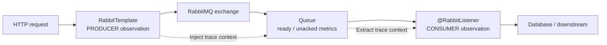
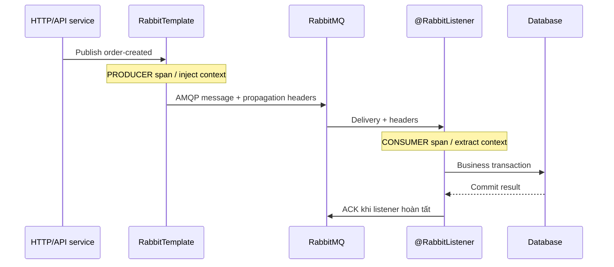
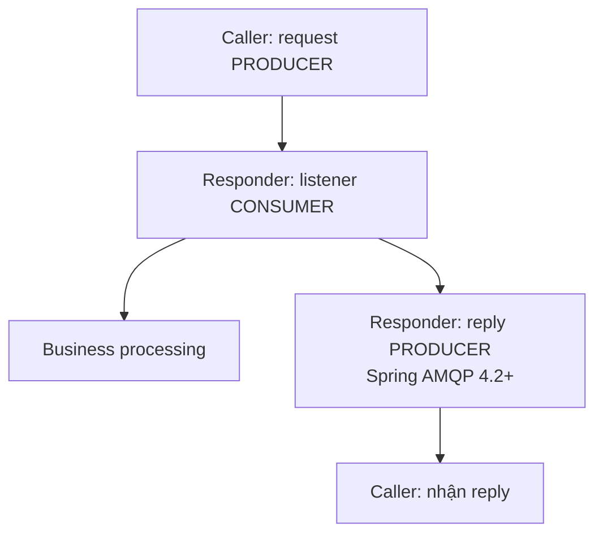

# Micrometer Observation và tracing theo phiên bản hỗ trợ

Ứng dụng xử lý message với Spring AMQP thường có đường đi **HTTP/API → `RabbitTemplate` → exchange → queue → `@RabbitListener` → database**. Khi xảy ra độ trễ hoặc message lỗi, việc chỉ nhìn log `"Received order"` không đủ để trả lời: publish có chậm không, listener xử lý bao lâu, event có bị redelivery không và đoạn nào của cùng một yêu cầu đã thất bại?

**Micrometer Observation** giúp mô tả một thao tác dưới dạng *observation* rồi chuyển nó thành **metric**, **trace/span** hoặc cả hai, tùy các handler và thư viện có trong ứng dụng. Trong Spring AMQP, việc bật Observation trên **publisher** và **listener container** giúp theo dõi hai đầu của một giao tiếp RabbitMQ mà không phải tự viết logic tạo span cho mọi message.

Bài học thuộc chương **Quan sát hệ thống** của module **SPRING_AMQP**, tập trung vào tích hợp Micrometer, distributed tracing và tương quan dữ liệu qua `RabbitTemplate`, `@RabbitListener`, exchange, queue, binding, ACK/NACK, retry và dead-letter. Một điểm quan trọng là **tính năng thay đổi theo phiên bản Spring AMQP và Spring Boot**: API Observation hiện đại không có trên mọi bản cũ, tên metric cũng khác với Timer legacy.

> **Phạm vi:** Phần chính trình bày Spring AMQP **3.0+** với RabbitMQ **AMQP 0-9-1** và `@RabbitListener` không-batch. Các phần về Streams, reply và Spring Boot 4.x có ghi rõ mốc phiên bản. Mã tham chiếu dùng Spring AMQP 3.2 / Spring Boot 3.5, Java 17+, trừ khi được chú thích khác.

## 1. Mục tiêu học tập

Sau bài này, bạn có thể:

1. Phân biệt **Micrometer Timer cũ**, **Micrometer Observation**, **metrics**, **distributed tracing** và **RabbitMQ broker metrics**.
2. Xác định các mốc Spring AMQP **2.2**, **3.0**, **3.0.5** và **4.2** liên quan tới khả năng quan sát.
3. Bật `observationEnabled` đúng chỗ trên `RabbitTemplate` và `SimpleRabbitListenerContainerFactory` / `DirectRabbitListenerContainerFactory`.
4. Cấu hình Spring Boot để đưa observation tới Prometheus và trace tới backend OpenTelemetry/Zipkin.
5. Giải thích cơ chế propagation: context được ghi vào **message headers** lúc publish và phục hồi khi listener nhận.
6. Đọc đúng các metric `spring.rabbit.listener`, `spring.rabbit.template`, phân biệt với `spring.rabbitmq.listener` legacy.
7. Thêm tag qua `RabbitListenerObservationConvention` / `RabbitTemplateObservationConvention` mà không gây nổ số series.
8. Hiểu các giới hạn của batch listener, asynchronous processing, retry, dead-letter và request–reply.
9. Thiết kế dashboard và tình huống thử nghiệm tìm nguyên nhân lỗi/độ trễ qua nhiều dịch vụ.

## 2. Bốn lớp quan sát nên phân biệt

| Lớp | Công cụ tiêu biểu | Trả lời câu hỏi nào? |
| --- | --- | --- |
| **Application logs** | SLF4J, Logback, MDC | Event nào được xử lý, ID nghiệp vụ, exception, quyết định retry? |
| **Application metrics** | Micrometer, Prometheus, Grafana | Listener tốn bao lâu, tỷ lệ lỗi, throughput và xu hướng p95/p99? |
| **Distributed traces** | Micrometer Tracing, OpenTelemetry/Brave, Jaeger/Tempo/Zipkin | Một request đi qua publisher, RabbitMQ, consumer và database như thế nào? |
| **Broker metrics** | RabbitMQ Management / Prometheus plugin | Queue depth, messages ready/unacked, consumer count, publish/deliver/ACK rate, channel/connection? |

**Observation** là API tích hợp. Khi được start/stop, nó có thể sinh timer cho hệ thống metrics và một span cho tracing. **Observation không tự động là một distributed trace đã được export**: phải có `ObservationRegistry`, observation handlers, tracer bridge, exporter, sampling và backend thực tế.

**Broker metrics không tự được bao phủ bởi Observation của Spring.** Ví dụ trace cho biết listener xử lý một message trong 180 ms; nó **không** tự cho biết message đó đã đợi 30 giây trong queue trước khi được broker giao. Muốn phân tích độ trễ end-to-end cần kết hợp timestamp nghiệp vụ, metrics queue và trace.



Producer và consumer có thể là hai JVM khác nhau. **Trace context** liên kết chúng dù mã listener chạy trên thread/host khác; nhưng broker vẫn quản lý delivery độc lập với việc ghi trace.

## 3. Bảng mốc phiên bản cần nhớ

| Phiên bản Spring AMQP | Khả năng liên quan | Ý nghĩa triển khai |
| --- | --- | --- |
| **Trước 2.2** | Chưa có tự động Micrometer listener Timer như các bản sau. | Quan sát chủ yếu qua logging, listener events và instrumentation riêng. |
| **2.2+** | Listener containers có **Micrometer Timer legacy** khi Micrometer và `MeterRegistry` phù hợp hiện diện. | Metric chính là `spring.rabbitmq.listener`. Đây **không phải** cơ chế Observation/trace propagation 3.0. |
| **3.0+** | **Micrometer Observation** cho `RabbitTemplate` và listener containers AMQP 0-9-1. | Bật `observationEnabled` ở template và container/factory; hỗ trợ metrics lẫn tracing khi cấu hình đủ. |
| **3.0.5+** | Observation cho `RabbitStreamTemplate` và stream listener container. | Có conventions/metric riêng `spring.rabbit.stream.*`; không áp dụng y hệt công tắc của RabbitTemplate. |
| **3.2+** | Sender context tách rõ **exchange** và **routingKey** trong các convention/semantic attributes. | Không đoán tag từ ví dụ 3.0 cũ; đối chiếu Javadoc/metric của bản đang chạy. |
| **4.0 / 4.1** | Tiếp tục Micrometer Observation cho nhánh Rabbit đã hỗ trợ; có thêm các module AMQP 1.0 riêng. | Không mặc định `RabbitAmqpTemplate` hoặc generic `AmqpClient` dùng đúng các API/cấu hình Observation của `RabbitTemplate` 0-9-1. |
| **4.2+** | **Listener reply message** có observation PRODUCER riêng khi đã bật Observation. | Reply span là con của listener CONSUMER span; trace context (ví dụ `traceparent`) được truyền sang reply. |

**Hai hệ version phải phân biệt:** bảng trên là **Spring AMQP**, không phải RabbitMQ broker. Spring Boot quản lý phiên bản Spring AMQP theo BOM; một ứng dụng dùng Boot 3.x và một ứng dụng Boot 4.x có dependency tracing và property khác nhau.

### 3.1 Micrometer Timer legacy từ 2.2

Khi có một `MeterRegistry` được chọn (ví dụ một registry bean hoặc một bean `@Primary`), listener container có thể tự đăng ký Timer legacy:

```text
spring.rabbitmq.listener
  listenerId = ...
  queue      = ...
  result     = success | failure
  exception  = none | ...
```

Với listener thông thường, thường có các Timer ghi nhận kết quả success/failure. Nếu muốn tắt loại Timer này ở bản có hỗ trợ, dùng `micrometerEnabled=false` trên container/factory.

**Đừng nhầm:** tên cũ có `rabbitmq` ở giữa, còn Observation hiện đại dùng `spring.rabbit.listener`. Việc upgrade và bật `observationEnabled` có thể làm dashboard truy vấn metric cũ không thấy dữ liệu mới.

### 3.2 Observation từ 3.0 không tự bật

Spring AMQP 3.0+ hỗ trợ API, nhưng **mặc định Observation không được bật** chỉ vì đã thêm `spring-boot-starter-actuator`. Trên từng component, `observationEnabled` phải được đặt thành `true` hoặc được cấu hình qua property Spring Boot tương thích.

Tài liệu Spring AMQP nói rõ: khi bật Observation, **Micrometer Timer legacy của component sẽ bị vô hiệu hóa**, vì metric/timer lúc này được quản lý qua Observation. Đừng kỳ vọng đồng thời có hai Timer legacy và Observation cho cùng một listener.

### 3.3 Những trường hợp đặc biệt

- **RabbitMQ Streams:** Observation của stream template/container bắt đầu từ **3.0.5**, với classes/conventions riêng.
- **Batch listener containers:** tài liệu Spring AMQP hiện ghi rõ **không tạo Observation cho batch listener container**, do cách gắn nhiều message/trace vào một batch không rõ ràng. Dù đặt `observationEnabled=true`, đừng mặc định sẽ có một span cho từng message trong `List<Message>`.
- **Request–reply:** từ **4.2** mới có observation PRODUCER tự động cho reply của listener như mô tả trong tài liệu. Ở bản cũ, có thể cần instrumentation bổ sung nếu muốn span reply tách biệt.
- **Module AMQP 1.0:** Spring AMQP 4.x có nhánh RabbitMQ-specific và generic riêng. Xác nhận API Micrometer của chính client/container đã chọn, không dùng ví dụ AMQP 0-9-1 như một bảo đảm chung.

## 4. Bật Observation cho RabbitTemplate và @RabbitListener

Với một ứng dụng Java cấu hình thủ công, cần bật riêng **đầu publish** và **đầu consume**.

### 4.1 Topology ví dụ: orders

Dùng exchange trực tiếp `orders.events.x`, routing key `orders.created` và queue `orders.created.q`:

```java
import org.springframework.amqp.core.Binding;
import org.springframework.amqp.core.BindingBuilder;
import org.springframework.amqp.core.DirectExchange;
import org.springframework.amqp.core.Queue;
import org.springframework.amqp.core.QueueBuilder;
import org.springframework.beans.factory.annotation.Qualifier;
import org.springframework.context.annotation.Bean;
import org.springframework.context.annotation.Configuration;

@Configuration
public class OrderTopology {
    public static final String EXCHANGE = "orders.events.x";
    public static final String QUEUE = "orders.created.q";
    public static final String ROUTING_KEY = "orders.created";

    @Bean
    DirectExchange ordersExchange() {
        return new DirectExchange(EXCHANGE);
    }

    @Bean
    Queue ordersQueue() {
        return QueueBuilder.durable(QUEUE).build();
    }

    @Bean
    Binding ordersBinding(
            @Qualifier("ordersQueue") Queue queue,
            @Qualifier("ordersExchange") DirectExchange exchange) {
        return BindingBuilder.bind(queue)
                .to(exchange)
                .with(ROUTING_KEY);
    }
}
```

Queue durable giúp giữ topology qua restart; còn độ tin cậy dữ liệu cần thêm persistent message, publisher confirms và chiến lược ACK/idempotency phù hợp. **Bật tracing không làm delivery trở nên bền vững.**

### 4.2 Tạo RabbitTemplate có Observation

```java
import org.springframework.amqp.rabbit.connection.ConnectionFactory;
import org.springframework.amqp.rabbit.core.RabbitTemplate;
import org.springframework.context.annotation.Bean;
import org.springframework.context.annotation.Configuration;

@Configuration
public class ObservedPublisherConfig {

    @Bean
    RabbitTemplate observedRabbitTemplate(
            ConnectionFactory connectionFactory) {

        var template = new RabbitTemplate(connectionFactory);
        template.setObservationEnabled(true);
        return template;
    }
}
```

Từ Spring AMQP **3.0**, `RabbitTemplate.setObservationEnabled(true)` cho phép framework tạo observation cho thao tác gửi. Khi có tracing bridge và propagator phù hợp, instrumentation có thể đưa tracing context vào header của message được publish.

**Chú ý:** đây là bean do ví dụ tự tạo, **không dùng đồng thời** với một RabbitTemplate auto-configured không có Observation nếu bạn vô tình inject bean khác. Với Spring Boot, cách đơn giản hơn là bật property ở mục 5 thay vì thay toàn bộ bean.

### 4.3 Bật ở SimpleRabbitListenerContainerFactory

```java
import org.springframework.amqp.core.AcknowledgeMode;
import org.springframework.amqp.rabbit.config.SimpleRabbitListenerContainerFactory;
import org.springframework.amqp.rabbit.connection.ConnectionFactory;
import org.springframework.context.annotation.Bean;
import org.springframework.context.annotation.Configuration;

@Configuration
public class ObservedConsumerConfig {

    @Bean
    SimpleRabbitListenerContainerFactory observedListenerFactory(
            ConnectionFactory connectionFactory) {

        var factory = new SimpleRabbitListenerContainerFactory();
        factory.setConnectionFactory(connectionFactory);

        factory.setObservationEnabled(true);
        factory.setAcknowledgeMode(AcknowledgeMode.AUTO);
        factory.setConcurrentConsumers(2);
        factory.setPrefetchCount(10);

        return factory;
    }
}
```

Nếu dùng `@RabbitListener`, phải bật `setObservationEnabled(true)` trên **factory mà annotation thực sự tham chiếu**. Chỉ bật ở một container khác không tạo Observation cho listener này.

Ví dụ listener:

```java
import org.springframework.amqp.rabbit.annotation.RabbitListener;
import org.springframework.stereotype.Component;

@Component
public class OrdersListener {
    private final OrdersService ordersService;

    public OrdersListener(OrdersService ordersService) {
        this.ordersService = ordersService;
    }

    @RabbitListener(
        id = "orders-created-consumer",
        queues = OrderTopology.QUEUE,
        containerFactory = "observedListenerFactory")
    public void handle(String json) {
        ordersService.processIdempotently(json);
    }
}
```

`OrdersService` là service nghiệp vụ do ứng dụng tự triển khai, nhận JSON và xử lý idempotent. Dùng listener `String` để minh họa thay vì giả định có converter JSON sang DTO. Với `AcknowledgeMode.AUTO`, listener thành công mới dẫn đến container ACK theo hợp đồng, còn lỗi đi vào chính sách xử lý retry/reject của container.

### 4.4 DirectRabbitListenerContainerFactory cũng hỗ trợ

Nếu dùng **DMLC**, đặt cùng công tắc trên `DirectRabbitListenerContainerFactory`:

```java
import org.springframework.amqp.rabbit.config.DirectRabbitListenerContainerFactory;
import org.springframework.amqp.rabbit.connection.ConnectionFactory;
import org.springframework.context.annotation.Bean;

@Bean
DirectRabbitListenerContainerFactory observedDirectFactory(
        ConnectionFactory connectionFactory) {

    var factory = new DirectRabbitListenerContainerFactory();
    factory.setConnectionFactory(connectionFactory);
    factory.setConsumersPerQueue(2);
    factory.setObservationEnabled(true);
    return factory;
}
```

SMLC dùng `concurrentConsumers` còn DMLC dùng `consumersPerQueue`, nhưng **cả hai đều có thể bật Observation từ Spring AMQP 3.0**. Hai ví dụ là lựa chọn thay thế, không cần cho hai listener cạnh tranh cùng queue chỉ để có traces.

## 5. Cấu hình Spring Boot không cần thay bean

Với Spring Boot dòng **3.2–3.5** và hệ AMQP tương thích, có các property trực tiếp cho template và container. Ví dụ:

```yaml
spring:
  application:
    name: orders-service
  rabbitmq:
    template:
      observation-enabled: true
    listener:
      type: simple
      simple:
        observation-enabled: true

management:
  tracing:
    sampling:
      probability: 1.0
  endpoints:
    web:
      exposure:
        include: health,info,metrics,prometheus
```

Giải thích:

- `spring.rabbitmq.template.observation-enabled=true` bật Observation cho **RabbitTemplate được Boot auto-configure**.
- `spring.rabbitmq.listener.simple.observation-enabled=true` bật Observation cho factory SMLC do Boot cấu hình. Nếu `listener.type=direct`, dùng `spring.rabbitmq.listener.direct.observation-enabled=true`.
- Property được mô tả cho listener stream là `spring.rabbitmq.listener.stream.observation-enabled` trên nhánh Boot có tích hợp Streams.
- `management.tracing.sampling.probability=1.0` dùng cho **môi trường thử nghiệm** để thấy mọi trace. Trong production chọn tỷ lệ sampling theo tải, chi phí và yêu cầu điều tra.
- Endpoint `/actuator/prometheus` chỉ có khi thư viện Prometheus registry được cài và endpoint được expose; cấu hình này **không** tự cài thư viện xuất metrics.

Nếu đang tạo **custom factory** và annotation chỉ rõ `containerFactory="observedListenerFactory"`, những Boot property áp cho **factory mặc định** không tự sửa toàn bộ custom factory. Đảm bảo custom factory tự bật Observation và dùng đúng `ObservationRegistry` do application context cung cấp.

### 5.1 Dependency cho Spring Boot 3.5 và OpenTelemetry/OTLP

Một ví dụ Gradle với dependency versions do Spring Boot BOM quản lý:

```gradle
dependencies {
    implementation("org.springframework.boot:spring-boot-starter-amqp")
    implementation("org.springframework.boot:spring-boot-starter-actuator")

    // Metrics về Prometheus:
    runtimeOnly("io.micrometer:micrometer-registry-prometheus")

    // Tracing Micrometer -> OpenTelemetry:
    implementation("io.micrometer:micrometer-tracing-bridge-otel")

    // Export traces bằng OTLP tới Collector/Tempo/Jaeger tương thích:
    runtimeOnly("io.opentelemetry:opentelemetry-exporter-otlp")
}
```

Cần cấu hình endpoint OTLP phù hợp với backend; ở Boot 3.5, xem nhóm property `management.otlp.tracing.*`. Nếu chưa có Collector hoặc exporter đang lỗi, instrumentation vẫn có thể tạo Observation nhưng **trace có thể không xuất hiện trên giao diện quan sát**.

**Trên Spring Boot 4.0+**, tên starter/tracing auto-configuration thay đổi. Tài liệu Boot 4 giới thiệu **`org.springframework.boot:spring-boot-starter-opentelemetry`** để cấu hình OpenTelemetry + OTLP thuận tiện, với properties nhóm `management.opentelemetry.tracing.export.otlp.*`. Không trộn máy móc các artifact và tên property của Boot 3.5 với Boot 4 trong cùng ví dụ.

### 5.2 Cơ chế ObservationRegistry

Spring Boot Actuator thường auto-configure một `ObservationRegistry` cùng các handler cần thiết. Framework dùng registry đó để thu nhận và xử lý Observation.

Ở ứng dụng thuần Spring không dùng Boot, có thể tạo một `ObservationRegistry` bằng API Micrometer, nhưng **chỉ tạo registry rỗng không tự có tracing**. Muốn ghi metrics/traces cần đăng ký `MeterObservationHandler`, `TracingObservationHandler` hoặc dùng auto-configuration thích hợp và exporter. Vì thế trong phần thực hành, ưu tiên cấu hình Actuator và tracing bridge thay vì tự ráp từng handler.

## 6. Distributed tracing đi qua RabbitMQ như thế nào?

Một trace có thể đi qua nhiều JVM nhờ **propagator** ghi và đọc context bằng message headers. Với publisher/consumer Observation được bật và tracer bridge tương thích:

1. API nhận HTTP request có observation/span hiện hành.
2. `RabbitTemplate` tạo **send/producer observation**, lấy context hiện hành và inject các giá trị propagation vào message headers trước khi publish.
3. RabbitMQ định tuyến bản message; broker **không cần hiểu ý nghĩa trace ID**.
4. Listener container nhận message, extract context từ headers rồi tạo **receive/consumer observation**, nối vào trace hoặc thiết lập liên hệ theo convention của tracing bridge.
5. Business service có thể tạo các child observations/spans khi thực thi DB hoặc HTTP downstream.
6. Khi listener hoàn tất, span kết thúc, còn ACK được xử lý theo listener/container contract.



**Không mặc định header luôn phải mang đúng tên `traceparent`.** Với W3C Trace Context, một header thường là `traceparent`; với B3 hoặc propagator khác, tên header có thể là `b3` hoặc nhóm headers khác. Cấu hình ở cả producer và consumer phải tương thích. Chọn một chuẩn propagation cho hệ thống và kiểm tra bằng message test.

### 6.1 Trace ID khác event ID và correlation ID

| ID | Mục đích chính | Có nên dùng làm khóa idempotency? |
| --- | --- | --- |
| **Trace ID** | Ghép nhiều spans thành một hành trình phân tán. | **Không.** Một trace có thể chứa nhiều event, sampling/replay khác nhau. |
| **Span ID** | Định danh một thao tác đo thời gian trong trace. | **Không.** Mỗi lần chạy lại có thể tạo span mới. |
| **Event ID** | Định danh một sự kiện nghiệp vụ ổn định qua re-delivery/re-publish. | **Có**, nếu producer cam kết stable ID và business contract. |
| **Correlation ID** | Ghép request/reply hoặc tương quan luồng nghiệp vụ. | Tùy hợp đồng; không mặc nhiên ổn định làm khóa chống trùng. |
| **Delivery tag** | Xác nhận message trên một AMQP channel. | **Không.** Không tồn tại như business ID toàn cục. |

Nếu một event được retry hai lần, bạn có thể thấy **nhiều consumer spans**. Đó là điều bình thường khi có at-least-once delivery; không suy ra có hai business effects thành công. Để biết idempotency hoạt động, theo dõi marker DB hoặc metric `duplicate_skipped_total` của ứng dụng.

### 6.2 Nếu chỉ thấy span producer hoặc chỉ thấy span consumer

Các nguyên nhân phổ biến:

- Publisher đã bật Observation nhưng listener factory **chưa** bật, hoặc ngược lại.
- Có bridge/exporter ở một service nhưng service còn lại chưa cài.
- Tracer/sampling đang bỏ qua một span; tỷ lệ mẫu dưới 100%.
- Consumer nhận message do publisher ngoài Spring AMQP tạo, **không** có headers tracing hoặc dùng propagator khác.
- Custom message post-processor, retry/DLX tooling hoặc bridge đã sửa/xóa headers propagation.
- Listener thực tế chạy trên factory không phải factory đã bật Observation.
- Thread nhảy sang executor/reactive pipeline mà **context không được propagate**, tạo trace bị tách.
- Endpoint exporter/Collector đang lỗi, nên span được tạo nhưng không xuất đi.

Khi điều tra, kiểm tra **headers thật của message test**, runtime bean configurations, giá trị sampling, log của tracing exporter và trace backend trước khi sửa mã business.

## 7. Đọc metric đúng: Timer cũ và Observation metric

Khi bật Observation trên nhánh AMQP 0-9-1, Spring AMQP cung cấp tên instrument như sau:

| Instrument | Tên | Loại | Cần đọc thế nào? |
| --- | --- | --- | --- |
| **Listener Observation timer** | `spring.rabbit.listener` | Timer | Độ dài một lần nhận/xử lý listener có Observation. |
| **Listener active** | `spring.rabbit.listener.active` | Long task timer | Theo dõi thao tác đang hoạt động. |
| **Template Observation timer** | `spring.rabbit.template` | Timer | Thời gian thao tác `RabbitTemplate` được instrument. |
| **Template active** | `spring.rabbit.template.active` | Long task timer | Theo dõi thao tác template đang hoạt động. |
| **Listener Timer legacy** | `spring.rabbitmq.listener` | Timer | Metric của listener khi dùng Micrometer timer cũ, không phải Observation. |

Tên trong code Micrometer có dấu chấm; **Prometheus thường chuyển thành các time series như `spring_rabbit_listener_seconds_count`, `spring_rabbit_listener_seconds_sum`** (tên chính xác phụ thuộc registry và distribution config). Không truy vấn nhầm `spring_rabbitmq_listener...` khi đã chuyển sang Observation.

Các low-cardinality keys mặc định từ Micrometer semantic documentation:

| Observation | Low-cardinality tags tiêu biểu |
| --- | --- |
| `spring.rabbit.listener` | `messaging.destination.name` (queue), `spring.rabbit.listener.id`. |
| `spring.rabbit.template` | `messaging.destination.name` (exchange), `messaging.rabbitmq.destination.routing_key`, `spring.rabbit.template.name`. |
| `spring.rabbit.stream.listener` | `spring.rabbit.stream.listener.id`. |
| `spring.rabbit.stream.template` | `spring.rabbit.stream.template.name`. |

**Cẩn thận:** các tên và keys này phụ thuộc tài liệu phiên bản. Các integration AMQP 1.0 mới có thể có instrument conventions khác. Hãy so với `/actuator/metrics` hoặc scrape Prometheus thực tế trước khi viết dashboard.

### 7.1 Metric timer không thay thế business SLI

Một `RabbitTemplate` observation kết thúc khi lời gọi publish kết thúc; nó **không tự chứng minh** broker đã ghi durable message hoặc consumer đã xử lý. Cần thêm:

- Publisher confirms (ACK/NACK từ broker cho publisher) và returns cho unroutable message.
- Consumer success/failure count theo nghiệp vụ, không chỉ số lần listener được gọi.
- Queue ready/unacked, age of oldest message, DLQ depth và redelivery từ broker.
- End-to-end business latency dựa trên timestamp/event ID và trạng thái hoàn tất.

Ví dụ: `spring.rabbit.template` p95 = 5 ms không đồng nghĩa hệ thống xử lý đơn hàng trong 5 ms nếu message chờ 40 giây trong queue.

### 7.2 Query minh họa với Prometheus

Nếu export các timers theo chuẩn Prometheus (và ứng dụng có đủ traffic):

```promql
# Tốc độ gọi listener (lần/giây) xấp xỉ:
sum(rate(spring_rabbit_listener_seconds_count[5m]))

# Thời gian trung bình listener trong cửa sổ 5 phút:
sum(rate(spring_rabbit_listener_seconds_sum[5m]))
/
sum(rate(spring_rabbit_listener_seconds_count[5m]))
```

Đây là **metric tổng hợp**, không phải latency của một event cụ thể. Tính p95 cần histogram/percentiles phù hợp và tên series `_bucket` thực tế; không suy ra p95 chỉ từ `_sum / _count`. Lưu ý instrument name trong Micrometer có thể được Prometheus registry chuẩn hóa khác nhau theo version/export configuration.

## 8. Tùy biến RabbitListenerObservationConvention mà không gây cardinality explosion

Từ Spring AMQP 3.0, bạn có thể cung cấp convention riêng cho template hoặc listener:

- `RabbitTemplateObservationConvention` dùng cho producer/template.
- `RabbitListenerObservationConvention` dùng cho consumer/listener.
- Có sẵn các default convention class ở package `org.springframework.amqp.rabbit.support.micrometer`.

Để thêm một tag **giá trị hữu hạn**, ví dụ tên domain operation, có thể kế thừa default listener convention:

```java
import io.micrometer.common.KeyValue;
import io.micrometer.common.KeyValues;
import org.springframework.amqp.rabbit.support.micrometer.RabbitListenerObservation;
import org.springframework.amqp.rabbit.support.micrometer.RabbitMessageReceiverContext;

public class OrdersObservationConvention extends
        RabbitListenerObservation.DefaultRabbitListenerObservationConvention {

    @Override
    public KeyValues getLowCardinalityKeyValues(
            RabbitMessageReceiverContext context) {
        return super.getLowCardinalityKeyValues(context)
                .and(KeyValue.of("business.operation", "order-created"));
    }
}
```

Áp dụng trên factory:

```java
factory.setObservationEnabled(true);
factory.setObservationConvention(new OrdersObservationConvention());
```

Nếu chỉ cần gắn nhãn theo `operation` và có **ít giá trị ổn định**, low-cardinality tag phù hợp cho metrics và tracing. Mỗi distinct combination của tag làm tăng số time series, nên:

**Không đưa `eventId`, `orderId`, user ID, email, full URL, timestamp hoặc message payload làm low-cardinality metric tag.** Một triệu event ID khác nhau có thể tạo hàng triệu chuỗi time series, làm Prometheus/registry tốn RAM và gây chi phí cao.

Thông tin định danh từng event, nếu thực sự cần cho điều tra, nên nằm ở **structured log, span attribute high-cardinality có kiểm soát, hoặc business audit table**, theo chính sách privacy và retention. Đừng đưa dữ liệu nhạy cảm lên tracing backend không được phép lưu.

### 8.1 Dùng high-cardinality tag có điều kiện

Observation tách **low-cardinality key values** (thường dùng trong metrics và spans) và **high-cardinality key values** (thường dành cho spans). Tuy nhiên, "high-cardinality" không đồng nghĩa được phép thêm mọi nội dung: tracing vẫn có giới hạn kích thước, sampling, retention và yêu cầu bảo vệ dữ liệu. Với event ID có thể dùng trong log/trace khi cần, nhưng không mặc định log toàn bộ payload.

### 8.2 Tùy biến template

Tương tự, có thể sử dụng `RabbitTemplateObservationConvention` hoặc kế thừa `RabbitTemplateObservation.DefaultRabbitTemplateObservationConvention`, sau đó gọi `template.setObservationConvention(customConvention)`. Nếu ứng dụng Spring Boot đã cung cấp bean convention và Boot tự gắn vào template, không cần tùy biến lại trùng lặp.

## 9. Đo thêm một bước nghiệp vụ bằng ObservationRegistry

Observation tích hợp sẵn theo dõi publish và listener, nhưng nhiều hệ thống muốn phân biệt thời gian kiểm tra dữ liệu, gọi API downstream, hoặc ghi database. Có thể tạo **observation con** trong method listener:

```java
import io.micrometer.observation.Observation;
import io.micrometer.observation.ObservationRegistry;
import org.springframework.stereotype.Service;

@Service
public class OrdersService {

    private final ObservationRegistry observationRegistry;
    private final OrderRepository repository;

    public OrdersService(
            ObservationRegistry observationRegistry,
            OrderRepository repository) {
        this.observationRegistry = observationRegistry;
        this.repository = repository;
    }

    public void processIdempotently(String orderJson) {
        Observation.createNotStarted(
                    "orders.persist", observationRegistry)
                .lowCardinalityKeyValue("operation", "persist")
                .observe(() -> repository.saveIfNew(orderJson));
    }
}
```

`OrderRepository.saveIfNew(...)` là phương thức nghiệp vụ **minh họa**, cần được triển khai với unique constraint/inbox/transaction. Mã tạo observation con nhờ sử dụng cùng `ObservationRegistry`; khi đang có consumer observation là parent, tracer handler có thể ghi nhận bước `orders.persist` trong cùng trace.

Một observation đo mã chạy **không làm câu lệnh SQL trở nên idempotent** hoặc atomic. Muốn đo cả thời gian message chờ trong queue, hãy ghi timestamp publish trong event metadata, rồi tính độ trễ khi nhận; phân biệt clock skew giữa máy producer và consumer.

## 10. Retry, ACK/NACK, dead-letter và giới hạn trace

### 10.1 Khi một message được giao lại

Giả sử consumer xử lý event E-100, database commit thành công nhưng ACK chưa tới RabbitMQ vì connection mất. Broker có thể giao lại message đó:

```text
Delivery 1: eventId=E-100 -> consumer span A
    DB COMMIT thành công
    mất connection trước ACK

Delivery 2: eventId=E-100 -> consumer span B
    idempotency marker đã có -> no-op
    ACK bình thường
```

Có thể quan sát **hai spans** cho hai lần delivery. Điều này là hành vi đúng của at-least-once transport, không chứng minh nghiệp vụ được commit hai lần. Kết luận về duplicate business effect phải dựa vào event ID/DB marker và invariant.

Khi dùng Spring Retry trong cùng lời gọi listener (retry advice), những lần thử có thể nằm **trong cùng một consumer observation**; khi broker requeue/redeliver, thường là **lần consume mới**. Không tự lấy số span làm chính xác số attempt nghiệp vụ.

### 10.2 NACK và DLQ không tự tạo một trace mới liên tục

Message bị reject không requeue có thể được RabbitMQ dead-letter tới DLQ; đây là một bước do **broker** thực hiện. Spring AMQP listener observation không phải lúc nào cũng tạo một producer span riêng cho động tác dead-letter nội bộ của broker.

Khi có một DLQ listener, nó có thể tạo observation cho delivery từ DLQ. Trace context header có thể còn theo message, nhưng độ liên kết chính xác phụ thuộc broker republishing, chính sách headers, tracer propagator và triển khai retry. Tránh khẳng định mọi đường DLX đều giữ nguyên một chuỗi parent-child hoàn hảo.

**Cần metric riêng** cho `dead_lettered_total`/DLQ depth và phân loại nguyên nhân lỗi, bên cạnh trace để điều tra từng case.

### 10.3 Lỗi dữ liệu cần log nhưng không phải retry vô hạn

Ví dụ listener parse JSON thất bại. Observation thường ghi nhận kết quả có exception; nhưng nếu handler giữ `defaultRequeueRejected=true` và cứ requeue, queue có thể lặp lỗi nóng. Tracing không phải policy xử lý lỗi. Chọn retry giới hạn/backoff, reject vào DLQ hoặc quarantine, và thêm các metric:

| Metric nghiệp vụ | Mục đích |
| --- | --- |
| `events_processed_total` | Số event hoàn tất thành công, không phải số deliveries. |
| `events_duplicate_skipped_total` | Lần replay được dedup an toàn. |
| `events_failed_total{reason=...}` | Lỗi theo danh mục hữu hạn, không dùng message text làm tag. |
| `events_dead_lettered_total` | Số message bị cách ly/kết thúc retry, nên đối chiếu broker. |
| `events_processing_lag_seconds` | Chênh thời gian từ publish đến business commit, nếu timestamp đáng tin. |

Đây là **metric đề xuất do ứng dụng tự định nghĩa**, không phải những metric mặc định Spring AMQP tạo.

## 11. Batch listener: giới hạn phải nêu rõ

Đây là ngoại lệ quan trọng:

> Theo tài liệu Spring AMQP, **Observation không được tạo cho Batch Listener Containers** do chưa rõ cách gắn quan hệ trace cho lô chứa nhiều message.

Ví dụ:

```java
factory.setBatchListener(true);
factory.setConsumerBatchEnabled(true);
factory.setBatchSize(20);
factory.setObservationEnabled(true);

@RabbitListener(
    queues = "orders.created.q",
    containerFactory = "batchListenerFactory")
public void onBatch(java.util.List<String> batch) {
    // Không suy ra rằng framework sẽ tạo 20 consumer spans.
}
```

Lô 20 message có thể mang **20 trace contexts khác nhau**. Tạo một span có một parent duy nhất cho tất cả message là không chính xác về nhân quả; việc tự chọn parent đầu tiên còn có thể gây hiểu nhầm cho những message khác.

### Các lựa chọn quan sát batch có kiểm soát

1. Ghi **metric mức lô** như `batch_size`, `batch_duration` và lỗi/partial batch; dùng tag hữu hạn như tên listener hoặc queue.
2. Ghi **structured log theo event ID** từng phần tử khi cần audit/troubleshooting.
3. Nếu cần tracing từng phần tử, cân nhắc xử lý từng message bằng listener thường; hoặc tự xây tracing theo **span links** (khi tracing library hỗ trợ) để biểu diễn nhiều input contexts, thay vì gán một parent sai.
4. Không cho rằng bật `observationEnabled=true` xóa được khoảng trống trace này.
5. Với message producer-created batch đã de-batch, phải xác định dữ liệu đầu vào có mấy message vật lý và bao nhiêu payload logic trước khi diễn giải số span.

## 12. RabbitMQ Streams có Observation riêng từ 3.0.5

Với **`RabbitStreamTemplate`** và **StreamListenerContainer** của `spring-rabbit-stream`, Spring AMQP hỗ trợ Observation **từ 3.0.5**. Trên cả template và stream listener container/factory, bật `observationEnabled` tương ứng.

Các instrument riêng:

| Thành phần | Timer | Long task timer |
| --- | --- | --- |
| Stream listener | `spring.rabbit.stream.listener` | `spring.rabbit.stream.listener.active` |
| Stream template | `spring.rabbit.stream.template` | `spring.rabbit.stream.template.active` |

Tuỳ biến convention qua `RabbitStreamTemplateObservationConvention` và `RabbitStreamListenerObservationConvention`.

**Không coi stream offset là delivery tag AMQP 0-9-1**. Stream dùng cơ chế đọc/replay và lưu offset; một span thành công không đồng nghĩa offset đã lưu bền vững hoặc message bị xóa khỏi stream. Khi replay một offset, cùng business record có thể tạo thêm consumer observation; vẫn cần idempotency.

Nếu đang ở **Spring AMQP 3.0.0–3.0.4**, `RabbitTemplate`/AMQP listener có Observation nhưng **stream-specific Observation** chưa được công bố tới **3.0.5**. Đây là lý do phải kiểm tra **patch version**, không chỉ major/minor.

## 13. Request–reply: thay đổi quan trọng từ 4.2

Trong RPC qua `RabbitTemplate.convertSendAndReceive(...)`, có request được gửi và reply trả về. Đầu vào listener có thể tạo **CONSUMER observation**. Nhưng trước Spring AMQP 4.2, không nên mặc định có một **reply PRODUCER span** riêng biệt do framework tạo.

**Từ Spring AMQP 4.2**, listener reply message được quan sát bằng `RabbitTemplateObservation.TEMPLATE_OBSERVATION` khi Observation được bật. Reply PRODUCER observation là **con của listener CONSUMER observation**; tracing context như `traceparent` được truyền vào reply.



Đây là cải tiến **theo phiên bản**, không có nghĩa mọi phiên bản hoặc mọi listener RPC sẽ tự tạo đủ span với cùng cây quan hệ. Khi kiểm thử:

- Bật Observation trên cả request publisher và responder listener factory.
- Dùng tracer bridge/propagator tương thích.
- Xác minh reply headers, trace ở backend và các trường hợp timeout/late reply.
- Đừng để `correlationId` dùng cho RPC bị nhầm với `traceId`.
- Không dùng tracing làm thay thế timeout, idempotency hoặc kiểm soát reply queue.

## 14. Logging correlation và context khi chuyển thread

Trong luồng đồng bộ đơn giản, Micrometer Tracing có thể đưa trace ID/span ID vào MDC/log pattern qua tích hợp framework. Cách này giúp lọc log các dịch vụ theo trace ID.

Tuy nhiên, **trace context thường gắn với scope/thread hiện tại**. Nếu listener giao việc sang một thread tự tạo, `ExecutorService` hoặc callback bất đồng bộ mà không thiết lập context propagation, các log và spans trong tác vụ mới có thể mất parent context.

Ví dụ sai mô hình:

```java
@RabbitListener(queues = "orders.created.q")
public void receive(String event) {
    new Thread(() -> process(event)).start();
    // Listener đã trả về; AUTO ACK có thể xảy ra trước khi process hoàn tất.
}
```

Vấn đề ở đây gồm **hai lớp**, không chỉ tracing:

- Context/span có thể mất khi đổi thread.
- `AcknowledgeMode.AUTO` có thể ACK khi listener kết thúc trong khi tác vụ bất đồng bộ còn chưa lưu nghiệp vụ.

Giải pháp phải đồng thời bảo đảm **propagation** và **ACK đúng sau khi công việc bền vững**. Cân nhắc dùng các cơ chế listener async được framework hỗ trợ, `ContextSnapshot`/Micrometer Context Propagation hoặc executor được instrument, cộng transaction và idempotency. Không bọc mỗi Runnable bằng một trace scope rồi coi việc ACK đã an toàn.

Với reactive pipelines, cần kiểm tra Reactor context propagation và cách Observation scope được mở/đóng theo phiên bản. Đừng dùng ThreadLocal của imperative code như giả định cố định trong toàn pipeline reactive.

## 15. Dashboard và SLI nên có khi vận hành

Một dashboard hữu ích không chỉ vẽ timer. Nó phải ghép **hệ thống broker** với **hệ thống nghiệp vụ**:

| Góc nhìn | Chỉ số nên theo dõi | Hành động khi xấu đi |
| --- | --- | --- |
| Producer | Rate publish, lỗi publish, confirm latency, returns/unroutable | Kiểm tra broker, retry/outbox, routing key. |
| Queue | `messages_ready`, `messages_unacknowledged`, consumer count | Phân biệt backlog do tải cao, consumer thiếu hay processing chậm. |
| Listener | `spring.rabbit.listener` count/latency/error, active tasks | Tìm listener/chức năng chậm, exception và bottleneck downstream. |
| Retry/DLQ | Redelivery rate, DLQ depth, age of oldest DLQ | Phân loại lỗi permanent vs transient, tránh vòng lặp. |
| Business | Successful event count, processing lag, duplicate skipped | Kiểm tra SLO đầu-cuối và at-least-once business effect. |
| Tracing | Trace qua API → publisher → consumer → DB, missing parent links | Phát hiện thiếu instrumentation, context propagation hoặc exporter. |
| Tài nguyên | CPU, JVM heap, GC, DB pool, network, consumer concurrency | Xác định nguyên nhân throughput không tăng. |

Ví dụ diễn giải:

- **Queue ready tăng, listener p95 bình thường, consumer count thấp:** kiểm tra thiếu consumer hoặc concurrency.
- **Queue unacked tăng, listener p95 tăng mạnh:** downstream/DB hoặc ACK chậm; thêm consumer chưa chắc giúp.
- **Template p95 bình thường nhưng confirm latency tăng:** publish API không phản ánh toàn bộ độ bền broker; kiểm tra confirms.
- **Nhiều consumer spans cùng event ID nhưng business count không tăng tương ứng:** hệ thống có thể đang redelivery/retry; kiểm tra dedup marker.
- **Trace thiếu đoạn consumer, dù broker delivered messages:** kiểm tra factory Observation, propagation headers và sampling.

Đừng đưa queue/payload chứa dữ liệu nhạy cảm lên dashboard hoặc logs công khai. Retention của metrics/traces và quyền truy cập tracing backend cũng là một phần vận hành.

## 16. Thực hành kiểm chứng từng lớp

### Thí nghiệm A — baseline legacy Timer và Observation

1. Chạy ứng dụng Spring AMQP **3.2** có Micrometer và `MeterRegistry` nhưng chưa bật Observation.
2. Gửi 20 message; kiểm tra legacy metric `spring.rabbitmq.listener` nếu timer được kích hoạt theo cấu hình.
3. Bật `spring.rabbitmq.template.observation-enabled=true` và `spring.rabbitmq.listener.simple.observation-enabled=true`.
4. Kiểm tra `spring.rabbit.template`, `spring.rabbit.listener` và các tags.
5. So sánh với legacy: lý giải vì sao Timer cũ không còn xuất hiện cho cùng component khi chuyển sang Observation.

**Kết quả mong đợi:** có tên instrument của Observation, không cộng dồn trùng Timer legacy; listener thực sự dùng factory đã được bật.

### Thí nghiệm B — trace xuyên hai dịch vụ

1. Service A nhận HTTP rồi publish vào `orders.events.x` qua RabbitTemplate đã bật Observation.
2. Service B nhận message bằng `@RabbitListener` của factory có `observationEnabled=true`.
3. Cài Micrometer Tracing + OpenTelemetry bridge và exporter theo version Boot, chạy Collector/Tempo/Jaeger hoặc backend tương thích.
4. Đặt `management.tracing.sampling.probability=1.0` **chỉ trong test**.
5. Gửi một request, xem trace có producer/consumer spans liên quan không.
6. Kiểm tra message headers chứa propagation context; so sánh `traceId` với `eventId`.

### Thí nghiệm C — tắt một đầu instrumentation

Tắt Observation riêng ở publisher hoặc consumer. Gửi lại request, xem trace có bị mất một span hoặc trở thành trace rời rạc không. Bật lại và xác minh. Thử một publisher ngoài Spring không inject tracing headers để học cách consumer hình thành context khi không có parent.

### Thí nghiệm D — redelivery và idempotency

Cố tình làm listener throw exception ở một event test, cấu hình retry giới hạn/backoff và DLQ. Quan sát số consumer spans/retry logs. Sau đó thử crash sau DB commit nhưng trước ACK trong môi trường cách ly, dùng event ID và unique constraint để bảo đảm không tạo business effect trùng.

**Giải thích:** trace theo từng delivery khác với số sự kiện nghiệp vụ được ghi bền vững.

### Thí nghiệm E — batch listener

Bật `consumerBatchEnabled=true` và `batchListener=true` cho một listener nhận danh sách. Quan sát metric/tracing; đối chiếu giới hạn batch Observation trong tài liệu. Tự ghi `batch_size` và `batch_processing_duration` trong application metrics thay vì chờ framework tạo span cho từng record.

### Thí nghiệm F — phiên bản Stream 3.0.4 so với 3.0.5+

Trong một project thử nghiệm riêng, đối chiếu tài liệu/API stream Observation ở **3.0.4** và **3.0.5**. Nếu nâng phiên bản, bật Observation trên `RabbitStreamTemplate` và stream listener container, kiểm tra các tên `spring.rabbit.stream.*`. Không áp dụng nhầm metric queue `spring.rabbit.listener` cho stream protocol.

### Thí nghiệm G — reply trace ở 4.2

Với Spring AMQP 4.2+, làm request–reply qua `RabbitTemplate`/`@RabbitListener`. Quan sát reply PRODUCER span là con của listener CONSUMER span; kiểm tra reply propagation header. Ở bản trước đó, ghi nhận khác biệt thay vì tự suy đoán.

## 17. Những lỗi thường gặp

| Triệu chứng | Nguyên nhân có thể | Cách sửa |
| --- | --- | --- |
| Có Actuator nhưng không thấy trace AMQP | `observationEnabled` vẫn false trên template/listener. | Bật cả hai đúng bean/factory. |
| Có Observation timers nhưng không có trace trên backend | Chưa cài Micrometer Tracing bridge, exporter, sampling hoặc backend chưa nhận dữ liệu. | Kiểm tra dependency, endpoint và exporter logs. |
| Chỉ thấy `spring.rabbitmq.listener` | Đang dùng legacy Micrometer Timer. | Xác định version; bật Observation trên 3.0+ để có `spring.rabbit.listener`. |
| Dashboard metric cũ trống sau upgrade | Tên/tag đã đổi từ Timer legacy sang Observation. | Sửa query/dashboard, kiểm chứng ở `/actuator/metrics`. |
| Trace producer và consumer tách rời | Thiếu propagation headers hoặc cấu hình propagator khác nhau. | Kiểm tra headers W3C/B3, converter/post-processor và auto config. |
| Custom listener không có trace | Listener tham chiếu factory khác factory đã bật. | Đối chiếu `containerFactory` và bean đang chạy. |
| Batch listener không tạo spans như kỳ vọng | Spring AMQP không tạo Observation cho Batch Listener Containers. | Dùng batch metrics/logs hoặc instrumentation có span links. |
| Tăng độ phân giải metrics làm Prometheus quá tải | Tag chứa eventId/orderId/user ID. | Dùng low-cardinality tags hữu hạn; ID ở logs/traces có kiểm soát. |
| Có nhiều spans cho một event | Message được replay/requeue/republish. | Dùng event ID và idempotency, xem delivery/retry history. |
| Trace đẹp nhưng event vẫn mất | Tracing không thay thế publisher confirms, ACK hoặc durable queue. | Cấu hình delivery reliability riêng. |
| Không thấy span con khi xử lý async | Context không được propagate sang thread/reactive context. | Dùng context propagation và ACK theo completion. |
| Không có `spring.rabbit.stream.*` ở AMQP 3.0.4 | Tính năng stream Observation bắt đầu từ 3.0.5. | Nâng phiên bản nếu cần. |
| Reply không có PRODUCER span ở bản cũ | Khả năng reply observation tự động mới được mô tả từ 4.2. | Kiểm tra version hoặc tự instrument bổ sung. |
| Dùng property Boot 3.5 cho Boot 4 nhưng không có hiệu lực | Tracing starter/export properties đã thay đổi. | Đối chiếu Boot BOM và reference đúng dòng. |

## 18. Ghi nhớ cốt lõi

- **Spring AMQP 2.2** cung cấp Micrometer **listener Timer legacy**; **3.0** bổ sung Micrometer **Observation** cho `RabbitTemplate` và listener, cần bật `observationEnabled`.
- **Khi bật Observation, legacy Timer của component không còn được tạo như trước.** Tên metric mới là `spring.rabbit.listener` và `spring.rabbit.template`; không nhầm với `spring.rabbitmq.listener`.
- **Observation muốn thành distributed tracing phải có Micrometer Tracing bridge, context propagation, sampler và exporter/backend**. Chỉ cài Actuator hoặc gọi `setObservationEnabled(true)` chưa bảo đảm trace hiển thị.
- **RabbitMQ Streams có Observation từ 3.0.5** với `spring.rabbit.stream.*`; **reply PRODUCER observation từ 4.2** khi được bật.
- **Batch Listener Containers không tạo Observation tự động** theo tài liệu Spring AMQP. Nếu cần metrics cho batch, phải đo phù hợp; tracing nhiều context đầu vào cần thiết kế kỹ.
- **Trace ID không thay event ID**. Tracing không bảo đảm exactly-once, không xác nhận publish durability và không thay queue/ACK/DLQ metrics.
- **Thiết kế dashboard nối application + broker + business:** queue lag, consumer timing, retry/DLQ, publisher confirms và business completion cần được nhìn cùng nhau.

## Tài liệu tham khảo

- [Spring AMQP — Micrometer Observation](https://docs.spring.io/spring-amqp/reference/4.2/amqp/receiving-messages/micrometer-observation.html): bật Observation từ 3.0, convention, batch limitation và reply tracing 4.2.
- [Spring AMQP — Micrometer Integration](https://docs.spring.io/spring-amqp/reference/amqp/receiving-messages/micrometer.html): Micrometer Timer legacy từ 2.2, tên `spring.rabbitmq.listener` và tags.
- [Spring AMQP — Micrometer Observation Documentation](https://docs.spring.io/spring-amqp/reference/appendix/micrometer.html): tên metric/span, timer và low-cardinality key values.
- [Spring AMQP — Using the RabbitMQ Stream Plugin](https://docs.spring.io/spring-amqp/reference/stream.html): Streams Observation từ 3.0.5, conventions riêng.
- [Spring AMQP — Changes in 3.0 Since 2.4](https://docs.spring.io/spring-amqp/reference/4.0/appendix/previous-whats-new/changes-in-3-0-since-2-4.html): mốc Micrometer Observation 3.0.
- [Spring AMQP — RabbitTemplate API 3.0](https://docs.spring.io/spring-amqp/docs/3.0.14/api/org/springframework/amqp/rabbit/core/RabbitTemplate.html): `setObservationEnabled` và `setObservationConvention`.
- [Spring AMQP — DefaultRabbitListenerObservationConvention API](https://docs.spring.io/spring-amqp/docs/3.1.x/api/org/springframework/amqp/rabbit/support/micrometer/RabbitListenerObservation.DefaultRabbitListenerObservationConvention.html): custom low-cardinality tag.
- [Spring Boot 3.5 — Tracing](https://docs.spring.io/spring-boot/3.5/reference/actuator/tracing.html): Micrometer Tracing + OpenTelemetry/OTLP trên Boot 3.5.
- [Spring Boot 4 — Tracing](https://docs.spring.io/spring-boot/reference/actuator/tracing.html): starter OpenTelemetry và exporter properties của Boot 4.
- [Spring Boot — Common Application Properties](https://docs.spring.io/spring-boot/appendix/application-properties/): các property `spring.rabbitmq.*.observation-enabled`.
- [Micrometer — Observation Documentation](https://docs.micrometer.io/micrometer/reference/observation/introduction.html): registry, handlers, key values và observation scopes.
- [RabbitMQ — Prometheus Metrics](https://www.rabbitmq.com/docs/prometheus): broker queue metrics và plugin Prometheus.
