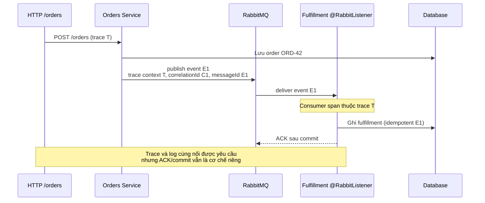
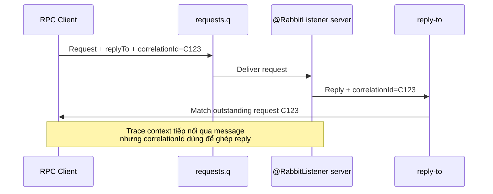
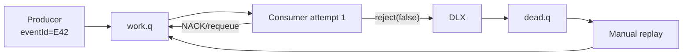

# Truyền trace context, correlationId và messageId

## 1. Bài toán: theo dấu một yêu cầu đi qua RabbitMQ

Một API nhận `POST /orders`, ghi đơn hàng rồi gửi sự kiện `OrderCreated` bằng `RabbitTemplate` tới RabbitMQ. Exchange định tuyến event vào queue `orders.created.q`; `@RabbitListener` ở dịch vụ fulfillment nhận, lưu tác vụ giao hàng, sau đó publish tiếp một lệnh khác.

Khi hệ thống xảy ra lỗi, chỉ xem log ở API rất khó trả lời: **request nào sinh ra message**, **delivery nào được giao lại**, **consumer nào thực hiện side effect**, **message nào là phản hồi của request/reply**? Những câu hỏi này liên quan tới ba nhóm định danh:

- **Trace context** liên kết các bước thực thi của cùng một distributed trace qua HTTP, RabbitMQ và các dịch vụ tiếp theo.
- **`correlationId`** liên kết các message hoặc bước nghiệp vụ thuộc cùng một yêu cầu/workflow; trong RPC của Spring AMQP nó còn có vai trò ghép request với reply.
- **`messageId`** định danh một message/sự kiện logic để tra cứu, điều tra và khi thiết kế phù hợp có thể dùng cho deduplication.

Bài thuộc chương **Quan sát hệ thống** của module **`SPRING_AMQP`**, với nền tảng `RabbitTemplate`, `@RabbitListener`, exchange, queue, binding, acknowledgement, retry và dead-letter. Mục tiêu là **truyền đúng ngữ cảnh qua message**, bảo đảm log/trace liên kết được với hành vi nghiệp vụ nhưng không ngộ nhận trace thành bảo đảm giao nhận hay idempotency.



## 2. Phân biệt các định danh một cách chính xác

| Thành phần | Do ai tạo/quản lý? | Phạm vi | Dùng để làm gì? |
| --- | --- | --- | --- |
| `traceId` | Hệ thống tracing (Micrometer Tracing/OpenTelemetry/Brave) | Một distributed trace | Tìm toàn bộ các span liên quan cùng đường đi thực thi |
| `spanId` | Tracer tạo cho mỗi span | Một thao tác quan sát cụ thể | Phân biệt publish, receive, DB, HTTP trong trace |
| `traceparent` | Propagator theo chuẩn W3C Trace Context | Metadata qua ranh giới process/message | Mang trace ID, parent span ID và trace flags để consumer tiếp nối trace |
| `tracestate` | Propagator/vendor tracing | Metadata qua ranh giới | Mang trạng thái bổ sung của tracing; không phải payload nghiệp vụ |
| `baggage` | Cơ chế propagation được cấu hình | Dữ liệu ngữ cảnh cần đi qua nhiều dịch vụ | Truyền vài giá trị được cho phép; **không** dùng cho dữ liệu nhạy cảm |
| `MessageProperties.messageId` | Ứng dụng hoặc message converter/cơ chế riêng | Một **logical message/event** | Tra cứu, đối chiếu và có thể dedup theo hợp đồng nghiệp vụ |
| `MessageProperties.correlationId` | Ứng dụng hoặc hạ tầng RPC | Một workflow/request hoặc chuỗi request/reply | Liên kết những message liên quan |
| `CorrelationData.id` | Client publisher trong Spring AMQP | Một thao tác publish theo publisher confirms | Ghép publisher ACK/NACK/return với lần gửi, **không** phải `correlationId` nghiệp vụ |
| `deliveryTag` | RabbitMQ broker trên consuming channel | **Một channel** | Chỉ định delivery để consumer `basicAck`/`basicNack` |
| `redelivered` | RabbitMQ đặt khi delivery được giao lại | Một lần giao message | Gợi ý về redelivery, không chứng minh side effect đã xảy ra |

**Điểm dễ nhầm nhất:** `correlationId` và `messageId` là thuộc tính của AMQP message; `traceId`/`spanId` là ngữ cảnh quan sát. Một message có thể mang **cả ba** mà không mâu thuẫn.

Ví dụ một đơn hàng qua ba sự kiện:

```text
Workflow correlationId = checkout-req-123

Event OrderCreated: messageId=evt-001
Event PaymentCaptured: messageId=evt-002
Event ShipmentBooked: messageId=evt-003

Trace có thể gồm:
 traceId=trace-A cho HTTP checkout và các publish gần nhau;
 traceId=trace-B cho một batch/replay bắt đầu lại sau nhiều ngày.
```

`correlationId` giữ ổn định theo workflow nếu ứng dụng chủ động đặt; `messageId` khác nhau cho **các event logic khác nhau**, nhưng nên giữ ổn định khi **gửi lại cùng event**. Trace có thể thay đổi qua retry, cron hoặc replay, nên **không dùng trace ID làm khóa idempotency bền vững**.

## 3. Trace context được gửi qua headers như thế nào?

Khi sử dụng **W3C Trace Context**, producer truyền các header như:

```text
traceparent: 00-4bf92f3577b34da6a3ce929d0e0e4736-00f067aa0ba902b7-01
tracestate: <giá trị nếu được propagator sử dụng>
```

Cấu trúc `traceparent` dạng:

```text
version-trace-id-parent-id-trace-flags
   00    32 hex   16 hex      2 hex
```

Ví dụ trên có trace ID `4bf92f...e4736`, parent span ID `00f067aa0ba902b7`. Khi consumer nhận message, tracing instrumentation **trích xuất** remote parent, rồi tạo consumer span mới. Span mới có **span ID khác** nhưng được liên kết vào trace theo quan hệ parent/link của instrumentation.

Không phải mọi ứng dụng đều dùng W3C: Brave có thể cấu hình B3 hoặc một propagation format khác. Vì vậy:

1. Chọn và tài liệu hóa **một propagation format** cho producer/consumer.
2. Kiểm tra trace headers thực tế trên message test; **đừng giả định luôn tồn tại `traceparent`** khi ứng dụng đang cấu hình B3.
3. Để **Micrometer/OpenTelemetry propagator** inject/extract trace context; tránh tự dựng chuỗi `traceparent` từ UUID nghiệp vụ.
4. Không dùng `traceparent` làm `correlationId`, và không ghi đè trace headers bằng một `MessagePostProcessor` tùy ý.

Trong AMQP 0-9-1, trace context thường đi trong `MessageProperties.headers`. Nếu qua bridge, dead-letter, retry hoặc service viết bằng ngôn ngữ khác, hãy xác minh headers được **giữ lại/biến đổi đúng kiểu**, thay vì chỉ kiểm tra body.

### Trace context có phải dữ liệu nghiệp vụ không?

**Không.** Trace dùng để quan sát một lần thực thi và có thể bị sampling, mất exporter hoặc hết thời gian lưu trữ. Hệ thống vẫn phải chạy đúng khi không có trace headers. Với message từ một producer cũ không có tracing, consumer cần **bắt đầu trace mới** (nếu tracing bật) và vẫn xử lý nghiệp vụ bình thường.

## 4. Kích hoạt Micrometer Observation ở cả producer và consumer

Spring AMQP **3.0 trở lên** hỗ trợ Micrometer Observation cho `RabbitTemplate` và listener container. Khi bật Observation và cấu hình tracing bridge, Spring có thể tạo producer/consumer spans và chuyển trace context qua message. Nếu chỉ bật producer mà consumer không bật, bạn có thể thấy span gửi nhưng **không thấy span xử lý message** như mong muốn.

### 4.1. Dependency và cấu hình cho Spring Boot 3.x

Ví dụ Gradle (để Spring Boot quản lý các phiên bản phụ thuộc):

```gradle
dependencies {
    implementation("org.springframework.boot:spring-boot-starter-amqp")
    implementation("org.springframework.boot:spring-boot-starter-actuator")

    // Một lựa chọn tracing: Micrometer Tracing + OpenTelemetry.
    implementation("io.micrometer:micrometer-tracing-bridge-otel")
    runtimeOnly("io.opentelemetry:opentelemetry-exporter-otlp")
}
```

Một ứng dụng dùng Brave/Zipkin có bộ dependency khác; **không** bật hai tracing bridge vô tình cùng lúc. Để gửi traces tới collector trong môi trường thật, cấu hình endpoint, TLS và exporter phù hợp phiên bản Spring Boot đang chạy.

```yaml
spring:
  application:
    name: fulfillment-service
  rabbitmq:
    template:
      observation-enabled: true
    listener:
      simple:
        observation-enabled: true

management:
  tracing:
    sampling:
      probability: 1.0 # Chỉ dùng trong lab; production đặt theo ngân sách.
```

Các thuộc tính trên áp dụng cho **RabbitMQ AMQP 0-9-1** với `RabbitTemplate` và simple listener container trong Boot 3.x. Nếu dùng `DirectRabbitListenerContainer`, cấu hình `spring.rabbitmq.listener.direct.observation-enabled=true`. Đối với những template/factory **tự tạo thủ công**, đừng mặc nhiên cho rằng property Boot sẽ tác động lên mọi bean riêng — hãy bật Observation trên chính bean.

**Lưu ý version:** Trong các phiên bản Spring Boot mới có module RabbitMQ AMQP 1.0 riêng, tên property và lớp client khác. Bài này tập trung Spring AMQP 0-9-1; không sao chép cấu hình `spring.rabbitmq.*` sang client AMQP 1.0 rồi kỳ vọng tracing hoạt động giống hệt.

### 4.2. Cấu hình Java tường minh cho bean tự tạo

```java
import org.springframework.amqp.rabbit.config.SimpleRabbitListenerContainerFactory;
import org.springframework.amqp.rabbit.connection.ConnectionFactory;
import org.springframework.amqp.rabbit.core.RabbitTemplate;
import org.springframework.context.annotation.Bean;
import org.springframework.context.annotation.Configuration;

@Configuration
public class ObservedRabbitConfiguration {

    @Bean("observedRabbitTemplate")
    public RabbitTemplate observedRabbitTemplate(
            ConnectionFactory connectionFactory) {
        RabbitTemplate template = new RabbitTemplate(connectionFactory);
        template.setObservationEnabled(true);
        return template;
    }

    @Bean("observedListenerFactory")
    public SimpleRabbitListenerContainerFactory observedListenerFactory(
            ConnectionFactory connectionFactory) {
        SimpleRabbitListenerContainerFactory factory =
                new SimpleRabbitListenerContainerFactory();
        factory.setConnectionFactory(connectionFactory);
        factory.setObservationEnabled(true);
        factory.setConcurrentConsumers(2);
        factory.setPrefetchCount(10);
        return factory;
    }
}
```

Ví dụ giả định Spring Boot có `ObservationRegistry` phù hợp và tracing bridge được cấu hình. Với ứng dụng thuần Spring không dùng Boot, cần **cung cấp và đăng ký `ObservationRegistry`/tracing handlers** thích hợp; chỉ gọi `setObservationEnabled(true)` khi registry thực tế là noop sẽ **không tự tạo distributed traces**.

Khi bật Observation, các Micrometer Timer cũ do thành phần AMQP tự thu thập được thay bằng timers từ Observation. Tránh **đếm đôi** khi nâng dashboard/alerts. Một số tình huống **batch listener** không tạo observation theo từng batch do semantics tracing mơ hồ; phải kiểm tra loại listener thực tế trước khi kỳ vọng có span cho từng message.

## 5. Ví dụ đầy đủ: publish với `messageId`, `correlationId` và trace tự động

Giả sử một HTTP request đã được Spring tracing tạo span hiện tại. Ta gửi `OrderCreated` tới direct exchange, queue và binding rõ ràng. `RabbitTemplate` quan sát lúc publish và inject trace context thông qua tracing bridge.

### 5.1. Topology

```java
import org.springframework.amqp.core.BindingBuilder;
import org.springframework.amqp.core.Declarables;
import org.springframework.amqp.core.DirectExchange;
import org.springframework.amqp.core.Queue;
import org.springframework.amqp.core.QueueBuilder;
import org.springframework.context.annotation.Bean;
import org.springframework.context.annotation.Configuration;

@Configuration
public class ObservabilityTopology {

    @Bean
    public Declarables orderObservabilityDeclarables() {
        DirectExchange work =
                new DirectExchange("orders.events.x", true, false);
        DirectExchange dead =
                new DirectExchange("orders.dead.x", true, false);
        Queue workQueue = QueueBuilder.durable("orders.created.q")
                .deadLetterExchange("orders.dead.x")
                .deadLetterRoutingKey("orders.failed")
                .build();
        Queue deadQueue =
                QueueBuilder.durable("orders.dead.q").build();

        return new Declarables(
                work,
                dead,
                workQueue,
                deadQueue,
                BindingBuilder.bind(workQueue)
                        .to(work).with("orders.created"),
                BindingBuilder.bind(deadQueue)
                        .to(dead).with("orders.failed")
        );
    }
}
```

`RabbitAdmin` có thể khai báo topology này khi có connection và các bean được quản lý. Exchange và queue durable **không** tự biến việc publish thành exactly once; nếu producer cần bảo đảm publish, phải dùng publisher confirms/returns và retry/outbox phù hợp.

### 5.2. Producer gắn định danh nhưng **không** tự viết `traceparent`

```java
import java.nio.charset.StandardCharsets;
import java.util.UUID;

import org.springframework.amqp.core.Message;
import org.springframework.amqp.core.MessageDeliveryMode;
import org.springframework.amqp.core.MessageProperties;
import org.springframework.amqp.rabbit.core.RabbitTemplate;
import org.springframework.beans.factory.annotation.Qualifier;
import org.springframework.stereotype.Service;

@Service
public class OrderEventPublisher {
    private final RabbitTemplate rabbitTemplate;

    public OrderEventPublisher(
            @Qualifier("observedRabbitTemplate")
                    RabbitTemplate rabbitTemplate) {
        this.rabbitTemplate = rabbitTemplate;
    }

    public String publishCreated(
            String orderId,
            String requestCorrelationId) {
        // Sinh eventId khi phát sinh logical event.
        // Nếu gửi lại cùng event, PHẢI sử dụng lại ID đã lưu.
        String eventId = UUID.randomUUID().toString();
        String correlationId = requestCorrelationId != null
                ? requestCorrelationId
                : UUID.randomUUID().toString();

        // JSON minh họa với orderId đã được validate ở API.
        // Production nên dùng ObjectMapper với DTO/schema rõ ràng.
        String json = """
                {"eventId":"%s","orderId":"%s","eventType":"OrderCreated"}
                """.formatted(eventId, orderId);

        MessageProperties props = new MessageProperties();
        props.setContentType("application/json");
        props.setContentEncoding("UTF-8");
        props.setDeliveryMode(MessageDeliveryMode.PERSISTENT);
        props.setMessageId(eventId);
        props.setCorrelationId(correlationId);
        props.setHeader("x-event-type", "OrderCreated");

        Message message =
                new Message(json.getBytes(StandardCharsets.UTF_8), props);

        // Observation của RabbitTemplate sẽ inject propagation headers
        // theo propagator/tracer đang cấu hình.
        rabbitTemplate.send(
                "orders.events.x", "orders.created", message);
        return eventId;
    }
}
```

Ví dụ dùng `RabbitTemplate.send` với bytes đã tạo để tránh phụ thuộc implicit message conversion. **Cảnh báo:** Nội suy `orderId` thẳng vào JSON chỉ an toàn khi giá trị đã được validate/escape; ứng dụng thật hãy serialize DTO bằng Jackson. `messageId` trong code là do **ứng dụng gán**, không phải RabbitMQ mặc định đảm bảo mọi message đều có một ID duy nhất.

Đặc biệt, `rabbitTemplate.send(...)` có thể return trước khi nhận publisher confirmation. Nếu cần đảm bảo tính bền vững, dùng `CorrelationData` cho publisher confirms, `mandatory`/returns để phát hiện không route được, và transactional outbox cho nghiệp vụ DB → event. `CorrelationData.id` được dùng **đối chiếu lần gửi**, không nhất thiết trùng `MessageProperties.correlationId`.

### 5.3. Consumer đọc định danh và bảo toàn trace qua `@RabbitListener`

```java
import java.nio.charset.StandardCharsets;
import org.slf4j.Logger;
import org.slf4j.LoggerFactory;
import org.slf4j.MDC;
import org.springframework.amqp.core.Message;
import org.springframework.amqp.rabbit.annotation.RabbitListener;
import org.springframework.stereotype.Component;

@Component
public class OrderCreatedListener {
    private static final Logger log =
            LoggerFactory.getLogger(OrderCreatedListener.class);
    private final OrderDedupService dedupService;

    public OrderCreatedListener(OrderDedupService dedupService) {
        this.dedupService = dedupService;
    }

    @RabbitListener(
            id = "orderCreatedWorker",
            queues = "orders.created.q",
            containerFactory = "observedListenerFactory")
    public void receive(Message message) {
        String messageId =
                message.getMessageProperties().getMessageId();
        String correlationId =
                message.getMessageProperties().getCorrelationId();

        if (messageId == null || messageId.isBlank()) {
            throw new IllegalArgumentException("Missing messageId");
        }

        // Không tin vô điều kiện giá trị header từ bên ngoài;
        // giới hạn ký tự/độ dài trước khi gắn vào log.
        String safeCorrelation = safeForLog(correlationId);

        try (MDC.MDCCloseable correlation =
                     MDC.putCloseable("correlationId", safeCorrelation);
             MDC.MDCCloseable event =
                     MDC.putCloseable("eventId", safeForLog(messageId))) {

            String json =
                    new String(message.getBody(), StandardCharsets.UTF_8);
            log.info("Received OrderCreated");

            // Service cần ghi nhận đã xử lý eventId trong transaction
            // cùng side effect của order; không chỉ check trong RAM.
            dedupService.applyOnce(messageId, json);
            log.info("OrderCreated committed");
        }
        // AUTO acknowledge sau khi listener hoàn tất thành công.
        // Nếu DB transaction ném lỗi, container áp dụng chính sách lỗi.
    }

    private static String safeForLog(String raw) {
        if (raw == null || raw.isBlank()) {
            return "unknown";
        }
        if (raw.length() > 128
                || !raw.matches("[A-Za-z0-9_.:-]+")) {
            return "invalid";
        }
        return raw;
    }
}

interface OrderDedupService {
    void applyOnce(String eventId, String json);
}
```

`OrderDedupService` là hợp đồng minh họa cần triển khai: transaction ghi event ID vào inbox có unique constraint cùng lúc cập nhật nghiệp vụ; khi nhận lại cùng ID thì không thực hiện side effect lần nữa. Với default `AcknowledgeMode.AUTO`, listener trả về **sau khi** service transaction commit; container sau đó mới ACK delivery.

**MDC không tạo trace context**. MDC chỉ gắn dữ liệu vào log của thread đang chạy. Trace ID/span ID thường được bridge tracing thêm vào MDC trong scope của span; `MDC.putCloseable` ở trên chỉ bổ sung correlation ID/event ID và **tự xóa** khi rời scope, tránh dữ liệu của message trước bị rò sang message tiếp theo trên cùng thread.

## 6. Xem một distributed trace và log đúng cách

Giả sử một message có:

```text
messageId     = evt-001
correlationId = checkout-2026-42
traceparent   = 00-4bf92f3577b34da6a3ce929d0e0e4736-...-01
```

Khi cả producer và consumer bật Observation/tracing, backend tracing có thể hiển thị:

```text
Trace 4bf92f3577b34da6a3ce929d0e0e4736
  ├── HTTP POST /orders
  │   ├── DB create order
  │   └── spring.rabbit.template (PRODUCER)
  └── spring.rabbit.listener (CONSUMER)
      ├── orders.process (business span tùy chọn)
      └── DB save fulfillment
```

Đây là **sơ đồ logic**; quan hệ parent/link giữa messaging spans và thời điểm xuất hiện span phụ thuộc instrumentation, sampling và cách producer/consumer chạy. Với message đi qua retry queue nhiều giờ sau đó, hệ thống có thể bắt đầu trace mới hoặc liên kết lịch sử bằng event ID thay vì cố duy trì một trace bất tận.

Ví dụ log có cấu trúc:

```json
{
  "timestamp": "2026-11-26T03:00:00Z",
  "service": "fulfillment-service",
  "level": "INFO",
  "traceId": "4bf92f3577b34da6a3ce929d0e0e4736",
  "spanId": "a1b2c3d4e5f60708",
  "correlationId": "checkout-2026-42",
  "eventId": "evt-001",
  "queue": "orders.created.q",
  "operation": "fulfillment.create",
  "result": "committed"
}
```

Không cần log toàn bộ body có thông tin thanh toán, địa chỉ hay dữ liệu cá nhân. Tracing backend cũng có giới hạn retention; khi cần đối soát dài hạn, hãy lưu các ID nghiệp vụ ổn định trong database/log theo chính sách lưu trữ phù hợp.

### Thêm business span mà không đưa `orderId` vào metric tag

```java
import io.micrometer.observation.Observation;
import io.micrometer.observation.ObservationRegistry;
import org.springframework.stereotype.Service;

@Service
public class ObservedOrderProcessor {
    private final ObservationRegistry registry;
    private final OrderDedupService dedup;

    public ObservedOrderProcessor(
            ObservationRegistry registry,
            OrderDedupService dedup) {
        this.registry = registry;
        this.dedup = dedup;
    }

    public void process(String eventId, String json) {
        Observation observation =
                Observation.createNotStarted("orders.process", registry)
                        .lowCardinalityKeyValue("operation", "apply-event")
                        .start();
        try (Observation.Scope scope = observation.openScope()) {
            dedup.applyOnce(eventId, json);
        } catch (RuntimeException ex) {
            observation.error(ex);
            throw ex;
        } finally {
            observation.stop();
        }
    }
}
```

Observation này có thể trở thành span con của listener span **nếu đang có context quan sát hợp lệ**. `operation=apply-event` có cardinality thấp; không thêm `eventId`, `correlationId`, `orderId`, `traceId` vào **low-cardinality metric tags**, vì mỗi message có giá trị khác nhau sẽ gây nổ số time series. Nếu thực sự cần gắn ID vào trace spans, cân nhắc span attributes có kiểm soát quyền truy cập/chi phí và tuyệt đối không ghi PII.

## 7. Truyền correlationId qua request/reply

Ở mô hình RPC (`RabbitTemplate.convertSendAndReceive(...)` kết hợp listener trả kết quả), `correlationId` của AMQP có ý nghĩa đặc biệt:



`RabbitTemplate` có logic quản lý correlation cho request/reply, bao gồm phát sinh/ghi lại correlation cần thiết để ghép reply. Một số cấu hình có thể **ghi đè hoặc dùng một property/header correlation khác**. Do vậy không nên tự ý thay `MessageProperties.correlationId` bằng ID phiên HTTP ngay trước RPC mà chưa xem cấu hình `RabbitTemplate` (`userCorrelationId`, correlation key và reply handling).

**Khuyến nghị phân tách:**

- Dùng **`correlationId` AMQP** theo contract RPC khi framework cần ghép reply.
- Nếu cần correlation nghiệp vụ xuyên toàn workflow, dùng header ứng dụng riêng, chẳng hạn `x-business-correlation-id`, hoặc trường `workflowId` trong payload.
- Dùng **trace context** để liên kết spans của request, xử lý và reply; không thay traceId bằng correlationId RPC.
- Khi publish **reply**, preserve correlation theo quy tắc request/reply; không lấy `messageId` của reply thay cho correlation.
- `messageId` của request và reply là **hai message logic khác nhau**; có thể gán hai ID khác nhau nhưng cùng `workflowId`.

Ở các phiên bản Spring AMQP, hỗ trợ observation cho reply message có thể khác nhau. Ví dụ từ Spring AMQP **4.2**, reply do listener gửi được tạo producer observation riêng và truyền trace context khi observation bật. Khi cần trace reply trong các phiên bản trước, hãy kiểm tra bằng integration test thay vì khẳng định reply tự có span và `traceparent`.

## 8. Retry, requeue và DLQ: giữ ID nào, đổi trace ra sao?

Một message có thể đi qua những giai đoạn:



| Bước | `messageId`/event ID | Business correlation | Trace context |
| --- | --- | --- | --- |
| Retry/redelivery **cùng delivery logic** | Giữ ổn định để dedup | Giữ ổn định | Broker có thể giữ headers từ publish ban đầu; consumer có span thực thi mới |
| Dead-letter do broker thực hiện | Thường giữ identity của message, thêm dead-letter metadata như `x-death` | Có thể giữ nguyên | Trace headers có thể được chuyển tiếp, nhưng đừng coi `x-death` là trace |
| Ứng dụng publish một **bản sao retry** | Giữ event ID **nếu đó vẫn là cùng logical event**; dùng attempt count riêng | Giữ workflow correlation | Có thể sinh publish span mới; không copy traceparent cũ một cách mù quáng |
| Tạo event nghiệp vụ tiếp theo | **messageId mới** | Có thể giữ workflow ID | Trace hiện tại được inject vào message mới |
| Manual replay sau nhiều ngày | Giữ original event ID nếu đang replay cùng side effect | Giữ business correlation hoặc lineage | Trace mới với liên kết/audit tới trace cũ nếu cần; không giả định trace cũ còn tồn tại |

Nếu viết relay/retry bằng cách **copy nguyên headers của message nhận rồi publish lại**, headers `traceparent`, `tracestate` hoặc B3 từ lần publish cũ có thể **không phản ánh đúng span hiện hành**. Hãy để instrumentation inject ngữ cảnh từ scope đang hoạt động; giữ business ID ổn định, đồng thời có chính sách hợp lý cho retry metadata (attempt count, reason, original queue).

**Lưu ý quan trọng về dedup:** RabbitMQ không tự tạo `messageId` cho mọi message. Nếu producer ban đầu không gán ID, consumer phải có một khóa idempotency nghiệp vụ khác, ví dụ `eventId` trong JSON. `deliveryTag` **không dùng** được vì tăng theo channel và thay đổi khi redelivery.

### Publisher confirm không phải consumer ACK

Trong Spring AMQP:

```java
import org.springframework.amqp.rabbit.connection.CorrelationData;

CorrelationData confirmCorrelation =
        new CorrelationData("publish-attempt-123");
rabbitTemplate.convertAndSend(
        "orders.events.x",
        "orders.created",
        "event-body",
        confirmCorrelation);
```

`CorrelationData.id` ở đây dùng để **ghép kết quả publisher confirm**. Nó có thể khác `MessageProperties.correlationId` và `messageId`. Publisher confirm ACK nghĩa là broker đã xử lý publish theo semantics của publisher confirms, **không** có nghĩa consumer đã ACK hay database của consumer đã commit.

Với message không route được, kết quả confirm có thể ACK; vì thế cần `mandatory=true` và returned message nếu bắt buộc xác minh message vào queue. Các giá trị correlation chỉ hỗ trợ **điều tra** và ghép tín hiệu, không tự tăng độ bền của đường truyền.

## 9. Không mất trace context khi chuyển sang thread khác

Tracing context và MDC thường được giữ theo **thread-local scope**. Nếu listener gọi:

```java
executor.execute(() -> shippingService.bookShipment(orderId));
```

thì `shippingService` trên thread khác có thể **không có current trace/span**, log mất `traceId` và downstream publish tạo một trace rời rạc. Để giải quyết, Spring Framework 6.1+ cung cấp `ContextPropagatingTaskDecorator` (với Micrometer Context Propagation):

```java
import org.springframework.context.annotation.Bean;
import org.springframework.context.annotation.Configuration;
import org.springframework.core.task.support.ContextPropagatingTaskDecorator;
import org.springframework.scheduling.concurrent.ThreadPoolTaskExecutor;

@Configuration
public class TraceContextExecutorConfiguration {

    @Bean("messageWorkExecutor")
    public ThreadPoolTaskExecutor messageWorkExecutor() {
        ThreadPoolTaskExecutor executor = new ThreadPoolTaskExecutor();
        executor.setCorePoolSize(4);
        executor.setMaxPoolSize(8);
        executor.setQueueCapacity(100);
        executor.setThreadNamePrefix("message-work-");
        executor.setTaskDecorator(
                new ContextPropagatingTaskDecorator());
        executor.initialize();
        return executor;
    }
}
```

Đây là **cách truyền observability context**, không bảo đảm công việc đã hoàn tất. Với `@RabbitListener` `AcknowledgeMode.AUTO`, nếu method chỉ submit task rồi return, container có thể **ACK trước khi task thực sự hoàn thành**. Để xử lý công việc dài, dùng listener đồng bộ chờ kết quả hoặc async return (`CompletableFuture`) với acknowledgement/lifecycle phù hợp, và kiểm thử shutdown/redelivery.

### Truyền gì sang `CompletableFuture`, Reactor hoặc scheduler?

- `CompletableFuture.supplyAsync(..., executor)` dùng đúng executor có context propagation.
- Với Reactor, kiểm tra cơ chế Reactor context propagation và `spring.reactor.context-propagation` theo phiên bản Boot.
- Với scheduled job bắt đầu **không có incoming request**, nên tạo một root trace mới; đừng giữ vĩnh viễn scope/trace của request cũ.
- Với outbox relay hoặc retry sau nhiều giờ, `eventId` và `correlationId` nghiệp vụ mới là khóa liên kết đáng tin cậy; trace có thể được liên kết qua span links hoặc log metadata, không phải bằng cách giữ một ThreadLocal đã kết thúc.

## 10. Metric, log và trace bổ sung cho nhau

Ba loại tín hiệu có mục tiêu khác nhau:

| Tín hiệu | Trả lời câu hỏi | Ví dụ |
| --- | --- | --- |
| **Metrics** | Hệ thống đang chậm/lỗi bao nhiêu? | `spring.rabbit.listener` timer; backlog `messages_ready`; DLQ size |
| **Logs** | Một lần xử lý đã làm gì, outcome nào? | `eventId`, `correlationId`, queue, `redelivered`, error type |
| **Traces** | Các thao tác qua service liên quan thế nào, mất thời gian ở đâu? | HTTP → Rabbit publish → listener → DB/HTTP |

Spring AMQP có Micrometer Observation metrics như `spring.rabbit.template` và `spring.rabbit.listener`; khi tracing bật, chúng cũng có span conventions. Các chỉ số RabbitMQ broker như số consumer, queue depth, `messages_unacknowledged`, redelivery và DLQ còn cần dashboard từ broker hoặc metrics exporter — **không** suy rằng chỉ bật trace ở Spring sẽ có đầy đủ broker metrics.

### Chọn metric tags có cardinality thấp

| Tag nên dùng khi có kiểm soát | Không nên đưa vào metric tag |
| --- | --- |
| `service`, `environment`, `listener.id` | `messageId`, `eventId` |
| `queue` hoặc exchange có tập tên hữu hạn | `correlationId` |
| `outcome` (`success`, `retry`, `dead-letter`) | `traceId`, `spanId` |
| `exception.class` với số loại được kiểm soát | `orderId`, `paymentId`, `userId` |
| `routingKey` nếu tập giá trị nhỏ, ổn định | Routing key chứa tenant/user ID động |

Nếu muốn dùng tên queue để gắn metric, tránh sinh hàng nghìn queue động cùng tên duy nhất rồi đưa nguyên tên vào tag. Cần đặt baseline/SLO rõ ràng: tỷ lệ lỗi, p95/p99 xử lý, độ trễ publish/confirm, redelivery rate và thời gian tồn tại message trong queue.

### Cấu trúc log khuyến nghị

Một record log cho một delivery nên có:

```text
timestamp
service / environment / version
traceId / spanId (khi tracing active và có sampling/bridge phù hợp)
correlationId hoặc workflowId
messageId hoặc eventId
queue / listenerId / redelivered
businessOperation / attempt / outcome
errorCode (nếu có)
```

Không log toàn bộ RabbitMQ `Message` nếu payload chứa dữ liệu nhạy cảm. Header từ bên ngoài có thể rất dài hoặc chứa ký tự điều khiển; cần sanitize và giới hạn độ dài trước khi đưa vào log.

## 11. Checklist kiểm thử truyền context xuyên RabbitMQ

Trước khi nói một ứng dụng “đã có distributed tracing”, cần kiểm tra bằng **tình huống cụ thể** trên môi trường test:

| Mã | Tình huống | Kỳ vọng |
| --- | --- | --- |
| T01 | HTTP có span hiện tại → `RabbitTemplate` publish → listener nhận | Producer và consumer spans được nối theo propagation đã chọn |
| T02 | Consumer nhận message từ legacy producer không có trace headers | Listener vẫn xử lý; tracing có thể khởi tạo root mới |
| T03 | Producer đặt `messageId=E1`, `correlationId=C1` | Consumer nhận đúng E1/C1 qua AMQP properties |
| T04 | Publish lại **cùng logical event** sau confirm timeout | Giữ E1; DB inbox không tạo side effect trùng |
| T05 | Consumer DB commit rồi mất kết nối trước ACK | Redelivery có thể xảy ra; dedup E1 vẫn đúng |
| T06 | Message chuyển DLX/DLQ | Có thể đối chiếu original ID, x-death và queue; không trông chờ trace cũ còn được export |
| T07 | Listener publish event thứ hai E2 | E2 có messageId khác E1, workflow correlation có thể giữ C1 |
| T08 | `@Async` hoặc executor trong listener | Context tiếp tục trên thread mới khi task decorator được cấu hình |
| T09 | Bật sampling thấp | Nghiệp vụ và correlation ID vẫn hoạt động dù trace không được export |
| T10 | RPC request/reply | Spring ghép đúng reply bằng correlation; tracing không làm thay đổi cơ chế ghép |
| T11 | Consumer batch hoặc native stream | Xác minh mức độ observation hỗ trợ thực tế, không giả định mỗi message đều có một span |
| T12 | Producer dùng B3, consumer chỉ nhận W3C | Phát hiện trace bị tách; chuẩn hóa propagator |

### Một integration test nhỏ cho `messageId` và `correlationId`

Đối với test cần quan sát headers trước khi listener thật consume, tạo **queue kiểm thử riêng** không được listener chạy nền cùng subscribe. Giả sử queue `trace.test.q` tồn tại và được bind vào exchange `trace.test.x` với routing key `trace.test`.

```java
import static org.junit.jupiter.api.Assertions.*;

import java.nio.charset.StandardCharsets;
import org.junit.jupiter.api.Test;
import org.springframework.amqp.core.Message;
import org.springframework.amqp.core.MessageProperties;
import org.springframework.amqp.rabbit.core.RabbitTemplate;
import org.springframework.beans.factory.annotation.Autowired;
import org.springframework.boot.test.context.SpringBootTest;

@SpringBootTest
class AmqpIdentityIT {

    @Autowired
    RabbitTemplate rabbitTemplate;

    @Test
    void preservesBusinessIdsAcrossPublishAndReceive() {
        MessageProperties props = new MessageProperties();
        props.setMessageId("evt-test-123");
        props.setCorrelationId("checkout-test-456");
        props.setContentType("text/plain");

        rabbitTemplate.send("trace.test.x", "trace.test",
                new Message("ok".getBytes(StandardCharsets.UTF_8), props));

        Message received =
                rabbitTemplate.receive("trace.test.q", 10_000L);
        assertNotNull(received);
        assertEquals("evt-test-123",
                received.getMessageProperties().getMessageId());
        assertEquals("checkout-test-456",
                received.getMessageProperties().getCorrelationId());
    }
}
```

Test trên **chỉ xác minh AMQP message properties**; nó không đủ chứng minh trace context đã truyền. Để kiểm thử tracing, tạo incoming Observation/span khi publish, dùng tracing exporter/test span handler hoặc một `@RabbitListener` được instrument, rồi so sánh **trace ID được extract ở consumer** với producer. Nếu chọn W3C propagation, có thể kiểm tra header `traceparent` hợp lệ, nhưng không hard-code tên header khi hệ thống dùng B3.

Khi dùng publisher confirms ở test, đợi xác nhận trước khi kết luận publish đã tới broker. `RabbitTemplate.receive` là polling đơn giản; nó không thay cho kiểm thử consumer listener span. **Không chạy test trên production queue** vì `receive()` thực sự lấy delivery khỏi queue và có thể ACK.

## 12. Xử lý sự cố và triệu chứng thường gặp

| Triệu chứng | Nguyên nhân thường gặp | Cách kiểm tra/khắc phục |
| --- | --- | --- |
| Log consumer không có `traceId` | Observation chưa bật ở listener, thiếu tracing bridge, không có registry, hoặc lost context | Xác minh `observation-enabled`, dependencies, và scope/thread |
| Producer có trace nhưng consumer mở trace mới | Propagator khác nhau, headers bị strip, converter/bridge làm mất headers | Inspect message headers test, chuẩn hóa W3C/B3 |
| Trace hiển thị nhưng không thấy log | Log pattern không hiện MDC hoặc pipeline filter | Cấu hình structured logging, trace/span fields và ingestion |
| Span publish có nhưng không có span nhận | Listener factory custom chưa bật Observation | Bật `setObservationEnabled(true)` trên đúng factory |
| Span nhận hiển thị nhưng DB chưa commit | Trace span đo execution, không tự bảo đảm transaction | Dựa vào DB commit/ACK, không suy kết quả từ span |
| `messageId` null ở nhiều message | Producer không gán ID | Bắt buộc eventId ở schema hoặc đặt `messageId` ở producer |
| `correlationId` đổi bất ngờ trong RPC | `RabbitTemplate` quản lý request/reply correlation | Tách business workflow ID khỏi RPC correlation, kiểm tra template config |
| Sau async task trace bị đứt | Executor chưa propagate observation | `ContextPropagatingTaskDecorator`, kiểm tra thread boundary |
| Retry tạo nhiều trace riêng | Replay không còn active parent hoặc header bị thay | Nối bằng eventId/workflowId; dùng link/context có chủ đích |
| Metrics bùng nổ time series | Đưa orderId/traceId vào labels | Chỉ dùng low-cardinality tags |
| Phát hiện trace ID trong log nhưng không có trên backend | Sampling/exporter chưa cấu hình hoặc exporter lỗi | Kiểm tra sampling, endpoint, network, exporter logs |
| DLQ đầy nhưng dashboard traces không phản ánh | Tracing chỉ nhìn application calls, không phản ánh đầy đủ broker state | Kết hợp queue/DLQ metrics, alerts và log nghiệp vụ |

### Khi điều tra một message “mất tích”

Thứ tự kiểm tra nên là:

1. Tìm `eventId`/`messageId` trong outbox hoặc log producer: **ý định publish đã commit chưa?**
2. Đối chiếu publisher confirm/return: **exchange và binding có route vào queue không?**
3. Tra backlog, `ready`/`unacked`, consumer và DLQ: **broker đang giữ ở đâu?**
4. Tìm `correlationId` để tổng hợp các event thuộc workflow.
5. Mở trace (nếu có) để xác định điểm chậm/lỗi trong từng service.
6. Kiểm tra inbox/DB state để xác nhận nghiệp vụ đã commit hay chưa.

Không đảo thứ tự bằng cách “không thấy trace nên suy message không được publish”. Trace có thể bị sampling hoặc exporter mất kết nối trong khi publish và xử lý vẫn thành công.

## 13. Bảo mật và quản trị dữ liệu quan sát

Trace headers đi qua ranh giới tin cậy giống những dữ liệu inbound khác. Không cho phép client tự gắn ID bất kỳ rồi sử dụng làm khóa phân quyền hoặc khóa idempotency mà không validate.

- `traceparent` phải được kiểm tra định dạng bởi propagator; định danh được cung cấp từ bên ngoài **không phải bằng chứng xác thực**.
- `baggage` có thể đi qua nhiều dịch vụ và xuất hiện ở headers/logs. **Không** đưa token, password, email, số thẻ hoặc nội dung khách hàng vào baggage.
- `correlationId` do người dùng truyền nên có giới hạn độ dài/ký tự và có thể được thay bằng ID do ứng dụng cấp; không tin giá trị này để cấp quyền truy cập.
- `messageId`/eventId phải có chính sách uniqueness và dedup theo domain; không dùng ID bất kỳ làm điều kiện “đã thanh toán” khi chưa kiểm tra trạng thái DB.
- Traces, logs và messages có **vòng đời lưu trữ khác nhau**. Nếu cần chứng cứ nghiệp vụ lâu dài, dùng audit database có kiểm soát, không dựa hoàn toàn vào trace backend.
- Giới hạn số span/attributes và sampling để tránh quá tải hệ thống quan sát trong những luồng message khối lượng lớn.

## 14. Câu hỏi tự kiểm tra

1. Phân biệt `traceId`, `spanId`, `correlationId` và `messageId` bằng ví dụ `OrderCreated → PaymentCaptured`.
2. Nếu consumer nhận lại cùng message sau ACK bị mất, tại sao `deliveryTag` không thể làm dedup key?
3. `RabbitTemplate.setObservationEnabled(true)` giải quyết điều gì, và vì sao vẫn cần bật Observation trên listener factory?
4. Vì sao hai dịch vụ sử dụng khác propagation format (W3C/B3) có thể hiển thị thành hai trace dù cùng một message?
5. Một ứng dụng đã cấu hình tracing nhưng publish trong `CompletableFuture.supplyAsync` dùng executor mặc định. Trace có thể bị đứt ở đâu, và cách sửa?
6. Với Spring AMQP request/reply, vì sao việc ghi đè `MessageProperties.correlationId` bằng workflow ID có thể làm ghép reply thất bại?
7. Khi publish lại cùng sự kiện vì confirm timeout, nên giữ hay tạo mới `messageId`? Trường hợp nào mới nên tạo ID mới?
8. Tại sao không nên dùng `eventId` hoặc `traceId` làm Micrometer metric labels?
9. Khi broker dead-letter một message sang DLQ, cần lưu dấu những metadata nào để điều tra? Trace cũ có chắc còn được export không?
10. Hãy thiết kế test chứng minh producer và consumer cùng trace, trong khi `messageId` và `correlationId` được bảo toàn độc lập.
11. Nếu log đã có `traceId` nhưng trace backend trống, cần kiểm tra sampling và exporter như thế nào?
12. Trình bày quy trình truy vết một `OrderPaid` bị “mất” từ outbox đến publisher confirm, queue/DLQ và bảng inbox.

**Ghi nhớ:** Trace context dùng để **nối các span thực thi**, `correlationId` dùng để **ghép workflow hoặc RPC**, còn `messageId` định danh **logical message/event**. Hãy bật Micrometer Observation ở cả `RabbitTemplate` và `@RabbitListener` container, truyền trace qua propagator, giữ business IDs ổn định qua retry, dùng idempotency/ACK để bảo vệ nghiệp vụ và kết hợp traces với logs, metrics của RabbitMQ để có quan sát toàn diện.

### Tài liệu tham khảo chính thức

- [Spring AMQP — Micrometer Observation](https://docs.spring.io/spring-amqp/reference/amqp/receiving-messages/micrometer-observation.html): bật Observation cho RabbitTemplate/listener factory, conventions và giới hạn với batch listener.
- [Spring AMQP — Micrometer Observability Metrics/Spans](https://docs.spring.io/spring-amqp/reference/appendix/micrometer.html): các observation names/tags của template và listener.
- [Spring Boot — Tracing](https://docs.spring.io/spring-boot/reference/actuator/tracing.html): Micrometer Tracing, exporter và sampling.
- [Spring Boot — Observability and Context Propagation](https://docs.spring.io/spring-boot/reference/actuator/observability.html): context propagation qua thread/reactive pipeline.
- [Spring Boot — RabbitMQ Configuration Properties](https://docs.spring.io/spring-boot/appendix/application-properties/): `spring.rabbitmq.template.observation-enabled` và listener observation.
- [W3C — Trace Context](https://www.w3.org/TR/trace-context/): định dạng `traceparent` và `tracestate`.
- [RabbitMQ — Consumer Acknowledgements and Publisher Confirms](https://www.rabbitmq.com/docs/confirms): phân biệt publisher confirms, delivery acknowledgement và redelivery.
