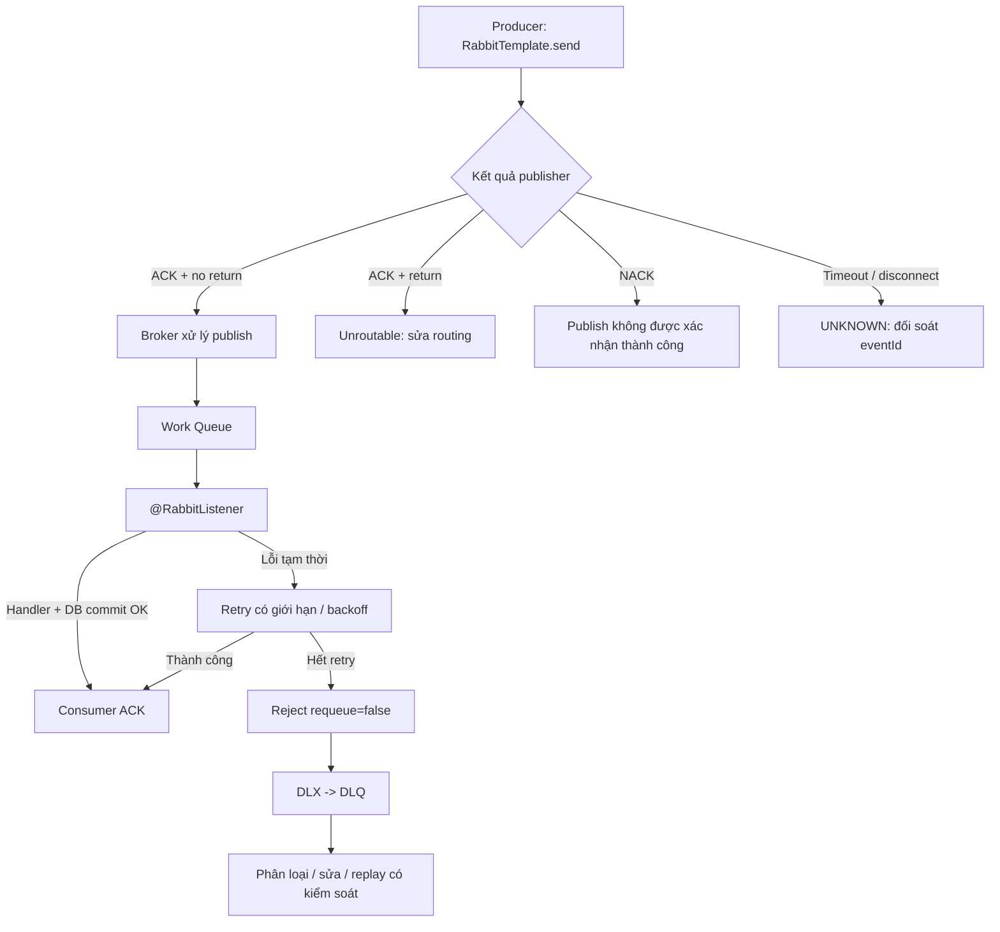

# Theo dõi confirm nack, return, retry và dead-letter

> **Chương:** Quan sát hệ thống  
> **Module:** SPRING_AMQP — tích hợp RabbitMQ với Spring AMQP bằng `RabbitTemplate`, `@RabbitListener`, exchange, queue, binding; vận hành acknowledgment, retry, dead-letter, giao dịch và observability để xử lý bất đồng bộ đáng tin cậy.
>
> **Phạm vi:** RabbitMQ **AMQP 0-9-1** với Spring Boot 3.x / Spring AMQP 3.x. Bài phân biệt tín hiệu của **producer**, **consumer** và **broker**; từ đó thiết kế metrics, log, trace, cảnh báo và phương án đối soát. Với Spring Boot 4.x / Spring AMQP 4.x, phải kiểm tra tên thuộc tính và API theo phiên bản.

## 1. Mục tiêu học tập

Sau bài này, bạn có thể:

1. Giải thích đúng ý nghĩa **publisher confirm ACK/NACK**, **publisher return**, **consumer basic.ack/basic.nack**, retry và dead-letter.
2. Phân biệt **publish đã được broker xác nhận**, **message đã được route**, **consumer đã xử lý thành công** và **nghiệp vụ đã commit**.
3. Cấu hình `RabbitTemplate` với correlated publisher confirms, mandatory returns và `CorrelationData` để đo **kết quả publish theo từng event**.
4. Gắn metrics/traces cho `@RabbitListener`; đo số lần retry, retry exhausted, latency, delivery trùng và lỗi handler.
5. Đọc `x-death`, nhận diện nguyên nhân dead-letter, đo DLQ backlog/age mà không hiểu nhầm nó là bộ đếm mọi retry.
6. Thiết kế dashboard/alert và runbook xử lý **confirm NACK, unroutable return, timeout, retry storm, DLQ tăng**.
7. Kiểm thử fault injection để chứng minh mỗi tín hiệu được phát đúng và không đánh dấu message “thành công” quá sớm.

### Bối cảnh bài học

Dịch vụ Order phát `OrderCreated` qua `RabbitTemplate` vào direct exchange `orders.events.x`, routing key `order.created`. Dịch vụ Projection dùng `@RabbitListener` đọc `orders.created.q` và cập nhật database. Message hỏng được dead-letter tới `orders.created.dlq`.

Khi dashboard báo “send success 100%”, một số đơn vẫn không có dữ liệu bên Projection. Nguyên nhân có thể là **publisher return**, producer chỉ đếm số lần gọi `send()`, consumer thất bại sau vài lần retry, hoặc message đã vào DLQ. Muốn biết nguyên nhân, phải đo **nhiều giai đoạn độc lập** thay vì một cờ `success`.

## 2. Cùng chữ ACK/NACK nhưng hai chiều khác nhau

| Tín hiệu | Ai gửi cho ai? | Nó trả lời câu hỏi gì? | Không chứng minh điều gì? |
|---|---|---|---|
| **Publisher confirm ACK** | RabbitMQ → producer, trên publisher channel | Broker đã xử lý publish theo điều kiện của queue/exchange liên quan | Không chứng minh message route vào **queue mong đợi** nếu không kiểm tra return; không chứng minh consumer đã chạy |
| **Publisher confirm NACK** | RabbitMQ → producer | Broker không nhận trách nhiệm xử lý một hoặc nhiều publish | Không cho biết đầy đủ trạng thái nghiệp vụ ở consumer/DB |
| **`basic.return`** | RabbitMQ → producer khi `mandatory=true` | Message không route được tới queue phù hợp (và không được xử lý qua một route thay thế đủ điều kiện) | Không có nghĩa publisher confirm sẽ là NACK |
| **Consumer `basic.ack`** | Consumer → RabbitMQ | Consumer xác nhận delivery đã hoàn tất trách nhiệm ở broker | Không phải publisher confirm ACK; không tự đảm bảo DB và broker cùng commit nguyên tử |
| **Consumer `basic.nack`/`basic.reject`** | Consumer → RabbitMQ | Delivery bị từ chối; có thể requeue hoặc dead-letter | Không phải publisher confirm NACK |
| **Retry in listener** | Spring Retry → callback handler | Ứng dụng thử xử lý lại cùng delivery trong một luồng retry | Không phải một lần broker requeue/dead-letter mới |
| **Dead-letter** | Broker → dead-letter exchange | Message rời queue nguồn do reject/expiration/limit theo policy | Không bảo đảm queue đích đã nhận bền vững trong mọi cấu hình |

**Kết luận sớm:** “confirm ACK”, “không bị return” và “consumer ACK” là **ba cột kiểm chứng khác nhau**, chưa kể business transaction commit.

### 2.1. Một trường hợp dễ nhầm: return trước confirm ACK

Khi publish bắt buộc định tuyến (`mandatory=true`) tới exchange **đang tồn tại** nhưng không có binding tới queue nào:

```mermaid
sequenceDiagram
    participant P as RabbitTemplate / Producer
    participant X as RabbitMQ Exchange
    participant Q as Queue
    P->>X: basic.publish(mandatory=true, eventId=E42)
    X--xQ: Không có binding khớp
    X-->>P: basic.return(replyText=NO_ROUTE)
    X-->>P: Publisher confirm basic.ack
    Note over P: return=true; confirm ACK=true
    Note over P: Publish không vào queue đích
```

RabbitMQ có thể phát **confirm ACK sau return** vì broker đã xác định message là unroutable và xử lý nó theo giao thức. Vì vậy:

- **Sai:** “`ack=true` nên đơn hàng chắc chắn đã được worker nhận”.
- **Đúng:** “Broker ACK publish nhưng message bị returned; routing thất bại. Phải sửa exchange/binding/routing key”.

Với Spring AMQP và correlated confirms + returns, `CorrelationData.getReturned()` được điền **trước khi confirm future hoàn tất**. Do đó có thể kiểm tra cả hai khi xử lý `getFuture()`.

### 2.2. Publisher NACK hiếm hơn return

Broker-generated publisher `basic.nack` thường dành cho những trường hợp lỗi nội bộ khiến broker không thể nhận trách nhiệm publish. Nó **không** được dùng thay cho việc message không có route. Ngoài ra Spring có thể tổng hợp kết quả NACK khi channel/connection đóng lúc còn confirm outstanding, với `reason` thể hiện nguyên nhân phía framework. **`reason` có thể null** đối với một số broker-generated NACK.

Đừng lấy “không thấy NACK” làm chỉ số duy nhất về sức khỏe publish. Phần lớn lỗi route phải được phát hiện bằng return; connection mất có thể tạo trạng thái **UNKNOWN**.

### 2.3. Sự kiện phát sinh trên hai tuyến



Đường này là mô hình logic, không phải lời hứa atomic end-to-end. Đặc biệt, mất xác nhận sau khi broker đã nhận message có thể dẫn đến duplicate khi producer retry; mất consumer ACK sau DB commit có thể dẫn đến redelivery.

## 3. Thiết kế một “sổ cái tín hiệu” theo eventId

Mỗi nghiệp vụ cần ít nhất hai nhóm ID:

| Trường | Định nghĩa | Giữ ổn định qua retry/replay? | Nên dùng làm metric label? |
|---|---|---|---|
| `eventId` | ID nghiệp vụ duy nhất của sự kiện | **Có**; giữ nguyên khi phát lại cùng event | **Không**: cardinality rất cao |
| `aggregateId`/`orderId` | Đơn hàng/thực thể mà event áp dụng | **Có** | Không trong metric chung |
| `publishAttemptId` | ID một lần thử publish riêng | **Không**, tạo mới cho mỗi lần thử | Không |
| `CorrelationData.id` | ID giúp Spring ghép confirm với publish | Unique cho từng in-flight publish attempt | Không |
| `traceId`/`spanId` | Quan hệ các thao tác trong distributed trace | Theo trace context | Không dùng như metric label |
| `exchange`, `routingKey` | Nơi gửi và khóa routing | Theo route | Có thể, nếu tập giá trị được kiểm soát và hữu hạn |
| `queue`, `listenerId` | Nơi tiêu thụ và handler | Theo cấu hình | Có thể, nếu bounded cardinality |
| `deliveryTag` | ID delivery **trong channel hiện tại** | **Không**; thay đổi khi redelivery | Không |
| `retryAttempt`/`retry_count` | Lần thử xử lý theo quy tắc của ứng dụng | Theo chính sách, cần làm rõ nguồn | Nên dùng nhóm số/histogram, không nhãn tùy ý |

Không dùng riêng `messageId` hay `deliveryTag` làm nguồn chân lý của business idempotency nếu producer không giữ ID ổn định. Đặt `eventId` trong body/header và dùng khóa duy nhất ở consumer database.

### 3.1. Chuỗi trạng thái nên ghi nhận

```text
event_created
  -> publish_attempt_started
  -> publish_sent (gọi send không ném lỗi)
  -> publish_confirm_ack / publish_confirm_nack / publish_returned
  -> [hoặc publish_outcome_unknown: timeout, connection lost]
  -> listener_delivery
  -> listener_attempt_failed / listener_attempt_succeeded
  -> retry_exhausted / dead_lettered / business_committed
  -> consumer_ack
```

Đây là một **event audit/log model**, không khẳng định các trạng thái luôn tuyến tính. Return và confirm ACK có thể xảy ra cho **cùng publish attempt**; retry attempt và dead-letter có thể tách nhiều giai đoạn; một event có thể có nhiều publish attempts.

### 3.2. Quy tắc cardinality

Trong metrics dùng labels ít giá trị: `app`, `result`, `exchange`, `queue`, `listener_id`, `exception_family` đã chuẩn hóa. Trong structured logs/traces lưu `eventId`, `correlationId`, `orderId` và stack trace đã được redaction. Không gắn payload, exception message nguyên văn, request ID hoặc routing key do người dùng tùy ý tạo vào metric label.

## 4. Cấu hình Spring Boot: có confirm và return thật

Ví dụ ứng dụng Spring Boot 3.x sử dụng RabbitMQ AMQP 0-9-1:

```xml
<!-- pom.xml: Spring Boot quản lý versions qua BOM -->
<dependencies>
    <dependency>
        <groupId>org.springframework.boot</groupId>
        <artifactId>spring-boot-starter-amqp</artifactId>
    </dependency>
    <dependency>
        <groupId>org.springframework.boot</groupId>
        <artifactId>spring-boot-starter-actuator</artifactId>
    </dependency>
    <dependency>
        <groupId>io.micrometer</groupId>
        <artifactId>micrometer-registry-prometheus</artifactId>
    </dependency>
    <dependency>
        <groupId>org.springframework.retry</groupId>
        <artifactId>spring-retry</artifactId>
    </dependency>
</dependencies>
```

```yaml
# application.yml — cấu hình mẫu cho bài thực hành
spring:
  application:
    name: order-service
  rabbitmq:
    host: localhost
    port: 5672
    username: order_app
    password: "<from-secret-store>"
    publisher-confirm-type: correlated
    publisher-returns: true
    template:
      mandatory: true
    listener:
      simple:
        concurrency: 2
        prefetch: 10
        default-requeue-rejected: false

management:
  endpoints:
    web:
      exposure:
        include: health,info,prometheus
  metrics:
    tags:
      application: order-service
```

Ý nghĩa:

- `publisher-confirm-type=correlated` cho phép nhận kết quả publisher ACK/NACK theo `CorrelationData`.
- `publisher-returns=true` cho phép nhận `basic.return` trên connection factory.
- `template.mandatory=true` yêu cầu broker trả message không định tuyến được (thay vì âm thầm bỏ theo luồng không mandatory).
- `default-requeue-rejected=false` ngăn listener exception mặc định trở thành requeue nóng; **phải cấu hình DLX/DLQ** nếu muốn giữ lại message bị reject.
- Actuator/Prometheus cho phép thu thập metrics từ app; nên bảo vệ endpoint bằng auth/network controls, không để lộ công khai dữ liệu nội bộ.

Đừng bật `channelTransacted=true` trên publisher channel rồi đồng thời kỳ vọng publisher confirms: RabbitMQ **không hỗ trợ confirm mode và transactional mode trên cùng channel**. Nếu dùng BE1PC với AMQP channel transaction, mô hình quan sát commit khác publisher confirm.

## 5. Topology cho work queue và DLQ

```java
import org.springframework.amqp.core.BindingBuilder;
import org.springframework.amqp.core.Declarables;
import org.springframework.amqp.core.DirectExchange;
import org.springframework.amqp.core.Queue;
import org.springframework.amqp.core.QueueBuilder;
import org.springframework.context.annotation.Bean;
import org.springframework.context.annotation.Configuration;

final class OrderRoutes {
    static final String EXCHANGE = "orders.events.x";
    static final String WORK = "orders.created.q";
    static final String KEY = "order.created";
    static final String DLX = "orders.dead.x";
    static final String DLQ = "orders.created.dlq";
    static final String DEAD_KEY = "created.failed";
    private OrderRoutes() {}
}

@Configuration
public class OrderTopology {
    @Bean
    Declarables orderDeclarations() {
        DirectExchange workX =
            new DirectExchange(OrderRoutes.EXCHANGE, true, false);
        DirectExchange deadX =
            new DirectExchange(OrderRoutes.DLX, true, false);

        Queue work = QueueBuilder.durable(OrderRoutes.WORK)
            .deadLetterExchange(OrderRoutes.DLX)
            .deadLetterRoutingKey(OrderRoutes.DEAD_KEY)
            .build();
        Queue dead = QueueBuilder.durable(OrderRoutes.DLQ).build();

        return new Declarables(
            workX, deadX, work, dead,
            BindingBuilder.bind(work).to(workX).with(OrderRoutes.KEY),
            BindingBuilder.bind(dead).to(deadX).with(OrderRoutes.DEAD_KEY)
        );
    }
}
```

Ở production, RabbitMQ **policy** thường tiện hơn hardcode `x-dead-letter-exchange` để thay đổi cấu hình mà không phải redeclare queue đang tồn tại với arguments mới. Ví dụ chỉ để minh họa; queue/exchange phải tồn tại trên đúng vhost và quyền `configure`/`write`/`read` phải phù hợp.

**Quan trọng:** DLX cũng là một cơ chế publish nội bộ của broker. Dead-letter **có thể thất bại** nếu exchange/binding/queue đích không sẵn sàng. RabbitMQ thường dead-letter mà **không bật publisher confirms nội bộ** theo mặc định; quorum queue có lựa chọn **at-least-once dead-lettering** với điều kiện cấu hình phù hợp. Đừng khẳng định “message đã bị reject thì chắc chắn đã lưu an toàn trong DLQ”.

## 6. Theo dõi kết quả publisher theo từng lần gửi

### 6.1. Chọn callback hoặc CorrelationData future

Spring `RabbitTemplate` có:

- `setConfirmCallback((correlationData, ack, cause) -> ...)` cho publisher confirm.
- `setReturnsCallback(returned -> ...)` cho returned message.
- `CorrelationData.getFuture()` và `CorrelationData.getReturned()` để theo dõi từng publish attempt.

Mỗi `RabbitTemplate` chỉ có **một confirm callback** và **một returns callback**. Không để các bean khác nhau lần lượt đăng ký callback trên cùng template rồi ghi đè nhau. Với pipeline cần đo theo từng event, ví dụ dưới dùng **CorrelationData future**, tránh nhầm callback tổng hợp với callback của một attempt.

### 6.2. Publisher có metrics/structured logs

```java
import io.micrometer.core.instrument.MeterRegistry;
import java.nio.charset.StandardCharsets;
import java.util.UUID;
import java.util.concurrent.TimeUnit;
import org.slf4j.Logger;
import org.slf4j.LoggerFactory;
import org.springframework.amqp.AmqpException;
import org.springframework.amqp.core.Message;
import org.springframework.amqp.core.MessageDeliveryMode;
import org.springframework.amqp.core.MessageProperties;
import org.springframework.amqp.rabbit.connection.CorrelationData;
import org.springframework.amqp.rabbit.core.RabbitTemplate;
import org.springframework.stereotype.Service;

@Service
public class ObservableOrderPublisher {
    private static final Logger log =
        LoggerFactory.getLogger(ObservableOrderPublisher.class);

    private final RabbitTemplate rabbit;
    private final MeterRegistry metrics;

    public ObservableOrderPublisher(
        RabbitTemplate rabbit,
        MeterRegistry metrics
    ) {
        this.rabbit = rabbit;
        this.metrics = metrics;
    }

    public void publish(String eventId, String json) {
        MessageProperties properties = new MessageProperties();
        properties.setMessageId(eventId);
        properties.setHeader("event-id", eventId);
        properties.setContentType(MessageProperties.CONTENT_TYPE_JSON);
        properties.setDeliveryMode(MessageDeliveryMode.PERSISTENT);
        Message message = new Message(
            json.getBytes(StandardCharsets.UTF_8), properties
        );

        // Một correlationId riêng cho từng publish attempt.
        String attemptId = UUID.randomUUID().toString();
        CorrelationData correlation = new CorrelationData(attemptId);
        long start = System.nanoTime();
        metrics.counter("app.rabbit.publish.attempt").increment();

        try {
            rabbit.send(
                OrderRoutes.EXCHANGE,
                OrderRoutes.KEY,
                message,
                correlation
            );
        } catch (AmqpException sendError) {
            // Lỗi đồng bộ: không đồng nghĩa broker chắc chắn chưa nhận.
            metrics.counter("app.rabbit.publish.send_error").increment();
            log.error(
                "rabbit.publish.send_error eventId={} attemptId={}",
                eventId, attemptId, sendError
            );
            throw sendError;
        }

        correlation.getFuture()
            .orTimeout(15, TimeUnit.SECONDS)
            .whenComplete((confirm, failure) -> {
                final String outcome;
                if (failure != null) {
                    // Timeout / connection failure: kết quả có thể UNKNOWN.
                    outcome = "unknown";
                } else if (!confirm.isAck()) {
                    outcome = "nack";
                } else if (correlation.getReturned() != null) {
                    // Có thể broker vừa ACK vừa trả NO_ROUTE.
                    outcome = "returned";
                } else {
                    outcome = "ack_no_return";
                }

                metrics.counter(
                    "app.rabbit.publish.result", "outcome", outcome
                ).increment();
                metrics.timer(
                    "app.rabbit.publish.confirm.latency",
                    "outcome", outcome
                ).record(
                    System.nanoTime() - start, TimeUnit.NANOSECONDS
                );

                if (correlation.getReturned() != null) {
                    log.warn(
                        "rabbit.publish.return eventId={} attemptId={} " +
                        "replyCode={} replyText={}",
                        eventId,
                        attemptId,
                        correlation.getReturned().getReplyCode(),
                        correlation.getReturned().getReplyText()
                    );
                }
                log.info(
                    "rabbit.publish.result eventId={} attemptId={} outcome={}",
                    eventId, attemptId, outcome
                );
            });
    }
}
```

**Cách đọc kết quả:** `ack_no_return` nghĩa là broker xác nhận publish và không ghi nhận return trên attempt này theo cơ chế đã cấu hình. Nó **không** chứng minh Projection đã xử lý. `returned` nghĩa là message không route được như dự kiến dù broker có thể confirm ACK. `nack` là broker/framework không xác nhận thành công. `unknown` nghĩa là callback timeout hoặc lỗi khiến kết quả không chắc chắn.

**Lưu ý production:** `CompletableFuture.orTimeout` hoàn tất future bằng exception khi quá hạn; một broker confirm đến muộn không nên được dùng để “lật” trạng thái business event từ UNKNOWN sang ACK bằng cách sửa metric cũ. Hãy giữ một bảng/audit pending nếu cần đối soát kết quả muộn; không retry mù. Với instance crash trước callback, metrics sẽ thiếu kết quả: **trạng thái pending cần nằm ở nguồn lưu bền vững** nếu có yêu cầu không mất event (ví dụ transactional outbox).

### 6.3. CorrelationData và returned headers

Nếu dùng publisher returns, `CorrelationData` phải có ID unique cho mỗi in-flight attempt để Spring gắn đúng returned message. RabbitMQ sẽ gửi `basic.return` **trước** publisher confirm khi message unroutable và mandatory, và Spring bảo đảm trường returned được điền trước khi confirm future hoàn tất trong chế độ tương ứng.

Một `RabbitTemplate.ReturnsCallback` chung có thể đo tổng số returns trên toàn template; nhưng để gán **eventId** cho return, phải lấy message properties/header của returned message hoặc dựa vào `CorrelationData.getReturned()`. Tránh ghi payload thô vào log nếu nó chứa PII, token hoặc dữ liệu tài chính.

### 6.4. Nếu cần một callback toàn template

```java
// Gắn MỘT lần vào RabbitTemplate được quản lý; minh họa API:
rabbitTemplate.setConfirmCallback((correlation, ack, cause) -> {
    if (!ack) {
        log.warn("Publisher NACK corrId={} cause={}",
            correlation == null ? "<none>" : correlation.getId(),
            cause);
    }
});

rabbitTemplate.setReturnsCallback(returned -> {
    log.warn("Unroutable exchange={} routingKey={} code={}",
        returned.getExchange(),
        returned.getRoutingKey(),
        returned.getReplyCode());
});
```

Đây là **đoạn minh họa nhúng trong configuration bean**: giả định `rabbitTemplate` và `log` đã có sẵn. Không đồng thời dùng đoạn này để đếm lại **cùng một** publisher outcome đã được đếm qua future ở mục 6.2, nếu không dashboard có thể đếm đôi. Chọn một nguồn đếm chuẩn và thiết kế callback cho toàn template có chủ sở hữu duy nhất.

## 7. Quan sát @RabbitListener và các lần retry

Mỗi **delivery** có thể gây nhiều **handler attempts**, nhất là khi Spring Retry thực hiện retry tại chỗ. Đếm mỗi `@RabbitListener` invocation như một broker redelivery là sai.

### 7.1. Ba cấp cần đo

| Cấp | Mốc đếm | Ý nghĩa |
|---|---|---|
| Broker delivery | RabbitMQ giao message cho consumer | Một lần giao thực tế; `redelivered` biểu thị lần giao lại theo broker |
| Handler attempt | Ứng dụng chạy body của listener | Có thể nhiều lần cho một delivery nếu dùng stateless retry |
| Business commit | Transaction DB hoặc side effect thành công | Kết quả thực tế; nên có business audit và idempotency |

Vì vậy, dashboard cần chỉ số riêng: `delivery.redelivered`, `listener.attempt.failure`, `retry.exhausted`, `business.commit.success`, `duplicate.suppressed`.

### 7.2. Container có retry hữu hạn và DLQ

```java
import io.micrometer.core.instrument.MeterRegistry;
import org.slf4j.Logger;
import org.slf4j.LoggerFactory;
import org.springframework.amqp.rabbit.config.RetryInterceptorBuilder;
import org.springframework.amqp.rabbit.config.SimpleRabbitListenerContainerFactory;
import org.springframework.amqp.rabbit.connection.ConnectionFactory;
import org.springframework.amqp.rabbit.support.AmqpRejectAndDontRequeueException;
import org.springframework.context.annotation.Bean;
import org.springframework.context.annotation.Configuration;

@Configuration
public class ObservedListenerConfig {
    private static final Logger log =
        LoggerFactory.getLogger(ObservedListenerConfig.class);

    @Bean("observedListenerFactory")
    SimpleRabbitListenerContainerFactory observedListenerFactory(
        ConnectionFactory connectionFactory,
        MeterRegistry metrics
    ) {
        var factory = new SimpleRabbitListenerContainerFactory();
        factory.setConnectionFactory(connectionFactory);
        factory.setConcurrentConsumers(2);
        factory.setPrefetchCount(10);
        factory.setDefaultRequeueRejected(false);
        factory.setObservationEnabled(true);

        factory.setAdviceChain(
            RetryInterceptorBuilder.stateless()
                .maxRetries(2)
                .backOffOptions(250, 2.0, 2_000)
                .recoverer((message, cause) -> {
                    metrics.counter(
                        "app.rabbit.retry.exhausted",
                        "queue", OrderRoutes.WORK
                    ).increment();
                    log.warn(
                        "rabbit.retry.exhausted messageId={}",
                        message.getMessageProperties().getMessageId(),
                        cause
                    );
                    throw new AmqpRejectAndDontRequeueException(
                        "Retry budget exhausted", cause
                    );
                })
                .build()
        );
        return factory;
    }
}
```

Trong ví dụ, retry **stateless** xảy ra trong listener advice với backoff hữu hạn. `maxRetries(2)` biểu diễn **hai lần thử lại** theo retry builder bên cạnh lần xử lý ban đầu; cần xác minh con số thực bằng test và metric handler attempt khi nâng version. Khi recoverer ném `AmqpRejectAndDontRequeueException`, container reject không requeue để broker dead-letter nếu DLX/binding phù hợp.

**Điều cần tránh:** recoverer mặc định hoặc một recoverer trả về bình thường có thể coi message đã được xử lý và container ack nó, **không tự vào DLQ**. Nếu dùng `RepublishMessageRecoverer`, message được **ứng dụng publish lại** vào exchange khác; đó không phải broker `x-death` mặc định. Khi cần đảm bảo republish lỗi được broker nhận, cân nhắc `RepublishMessageRecovererWithConfirms` và kiểm thử route/return.

Với DB transaction bên ngoài và rollback cần đi qua broker, **stateful retry** có thể phù hợp hơn stateless; đừng copy cấu hình ví dụ này sang workflow có transaction quan trọng mà không xác minh semantics. Với listener bất đồng bộ (`CompletableFuture`, Kotlin `suspend`), cần kiểm tra advice/ack lifecycle theo phiên bản và không kỳ vọng retry đồng bộ tự bắt được lỗi phát sinh sau callback.

### 7.3. Handler đo attempts và kết quả nghiệp vụ

```java
import io.micrometer.core.instrument.MeterRegistry;
import org.springframework.amqp.core.Message;
import org.springframework.amqp.rabbit.annotation.RabbitListener;
import org.springframework.stereotype.Component;

@Component
public class ObservedOrderListener {
    private final ProjectionService service;
    private final MeterRegistry metrics;

    public ObservedOrderListener(
        ProjectionService service,
        MeterRegistry metrics
    ) {
        this.service = service;
        this.metrics = metrics;
    }

    @RabbitListener(
        id = "orders-created-listener",
        queues = OrderRoutes.WORK,
        containerFactory = "observedListenerFactory"
    )
    public void onMessage(Message raw) {
        metrics.counter(
            "app.rabbit.listener.attempt",
            "queue", OrderRoutes.WORK
        ).increment();

        boolean redelivered =
            raw.getMessageProperties().isRedelivered();
        if (redelivered) {
            // Đếm theo delivery nếu không dùng retry advice ở tầng method;
            // ở ví dụ này callback có thể chạy nhiều lần cho một delivery.
            // Vì vậy tên metric là attempt.redelivered, không phải delivery count.
            metrics.counter(
                "app.rabbit.listener.attempt.redelivered",
                "queue", OrderRoutes.WORK
            ).increment();
        }

        try {
            service.applyIdempotently(raw);
            metrics.counter(
                "app.rabbit.listener.attempt.result",
                "outcome", "success"
            ).increment();
        } catch (RuntimeException ex) {
            metrics.counter(
                "app.rabbit.listener.attempt.result",
                "outcome", "failed"
            ).increment();
            throw ex; // Để advice/container quyết định retry/reject.
        }
    }
}
```

`ProjectionService` là service nghiệp vụ cần viết riêng; nó chỉ được trả về thành công sau khi transaction cần thiết commit. Nếu đã xử lý `eventId` từ trước, nó phải bỏ qua side effect trùng và trả về theo idempotency policy. Tác dụng phụ HTTP/DB ngoài transaction cần quản lý riêng.

**Điểm tinh tế:** Với retry advice gọi lại cùng listener method, counter `attempt.redelivered` đo số **attempts trên một delivery có redelivered flag**, không phải số broker deliveries độc lập. Nếu cần đếm delivery chính xác, đặt instrumentation ở container/consumer receive boundary hoặc broker metrics, không đặt đếm đó trong handler bị retry.

### 7.4. Khi nào nên đếm consumer nack?

Trong chế độ `AcknowledgeMode.AUTO` của listener container, app thường **không gọi trực tiếp `basicNack`**. Lỗi handler có thể được chuyển thành reject/nack theo policy. Khi đó nguồn đếm “consumer nack/reject” chính xác có thể là:

- Metric broker về nack/reject/delivery theo queue hoặc node, nếu plugin/collector phiên bản đó xuất đúng metric.
- Log/callback của listener error/recoverer phân loại nguyên nhân.
- Quarantine/DLQ arrival và `x-death.reason`.

Không dùng `failed attempts = consumer nacks`: ba lần thử trong handler có thể chỉ dẫn tới **một** lần reject cuối cùng.

## 8. Dead-letter: đo cái gì, đọc x-death thế nào?

RabbitMQ dead-letter một message từ source queue khi có một trong các sự kiện thường gặp:

1. Consumer reject/nack với `requeue=false`.
2. Message TTL hết hạn.
3. Queue vượt giới hạn độ dài và policy overflow khiến message bị loại.
4. Quorum queue vượt **delivery limit** của nó.

RabbitMQ bổ sung metadata dead-letter vào headers và có thể thay exchange/routing key trên hành trình mới.

### 8.1. Metadata quan trọng

| Metadata | Ý nghĩa | Giới hạn |
|---|---|---|
| `x-death` | Lịch sử dead-letter của message, nén theo cặp **queue + reason** | Không phải tổng số lần retry tại chỗ, không đếm mọi lần requeue |
| `x-first-death-queue` | Queue đầu tiên dead-letter message | Giữ lịch sử nguồn ban đầu |
| `x-first-death-reason` | Lý do dead-letter đầu tiên | Không thay đổi theo những lần dead-letter sau |
| `x-last-death-queue` | Queue dead-letter gần nhất | Có thể thay đổi qua nhiều hop |
| `x-last-death-reason` | Lý do dead-letter gần nhất | Chỉ nói về dead-letter hop gần nhất |
| `x-delivery-count` | Metadata của quorum queues theo phiên bản và delivery-limit semantics | Không đồng nghĩa số lần handler retry trong Spring |
| `retry_count` | Header/metadata ứng dụng hoặc Spring AMQP cho một số mô hình republish retry | Phải xác định ai tăng và phiên bản; không cộng mù với x-death |

`x-death.reason` thường gặp: `rejected`, `expired`, `maxlen`, `delivery_limit`. `x-death` được gộp theo **queue và reason**, nên một item với `count=3` không có nghĩa là đây là retry lần 3 của business event nếu message đã đi qua nhiều queue/hop khác.

Từ RabbitMQ 4.0, broker không tin các `x-death` client tự gửi như một nguồn lịch sử broker. Đừng cố tự tạo header `x-death` để giả lập retry count khi republish. Spring AMQP 3.2 có hỗ trợ `retry_count` để phục vụ luồng retry qua broker; code và dashboard phải kiểm tra nguồn giá trị này trong version đang dùng.

### 8.2. Tại sao chỉ đo DLQ depth chưa đủ?

`messages_ready` trong DLQ cho biết số message hiện đang chờ. Nó **không phải tốc độ message mới bị dead-letter** nếu có worker liên tục drain DLQ, không chứng minh mọi message dead-letter đều tới nơi, và không cho biết sự kiện lỗi cũ nhất đã tồn tại bao lâu.

Nên đo bốn tín hiệu:

- **DLQ depth:** bao nhiêu message đang ở DLQ (ready và, khi cần, unacked).
- **DLQ ingress rate:** bao nhiêu message mới được chuyển vào DLQ trong mỗi cửa sổ thời gian (dựa trên metric broker phù hợp hoặc collector/audit riêng).
- **Oldest DLQ message age:** thời gian từ lúc message bắt đầu chờ điều tra; tùy collector, cần lưu `firstFailedAt` vì message `timestamp` của producer không đồng nghĩa lúc dead-letter.
- **Dead-letter reason distribution:** tỷ lệ `rejected`, `expired`, `maxlen`, `delivery_limit` và đường đi của từng source queue.

**Không tạo listener “chỉ để quan sát” mà trả về bình thường trên DLQ**: với AUTO ack nó sẽ tiêu thụ/xóa message trong DLQ. Nếu cần chuyên trách quarantine, chỉ ack sau khi **ghi lại bản sao/metadata bền vững**, và phải có quy trình replay.

### 8.3. Cách kiểm tra headers trong một message đã cách ly

```java
// Khi một quarantine consumer đã thực sự có trách nhiệm
// nhận và lưu message vào kho bền vững trước khi ack:
MessageProperties props = raw.getMessageProperties();
Object xDeath = props.getHeaders().get("x-death");
Object firstReason =
    props.getHeaders().get("x-first-death-reason");
Object lastReason =
    props.getHeaders().get("x-last-death-reason");

log.info(
    "quarantine.headers messageId={} firstReason={} lastReason={} xDeath={}",
    props.getMessageId(),
    firstReason,
    lastReason,
    xDeath
);
```

Đây là **code fragment** trong một handler đã được thiết kế, không phải một listener tự đăng ký để xóa DLQ. Khi log `x-death`, tránh ghi raw payload/stack trace chứa dữ liệu nhạy cảm; normalize reason/queue trước khi dùng làm metric labels.

### 8.4. Cần biết broker dead-letter cũng có thể thất bại

Nếu DLX không tồn tại, binding sai hoặc target queue không sẵn sàng, message có thể không xuất hiện trong DLQ như kỳ vọng. RabbitMQ **quorum queues** có cơ chế at-least-once dead-lettering dùng publisher confirms nội bộ khi cấu hình phù hợp; cấu hình mặc định của nhiều queue không có bảo đảm này. Vì vậy, ngoài depth nên kiểm tra broker logs/metrics về dead-letter thất bại và **kiểm thử thực tế** đường đi từ source queue tới DLQ.

## 9. Micrometer Observation, metrics broker và distributed tracing

### 9.1. Đừng nhầm ba nguồn dữ liệu

| Nguồn | Quan sát được | Không thể tự quan sát |
|---|---|---|
| **RabbitMQ Prometheus plugin** | Connections, channels, queue backlog, deliver/ack/nack/return/routing theo mức chi tiết plugin cung cấp | Business transaction commit hoặc eventId cụ thể |
| **Spring AMQP / Micrometer** | Latency và outcome của template/listener, observations/traces, custom application counters | Mọi dead-letter hop ở broker khi app không nhìn thấy |
| **Database/business audit** | Event đã áp dụng, duplicate bị chặn, version nghiệp vụ, outbox pending/sent | Trạng thái network/broker confirm nếu không lưu riêng |

Một dashboard đáng tin cậy phải kết nối cả ba lớp này. Nếu chỉ thấy `queue_ready=0`, message có thể đã xử lý xong, bị dead-letter, bị routing sai hoặc chưa được publish.

### 9.2. Bật Micrometer Observation

Từ Spring AMQP 3.0, `RabbitTemplate` và listener containers hỗ trợ Micrometer Observation. Với template/factory custom bean, có thể bật:

```java
import org.springframework.amqp.rabbit.connection.ConnectionFactory;
import org.springframework.amqp.rabbit.core.RabbitTemplate;
import org.springframework.amqp.rabbit.config.SimpleRabbitListenerContainerFactory;
import org.springframework.context.annotation.Bean;
import org.springframework.context.annotation.Configuration;

@Configuration
class RabbitObservationConfiguration {
    @Bean
    RabbitTemplate rabbitTemplate(ConnectionFactory connectionFactory) {
        RabbitTemplate template = new RabbitTemplate(connectionFactory);
        template.setMandatory(true);
        template.setObservationEnabled(true);
        return template;
    }

    // Có thể tích hợp observationEnabled vào factory ở mục 7.2,
    // tránh đăng ký thêm factory cùng tên hay tạo listener trùng.
}
```

Trong mục 7.2, `factory.setObservationEnabled(true)` đã bật observation cho annotated listener dùng factory đó. **Observation thay thế các Micrometer timers tự động riêng của container** khi được bật, tránh đếm trùng giữa timer legacy và timer của observation. Các meter mặc định không đo hết NACK/return/retry exhaustion: cần custom counters từ phần 6–8.

Micrometer Observation còn hỗ trợ context propagation và tracing tùy `ObservationRegistry`/tracing bridge được cấu hình. Một trace nối producer → consumer giúp xem thời gian chờ và xử lý, nhưng nếu retry/republish tạo message mới phải thiết kế propagation/correlation phù hợp, không giả định mọi retry tự giữ cùng trace.

### 9.3. Broker metrics: một cách triển khai

RabbitMQ có plugin `rabbitmq_prometheus` để xuất các metrics node/connection/queue. Việc bật plugin là thao tác quản trị **ngoài ứng dụng**, ví dụ trên môi trường test:

```bash
rabbitmq-plugins enable rabbitmq_prometheus
```

Collector có thể scrape endpoint Prometheus của RabbitMQ trên port phù hợp (thường `15692`). Tên series và mức độ chi tiết (per-queue vs aggregate, detailed family) phụ thuộc phiên bản/plugin và endpoint được scrape. Không sao chép một biểu thức PromQL bất kỳ rồi khẳng định nó có sẵn trong mọi RabbitMQ.

Ứng dụng Spring Boot có thể mở `/actuator/prometheus` (nếu đã expose và có registry). **Bảo vệ endpoint**, tách metric của ứng dụng với metric broker, gắn labels `environment`/`app`/`queue` từ danh sách cấu hình có kiểm soát.

### 9.4. Bảng mapping tín hiệu và nguồn đo

| Signal | Nguồn đề xuất | Nhãn/metadata | Mục tiêu |
|---|---|---|---|
| Publish attempts | Custom Micrometer counter | app, exchange | Bao nhiêu attempt producer đã khởi tạo |
| Publisher ACK/NACK/RETURN/UNKNOWN | `CorrelationData` future và optional callbacks | outcome, exchange | Tách route lỗi, NACK và timeout |
| Publish confirm latency | Custom timer | outcome, exchange | Đo thời gian từ send tới outcome |
| Listener processing latency | Spring Observation | listener id, destination | Biết xử lý nhanh/chậm và error |
| Handler failed attempts | Custom counter trong handler/retry layer | exception family, listener id | Tìm lỗi lặp trong Spring Retry |
| Retry exhausted | MessageRecoverer / retry listener | queue, cause family | Đo số event vượt retry budget |
| Consumer redeliveries | RabbitMQ metric + header `redelivered` | queue / eventId trong log | Điều tra mất ack/consumer crash |
| Nack/reject | Broker metrics và container error handler | queue, reason | Chẩn đoán requeue nóng hoặc reject |
| DLQ ready/unacked | Broker metrics | queue/vhost | Đo backlog chờ xử lý |
| Dead-letter ingress/failure | Broker metric/log hoặc quarantine audit | source queue, reason | Phát hiện source queue đang thải message |
| Business processed/deduplicated | DB/inbox + custom counter | consumer logical name | Kiểm chứng hiệu ứng nghiệp vụ |
| Outbox pending age | DB query + metrics | event type, status | Phát hiện DB đã commit nhưng sự kiện chưa publish |

## 10. Dashboard và SLO phải trả lời đúng câu hỏi

### 10.1. Dashboard producer

Hiển thị **theo thời gian**, không chỉ tổng số từ khi app start:

- Tổng `publish.attempt` và tốc độ attempt/s.
- `publish.result` chia `ack_no_return`, `returned`, `nack`, `unknown`.
- p50/p95/p99 `publish.confirm.latency`, số pending confirm và channel/connection errors.
- Tỷ lệ `returned / attempts` theo exchange/routing config.
- Outbox pending count/age nếu event gắn với database transaction.

Định nghĩa **“publish accepted”** cho ứng dụng phải có điều kiện rõ ràng, chẳng hạn publisher ACK **và** không có return trên mandatory publish tới route mong đợi. Ngay cả vậy, để đo “đã xử lý xong” vẫn cần consumer/DB audit.

### 10.2. Dashboard consumer

- Handler attempts/s, failure attempts/s, retry exhausted/s.
- Handler latency p95/p99, concurrency, prefetch, DB/HTTP downstream latency.
- Consumer ACK/NACK/reject/redeliver theo broker.
- DLQ ingress/depth/oldest age và phân bố `x-death.reason`.
- Số `eventId` đã xử lý một lần và số duplicate bị chặn.
- Queue ready/unacked và consumer count; không gộp “ready=0” với “mọi đơn đã hoàn tất”.

### 10.3. Các ngưỡng cảnh báo minh họa

| Điều kiện | Mức thử nghiệm (tự hiệu chỉnh) | Tác động và người xử lý |
|---|---|---|
| Publisher NACK > 0 trong 5 phút | Cảnh báo sau khi vượt baseline | Producer/broker team; kiểm tra broker internal errors |
| Returned > 0 ở route phải có binding | Cảnh báo sớm | Platform/topology team; có khả năng mất event đích |
| UNKNOWN tăng liên tục | Theo số event chưa đối soát và tuổi pending | SRE/on-call; kiểm tra network/confirm latency, outbox |
| Retry exhausted > 0 | Theo SLO nghiệp vụ | Consumer owner; phân loại exception và DLQ |
| DLQ oldest age vượt 15 phút | Ví dụ cho luồng có SLA ngắn | Ops phải triage/replay; ngưỡng thực tế tùy nghiệp vụ |
| DLQ ingress tăng nhanh | Rate cao hơn baseline | Kiểm tra schema drift, dependency outage, poison message |
| Redelivery spike sau broker restart | Có thể chấp nhận ngắn hạn | Đảm bảo idempotency và không có duplicate side effect |
| Publish success cao nhưng business success thấp | Đối soát eventId/outbox và read model | Điều tra routing, consumers, transaction |

Những ngưỡng là **ví dụ**, không phải RabbitMQ default hay SLO chuẩn. Dùng burn-rate/cửa sổ nhiều mức cho SLA quan trọng và tránh cảnh báo trùng lặp giữa broker/app.

### 10.4. PromQL mẫu trên custom counters

Với `MeterRegistry.counter("app.rabbit.publish.result", "outcome", ...)` của ví dụ, Prometheus thường hiển thị tên theo dạng `app_rabbit_publish_result_total` (phụ thuộc registry/naming convention):

```promql
# Tốc độ publisher kết quả bất thường trong 5 phút:
sum by (outcome) (
  rate(app_rabbit_publish_result_total{
    outcome=~"nack|returned|unknown"
  }[5m])
)
```

```promql
# Tốc độ retry exhausted của listener:
sum by (queue) (
  rate(app_rabbit_retry_exhausted_total[5m])
)
```

Hai query chỉ minh họa **custom metric đã được code khai báo**. Phải kiểm tra `/actuator/prometheus` để xác nhận exact series name, labels và aggregation trước khi tạo alert. Nếu ứng dụng restart, Counter reset; dùng `rate/increase` chứ không so sánh raw Counter đơn lẻ giữa các instance.

## 11. Phân tích tình huống thực tế

### 11.1. Publisher ACK nhưng consumer không thấy event

**Dấu hiệu:** `publish.result=ack_no_return` nhưng không có `business.processed` tương ứng.

Kiểm tra tuần tự:

1. Producer có dùng đúng exchange/routing key, vhost và template mandatory/returns thật không?
2. Message có đang nằm trong queue ready/unacked hoặc đã bị consumer xử lý/ack trước khi ghi audit không?
3. Message có đi qua alternate exchange, retry queue hoặc DLQ không?
4. Consumer có bị lỗi connection/permission/missing queue, concurrency=0 hoặc xử lý chậm không?
5. DB/inbox có đã ghi nhận eventId nhưng dashboard business metric bị mất do app crash/metric reset không?

**Không kết luận message “mất” chỉ từ queue hiện rỗng**; queue trống có thể vì message đã xử lý và ack.

### 11.2. Returned nhiều nhưng NACK bằng 0

**Dấu hiệu:** Publisher result `returned` tăng; confirm NACK gần như bằng 0.

Hướng xử lý: kiểm tra binding/routing key, có queue được khai báo sau exchange không, vhost, queue đổi tên khi deployment, mandatory returns có được xử lý không. Đây là **lỗi routing**, không phải tự động broker failure. Đừng “fix” bằng tăng retry producer vô hạn khi route vẫn sai.

### 11.3. Retry attempts tăng nhưng DLQ không tăng

Các khả năng:

- Retry stateless trong cùng delivery đang chạy; chưa chạm giới hạn.
- Recoverer trả về bình thường và container đã ack event, không reject.
- `defaultRequeueRejected=true`/`ImmediateRequeueAmqpException` tạo requeue nóng.
- DLX/binding sai, message không tới DLQ.
- DLQ có consumer tự động drain; depth ổn định che ingress.
- Metrics đang đếm handler attempts, không phải số message cuối cùng bị reject.

Kiểm tra retry budget, recoverer, container requeue policy, `x-death`, broker logs và đường routing DLX/DLQ. Không bật lại tất cả message khi chưa biết nguyên nhân.

### 11.4. DLQ tăng vì expired, không phải consumer lỗi

Nếu `x-death.reason=expired` tăng, message có thể hết TTL trong retry queue hoặc work queue dù listener hoàn toàn không ném exception. Phải đo tuổi queue/backlog, TTL và downstream capacity; tăng `maxRetries` của Spring không sửa được message TTL hết hạn trước khi listener thấy nó.

### 11.5. Consumer đã commit DB nhưng mất ACK

RabbitMQ có thể redeliver sau khi connection mất. `redelivered=true` và duplicate-suppressed metric tăng không nhất thiết là lỗi business mới, có thể là cơ chế khôi phục đúng. Điều quan trọng là **số side effect thực tế có bị lặp không** và consumer có tiếp tục ACK sau khi nhận biết duplicate không.

## 12. Runbook xử lý sự cố: từ tín hiệu đến hành động

| Tín hiệu đầu tiên | Điều tra ngay | Hành động khôi phục | Chứng cứ kết thúc sự cố |
|---|---|---|---|
| **Publisher NACK** | Confirm reason, broker/channel logs, node health | Phân loại transient vs cấu hình; retry có kiểm soát khi outcome xác định | Số event được xác nhận, không còn pending |
| **Unroutable return** | Exchange, binding, routing key, vhost, deployment | Khôi phục binding/topology, replay từ nguồn bền vững | Return rate về baseline, event xuất hiện ở consumer audit |
| **Confirm timeout/UNKNOWN** | Network, broker resource alarms, connection close, pending confirms | Đối soát theo eventId; không tự đánh dấu FAILED tuyệt đối | Kết quả từng event được phân loại hoặc đưa vào reconciliation |
| **Handler retry storm** | Exception class, downstream outage, retry policy | Circuit breaker/backoff/quarantine; giảm concurrency nếu cần | Retry rate giảm, business commit phục hồi |
| **DLQ ingress tăng** | Source queue, reason, schema, retention | Sửa nguyên nhân, lọc/replay theo batch có kiểm soát | DLQ age/depth giảm và duplicate side effects không tăng |
| **Dead-letter không tới DLQ** | DLX tồn tại? Binding/permission? Target quorum khỏe? | Sửa topology, bật at-least-once DLX khi đáp ứng điều kiện và cần thiết | Fault test source -> target thành công |

### 12.1. Bảo vệ quá trình replay

Không nên dùng nút “replay all DLQ” không có kiểm soát. Quy trình tốt:

1. Snapshot mẫu lỗi và phân loại `x-death.reason`, business `eventId`, schema/version.
2. Sửa lỗi hoặc xác định event nào đã được downstream xử lý.
3. Tạo `replayBatchId` để audit và giới hạn tốc độ.
4. Dùng publisher confirms/returns khi republish.
5. Giữ `eventId` nghiệp vụ ổn định; consumer kiểm tra idempotency.
6. Theo dõi tỷ lệ thành công, duplicate, DLQ mới và pause nếu lỗi tái diễn.

Nếu producer DB commit rồi mất xác nhận, **transactional outbox** giúp giữ ý định phát event; publisher và consumer vẫn phải xử lý duplicate. Quá trình replay của DLQ không tự bảo đảm exactly-once end-to-end.

## 13. Kiểm thử observability: lỗi phải tạo được tín hiệu

Thực hiện trên broker/vhost/queue **thử nghiệm**, có dashboard và structured logs. Với mỗi test, lưu `eventId` và `attemptId` để ghép chứng cứ producer, broker, consumer.

| Test | Cách gây tình huống | Kỳ vọng chính |
|---|---|---|
| **T1 — Happy path** | Gửi event đúng exchange, routing key; consumer commit | Publisher `ack_no_return`, listener success, DB có business marker |
| **T2 — Unroutable** | Publish mandatory đến exchange tồn tại nhưng không có binding khớp | Có `basic.return`/result `returned`; publisher confirm vẫn có thể ACK |
| **T3 — Exchange không tồn tại** | Publish tới exchange tên sai trong test | Broker channel exception, có thể synthetic NACK/đóng channel; **không mặc định có basic.return** |
| **T4 — Broker publish NACK/sự cố** | Fault injection broker/channel trong môi trường test | `nack` hoặc `unknown` có lý do; không đánh dấu consumer processed |
| **T5 — Mất connection trước confirm** | Ngắt connection đúng lúc in-flight | Future timeout/exception; outcome UNKNOWN, cần reconciliation |
| **T6 — Handler transient failure** | DB timeout một vài lần rồi phục hồi | Failed attempts tăng, retry sau backoff, cuối cùng success |
| **T7 — Retry exhausted** | Handler luôn ném exception | `retry.exhausted` tăng, reject không requeue, đi vào DLQ theo binding |
| **T8 — JSON/schema poison** | Gửi payload không hợp lệ | Phân loại non-retryable nếu policy có; message được quarantine/DLQ, không hot loop |
| **T9 — TTL expired** | Để message hết TTL trong queue thử | Dead-letter reason `expired`, không gọi listener thành công |
| **T10 — Quorum delivery limit** | Cho message redeliver vượt giới hạn được cấu hình | `delivery_limit` dead-letter theo broker version/settlement semantics |
| **T11 — DLX sai routing** | Dùng binding DLQ không phù hợp trong test | Không được coi source reject là bằng chứng DLQ đã nhận; broker logs/metrics báo thiếu |
| **T12 — DB commit rồi mất consumer ACK** | Fault injection sau commit trước ack | Redelivery có thể xảy ra; idempotency chặn side effect trùng |
| **T13 — DLQ auto-drain** | Dùng quarantine service ack sau khi lưu bền vững | Depth có thể thấp dù ingress cao; dashboard vẫn phát hiện từ audit |
| **T14 — Metrics reset** | Restart service rồi so sánh Counter | Rate queries hoạt động; không cộng raw counters sai |

### 13.1. Checklist đọc kết quả

Với **mỗi** test, ghi:

```text
eventId, publishAttemptId, traceId, exchange, routingKey, queue
publisher.send result, confirm ack/nack/unknown, confirm latency
returned? replyCode, replyText
consumer delivery/redelivered, listener attempts, retry exhausted
consumer final disposition: ack, reject/requeue, dead-letter
DLQ observed? x-death reason/history, ingress time
business DB transaction committed? duplicate suppressed?
broker/server/client version and observability instrumentation version
```

Nếu một test **không tái hiện được chính xác cửa sổ lỗi** (ví dụ confirm mất sau khi broker đã ghi message), không nên ghi “PASS: xác nhận không mất message” chỉ vì không thấy NACK. Ghi rõ **UNKNOWN** và cách đối soát dựa trên eventId.

### 13.2. Tự kiểm tra kiến thức

1. Vì sao RabbitMQ có thể gửi `basic.return` và publisher confirm ACK cho **cùng một** message?
2. Publisher NACK khác consumer `basic.nack(requeue=false)` ở đâu?
3. `CorrelationData.id` và `eventId` có nên dùng chung một giá trị qua mọi lần retry không? Vì sao?
4. Nếu handler được Spring Retry gọi ba lần cho một delivery, có phải broker đã redeliver ba lần?
5. Vì sao `x-death.count` không phải tổng số lần ứng dụng retry?
6. Nếu DLQ depth bằng 0 nhưng deadline replay bị vi phạm, còn những khả năng nào?
7. Vì sao publisher confirm ACK không thể chứng minh consumer DB transaction đã commit?
8. Lỗi kết nối sau publish nhưng trước confirm được phân loại là FAILED hay UNKNOWN?
9. Vì sao một listener chỉ dùng để log DLQ có thể làm mất dữ liệu điều tra?
10. Quarantine/replay phải giữ ID nào ổn định để ngăn side effect trùng?

## 14. Ghi nhớ và tài liệu tham khảo

**Theo dõi Spring AMQP không chỉ là bật một chỉ số “success”.** Publisher có **confirm ACK/NACK** và **return** riêng; consumer có **delivery, handler attempts, retry, ack/nack**; broker có **dead-letter/queue state**; database có **business commit và idempotency**. Những tín hiệu này phải được kết nối bằng eventId/correlationId trong audit và tracing, đồng thời tách khỏi metric labels có cardinality cao.

Khi xử lý sự cố, **đừng nhầm ACK với đã định tuyến, return với NACK, retry với redelivery, hay DLQ depth với tổng số dead-letter events**. Sử dụng correlated confirms + mandatory returns, retry budget + recoverer rõ ràng, DLQ/retention/monitoring và kịch bản kiểm thử kết quả UNKNOWN. Cách thiết kế này giúp hệ thống bất đồng bộ đáng tin cậy và có khả năng điều tra đến cấp sự kiện.

**Tài liệu chính thức:**

- Spring AMQP — RabbitTemplate, Publisher Confirms and Returns: https://docs.spring.io/spring-amqp/reference/amqp/template.html
- Spring AMQP — Resilience, Retry, Recoverers: https://docs.spring.io/spring-amqp/reference/amqp/resilience-recovering-from-errors-and-broker-failures.html
- Spring AMQP — Micrometer Observation: https://docs.spring.io/spring-amqp/reference/amqp/receiving-messages/micrometer-observation.html
- Spring AMQP — Micrometer Integration: https://docs.spring.io/spring-amqp/reference/amqp/receiving-messages/micrometer.html
- Spring AMQP — Micrometer Observation Metrics/Spans: https://docs.spring.io/spring-amqp/reference/appendix/micrometer.html
- RabbitMQ — Consumer Acknowledgements and Publisher Confirms: https://www.rabbitmq.com/docs/confirms
- RabbitMQ — Publisher Routing, Returns: https://www.rabbitmq.com/docs/publishers
- RabbitMQ — Dead Letter Exchanges and Safety: https://www.rabbitmq.com/docs/dlx
- RabbitMQ — Monitoring and Prometheus: https://www.rabbitmq.com/docs/monitoring
- Spring Boot — Metrics / Prometheus: https://docs.spring.io/spring-boot/reference/actuator/metrics.html
