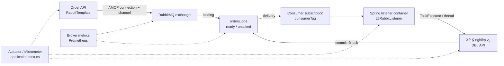
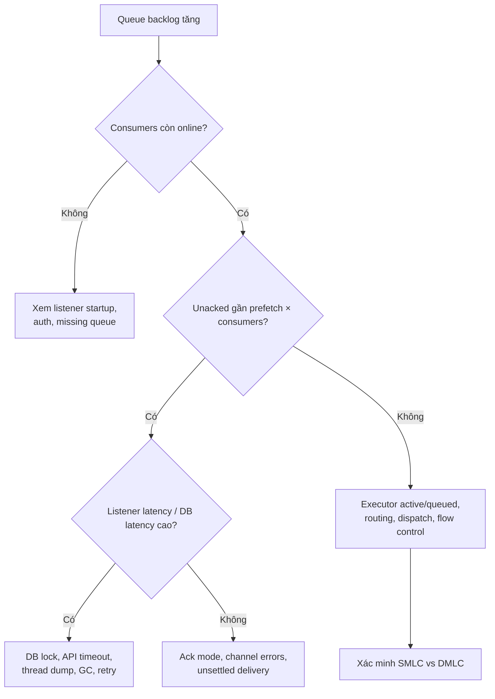

# Giám sát connection, channel, consumer và mức sử dụng executor

Một hệ thống **Spring AMQP** có thể vẫn trả HTTP 200, kết nối RabbitMQ vẫn hiển thị `open`, nhưng queue `orders.jobs` tăng từ 100 lên 100.000 message mà không có đơn hàng nào được hoàn tất. Nguyên nhân có thể là **không còn consumer**, consumer vẫn kết nối nhưng bị kẹt database, **channel** bị đóng liên tục do ack sai, hoặc thread pool mà listener sử dụng đã cạn tài nguyên.

Để chẩn đoán, chỉ nhìn `messages_ready` hay thông báo “Connected to RabbitMQ” là chưa đủ. Phải nối thông tin từ **RabbitMQ broker**, **connection/channel cache của ứng dụng**, **listener container**, **executor** và **kết quả nghiệp vụ**. Bài thuộc chương **Quan sát hệ thống** của module **SPRING_AMQP**, dùng ngữ cảnh `RabbitTemplate`, `@RabbitListener`, exchange, queue, binding, publisher confirm, consumer ack, retry và dead-letter để xây một hệ thống bất đồng bộ có thể giải thích được khi sự cố xảy ra.

Sau bài học, bạn có thể:

- Phân biệt connection, channel, consumer subscription, listener thread và business task; biết vì sao số lượng của chúng không bằng nhau.
- Theo dõi tốc độ tạo/đóng connection, channel, lỗi channel, publisher confirm và số delivery chưa ack.
- Quan sát số consumer hoạt động, lifecycle event, độ trễ listener, retry/redelivery và trạng thái queue.
- Đo `ThreadPoolTaskExecutor`: active threads, pool size, queue depth, completed tasks và rejected tasks.
- Phân biệt threading của `SimpleMessageListenerContainer` (SMLC) và `DirectMessageListenerContainer` (DMLC).
- Lập dashboard, ngưỡng cảnh báo và quy trình điều tra giúp tìm **nguyên nhân**, không chỉ nhìn thấy một metric tăng.

## 1. Bản đồ các lớp cần quan sát



Một thuật ngữ tưởng giống nhau có thể nói đến tài nguyên hoàn toàn khác:

| Đối tượng | Là gì? | Điều thường đo | Không nên suy diễn |
| --- | --- | --- | --- |
| **Connection** | Một kết nối AMQP/TCP giữa client và broker | Số lượng, open/close, reconnect, blocked, lưu lượng | Connection đang mở **không chứng minh** queue có consumer |
| **Channel** | Kênh logic AMQP 0-9-1 được multiplex trên connection | Open/close, channel churn, cache, unconfirmed publish, unacked delivery | Một channel không tương đương một message hoặc một thread |
| **Consumer** | Subscription `basic.consume` trên queue | Consumer count, consumer tag, prefetch, cancel/restart | Consumer còn đăng ký **không chứng minh** handler đang xử lý nhanh |
| **Listener container** | Spring quản lý consumer, recovery, chuyển delivery đến handler | Running state, concurrency, success/failure, lifecycle | Một container có thể quản lý **nhiều consumer** |
| **Executor** | Nguồn thread chạy listener hoặc công tác quản lý, tùy loại container | Active, queue, pool, rejection, thời gian chờ | Executor của DMLC không nhất thiết chạy business listener |
| **Business operation** | DB transaction hoặc side effect nghiệp vụ | Success, latency, duplicate, retry, SLA | `basicAck` thành công không tự chứng minh quy tắc nghiệp vụ đúng |

**Đơn vị quan sát nên ổn định:** `service`, `environment`, `vhost`, `queue`, `listenerId`, `executorName` và `instance` là những nhãn hữu ích nếu số lượng có kiểm soát. `messageId`, `correlationId`, `deliveryTag`, consumer tag biến động và giá trị payload nên đi vào **log/trace có kiểm soát**, không phải label của mọi metric vì dễ gây **high cardinality**.

## 2. Đọc dashboard theo chuỗi nguyên nhân – hậu quả

Giả sử producer publish 200 event/giây và consumer chỉ hoàn tất 120 event/giây. Trong khoảng dài, queue có xu hướng tăng backlog. Nhưng có nhiều nguyên nhân khiến throughput của consumer thấp:

```text
Tốc độ publish > tốc độ xử lý thành công
               |
               v
        messages_ready tăng
               |
      +--------+---------+
      |                  |
  consumers = 0      consumers > 0
      |                  |
 Mất subscription       +---- messages_unacked cao?
 / thiếu queue          |              |
 / lỗi quyền            Có             Không
                       |              |
               Handler chậm/       Credit, quyền,
               DB lock, retry,    dispatch, executor,
               chưa ACK           routing/đầu vào
```

Sơ đồ chỉ là cách phân nhánh **điều tra ban đầu**. `messages_unacknowledged` thấp có thể vì consumer ack nhanh rồi lỗi phía sau, hoặc vì producer thực tế không gửi vào queue. Muốn chẩn đoán đúng phải thêm **tốc độ publish, deliver, ack, redelivery, tình trạng executor và transaction**.

### 2.1. Bộ tín hiệu tối thiểu

| Tín hiệu | Đọc ở đâu? | Ý nghĩa |
| --- | --- | --- |
| Connections/channels đang mở | RabbitMQ Management/Prometheus | Broker có bao nhiêu kết nối và kênh logic đang tồn tại |
| Connection/channel opened/closed | Application events/log, broker metrics | Churn cao báo vấn đề vòng đời, timeout hoặc channel exception |
| Consumers trên **từng queue** | Broker Management/Prometheus | Subscription có thật ở queue mong đợi |
| `messages_ready` | Broker per-queue | Message đang chờ được giao |
| `messages_unacknowledged` | Broker per-queue | Delivery đang chờ consumer ack/nack |
| Delivery/ack/redelivery rate | Broker per-queue | Consumer nhận và xác nhận việc nhanh đến đâu; có lặp lại không |
| Listener latency và outcome | Spring Micrometer/Observation | Thời gian xử lý và exception tại listener |
| Executor active/pool/queued/rejected | Spring Boot Actuator/Micrometer hoặc custom binder | Thread có bận/kẹt, task có phải xếp hàng, có bị từ chối không |
| DB latency, timeout, connection pool | Driver/DB/Micrometer | Phân biệt executor hết thread vì tài nguyên ngoài chậm |
| Tuổi công việc chưa hoàn tất | Outbox/inbox và database nghiệp vụ | Người dùng đang đợi lâu bao nhiêu; SLA có vi phạm không |

**Không lấy số ACK làm số giao dịch nghiệp vụ đã thành công.** Với consumer ack thủ công, message có thể được ack dù handler lập trình sai; với message redelivery, một giao dịch có thể được thử lại nhiều lần. Nên đo riêng **business success**, **business duplicate blocked** và **business failure**.

## 3. Broker metrics: RabbitMQ Management và Prometheus

RabbitMQ Management plugin cung cấp UI và HTTP API để xem connections, channels, consumers, queue depth và routing. Với lưu trữ dài hạn, cảnh báo và dashboard Grafana, RabbitMQ khuyến nghị plugin **`rabbitmq_prometheus`**.

Ví dụ trong **môi trường được phép quản trị**:

```bash
# Bật exporter Prometheus trên RabbitMQ nếu chưa được platform bật.
rabbitmq-plugins enable rabbitmq_prometheus

# Mặc định exporter thường phục vụ trên TCP 15692;
# endpoint metrics có thể thay đổi qua cấu hình hạ tầng.
curl -fsS http://localhost:15692/metrics
```

**Bảo mật:** không đưa endpoint metrics/Management API ra Internet công khai. Giới hạn mạng, auth/TLS hoặc reverse proxy theo thiết kế của platform; exporter chứa thông tin chi tiết về hạ tầng.

### 3.1. Aggregated, per-object và detailed metrics

| Endpoint | Đặc điểm | Khi dùng |
| --- | --- | --- |
| `/metrics` | Thống kê **tổng hợp** mặc định, kích thước nhỏ hơn | Theo dõi sức khỏe cluster/node tổng quát |
| `/metrics/per-object` | Metric cho từng connection/queue/channel tùy họ metric | Chẩn đoán chi tiết trên môi trường nhỏ hoặc khi thật cần; chi phí/cardinality cao |
| `/metrics/detailed?family=...` | Chỉ lấy **nhóm metric yêu cầu** | Giám sát queue/consumer cụ thể mà không thu toàn bộ per-object metrics |
| Management UI/API | Xem trực tiếp từng kết nối, consumer tag, channel, queue, topology | Điều tra sự cố theo thời điểm, không nên dùng làm time-series store lâu dài |

Ví dụ exporter cho nhóm metric cần thiết:

```text
GET http://rabbitmq-host:15692/metrics/detailed?family=queue_coarse_metrics&family=queue_consumer_count
GET http://rabbitmq-host:15692/metrics/detailed?family=queue_delivery_metrics
GET http://rabbitmq-host:15692/metrics/detailed?family=connection_metrics&family=channel_metrics
```

Các họ metric `connection_metrics`/`channel_metrics` có thể **rất tốn kém** trong hệ thống có nhiều kết nối/channel. Không scrape chi tiết mỗi vài giây trên mọi node chỉ để vẽ một con số tổng. Chọn nhóm cần thiết, sampling phù hợp, retention ngắn cho dữ liệu chi tiết và giới hạn cardinality.

### 3.2. Một số tên metric có thật của endpoint detailed

| Metric (RabbitMQ Prometheus detailed) | Diễn giải |
| --- | --- |
| `rabbitmq_detailed_queue_messages_ready` | Message còn chờ được giao trên queue |
| `rabbitmq_detailed_queue_messages_unacked` | Message đã giao nhưng chưa ack |
| `rabbitmq_detailed_queue_messages` | Tổng ready + unacked |
| `rabbitmq_detailed_queue_consumers` | Số consumer đang đăng ký trên queue |
| `rabbitmq_detailed_queue_messages_delivered_ack_total` | Số delivery theo cơ chế manual acknowledgement |
| `rabbitmq_detailed_queue_messages_acked_total` | Tổng số message được xác nhận |
| `rabbitmq_detailed_queue_messages_redelivered_total` | Tổng số redeliveries |
| `rabbitmq_detailed_connection_channels` | Số channel trên một connection |
| `rabbitmq_detailed_channel_messages_unacked` | Delivery chưa ack ở channel |
| `rabbitmq_detailed_channel_messages_unconfirmed` | Publish đang chờ publisher confirm trên channel |
| `rabbitmq_detailed_channel_consumers` | Số consumer trên channel |

Các metric trong bảng **chỉ có khi scrape đúng family tương ứng**, không mặc định xuất hiện tất cả ở `/metrics`. Một số metric per-object có thể cần label `vhost`, `queue`, `node` hoặc ID động tùy exporter/version. Khi xây PromQL, kiểm tra output thực tế và tránh cộng cùng một queue trùng nhiều node mà không kiểm tra semantics của metric.

### 3.3. Một vài truy vấn PromQL minh họa

Các ví dụ này giả định Prometheus đã scrape `/metrics/detailed` đúng family và label `queue`/`vhost`:

```promql
# Queue có backlog chưa được giao (đơn vị message).
rabbitmq_detailed_queue_messages_ready{
  vhost="orders-prod", queue="orders.jobs"
}

# Consumer của một queue đã về 0.
rabbitmq_detailed_queue_consumers{
  vhost="orders-prod", queue="orders.jobs"
} == 0

# Tốc độ redelivery theo 5 phút (events/giây).
rate(rabbitmq_detailed_queue_messages_redelivered_total{
  vhost="orders-prod", queue="orders.jobs"
}[5m])
```

**Cảnh báo PromQL cần có điều kiện “metric biến mất”.** Nếu queue bị xóa, metric per-queue có thể **không tồn tại** thay vì cho giá trị 0. Một rule chỉ dùng `== 0` có thể bỏ sót đúng sự cố queue mất; kết hợp kiểm tra `absent()`, trạng thái exporter và quy ước topology được quản lý.

## 4. Connection: xem số lượng, vòng đời và block state

Một AMQP 0-9-1 connection là kết nối dài hạn; Spring `CachingConnectionFactory` thường tái sử dụng connection/channel. Broker và ứng dụng nên quan sát:

- **Số connection đang mở theo service/instance/vhost.** Một service có nhiều publisher/consumer hoặc connection factory riêng có thể mở nhiều connection; không áp đặt một connection là chuẩn cho mọi app.
- **Connection churn:** tạo/đóng liên tục khi không deploy là dấu hiệu đáng điều tra; có thể do network, heartbeat, TLS credential hết hạn, auth/permission hoặc ứng dụng tạo factory liên tục.
- **Blocked/unblocked state:** khi broker chặn publisher do alarm bộ nhớ/disk, producer có thể gặp độ trễ/timeout; client cần quan sát sự kiện block và thời gian chờ confirm.
- **Client-provided connection name:** tên có cấu trúc `service/env/instance` giúp đối chiếu connection ở broker với log Spring và deployment.
- **Publisher confirm timeouts:** không phải lúc nào cũng do broker unreachable; có thể do disk pressure, flow control hoặc lỗi mạng sau publish.

**Connection count gần bằng 1 không đồng nghĩa healthy.** Broker còn kết nối nhưng consumer có thể bị hủy, queue mất hoặc handler vẫn đang kẹt. Ngược lại, tăng connection vào lúc rolling deploy có thể là hiện tượng bình thường nếu instance cũ và mới chạy song song.

### 4.1. Quan sát sự kiện kết nối trong Spring

`CachingConnectionFactory` cho phép đăng ký `ConnectionListener` để nhận các sự kiện về vòng đời connection. Nên đếm sự kiện theo **loại outcome**, nguồn service/instance và thời điểm, tránh log username, password hoặc toàn bộ URI chứa credential.

Một cấu hình connection-name đơn giản:

```java
import org.springframework.amqp.rabbit.connection.CachingConnectionFactory;
import org.springframework.context.annotation.Bean;
import org.springframework.context.annotation.Configuration;

@Configuration
public class ConnectionMonitoringConfig {

    // Minh họa cho ứng dụng CHỦ ĐỘNG tạo connection factory;
    // nếu Boot đã auto-configure factory thì không khai báo bean trùng.
    @Bean
    CachingConnectionFactory rabbitConnectionFactory() {
        CachingConnectionFactory factory =
                new CachingConnectionFactory("localhost");
        factory.setConnectionNameStrategy(cf -> "orders-worker/dev");
        return factory;
    }
}
```

**Chỉ là ví dụ local:** nếu dùng Spring Boot production, thường nên giữ auto-configured factory và bổ sung `ConnectionNameStrategy` thông qua cấu hình/customization thích hợp, thay vì tạo factory `localhost` có thể bỏ qua TLS/secret/vhost của deployment. Không dùng tên connection làm nhãn metric với instance UUID thay đổi liên tục nếu cần giữ cardinality thấp.

### 4.2. Kiểm tra bằng RabbitMQ CLI

```bash
# Chạy bởi operator có quyền, trong môi trường RabbitMQ phù hợp.
rabbitmqctl list_connections name user vhost state channels
rabbitmqctl list_channels connection number consumer_count messages_unacknowledged
```

Tên field/CLI có thể khác theo phiên bản broker; nếu lệnh trả lỗi field, xem `rabbitmqctl help list_connections` hoặc `list_channels`. Không kết luận lỗi ứng dụng chỉ từ số connection: so sánh theo thời gian và theo deployment.

## 5. Channel: cache, churn và giới hạn tài nguyên

RabbitMQ multiplex nhiều **AMQP channel** trên một connection. `RabbitTemplate` có thể mượn channel để publish; listener thường giữ channel phục vụ delivery và acknowledgement. Channel không nên bị tạo/đóng ở tốc độ cao một cách không cần thiết.

### 5.1. `channelCacheSize` không mặc nhiên là giới hạn tổng channel

Trong chế độ `CachingConnectionFactory.CacheMode.CHANNEL` thông thường:

- `channelCacheSize` quy định **số channel idle được cache**, không phải tổng channel có thể được sử dụng đồng thời.
- Khi nhu cầu cao hơn cache, Spring có thể tạo thêm channel; channel trả lại khi cache đầy sẽ bị đóng vật lý.
- Nếu `channelCheckoutTimeout` **lớn hơn 0**, Spring bật cơ chế **giới hạn số channel**: lúc đó `channelCacheSize` trở thành giới hạn channel dùng đồng thời trên mỗi connection và có thể chờ để mượn; hết thời gian sẽ phát sinh lỗi timeout.
- Có những pool/cache riêng cho channel transactional và non-transactional; không suy rằng broker channel count bằng giá trị một gauge “idle”.

Ví dụ minh họa:

```text
channelCacheSize = 25
channelCheckoutTimeout = 0
Peak 80 publish operations đồng thời
  -> có thể phải tạo >25 channel trong một connection
  -> khi trả về, chỉ một số được giữ idle; số khác bị đóng.

channelCacheSize = 25
channelCheckoutTimeout = 1000 ms
  -> nhu cầu mượn vượt giới hạn có thể phải CHỜ
  -> hết 1 giây có thể nhận AmqpTimeoutException.
```

**Không tăng `channelCacheSize` chỉ vì thấy `messages_unacked` cao.** Đây là hai loại tài nguyên khác nhau: unacked delivery có thể do listener xử lý chậm; nâng cache publisher không giải quyết transaction DB bị kẹt.

### 5.2. Đọc cache properties trong ứng dụng

`CachingConnectionFactory.getCacheProperties()` trả về `Properties` để phục vụ chẩn đoán:

```java
import java.util.Properties;
import org.springframework.amqp.rabbit.connection.CachingConnectionFactory;
import org.springframework.stereotype.Component;

@Component
public class RabbitChannelCacheInspector {
    private final CachingConnectionFactory connectionFactory;

    public RabbitChannelCacheInspector(
            CachingConnectionFactory connectionFactory) {
        this.connectionFactory = connectionFactory;
    }

    public String snapshot() {
        Properties p = connectionFactory.getCacheProperties();
        return "mode=" + p.getProperty("cacheMode")
             + ", cacheSize=" + p.getProperty("channelCacheSize")
             + ", idleNonTx=" + p.getProperty("idleChannelsNotTx")
             + ", idleTx=" + p.getProperty("idleChannelsTx")
             + ", idleNonTxHighWater="
             + p.getProperty("idleChannelsNotTxHighWater");
    }
}
```

Đây là **đoạn tiện ích chẩn đoán**, không phải metric endpoint tự động có sẵn. Các thuộc tính và high-water mark phụ thuộc `CacheMode`/phiên bản. `idleChannelsNotTxHighWater` là mức cao nhất của **số channel idle trong cache**, **không phải đỉnh tổng số channel được tạo/đang dùng**. Muốn phân tích churn cần kết hợp broker channel opened/closed và sự kiện lỗi tại client.

Không xuất `connectionName` hoặc `localPort` động thành label cho từng lần scrape nếu số giá trị tăng vô hạn. Chúng hữu ích để **đối chiếu một connection cụ thể trong log điều tra**, không phù hợp với mọi time series.

### 5.3. Chẩn đoán channel bị đóng liên tục

| Dấu hiệu | Khả năng | Kiểm tra |
| --- | --- | --- |
| `PRECONDITION_FAILED - unknown delivery tag` | Ack sai channel, ack trùng hoặc nhầm phạm vi `multiple=true` | Xem stack trace, channel và mã/đường ack |
| `NOT_FOUND` khi consume/declare | Queue/exchange không tồn tại | Xác minh topology, vhost, owner và listener recovery |
| `ACCESS_REFUSED` | Thiếu quyền declare/read/write | Kiểm tra ACL `configure/write/read` |
| Channel count tăng liên tục | Channel lifecycle leak hoặc concurrency tăng | Phân biệt đang dùng thực với cache; kiểm tra số consumer/publisher |
| Channel churn tăng nhanh nhưng count thấp | Cache không giữ đủ idle channels, mở/đóng liên tục | So sánh `channelCacheSize` với workload và latency |
| `AmqpTimeoutException` khi mượn channel | Giới hạn checkout hoặc broker/network bị kẹt | `channelCheckoutTimeout`, số channel dùng đồng thời, publisher concurrency |

**Channel error có thể làm connection vẫn sống.** Vì vậy một health check “RabbitMQ connected” có thể bỏ sót channel bị đóng do thao tác AMQP không hợp lệ.

## 6. Consumer: đếm subscription, theo dõi lifecycle và tiến độ

Consumer count trên queue cho biết **bao nhiêu subscription đã đăng ký**, không phải bao nhiêu message mỗi giây được commit. Với listener có concurrency cố định bằng 4, một queue có thể có bốn consumer; khi scale 3 pod, tổng số consumer có thể tăng theo số instance.

**Đừng dùng số consumer cố định mà không tính replication/deployment.** Trong rolling deployment, count có thể tạm tăng; với Single Active Consumer, nhiều consumer đăng ký nhưng chỉ một consumer **active** nhận delivery theo cơ chế của broker.

### 6.1. Theo dõi Spring listener events

Spring AMQP cung cấp các sự kiện quan trọng:

| Event | Dùng để quan sát | Giới hạn |
| --- | --- | --- |
| `ConsumeOkEvent` | Broker chấp thuận subscription, có queue và consumer tag | Không chứng minh listener đã xử lý message |
| `ListenerContainerConsumerFailedEvent` | Consumer failure, `reason`, `fatal`, `Throwable` | Một sự cố broker có thể tạo nhiều event ở nhiều consumer |
| `MissingQueueEvent` | Queue cần nghe bị thiếu | Không khẳng định message đã được khôi phục |
| `AsyncConsumerRestartedEvent` | SMLC khởi động lại consumer sau lỗi | Không tự chứng minh nghiệp vụ đã phục hồi |
| `ListenerContainerIdleEvent` | Listener không nhận delivery trong một khoảng | Nếu queue không có message thì idle là bình thường |

Ví dụ đếm lỗi và log định danh ổn định:

```java
import io.micrometer.core.instrument.Counter;
import io.micrometer.core.instrument.MeterRegistry;
import org.slf4j.Logger;
import org.slf4j.LoggerFactory;
import org.springframework.amqp.rabbit.listener.ConsumeOkEvent;
import org.springframework.amqp.rabbit.listener.ListenerContainerConsumerFailedEvent;
import org.springframework.amqp.rabbit.listener.MissingQueueEvent;
import org.springframework.context.event.EventListener;
import org.springframework.stereotype.Component;

@Component
public class RabbitConsumerLifecycleMetrics {
    private static final Logger log =
            LoggerFactory.getLogger(RabbitConsumerLifecycleMetrics.class);
    private final Counter failed;
    private final Counter missingQueue;

    public RabbitConsumerLifecycleMetrics(MeterRegistry registry) {
        this.failed = Counter.builder("app.rabbit.consumer.failures")
                .description("Listener consumer failure events")
                .register(registry);
        this.missingQueue = Counter.builder("app.rabbit.consumer.missing_queue")
                .description("Missing queue events")
                .register(registry);
    }

    @EventListener
    public void failed(ListenerContainerConsumerFailedEvent event) {
        failed.increment();
        log.warn("Rabbit consumer failed fatal={} reason={}",
                event.isFatal(), event.getReason());
    }

    @EventListener
    public void missing(MissingQueueEvent event) {
        missingQueue.increment();
        log.error("RabbitMQ queue missing: {}", event.getQueue());
    }

    @EventListener
    public void subscribed(ConsumeOkEvent event) {
        log.info("RabbitMQ subscription ok queue={} tag={}",
                event.getQueue(), event.getConsumerTag());
    }
}
```

Các counter `app.rabbit.consumer.*` là **custom metric**, không phải metric RabbitMQ tự phát ra. Ví dụ intentionally không gắn consumer tag hoặc nguyên văn `reason` làm label vì giá trị có thể thay đổi liên tục; log vẫn nên chứa đủ ngữ cảnh cần điều tra.

Nếu có nhiều listener, có thể thêm tag cố định `listenerId`/`service` qua cách đăng ký meter tương ứng, tránh tạo series mới theo mỗi message hoặc exception text. Muốn đo **trạng thái hiện tại** (consumer còn đăng ký hay không), xem metric broker hoặc container snapshot; **một counter sự kiện không phải gauge trạng thái hiện tại**.

### 6.2. Listener chạy nhưng nghiệp vụ không tiến triển

Khi `consumers > 0`, cần phân tích:

- `messages_ready` tăng và `messages_unacked` xấp xỉ **prefetch × consumers**: có thể consumer đã nhận nhiều nhưng xử lý rất chậm/kẹt hoặc thiếu ack.
- `messages_unacked` thấp, `messages_ready` cao: có thể consumer chưa thực sự nhận đều, prefetch nhỏ, executor bị đói thread, flow control hoặc lỗi dispatch.
- `redelivery rate` tăng cùng số lỗi listener: nghi vấn poison message, lỗi DB, nack-requeue liên tục hoặc consumer restart.
- `ack rate` cao nhưng **business success** thấp: kiểm tra ack trước commit, swallow exception, transaction rollback và nhánh dedup.
- `consumers = 0`: cần kiểm tra queue còn tồn tại, lỗi auth, `missingQueuesFatal`, listener stopped, mất kết nối hoặc deploy chưa đăng ký bean.

Nếu consumer dùng `AcknowledgeMode.MANUAL`, **không ack/nack** một delivery sẽ khiến nó vẫn unacked. Nếu handler ném exception và bị bắt/swallow không đúng, broker có thể không được báo trạng thái cuối. Cần logging có event ID, handler outcome và thao tác acknowledgement.

## 7. Executor: SMLC và DMLC **khác** đường chạy listener

Đây là điểm rất dễ gây sai lệch khi xây dashboard.

| Loại container | Thread nào gọi `@RabbitListener`? | `taskExecutor` của container dùng cho | Cần đo thêm |
| --- | --- | --- | --- |
| **SMLC** (`SimpleMessageListenerContainer`) | **Thread của `TaskExecutor`** cấu hình trên container | Thực thi consumer/listener task | Pool active, queued, rejection, listener latency |
| **DMLC** (`DirectMessageListenerContainer`) | **Thread callback của RabbitMQ Java client** | Chủ yếu công việc **giám sát consumer**, không phải thread gọi business listener | RabbitMQ client dispatch executor/thread, consumer status, broker metrics |

Với SMLC, nếu bạn cấu hình `concurrentConsumers=8` nhưng cấp executor chỉ có **4 thread có khả năng chạy**, một phần consumer task có thể không khởi động hoặc không hoạt động như mong đợi. Với DMLC, tăng kích thước `taskExecutor` container **không tự tăng số thread xử lý business message** vì listener chạy trên luồng khác.

Spring AMQP có mặc định `SimpleAsyncTaskExecutor` cho SMLC nếu không cấu hình. Nó **không giống một `ThreadPoolTaskExecutor` cố định với số core/max, queue và rejected count dễ quan sát**. Nếu yêu cầu kiểm soát và metrics executor rõ ràng, cấu hình bean `ThreadPoolTaskExecutor` riêng và đo nó bằng Spring Boot Actuator/Micrometer.

### 7.1. Ví dụ Spring cấu hình SMLC với executor riêng

```java
import org.springframework.amqp.core.AcknowledgeMode;
import org.springframework.amqp.rabbit.config.SimpleRabbitListenerContainerFactory;
import org.springframework.amqp.rabbit.connection.ConnectionFactory;
import org.springframework.context.annotation.Bean;
import org.springframework.context.annotation.Configuration;
import org.springframework.scheduling.concurrent.ThreadPoolTaskExecutor;

@Configuration
public class ObservedRabbitConsumerConfig {

    @Bean("rabbitListenerExecutor")
    ThreadPoolTaskExecutor rabbitListenerExecutor() {
        ThreadPoolTaskExecutor executor = new ThreadPoolTaskExecutor();
        executor.setCorePoolSize(8);
        executor.setMaxPoolSize(16);
        executor.setQueueCapacity(100);
        executor.setThreadNamePrefix("rabbit-orders-");
        return executor;
    }

    @Bean("observedRabbitFactory")
    SimpleRabbitListenerContainerFactory observedRabbitFactory(
            ConnectionFactory connectionFactory,
            ThreadPoolTaskExecutor rabbitListenerExecutor) {
        SimpleRabbitListenerContainerFactory factory =
                new SimpleRabbitListenerContainerFactory();
        factory.setConnectionFactory(connectionFactory);
        factory.setTaskExecutor(rabbitListenerExecutor);
        factory.setConcurrentConsumers(4);
        factory.setMaxConcurrentConsumers(8);
        factory.setPrefetchCount(20);
        factory.setAcknowledgeMode(AcknowledgeMode.AUTO);
        factory.setObservationEnabled(true);
        return factory;
    }
}
```

Lưu ý khi dùng Spring: nếu có **nhiều bean `ThreadPoolTaskExecutor`**, inject bằng `@Qualifier("rabbitListenerExecutor")` để tránh ambiguity. Ví dụ này giả định bean executor được chọn đúng và container chạy dưới Spring Boot/AMQP có hỗ trợ Micrometer Observation.

**Cách đọc cấu hình:**

- `concurrentConsumers=4`: SMLC khởi đầu với bốn consumer, có thể tăng tới `maxConcurrentConsumers=8` khi điều kiện scaling của container được đáp ứng.
- `prefetchCount=20`: mỗi consumer có thể giữ nhiều delivery chưa ack; nó **không phải** số thread xử lý đồng thời.
- Pool core 8, max 16, queue 100 là ví dụ thử nghiệm, **không có nghĩa 16 consumer luôn cần 16 thread**. Với cấu hình tối đa 8 consumer, pool có đủ thread dự phòng cho ví dụ; cần đo workload thực tế.
- `setObservationEnabled(true)` bật Spring observation cho listener thay vì chỉ dựa vào các timer cũ.

**Bẫy của `ThreadPoolExecutor`:** khi core threads đã bận và hàng đợi chưa đầy, task mới thường được **đưa vào queue** trước khi mở rộng tới `maxPoolSize`. Vì vậy `maxPoolSize=16` không có nghĩa executor lập tức tăng lên 16 thread khi core=8. Với consumer task dài hạn, queue chứa các consumer task chờ khởi động có thể khiến tưởng container đã tăng concurrency trong khi executor chưa thực sự cấp luồng.

### 7.2. Gắn listener và phân biệt latency

```java
import org.springframework.amqp.rabbit.annotation.RabbitListener;
import org.springframework.stereotype.Component;

@Component
public class ObservedOrderListener {
    private final OrderHandler handler;

    public ObservedOrderListener(OrderHandler handler) {
        this.handler = handler;
    }

    @RabbitListener(id = "orders-jobs-listener",
                    queues = "orders.jobs",
                    containerFactory = "observedRabbitFactory")
    public void onOrder(String payload) {
        // OrderHandler là service do ứng dụng tự triển khai;
        // transaction + idempotency, lỗi được propagate rõ ràng.
        handler.process(payload);
    }
}
```

Ví dụ dùng **AUTO acknowledgement** để container ack sau khi handler hoàn tất thành công; lỗi theo chính sách error handler của container. `OrderHandler` cần implementation, transaction, retry/DLQ theo nhu cầu. Trong hệ thống đòi kiểm soát từng delivery, có thể chọn MANUAL ack nhưng phải tự gọi `basicAck/basicNack` đúng channel sau khi commit.

**Listener latency** đo thời gian thực thi handler (và một số overhead của adapter), **không phải end-to-end latency từ lúc producer publish**. Để đo end-to-end, lưu event creation time an toàn trong payload/header và đo khi transaction nghiệp vụ commit; chú ý đồng bộ đồng hồ và tránh nhầm thời gian broker lưu/chờ queue với thời gian xử lý Java.

## 8. Dùng Spring Boot Actuator và Micrometer

Một ứng dụng có `spring-boot-starter-actuator` và `micrometer-registry-prometheus` có thể xuất các metric phù hợp qua `/actuator/prometheus` khi đã **expose endpoint**.

Ví dụ dependency Maven:

```xml
<dependency>
    <groupId>org.springframework.boot</groupId>
    <artifactId>spring-boot-starter-actuator</artifactId>
</dependency>
<dependency>
    <groupId>io.micrometer</groupId>
    <artifactId>micrometer-registry-prometheus</artifactId>
</dependency>
```

Với Spring Boot hiện hành:

```yaml
management:
  endpoints:
    web:
      exposure:
        include: "health,info,metrics,prometheus"
  metrics:
    tags:
      application: "orders-worker"
      environment: "staging"
```

**Chỉ expose endpoint metrics trên mạng quản trị**; bảo vệ bằng TLS/auth/RBAC/network policy theo hạ tầng. Nếu chưa expose `prometheus`, việc đã thêm dependency không bảo đảm endpoint HTTP truy cập được.

### 8.1. Hai kiểu đo listener

| Kiểu đo | Khi dùng | Metric tiêu biểu |
| --- | --- | --- |
| **Micrometer Timer truyền thống** | Có Micrometer registry, không bật observation | `spring.rabbitmq.listener` với tags `listenerId`, `queue`, `result`, `exception` (tùy phiên bản) |
| **Micrometer Observation** | Bật `observationEnabled` trên factory/template | `spring.rabbit.listener` và `spring.rabbit.listener.active` theo convention, có thể kết nối trace |

Khi bật `observationEnabled`, Spring AMQP **không đồng thời duy trì timer truyền thống theo cách cũ**, vì observation quản lý đo lường. Đừng tạo dashboard bắt buộc dựa vào `spring.rabbitmq.listener` rồi chuyển sang observation mà không cập nhật truy vấn.

**Batch listener có caveat:** Spring AMQP không tạo observations cho batch listener container theo cơ chế thông thường do cách diễn giải trace không rõ ràng. Nếu bật consumer batch, cần kiểm tra metric thực tế và có thể phải thêm metric nghiệp vụ riêng.

### 8.2. Các metric executor

Spring Boot Actuator tự instrument các bean `ThreadPoolTaskExecutor`/`ThreadPoolTaskScheduler` phù hợp khi underlying executor có sẵn. Những meter thường quan sát được dưới prefix **`executor.*`**, được gắn nhãn bằng tên bean:

| Meter logic | Ý nghĩa |
| --- | --- |
| `executor.active` | Số thread đang thực thi task |
| `executor.pool.size` | Số thread hiện có trong pool |
| `executor.pool.core` / `executor.pool.max` | Ngưỡng core/max của pool |
| `executor.queued` | Số task chờ trong hàng đợi |
| `executor.queue.remaining` | Dung lượng còn lại của hàng đợi khi có thể xác định |
| `executor.completed` | Tổng số task đã hoàn thành |

Tên meter xuất ra ở Prometheus có thể được **chuẩn hóa** (dấu chấm thành gạch dưới, suffix theo metric type), và danh sách meter phụ thuộc phiên bản Spring Boot/Micrometer. Xác minh tại `/actuator/metrics` trước khi tạo query; nếu không có metric `rejected` mặc định, hãy thêm **counter riêng** qua `RejectedExecutionHandler` hoặc nơi bắt `TaskRejectedException` thay vì giả định nó luôn tồn tại.

**`executor.queued=0` không đồng nghĩa executor rảnh.** Một pool 8/8 threads đang xử lý tám consumer task dài hạn có thể có queue rỗng nhưng **không còn thread** cho task khác. Đọc `active/pool` cùng queue, listener concurrency và thời gian chờ task.

### 8.3. Trace và correlation ID

Với Spring AMQP 3.x trở lên, Micrometer Observation có thể tích hợp tracing cho `RabbitTemplate` và listener. Giữ định danh nghiệp vụ (`eventId`, `orderId`) trong logs/trace theo chính sách dữ liệu, không đưa payload/PII vào metric tags.

Publisher confirm cho biết broker chấp nhận publish, còn consumer ack cho biết broker nhận xác nhận delivery. Một trace có các span publish/consume **không đủ để chứng minh business transaction đã commit**, vì vậy cần log marker `DB_COMMITTED`/`BUSINESS_COMPLETED` hoặc đo bằng database nghiệp vụ.

## 9. Đo mức sử dụng executor cho đúng tải

Giả sử có 4 consumer, pool của listener còn 8 core threads và hàng đợi 100 task:

| Quan sát | Cách hiểu có thể đúng | Kiểm tra tiếp |
| --- | --- | --- |
| `active=4`, `pool=8`, `queued=0`, CPU bình thường | Có bốn consumer task dài hạn và vẫn còn tài nguyên | So sánh consumer count broker; backlog và handler latency |
| `active=8`, `pool=8`, `queued=100` | Saturation/thiếu worker thread hoặc executor dùng chung bị chiếm | Task nào đang chạy? Vì sao queue tăng? Có blocking I/O? |
| `active=8`, `pool=8`, `queued=0` | Có thể đã kín thread nhưng không có request mới | Thread dump, producer throughput, consumer latency |
| `pool` tăng mạnh, rejection tăng | Tải hoặc cấu hình pool/queue chưa phù hợp | Backpressure, tối ưu handler, giới hạn concurrency |
| Thread pool rảnh nhưng `messages_unacked` rất cao | Có thể listener chạy ở **executor khác** hoặc handler đang chờ ngoại vi | Kiểm tra SMLC/DMLC, Rabbit client threads, DB pool |
| Pool chỉ có 2 thread, consumer cấu hình 8 | Không đủ thread chạy 8 consumer SMLC | Tăng executor hợp lý hoặc giảm concurrency |

Một số tác vụ trong listener có thể được chuyển sang `@Async` hoặc một executor khác. Khi đó metric `rabbitListenerExecutor` **không phản ánh** toàn bộ công việc. Nếu listener trả về trước khi xử lý side effect hoàn tất nhưng container ack ngay, có thể mất tác vụ khi async job thất bại. Thiết kế async acknowledgement hoặc transaction/outbox có chủ đích trước khi tối ưu thread.

### 9.1. Phân biệt executor starvation với database bottleneck



Nếu tăng pool size mà throughput không đổi và DB connection pool đã chạm max, bạn có thể chỉ chuyển chỗ nghẽn từ executor sang database. Khi cần tối ưu, đo **throughput, p95/p99 latency, error/retry rate và resource utilization** trước/sau cùng một workload.

## 10. Ngưỡng cảnh báo: ưu tiên kết quả nghiệp vụ

Một dashboard tốt không chỉ có đường biểu diễn đẹp mà phải phát hiện lúc service không còn hoàn tất công việc đúng SLA.

| Tình trạng | Alert gợi ý | Tránh false positive |
| --- | --- | --- |
| Queue quan trọng không có consumer | `consumers == 0` hoặc metric queue biến mất trên một khoảng thời gian | Queue tạm/không có owner hoặc đang migration đã được phê duyệt |
| Backlog tăng liên tục | `messages_ready` tăng trong nhiều cửa sổ và publisher rate > ack/business throughput | Spike ngắn, batch job định kỳ |
| `unacked` cao kéo dài | Unacked gần credit/prefetch trong thời gian dài | Workload cố ý chạy tác vụ dài hoặc prefetch lớn |
| Executor ở ngưỡng | Active gần max **và** queued tăng/rejection xuất hiện | Consumer task dài hạn khiến active tự nhiên cao |
| Connection/channel churn | Mở/đóng tăng bất thường khi không rollout | Rolling deploy, autoscale hoặc broker failover đã dự kiến |
| Consumer failure/restart | `ListenerContainerConsumerFailedEvent` tăng, cùng redelivery | Restart có chủ đích |
| DLQ/retry tăng | Tỷ lệ reject/requeue và DLQ depth tăng | Kiểm thử sự cố hoặc campaign replay được phê duyệt |
| Business SLA vi phạm | Tuổi event chưa có kết quả vượt ngưỡng nghiệp vụ | Trạng thái pending hợp lệ theo workflow |

**Không dùng một ngưỡng cố định cho mọi queue.** Một queue gửi email có thể chấp nhận backlog vài phút; queue thanh toán có thể cần cảnh báo sớm hơn. Đặt **SLO theo nghiệp vụ** và dùng metrics connection/channel/consumer/executor để giải thích khi SLO bị vi phạm.

### PromQL: ví dụ về alert bền hơn

```promql
# Ví dụ: queue quan trọng có 0 consumer trong 5 phút
# (dùng điều kiện for: 5m ở alert rule, không chỉ query tức thời):
rabbitmq_detailed_queue_consumers{
  vhost="orders-prod", queue="orders.jobs"
} == 0

# Queue có thể đã bị xóa và series biến mất:
absent(rabbitmq_detailed_queue_consumers{
  vhost="orders-prod", queue="orders.jobs"
})
```

Với cụm nhiều node, metric per-queue có thể được phát bởi một hoặc nhiều scrape target tùy queue type/placement. Hãy kiểm tra label `instance`/`node` và phương pháp tổng hợp theo queue trước khi dùng `absent()` hoặc so sánh count ở quy mô cluster. `absent()` cũng có thể bị kích hoạt khi **exporter/scrape target không hoạt động**; kết hợp alert `up==0` để phân biệt mất metric với mất queue.

## 11. Runbook: điều tra ba sự cố thường gặp

### Tình huống A — RabbitMQ connection liên tục reconnect

**Triệu chứng:** broker connection count dao động, log Spring có connection shutdown, publisher confirm timeout, listener thỉnh thoảng restart.

**Điều tra:**

1. Ghép timestamp giữa log application, RabbitMQ node, Kubernetes pod/deployment và network.
2. Xem có TLS cert/credential xoay vòng, heartbeat timeout, broker memory/disk alarm hoặc rolling restart không.
3. Kiểm tra `connection_name` và `localPort` để đối chiếu đúng client với broker; chú ý connection riêng cho publisher nếu có.
4. Đo số lần connection/channel tạo/đóng, thời gian phục hồi subscription và tuổi outbox pending.
5. Khi khôi phục, kiểm tra message đã commit nhưng ack bị mất có thể redeliver; xác nhận idempotency hoạt động.

**Không tự khắc phục bằng vòng retry cực ngắn:** kết nối liên tục khi broker đang quá tải chỉ làm tăng áp lực. Dùng recovery interval/backoff phù hợp và cảnh báo.

### Tình huống B — Connection còn mở, consumer count về 0

**Triệu chứng:** RabbitMQ connection `open` nhưng queue `orders.jobs` không có consumer, `messages_ready` tăng.

**Điều tra:**

1. Kiểm tra listener container `running`, `@RabbitListener` có được đăng ký và queue/vhost có đúng không.
2. Xem `MissingQueueEvent`, `ListenerContainerConsumerFailedEvent`, `ConsumeOkEvent`; đối chiếu broker `basic.cancel`, `NOT_FOUND`, `ACCESS_REFUSED`.
3. Kiểm tra executor SMLC có đủ thread để khởi động consumer task không.
4. Kiểm tra queue bị xóa hay chỉ thiếu binding; **tạo lại queue không khôi phục message đã bị xóa**.
5. Phục hồi topology theo owner, subscription và kiểm tra end-to-end; đối soát outbox/DB để phát lại event thiếu nếu cần.

### Tình huống C — Consumer count vẫn đủ, nhưng backlog và unacked tăng

**Triệu chứng:** consumer count như trước, `messages_unacked` tăng gần prefetch, listener latency cao, executor có nhiều active threads.

**Điều tra:**

1. Đo DB connection pool, lock wait, transaction duration, API timeout, GC pause.
2. Lấy thread dump trong môi trường được phép để xem thread đang đợi gì, phân biệt SMLC consumer threads với RabbitMQ client dispatch threads của DMLC.
3. Kiểm tra có message `redelivered` liên tục, poison message, retry nóng hoặc listener quên ack/nack trong MANUAL mode không.
4. Xem publisher rate, ack rate, business success rate và hàng đợi executor; xác định throughput thực.
5. Tối ưu nguyên nhân gốc (transaction/I/O/retry), rồi mới chỉnh concurrency/prefetch/executor trên môi trường test.

## 12. Thực hành đo tải và mô phỏng lỗi

Chuẩn bị một ứng dụng Spring Boot có `RabbitTemplate` publish event vào direct exchange `orders.events`, binding vào queue `orders.jobs` và `@RabbitListener` dùng `observedRabbitFactory`. Bật Actuator/Micrometer, RabbitMQ Prometheus plugin và một dashboard Prometheus/Grafana trong **môi trường development/staging**.

1. **Đối chứng ổn định:** producer gửi 10 message/giây, handler xử lý ~20 ms/message. Ghi consumer count, listener duration, ack rate, ready/unacked và executor active/queued.
2. **Tăng tải từ từ:** đưa producer lên 100 rồi 500 message/giây. So sánh thời điểm backlog tăng với executor active, DB pool và handler latency.
3. **Giảm executor capacity:** giảm core/max xuống dưới concurrent consumers ở SMLC test. Quan sát sự khác biệt giữa consumer count cấu hình và consumer thực chạy, executor queued/rejections và startup.
4. **So sánh SMLC và DMLC:** chuyển listener sang DMLC thử nghiệm có cấu hình phù hợp, quan sát rằng thread gọi handler thuộc RabbitMQ client dispatch, còn container task executor không có cùng vai trò.
5. **Giới hạn channel:** bật `channelCheckoutTimeout` >0 và tạo burst publish nhiều hơn sức chứa; kiểm tra `AmqpTimeoutException` và channel activity. Không thực hiện test phá tải trên broker production.
6. **Lỗi ACK:** trên một listener cô lập, chủ động mô phỏng ack trùng/sai tag để quan sát channel close và recovery; không làm với dữ liệu thật.
7. **Consumer mất subscription:** trong RabbitMQ test, stop listener hoặc tạm làm queue không khả dụng theo kịch bản kiểm soát. Quan sát `ConsumeOkEvent`/consumer failure và alert consumer count.
8. **DB chậm:** chèn độ trễ giả lập vào handler; quan sát `messages_unacked`/listener latency/DB metrics. Tăng executor có chữa được nguyên nhân hay chỉ tăng tranh chấp?
9. **Redelivery:** làm consumer chết sau DB commit nhưng trước ack; kiểm tra redelivery, idempotency và business success cuối cùng.
10. **Diễn tập alert:** xác nhận alert consumer count 0, queue missing metric, executor saturation và SLO được kích hoạt, đồng thời tránh false positive khi rolling deploy.

### Ghi lại kết quả

| Thử nghiệm | Throughput (msg/s) | p95 listener (ms) | Ready / unacked | Consumer count | Executor active/queued | Kết luận |
| --- | ---: | ---: | --- | ---: | --- | --- |
| Baseline | Điền sau thử | Điền sau thử | Điền sau thử | Điền sau thử | Điền sau thử | Không giả định trước |
| Producer burst | Điền sau thử | Điền sau thử | Điền sau thử | Điền sau thử | Điền sau thử | Xác định nút thắt |
| DB slow | Điền sau thử | Điền sau thử | Điền sau thử | Điền sau thử | Điền sau thử | So sánh với burst |
| Executor constrained | Điền sau thử | Điền sau thử | Điền sau thử | Điền sau thử | Điền sau thử | Phân biệt chờ thread |

**Khi báo cáo:** dùng cùng cửa sổ đo, cùng cấu hình broker và các loại message tương đương. Đừng so sánh p95 ở lúc queue rỗng với p95 khi backlog đang tồn tại mà không ghi lại độ trễ chờ queue.

## 13. Các nhầm lẫn gây kết luận sai

| Nhầm lẫn | Vì sao sai | Cách sửa |
| --- | --- | --- |
| “Connection open tức là consumer khỏe” | Subscription có thể bị hủy, queue không tồn tại | Đo consumer per queue + lifecycle events |
| “Channel cache size = tổng số channel tối đa” | Mặc định chỉ giới hạn idle cached channel | Kiểm tra `channelCheckoutTimeout` và broker open channels |
| “Idle channels high water = peak used channels” | Đó là high-water mark **idle cached**, không phải in-use peak | Kết hợp broker channel metrics |
| “`prefetch=20` nghĩa là 20 threads” | Prefetch giới hạn outstanding delivery | Đo concurrency và executor độc lập |
| “Executor của DMLC chạy listener” | DMLC gọi listener trên RabbitMQ client thread | Theo dõi client dispatch + container monitor |
| “`executor.queued=0` nghĩa là pool không bận” | Active threads có thể đầy vì consumer task lâu dài | Đọc active/pool và thread dump |
| “Message ACK = nghiệp vụ hoàn thành” | Ack và DB commit là hai cơ chế khác nhau | Business success + idempotent transaction |
| “Metrics consumer tăng tức là xử lý nhanh hơn” | Nhiều consumer có thể kẹt DB hoặc retry | Đo throughput thành công và p95/p99 |
| “Không thấy lỗi listener là không có lỗi” | Error handler có thể bắt/retry và không propagate | Theo dõi retry, DLQ, business outcome |
| “Một series per-message sẽ giúp debug tốt” | High-cardinality làm tăng chi phí/hỏng hệ thống monitoring | ID trong log/trace, tags cố định |

## 14. Checklist vận hành

| Câu hỏi | Cần có |
| --- | --- |
| Đang chạy bao nhiêu connection, channel và consumer thực tế? | Broker metrics theo node/vhost/queue, đối chiếu instance |
| Connection/channel mở và đóng bất thường không? | Churn rate, error codes, deploy/restart correlation |
| Channel cache có bị giới hạn hay tạo/đóng thường xuyên? | Cache properties + broker channel count + checkout timeout |
| Listener có subscribe và đang tiến triển nghiệp vụ không? | Consumer count, lifecycle events, business success rate |
| Queue tăng vì không có consumer hay vì xử lý chậm? | Ready/unacked, deliver/ack, listener latency, executor |
| Executor có đủ thread và queue capacity không? | Active/pool/queued/rejected, phân biệt SMLC/DMLC |
| Việc bật Observation có làm đổi metric names không? | Xác minh `spring.rabbit.listener` vs `spring.rabbitmq.listener` |
| Retry/redelivery/DLQ có tăng không? | Error rate, redelivery, DLQ, idempotency counters |
| Monitoring endpoints an toàn và kiểm soát cardinality chưa? | TLS/RBAC, fixed tags, sampling, scrape đúng family |
| Alert có đo đúng SLA nghiệp vụ không? | Business completion latency và end-to-end outcome |

**Kết luận:** giám sát connection, channel, consumer và executor là theo dõi **khả năng vận hành của đường truyền và bộ xử lý**, không phải chỉ quan sát số message còn trong queue. Khi kết hợp broker metrics, Spring listener observations, executor metrics và kết quả database, bạn có thể nhận biết rõ sự cố thuộc về **kết nối, tài nguyên channel, subscription, thread pool hay nghiệp vụ**, rồi chọn hành động khôi phục phù hợp.

## 15. Câu hỏi tự kiểm tra

1. Vì sao một ứng dụng còn AMQP connection nhưng queue có `consumers=0`?
2. `channelCacheSize=25` và `channelCheckoutTimeout=0`: ứng dụng có thể tạo hơn 25 channel đồng thời không? Khi nào cache size trở thành giới hạn?
3. `idleChannelsNotTxHighWater` biểu thị gì và vì sao không được gọi là đỉnh số channel đang sử dụng?
4. `messages_ready` tăng nhưng `messages_unacked` thấp. Bạn sẽ kiểm tra những thành phần nào trước khi tăng prefetch?
5. Với SMLC và DMLC, `taskExecutor` nào gọi trực tiếp listener? Vì sao cần giám sát RabbitMQ client threads khi dùng DMLC?
6. Nếu `executor.active` chạm max, `executor.queued=0`, có thể kết luận pool chưa bị nghẽn không?
7. Khác biệt giữa `spring.rabbitmq.listener` và `spring.rabbit.listener` là gì khi bật Micrometer Observation?
8. Vì sao `ConsumeOkEvent` chưa đủ để chứng minh consumer đang xử lý công việc thành công?
9. Khi queue bị xóa, vì sao alert `rabbitmq_detailed_queue_consumers == 0` có thể không kích hoạt?
10. Tại sao tăng listener concurrency có thể không cải thiện throughput nếu DB connection pool đã bão hòa?

## Tài liệu tham khảo

- [RabbitMQ — Monitoring with Prometheus and Grafana](https://www.rabbitmq.com/docs/prometheus): exporter, aggregated/per-object/detailed metrics, queue/consumer/channel và chi phí thu thập.
- [RabbitMQ — Management Plugin](https://www.rabbitmq.com/docs/management): UI và HTTP API quan sát connections, channels, consumers, queues.
- [RabbitMQ — Consumer Prefetch](https://www.rabbitmq.com/docs/consumer-prefetch): ý nghĩa giới hạn outstanding deliveries và lý do prefetch không phải thread count.
- [RabbitMQ — Consumer Acknowledgements and Publisher Confirms](https://www.rabbitmq.com/docs/confirms): unacked, confirm và redelivery.
- [Spring AMQP — Connection and Resource Management](https://docs.spring.io/spring-amqp/reference/amqp/connections.html): `CachingConnectionFactory`, `getCacheProperties()`, channel cache và recovery.
- [Spring AMQP — Choosing a Container](https://docs.spring.io/spring-amqp/reference/amqp/receiving-messages/choose-container.html): khác biệt kiến trúc SMLC/DMLC.
- [Spring AMQP — Threading and Asynchronous Consumers](https://docs.spring.io/spring-amqp/reference/amqp/receiving-messages/threading.html): task executor, RabbitMQ client threads và concurrency.
- [Spring AMQP — Consumer Events](https://docs.spring.io/spring-amqp/reference/amqp/receiving-messages/consumer-events.html): `ConsumeOkEvent`, `MissingQueueEvent`, `ListenerContainerConsumerFailedEvent` và lifecycle.
- [Spring AMQP — Micrometer Integration](https://docs.spring.io/spring-amqp/reference/amqp/receiving-messages/micrometer.html): timer truyền thống cho listener.
- [Spring AMQP — Micrometer Observation](https://docs.spring.io/spring-amqp/reference/amqp/receiving-messages/micrometer-observation.html): observation, trace và thay đổi timer.
- [Spring AMQP — Micrometer Observation Documentation](https://docs.spring.io/spring-amqp/reference/appendix/micrometer.html): metric name/tags của observation.
- [Spring Boot — Metrics](https://docs.spring.io/spring-boot/reference/actuator/metrics.html): `ThreadPoolTaskExecutor` metrics, registry, custom metrics và Actuator.
