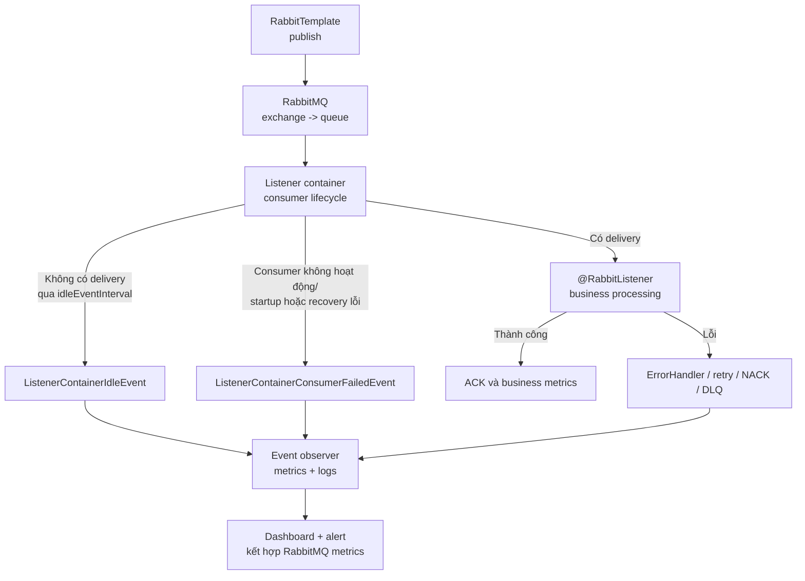
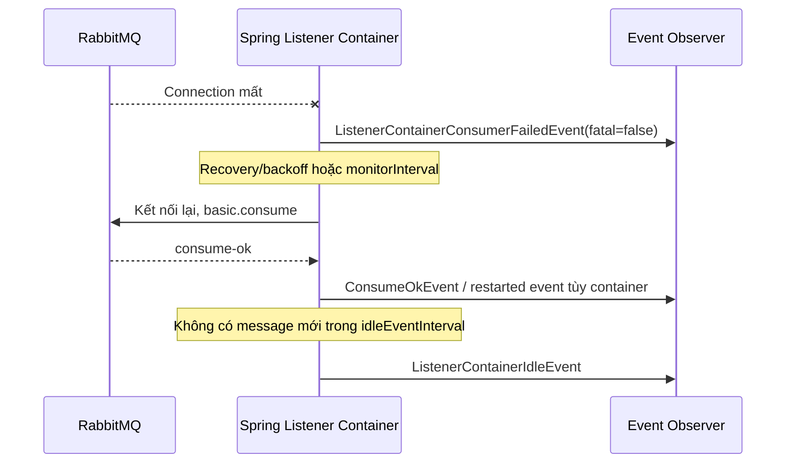

# Listener idle events và sự kiện consumer thất bại

## 1. Vì sao cần quan sát vòng đời consumer, không chỉ số message?

Trong chương **Quan sát hệ thống** của module **SPRING_AMQP**, chúng ta sử dụng RabbitMQ qua `RabbitTemplate`, `@RabbitListener`, exchange, queue và binding để xây luồng xử lý bất đồng bộ. Một hệ thống có publisher confirms, consumer acknowledgments, retry và dead-letter vẫn cần biết **consumer đang thực sự làm việc hay đã ngừng nhận message**.

Giả sử một ứng dụng xử lý thanh toán nhận event từ queue `payments.events.q`. Khi dashboard cho thấy **không có message được xử lý trong 5 phút**, ít nhất bốn tình huống có thể đang xảy ra:

1. **Bình thường:** không có event thanh toán mới, queue rỗng, consumer khỏe.
2. **Consumer nhàn rỗi bất thường:** publisher vẫn gửi và queue đang có backlog nhưng listener không nhận delivery.
3. **Consumer gặp sự cố:** kết nối RabbitMQ bị đóng, queue thiếu, quyền truy cập sai hoặc quá trình đăng ký consumer thất bại.
4. **Ứng dụng kẹt trong xử lý:** listener nhận message trước đó nhưng bị treo ở database/API; số message chưa ack tăng, tốc độ hoàn tất giảm.

Chỉ đếm số message/giây không cho biết được nguyên nhân. Spring AMQP có các **application events** được phát từ listener container để quan sát **thời gian không có delivery** và **lỗi của consumer hoặc vòng đời container**. Hai event cốt lõi của bài:

- `ListenerContainerIdleEvent`: container đã **không nhận delivery mới** trong khoảng thời gian cấu hình.
- `ListenerContainerConsumerFailedEvent`: một consumer của listener container gặp sự cố, kèm lý do, exception và mức độ `fatal`.

> **Điểm quan trọng nhất:** *Idle* không tự động có nghĩa “queue không còn message”, và *consumer failed* không đồng nghĩa “một message nghiệp vụ bị lỗi”. Phải kết hợp event với trạng thái RabbitMQ, số message ready/unacked, throughput, độ trễ và lịch sử khôi phục mới đưa ra cảnh báo chính xác.

Bài này trình bày cách bật và nhận hai loại event, ví dụ Java với `@EventListener`, cách đo metrics, thiết kế cảnh báo, xử lý an toàn khi container dừng/khởi động lại và kịch bản kiểm thử thực tế.

## 2. Phân biệt ba lớp lỗi

Trong pipeline Spring AMQP, lỗi có thể nằm ở ba ranh giới khác nhau:

| Tầng | Ví dụ | Cách quan sát và phản ứng |
| --- | --- | --- |
| **Message processing** | JSON không hợp lệ, business validation lỗi, DB timeout trong `@RabbitListener` | `ErrorHandler`/retry interceptor, ack/nack/requeue, DLQ, listener metrics và log nghiệp vụ |
| **Consumer lifecycle** | Mất connection, không subscribe được queue, consumer bị cancel, lỗi khởi tạo/khôi phục consumer | `ListenerContainerConsumerFailedEvent`, các event started/restarted/stopped, broker connections/consumers |
| **Lưu lượng/hoạt động** | Không có message mới, producer ngừng gửi, listener không nhận delivery một thời gian | `ListenerContainerIdleEvent`, tốc độ publish/deliver, queue ready/unacked, time since last business success |

Một message bị listener ném exception **không bắt buộc** làm consumer chết. Container có thể xử lý lỗi bằng retry, reject hoặc dead-letter rồi tiếp tục nhận message khác. Vì vậy, không xây alert “mọi lỗi nghiệp vụ” chỉ dựa trên `ListenerContainerConsumerFailedEvent`.

Ngược lại, consumer có thể không nhận được message nào vì queue thiếu hoặc connection lỗi mà **không có method `@RabbitListener` nào được gọi**. Lúc này chỉ gắn monitoring vào code nghiệp vụ là không đủ.

### Sơ đồ quan hệ



## 3. ListenerContainerIdleEvent: container “idle” nghĩa là gì?

Spring AMQP hỗ trợ `ListenerContainerIdleEvent` từ phiên bản **1.6**. Khi cấu hình `idleEventInterval` (đơn vị **mili giây**), listener container có thể phát event sau khi một khoảng thời gian trôi qua **không có message delivery**. Trong thời gian tiếp tục idle, event lại được phát **theo chu kỳ cấu hình**.

Ví dụ `idleEventInterval=60000`:

```text
00:00  Consumer nhận message cuối cùng
01:00  Không có delivery mới -> ListenerContainerIdleEvent
02:00  Vẫn không có delivery -> ListenerContainerIdleEvent tiếp
03:00  Consumer nhận message mới -> khoảng idle được cập nhật
04:00  Nếu tiếp tục không nhận mới -> có thể phát event tiếp theo
```

Mốc thời gian trên chỉ minh họa; thực tế chịu ảnh hưởng của cách container lấy message, scheduler, timeout, thread scheduling và tải hệ thống. Đây **không phải** đồng hồ chính xác tới từng mili giây.

### 3.1. Những gì idle event nói được — và không nói được

**Idle event cho biết:**

- Listener container đang được theo dõi đã không nhận message mới theo tiêu chí idle của nó trong khoảng thời gian đã báo.
- Có thể xác định listener/container cụ thể qua `listenerId` và các queue được theo dõi.
- Có thể tạo sự kiện cho dashboard và kịch bản cảnh báo hoạt động bất thường.

**Idle event không chứng minh rằng:**

- Queue thực sự **rỗng**. Broker có thể còn backlog nhưng consumer tạm thời không nhận được.
- Mọi message trước đó đã được **ACK** hoặc commit nghiệp vụ.
- Producer còn đang hoạt động; producer ngừng gửi cũng làm consumer idle.
- Consumer **khỏe** chỉ vì vừa phát idle event. Phải đối chiếu các event lỗi/lifecycle và trạng thái container.
- Trong trường hợp container đã **dừng hoàn toàn**, một idle event nhất định sẽ tiếp tục được phát. Không có event không phải bằng chứng khỏe mạnh.

**Ví dụ hai tình huống rất khác nhau:** sau 60 giây idle, nếu `messages_ready=0`, `messages_unacknowledged=0` và hệ thống không mong đợi tải, nhiều khả năng đây là trạng thái bình thường. Nếu `messages_ready=10_000`, publisher đang gửi nhưng không có delivery mới, cần điều tra consumer, quyền vhost, connection, prefetch và trạng thái queue.

### 3.2. Các trường có trong event

| Thuộc tính / method | Ý nghĩa | Lưu ý |
| --- | --- | --- |
| `getSource()` | Instance listener container phát event | Hữu ích để lọc đúng container |
| `getListenerId()` | ID của `@RabbitListener` hoặc tên container bean | Có thể là `null` nếu chưa đặt ID thích hợp |
| `getIdleTime()` | Thời gian idle đã tính, **mili giây** | Không phải tổng thời gian message nằm trong queue |
| `getQueueNames()` | Danh sách queue đang được container theo dõi | Có thể có nhiều queue; không suy ra từng queue đều rỗng |
| `getTimestamp()` | Timestamp của Spring application event | Là thời điểm event được tạo; không phải thời điểm broker nhận message cuối |

Các method trên thuộc `org.springframework.amqp.rabbit.listener.ListenerContainerIdleEvent`.

### 3.3. Bật idle event ở đâu?

Event này **không mặc định bật với một khoảng thời gian bạn tự đặt**. Cần cấu hình `idleEventInterval` trên listener container/factory. Có ba con đường thường thấy:

- `SimpleMessageListenerContainer.setIdleEventInterval(60000L)` nếu tự tạo container.
- `SimpleRabbitListenerContainerFactory.setIdleEventInterval(60000L)` nếu dùng `@RabbitListener` với factory riêng.
- Cấu hình XML `idle-event-interval="60000"` cho listener container phù hợp.

Khi có nhiều factory, mỗi container có thể có một `idleEventInterval` khác nhau. Đừng chỉ bật ở một factory không được endpoint thực tế sử dụng.

## 4. Ví dụ hoàn chỉnh: topology, listener factory và @RabbitListener

Các đoạn mã sau dùng **Spring AMQP 3.2.x với Spring Boot 3.x / Java 17+** làm điểm tham chiếu, và các API cốt lõi cũng có ở nhiều phiên bản Spring AMQP khác. Cần dependency `spring-boot-starter-amqp`. Để xuất metric Micrometer, thêm `spring-boot-starter-actuator` và Prometheus registry nếu triển khai Prometheus.

### 4.1. Tạo exchange, queue và binding

```java
import org.springframework.amqp.core.Binding;
import org.springframework.amqp.core.BindingBuilder;
import org.springframework.amqp.core.DirectExchange;
import org.springframework.amqp.core.Queue;
import org.springframework.amqp.core.QueueBuilder;
import org.springframework.context.annotation.Bean;
import org.springframework.context.annotation.Configuration;

@Configuration
class PaymentQueueTopology {

    @Bean
    DirectExchange paymentsExchange() {
        return new DirectExchange("payments.x", true, false);
    }

    @Bean
    Queue paymentsEventsQueue() {
        return QueueBuilder.durable("payments.events.q").build();
    }

    @Bean
    Binding paymentBinding(Queue paymentsEventsQueue,
                           DirectExchange paymentsExchange) {
        return BindingBuilder.bind(paymentsEventsQueue)
                .to(paymentsExchange)
                .with("payment.completed");
    }
}
```

Queue durable chỉ giúp tài nguyên queue có tính bền vững nhất định; không tự bảo đảm message persistent hay quorum replication. Bài tập quan sát event **không thay thế** thiết kế publisher confirms, retry, DLQ và idempotency cần có trong ứng dụng thực.

### 4.2. Định nghĩa listener factory với idle interval

```java
import org.springframework.amqp.core.AcknowledgeMode;
import org.springframework.amqp.rabbit.config.SimpleRabbitListenerContainerFactory;
import org.springframework.amqp.rabbit.connection.ConnectionFactory;
import org.springframework.context.annotation.Bean;
import org.springframework.context.annotation.Configuration;

@Configuration
class PaymentListenerConfig {

    @Bean("observedPaymentListenerFactory")
    SimpleRabbitListenerContainerFactory observedPaymentListenerFactory(
            ConnectionFactory connectionFactory) {

        var factory = new SimpleRabbitListenerContainerFactory();
        factory.setConnectionFactory(connectionFactory);

        // Chỉ để một ngưỡng quan sát; không phải business timeout.
        factory.setIdleEventInterval(30_000L);

        factory.setConcurrentConsumers(2);
        factory.setMaxConcurrentConsumers(2);
        factory.setPrefetchCount(10);

        // AUTO của Spring: listener thành công -> container ACK.
        factory.setAcknowledgeMode(AcknowledgeMode.AUTO);
        return factory;
    }
}
```

**Các ý cần hiểu:**

- `setIdleEventInterval(30_000L)`: container có thể phát idle event khi không có message delivery trong khoảng 30 giây; tiếp tục phát nếu vẫn idle.
- `setConcurrentConsumers(2)`: hai consumer trên một instance ở `SimpleMessageListenerContainer`; không phải hai cluster.
- `setPrefetchCount(10)`: mỗi consumer có thể giữ một số delivery chưa ack, không phải idle timeout.
- `AcknowledgeMode.AUTO` là chế độ Spring container chủ động ack/nack, khác RabbitMQ auto-ack (`NONE`).
- **Không đổi interval quá thấp** (ví dụ 1 ms) chỉ để có nhiều event: sự kiện nhiều và log lặp sẽ tạo chi phí giám sát không cần thiết.

Khi dùng Spring Boot factory mặc định, có thể cấu hình theo khả năng và tên properties của **phiên bản Boot**; ví dụ trên cố ý dùng Java factory để tránh nhầm thuộc tính `spring.rabbitmq.listener.simple.*` giữa các phiên bản.

### 4.3. Listener có ID ổn định

```java
import org.springframework.amqp.rabbit.annotation.RabbitListener;
import org.springframework.stereotype.Component;

@Component
class PaymentEventsConsumer {
    private final PaymentAuditService auditService;

    PaymentEventsConsumer(PaymentAuditService auditService) {
        this.auditService = auditService;
    }

    @RabbitListener(
            id = "paymentsWorker",
            queues = "payments.events.q",
            containerFactory = "observedPaymentListenerFactory")
    public void handle(String paymentId) {
        // Đây là lời gọi đồng bộ: commit DB trước khi return.
        auditService.recordOnce(paymentId);
    }
}
```

`PaymentAuditService.recordOnce` là service nghiệp vụ do dự án cài đặt, nên có transaction và idempotency key theo `paymentId`. Nếu lỗi nghiệp vụ, phải để exception được xử lý đúng bởi container/retry thay vì nuốt lỗi rồi return thành công.

**Vì sao đặt `id="paymentsWorker"`?** Khi có nhiều listener, một ID ổn định giúp lọc event và gắn nhãn metric chính xác. Không dùng ID tự sinh hoặc chứa UUID ngẫu nhiên của từng message làm metric label.

## 5. Nhận ListenerContainerIdleEvent bằng @EventListener

Spring phát event qua hệ thống **Spring ApplicationEvent**, không phải RabbitMQ exchange/queue. Đây là **sự kiện nội bộ ApplicationContext**; không có gì được publish thêm vào broker chỉ vì ta gắn `@EventListener`.

### 5.1. Chỉ theo dõi đúng listener cần quan sát

```java
import java.util.Arrays;
import org.slf4j.Logger;
import org.slf4j.LoggerFactory;
import org.springframework.amqp.rabbit.listener.ListenerContainerIdleEvent;
import org.springframework.context.event.EventListener;
import org.springframework.stereotype.Component;

@Component
class PaymentIdleLogger {
    private static final Logger log =
            LoggerFactory.getLogger(PaymentIdleLogger.class);

    @EventListener(condition = "event.listenerId == 'paymentsWorker'")
    public void onIdle(ListenerContainerIdleEvent event) {
        log.info("Rabbit listener idle: listener={}, idleMs={}, queues={}",
                event.getListenerId(),
                event.getIdleTime(),
                Arrays.toString(event.getQueueNames()));
    }
}
```

Điều kiện `event.listenerId == 'paymentsWorker'` dùng **Spring Expression Language** để chỉ chạy handler với listener ID mục tiêu. Không có điều kiện, handler sẽ nhận idle events từ **mọi listener container** trong cùng ApplicationContext.

Nếu ứng dụng chỉ có một listener, một `@EventListener` không filter vẫn hợp lệ, nhưng khi mở rộng thành 10 queue dễ tạo log lẫn lộn. Với nhiều queue, không nên đo riêng “queue A idle” chỉ từ event cấp container đang listen đồng thời A, B: phải xác minh semantics theo container và metrics từng queue.

### 5.2. Đo count mà không bùng nổ metric cardinality

```java
import io.micrometer.core.instrument.Counter;
import io.micrometer.core.instrument.MeterRegistry;
import org.springframework.amqp.rabbit.listener.ListenerContainerIdleEvent;
import org.springframework.context.event.EventListener;
import org.springframework.stereotype.Component;

@Component
class PaymentIdleMetrics {
    private final Counter idleEvents;

    PaymentIdleMetrics(MeterRegistry meters) {
        this.idleEvents = Counter.builder("app.rabbit.listener.idle.events")
                .tag("listener", "paymentsWorker")
                .description("Number of container idle notifications")
                .register(meters);
    }

    @EventListener(condition = "event.listenerId == 'paymentsWorker'")
    public void countIdle(ListenerContainerIdleEvent event) {
        idleEvents.increment();
    }
}
```

Chỉ số `app.rabbit.listener.idle.events` trong ví dụ là **metric ứng dụng tự đặt**, **không phải metric mặc định Spring AMQP tự tạo**. Vì event được phát lại theo interval khi vẫn idle, counter này đo **số thông báo**, không phải số **lần chuyển trạng thái hoạt động → idle** và cũng không phải thời lượng queue rỗng.

Nếu muốn “idle transitions” hoặc “thời điểm nhận message gần nhất”, cần **state** riêng và thuật toán xác định lúc nào trở lại active, chứ không chỉ tăng counter ở mỗi event.

### 5.3. Có thể nhận event bằng ApplicationListener

Một lựa chọn thay cho annotation là:

```java
import org.springframework.amqp.rabbit.listener.ListenerContainerIdleEvent;
import org.springframework.context.ApplicationListener;
import org.springframework.stereotype.Component;

@Component
class IdleApplicationListener
        implements ApplicationListener<ListenerContainerIdleEvent> {

    @Override
    public void onApplicationEvent(ListenerContainerIdleEvent event) {
        if (!"paymentsWorker".equals(event.getListenerId())) {
            return;
        }
        // Xử lý ngắn: log, counter hoặc enqueue sự kiện cho monitor.
    }
}
```

**Đây là ví dụ thay thế**, không bắt buộc đăng ký đồng thời `PaymentIdleLogger`, `PaymentIdleMetrics` và `IdleApplicationListener`. Nếu đăng ký nhiều observer cố ý, mỗi observer sẽ nhận cùng event và không được đếm lặp khi tính một metric tổng.

## 6. ListenerContainerConsumerFailedEvent: consumer thất bại thế nào?

Spring AMQP hỗ trợ `ListenerContainerConsumerFailedEvent` từ **1.5**. Container phát event này khi một **consumer** gặp sự cố. Đây là dữ liệu rất hữu ích để xác định nguyên nhân không nhận được message, ví dụ không thể subscribe queue, kết nối RabbitMQ hỏng hoặc vấn đề quyền/khai báo queue.

Event thuộc package `org.springframework.amqp.rabbit.listener`, có các thông tin:

| API | Giá trị | Cách sử dụng |
| --- | --- | --- |
| `getSource()` | Listener container phát sự kiện | Đối chiếu container/ID qua registry |
| `getReason()` | Chuỗi mô tả lý do consumer lỗi | Ghi log đã sanitization; không dùng nguyên văn làm metric label |
| `isFatal()` | `true` khi lỗi được coi là fatal; `false` với lỗi có thể phục hồi | Chia mức độ cảnh báo, không xem là guarantee tuyệt đối về toàn hệ thống |
| `getThrowable()` | Exception/Throwable gắn với lỗi, có thể null tùy trường hợp | Phục vụ log nguyên nhân, phân loại exception |
| `getTimestamp()` | Thời điểm event được tạo | Hữu ích khi xâu chuỗi sự kiện trong timeline |

**Ý nghĩa cờ fatal:**

- `fatal=true`: lỗi bị container coi là nghiêm trọng ở bối cảnh đó, thường **không retry startup** theo cùng cơ chế. Cần xem trạng thái container và cấu hình cụ thể.
- `fatal=false`: container có thể thử khôi phục. Với `SimpleMessageListenerContainer`, nhịp thử theo `recoveryInterval` hoặc `recoveryBackoff`; với `DirectMessageListenerContainer`, kiểm tra/recovery gắn với `monitorInterval`.

Đây **không phải** taxonomy của lỗi JSON/DB trong một message. `fatal=false` không đồng nghĩa không có tác động người dùng, và `fatal=true` cũng không tự mô tả mọi nguyên nhân gốc.

### 6.1. Nhận failure event an toàn

`ListenerContainerConsumerFailedEvent` không có `getListenerId()` như idle event. Thay vì giả định có method đó, có thể **so sánh nguồn event** với container trong `RabbitListenerEndpointRegistry`:

```java
import io.micrometer.core.instrument.Counter;
import io.micrometer.core.instrument.MeterRegistry;
import org.slf4j.Logger;
import org.slf4j.LoggerFactory;
import org.springframework.amqp.rabbit.listener.ListenerContainerConsumerFailedEvent;
import org.springframework.amqp.rabbit.listener.RabbitListenerEndpointRegistry;
import org.springframework.context.event.EventListener;
import org.springframework.stereotype.Component;

@Component
class PaymentConsumerFailureObserver {
    private static final Logger log =
            LoggerFactory.getLogger(PaymentConsumerFailureObserver.class);

    private final RabbitListenerEndpointRegistry listenerRegistry;
    private final Counter recoverableFailures;
    private final Counter fatalFailures;

    PaymentConsumerFailureObserver(
            RabbitListenerEndpointRegistry listenerRegistry,
            MeterRegistry meters) {
        this.listenerRegistry = listenerRegistry;
        this.recoverableFailures =
                Counter.builder("app.rabbit.consumer.failures")
                        .tag("listener", "paymentsWorker")
                        .tag("fatal", "false")
                        .register(meters);
        this.fatalFailures =
                Counter.builder("app.rabbit.consumer.failures")
                        .tag("listener", "paymentsWorker")
                        .tag("fatal", "true")
                        .register(meters);
    }

    @EventListener
    public void onFailure(ListenerContainerConsumerFailedEvent event) {
        var target = listenerRegistry.getListenerContainer("paymentsWorker");
        if (target == null || event.getSource() != target) {
            return;
        }

        if (event.isFatal()) {
            fatalFailures.increment();
            log.error("Rabbit consumer fatal: listener={}, reason={}",
                    "paymentsWorker", event.getReason(),
                    event.getThrowable());
        }
        else {
            recoverableFailures.increment();
            log.warn("Rabbit consumer failed: listener={}, reason={}",
                    "paymentsWorker", event.getReason(),
                    event.getThrowable());
        }
    }
}
```

**Giải thích:**

- `RabbitListenerEndpointRegistry.getListenerContainer("paymentsWorker")` trả về container thuộc endpoint `@RabbitListener` theo ID đã đặt. Container do registry quản lý có thể **không phải một Spring bean thông thường** để autowire theo tên.
- `event.getSource()` là instance container phát event. So sánh object identity giúp lọc event đến từ endpoint đã chọn mà không tự đoán tên qua `toString()`.
- Metric chỉ có nhãn `listener` và `fatal` với **tập giá trị nhỏ và ổn định**. Không dùng `reason`, tên exception chứa giá trị động, queue được đặt theo requestId hoặc `messageId` làm label.
- Trong production, cần xem xét log exception và nguyên văn `reason` có thể chứa endpoint, tên người dùng hay thông tin hạ tầng; không ghi secret hoặc thông tin nhạy cảm.
- Nếu một consumer lỗi do sự cố chung của broker và ứng dụng có nhiều consumer, **có thể phát nhiều failure events**. Counter là số event, **không phải số sự cố độc lập**.

Khi muốn nhận event cho mọi container, có thể triển khai `ApplicationListener<ListenerContainerConsumerFailedEvent>` và phân loại qua `getSource()`/registry thay vì chỉ theo dõi một listener.

### 6.2. Một sự cố broker có thể làm nhiều consumer cùng báo lỗi

Giả sử `concurrentConsumers=4`:

```text
10:00:00 RabbitMQ connection mất
10:00:01 Consumer #1 failed (non-fatal)
10:00:01 Consumer #2 failed (non-fatal)
10:00:02 Consumer #3 failed (non-fatal)
10:00:02 Consumer #4 failed (non-fatal)
10:00:10 Consumer restarted / subscriptions recovered
```

Một failure vật lý có thể tạo bốn event — và trong cluster nhiều replica còn nhiều hơn. Không phát **bốn alert khẩn cấp** riêng biệt rồi kết luận có bốn root causes. Hãy nhóm theo service, cluster, khoảng thời gian, exception class và trạng thái kết nối; đối chiếu RabbitMQ node health.

### 6.3. Fatal, non-fatal và lỗi cấu hình

Một số tình huống cần quan sát:

| Hiện tượng | Điểm kiểm tra đầu tiên | Event/metric có thể liên quan |
| --- | --- | --- |
| Broker bị restart hoặc mất mạng | TCP/TLS, heartbeat, broker log, reconnect | Non-fatal consumer failure, recovery/restarted, RabbitMQ connection count |
| Queue bị xóa | Tên queue, quyền vhost, `missingQueuesFatal` | `MissingQueueEvent`, failure event, container không active |
| Consumer exclusive tranh chấp | Có consumer khác đang giữ exclusive queue/consumer? | Failure event, debug log trong Spring AMQP 3.1+ |
| Sai user/password hoặc vhost | Auth log, secret rotation, `possibleAuthenticationFailureFatal` | Failure có thể fatal hoặc đi vào recovery tùy container/cấu hình |
| Thiếu tài nguyên broker | Memory/disk alarms, blocked connection, queue leader/quorum | Failure hoặc throughput stall, ready/unacked tăng |
| Xử lý DB bị treo | HikariCP pending, thread dump, HTTP timeout, unacked cao | Có thể **không có consumer failed event** |
| JSON parse lỗi liên tục | Converter/error handler, DLQ, retry policy | Message-level failures, không nhất thiết có consumer failure |

Không kết luận fatal/non-fatal chỉ từ “loại exception” mà không xem cấu hình `missingQueuesFatal`, `possibleAuthenticationFailureFatal`, container type và thời điểm lỗi (startup so với runtime).

## 7. Các lifecycle events khác giúp hoàn chỉnh timeline

Spring AMQP còn phát các event vòng đời:

| Event | Khi nào hữu ích? | Ghi chú |
| --- | --- | --- |
| `AsyncConsumerStartedEvent` | Consumer mới bắt đầu | Có thể dùng xác nhận tín hiệu bắt đầu |
| `AsyncConsumerRestartedEvent` | Consumer được restart sau lỗi | Áp dụng với `SimpleMessageListenerContainer` |
| `AsyncConsumerStoppedEvent` | Consumer dừng | Áp dụng với `SimpleMessageListenerContainer` |
| `AsyncConsumerTerminatedEvent` | Consumer kết thúc bình thường | Phân biệt dừng dự kiến với thất bại |
| `ConsumeOkEvent` | Broker xác nhận `basic.consume` | Chứa queue name và consumer tag |
| `MissingQueueEvent` | Container phát hiện thiếu queue | Phục vụ điều tra topology |
| `ListenerContainerIdleEvent` | Không có message delivery qua interval | Không tương đương consumer failure |
| `ListenerContainerConsumerFailedEvent` | Consumer gặp sự cố | Có reason, throwable, fatal |

**Lưu ý container type:** `SimpleMessageListenerContainer` (SMLC) và `DirectMessageListenerContainer` (DMLC) có cách quản lý consumer/threads khác nhau. Không suy ra mọi lifecycle event đều được cả hai loại phát giống hệt nhau. `AsyncConsumerRestartedEvent` và `AsyncConsumerStoppedEvent` được tài liệu nêu riêng cho SMLC.

### Timeline một lần phục hồi



**Đừng coi chỉ cần có restarted event là toàn pipeline đã phục hồi hoàn toàn.** Kiểm chứng tiếp việc nhận và ack được một message thực, publisher confirms, trạng thái queue leader/quorum và sức khỏe downstream.

## 8. Recovery settings tác động gì đến failure events?

Sự khác biệt chính giữa hai loại container:

| Thuộc tính | `SimpleMessageListenerContainer` | `DirectMessageListenerContainer` |
| --- | --- | --- |
| Mô hình nhận | Consumer qua một đường nhận nội bộ và worker thread của container | Gần callback client hơn, chia sẻ client threads |
| Tăng/giảm đồng thời | `concurrentConsumers`, `maxConcurrentConsumers` | `consumersPerQueue` |
| Khôi phục non-fatal | `recoveryInterval` hoặc `recoveryBackoff` | `monitorInterval` kiểm tra consumer lỗi |
| Kiểm tra idle | `idleEventInterval` của container | `idleEventInterval` kết hợp monitor/scheduler của DMLC |
| Theo dõi restart | Có `AsyncConsumerRestartedEvent` | Không nên phụ thuộc vào event dành riêng SMLC |

Ví dụ tạo riêng một SMLC không dùng annotation (chỉ để minh họa property):

```java
import org.springframework.amqp.rabbit.connection.ConnectionFactory;
import org.springframework.amqp.rabbit.listener.SimpleMessageListenerContainer;
import org.springframework.amqp.core.Message;
import org.springframework.amqp.core.MessageListener;
import org.springframework.context.annotation.Bean;

@Bean
SimpleMessageListenerContainer directSmlcExample(
        ConnectionFactory connectionFactory) {

    var container = new SimpleMessageListenerContainer(connectionFactory);
    container.setQueueNames("payments.events.q");
    container.setMessageListener((MessageListener) message -> {
        // Thay bằng business service, xử lý đồng bộ.
        String payload = new String(message.getBody(),
                java.nio.charset.StandardCharsets.UTF_8);
        System.out.println(payload);
    });
    container.setIdleEventInterval(30_000L);
    container.setRecoveryInterval(5_000L);
    return container;
}
```

**Không bật đồng thời bean `directSmlcExample` và `@RabbitListener` phần 4 trên cùng queue** khi chỉ muốn đo một consumer: đó sẽ là hai nhóm cạnh tranh lấy message.

Trong bài thực hành chính, dùng factory của phần 4, nên đoạn SMLC chỉ minh họa cách đặt `setRecoveryInterval` khi quản lý container thủ công. Đối với DMLC có thể cấu hình `monitorInterval`/`TaskScheduler` qua `DirectRabbitListenerContainerFactory` phù hợp, nhưng đừng sao chép `setRecoveryInterval` của SMLC sang DMLC.

### 8.1. Fatal không đồng nghĩa “retry mọi lúc”

Một số lỗi khởi tạo có thể được coi là fatal và dừng application context hoặc container, tùy `missingQueuesFatal` hay `possibleAuthenticationFailureFatal`. Ngược lại, khi cấu hình cho phép recover, container có thể thử mãi với khoảng backoff, khiến ứng dụng **còn chạy** nhưng **không tiêu thụ được message**.

Đây là lý do phải kiểm tra **liveness, readiness và trạng thái active consumers** riêng. Một container có thể không hoạt động nhưng process JVM vẫn khỏe. Một consumer lỗi non-fatal có thể phục hồi nhanh, nhưng nếu cứ lặp failure-recovery liên tục thì vẫn vi phạm SLO.

## 9. Tránh những thao tác nguy hiểm trong @EventListener

### 9.1. Không gọi container.stop() trực tiếp khi nhận idle event

Theo tài liệu Spring AMQP, nếu dùng idle event để dừng container, **không gọi `container.stop()` ngay trên thread đang phát sự kiện từ listener**. Cách này có thể gây delay hoặc log không cần thiết, thậm chí làm tình huống khó chẩn đoán.

Thay vì dừng đồng bộ, chuyển quyết định sang **một luồng điều phối riêng**. Ví dụ ý tưởng:

```text
ListenerContainerIdleEvent
    -> EventListener ghi metric, phát tín hiệu cho control executor
    -> Control executor đánh giá chính sách / trạng thái queue
    -> RabbitListenerEndpointRegistry.getListenerContainer("paymentsWorker")
    -> stop() hoặc start() theo quyết định đã được bảo vệ
```

**Không tự động stop consumer chỉ vì một event idle**: trong hệ thống có lưu lượng thấp, idle là bình thường. Nếu đã stop consumer, nó có thể **không còn phát idle event** để tự “đánh thức” lần sau; cần scheduler/controller riêng hoặc thao tác operator đảm bảo khởi động lại đúng thời điểm.

### 9.2. Event listener cần nhanh và không ném exception vô cớ

Trong cấu hình Spring mặc định, nhiều application events được phân phối **đồng bộ** trong thread gọi publish. Một `@EventListener` chậm (ví dụ gọi HTTP monitoring API chờ 10 giây) có thể làm chậm chính luồng consumer/container.

Nên:

- Ghi counter/gauge/timestamp và log mức phù hợp **ngay lập tức**.
- Nếu cần báo động ra hệ thống ngoài, đưa vào một executor **có giới hạn queue và có chính sách khi đầy**; hoặc để Prometheus/alert manager đọc metrics.
- Không chạy `stop()`, kiểm tra database nặng, quét toàn bộ queue hoặc gọi blocking HTTP từ event handler.
- Khi event handler lỗi, phải bắt/log phù hợp để tránh ảnh hưởng container; không nên tạo vòng lặp event lỗi.
- Nếu dùng `@Async`, lưu ý exception trong async event handler không được trả về thread gốc; cần `AsyncUncaughtExceptionHandler` hoặc metrics lỗi riêng.

### 9.3. Không xem event là event bus phân tán

Spring `ApplicationEvent` chỉ tồn tại trong **ApplicationContext/JVM** đang chạy. Nếu deployment có 8 replica, mỗi replica tự phát idle/failure events của container cục bộ; một replica không tự biết chính xác event của replica còn lại.

Muốn quan sát toàn cluster:

- Đưa metrics đến Prometheus/OpenTelemetry và dùng `service`, `instance`, `listener`, `cluster` làm nhãn có cardinality kiểm soát.
- Thu thập RabbitMQ broker metrics về connections, consumers và queue depth.
- Gắn cùng trace/log context khi debug message nghiệp vụ; không dùng messageId làm label metric.
- Thiết kế alert theo cả replica/service/queue, tránh nhiều cảnh báo trùng từ một lỗi broker chung.

## 10. Quan sát tổng hợp bằng metrics, logs và trạng thái broker

### 10.1. Bộ metric hữu ích

| Nguồn | Metric / thông tin | Mục đích |
| --- | --- | --- |
| Application custom | `app.rabbit.listener.idle.events` | Số lần container thông báo idle |
| Application custom | `app.rabbit.consumer.failures{fatal}` | Số lần consumer failure event theo mức độ |
| Application custom | Thời điểm thành công nghiệp vụ gần nhất | Tính khoảng im lặng của **business completion**, không đồng nhất với idle |
| Spring AMQP / Micrometer | Timer thành công/thất bại của listener | P95/P99 xử lý và số lần listener bị lỗi |
| RabbitMQ | `messages_ready` | Số message chờ nhận |
| RabbitMQ | `messages_unacknowledged` | Số delivery chưa ack |
| RabbitMQ | Số consumer/connection/channel | Container đã có subscription hay đang mất kết nối? |
| RabbitMQ | Publish/deliver/ack/redeliver rate | Có message đi vào, đến consumer và hoàn tất không? |
| RabbitMQ | DLQ depth / dead-letter rate | Lỗi message có đang tích tụ không? |
| App + downstream | DB pool pending, API 429/503, thread pool, GC | Consumer có thể bị kẹt dù chưa phát failure event |

Trong Spring AMQP có thể bật Micrometer/Observation theo bản đang dùng; listener container có timer thành công/thất bại khi điều kiện Micrometer được đáp ứng. **Tên metrics do thư viện cung cấp khác tên metric tự định nghĩa** ở phần 5/6; xác minh đúng tên xuất ra từ Actuator/Prometheus trước khi tạo rule.

### 10.2. Ba tình huống cần phân biệt qua dashboard

| Tình huống | Idle events | Consumer failed events | Broker queue/consumer metrics | Kết luận sơ bộ |
| --- | --- | --- | --- | --- |
| Không có tải, hệ thống khỏe | Có thể lặp lại | Không | ready ≈ 0, unacked ≈ 0, consumer count đúng | Nhàn rỗi bình thường |
| Broker hoặc consumer mất kết nối | Có thể ngưng xuất hiện | Có thể tăng | consumer count giảm, connection/recovery errors | Điều tra kết nối, quyền hoặc topology |
| Listener treo DB/API | Có thể không đáng tin để xác định “không xử lý” | Có thể không có | unacked cao, completion rate giảm, DB/API chậm | Điều tra thread dump, timeout, pool |
| Producer ngừng phát | Tăng theo interval | Không nhất thiết có | publish rate ≈ 0, ready ≈ 0 | Điều tra upstream nếu tải phải liên tục |
| Consumer chậm, queue ùn | Có thể không có vì vẫn nhận đều | Không | ready tăng, ack rate thấp | Tắc downstream, concurrency/throughput |

**Ghi nhớ:** *không có event* không tương đương healthy. Nếu listener bị dừng, process bị kill hoặc event publisher chưa được thiết lập, chính cơ chế event có thể không phát được thông báo.

## 11. Thiết kế cảnh báo ít nhiễu

### 11.1. Nguyên tắc alert

1. **Idle chỉ là tín hiệu, không phải incident:** alert khi idle **bất thường so với kỳ vọng tải** và có bằng chứng khác (producer vẫn publish, broker có backlog, consumer không nhận).
2. **Fatal failure cần ưu tiên cao:** kiểm tra ngay vì có thể liên quan cấu hình/vhost/queue khiến listener không thể phục hồi; nhưng vẫn xem trạng thái hiện tại để tránh cảnh báo stale.
3. **Non-fatal failure cần theo tần suất và recovery:** một lần mất connection rồi phục hồi nhanh có thể là sự kiện vận hành bình thường; lặp lại thường xuyên hoặc không phục hồi sau ngưỡng mới cần cảnh báo.
4. **Thiếu consumer là cảnh báo độc lập:** số consumer hoạt động thấp hơn mong đợi hoặc queue age tăng mới đo được nhu cầu can thiệp dù không có event.
5. **Tách message errors khỏi consumer failures:** retry/DLQ và listener errors đo bằng metric riêng.

### 11.2. Ví dụ điều kiện cảnh báo (không phải ngưỡng khuyến nghị chung)

| Điều kiện giả định | Hành động |
| --- | --- |
| `paymentsWorker` idle 3 interval **và** broker ready > 0 liên tục, publish rate > 0 | Cảnh báo consumer không nhận; kiểm tra connection/prefetch/locks |
| `consumer.failures{fatal=true}` tăng | Cảnh báo sớm; đối chiếu container running và startup logs |
| Non-fatal failures lặp nhiều lần trong 10 phút, restart/recovery không thành công | Báo sự cố kết nối hoặc cấu hình |
| Số consumer của queue bằng 0 trong hơn 2 phút khi service phải sẵn sàng | Cảnh báo availability |
| `messages_unacknowledged` tăng và successful processing rate = 0 | Cảnh báo stuck handler/downstream, không phụ thuộc idle event |
| `DLQ depth` liên tục tăng | Điều tra message format/business lỗi, không coi là consumer chết |

Các giá trị 3 interval, 2 phút, 10 phút ở trên chỉ là **ví dụ thiết kế**, phải chọn từ SLO/traffic thực tế. Với batch job chạy một lần mỗi giờ, idle 5 phút là bình thường. Với hệ thống thanh toán hoạt động liên tục, idle + backlog > 0 kéo dài là đáng chú ý.

### 11.3. PromQL giả định

Nếu metric custom được exporter chuyển thành `app_rabbit_consumer_failures_total` và có nhãn `listener="paymentsWorker"`:

```promql
sum(
  increase(
    app_rabbit_consumer_failures_total{
      listener="paymentsWorker",
      fatal="true"
    }[5m]
  )
) > 0
```

Đây là **ví dụ theo quy ước đổi dấu chấm thành dấu gạch dưới của Prometheus**, không bảo đảm đúng tên trên từng registry/phiên bản. Phải kiểm tra endpoint `/actuator/prometheus`, nhãn và metric tên thực tế. Với replica, điều kiện trên tổng nhóm có thể chạm ngưỡng nhiều lần khi broker gặp một lỗi chung; nên kết hợp dedup/rule severity.

## 12. Kiểm thử: sự kiện nào xuất hiện trong mỗi kịch bản?

Bài tập nên chạy với RabbitMQ trong môi trường cô lập, Spring Boot, Actuator và listener ID ổn định `paymentsWorker`.

### 12.1. Thử idle event

1. Khởi động RabbitMQ, tạo exchange/queue/binding như phần 4.
2. Bật `idleEventInterval=3000` **chỉ trong môi trường kiểm thử**, để rút ngắn chu kỳ quan sát.
3. Bảo đảm không publish gì, đợi hơn vài chu kỳ; kiểm tra `PaymentIdleLogger` hoặc counter.
4. Publish một `paymentId` bằng `RabbitTemplate`, kiểm tra `@RabbitListener` xử lý thành công và timeline idle thay đổi.
5. Ngừng publish, kiểm tra idle event xuất hiện trở lại.
6. Đối chiếu `getQueueNames()` và `getListenerId()`; tạo một listener khác để chứng minh filter đúng.

Đoạn publisher dùng để tạo tải kiểm thử:

```java
import org.springframework.amqp.rabbit.core.RabbitTemplate;
import org.springframework.stereotype.Service;

@Service
class PaymentTestPublisher {
    private final RabbitTemplate template;

    PaymentTestPublisher(RabbitTemplate template) {
        this.template = template;
    }

    public void publish(String paymentId) {
        template.convertAndSend(
                "payments.x", "payment.completed", paymentId);
    }
}
```

### 12.2. Thử consumer failure event

1. Chạy app và broker, xác nhận listener đã subscribe.
2. Trong môi trường thử nghiệm, dừng broker hoặc cắt connection giữa app và broker.
3. Quan sát `ListenerContainerConsumerFailedEvent`, `getReason()`, `isFatal()`, exception và log recovery. Không mặc định mọi tình huống đều sinh cùng một chuỗi event.
4. Khôi phục broker, đợi container reconnect; kiểm tra số consumer trở lại và gửi một message xác nhận xử lý tiếp tục.
5. Thử queue bị thiếu trong một môi trường riêng; lưu ý `missingQueuesFatal` có thể làm startup thất bại, nên cấu hình recovery thích hợp trước khi mô phỏng.
6. Nếu muốn kiểm thử lỗi **business handler**, chủ động ném exception trong `PaymentAuditService` và xác minh đó đi vào error handler/retry/DLQ; **không** giả định luôn có `ListenerContainerConsumerFailedEvent`.

**Cảnh báo:** không xóa queue/đổi vhost production để thử. Dùng cluster test hoặc Testcontainers, đặt timeout và cleanup rõ ràng.

### 12.3. Kết quả cần lưu sau phép thử

| Kịch bản | Đầu ra kỳ vọng | Quan sát bổ sung |
| --- | --- | --- |
| Queue rỗng, consumer khỏe | Idle events theo chu kỳ; không có consumer failure do riêng việc rỗng queue | Broker ready=0, consumer count ổn định |
| Publish sau giai đoạn idle | Listener nhận message, idle clock không tiếp tục như trước nếu có delivery | ACK và business success tăng |
| Broker mất kết nối | Có thể xuất hiện consumer failure/recovery events | Connections/consumers giảm; app log có reconnect |
| Broker phục hồi | Consumer subscribe lại, xử lý được message mới | `ConsumeOkEvent`/restart events tùy container |
| Queue thiếu | `MissingQueueEvent` hoặc failure/startup lỗi theo cấu hình | Trạng thái startup, `missingQueuesFatal` |
| Business exception | Error handler/retry/DLQ hoạt động | Listener failure timer, không mặc định consumer failed event |
| Listener kẹt trong DB | Completion rate giảm, unacked tăng | Thread dump và DB pool; idle không đủ chẩn đoán |
| App bị kill | Không còn event mới trong app | Uptime/scrape failure + broker consumers giảm |

## 13. Chẩn đoán khi không thấy event

Nếu đã bật `idleEventInterval` mà không có log:

- **Đúng factory chưa?** `@RabbitListener(containerFactory="observedPaymentListenerFactory")` phải dùng factory được đặt interval.
- **Container có thực sự chạy?** Kiểm tra `RabbitListenerEndpointRegistry`, số consumer broker và queue name.
- **Listener ID khớp?** `@EventListener(condition="event.listenerId == 'paymentsWorker'")` sẽ bỏ qua tất cả event khác.
- **Có message đến liên tục?** Một consumer đang nhận đều thường không phát idle event.
- **Mức log đủ thấy chưa?** Metric có thể tăng nhưng `INFO` log bị chặn ở cấu hình logger.
- **Tài nguyên và thời gian?** `idleEventInterval` tính theo mili giây và sự kiện theo scheduler/receive timeout; hãy chờ đủ lâu trong test.
- **App có ApplicationContext hợp lệ không?** Nếu tự tạo container bên ngoài Spring và không gắn `ApplicationEventPublisher`, application events có thể không được phát.
- **Container đã dừng chưa?** Dừng rồi không có idle event để dựa vào; phải đọc registry/broker state.

Nếu **có rất nhiều consumer failed events**:

- Đối chiếu liệu một broker connection failure đã phát event trên **mỗi consumer** hay có các nguyên nhân khác nhau.
- Kiểm tra xác thực vhost/credentials, network/TLS, queue existence, broker alarms và thời gian backoff.
- Kiểm tra trạng thái current consumer count, không chỉ số event trong quá khứ.
- Tránh gọi retry/restart liên tục **từ chính event handler**, vì có thể tạo vòng lặp mất ổn định.

## 14. Các sai lầm phổ biến

**Diễn giải idle thành queue empty.** Listener không nhận delivery có thể do broker, consumer, prefetch hoặc network chứ không chỉ vì không có message.

**Diễn giải consumer failed thành từng message failed.** Lỗi JSON, DB hoặc validation có thể được xử lý mà consumer vẫn chạy; cần listener error metrics riêng.

**Dùng mọi failure event như sự cố riêng.** Một lỗi connection chung có thể tạo event ở nhiều consumer/replica; cần nhóm, đối chiếu broker health và tránh page storm.

**Gọi `stop()` đồng bộ ngay trong idle event.** Có thể cản trở thread phát event, gây delay; hãy dùng control executor/scheduler và một chính sách rõ.

**Dùng reason hoặc message ID làm label metric.** Tạo cardinality cao, tăng chi phí Prometheus và có nguy cơ lộ thông tin; dùng nhãn mức thấp, hữu hạn.

**Đưa blocking HTTP vào @EventListener.** Event dispatch thường đồng bộ; handler chậm có thể ảnh hưởng vòng đời consumer. Dùng monitoring pipeline hoặc executor có giới hạn.

**Đặt idleEventInterval quá ngắn.** Idle event lặp liên tục khi không có tải, dễ tạo log/alert noise. Chọn interval theo kỳ vọng traffic và khả năng giám sát.

**Bỏ qua trạng thái container khi fatal.** Fatal/non-fatal chỉ là phân loại của event. Cần xác minh container thật sự chạy hoặc đã phục hồi.

**Cho rằng có event là đã gửi thông báo ra broker.** Spring ApplicationEvent cục bộ không tự durable, không tự phát tới cluster khác và có thể mất khi process chết.

**Không kiểm tra queue age và unacked.** Có những tình huống listener vẫn nhận nhưng xử lý không xong; idle event không thể thay thế business latency, backlog và DLQ metrics.

## 15. Checklist đưa vào production

1. **Đặt ID ổn định** cho mỗi `@RabbitListener`; biết listener dùng SMLC hay DMLC.
2. Bật `idleEventInterval` trên đúng container/factory, với giá trị theo đặc điểm traffic.
3. Đăng ký `@EventListener`/`ApplicationListener` nhận `ListenerContainerIdleEvent` và filter đúng listener ID.
4. Nhận `ListenerContainerConsumerFailedEvent`, lưu `reason`/`fatal`/exception đã sanitization và xác định nguồn bằng `getSource()`.
5. Bổ sung các event started/restarted/stopped, `MissingQueueEvent`, `ConsumeOkEvent` nếu cần để dựng timeline.
6. Chia metric **idle count, consumer failure count và message processing failures** thành các nhóm riêng.
7. Duy trì metrics broker **ready, unacked, consumers, publish/deliver/ack** và metrics downstream DB/API.
8. Thiết kế alert ghép **idle bất thường + queue backlog / publish rate / consumer status**; fatal được ưu tiên nhưng vẫn xác minh trạng thái.
9. Không gọi `container.stop()`, restart, HTTP blocking hoặc quét queue từ event handler trực tiếp.
10. Kiểm thử cả idle bình thường, mất broker, queue thiếu, business exception và listener bị treo.
11. Giữ retry, dead-letter, transaction, publisher confirms và idempotency độc lập với hệ thống quan sát.
12. Sau khi nâng phiên bản Spring AMQP, kiểm tra lại container type, nhịp recovery, event logging và tên metric thực tế.

**Kết luận:** `ListenerContainerIdleEvent` trả lời *“container đã không nhận message trong bao lâu?”*, còn `ListenerContainerConsumerFailedEvent` trả lời *“consumer gặp lỗi gì và khả năng phục hồi được container đánh giá thế nào?”*. Kết hợp hai loại application event với RabbitMQ broker metrics, listener timers, trạng thái connection/consumer, queue backlog và kết quả nghiệp vụ mới có thể nhận diện chính xác lúc hệ thống bất đồng bộ **thực sự gặp sự cố**, thay vì nhầm trạng thái nhàn rỗi bình thường thành lỗi.

## Tài liệu tham khảo

- [Spring AMQP — Detecting Idle Asynchronous Consumers](https://docs.spring.io/spring-amqp/reference/amqp/receiving-messages/idle-containers.html): `idleEventInterval`, `ListenerContainerIdleEvent`, `@EventListener` filtering và lưu ý không dừng container trong event thread.
- [Spring AMQP — Consumer Events](https://docs.spring.io/spring-amqp/reference/amqp/receiving-messages/consumer-events.html): `ListenerContainerConsumerFailedEvent`, `fatal`, recovery, các lifecycle event khác và logging.
- [Spring AMQP — Listener Container Attributes](https://docs.spring.io/spring-amqp/reference/amqp/containerAttributes.html): `recoveryInterval`, `recoveryBackoff`, `monitorInterval`, `missingQueuesFatal`, `possibleAuthenticationFailureFatal`.
- [Spring AMQP 3.2 — ListenerContainerIdleEvent API](https://docs.spring.io/spring-amqp/docs/3.2.x/api/org/springframework/amqp/rabbit/listener/ListenerContainerIdleEvent.html): `getListenerId()`, `getIdleTime()`, `getQueueNames()`.
- [Spring AMQP 3.2 — ListenerContainerConsumerFailedEvent API](https://docs.spring.io/spring-amqp/docs/3.2.x/api/org/springframework/amqp/rabbit/listener/ListenerContainerConsumerFailedEvent.html): `getReason()`, `getThrowable()`, `isFatal()`.
- [Spring Framework — Application Events](https://docs.spring.io/spring-framework/reference/core/beans/context-introduction.html): application event multicaster và event handler đồng bộ/bất đồng bộ.
- [RabbitMQ — Consumer Acknowledgments and Publisher Confirms](https://www.rabbitmq.com/docs/confirms): ack/requeue/redelivery và sự khác biệt giữa broker state với app event.
