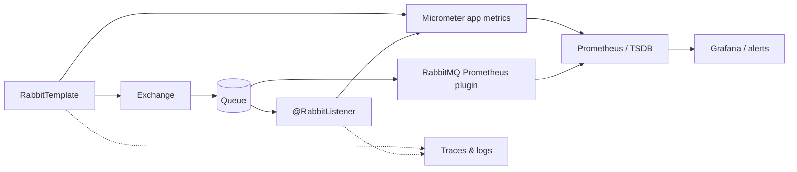
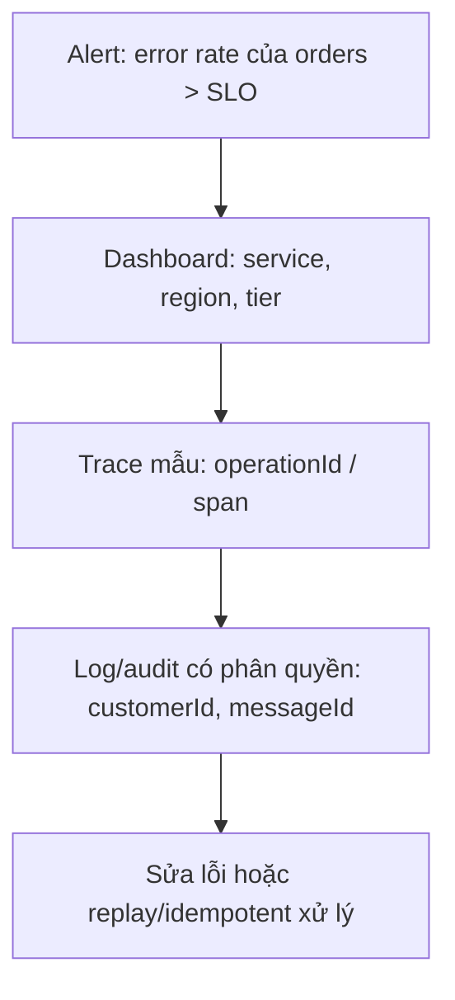
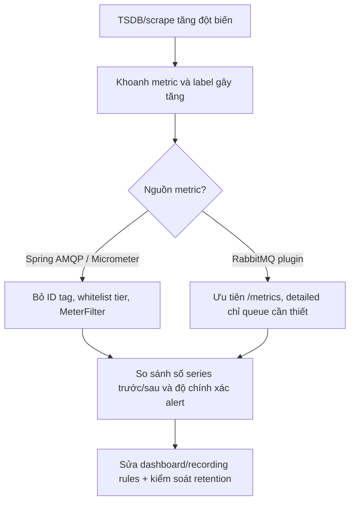

# Giới hạn cardinality khi gắn nhãn theo queue hoặc khách hàng

> **Chương:** Quan sát hệ thống  
> **Công nghệ:** Spring AMQP, RabbitMQ, Micrometer, Spring Boot Actuator, Prometheus và Grafana  
> **Trọng tâm:** Kiểm soát số chuỗi thời gian (time series) khi metric có nhãn `queue`, `customerId`/`tenantId`, routing key hoặc các giá trị động; giữ được tín hiệu vận hành quan trọng mà không làm cạn tài nguyên ứng dụng, RabbitMQ và hệ thống giám sát.

## 1. Tình huống: thêm một nhãn hữu ích, hệ thống giám sát bỗng quá tải

Một nền tảng SaaS dùng Spring AMQP: `RabbitTemplate` gửi sự kiện đến exchange, RabbitMQ định tuyến qua binding vào queue, `@RabbitListener` nhận để cập nhật đơn hàng. Ban đầu dashboard chỉ có tỷ lệ xử lý thành công, lỗi, độ trễ và queue backlog. Để trả lời câu hỏi “khách hàng nào đang gây tải?”, lập trình viên thêm `customerId` vào mọi metric. Một nhóm khác dùng mỗi khách hàng một queue (`orders.tenant-12345`) và bật toàn bộ RabbitMQ per-queue metrics.

Ứng dụng vẫn xử lý message, nhưng Prometheus bắt đầu tăng memory/storage, query Grafana chậm, scrape kéo dài hoặc bị từ chối, dashboard khó đọc. Điều đáng chú ý: **vấn đề không nhất thiết do nhiều message**, mà do **quá nhiều tổ hợp giá trị nhãn khác nhau**.

Nguyên tắc của bài học:

- **Metric** phù hợp với số lượng nhóm nhãn *ít, ổn định, dự đoán được*; dùng để tính tỷ lệ, độ trễ, SLO và cảnh báo tổng hợp.
- **Trace** phù hợp phân tích một đường đi của message/operation; ID có thể có cardinality cao nhưng được **sampling, retention và kiểm soát truy cập**.
- **Log/event audit** phù hợp truy tìm `messageId`, `operationId`, `customerId` cụ thể; truy vấn có lọc và chính sách bảo mật, không đẩy các ID này thành nhãn metric.
- **RabbitMQ broker metrics** và **Spring AMQP application metrics** là hai nguồn khác nhau; phải giới hạn ở **cả hai phía**.

Sau bài này, bạn sẽ ước tính được cardinality, tìm ra nhãn nguy hiểm trong listener/template và queue metrics, viết `MeterFilter` giới hạn các chuỗi time series, thiết kế metric với phân nhóm khách hàng có giới hạn, cấu hình scrape RabbitMQ chọn lọc, và kiểm thử guardrail trước khi triển khai.

## 2. Cardinality là gì? Đừng nhầm với lượng message

Prometheus lưu một time series theo tổ hợp **tên metric + toàn bộ nhãn và giá trị nhãn**. Với cùng một metric:

```prometheus
app_amqp_delivery_attempts_total{service="orders",outcome="success",tier="premium"} 1500
app_amqp_delivery_attempts_total{service="orders",outcome="failure",tier="premium"} 12
app_amqp_delivery_attempts_total{service="orders",outcome="success",tier="standard"} 8400
```

Ba dòng trên là **ba time series**, dù cùng tên metric. Thêm một giá trị mới của nhãn vào tổ hợp mà trước đây chưa có sẽ tạo một chuỗi khác. `customerId=customer-42` là một giá trị; `customerId=customer-43` là một giá trị khác. `queue=orders.tenant-42` và `queue=orders.tenant-43` cũng vậy.

Trong mô hình tệ nhất, ước lượng:

\[
N_{\mathrm{series}} \approx N_{\mathrm{queue}}\times N_{\mathrm{tenant}}\times N_{\mathrm{outcome}}\times N_{\mathrm{instance}}\times N_{\mathrm{metric\ variants}}
\]

Giả sử có **300 queue động**, **400 khách hàng**, **2 kết quả** và **3 instance**; một histogram có **10 bucket cộng `_sum`/`_count`** (12 biến thể). Nếu *mọi* tổ hợp đều xuất hiện, có thể lên đến:

\[
300 \times 400 \times 2 \times 3 \times 12 = 8{,}640{,}000\ \text{time series}
\]

Đây là **giới hạn trên minh họa**, không phải phép đo RabbitMQ hay dự báo chắc chắn: nếu mỗi queue chỉ phục vụ một tenant, số tổ hợp thực tế thấp hơn. Nhưng khi có nhiều phiên bản pod, cluster, zone, metric và thời gian sử dụng, số series hoạt động và số series *churn* trong lịch sử vẫn có thể rất lớn. Cardinality là số **tổ hợp nhãn đã được tạo**, không đơn thuần bằng số message mỗi giây.

### 2.1. Churn: nhãn đổi liên tục còn nguy hiểm hơn nhãn luôn nhiều

Ví dụ mỗi request tạo một reply queue tên `amq.gen-*`, hoặc mỗi lần ứng dụng khởi động sinh một `AnonymousQueue` tên `spring.gen-*`. Sau khi queue cũ bị xóa, metric có nhãn tên queue đó có thể vẫn hiện diện trong TSDB suốt thời gian retention; queue mới lại tạo chuỗi mới. Dù cùng lúc chỉ có 50 queue, vài ngàn queue đã sinh–xóa trong một ngày vẫn làm tăng số chuỗi từng được ghi, kích thước index và chi phí ghi/đọc.

Nhãn theo thời gian như `timestamp`, `messageId`, `correlationId`, `orderId`, `requestId`, URL có ID hoặc routing key mang tenant ID là dấu hiệu **không phù hợp để làm nhãn metric**. Thậm chí một định danh được hash cũng có cardinality tương đương nếu mỗi ID cho ra một hash khác nhau.

### 2.2. Histogram làm số series tăng thêm

Một `Timer` chỉ có `count`/`sum` thường có ít chuỗi hơn so với bật percentile histogram với nhiều bucket. Với Prometheus classic histogram, mỗi bộ nhãn được nhân ra các chuỗi `_bucket{le="..."}`, `_count`, `_sum`. Thêm `tenantId` vào histogram độ trễ listener vì vậy có thể đắt hơn nhiều so với thêm nhãn đó vào một counter. **Hãy quyết định nhãn trước, rồi mới quyết định bucket**; dùng SLO bucket cho những timer thật sự cần phân vị tổng hợp.

## 3. Phân loại nhãn: cái gì được phép, cái gì không?

Một **label policy** là hợp đồng giữa đội ứng dụng và đội vận hành. Mỗi nhãn cần có: mục đích truy vấn, tập giá trị tối đa, cách sinh, người chịu trách nhiệm và hành vi khi phát hiện giá trị lạ.

| Nhãn dự kiến | Đánh giá | Cách dùng phù hợp |
| --- | --- | --- |
| `service`, `environment`, `region` | Thường **thấp** và ổn định. | Dùng nhãn chung nếu danh sách được quản lý. |
| `operation` như `publish`, `consume`, `retry`, `dead_letter` | **Thấp** nếu enum cố định. | Hữu ích cho latency/error-rate theo thao tác. |
| `outcome` như `success`, `failure`, `duplicate` | **Thấp** nếu whitelist. | Rất phù hợp để alert theo lỗi. |
| `queue_class` như `orders`, `payments`, `notifications` | **Thấp** nếu taxonomy được chốt. | Khuyến nghị thay vì tên queue có suffix tenant. |
| `queue` | **Có điều kiện**. | Chỉ dùng khi số queue tên tĩnh nhỏ và có quota; không dùng cho queue tạm/động. |
| `listenerId` | **Có điều kiện**. | Giữ ID ổn định theo nhóm consumer, không lồng customer ID vào tên bean/listener. |
| `routing_key` | **Có điều kiện**. | Chỉ an toàn nếu key thuộc danh sách hữu hạn; nguy hiểm nếu key chứa ID. |
| `tenant_tier` (`free`, `standard`, `premium`, `other`) | **Thấp** sau khi chuẩn hóa/whitelist. | Giải đáp SLO theo phân khúc mà không lộ ID thật. |
| `customerId`, `tenantId`, `orderId`, `messageId`, `correlationId` | **Cao/không giới hạn**. | Dùng trong log có kiểm soát, trace hoặc kho audit; **không dùng metric labels**. |
| `exception` | **Có điều kiện**. | Dùng lớp lỗi/nhóm lỗi đã giới hạn; không dùng toàn bộ exception message chứa ID. |
| `error_message`, `payload`, `sql`, `url` có tham số động | **Không phù hợp**. | Không gắn vào metric; vừa cardinality cao vừa có nguy cơ lộ dữ liệu. |

**Không đủ chỉ giới hạn số nhãn:** một metric có 2 nhãn (`queue`, `customerId`) vẫn có thể gây bão series, trong khi metric có 5 nhãn mà mọi giá trị đều là enum nhỏ có thể ổn. Cần kiểm soát **số giá trị *và* số tổ hợp**.

## 4. Quan sát hai tầng: Spring AMQP và RabbitMQ không tự chia sẻ ngân sách nhãn



### 4.1. Micrometer timer truyền thống của listener

Khi dùng Spring AMQP AMQP 0-9-1 với Micrometer và `MeterRegistry` phù hợp, listener container có thể xuất timer **`spring.rabbitmq.listener`** (tên Micrometer trước khi được chuẩn hóa sang định dạng Prometheus), với các tag như:

- `listenerId`: ID listener/container.
- `queue`: queue name hoặc danh sách queue tùy kiểu container/batch.
- `result`: `success` hoặc `failure`.
- `exception`: ví dụ `none` hoặc `ListenerExecutionFailedException`.

Nếu `@RabbitListener(id="orders-main", queues="orders.main")` dùng queue **cố định**, các nhãn này tương đối ổn định. Nếu mỗi tenant tạo `@RabbitListener` hoặc queue riêng tên `orders.tenant-<id>`, cả `queue` và đôi khi `listenerId` sẽ tăng không giới hạn. Thuộc tính `micrometerTags` cũng có thể gây lỗi nếu gắn nhãn lấy trực tiếp từ customer ID.

### 4.2. Micrometer Observation hiện đại dùng **tên/tag khác**

Với Spring AMQP 3.x/4.x, khi bật **`observationEnabled`** trên `RabbitTemplate` hoặc listener container factory, Observation quản lý timer và trace; các Micrometer timer cũ của thành phần tương ứng **không chạy song song** theo mặc định đó.

Theo bộ observation convention của Spring AMQP, các meter có thể mang tên `spring.rabbit.listener` và `spring.rabbit.template` (khác tên `spring.rabbitmq.listener` ở cơ chế timer cũ). Các low-cardinality key điển hình bao gồm:

| Thành phần Observation | Metric | Nhãn cần kiểm soát |
| --- | --- | --- |
| Listener | `spring.rabbit.listener` | `messaging.destination.name` (tên queue), `spring.rabbit.listener.id`. |
| Template | `spring.rabbit.template` | `messaging.destination.name` (exchange), `messaging.rabbitmq.destination.routing_key`, `spring.rabbit.template.name`. |

**Bẫy phổ biến:** producer gọi `rabbitTemplate.convertAndSend("", "orders.tenant-" + tenantId, body)` với default exchange. Dù application không tự gắn `tenantId`, nhãn **`messaging.rabbitmq.destination.routing_key`** của template Observation có thể chứa nguyên queue name động. Với listener, `messaging.destination.name` chứa queue name động. Vì vậy cần rà soát **cả nhãn do framework tự sinh**, không chỉ nhãn tự thêm.

Tùy phiên bản Spring AMQP, lớp Observation và convention có thể có tên/tag khác nhau. Hãy kiểm tra đúng **metric đã được xuất từ ứng dụng thực** thay vì viết policy `MeterFilter` theo một tên không có thật. Đừng bật cả timer cũ và observation theo hai cấu hình riêng rồi đếm cùng một phép đo hai lần.

### 4.3. Broker exporter: per-object queue metrics là một nguồn bùng nổ khác

Plugin `rabbitmq_prometheus` có endpoint `/metrics` **tổng hợp** theo mặc định: dữ liệu được gom theo metric family thay vì tạo nhãn riêng cho mọi queue/connection. Ngược lại, `/metrics/per-object` xuất **rất nhiều metric cho từng resource**, nên tốn cả **CPU serialization của RabbitMQ** lẫn bộ nhớ/TSDB phía Prometheus khi số queue lớn. `/metrics/detailed` hỗ trợ chọn *chỉ một số family/virtual host/queue regex* cần thiết.

**Cấp giảm cardinality đúng là ngay từ nơi sinh dữ liệu.** Một `MeterFilter` trong Spring Boot **không kiểm soát được metric** do plugin RabbitMQ ở process broker xuất. Ngược lại, việc đổi `/metrics/per-object` thành `/metrics` **không sửa nhãn customer ID** mà ứng dụng Java tạo qua Micrometer.

## 5. Anti-pattern: mỗi khách hàng một queue và một time series riêng

Giả sử producer Spring AMQP dùng default exchange và queue đặt theo tenant:

```java
// Ví dụ KHÔNG KHUYẾN NGHỊ để minh họa cardinality.
public void publishToTenant(RabbitTemplate template, String tenantId,
                            String payload) {
    String queueName = "orders.tenant-" + tenantId;
    template.convertAndSend("", queueName, payload);
}
```

Tại broker, có thể tạo hàng ngàn queue `orders.tenant-...`. Tại app, nếu timer/observation ghi `routing_key` hay `queue` nguyên bản, số series tăng theo số tenant. Nếu listener hoặc job tạo một bean/container cho mỗi tenant, `listenerId` cũng có thể tăng theo. Việc sử dụng tên queue để phân vùng dữ liệu là quyết định **topology** riêng: có thể có lý do cách ly/throughput, nhưng đòi hỏi ngân sách và lifecycle queue. **Không nên mặc định tiếp tục dùng tên queue đó làm dimension của mọi metric.**

### 5.1. Cách thiết kế thay thế khi không bắt buộc phải có queue riêng

```text
                             orders.events (exchange)
                                     |
                         routing key: orders.created
                                     |
                            orders.created (queue)
                                     |
                       @RabbitListener - worker pool
                                     |
                         App xử lý tenantId trong payload
```

Một queue/chùm queue theo **loại công việc** giúp số queue ổn định. Các sự kiện vẫn có `tenantId` cho kiểm tra quyền, phân vùng nghiệp vụ và truy vết, nhưng **metric chỉ dùng `queue_class=orders`, `tier=premium|standard|other`, `outcome=...`**. Không đưa `tenantId` vào nhãn metric. Nếu cần cách ly tài nguyên per-tenant, hãy cân nhắc vhost/queue/quota riêng có chủ đích và giải pháp đo theo từng tenant **ở kho dữ liệu/audit chuyên biệt**, thay vì histogram cho mọi tenant trên Prometheus chung.

### 5.2. Đừng dùng kết quả hash làm “nhãn cardinality thấp”

Ví dụ `tenantHash = sha256(tenantId)` vẫn cho ra **một giá trị khác nhau cho mỗi tenant**. Cần tạo **nhóm hữu hạn** (`tier`, `plan`, `workload`, `bucket=00..15`) thay vì định danh. Hash thành 16 bucket chỉ giảm cardinality nếu thực sự **lấy `hash mod 16`** và chấp nhận dữ liệu đã tổng hợp; bucket không thể dùng để xác định chính xác tenant nào lỗi.

## 6. Ví dụ Spring AMQP: metric theo phân khúc khách hàng hữu hạn

Giả sử ứng dụng dùng `spring-boot-starter-amqp`, `spring-boot-starter-actuator` và một backend Micrometer/Prometheus được cấu hình phù hợp; broker có queue cố định `orders.created`. Ta muốn đo **số attempt xử lý và thời gian xử lý** theo tier, kết quả. Chỉ hai nhãn `tier` và `outcome` có số giá trị hữu hạn. Ví dụ dùng Spring Boot 3.x/4.x với API Micrometer phổ biến:

```java
import io.micrometer.core.instrument.MeterRegistry;
import io.micrometer.core.instrument.Timer;
import java.util.Map;
import org.springframework.amqp.core.Message;
import org.springframework.amqp.rabbit.annotation.RabbitListener;
import org.springframework.stereotype.Component;

@Component
public class OrdersMetricsListener {
    private final MeterRegistry registry;
    private final OrderBusinessService business;

    public OrdersMetricsListener(MeterRegistry registry,
                                 OrderBusinessService business) {
        this.registry = registry;
        this.business = business;
    }

    @RabbitListener(id = "orders-created", queues = "orders.created")
    public void receive(Message message) {
        // Header này chỉ được dùng để phân nhóm metric, không để cấp quyền.
        String tier = allowedTier(message.getMessageProperties()
                .getHeaders().get("tenantTier"));
        Timer.Sample sample = Timer.start(registry);
        String outcome = "success";

        try {
            // Service thật cần transaction dữ liệu + idempotency theo operationId.
            business.processIdempotently(message);
        }
        catch (RuntimeException ex) {
            outcome = "failure";
            throw ex; // Spring listener container xử lý retry/ack/DLQ.
        }
        finally {
            sample.stop(Timer.builder("app.amqp.orders.handler.duration")
                    .description("Duration of orders listener attempts")
                    .tags("tier", tier, "outcome", outcome)
                    .register(registry));

            registry.counter("app.amqp.orders.delivery.attempts",
                    "tier", tier, "outcome", outcome).increment();
        }
    }

    private static String allowedTier(Object rawValue) {
        if ("premium".equals(rawValue)) return "premium";
        if ("standard".equals(rawValue)) return "standard";
        if ("free".equals(rawValue)) return "free";
        return "other"; // Không tạo tag từ giá trị không biết trước.
    }
}
```

`OrderBusinessService` là service nghiệp vụ do ứng dụng cung cấp; ví dụ tập trung vào instrument, không triển khai database. Dù message gắn `tenantTier="customer-123456"`, hàm `allowedTier()` chuyển thành `other` **chứ không tạo nhãn mới**. Trong production, tier nên lấy từ nguồn dữ liệu đáng tin hoặc được kiểm tra độc lập, bởi một header producer có thể giả mạo tier; **phân loại metric không phải phân quyền khách hàng**.

Phân biệt **attempt counter** với **business success counter**: listener chạy lại sau redelivery có thể tăng số attempt, dù idempotent service chỉ commit một lần. Điều này không sai nếu metric được đặt tên và diễn giải là số *delivery attempts*. Muốn đếm số tác động nghiệp vụ duy nhất, hãy tăng counter tại đường xử lý **sau khi đã xác định commit lần đầu** hoặc đo từ dữ liệu nghiệp vụ, không dùng `@RabbitListener` invocation count để suy ra số đơn hàng đã được thanh toán.

### 6.1. Ước lượng series của ví dụ

Với `tier` trong `{premium, standard, free, other}` và `outcome` trong `{success, failure}`: tối đa **4 × 2 = 8 tổ hợp nhãn trên mỗi metric** trước các nhãn hạ tầng cố định như `service`/`instance`. Nếu bật 10 bucket histogram và `_count`/`_sum`, phần histogram có thể lên tới khoảng `8 × 12 = 96` chuỗi mỗi instance (tùy backend/phiên bản/config). Con số này dễ dự toán hơn việc tăng theo hàng chục nghìn `customerId`.

### 6.2. Biểu đồ và alert không cần biết tên khách hàng

Mức tải theo tier, tỷ lệ thất bại hay độ trễ p95 theo service/region là đủ cho phần lớn SLO vận hành. Khi một tier có vấn đề, có thể nhảy từ trace sample sang log, truy vấn theo `operationId`/`customerId` trong kho audit **có phân quyền** để xác định tenant cụ thể. Không tạo một chuỗi thời gian trên Prometheus cho mỗi khách hàng chỉ để tiện drill-down.

## 7. Đặt guardrail trong Micrometer: đừng đợi tới lúc Prometheus chết

`MeterFilter` giúp loại bỏ, đổi nhãn hoặc hạn chế số lượng meter **trong ứng dụng**. Đây là lớp phòng vệ bổ sung sau khi thiết kế low-cardinality tag chuẩn, không phải giải pháp để duy trì một mô hình nhãn không giới hạn.

### 7.1. Loại bỏ nhãn ID nguy hiểm khỏi toàn bộ metric

```java
import io.micrometer.core.instrument.config.MeterFilter;
import org.springframework.context.annotation.Bean;
import org.springframework.context.annotation.Configuration;

@Configuration(proxyBeanMethods = false)
public class CardinalityGuardConfig {
    @Bean
    MeterFilter stripUnboundedIds() {
        return MeterFilter.ignoreTags(
                "customerId", "tenantId", "messageId", "correlationId");
    }
}
```

Trong Spring Boot có Micrometer auto-configuration, bean `MeterFilter` được đăng ký với registry thích hợp. `ignoreTags(...)` là biện pháp **cứu nguy** khi thư viện cũ vô tình thêm những nhãn đó; tốt hơn vẫn là không thêm chúng ngay từ instrumentation. Tên tag **phân biệt chính xác**: `tenantId` khác `tenant_id`, nên cần kiểm tra thật trong `/actuator/prometheus`.

### 7.2. Giới hạn số giá trị `queue` cho timer cũ và Observation

```java
import io.micrometer.core.instrument.config.MeterFilter;
import org.springframework.context.annotation.Bean;
import org.springframework.context.annotation.Configuration;

@Configuration(proxyBeanMethods = false)
public class ListenerQueueCardinalityCap {
    @Bean
    MeterFilter capLegacyListenerQueues() {
        return MeterFilter.maximumAllowableTags(
                "spring.rabbitmq.listener", "queue", 32, MeterFilter.deny());
    }

    @Bean
    MeterFilter capObservationDestinations() {
        return MeterFilter.maximumAllowableTags(
                "spring.rabbit.listener", "messaging.destination.name",
                32, MeterFilter.deny());
    }
}
```

Giới hạn `32` **chỉ là con số lab**, không phải ngưỡng chuẩn của Spring/RabbitMQ. Tùy tải mà đặt ngân sách. `maximumAllowableTags` từ chối **meter mới** dùng giá trị nhãn vượt giới hạn; nó **không gom phần còn lại thành `other`**, không tự xóa các meter đã tạo và không giới hạn những metric có tên khác. Nếu dùng `MeterFilter.deny()` mà không theo dõi, bạn có thể **mất quan sát của queue mới** sau khi đã chạm trần. Hãy coi sự kiện vượt budget là lỗi cấu hình cần alert và sửa tại nguồn.

### 7.3. Chuẩn hóa nhãn routing key do template tạo

```java
@Bean
MeterFilter normalizeObservedRoutingKeys() {
    return MeterFilter.replaceTagValues(
            "messaging.rabbitmq.destination.routing_key",
            raw -> switch (raw) {
                case "orders.created" -> "orders.created";
                case "payments.received" -> "payments.received";
                default -> "other";
            });
}
```

Bean ví dụ nằm trong một Spring `@Configuration` đã import `MeterFilter`, dùng Java 17+. Đây là biện pháp **giảm cardinality của nhãn metric**, **không đổi routing key thật** mà RabbitMQ dùng. Nhược điểm là mọi key ngoài whitelist trở thành `other`; cần quyết định có mất khả năng xem lỗi theo key chi tiết không. `replaceTagValues` hoạt động theo **tag key** trên registry, nên kiểm tra ảnh hưởng nếu các thư viện khác cũng dùng key này. Với Observation custom convention, ưu tiên tạo low-cardinality key value ngay từ đầu; giữ ID chi tiết trong trace/log thay vì dùng `MeterFilter` để sửa sau.

### 7.4. Dùng `MeterFilter` đúng thứ tự và kiểm chứng kết quả

`MeterFilter` được áp dụng theo thứ tự trong registry; các filter có thể kết hợp làm đổi tên, bỏ tag, thay giá trị hoặc deny meter. Đừng cài nhiều bean `MeterFilter` mâu thuẫn rồi tưởng việc map chắc chắn xảy ra theo một thứ tự chưa được kiểm soát. Trên hệ thống thực, kiểm tra tên/nhãn trong output và làm integration test với `SimpleMeterRegistry` hoặc exporter test để chắc **số series đạt budget**.

**Không áp dụng trực tiếp:** `MeterFilter` này không loại bỏ khách hàng khỏi log/traces, không giảm số queue RabbitMQ thật, không hạn chế per-object metrics do broker xuất và không tự giới hạn số time series cũ đã được lưu trong Prometheus.

## 8. RabbitMQ Prometheus plugin: chọn tổng hợp thay vì xuất toàn bộ queue

RabbitMQ có plugin `rabbitmq_prometheus`, thường lắng nghe trên port `15692` sau khi bật. Ví dụ quản trị viên lab:

```bash
rabbitmq-plugins enable rabbitmq_prometheus
curl -fsS http://localhost:15692/metrics | head
```

Đây là lệnh minh họa; không mở cổng exporter ra Internet. Với môi trường thật, giới hạn network access/HTTP/TLS cho Prometheus và kiểm soát scrape credential theo topology.

### 8.1. So sánh ba endpoint

| Endpoint | Đặc điểm | Nên dùng khi |
| --- | --- | --- |
| `/metrics` | **Aggregated** theo mặc định; kích thước phản hồi tương đối ổn định khi queue/connection tăng. | Monitoring toàn cụm, alert cơ bản và dashboard production. |
| `/metrics/per-object` | Trả metric từng queue/connection/channel và nhiều resource; payload và CPU serialize có thể cực lớn. | Điều tra ngắn hạn ở môi trường nhỏ, sau khi cân nhắc chi phí; tránh scrape diện rộng thường xuyên. |
| `/metrics/detailed` | Chỉ trả những metric **family** và `vhost`/`queue` được chọn qua query parameter. | Khi thật sự cần backlog/consumer per-queue cho một tập queue quan trọng đã giới hạn. |

Không đặt `prometheus.return_per_object_metrics = true` chỉ để có tên queue trong mọi biểu đồ; tùy chọn này biến **ngay cả `/metrics`** thành metric từng resource và có thể gây tải lớn. Queue động theo tenant dễ khiến Prometheus và RabbitMQ cùng chịu chi phí cao.

### 8.2. Cấu hình Prometheus: toàn cụm + một số queue ưu tiên

Ví dụ một `prometheus.yml` tối giản với **hai scrape job** trên cùng RabbitMQ exporter. Chỉ scrape chi tiết **hai queue tĩnh** `orders.critical` và `payments.critical`:

```yaml
scrape_configs:
  - job_name: rabbitmq-aggregate
    metrics_path: /metrics
    scrape_interval: 30s
    static_configs:
      - targets: ["rabbitmq:15692"]

  - job_name: rabbitmq-critical-queues
    metrics_path: /metrics/detailed
    scrape_interval: 30s
    params:
      family: [queue_coarse_metrics, queue_consumer_count]
      vhost: ["/"]
      queue: ["^(orders[.]critical|payments[.]critical)$"]
    static_configs:
      - targets: ["rabbitmq:15692"]
```

`family`/`vhost`/`queue` là query parameters được `/metrics/detailed` hỗ trợ trong các phiên bản RabbitMQ hiện đại; cần xác minh phiên bản thực tế. Một queue regex hẹp giúp tránh trả metric cho hàng ngàn queue có tenant suffix. Metric của endpoint detailed có thể dùng prefix **`rabbitmq_detailed_`**, nên khi viết PromQL/dashboard phải xem tên metric thật sau khi scrape.

**Quan trọng:** `params.queue` lọc theo regex **tên queue thật**, không tự nhóm tên về `orders`. Nếu mục tiêu là tổng quan theo `queue_class`, tạo metric nhóm có tập giá trị hữu hạn ở ứng dụng hoặc xây pipeline aggregate được kiểm soát; không tự biến tất cả queue động thành một nhãn `queue=orders` trong scrape mà không xử lý việc va chạm các sample cùng labelset.

### 8.3. Khi bắt buộc cần đo một queue/tenant cụ thể

Có những tình huống SLA yêu cầu cảnh báo backlog riêng cho một tenant rất quan trọng. Hãy chọn **danh sách tenant/queue có giới hạn và được xét duyệt**, hoặc chạy một hệ thống giám sát/tài khoản/bộ lưu trữ tách biệt với ngân sách riêng. Với toàn bộ tenant dài hạn, cân nhắc thu thập metric tổng hợp vào database/warehouse chuyên biệt có khả năng truy vấn theo tenant hoặc pipeline tổng hợp định kỳ, thay vì phát time series per-tenant cho mỗi histogram ở Prometheus.

## 9. Trace và log giúp điều tra từng khách hàng mà không tăng metric cardinality

Một event cần mang `operationId`, `messageId`, `correlationId` hoặc `customerId` để truy vết là điều hợp lý. **Sai lầm là gắn toàn bộ thành labels cho mọi meter.** Kết hợp các tín hiệu như sau:



Trong Micrometer Observation, khái niệm **low-cardinality KeyValues** phục vụ metric; các thông tin **high-cardinality** thích hợp cho trace context/span attributes khi được sampling và có chính sách riêng. **Đừng nhầm rằng mọi attribute của trace đều trở thành metric label**: điều này phụ thuộc bridge/exporter/convention và cần được kiểm chứng. Không thêm customer ID vào **service name, span name hoặc metric tag**; các tên đó nên ổn định.

Ví dụ log ứng dụng có thể ghi `operationId`, `queueClass`, `outcome`, `traceId` cho một message thất bại, nhưng phải **sanitize và redaction**, giới hạn truy cập, tránh ghi token/password/PII đầy đủ. Cấu hình sampling, retention và quyền truy vấn cho traces/logs vì cardinality cao ở đây vẫn có chi phí lưu trữ; nó chỉ là công cụ **phù hợp về hình thức dữ liệu**, không phải “miễn phí”.

### 9.1. Không dựa vào message ID như nhãn của exemplar tùy tiện

Prometheus exemplars có thể giúp liên kết một điểm đo histogram với trace ID từ mẫu truy vết, nhưng **trace ID trong exemplar khác với một label của time series**. Dùng cơ chế exemplar/tracing được exporter hỗ trợ; không tự thêm `traceId`/`spanId` vào nhãn counter/histogram vì như vậy vẫn tạo series vô hạn.

### 9.2. Truy vết qua RabbitTemplate và @RabbitListener

Khi bật Spring AMQP Observation cho producer/listener, tracing có thể truyền context qua message headers và tạo span gửi/nhận. Cần lựa chọn sampling/propagator nhất quán giữa các service, đặc biệt khi đi qua retry, DLQ, Shovel/Federation. Có thể ghi dấu retry, redelivery và queue trong span/log, nhưng **không dùng redelivery count hoặc message ID làm metric label**. Nếu sinh một span trên mỗi delivery, hãy kiểm soát sampling và không suy số span bằng số business effect chính xác.

## 10. Dashboard và cảnh báo không cần tạo một chuỗi cho mỗi khách hàng

Mục tiêu giám sát nên xuất phát từ câu hỏi vận hành, không xuất phát từ khả năng thêm một tag bất kỳ.

| Câu hỏi | Metric/nhãn đề xuất | Tránh |
| --- | --- | --- |
| Listener nào lỗi nhiều? | Failure/attempt theo `service`, `listener_group`, `outcome`. | `messageId`, exception message. |
| Tier khách hàng nào có độ trễ cao? | Histogram/timer theo `tenant_tier` enum, `service`. | `customerId` thực. |
| Broker có nghẽn toàn cụm không? | RabbitMQ `/metrics` tổng hợp: publish/deliver/ack, connections, ready/unacked. | Scrape toàn bộ per-object dù không dùng. |
| Queue quan trọng nào đang tích backlog? | `/metrics/detailed` giới hạn `queue` chính, `vhost`, `family`. | Mọi reply queue/anonymous queue. |
| Một message bị retry bao nhiêu lần? | Log/trace/audit theo `operationId`, DLQ headers, bounded retry counters. | Một time series theo ID. |
| Customer cụ thể có SLA riêng? | Bảng số liệu theo tenant trong warehouse hoặc subset tenant được duyệt/budget. | Cardinality không giới hạn trong Prometheus chung. |

### 10.1. PromQL đo mức độ sử dụng TSDB

Các truy vấn sau là **gợi ý chẩn đoán**, phải đối chiếu metric có thật ở Prometheus đang vận hành:

```promql
# Số series hiện diện theo tên metric tại thời điểm truy vấn (có thể đắt).
topk(20, count by (__name__) ({__name__=~"spring_rabbit.*|app_amqp_.*"}))

# Số giá trị queue đang xuất hiện trong một metric đã chọn.
count(count by (queue) (spring_rabbitmq_listener_seconds_count))

# Số queue/tier kết hợp trong một metric tự tạo.
count(app_amqp_orders_delivery_attempts_total)
```

Tên Prometheus của Micrometer timer thường có hậu tố như `_seconds_count`, `_seconds_sum`, nhưng tên chính xác phụ thuộc exporter và cấu hình observation. Truy vấn `count by(queue)` chỉ có ý nghĩa nếu metric đó thực sự có label `queue`; ở observation mới, label có thể là tên chuẩn hóa của `messaging.destination.name`, nên phải kiểm tra output trước khi viết PromQL. Truy vấn `count` với hàng triệu series cũng tốn tài nguyên: dùng trong điều tra có kiểm soát hoặc xây recording rule với phạm vi giới hạn.

### 10.2. Cảnh báo bảo vệ pipeline monitoring

Theo dõi số **active series**, **series created/churn**, memory TSDB/ingester, scrape duration, scrape payload, scrape sample count, số lần scrape failed, remote write backlog, CPU của RabbitMQ plugin và lỗi từ `MeterFilter` guardrail (nếu có instrumentation riêng). Một scrape bị từ chối vì vượt `sample_limit` **không có nghĩa hệ thống ứng dụng đang khỏe**; nó có thể là dấu hiệu quan sát đã bị mù.

Không chỉ tăng `sample_limit`/RAM/retention để chữa triệu chứng; hãy tìm nhãn phát sinh mới và khôi phục schema metric có số giá trị hữu hạn. Thiết lập ngân sách cho **từng service, từng registry, từng exporter, từng cluster và toàn bộ hệ thống**.

## 11. Kiểm thử cardinality trước khi đưa vào production

### 11.1. Thử với 10, 100, 1.000 khách hàng ảo

1. Dùng một queue cố định và metric kiểu `tier/outcome`; phát message với 10, 100, 1.000 giá trị `customerId` khác nhau nhưng chỉ vài tier hợp lệ.
2. Kiểm tra số tổ hợp nhãn metric **không tăng tuyến tính theo số customer ID**; với 4 tier × 2 outcome, trần logic là 8 bộ nhãn trên một metric cho mỗi instance trước các nhãn hạ tầng.
3. Thử header tier không hợp lệ/giá trị ngẫu nhiên; mọi giá trị lạ phải thành `other`, không tạo một series mới cho mỗi chuỗi.
4. Thử listener với queue `spring.gen-*` hoặc `amq.gen-*` và đo hậu quả nếu bật tag queue tự động; xác nhận policy cắt bỏ hoặc chỉ thu ở subset cho phép.
5. Bật rồi tắt Observation để đối chiếu tên/tag xuất hiện; không suy hai chế độ cho ra cùng tên metric.
6. Với broker có nhiều queue demo, so sánh thời gian/kích thước trả về của `/metrics`, `/metrics/per-object`, `/metrics/detailed` nhưng chỉ thử với tải an toàn, không gây quá tải cluster thật.

### 11.2. Test trực tiếp bằng SimpleMeterRegistry

Mã JUnit 5 minh họa giới hạn cardinality của **custom metric** ở mục 6; không cần RabbitMQ thật vì đang kiểm thử cách map tag:

```java
import static org.assertj.core.api.Assertions.assertThat;

import io.micrometer.core.instrument.simple.SimpleMeterRegistry;
import java.util.Set;
import java.util.stream.Collectors;
import org.junit.jupiter.api.Test;

class BoundedTenantTagTest {
    @Test
    void customerIdsDoNotMultiplySeries() {
        try (SimpleMeterRegistry registry = new SimpleMeterRegistry()) {
            for (int i = 0; i < 1_000; i++) {
                String tier = switch (i % 5) {
                    case 0 -> "free";
                    case 1 -> "standard";
                    case 2 -> "premium";
                    default -> "other";
                };
                registry.counter("app.amqp.test.attempts",
                        "tier", tier, "outcome", "success").increment();
            }

            Set<String> tiers = registry.getMeters().stream()
                    .map(meter -> meter.getId().getTag("tier"))
                    .collect(Collectors.toSet());

            assertThat(tiers).containsExactlyInAnyOrder(
                    "free", "standard", "premium", "other");
            assertThat(registry.getMeters()).hasSize(4);
        }
    }
}
```

Test trên xác minh **thiết kế nhãn có hữu hạn giá trị**, không kiểm tra transport RabbitMQ hay hiệu quả của `MeterFilter` dùng trong runtime. Muốn bảo vệ ứng dụng thật, thêm integration test với cấu hình registry/Actuator chính thức và nhìn vào số series được xuất trên endpoint `/actuator/prometheus`.

### 11.3. Cảnh báo khi vượt ngân sách

Khi phát hiện queue mới hoặc số nhãn thực vượt budget, các lựa chọn hợp lý là: từ chối **ghi metric mới** bằng guardrail và tạo alert riêng; map giá trị không thuộc whitelist về `other`; sửa instrument tại nguồn; hoặc thiết kế một pipeline audit/warehouse riêng cho per-tenant. **Không tự âm thầm mất metric và tiếp tục cho rằng SLO đang đầy đủ.**

## 12. Quy trình khắc phục khi cardinality đã tăng quá cao



1. **Phát hiện:** xác định service/exporter nào tăng sample, series count, scrape duration hoặc remote write backlog.
2. **Khoanh vùng:** xem tên metric và các nhãn có nhiều giá trị, đặc biệt `queue`, `routing_key`, `customerId`, `messageId`, `exception`, `listenerId` và `instance` phát sinh động.
3. **Phân biệt nguồn:** nếu do Spring AMQP, sửa instrumentation/Observation convention/`MeterFilter`; nếu do RabbitMQ, chỉnh scrape endpoint và hạn chế per-object.
4. **Bảo vệ dịch vụ:** nếu monitoring đang làm tăng CPU/memory quá mức, giảm scrape phạm vi/tần suất có kiểm soát và bảo vệ những alert quan trọng trước.
5. **Đổi metric schema:** áp dụng nhãn bounded, chạy kiểm thử, sửa PromQL và dashboard tương ứng; ghi rõ semantic thay đổi trong runbook.
6. **Đối soát:** dữ liệu cũ có nhãn mới/nhãn cũ cùng tồn tại đến khi retention hết; không giả định số series lưu trữ giảm ngay sau deploy. Nếu cần xử lý TSDB retention, tuân theo chính sách của đội giám sát.

## 13. Checklist thiết kế cho hệ thống Spring AMQP đa khách hàng

Trước khi gắn một nhãn mới vào `RabbitTemplate`, `@RabbitListener`, retry/DLQ timer hoặc RabbitMQ exporter, trả lời:

1. **Nhãn có bao nhiêu giá trị tối đa?** Có thật là enum/queue tĩnh, hay tên động sinh từ `tenantId`/`operationId`?
2. **Số tổ hợp sau khi nhân?** Tính thêm instance, region, outcome, exception group và histogram buckets.
3. **Nhãn đó có cần trong mọi metric không?** Nếu chỉ cần điều tra một customer, dùng log/trace/audit có phân quyền.
4. **Producer có routing key động không?** `RabbitTemplate` Observation có thể thêm routing key làm low-cardinality key mặc định; kiểm tra tên/tag thực tế.
5. **Listener có queue động không?** Tên queue `spring.gen-*`, `amq.gen-*` và queue per-tenant không phù hợp làm nhãn toàn cục.
6. **Broker đang scrape endpoint nào?** `/metrics` tổng hợp hay `/metrics/per-object` tất cả queues? Có thể chọn `/metrics/detailed` theo family và regex hẹp không?
7. **Guardrail hiện có là gì?** Whitelist nhãn, `MeterFilter`, quota series/samples và alert khi vượt giới hạn; ai chịu trách nhiệm cập nhật policy?
8. **Độ tin cậy nghiệp vụ có được đo đúng?** Delivery attempts khác số business side effect; duplicate/redelivery không phải số đơn hàng mới.
9. **Bảo mật dữ liệu đã được xem xét?** Tên tenant/queue hoặc nhãn customer ID có thể là dữ liệu nội bộ/PII, không nên phát cho mọi người có quyền đọc Prometheus.

**Kết luận:** Khi dùng Spring AMQP để tích hợp RabbitMQ, metric chỉ phát huy giá trị nếu nhãn có **cardinality dự đoán được**. Queue tĩnh, `listener_group`, `outcome` và phân khúc khách hàng hữu hạn có ích cho SLO; tên queue tạm, routing key động, `customerId`, `messageId` và correlation ID có thể làm số time series tăng theo quy mô dữ liệu. Hãy giữ định danh chi tiết trong log/trace/audit, giới hạn nhãn Micrometer **ngay tại application**, và chọn RabbitMQ `/metrics` tổng hợp hoặc `/metrics/detailed` có lọc thay vì scrape per-object toàn diện. Như vậy hệ thống vừa nhìn thấy được tình trạng publish, consume, retry, DLQ và latency, vừa tránh để chính hệ thống quan sát trở thành điểm nghẽn.

### Tài liệu tham khảo

- [Spring AMQP — Micrometer Integration](https://docs.spring.io/spring-amqp/reference/amqp/receiving-messages/micrometer.html): timer `spring.rabbitmq.listener`, tag `listenerId`, `queue`, `result`, `exception`.
- [Spring AMQP — Micrometer Observation](https://docs.spring.io/spring-amqp/reference/amqp/receiving-messages/micrometer-observation.html): bật Observation cho `RabbitTemplate` và listener container, custom convention.
- [Spring AMQP — Generated Micrometer Observation Documentation](https://docs.spring.io/spring-amqp/reference/appendix/micrometer.html): tên metric `spring.rabbit.listener`, `spring.rabbit.template` và low-cardinality keys.
- [Micrometer — Meter Filters](https://docs.micrometer.io/micrometer/reference/concepts/meter-filters.html): `ignoreTags`, `replaceTagValues`, `maximumAllowableTags` và lọc theo tên metric.
- [RabbitMQ — Monitoring with Prometheus and Grafana](https://www.rabbitmq.com/docs/prometheus): `/metrics`, `/metrics/per-object`, `/metrics/detailed`, lựa chọn metric family và ảnh hưởng đến broker/TSDB.
- [Prometheus — Metric and Label Naming](https://prometheus.io/docs/practices/naming/): quyết định các chiều nhãn metric có ý nghĩa.
- [Prometheus — Storage](https://prometheus.io/docs/prometheus/latest/storage/): đặc điểm time series TSDB, retention và ảnh hưởng tới tài nguyên.
