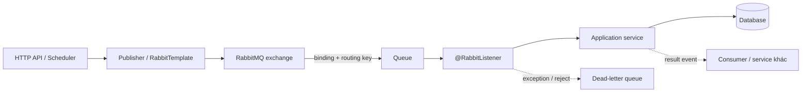
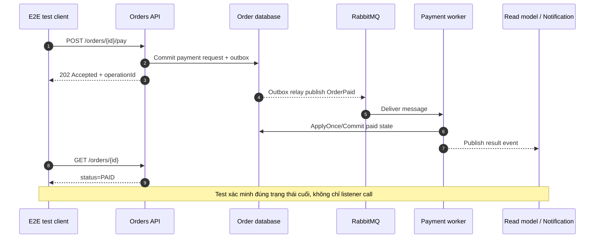

# Chọn kiểm thử đơn vị, tích hợp và toàn trình cho luồng thông điệp

## 1. Vì sao luồng RabbitMQ cần nhiều cấp độ kiểm thử?

Trong chương **Kiểm thử** của **Spring AMQP**, một nghiệp vụ thường đi qua nhiều thành phần bất đồng bộ:



Một bài test chỉ gọi trực tiếp method listener có thể xác nhận logic xử lý đúng, nhưng **không chứng minh message đi qua exchange, binding, queue hoặc acknowledgement**. Ngược lại, bài test kết nối RabbitMQ thật mà chỉ kiểm tra listener đã được gọi có thể bỏ sót lỗi transaction, xử lý trùng và trạng thái cuối cùng ở database.

Vì vậy câu hỏi không phải “nên viết unit test hay integration test?”, mà là **mỗi rủi ro cần cấp độ kiểm thử nào để phát hiện nhanh và có bằng chứng đủ mạnh?**

Mục tiêu học tập:

1. Phân biệt **kiểm thử đơn vị (unit)**, **kiểm thử tích hợp (integration)** và **kiểm thử toàn trình (end-to-end, E2E)** trong hệ thống bất đồng bộ.
2. Chọn cấp độ theo **ranh giới cần kiểm chứng**: Java code, Spring container, RabbitMQ, database hay nhiều service.
3. Dùng JUnit, Mockito, công cụ `spring-rabbit-test`, Testcontainers và phép chờ có điều kiện để viết test có khả năng lặp lại.
4. Lập ma trận kiểm thử cho routing, serialization, retry, ack, dead-letter, transaction, idempotency, ordering và reconnect.
5. Tránh test flaky, phụ thuộc thời gian ngẫu nhiên, dữ liệu tồn đọng và kết luận sai rằng “publish thành công” đồng nghĩa “nghiệp vụ hoàn tất”.

## 2. Ba cấp độ khác nhau ở ranh giới nào?

| Đặc tính | Unit test | Integration test | E2E test |
|---|---|---|---|
| Phạm vi | Một class/hàm và các cộng tác viên giả lập | Nhiều component liên kết với hạ tầng thật, ví dụ Spring + RabbitMQ | Toàn chuỗi từ đầu vào người dùng tới kết quả nghiệp vụ qua các service |
| RabbitMQ thật | **Không cần** | **Có** khi kiểm broker-specific behavior | **Có**, qua môi trường giống production nhất có thể |
| Database thật | Thường không | Có khi kiểm repository/transaction | Có, hoặc storage tương đương của luồng chạy thật |
| Thời gian chạy | Nhanh, thường mili giây | Trung bình, phải khởi tạo container/context | Chậm, nhiều dependency và điểm lỗi |
| Tính cô lập | Cao | Trung bình, cần tách queue/vhost/dữ liệu | Thấp hơn, phải quản lý toàn môi trường |
| Khi lỗi | Chỉ ra logic/cấu hình cục bộ | Chỉ ra boundary Spring–broker–DB | Chỉ ra hợp đồng và hành vi liên service |
| Ví dụ xác nhận | Publisher chọn đúng routing key | Broker thực sự route qua binding | API trả trạng thái đúng, downstream cập nhật chính xác |
| Không đủ để chứng minh | Broker hoạt động, redelivery/ack | Toàn bộ hành trình của khách hàng | Tất cả trường hợp lỗi nhỏ với thông báo nhanh |

### 2.1. Đừng dùng từ “integration” chỉ vì khởi động Spring

`@SpringBootTest` tải Spring context nhưng nếu mọi dependency đều bị mock và không có broker/database thật thì bài test đó chủ yếu kiểm **wiring/component behavior**, không phải giao tiếp với RabbitMQ. Tương tự, gọi `TestRabbitTemplate` trực tiếp vào listener mà không đi qua broker **không xác nhận RabbitMQ routing**.

Ngược lại, integration test không bắt buộc phải khởi động tất cả service trong công ty. Test một `RabbitTemplate` gửi qua exchange thật tới một listener thật, kiểm tra trạng thái trên database thật đã là **một bài tích hợp có giá trị**.

### 2.2. Ba câu hỏi để chọn cấp độ

1. **Tôi muốn phát hiện lỗi ở đâu?** Parse payload, mapping DTO, DB transaction, hay kết nối giữa service A và B?
2. **Tôi cần bằng chứng gì?** Mockito verify, record trong queue, commit database, hay trạng thái khách hàng nhìn thấy?
3. **Điểm nào không thể giả lập trung thực?** Broker ack/requeue/DLX, routing topic, publisher confirms, crash giữa commit và ack phải được kiểm với hạ tầng phù hợp.

**Quy tắc thực hành:** kiểm tra nhiều trường hợp lỗi nghiệp vụ ở unit; kiểm các ranh giới hạ tầng quan trọng ở integration; chọn một số hành trình đại diện và tình huống phục hồi cấp hệ thống ở E2E.

## 3. Ma trận chọn test theo rủi ro

| Câu hỏi/điều kiện cần chứng minh | Cấp độ chính | Có nên bổ sung cấp khác? |
|---|---|---|
| `OrderPaid` có amount âm phải bị từ chối? | Unit | Integration nếu exception ảnh hưởng ack/reject |
| DTO được parse đúng hoặc từ chối schema sai? | Unit | Integration để kiểm `MessageConverter` + container |
| Publisher chọn đúng exchange/routing key? | Unit | **Có:** integration vì binding có thể khai báo sai |
| Direct/topic/fanout exchange route đúng queue? | Integration với broker | E2E nếu routing xuyên nhiều service |
| Message được serialize, có content type/headers đúng? | Unit/contract test | Integration với producer–consumer thật |
| Listener khởi động, subscribe được queue? | Integration | E2E cho trạng thái sẵn sàng thực tế |
| Exception được retry với max attempts/backoff? | Unit cho policy | Integration để xác nhận container và DLQ |
| Reject `requeue=false` đi vào DLQ? | Integration | E2E nếu có service DLQ/replay riêng |
| Commit DB thành công nhưng broker mất ack không làm cộng tiền lần hai? | Integration với DB thật + broker | Fault-injection E2E cho critical flow |
| Publisher confirm/return khi routing không hợp lệ? | Integration với broker | E2E nếu kết quả ảnh hưởng HTTP response |
| Thứ tự event của cùng `orderId` qua nhiều consumer? | Integration dưới concurrency | E2E khi có nhiều producer/replica |
| Từ API đặt hàng tới hóa đơn được tạo và thông báo cập nhật? | E2E | Unit/integration cho từng cạnh để chẩn đoán |
| Broker restart, service reconnect và xử lý backlog? | Integration/fault injection | E2E cho tiêu chí vận hành |
| Token/PII không xuất hiện trong log khi listener lỗi? | Unit + integration | Kiểm pipeline quan sát E2E khi cần |

Một invariant quan trọng nên xuất hiện ở nhiều cấp độ **không phải do trùng lặp vô ích**, mà vì nó có các ranh giới khác nhau. Ví dụ: unit chứng minh duplicate trở thành no-op trong service; integration chứng minh redelivery thực không làm DB cập nhật hai lần; E2E chứng minh sau restart khách hàng chỉ bị tính tiền một lần.

## 4. Một luồng mẫu dùng chung cho cả ba cấp độ

Giả sử hệ thống nhận sự kiện thanh toán và cập nhật đơn. Message minh họa: `eventId|orderId|amountCents`.

- Producer dùng `RabbitTemplate` gửi vào **direct exchange** `orders.payments.exchange` với routing key `orders.paid`.
- Queue `orders.paid.queue` nhận message qua binding, có dead-letter exchange `orders.payments.dlx`.
- `@RabbitListener` giải mã nội dung, gọi service để áp dụng trạng thái **một lần duy nhất theo `eventId`**.
- Lỗi dữ liệu vĩnh viễn được reject không requeue; lỗi hạ tầng tạm thời retry hữu hạn theo chính sách riêng.

### 4.1. Hợp đồng payload, publisher và listener

```java
public record PaidEvent(String eventId, String orderId, long amountCents) {
    public PaidEvent {
        if (eventId == null || eventId.isBlank()
                || orderId == null || orderId.isBlank()
                || eventId.contains("|") || orderId.contains("|")
                || amountCents <= 0) {
            throw new IllegalArgumentException("INVALID_PAID_EVENT");
        }
    }

    public String encode() {
        return eventId + "|" + orderId + "|" + amountCents;
    }

    public static PaidEvent decode(String raw) {
        String[] fields = raw.split("\\|", -1);
        if (fields.length != 3) {
            throw new IllegalArgumentException("INVALID_PAID_EVENT");
        }
        try {
            return new PaidEvent(
                    fields[0], fields[1], Long.parseLong(fields[2]));
        } catch (NumberFormatException ex) {
            throw new IllegalArgumentException("INVALID_PAID_EVENT");
        }
    }
}
```

```java
import org.springframework.amqp.rabbit.core.RabbitTemplate;
import org.springframework.stereotype.Component;

@Component
public class PaidEventPublisher {
    private final RabbitTemplate template;

    public PaidEventPublisher(RabbitTemplate template) {
        this.template = template;
    }

    public void publish(PaidEvent event) {
        template.convertAndSend(
                PaidEventTopology.EXCHANGE,
                PaidEventTopology.ROUTING_KEY,
                event.encode());
    }
}
```

```java
import org.springframework.amqp.rabbit.annotation.RabbitListener;
import org.springframework.stereotype.Component;

public interface PaymentApplier {
    void applyOnce(PaidEvent event);
}

@Component
public class PaidEventListener {
    private final PaymentApplier applier;

    public PaidEventListener(PaymentApplier applier) {
        this.applier = applier;
    }

    @RabbitListener(id = "paidListener", queues = PaidEventTopology.QUEUE)
    public void onMessage(String payload) {
        applier.applyOnce(PaidEvent.decode(payload));
    }
}
```

Ghi chú: payload ký tự `|` chỉ dùng để minh họa phân lớp kiểm thử; ứng dụng thật nên dùng JSON/Avro/Protobuf có schema, message ID và trace ID chuẩn hóa. `PaymentApplier` là một interface được triển khai bởi service transaction/idempotency trong production; các bài test có thể thay bằng fake có kiểm soát.

### 4.2. Topology cho môi trường tích hợp

```java
import org.springframework.amqp.core.Binding;
import org.springframework.amqp.core.BindingBuilder;
import org.springframework.amqp.core.DirectExchange;
import org.springframework.amqp.core.Queue;
import org.springframework.amqp.core.QueueBuilder;
import org.springframework.beans.factory.annotation.Qualifier;
import org.springframework.context.annotation.Bean;
import org.springframework.context.annotation.Configuration;

@Configuration
public class PaidEventTopology {
    public static final String EXCHANGE = "orders.payments.exchange";
    public static final String ROUTING_KEY = "orders.paid";
    public static final String QUEUE = "orders.paid.queue";
    public static final String DLX = "orders.payments.dlx";
    public static final String DLQ = "orders.payments.failed";
    public static final String DEAD_KEY = "orders.failed";

    @Bean DirectExchange paidExchange() {
        return new DirectExchange(EXCHANGE, true, false);
    }

    @Bean DirectExchange paidDlx() {
        return new DirectExchange(DLX, true, false);
    }

    @Bean Queue paidQueue() {
        return QueueBuilder.durable(QUEUE)
                .deadLetterExchange(DLX)
                .deadLetterRoutingKey(DEAD_KEY)
                .build();
    }

    @Bean Queue paidDlq() {
        return QueueBuilder.durable(DLQ).build();
    }

    @Bean Binding paidBinding(
            @Qualifier("paidQueue") Queue queue,
            @Qualifier("paidExchange") DirectExchange exchange) {
        return BindingBuilder.bind(queue)
                .to(exchange).with(ROUTING_KEY);
    }

    @Bean Binding paidDeadBinding(
            @Qualifier("paidDlq") Queue queue,
            @Qualifier("paidDlx") DirectExchange exchange) {
        return BindingBuilder.bind(queue)
                .to(exchange).with(DEAD_KEY);
    }
}
```

Các bean chỉ **khai báo topology**, không tự chứng minh broker đã tạo đúng exchange/binding. Integration test phải thực sự chạy `RabbitAdmin`/cấu hình auto-declaration phù hợp và gửi qua broker thật. Nếu queue đã tồn tại với arguments khác, RabbitMQ có thể từ chối redeclare; dùng broker riêng để không ảnh hưởng queue production.

## 5. Unit test: kiểm tra quyết định trong Java, không khởi động broker

Unit test nhanh nhất và chính xác nhất để tìm lỗi trong `decode`, validation, gọi service và chọn routing key. Dùng **JUnit 5** và **Mockito**, tạo class bằng `new` và mock các cộng tác viên.

```java
import static org.junit.jupiter.api.Assertions.*;
import static org.mockito.Mockito.*;

import org.junit.jupiter.api.Test;
import org.springframework.amqp.rabbit.core.RabbitTemplate;

class PaidEventUnitTest {
    @Test
    void rejectsInvalidAmountBeforePublish() {
        assertThrows(IllegalArgumentException.class,
                () -> new PaidEvent("evt-1", "order-1", -1));
    }

    @Test
    void publisherUsesIntendedExchangeAndRoutingKey() {
        RabbitTemplate template = mock(RabbitTemplate.class);
        PaidEventPublisher publisher = new PaidEventPublisher(template);

        PaidEvent event = new PaidEvent("evt-1", "order-1", 2500);
        publisher.publish(event);

        verify(template).convertAndSend(
                PaidEventTopology.EXCHANGE,
                PaidEventTopology.ROUTING_KEY,
                "evt-1|order-1|2500");
        verifyNoMoreInteractions(template);
    }

    @Test
    void listenerDelegatesDecodedEventToBusinessService() {
        PaymentApplier applier = mock(PaymentApplier.class);
        PaidEventListener listener = new PaidEventListener(applier);

        listener.onMessage("evt-2|order-9|7900");

        verify(applier).applyOnce(
                new PaidEvent("evt-2", "order-9", 7900));
    }

    @Test
    void malformedPayloadDoesNotCallBusinessService() {
        PaymentApplier applier = mock(PaymentApplier.class);
        PaidEventListener listener = new PaidEventListener(applier);

        assertThrows(IllegalArgumentException.class,
                () -> listener.onMessage("not-a-valid-message"));
        verifyNoInteractions(applier);
    }
}
```

**Những gì test này xác nhận:** publisher đã gọi `convertAndSend` với ba tham số mong đợi; listener parse và gọi domain service đúng. **Những gì nó không xác nhận:** exchange có tồn tại, routing key có binding, message được serialize như trên wire, RabbitMQ ack/requeue hay database commit. Một method `@RabbitListener` được gọi trực tiếp cũng **không kích hoạt cơ chế container**.

### 5.1. Unit test nghiệp vụ và idempotency

Nên bổ sung nhiều unit test cho `PaymentApplier`:

- Event lần đầu: áp dụng thay đổi và ghi `eventId` đã xử lý.
- Event trùng `eventId` cùng nội dung: trả kết quả đã lưu, **không ghi side effect lần hai**.
- Event trùng ID nhưng payload khác: trả xung đột.
- Đơn đã hủy hoặc amount không hợp lệ: kết quả nghiệp vụ cuối cùng, không retry mù quáng.
- DB adapter ném lỗi tạm thời: service không báo thành công giả.

Nhưng **mock repository không thể chứng minh transaction/unique constraint hoạt động đúng dưới hai consumer cạnh tranh**. Phải có integration test với database thật để bảo đảm hai thao tác đồng thời không cùng insert/update thành công.

## 6. Component test với công cụ của `spring-rabbit-test`

Spring AMQP cung cấp `spring-rabbit-test`, hỗ trợ kiểm thử listener mà không bắt buộc dùng broker trong mọi bài:

| Công cụ | Kiểm chứng được | Không kiểm chứng được |
|---|---|---|
| `TestRabbitTemplate` | Gọi listener thông qua hạ tầng test; request–reply ở mức component | **Không** kiểm broker routing, exchange/binding, network, ack/DLX |
| `@RabbitListenerTest` + `RabbitListenerTestHarness` | Spy, capture argument, kết quả và exception của listener có ID | Không tự tạo broker và không thay thế kiểm thử E2E |
| `@SpringRabbitTest` | Bổ sung `RabbitTemplate`, `RabbitAdmin`, container factory... cho Spring test context | Không cần dùng thêm trên `@SpringBootTest` có Boot auto-configuration |
| `@RabbitAvailable` | Kiểm broker dùng chung có sẵn, khai báo/purge queue test | Nếu broker không có, mặc định có thể **skip** test thay vì fail CI |

**Chi tiết quan trọng:** `TestRabbitTemplate` tìm listener container trong context và **gọi listener trực tiếp trên thread test**, chủ yếu route theo **tên queue**. Nó không gửi qua RabbitMQ thật, nên bài test pass với `TestRabbitTemplate` **không phải bằng chứng exchange, binding hay DLQ đúng**.

`@RabbitListenerTest` có thể dùng Mockito spy trên listener method, và `RabbitListenerTestHarness.getNextInvocationDataFor(id, timeout, unit)` giúp chờ invocation bất đồng bộ theo ID. Muốn spy/capture, method listener không được là `final` và cần khai báo `id` trên `@RabbitListener`.

Ví dụ test harness dạng tối giản (các bean connection/container phải được cấu hình tương thích với test context):

```java
import java.util.concurrent.TimeUnit;
import org.springframework.amqp.rabbit.test.RabbitListenerTestHarness;

// Khi context đã dùng @RabbitListenerTest(capture = true)
// và listener khai báo @RabbitListener(id = "paidListener", ...):
RabbitListenerTestHarness.InvocationData invocation =
        harness.getNextInvocationDataFor(
                "paidListener", 10, TimeUnit.SECONDS);

assertNotNull(invocation);
assertEquals("evt-2|order-9|7900",
        invocation.getArguments()[0]);
```

Đây là mảnh minh họa thuộc **method test**, không phải một file Java độc lập. Không lấy số lần listener được spy làm bằng chứng message đã được **ack** hoặc thay đổi database đã **commit**. Muốn kiểm kết quả nghiệp vụ, hãy khẳng định trạng thái trên repository/DB hoặc một test sink có quan sát được.

## 7. Integration test: chạy RabbitMQ thật bằng Testcontainers

Với yêu cầu “`RabbitTemplate` thực sự gửi qua exchange và binding tới `@RabbitListener`”, cần broker thật. **Testcontainers** khởi tạo RabbitMQ riêng cho test class, giúp tránh phụ thuộc broker đang chạy trên máy developer hay queue chung của nhóm khác.

### 7.1. Dependency test

Ví dụ Maven với các dependency có scope `test`, dùng BOM Spring Boot và Testcontainers tương thích:

```xml
<dependency>
    <groupId>org.springframework.boot</groupId>
    <artifactId>spring-boot-starter-test</artifactId>
    <scope>test</scope>
</dependency>
<dependency>
    <groupId>org.springframework.boot</groupId>
    <artifactId>spring-boot-testcontainers</artifactId>
    <scope>test</scope>
</dependency>
<dependency>
    <groupId>org.testcontainers</groupId>
    <artifactId>junit-jupiter</artifactId>
    <scope>test</scope>
</dependency>
<dependency>
    <groupId>org.testcontainers</groupId>
    <artifactId>rabbitmq</artifactId>
    <scope>test</scope>
</dependency>
```

Các tọa độ `org.testcontainers:*` phía trên là dạng phổ biến cho Testcontainers **1.x**. Testcontainers **2.x** có thể thay artifact ID (ví dụ `testcontainers-rabbitmq` và `testcontainers-junit-jupiter`); hãy chọn theo BOM/dòng Spring Boot của dự án. Không trộn lẫn các artifact từ hai major version.

`@ServiceConnection` được Spring Boot hỗ trợ ở các phiên bản phù hợp (Spring Boot **3.1+**); nó cấp `RabbitConnectionDetails` từ `RabbitMQContainer` để ứng dụng kết nối đúng host/port động. Khi không dùng Boot hỗ trợ này, có thể cấu hình `spring.rabbitmq.host/port/username/password` bằng `@DynamicPropertySource`.

### 7.2. Integration test đi qua broker thực

Ví dụ này dùng fake `PaymentApplier` **chỉ trong test** để quan sát listener đã nhận message. Nó kiểm đường `RabbitTemplate → exchange → binding → queue → @RabbitListener`, nhưng chưa kiểm database hay retry.

```java
import static org.junit.jupiter.api.Assertions.*;

import java.util.concurrent.CountDownLatch;
import java.util.concurrent.TimeUnit;
import java.util.concurrent.atomic.AtomicReference;
import org.junit.jupiter.api.Test;
import org.junit.jupiter.api.extension.ExtendWith;
import org.springframework.beans.factory.annotation.Autowired;
import org.springframework.boot.test.context.SpringBootTest;
import org.springframework.boot.test.context.TestConfiguration;
import org.springframework.boot.testcontainers.service.connection.ServiceConnection;
import org.springframework.context.annotation.Bean;
import org.springframework.context.annotation.Import;
import org.springframework.context.annotation.Primary;
import org.testcontainers.containers.RabbitMQContainer;
import org.testcontainers.junit.jupiter.Container;
import org.testcontainers.junit.jupiter.Testcontainers;
import org.testcontainers.utility.DockerImageName;

@Testcontainers
@SpringBootTest
@Import(PaidEventIntegrationTest.SinkConfiguration.class)
class PaidEventIntegrationTest {

    @Container
    @ServiceConnection
    static final RabbitMQContainer rabbit = new RabbitMQContainer(
            DockerImageName.parse("rabbitmq:4.1-management"));

    @Autowired PaidEventPublisher publisher;
    @Autowired RecordingPaymentApplier sink;

    @Test
    void messageCrossesRealExchangeBindingQueueAndListener()
            throws InterruptedException {
        PaidEvent event = new PaidEvent("it-event-001", "it-order-7", 3200);
        publisher.publish(event);

        assertTrue(sink.received.await(10, TimeUnit.SECONDS),
                "Listener did not receive event through broker");
        assertEquals(event, sink.lastEvent.get());
    }

    @TestConfiguration(proxyBeanMethods = false)
    static class SinkConfiguration {
        @Bean
        @Primary
        RecordingPaymentApplier recordingPaymentApplier() {
            return new RecordingPaymentApplier();
        }
    }

    static class RecordingPaymentApplier implements PaymentApplier {
        final CountDownLatch received = new CountDownLatch(1);
        final AtomicReference<PaidEvent> lastEvent = new AtomicReference<>();

        @Override
        public void applyOnce(PaidEvent event) {
            lastEvent.set(event);
            received.countDown();
        }
    }
}
```

Giả định ứng dụng `@SpringBootTest` có cấu hình `PaidEventTopology`, publisher, listener và `RabbitAdmin` auto-declare thông thường. Nếu còn implementation `PaymentApplier` production yêu cầu database lúc startup, hãy cô lập test configuration/chỉ scan các bean cần thiết hoặc thêm database Testcontainer; `@Primary` chỉ quyết định bean được inject, **không bảo đảm bean production khác sẽ không khởi tạo**.

**Vì sao test này có giá trị:** nếu exchange/binding sai, message sẽ không đi tới listener và latch hết hạn. Tuy nhiên latch được count down **trước khi listener trả về**, nên đây **không phải** bằng chứng broker đã nhận ack; muốn chứng minh ack/requeue phải có test riêng quan sát trạng thái broker sau xử lý.

### 7.3. Kiểm tương tác với database và idempotency

Khi cần kiểm việc commit:

1. Dùng PostgreSQL/MariaDB Testcontainer hoặc database tương đương production.
2. Giữ nguyên `@Transactional`, unique constraint `event_id` và repository thật.
3. Publish một event, chờ bằng **Awaitility** đến khi DB lưu bản ghi `processed_events` với ID dự kiến.
4. Publish lại **cùng eventId và payload**, xác nhận chỉ có **một tác dụng phụ**.
5. Cho hai message cùng ID chạy gần đồng thời; xác nhận unique index/transaction ngăn double-write.

Ví dụ dạng assertion:

```java
import static org.awaitility.Awaitility.await;
import static org.junit.jupiter.api.Assertions.assertEquals;
import java.time.Duration;

publisher.publish(new PaidEvent("evt-77", "order-77", 8800));

await().atMost(Duration.ofSeconds(15)).untilAsserted(() ->
        assertEquals(1, jdbc.queryForObject(
                "SELECT COUNT(*) FROM processed_events WHERE event_id = ?",
                Integer.class, "evt-77")));

publisher.publish(new PaidEvent("evt-77", "order-77", 8800));

// Kiểm tra sau khi hệ thống quan sát một lần xử lý thứ hai hoặc qua
// điều kiện ổn định có giới hạn, không lập tức assert ngay sau publish.
// Bảng/dữ liệu tồn kho phải xác nhận không có side effect lần thứ hai.
```

Mảnh code này là **minh họa assertion** trong integration test có bean `jdbc`, `publisher` và dependency Awaitility; nó không phải test độc lập để copy nguyên. Chỉ kiểm `COUNT(processed_events)=1` là chưa đủ nếu handler vô tình áp dụng side effect hai lần trước khi insert dedup. Hãy kiểm cả **số dư/trạng thái domain**, event log và transaction behavior.

## 8. E2E test: bắt đầu từ hành vi người dùng, kết thúc ở trạng thái nghiệp vụ

Một bài E2E đi qua **đường vào thật** (HTTP API, batch job hoặc command) và **đường ra thật** (database, event downstream hoặc API truy vấn trạng thái). Ví dụ:



### 8.1. Hợp đồng cần được kiểm

Trong E2E, bằng chứng thường là:

- HTTP tạo yêu cầu thành công và trả `operationId` có thể truy vết, **không đợi vô hạn** để mọi consumer hoàn tất.
- Event được publish, route, consume; trạng thái đơn hàng về `PAID` trong deadline nghiệp vụ.
- Kết quả downstream (hóa đơn/thông báo) đúng contract, không tạo dữ liệu trùng.
- Khi broker tạm ngừng, outbox giữ công việc; sau phục hồi, cùng `operationId` hoàn tất đúng một lần ở mức nghiệp vụ.
- Một message dữ liệu lỗi được phân loại và có trạng thái quan sát được, thay vì âm thầm biến mất.

### 8.2. E2E skeleton với deadline có giới hạn

```java
import static org.awaitility.Awaitility.await;
import static org.junit.jupiter.api.Assertions.assertEquals;

import java.time.Duration;
import org.junit.jupiter.api.Test;
import org.springframework.beans.factory.annotation.Autowired;
import org.springframework.boot.test.context.SpringBootTest;
import org.springframework.boot.test.web.client.TestRestTemplate;

// Mẫu cần điều chỉnh theo endpoint, DTO và môi trường nhiều service thực tế.
@SpringBootTest(webEnvironment = SpringBootTest.WebEnvironment.RANDOM_PORT)
class PaymentFlowE2ETest {
    @Autowired TestRestTemplate http;
    @Autowired OrderStatusProbe orders; // Adapter đọc DB/API trạng thái.

    @Test
    void paymentRequestEventuallyBecomesPaid() {
        String orderId = "e2e-order-1001";
        // Giả sử fixture đã tạo orderId và đủ điều kiện thanh toán.
        http.postForEntity("/orders/{id}/pay", null,
                Void.class, orderId);

        await().atMost(Duration.ofSeconds(30))
                .pollInterval(Duration.ofMillis(200))
                .untilAsserted(() -> assertEquals(
                        "PAID", orders.findStatus(orderId)));
    }

    interface OrderStatusProbe {
        String findStatus(String orderId);
    }
}
```

Đây là **khung minh họa**, không phải test plug-and-play: phải hiện thực `OrderStatusProbe`, tạo fixture và kiểm status HTTP; nếu các service chạy riêng thì client nên gọi endpoint của môi trường E2E thay vì chỉ khởi động một Spring context. Môi trường E2E cần broker, database, service/relay thật (hoặc những thành phần tương đương đã được xác định rõ).

**Không dùng** E2E để kiểm mọi nhánh validation, vì sẽ quá chậm và khó phân tích nguyên nhân. Đó là nhiệm vụ chủ yếu của unit và integration tests.

## 9. Test các hành vi RabbitMQ không thể chứng minh bằng mock

### 9.1. Routing và serialization

Với broker thật, tạo các binding tường minh rồi gửi bằng `RabbitTemplate`:

- **Positive:** routing key đúng, queue đích nhận, listener parse message và có content type/schema chính xác.
- **Negative:** routing key sai, queue đích không nhận; nếu bật `mandatory`/publisher returns, xác nhận kết quả **returned**.
- **Topology drift:** queue đã tồn tại với arguments không khớp; xác nhận startup có lỗi rõ ràng, không “âm thầm xanh”.
- **Compatibility:** producer phát payload phiên bản `v2`, consumer `v1` có chấp nhận field mới không? Dùng contract/schema test riêng trước khi đẩy sang broker.

Không nên lấy `RabbitTemplate.convertAndSend(...)` không ném exception làm bằng chứng broker đã lưu message. Với publisher confirms cần bật tính năng, ghi nhận ack/nack; với routing không tới queue cần kiểm publisher returns. **Confirm chỉ xác nhận broker**, không xác nhận business handler.

### 9.2. Ack, reject, retry và dead-letter

Đây là nơi broker integration test thật sự khác unit test. Một kịch bản có kiểm soát:

1. Định nghĩa queue có DLX và DLQ; listener nhận payload sai có thể ném `AmqpRejectAndDontRequeueException`.
2. Publish một message mang `eventId` cụ thể với nội dung không hợp lệ.
3. Chờ đến khi broker đưa **đúng message** vào DLQ; kiểm `messageId` hoặc ID trong payload.
4. Xác nhận queue chính không còn message đang ready/unacked sau khi recoverer hoàn tất.
5. Xác nhận message không có side effect trong database, và DLQ vẫn giữ thông tin cần thiết cho điều tra.

```java
// Ví dụ code trong listener của môi trường test:
throw new org.springframework.amqp.AmqpRejectAndDontRequeueException(
        "BAD_SCHEMA");
```

**Điều kiện:** queue phải có DLX/binding chính xác; nếu không, reject không requeue có thể khiến message bị loại bỏ. Đối với retry, cấu hình `RetryInterceptorBuilder`/policy có `maxAttempts` và recoverer, rồi kiểm số lần xử lý thực tế. Nếu service retry xong nhưng recoverer **nuốt exception**, container có thể ack thay vì dead-letter. Vì vậy **hành vi DLQ phải được test qua broker**, không chỉ `verify(recoverer)`.

### 9.3. Database commit rồi mất ack

Lỗi đáng thử nhất cho idempotency:

```text
Delivery E1 → service commit DB → consumer mất connection trước ack
                              ↓
                      broker redeliver E1
                              ↓
                    service nhận ra eventId cũ
                              ↓
                    không cộng/trừ lần hai
```

Unit test chứng minh service có nhánh duplicate. Integration/fault test cần thực hiện:

- Cho worker xử lý E1 và commit DB.
- **Cắt connection đúng cửa sổ trước broker nhận ack** bằng fault injection/test hook.
- Chờ broker redeliver (hoặc publish lại cùng event ID khi kiểm idempotency producer retry).
- Kiểm record dedup và **trạng thái business cuối**, không chỉ số lần handler được gọi.

Chỉ kill broker ngẫu nhiên không bảo đảm chạm đúng cửa sổ lỗi. Test fault injection cần có điểm đồng bộ/latch để tái hiện có chủ đích. Không làm kiểu thử ngắt broker production.

### 9.4. Retry vì lỗi hạ tầng và phân loại lỗi nghiệp vụ

Phân biệt ba trường hợp:

| Lỗi | Unit cần làm | Integration cần chứng minh |
|---|---|---|
| **Business rejection** (ví dụ đơn đã hủy) | Service trả `REJECTED`, không retry | Listener ack sau khi lưu kết quả domain; queue không lặp vô hạn |
| **Transient** (DB unavailable) | Mapping exception thành retryable | Transaction rollback, retry hữu hạn/backoff, hết lượt thì DLQ hoặc recovery phù hợp |
| **Permanent malformed** | Parser báo `BAD_SCHEMA` | Container reject không requeue, message tới DLQ nếu có DLX |

Với test đếm lần retry, hãy phân biệt **số lần gọi service** và **số delivery broker**: stateless retry có thể gọi lại listener trên cùng delivery; stateful retry có thể đưa exception ra ngoài, dẫn tới rollback/requeue/redelivery.

## 10. Chờ bất đồng bộ đúng cách, không tạo test flaky

### 10.1. Không dùng `Thread.sleep` làm điều kiện thành công

```java
// DỄ FLAKY: nhanh ở laptop, chậm trong CI:
publisher.publish(event);
Thread.sleep(2000);
assertEquals("PAID", repository.findStatus(orderId));
```

Thay bằng **bounded wait cho một điều kiện có ý nghĩa**:

```java
publisher.publish(event);
await().atMost(Duration.ofSeconds(15))
        .pollInterval(Duration.ofMillis(100))
        .untilAsserted(() ->
                assertEquals("PAID", repository.findStatus(orderId)));
```

Không chờ vô hạn. Thời hạn cần tính đến khởi tạo listener, broker, CPU CI và retry backoff. Khi hết hạn, in **diagnostics có kiểm soát**: event ID, queue name, consumer count, DLQ depth, retry attempts và trạng thái DB; tránh dump payload/token/PII.

### 10.2. Các nguyên nhân flaky phổ biến

| Vấn đề | Tác động | Cách xử lý |
|---|---|---|
| Dùng queue chung từ lần test khác | Test nhận nhầm message hoặc còn DLQ cũ | Broker/container riêng hoặc queue/vhost unique per suite |
| Test chạy song song cùng queue | Competing consumers làm mỗi test nhận message của nhau | Partition suite theo queue, tắt parallel cho test dùng chung |
| Assert ngay sau publish | Listener chưa kịp chạy | Awaitility hoặc latch với timeout |
| Chỉ chờ latch từ đầu method | Tưởng nghiệp vụ hoàn tất dù transaction chưa commit | Chờ **trạng thái bền** trong DB, sau đó kiểm ack riêng |
| Không tạo topology trước khi gửi | Publish diễn ra trước binding/consumer startup | Khởi tạo queue/binding và probe readiness trước test |
| Sử dụng fixed port `5672` | Xung đột môi trường phát triển/CI | Testcontainers port mapping động / `@ServiceConnection` |
| Test dùng `Clock.systemUTC()` và thời gian thật | Ranh giới TTL/delay khác nhau mỗi lần | Inject `Clock` cho logic thời gian; TTL broker test riêng |
| Listener async mở executor rồi return sớm | Test có thể pass nhưng broker ack trước side effect | Test completion/transaction, không chỉ callback được gọi |
| Mock quá sâu | Sai binding, exception wrapper và redelivery không bị phát hiện | Bổ sung broker integration và ít E2E critical |

### 10.3. Giữ test độc lập

- Tạo `eventId` độc nhất theo test, nhưng **giữ nguyên ID** khi kiểm retry/duplicate.
- Nếu dùng dữ liệu DB, seed fixture theo transaction/namespace hoặc dọn đúng trước/sau test; với consumer chạy thread khác, `@Transactional` trên **method test** không bao trùm transaction của listener.
- Không dùng `RabbitTemplate.receive()` để “nhìn thử queue” khi listener production đang hoạt động: có thể vô tình **lấy mất message** mà listener cần xử lý.
- Purge queue test chỉ khi chắc chắn không còn consumer khác xử lý cùng queue; thao tác purge là phá hủy dữ liệu đang chờ.
- Khi có dữ liệu nhạy cảm, chỉ dùng **token/email giả** để thử logging, không đưa credential thực vào assertions/log thất bại.

## 11. Tổ chức CI: nhanh ở PR, sâu ở môi trường kiểm thử

Một phân lớp thực tế:

| Giai đoạn | Bộ kiểm thử | Mục tiêu |
|---|---|---|
| Mỗi commit/PR | Unit + parser/contract + component test không broker | Phản hồi nhanh, chặn lỗi logic |
| Mỗi PR hoặc merge | Broker integration quan trọng bằng Testcontainers | Chặn lỗi binding, converter, listener startup, ack/DLQ |
| Nightly / pre-release | Integration đầy đủ với DB thật, retry, concurrency, fault injection có kiểm soát | Kiểm transaction/redelivery và tương thích phiên bản |
| Staging / release gate | Một số E2E journeys đại diện + khả năng phục hồi broker | Đảm bảo luồng liên service theo SLO |

Đừng coi tỷ lệ unit/integration/E2E trong “kim tự tháp kiểm thử” là chỉ tiêu cứng. Nếu hệ thống chủ yếu là routing và retry, integration test có broker **mang giá trị rất cao**. Dù vậy, test E2E toàn hệ thống thường đắt đỏ, dễ thất bại vì dependency ngoài phạm vi code đang sửa; hãy chọn các luồng rủi ro cao thay vì copy mọi nhánh unit test sang E2E.

Khi một E2E fail, cần truy vết theo `eventId`/`operationId` qua **producer → exchange/queue → listener → database/downstream** để khoanh vùng nhanh, không chỉ đọc exception “condition not met in 30 seconds”.

## 12. Một kế hoạch kiểm thử hoàn chỉnh cho tính năng OrderPaid

Trước khi triển khai, viết rõ **invariants**:

1. `OrderPaid` hợp lệ có amount dương và ID ổn định.
2. Mỗi `eventId` chỉ áp dụng side effect **một lần**, kể cả khi broker redeliver.
3. Message hợp lệ đi đúng `exchange → binding → queue → listener`.
4. Payload lỗi vĩnh viễn không requeue vô hạn; khi cấu hình đúng thì tới DLQ.
5. Lỗi database tạm thời rollback và được retry theo budget.
6. API/nguồn phát không đánh đồng publisher confirm với kết quả nghiệp vụ.
7. Sau broker restart, backlog có thể được xử lý và trạng thái business được đối soát.

Ma trận tối thiểu để nhóm review:

| ID | Mô tả | Test level | Bằng chứng pass |
|---|---|---|---|
| U-01 | Parse/validate `OrderPaid` | Unit | Exception/code chính xác |
| U-02 | Publisher gọi đúng exchange/key | Unit | Mockito verify |
| U-03 | Business duplicate và conflict | Unit | No-op/xung đột đúng |
| C-01 | Listener adapter nhận String và gọi service | Component | Spy/capture args |
| I-01 | Broker route end-to-end trong một service | Integration | Handler nhận đúng `eventId` |
| I-02 | JSON/message converter tương thích schema | Integration | DTO/headers đúng |
| I-03 | Lỗi malformed → DLQ | Integration | DLQ chứa đúng event, main queue không kẹt |
| I-04 | Rollback/retry hữu hạn | Integration | Attempt count + trạng thái kết thúc |
| I-05 | Commit DB + duplicate/redelivery | Integration | DB state đúng, side effect một lần |
| I-06 | Confirm/return unroutable | Integration | Không báo nhầm đã tới queue |
| E-01 | HTTP payment → order `PAID` | E2E | API và DB/read model đúng |
| E-02 | Broker outage/recovery với outbox | E2E/fault | Không mất operation, có đối soát |

**Điều kiện pass không được chỉ là “không ném exception”.** Ví dụ test I-03 phải nhìn thấy đúng event ở DLQ, test I-05 phải kiểm **trạng thái business**, E-02 phải kiểm operation được xử lý sau phục hồi — kể cả khi message được giao nhiều lần.

## 13. Bài tập và câu hỏi tự kiểm tra

1. Vì sao test `verify(rabbitTemplate).convertAndSend(...)` không chứng minh exchange có binding?
2. So sánh `TestRabbitTemplate` và `RabbitTemplate` nối RabbitMQ Testcontainer. Khi nào dùng mỗi loại?
3. Viết unit test phân biệt message bị từ chối do amount âm với lỗi database tạm thời. Mỗi lỗi nên ảnh hưởng retry như thế nào?
4. Với direct exchange, làm sao chứng minh sai routing key gây unroutable thay vì producer chỉ “gửi không lỗi”?
5. Vì sao latch được count down khi listener bắt đầu không đủ khẳng định database transaction đã commit?
6. Viết integration test cho `AmqpRejectAndDontRequeueException` có DLX; ngoài việc listener lỗi, phải assert những gì trên broker?
7. Nếu publisher nhận confirm timeout, test có được kết luận message chắc chắn chưa tới broker không? Nêu cách kiểm idempotency khi gửi lại.
8. Khi hai test cùng queue và chạy song song, chúng có thể gây flaky bằng cách nào? Đưa ra phương án cô lập.
9. Một hệ thống có 1.000 unit test pass và 0 broker integration test, còn rủi ro nào chưa được xác minh?
10. Thiết kế E2E cho tình huống **service tạo đơn → RabbitMQ → worker → hóa đơn**, nêu input, correlation ID, điều kiện pass và deadline.
11. Nếu cần xác minh ordering khi có nhiều consumer, unit test có đủ không? Mô tả môi trường integration và dữ liệu cần quan sát.
12. Lập runbook khi integration test timeout: kiểm tra topology, queue ready/unacked, consumer count, DLQ, log an toàn, DB và retry state theo thứ tự nào?

## 14. Tài liệu tham khảo

- [Spring AMQP — Testing Support](https://docs.spring.io/spring-amqp/reference/testing.html): `spring-rabbit-test`, `TestRabbitTemplate`, `@RabbitListenerTest`, `@SpringRabbitTest` và `@RabbitAvailable`.
- [Spring Boot — Testcontainers](https://docs.spring.io/spring-boot/reference/testing/testcontainers.html): `@ServiceConnection`, `RabbitMQContainer` và connection details động.
- [Spring AMQP — Annotation-driven Listener Endpoints](https://docs.spring.io/spring-amqp/reference/amqp/receiving-messages/async-annotation-driven.html): `@RabbitListener` và cách container gọi listener.
- [Spring AMQP — Publisher Confirms and Returns](https://docs.spring.io/spring-amqp/reference/amqp/publisher-confirms-returns.html): xác nhận publish, routing không tới queue và callback.
- [Spring AMQP — Exception Handling](https://docs.spring.io/spring-amqp/reference/amqp/exception-handling.html): reject, requeue, fatal errors và behavior của container.
- [Testcontainers — RabbitMQ Module](https://java.testcontainers.org/modules/rabbitmq/): chạy broker RabbitMQ cô lập trong integration tests.
- [RabbitMQ — Consumer Acknowledgements and Publisher Confirms](https://www.rabbitmq.com/docs/confirms): lý do cần kiểm ack/confirm/redelivery độc lập.

**Ghi nhớ:** Unit test trả lời **“logic của tôi có đúng?”**; integration test trả lời **“Spring AMQP, RabbitMQ và database có tương tác đúng không?”**; E2E test trả lời **“nghiệp vụ của người dùng có đi từ đầu đến cuối và cho kết quả đúng không?”**. Đối với hệ thống bất đồng bộ đáng tin cậy, hãy chọn cấp độ theo **invariant và ranh giới rủi ro**, kiểm tra kết quả quan sát được thay vì chỉ số lần method được gọi, và luôn thiết kế test chịu được retry, redelivery và thời gian hoàn tất không đồng bộ.
