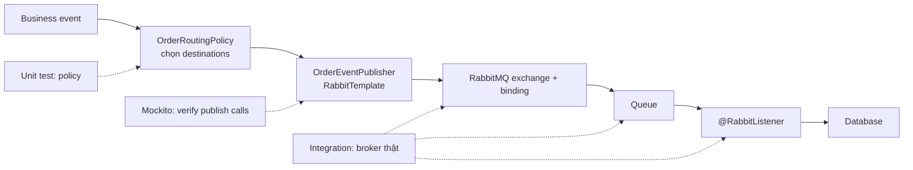
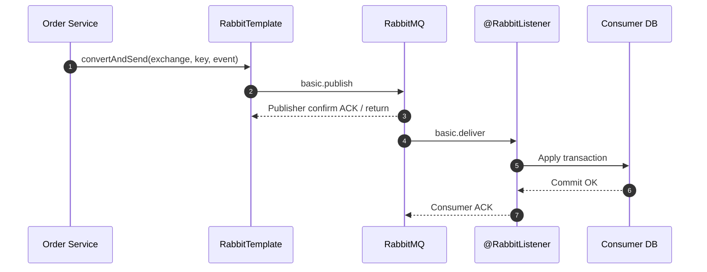

# Mock RabbitTemplate và kiểm thử quy tắc định tuyến nghiệp vụ

## 1. Vì sao cần kiểm thử routing trước khi chạy RabbitMQ?

Trong module **SPRING_AMQP**, producer thường dùng `RabbitTemplate` để gửi sự kiện qua **exchange** và **routing key**; RabbitMQ dùng **binding** để chuyển message đến queue, còn `@RabbitListener` xử lý bất đồng bộ phía consumer. Hệ thống còn cần publisher confirm, consumer ACK, retry, dead-letter, transaction và quan sát để chịu được lỗi thực tế.

Tuy nhiên, ngay cả khi kết nối broker hoàn toàn khỏe mạnh, nghiệp vụ vẫn có thể sai vì producer chọn **exchange không đúng**, viết nhầm **routing key** hoặc phát message nhiều/ít hơn quy định.

Ví dụ dịch vụ Đơn hàng có chính sách:

- Sự kiện `CREATED` được gửi tới exchange `orders.events` với key `order.vn.created` hoặc `order.sg.created` theo khu vực.
- Sự kiện `CANCELLED` dùng exchange `orders.events` và key tương ứng `order.vn.cancelled`.
- Sự kiện `PAID` dùng exchange `billing.events` với key `payment.vn.paid`.
- Riêng đơn hàng đã thanh toán với giá trị **từ 10.000.000 VND trở lên** cần gửi **thêm một message** tới exchange `risk.events`, key `risk.vn.review`, sau message thanh toán chính.
- Payload phải giữ nguyên `eventId`, `orderId` và dữ liệu; mỗi publish phải gắn `messageId`, business key và schema version.

Đây là **quy tắc định tuyến nghiệp vụ**. Chúng ta cần chứng minh các quyết định trên bằng test chạy nhanh, có kết quả xác định và **không cần broker**. Mockito cho phép tạo một `RabbitTemplate` giả (mock), gọi service thật và kiểm tra nó **đã yêu cầu publish như thế nào**.

**Giới hạn cần hiểu từ đầu:** một mock xác nhận *lời gọi Java tới RabbitTemplate*, **không xác nhận** exchange hoặc binding thực sự tồn tại, RabbitMQ đã nhận message, queue đã nhận delivery, hay `@RabbitListener` đã commit database. Những điều này thuộc các lớp integration/end-to-end test khác.

### Mục tiêu học tập

Sau bài, bạn sẽ biết cách:

1. Tách quyết định `exchange + routingKey` thành một **hàm thuần** có thể test bằng bảng dữ liệu.
2. Dùng **JUnit 5 + Mockito** để mock `RabbitTemplate`, gọi producer thật và xác nhận đúng exchange, key, payload, số lần gửi và thứ tự.
3. Dùng `ArgumentCaptor<MessagePostProcessor>` để kiểm tra header, `messageId` và delivery mode; hiểu vì sao mock không tự chạy postprocessor.
4. Kiểm tra trường hợp **không được publish** (validation fail), lỗi `AmqpException`, publish nhiều đích và nguy cơ gửi thành công một phần.
5. Tránh test sai do overload `convertAndSend`, matcher `any()`, test giòn do implementation details hoặc cố mock toàn bộ RabbitMQ.
6. Chọn đúng giữa **unit test**, `TestRabbitTemplate`, `@RabbitListenerTest` và integration test với broker thật.
7. Xây ma trận test đủ bao phủ routing policy, dữ liệu biên, message metadata và những đường thất bại quan trọng.

## 2. Ranh giới kiểm thử: chính xác chúng ta kiểm tra gì?



| Loại kiểm thử | Chạy broker? | Khẳng định được | **Không** khẳng định được |
|---|---|---|---|
| Unit test `OrderRoutingPolicy` | Không | Mapping event → exchange/key; điều kiện biên | RabbitTemplate thực sự được gọi |
| Unit test publisher với mock RabbitTemplate | Không | Số lần gọi, arguments, header logic nằm trong callback, exception path | Network, converter thật, binding thực tế, confirm/return |
| Test converter thật, không broker | Không | DTO → bytes/content type/header theo converter cấu hình | Broker nhận hoặc định tuyến thành công |
| `TestRabbitTemplate` trong Spring Rabbit Test | Không | Gọi listener trực tiếp theo **queue name** trong Spring context | Routing exchange/binding thật; publisher confirms/returns |
| `@RabbitListenerTest`/harness | Tùy cách dựng context | Theo dõi lời gọi listener và outcome; có thể dùng broker hoặc test setup | Tự động chứng minh business routing của exchange |
| Integration test qua RabbitMQ thật | Có | Exchange/binding/queue, serialization thực, consume, một số confirm/DLQ/retry | Tự chứng minh toàn bộ SLA hoặc exactly-once nếu chưa test failure windows |

**Đừng để một unit test Mockito xanh tạo cảm giác topology đã được kiểm chứng.** Nếu quy tắc dùng exchange `billing.events` nhưng hạ tầng chỉ khai báo `billing.event`, unit test có thể pass do cả production code và expected value cùng sai. Cần một integration test kiểm tra topology contract bằng broker thật.

## 3. Công cụ và phiên bản tham chiếu

Ví dụ dùng **Java 17+, Spring Boot 3.4+/Spring AMQP 3.x, JUnit Jupiter 5 và Mockito 5**. Những API chính `RabbitTemplate.convertAndSend(...)` và `MessagePostProcessor` ổn định qua nhiều bản Spring AMQP. Với Spring Boot 4.x/Spring AMQP 4.x, cần dùng BOM và API tương thích thay vì tự trộn phiên bản.

Trong Maven, `spring-boot-starter-amqp` dùng cho code ứng dụng, `spring-boot-starter-test` dùng cho unit test:

```xml
<dependencies>
    <dependency>
        <groupId>org.springframework.boot</groupId>
        <artifactId>spring-boot-starter-amqp</artifactId>
    </dependency>
    <dependency>
        <groupId>org.springframework.boot</groupId>
        <artifactId>spring-boot-starter-test</artifactId>
        <scope>test</scope>
    </dependency>
</dependencies>
```

`spring-boot-starter-test` thường cung cấp JUnit Jupiter, Mockito và AssertJ theo dependency management của Boot. Khi chỉ test hàm thuần và mock, **không cần** RabbitMQ container, Docker, connection factory hay `@SpringBootTest`.

Nếu muốn test brokerless listener với `TestRabbitTemplate` hoặc `RabbitListenerTestHarness`, dùng thêm `spring-rabbit-test` tương ứng; chúng được giới thiệu ở mục 12.

### 3.1. Cấu trúc lớp cho ví dụ

Các đoạn code bên dưới giả định cùng package `com.example.orders` và được chia thành những file Java riêng theo tên class:

```text
src/main/java/com/example/orders/
  Region.java
  OrderStage.java
  OrderEvent.java
  Route.java
  OrderRoutingPolicy.java
  OrderEventPublisher.java

src/test/java/com/example/orders/
  OrderRoutingPolicyTest.java
  OrderEventPublisherTest.java
```

Ở production có thể đặt `Route` và `OrderRoutingPolicy` trong domain/application layer; `OrderEventPublisher` là adapter tại ranh giới truyền tin. Không viết Spring configuration hoặc gọi broker trong test unit thuần.

## 4. Thiết kế quy tắc routing bằng một hàm thuần

### 4.1. Mô hình sự kiện

```java
public enum Region {
    VN, SG
}
```

```java
public enum OrderStage {
    CREATED, PAID, CANCELLED
}
```

```java
import java.math.BigDecimal;

public record OrderEvent(
        String eventId,
        String orderId,
        Region region,
        OrderStage stage,
        BigDecimal amount
) {}
```

`OrderEvent` là immutable Java record. Trong ví dụ `amount` được quy ước là **VND**, cùng đơn vị với ngưỡng kiểm tra rủi ro. Không nên so sánh trực tiếp số tiền khác đơn vị (USD, SGD, VND) với cùng ngưỡng mà chưa chuyển đổi và định nghĩa quy tắc rõ ràng.

### 4.2. Kết quả định tuyến

```java
public record Route(String exchange, String routingKey) {}
```

Một sự kiện có thể dẫn tới **một hoặc nhiều** destination; dùng `List<Route>` thay vì chỉ một `String routingKey` để test những trường hợp cần fan-out có chủ đích.

### 4.3. Chính sách nghiệp vụ

```java
import java.math.BigDecimal;
import java.util.List;
import java.util.Locale;

public final class OrderRoutingPolicy {

    static final BigDecimal RISK_THRESHOLD =
            new BigDecimal("10000000");

    public List<Route> routes(OrderEvent event) {
        validate(event);

        String region = event.region().name()
                .toLowerCase(Locale.ROOT);

        return switch (event.stage()) {
            case CREATED -> List.of(
                    new Route("orders.events",
                            "order." + region + ".created")
            );
            case CANCELLED -> List.of(
                    new Route("orders.events",
                            "order." + region + ".cancelled")
            );
            case PAID -> {
                Route payment = new Route(
                        "billing.events",
                        "payment." + region + ".paid");

                if (event.amount().compareTo(RISK_THRESHOLD) >= 0) {
                    yield List.of(
                            payment,
                            new Route("risk.events",
                                    "risk." + region + ".review")
                    );
                }

                yield List.of(payment);
            }
        };
    }

    private static void validate(OrderEvent event) {
        if (event == null
                || event.eventId() == null
                || event.eventId().isBlank()
                || event.orderId() == null
                || event.orderId().isBlank()
                || event.region() == null
                || event.stage() == null
                || event.amount() == null
                || event.amount().signum() < 0) {
            throw new IllegalArgumentException("Invalid order event");
        }

        if (event.stage() == OrderStage.PAID
                && event.amount().signum() == 0) {
            throw new IllegalArgumentException(
                    "PAID event must have positive amount");
        }
    }
}
```

Các invariant chủ đích:

- `CREATED` và `CANCELLED` luôn tới `orders.events`.
- `PAID` luôn tới `billing.events`.
- `PAID` có `amount >= 10.000.000` gửi **hai message**: billing trước, risk sau.
- Vùng `VN` và `SG` làm thành phần routing key, được hạ chữ bằng `Locale.ROOT` cho kết quả xác định.
- Event thiếu ID, region, stage hoặc amount âm bị từ chối **trước khi publish**.
- Sự kiện `PAID` phải có amount dương.

Đây là một hàm thuần: không đọc môi trường, không gọi broker, không có database, không phụ thuộc thời gian hay random. Vì thế test nhỏ sẽ chạy nhanh và dễ xác định lỗi nằm ở policy.

**Phân biệt:** danh sách `Route` thể hiện **những publish mà ứng dụng muốn thực hiện**, không có nghĩa RabbitMQ bảo đảm tất cả đích nhận message thành công như một transaction nguyên tử.

## 5. Unit test trực tiếp quy tắc định tuyến

Một policy thuần nên được test trực tiếp trước khi kiểm tra tương tác với `RabbitTemplate`.

### 5.1. Bảng trường hợp

| Event | Region | Amount | Exchange → routing key | Số destination |
|---|---|---:|---|---:|
| CREATED | VN | 500.000 | `orders.events → order.vn.created` | 1 |
| CREATED | SG | 500.000 | `orders.events → order.sg.created` | 1 |
| CANCELLED | VN | 0 | `orders.events → order.vn.cancelled` | 1 |
| PAID | VN | 9.999.999 | `billing.events → payment.vn.paid` | 1 |
| PAID | VN | 10.000.000 | `billing.events → payment.vn.paid` và `risk.events → risk.vn.review` | 2 |
| PAID | SG | 10.000.001 | `billing.events → payment.sg.paid` và `risk.events → risk.sg.review` | 2 |
| PAID | VN | 0 | Validation error | 0 |

Giá trị `9.999.999`, `10.000.000`, `10.000.001` là các **boundary values** quan trọng nhất: chúng kiểm chứng điều kiện `>=` thay vì `>` hoặc `<=`.

### 5.2. Parameterized test với JUnit 5

```java
import static org.junit.jupiter.api.Assertions.assertEquals;

import java.math.BigDecimal;
import java.util.List;
import java.util.stream.Stream;

import org.junit.jupiter.params.ParameterizedTest;
import org.junit.jupiter.params.provider.Arguments;
import org.junit.jupiter.params.provider.MethodSource;

class OrderRoutingPolicyTest {

    private final OrderRoutingPolicy policy =
            new OrderRoutingPolicy();

    static Stream<Arguments> routingCases() {
        return Stream.of(
            Arguments.of(
                new OrderEvent("E1", "O1", Region.VN,
                        OrderStage.CREATED, new BigDecimal("500000")),
                List.of(new Route("orders.events",
                        "order.vn.created"))
            ),
            Arguments.of(
                new OrderEvent("E2", "O2", Region.SG,
                        OrderStage.CREATED, new BigDecimal("500000")),
                List.of(new Route("orders.events",
                        "order.sg.created"))
            ),
            Arguments.of(
                new OrderEvent("E3", "O3", Region.VN,
                        OrderStage.CANCELLED, BigDecimal.ZERO),
                List.of(new Route("orders.events",
                        "order.vn.cancelled"))
            ),
            Arguments.of(
                new OrderEvent("E4", "O4", Region.VN,
                        OrderStage.PAID,
                        new BigDecimal("9999999")),
                List.of(new Route("billing.events",
                        "payment.vn.paid"))
            ),
            Arguments.of(
                new OrderEvent("E5", "O5", Region.VN,
                        OrderStage.PAID,
                        new BigDecimal("10000000")),
                List.of(
                    new Route("billing.events",
                            "payment.vn.paid"),
                    new Route("risk.events",
                            "risk.vn.review")
                )
            ),
            Arguments.of(
                new OrderEvent("E6", "O6", Region.SG,
                        OrderStage.PAID,
                        new BigDecimal("10000001")),
                List.of(
                    new Route("billing.events",
                            "payment.sg.paid"),
                    new Route("risk.events",
                            "risk.sg.review")
                )
            )
        );
    }

    @ParameterizedTest
    @MethodSource("routingCases")
    void selectsExpectedDestinations(
            OrderEvent event, List<Route> expected) {

        assertEquals(expected, policy.routes(event));
    }
}
```

`record Route` có `equals()`/`hashCode()` theo các thành phần, nên `assertEquals(expected, actual)` so sánh được cả nội dung lẫn **thứ tự các phần tử** trong `List`. Điều này hữu ích vì ví dụ yêu cầu billing được phát trước risk.

Nếu đường gửi rủi ro không bắt buộc thứ tự, hãy viết contract rõ và dùng assertion không phụ thuộc thứ tự; tránh khiến test giòn vì một thứ tự triển khai không có ý nghĩa nghiệp vụ.

### 5.3. Kiểm tra dữ liệu không hợp lệ

```java
import static org.junit.jupiter.api.Assertions.assertThrows;

import java.math.BigDecimal;
import org.junit.jupiter.api.Test;

class OrderRoutingValidationTest {
    private final OrderRoutingPolicy policy =
            new OrderRoutingPolicy();

    @Test
    void rejectsPaidEventWithZeroAmount() {
        OrderEvent invalid = new OrderEvent(
                "E1", "O1", Region.VN, OrderStage.PAID,
                BigDecimal.ZERO);

        assertThrows(IllegalArgumentException.class,
                () -> policy.routes(invalid));
    }

    @Test
    void rejectsMissingRoutingDimension() {
        OrderEvent invalid = new OrderEvent(
                "E2", "O2", null, OrderStage.CREATED,
                BigDecimal.ONE);

        assertThrows(IllegalArgumentException.class,
                () -> policy.routes(invalid));
    }

    @Test
    void rejectsNullEvent() {
        assertThrows(IllegalArgumentException.class,
                () -> policy.routes(null));
    }
}
```

Các test này xác minh policy. Chưa có `RabbitTemplate` nào tham gia; không cần Spring context, Docker hay network.

## 6. Adapter thật: OrderEventPublisher sử dụng RabbitTemplate

Khi policy đã xác định destination, publisher sẽ gửi payload và gắn metadata. Tách lớp này khỏi policy giúp test tương tác rất rõ.

```java
import org.springframework.amqp.core.MessageDeliveryMode;
import org.springframework.amqp.rabbit.core.RabbitTemplate;

public final class OrderEventPublisher {
    private final RabbitTemplate rabbitTemplate;
    private final OrderRoutingPolicy routingPolicy;

    public OrderEventPublisher(
            RabbitTemplate rabbitTemplate,
            OrderRoutingPolicy routingPolicy) {
        this.rabbitTemplate = rabbitTemplate;
        this.routingPolicy = routingPolicy;
    }

    public void publish(OrderEvent event) {
        // Tính toàn bộ route và validate trước khi gửi lần nào.
        for (Route route : routingPolicy.routes(event)) {
            rabbitTemplate.convertAndSend(
                    route.exchange(),
                    route.routingKey(),
                    event,
                    message -> {
                        message.getMessageProperties()
                                .setMessageId(event.eventId());
                        message.getMessageProperties().setHeader(
                                "x-business-key",
                                "order:" + event.orderId());
                        message.getMessageProperties().setHeader(
                                "x-schema-version", "1");
                        message.getMessageProperties().setDeliveryMode(
                                MessageDeliveryMode.PERSISTENT);
                        return message;
                    }
            );
        }
    }
}
```

Ở Spring, lớp này có thể trở thành `@Service` được constructor-inject `RabbitTemplate` và policy bean. Để giữ ví dụ unit test đơn giản, nó là Java class thông thường; hành vi chạy thật không phụ thuộc annotation.

**Cần nhớ các overload của `convertAndSend`**:

```java
// 3 tham số: không có MessagePostProcessor
rabbitTemplate.convertAndSend(exchange, routingKey, event);

// 4 tham số: có MessagePostProcessor
rabbitTemplate.convertAndSend(
        exchange, routingKey, event, messagePostProcessor);

// 5 tham số: MessagePostProcessor + CorrelationData cho confirms
rabbitTemplate.convertAndSend(
        exchange, routingKey, event,
        messagePostProcessor, correlationData);
```

Mockito phân biệt các overload theo chữ ký Java. Test gọi `verify(template).convertAndSend(exchange, key, payload)` sẽ **không match** code dùng overload 4 tham số; điều đó là một lỗi test thường gặp.

## 7. Mock RabbitTemplate với MockitoExtension

### 7.1. Test không khởi động Spring context

```java
import static org.junit.jupiter.api.Assertions.assertThrows;
import static org.mockito.ArgumentMatchers.any;
import static org.mockito.ArgumentMatchers.eq;
import static org.mockito.ArgumentMatchers.same;
import static org.mockito.Mockito.*;

import java.math.BigDecimal;

import org.junit.jupiter.api.BeforeEach;
import org.junit.jupiter.api.Test;
import org.junit.jupiter.api.extension.ExtendWith;
import org.mockito.InOrder;
import org.mockito.Mock;
import org.mockito.junit.jupiter.MockitoExtension;
import org.springframework.amqp.core.MessagePostProcessor;
import org.springframework.amqp.rabbit.core.RabbitTemplate;

@ExtendWith(MockitoExtension.class)
class OrderEventPublisherTest {

    @Mock
    private RabbitTemplate rabbitTemplate;

    private OrderEventPublisher publisher;

    @BeforeEach
    void setUp() {
        publisher = new OrderEventPublisher(
                rabbitTemplate, new OrderRoutingPolicy());
    }

    @Test
    void sendsCreatedEventToOrdersExchange() {
        OrderEvent event = new OrderEvent(
                "E1001", "O1001", Region.VN, OrderStage.CREATED,
                new BigDecimal("500000"));

        publisher.publish(event);

        verify(rabbitTemplate).convertAndSend(
                eq("orders.events"),
                eq("order.vn.created"),
                same(event),
                any(MessagePostProcessor.class));

        verifyNoMoreInteractions(rabbitTemplate);
    }

    @Test
    void sendsPaidEventToBillingOnlyBelowThreshold() {
        OrderEvent event = new OrderEvent(
                "E1002", "O1002", Region.VN, OrderStage.PAID,
                new BigDecimal("9999999"));

        publisher.publish(event);

        verify(rabbitTemplate).convertAndSend(
                eq("billing.events"),
                eq("payment.vn.paid"),
                same(event),
                any(MessagePostProcessor.class));

        verifyNoMoreInteractions(rabbitTemplate);
    }

    @Test
    void sendsHighValuePaidEventToBillingThenRisk() {
        OrderEvent event = new OrderEvent(
                "E1003", "O1003", Region.SG, OrderStage.PAID,
                new BigDecimal("10000000"));

        publisher.publish(event);

        InOrder order = inOrder(rabbitTemplate);
        order.verify(rabbitTemplate).convertAndSend(
                eq("billing.events"),
                eq("payment.sg.paid"),
                same(event),
                any(MessagePostProcessor.class));
        order.verify(rabbitTemplate).convertAndSend(
                eq("risk.events"),
                eq("risk.sg.review"),
                same(event),
                any(MessagePostProcessor.class));
        order.verifyNoMoreInteractions();
    }

    @Test
    void doesNotPublishInvalidEvent() {
        OrderEvent invalid = new OrderEvent(
                "", "O1004", Region.VN, OrderStage.PAID,
                new BigDecimal("500000"));

        assertThrows(IllegalArgumentException.class,
                () -> publisher.publish(invalid));

        verifyNoInteractions(rabbitTemplate);
    }
}
```

Đây là **test của producer thật với RabbitTemplate giả**:

- `@Mock` tạo mock, không tạo TCP connection.
- `@ExtendWith(MockitoExtension.class)` quản lý Mockito cho JUnit 5.
- `@BeforeEach` tạo service thật, không cần `@InjectMocks` khi có thể truyền dependency bằng constructor rõ ràng.
- `verify(...)` khẳng định exchange, routing key, object payload và overload thực sự được gọi.
- `verifyNoMoreInteractions(...)` bắt những lần gửi không mong muốn, ví dụ route thêm sang `risk.events` khi amount dưới ngưỡng.
- `InOrder` xác minh hai lệnh publish **được gọi theo thứ tự**; **không chứng minh** broker đã xác nhận message theo thứ tự hoặc tất cả destination cùng thành công.

### 7.2. Hiểu đúng các matcher

| Matcher | Ý nghĩa | Dùng khi |
|---|---|---|
| `eq("orders.events")` | Giá trị bằng chuỗi mong đợi | Exchange/routing key contract |
| `same(event)` | Chính xác cùng object instance | Publisher truyền nguyên record mà không chuyển đổi |
| `argThat(e -> ...)` | Kiểm tra thuộc tính object theo điều kiện | Producer tạo một bản payload khác |
| `any(MessagePostProcessor.class)` | Có callback thuộc kiểu MPP, không null | Overload 4 tham số |
| `isNull()` | Tham số null | Khi hợp đồng cho phép null rõ ràng |
| `times(2)` | Một phương thức/call pattern có đúng hai lần | Kiểm tra số lượng tương tác |
| `never()` | Không có lần gọi match pattern | Chứng minh không có route cấm |
| `verifyNoInteractions(template)` | Không có lời gọi trên mock | Input invalid đã bị chặn trước send |

**Quy tắc Mockito:** khi dùng matcher cho **một** tham số trong lời gọi `verify`/`when`, các tham số còn lại cũng phải được bọc bằng matcher phù hợp; không trộn `eq(exchange)` với raw literal `routingKey` trong cùng lời gọi.

**Không dùng `any()` khắp nơi:** test sau có thể pass dù routing sai:

```java
verify(rabbitTemplate).convertAndSend(
        anyString(), anyString(), any(),
        any(MessagePostProcessor.class));
```

Nó chỉ chứng minh một lời gọi tương thích đã xảy ra, chứ không chứng minh **quy tắc định tuyến nghiệp vụ**. Nếu hợp đồng là exchange/key cụ thể, dùng `eq(...)`.

### 7.3. Kiểm tra sự kiện ở ranh giới

Test cao giá trị cần dùng ít nhất ba điểm:

```text
amount = 9_999_999   -> chỉ billing
amount = 10_000_000  -> billing + risk
amount = 10_000_001  -> billing + risk
```

Điểm **đúng bằng ngưỡng** giúp phát hiện bug “`>`” thay vì “`>=`”. Mỗi nhánh có thể kiểm tra trong routing policy test thuần; publisher test nên giữ vài case đại diện để chứng minh **chuyển quyết định thành lời gọi RabbitTemplate**.

## 8. Capture payload và kiểm tra MessagePostProcessor

### 8.1. Vì sao verify callback tồn tại là chưa đủ?

Publisher gọi:

```java
rabbitTemplate.convertAndSend(
    route.exchange(), route.routingKey(),
    event, message -> {
        message.getMessageProperties().setMessageId(event.eventId());
        return message;
    });
```

Khi `RabbitTemplate` là mock mặc định, Mockito **không chạy converter hoặc lambda `MessagePostProcessor`**. Do đó:

```java
verify(rabbitTemplate).convertAndSend(
        eq("billing.events"), eq("payment.vn.paid"),
        same(event), any(MessagePostProcessor.class));
```

chỉ xác nhận có callback, chưa chứng minh callback thực sự gắn `messageId` hay header đúng. Cần **capture callback** rồi gọi nó trên một `Message` giả định trong unit test.

### 8.2. ArgumentCaptor cho MessagePostProcessor

```java
import static org.junit.jupiter.api.Assertions.*;
import static org.mockito.ArgumentMatchers.eq;
import static org.mockito.ArgumentMatchers.same;
import static org.mockito.Mockito.verify;

import java.math.BigDecimal;
import java.nio.charset.StandardCharsets;

import org.junit.jupiter.api.Test;
import org.mockito.ArgumentCaptor;
import org.springframework.amqp.core.Message;
import org.springframework.amqp.core.MessageDeliveryMode;
import org.springframework.amqp.core.MessagePostProcessor;
import org.springframework.amqp.core.MessageProperties;

@Test
void attachesExpectedMetadataToPublishedMessage() {
    OrderEvent event = new OrderEvent(
            "E2001", "O2001", Region.VN, OrderStage.PAID,
            new BigDecimal("500000"));

    publisher.publish(event);

    ArgumentCaptor<MessagePostProcessor> processorCaptor =
            ArgumentCaptor.forClass(MessagePostProcessor.class);

    verify(rabbitTemplate).convertAndSend(
            eq("billing.events"),
            eq("payment.vn.paid"),
            same(event),
            processorCaptor.capture());

    Message before = new Message(
            "{}".getBytes(StandardCharsets.UTF_8),
            new MessageProperties());

    Message after =
            processorCaptor.getValue().postProcessMessage(before);

    assertSame(before, after);
    assertEquals("E2001",
            after.getMessageProperties().getMessageId());
    assertEquals("order:O2001",
            after.getMessageProperties().getHeaders()
                    .get("x-business-key"));
    assertEquals("1",
            after.getMessageProperties().getHeaders()
                    .get("x-schema-version"));
    assertEquals(MessageDeliveryMode.PERSISTENT,
            after.getMessageProperties().getDeliveryMode());
}
```

Đoạn trên là **method thêm vào `OrderEventPublisherTest`** ở mục 7: nó dùng các field `publisher` và `rabbitTemplate` đã được khai báo ở đó. Không sao chép thành file độc lập ở cấp package khi chưa thêm class và setup.

Khi production chuyển sang overload 5 tham số có `CorrelationData`, capture cần đổi chữ ký cho phù hợp. Đừng ép test dùng overload cũ để giữ test xanh.

### 8.3. Capture payload có ý nghĩa gì?

`same(event)` phù hợp khi adapter được yêu cầu truyền **chính object** mà người gọi cung cấp. Nếu producer tạo một event envelope mới hoặc thay đổi payload trước publish, `same` quá cứng. Khi đó dùng `ArgumentCaptor<OrderEvent>`:

```java
ArgumentCaptor<OrderEvent> payloadCaptor =
        ArgumentCaptor.forClass(OrderEvent.class);

verify(rabbitTemplate).convertAndSend(
        eq("orders.events"),
        eq("order.vn.created"),
        payloadCaptor.capture(),
        any(MessagePostProcessor.class));

assertEquals("E1001", payloadCaptor.getValue().eventId());
assertEquals("O1001", payloadCaptor.getValue().orderId());
```

Đoạn này cũng là **method fragment** sử dụng cùng test class, giả định publisher đã gửi event CREATED với IDs trên. Khi payload thật được ánh xạ sang DTO khác, hãy capture kiểu payload mà `RabbitTemplate` thật sự nhận được.

**Không kiểm tra JSON bytes chỉ bằng mock RabbitTemplate.** Mockito không chạy `MessageConverter`. Muốn khẳng định content type, encoding, schema JSON và field naming, hãy test converter thật hoặc dùng integration test chuyên trách.

## 9. Test lỗi gửi, không gửi và gửi một phần

### 9.1. Stubbing một phương thức void

`RabbitTemplate.convertAndSend(...)` trả về `void`. Mockito không thể sử dụng `when(template.convertAndSend(...)).thenThrow(...)` vì method không trả giá trị. Dùng `doThrow(...).when(mock)`.

```java
import static org.junit.jupiter.api.Assertions.assertThrows;
import static org.mockito.ArgumentMatchers.*;
import static org.mockito.Mockito.*;

import java.math.BigDecimal;
import org.junit.jupiter.api.Test;
import org.springframework.amqp.AmqpException;
import org.springframework.amqp.core.MessagePostProcessor;

@Test
void propagatesTransportFailureToCaller() {
    OrderEvent event = new OrderEvent(
            "E3001", "O3001", Region.VN, OrderStage.CREATED,
            new BigDecimal("100000"));

    doThrow(new AmqpException("synthetic connection error"))
            .when(rabbitTemplate)
            .convertAndSend(
                    eq("orders.events"),
                    eq("order.vn.created"),
                    same(event),
                    any(MessagePostProcessor.class));

    assertThrows(AmqpException.class,
            () -> publisher.publish(event));

    verify(rabbitTemplate).convertAndSend(
            eq("orders.events"),
            eq("order.vn.created"),
            same(event),
            any(MessagePostProcessor.class));
}
```

Đây là **test mô phỏng exception ở ranh giới RabbitTemplate**, không làm broker thực sự mất kết nối. Nó chứng minh service hiện tại không nuốt lỗi. Nếu business yêu cầu error wrapping, log hoặc lưu retry state, hãy thay expectation theo contract mới.

**Quan trọng:** `convertAndSend` không ném exception trong mọi tình huống message không tới queue. Publish không route được có thể không gây lỗi đồng bộ. Broker ACK/NACK và publisher returns là những tín hiệu riêng, cần test tích hợp hoặc cấu trúc abstraction riêng.

### 9.2. Test tình trạng gửi thành công một phần

Với sự kiện PAID giá trị cao, policy sinh hai route. Giả sử mock mô phỏng publish billing thành công nhưng risk ném lỗi:

```java
import static org.junit.jupiter.api.Assertions.assertThrows;
import static org.mockito.ArgumentMatchers.*;
import static org.mockito.Mockito.*;

import java.math.BigDecimal;
import org.junit.jupiter.api.Test;
import org.mockito.InOrder;
import org.springframework.amqp.AmqpException;
import org.springframework.amqp.core.MessagePostProcessor;

@Test
void secondDestinationMayFailAfterFirstWasCalled() {
    OrderEvent event = new OrderEvent(
            "E3002", "O3002", Region.VN, OrderStage.PAID,
            new BigDecimal("10000000"));

    doThrow(new AmqpException("synthetic risk failure"))
            .when(rabbitTemplate)
            .convertAndSend(
                    eq("risk.events"),
                    eq("risk.vn.review"),
                    same(event),
                    any(MessagePostProcessor.class));

    assertThrows(AmqpException.class,
            () -> publisher.publish(event));

    InOrder order = inOrder(rabbitTemplate);
    order.verify(rabbitTemplate).convertAndSend(
            eq("billing.events"), eq("payment.vn.paid"),
            same(event), any(MessagePostProcessor.class));
    order.verify(rabbitTemplate).convertAndSend(
            eq("risk.events"), eq("risk.vn.review"),
            same(event), any(MessagePostProcessor.class));
    order.verifyNoMoreInteractions();
}
```

**Test này chỉ chứng minh lần gọi đầu đã xảy ra trước lần thứ hai**; nó không chứng minh broker đã lưu message thứ nhất. Nó bộc lộ một rủi ro thiết kế thật: nếu application đã gửi billing nhưng risk thất bại, lần retry toàn bộ sự kiện có thể gửi lại billing lần nữa.

Giải pháp production khi cần **mỗi destination được giao đáng tin cậy**:

1. Tạo một `eventId` ổn định cho event nghiệp vụ.
2. Lưu danh sách đích phải gửi trong **transactional outbox** cùng transaction nghiệp vụ.
3. Theo dõi kết quả **theo từng destination** (`billing` và `risk`), không gộp một cờ `sent`.
4. Dùng publisher confirms và publisher returns trên `RabbitTemplate` thật để xác định broker accepted/returned.
5. Khi timeout, retry destination còn pending với cùng event ID; consumer mỗi đích phải idempotent.

Đây là thiết kế **at-least-once + idempotency**, không phải multi-exchange atomic transaction.

### 9.3. Không publish khi dữ liệu không hợp lệ

Một test quan trọng hơn đếm số message là chứng minh **validation luôn chạy trước mọi send**:

```java
OrderEvent invalid = new OrderEvent(
        "E3003", "", Region.VN, OrderStage.CREATED,
        BigDecimal.ONE);

assertThrows(IllegalArgumentException.class,
        () -> publisher.publish(invalid));

verifyNoInteractions(rabbitTemplate);
```

Nếu code gửi một message rồi mới nhận ra input thiếu field cần thiết để route thứ hai, test `verifyNoInteractions` sẽ bắt được lỗi thiết kế đó.

## 10. Những ngộ nhận thường dẫn đến test xanh nhưng hệ thống sai

| Sai lầm | Vì sao nguy hiểm | Kiểm thử/thay đổi phù hợp |
|---|---|---|
| Chỉ verify `convertAndSend(any(), any(), ...)` | Không phát hiện sai exchange/routing key | Verify exact exchange/key theo bảng policy |
| Test chỉ một tình huống PAID | Không bắt được bug điều kiện ngưỡng | Test dưới/bằng/trên ngưỡng |
| Mock policy và mock template cùng lúc | Test chỉ chứng minh stub được dùng, không xác nhận mapping thật | Test policy thật; mock **chỉ** ranh giới broker |
| Chỉ `verify(times(1))` cho billing | Không bắt route phụ không mong muốn | `verifyNoMoreInteractions` hoặc kiểm tra toàn bộ plan |
| Tưởng MPP đã chạy khi verify call | Mock RabbitTemplate không tự thực thi callback | Capture MPP và gọi trên `Message` thử |
| So sánh text JSON với mock | Không có conversion thật | Unit test converter hoặc integration |
| Dùng matcher sai overload | Verify không khớp dù logic gửi đúng | Đối chiếu chữ ký `convertAndSend` 3/4/5 tham số |
| Mock trả void không exception rồi coi publish thành công | Mockito không mô phỏng publisher confirm | Kiểm thử confirm/returns ở broker thật |
| Kiểm tra quá nhiều chi tiết nội bộ | Refactor đổi helper làm test fail vô ích | Kiểm tra public contract và observable interactions |
| Chạy `@SpringBootTest` cho mọi routing case | Chậm, dễ gây flaky, tăng thời gian CI | Unit test policy/adapter nhanh |
| Dùng `Thread.sleep(500)` để chờ listener | Dễ fail trên CI chậm hoặc tải cao | Awaitility/latch/timeout hữu hạn |
| Tin `TestRabbitTemplate` mô phỏng exchange | Nó định tuyến trực tiếp theo queue name | Dùng RabbitMQ thật cho binding/exchange |
| Dùng `verifyNoInteractions` sau khi tự cấu hình mock/template | Test bị ảnh hưởng gọi setup hoặc stub ngoài test | Giữ test cô lập và đúng phạm vi tương tác |

### 10.1. Tại sao không mock sâu RabbitMQ internals?

Có thể mock `Channel`, `ConnectionFactory`, publisher confirms và AMQP method, nhưng đó thường là test **implementation details của Spring/RabbitMQ client**, không còn trực tiếp kiểm chứng business routing.

Trong đa số trường hợp, ứng dụng nên phụ thuộc vào một **port** như `EventPublisher`, test domain service với port giả và test `OrderEventPublisher` với `RabbitTemplate` mock. Chỉ integration test mới chịu trách nhiệm chứng minh exchange/binding thực tế.

## 11. Test quy tắc routing được cấu hình ngoài code

Nhiều dự án chuyển routing rules sang `application.yml`:

```yaml
app:
  routing:
    orders-exchange: orders.events
    billing-exchange: billing.events
    risk-exchange: risk.events
    threshold-vnd: 10000000
```

Điều này giúp triển khai linh hoạt nhưng tạo ra hai nguồn lỗi:

- **Configuration binding sai:** tên property không khớp với class `@ConfigurationProperties`, giá trị không hợp lệ hoặc profile môi trường sai.
- **Routing logic sai:** code chọn exchange/key không đúng theo config đã được bind.

Tách hai lớp test:

1. **Unit test routing policy** truyền một object cấu hình mẫu vào constructor, kiểm tra mapping và boundary.
2. **Configuration binding test** dùng `ApplicationContextRunner` hoặc Spring test context nhỏ để kiểm tra YAML/properties đã bind như mong đợi và validate config.

Đừng tự hard-code cùng chuỗi exchange trong cả code và test rồi nghĩ mình đã chứng minh config production không bị lỗi. Nếu route được cấu hình trong runtime, integration test cần kiểm tra các binding có thật và khớp routing plan.

**Ràng buộc:** không cho message tự quyết định exchange/routing key chỉ qua header không tin cậy. Nếu nghiệp vụ thực sự cho phép đa đích, hãy dùng allowlist nội bộ và business authorization; test cả các input không được phép.

## 12. Các công cụ hỗ trợ test của Spring AMQP

### 12.1. `spring-rabbit-test` không giống Mockito mock

Spring AMQP cung cấp module `spring-rabbit-test` để hỗ trợ listener testing:

```xml
<dependency>
    <groupId>org.springframework.amqp</groupId>
    <artifactId>spring-rabbit-test</artifactId>
    <scope>test</scope>
</dependency>
```

Bài test này vẫn lấy **mock RabbitTemplate** làm trung tâm. Nhưng khi cần test đường nhận/listener, có thêm:

- `TestRabbitTemplate`: gọi listener trực tiếp bằng **queue name** trong context, không cần RabbitMQ thật.
- `@RabbitListenerTest` và `RabbitListenerTestHarness`: spy/capture invocation của listener, có thể đồng bộ hóa việc quan sát xử lý bất đồng bộ.
- `@RabbitAvailable`: hỗ trợ một số integration test với broker đang chạy; có thể skip test nếu broker không sẵn (trừ khi cấu hình yêu cầu).
- `@SpringRabbitTest`: tạo bộ bean AMQP testing cơ bản cho Spring context.

Những công cụ này giải bài toán **khác** unit test policy; không nên thay thế mọi Mockito test bằng test infrastructure nặng hơn.

### 12.2. Giới hạn của TestRabbitTemplate

`TestRabbitTemplate` không khởi tạo đường exchange/binding RabbitMQ thật. Nó dò tìm listener trong Spring context và chuyển message trực tiếp theo **queue name**. Các lệnh publish như:

```java
testRabbitTemplate.convertAndSend(
        "payment.commands", "payload");
```

có thể kích hoạt listener `@RabbitListener(queues="payment.commands")` trong test context. Nhưng nếu production routing dùng exchange `orders.events` và key `order.vn.created`, **đừng giả định** `TestRabbitTemplate` sẽ thực hiện topic/direct binding của broker và phân phối như môi trường thật.

Ngoài ra, `TestRabbitTemplate` **không mô phỏng publisher confirms và publisher returns**. Muốn biết message có thể bị return khi không có binding hoặc broker NACK publish, phải dùng integration test với broker và confirm/return cấu hình thật.

### 12.3. Khi nào dùng @RabbitListenerTest?

Ví dụ có listener:

```java
@Component
class OrderInboundListener {
    private final OrderService service;

    OrderInboundListener(OrderService service) {
        this.service = service;
    }

    @RabbitListener(id = "orderInbound", queues = "orders.input")
    void onMessage(OrderCommand command) {
        service.process(command);
    }
}
```

`@RabbitListenerTest` có thể cung cấp harness để lấy spy/advice cho listener có `id`, xác minh argument và exception. Với async listener chạy trong container thread, dùng latch/await thay vì sleep vô thời hạn. 

**Không** dùng test harness để khẳng định producer chọn đúng exchange/routing key; bài toán ấy thuộc `OrderRoutingPolicyTest` và `OrderEventPublisherTest`.

## 13. Spring context test với @MockitoBean có cần không?

Đối với policy/publisher thuần, **không** cần Spring context. Nhưng có khi muốn kiểm tra một `@Service` thật được wire đúng bean `RabbitTemplate` hoặc cấu hình feature flag.

Từ **Spring Framework 6.2** (ví dụ Spring Boot 3.4+), có `@MockitoBean` để thay thế bean trong Spring test context:

```java
import org.junit.jupiter.api.Test;
import org.springframework.amqp.core.MessagePostProcessor;
import org.springframework.amqp.rabbit.core.RabbitTemplate;
import org.springframework.beans.factory.annotation.Autowired;
import org.springframework.boot.test.context.SpringBootTest;
import org.springframework.test.context.bean.override.mockito.MockitoBean;

import static org.mockito.ArgumentMatchers.*;
import static org.mockito.Mockito.*;

@SpringBootTest
class OrderPublisherSpringWiringTest {

    @MockitoBean
    RabbitTemplate rabbitTemplate;

    @Autowired
    OrderEventPublisher publisher;

    @Test
    void publisherUsesExpectedTemplateBean() {
        OrderEvent event = new OrderEvent(
                "E4001", "O4001", Region.VN,
                OrderStage.CREATED,
                new java.math.BigDecimal("100000"));

        publisher.publish(event);

        verify(rabbitTemplate).convertAndSend(
                eq("orders.events"),
                eq("order.vn.created"),
                same(event),
                any(MessagePostProcessor.class));
    }
}
```

Đoạn này **giả định** `OrderEventPublisher` và `OrderRoutingPolicy` được khai báo là bean (`@Service`/`@Bean`) trong ứng dụng. Do ví dụ mục 6 cố ý dùng Java class không có annotation, muốn chạy `@SpringBootTest` này phải thêm bean registration vào Spring configuration. Đây là **mẫu minh họa wire test**, không phải một file chạy độc lập trong ví dụ unit test ban đầu.

Nếu có nhiều bean `RabbitTemplate`, hãy dùng `@MockitoBean(name = "ordersRabbitTemplate")` và injection `@Qualifier` hoặc khai báo bean theo tên phù hợp để tránh mock nhầm broker.

**`@MockBean` của Spring Boot đời cũ đã được đánh dấu deprecated** trong các phiên bản mới; đối với Framework 6.2+ ưu tiên `@MockitoBean`. Không áp dụng annotation mới vào dự án Spring Boot/Spring Framework phiên bản chưa hỗ trợ.

## 14. Broker integration test: kiểm tra điều mock không biết

Những thay đổi như đổi tên exchange, routing key hoặc binding có thể làm hệ thống thật sai dù mọi unit test của policy và adapter vẫn pass. Vì vậy với những routing quan trọng nên có ít nhất một **integration test với RabbitMQ thật**.

### 14.1. Cần kiểm tra những gì?

1. Tạo `DirectExchange("orders.events")` và queue thử nghiệm.
2. Bind `order.vn.created` vào queue `orders.created.test`.
3. Gửi event bằng RabbitTemplate thật, dùng converter được cấu hình thật.
4. Chờ một khoảng hữu hạn và xác minh queue nhận message, body/headers tương ứng.
5. Dùng routing key không khớp để kiểm thử publisher return khi `mandatory=true` và publisher returns được bật.
6. Với xác nhận publish, kiểm tra `CorrelationData` confirm ACK/NACK trong điều kiện thực tế; broker accepted không có nghĩa consumer đã commit.
7. Thử cấu hình queue retry/DLX để xác minh reject không requeue đưa message tới DLQ khi điều kiện đúng.

Không cần đưa toàn bộ các case domain vào integration test: policy đã được test bằng bảng nhanh. Chỉ chọn vài **contract points** đại diện giữa code và RabbitMQ topology.

### 14.2. Testcontainers và broker thực

Một lựa chọn phổ biến là Testcontainers với RabbitMQ container. Thay vì cố định IP/port, test có thể lấy host và AMQP port được Testcontainers ánh xạ rồi truyền vào Spring context qua `@DynamicPropertySource`.

Ví dụ rút gọn minh họa **ý tưởng thiết lập broker**, với Testcontainers 1.x API RabbitMQContainer:

```java
import org.junit.jupiter.api.Test;
import org.springframework.boot.test.context.SpringBootTest;
import org.springframework.test.context.DynamicPropertyRegistry;
import org.springframework.test.context.DynamicPropertySource;
import org.testcontainers.containers.RabbitMQContainer;
import org.testcontainers.junit.jupiter.Container;
import org.testcontainers.junit.jupiter.Testcontainers;

@Testcontainers
@SpringBootTest
class OrderRoutingBrokerIT {

    @Container
    static final RabbitMQContainer rabbit =
            new RabbitMQContainer("rabbitmq:4.1-management");

    @DynamicPropertySource
    static void brokerProperties(DynamicPropertyRegistry registry) {
        registry.add("spring.rabbitmq.host", rabbit::getHost);
        registry.add("spring.rabbitmq.port", rabbit::getAmqpPort);
    }

    @Test
    void realBrokerRoutingContract() {
        // 1. Declare exchange, queue, binding ở test setup.
        // 2. Send bằng RabbitTemplate thật.
        // 3. Receive có timeout hữu hạn, assert body + properties.
        // 4. Dọn queue/test resources sau khi test kết thúc.
    }
}
```

Đây là **khung integration test** chứ không phải implementation đầy đủ: cần thêm Testcontainers dependencies tương ứng, Spring context bean, topology và assertions cụ thể. Với **Testcontainers 2.x**, artifact/package có thể khác; chọn API đúng với BOM của dự án.

**Không dùng cùng queue production để chạy test**. Queue/exchange test nên có tên riêng hoặc được tạo rồi dọn dẹp, tránh consumer ứng dụng khác “ăn” message làm test flaky. Nếu chạy test song song, dùng namespace/queue ngẫu nhiên và quản lý lifecycle phù hợp.

### 14.3. Không dùng Thread.sleep như điều kiện đồng bộ hóa chính

Một message bất đồng bộ có thể tới chậm hơn trên CI. Test kiểu:

```java
rabbitTemplate.convertAndSend(...);
Thread.sleep(200);
assertEquals(1, received.size());
```

dễ fail ngẫu nhiên. Nên dùng `Awaitility`, `CountDownLatch`, `RabbitListenerTestHarness` hoặc `receive(...)` với timeout giới hạn. Kết quả phải có điều kiện thành công và **thời hạn rõ**, thay vì ngủ một khoảng cố định rồi đoán consumer đã xử lý xong.

## 15. Những điều Mockito không thể chứng minh về độ tin cậy

`RabbitTemplate.convertAndSend(...)` là lời gọi gửi message, nhưng hệ thống production còn nhiều ranh giới:



Mock test thường chỉ quan sát bước 1. Nó **không có bằng chứng** cho các bước 2–5.

| Tính chất | Unit test Mockito làm được? | Cách kiểm chứng tốt hơn |
|---|---|---|
| Routing rule trong Java | Có | Test policy và publisher với exact arguments |
| Header do postprocessor tạo | Có, nếu tự gọi MPP | Test converter/integration để kiểm tra bytes thật |
| Exchange/binding được khai báo đúng | Không | RabbitMQ integration |
| Message được broker confirm ACK | Không tự có | Correlated publisher confirm trong integration |
| Unroutable message được return | Không tự có | `mandatory` + publisher returns + broker |
| Consumer ACK đúng sau commit | Không từ producer mock | Consumer unit/integration + failure injection |
| Retry/backoff và DLQ hoạt động | Không từ producer mock | Integration với broker và container policy |
| Không xử lý side effect hai lần | Không | Transaction/idempotency test, redelivery test |
| Gửi 2 exchange như một transaction nguyên tử | Không; RabbitTemplate không cung cấp điều đó | Thiết kế outbox theo destination và integration |

### 15.1. Publisher confirm cần một hợp đồng riêng

Nếu cần khẳng định broker thực sự chấp nhận message, cấu hình:

```yaml
spring:
  rabbitmq:
    publisher-confirm-type: correlated
    publisher-returns: true
    template:
      mandatory: true
```

Khi dùng `CorrelationData`, producer cần đối chiếu `confirm.isAck()`, return và timeout. **Confirm ACK không chứng minh message được route tới queue** nếu không kiểm tra return thích hợp.

Nếu áp dụng publisher confirms, test unit có thể mock **một abstraction như `ConfirmedPublisher`** để xác minh business service xử lý các outcome `ACCEPTED`, `RETURNED`, `NACK`, `UNKNOWN`; đừng khẳng định Mockito RabbitTemplate tự phát confirm. Sau đó dùng integration test thật để xác nhận adapter đối chiếu kết quả RabbitMQ chính xác.

### 15.2. Consumer ACK không thuộc phạm vi producer mock

Một `@RabbitListener` có `AcknowledgeMode.AUTO` thường được container ACK khi listener trả về thành công; nếu listener gọi một asynchronous job rồi trả về `void`, có thể ACK sớm. Cần kiểm thử listener/service riêng, kể cả crash sau DB commit nhưng trước ACK và redelivery.

Test một publisher mock không biết gì về ACK trên channel consumer. Việc verify `convertAndSend` không chứng minh downstream đã xử lý thành công.

## 16. Ma trận test gợi ý cho pipeline Order

| ID | Input/điều kiện | Lớp test | Expected assertion |
|---|---|---|---|
| T01 | `CREATED VN` | Policy unit | 1 route: `orders.events/order.vn.created` |
| T02 | `CREATED SG` | Policy unit | 1 route: `orders.events/order.sg.created` |
| T03 | `CANCELLED VN` | Policy unit | 1 route: `orders.events/order.vn.cancelled` |
| T04 | `PAID VN, 9.999.999` | Policy unit | Chỉ billing |
| T05 | `PAID VN, 10.000.000` | Policy unit | Billing + risk |
| T06 | `PAID SG, 10.000.001` | Policy unit | Billing + risk của SG |
| T07 | Event thiếu ID | Publisher+mock | Throw; `verifyNoInteractions` |
| T08 | Event có region null | Publisher+mock | Throw; không send |
| T09 | Event PAID amount=0 | Policy unit | Validation failure |
| T10 | CREATED hợp lệ | Publisher+mock | Exchange/key exact, payload exact, đúng overload |
| T11 | PAID thấp | Publisher+mock | 1 send, không có risk |
| T12 | PAID cao | Publisher+mock | 2 sends theo thứ tự |
| T13 | Metadata | Publisher+captor | Message ID, business key, schema version, persistent |
| T14 | RabbitTemplate ném AmqpException | Publisher+mock | Lỗi được propagates/handled theo contract |
| T15 | Send billing rồi risk lỗi | Publisher+mock | Lộ failure window, không giả định atomicity |
| T16 | Converter JSON thật | Converter unit | DTO fields/contentType/schema |
| T17 | Binding khớp | Broker integration | Đúng queue nhận message |
| T18 | Routing key không khớp | Broker integration | Return khi mandatory/returns được bật |
| T19 | Consumer DB commit trước ACK | Consumer/integration | Redelivery không lặp side effect |
| T20 | Message lỗi vĩnh viễn | Consumer/broker integration | Reject/DLQ theo cấu hình, không hot retry |

Một bộ test tốt không cần 20 bài integration tốn thời gian: phần lớn là test policy/adapter vài mili-giây, cộng một số integration cases đúng ranh giới hạ tầng quan trọng.

## 17. Bài thực hành

### Bài 1 — Bắt lỗi routing key sai

Sao chép policy và publisher ở mục 4–6. Viết test `CREATED VN` rồi cố ý đổi code từ `order.vn.created` thành `order.vn.create`.

**Kỳ vọng:** unit test policy hoặc publisher báo lỗi ngay, không cần broker.

### Bài 2 — Điều kiện ngưỡng rủi ro

Cho event PAID lần lượt có amount `9.999.999`, `10.000.000`, `10.000.001`. Chứng minh bằng test rằng chỉ hai trường hợp cuối thêm route `risk.events`.

**Kỳ vọng:** không bỏ sót boundary equality và không gửi route thừa.

### Bài 3 — Capture MessagePostProcessor

Dùng `ArgumentCaptor` lấy callback từ `RabbitTemplate` mock. Tự tạo `Message`, chạy callback và assert `messageId`, `x-business-key`, `x-schema-version`, `PERSISTENT`.

**Kỳ vọng:** hiểu rõ mock không tự thực thi message postprocessor.

### Bài 4 — Payload thay đổi hay giữ nguyên?

Thay publisher để tạo envelope mới trước khi gửi. Chỉnh test từ `same(event)` sang `ArgumentCaptor`/`argThat` kiểm tra các field nghiệp vụ quan trọng.

**Kỳ vọng:** test bám contract thay vì lệ thuộc object identity không có ý nghĩa nghiệp vụ.

### Bài 5 — Kiểm tra không gửi với input sai

Cho event thiếu `eventId`, `orderId`, `region`, amount âm hoặc PAID amount bằng 0. Dùng `assertThrows` và `verifyNoInteractions(template)`.

**Kỳ vọng:** tất cả invalid events bị chặn trước publish.

### Bài 6 — Mô phỏng lỗi transport

Dùng `doThrow(new AmqpException(...))` cho đúng overload `convertAndSend`. Khẳng định exception được đưa lên caller hoặc được chuyển thành trạng thái retry theo contract.

**Kỳ vọng:** phân biệt lỗi đồng bộ của template với publisher confirm bất đồng bộ.

### Bài 7 — Publish nhiều đích thành công một phần

Tạo PAID giá trị cao; stub đường `risk.events` ném lỗi, `billing.events` không lỗi. Kiểm tra lần gọi billing diễn ra trước risk và giải thích vì sao retry toàn bộ có thể gửi trùng billing.

**Kỳ vọng:** đề xuất outbox theo destination và idempotent consumer.

### Bài 8 — Test converter thật

Dùng message converter Spring AMQP được cấu hình trong ứng dụng để chuyển `OrderEvent` thành `Message`; assert JSON body, content type, encoding và contract field. Không mock converter trong chính bài test này.

**Kỳ vọng:** tách lỗi serialization khỏi lỗi routing.

### Bài 9 — TestRabbitTemplate với queue name

Dùng `spring-rabbit-test` và `TestRabbitTemplate` gọi listener trong Spring context mà không chạy broker; sau đó thử route exchange/key phức tạp và giải thích giới hạn.

**Kỳ vọng:** không nhầm direct listener invocation với real broker routing.

### Bài 10 — Broker integration có thời hạn

Tạo exchange/queue/binding riêng bằng RabbitMQ Testcontainers. Gửi event CREATED VN qua RabbitTemplate thật và assert queue nhận message trong timeout hữu hạn. Test thêm routing key sai với returns.

**Kỳ vọng:** xác nhận contract giữa code và topology chứ không chỉ call mock.

### Bài 11 — Mutation testing quy tắc

Cố ý thay `>=` thành `>`, đổi `billing.events` thành `orders.events` và đổi `VN` thành `SG` trong routing logic.

**Kỳ vọng:** từng mutation quan trọng phải có ít nhất một test đỏ tương ứng; nếu không, bổ sung dữ liệu biên.

### Bài 12 — Phân loại test trong CI

Đề xuất pipeline:

```text
Mỗi commit:
  Policy unit tests
  Publisher Mockito tests
  Converter tests

Merge/PR:
  RabbitMQ integration tests với topology riêng
  Confirm/returns smoke tests

Nightly hoặc trước release:
  Consumer redelivery/idempotency
  Retry/DLQ
  Failure injection/reconnect
```

**Kỳ vọng:** xác định bằng chứng mỗi lớp test tạo ra và giảm độ flaky không cần thiết.

## 18. Câu hỏi tự kiểm tra

1. Vì sao nên tách `OrderRoutingPolicy` khỏi `RabbitTemplate` trước khi viết test?
2. Unit test policy thuần và unit test mock RabbitTemplate chứng minh hai điều khác nhau thế nào?
3. Mockito có tự chạy `MessagePostProcessor` khi mock `convertAndSend` không?
4. `same(event)` khác `eq(event)` và `ArgumentCaptor` ở điểm nào?
5. Vì sao `verify(convertAndSend(anyString(), anyString(), ...))` là assertion quá yếu cho routing nghiệp vụ?
6. Khi production dùng overload bốn tham số, verify overload ba tham số có hợp lệ không?
7. Tại sao phải test cả `9.999.999`, `10.000.000` và `10.000.001`?
8. `verifyNoMoreInteractions` bắt được dạng bug nào mà `verify(times(1))` có thể bỏ sót?
9. Vì sao dùng `doThrow` thay vì `when(...).thenThrow` với `convertAndSend`?
10. Nếu một sự kiện phải publish tới hai exchange, mock test có chứng minh chúng cùng được broker ghi nguyên tử không?
11. RabbitTemplate mock có thể phát publisher confirm ACK/return giống broker thật không?
12. `TestRabbitTemplate` có thể thay thế integration test cho exchange + binding thật không?
13. Dùng `@MockitoBean` trong Spring context khác gì tạo `@Mock` với `MockitoExtension`?
14. Khi nào cần broker integration test thay vì tăng số unit test?
15. Vì sao không nên dùng `Thread.sleep` như điều kiện duy nhất để đợi listener?
16. Nếu consumer crash sau DB commit trước ACK, test publisher có thể phát hiện side effect trùng không?

## Ghi nhớ

- **Business routing là một hợp đồng**: test `event → exchange + routingKey + destinations` bằng bảng data và trường hợp biên.
- **Tách policy thuần khỏi transport** giúp unit test nhanh và rõ. Trong publisher test, dùng `RabbitTemplate` mock, nhưng chạy **chính producer/policy thật**.
- **Verify đúng overload** `convertAndSend`, exact destination, số lần gọi và payload. `ArgumentCaptor<MessagePostProcessor>` giúp kiểm tra header và message ID mà mock không tự thực thi.
- **Không gửi là một hành vi cần kiểm thử**: invalid event phải bị chặn trước mọi lời gọi publish.
- **Hai lệnh publish không phải transaction nguyên tử**. Mock xác minh thứ tự gọi; muốn độ tin cậy cần publisher confirm, returns, outbox và idempotency.
- **TestRabbitTemplate và RabbitListenerTestHarness không thay thế RabbitMQ broker** cho exchange/binding/confirm. Dùng integration test có timeout để kiểm chứng topology và delivery thật.
- Phối hợp policy unit, Mockito adapter, converter, broker integration và consumer failure tests để thiết kế ứng dụng **Spring AMQP** có thể kiểm chứng cả tính đúng đắn lẫn độ tin cậy.

## Tài liệu tham khảo

- [Spring AMQP — Testing Support](https://docs.spring.io/spring-amqp/reference/testing.html)
- [Spring AMQP — RabbitTemplate and Message Converters](https://docs.spring.io/spring-amqp/reference/amqp/message-converters.html)
- [Spring AMQP — Publisher Confirms and Returns](https://docs.spring.io/spring-amqp/reference/amqp/template.html)
- [Spring Framework — @MockitoBean and @MockitoSpyBean](https://docs.spring.io/spring-framework/reference/testing/annotations/integration-spring/annotation-mockitobean.html)
- [Mockito — API / Verification and Stubbing](https://javadoc.io/doc/org.mockito/mockito-core/latest/org.mockito/org/mockito/Mockito.html)
- [JUnit 5 — User Guide](https://junit.org/junit5/docs/current/user-guide/)
- [RabbitMQ — Exchanges and Bindings](https://www.rabbitmq.com/tutorials/amqp-concepts)
- [Testcontainers — RabbitMQ Module](https://java.testcontainers.org/modules/rabbitmq/)
