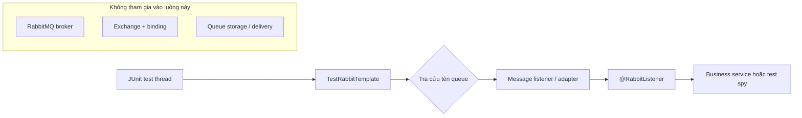
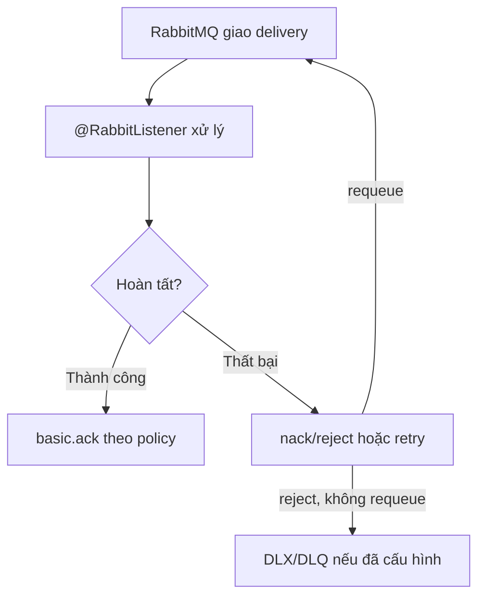

# `TestRabbitTemplate` và giới hạn mô phỏng không có broker trong Spring AMQP

Kiểm thử xử lý bất đồng bộ thường khó hơn kiểm thử một hàm Java thông thường: producer gửi message qua `RabbitTemplate`, RabbitMQ định tuyến từ exchange tới queue, listener container nhận delivery, rồi `@RabbitListener` xử lý và trả lời hoặc xác nhận message. Một bài test khởi chạy toàn bộ chuỗi đó cần broker, cấu hình queue/exchange/binding và cơ chế chờ kết quả bất đồng bộ. Tuy nhiên, **không phải mọi tình huống đều cần khởi động RabbitMQ thật**.

Trong chương **Kiểm thử** của **SPRING_AMQP**, `TestRabbitTemplate` (thuộc thư viện `spring-rabbit-test`) là công cụ để kiểm thử cơ bản luồng gọi listener **trong bộ nhớ, không đi qua broker**. Nó giúp xác minh payload được chuyển đổi, listener được chọn theo queue và logic nghiệp vụ phản hồi như kỳ vọng. Điều quan trọng không kém là hiểu các giới hạn: test không có broker **không chứng minh exchange/binding định tuyến đúng, ack/requeue/TTL/DLX hoạt động, publisher confirms đến nơi, hay ứng dụng tự phục hồi sau sự cố mạng**.

Mục tiêu sau bài học là biết **khi nào dùng `TestRabbitTemplate`, cách viết một test không cần RabbitMQ và khi nào bắt buộc dùng integration test với broker thật** để đảm bảo hệ thống bất đồng bộ đáng tin cậy.

## 1. Ba cấp độ kiểm thử cần phân biệt

| Cấp độ | Thành phần thực sự chạy | Điểm mạnh | Không chứng minh được |
|---|---|---|---|
| **Unit test thuần** | Gọi trực tiếp service Java, mock dependency | Chạy nhanh; kiểm tra nhánh nghiệp vụ | Listener adapter, converter, routing, broker |
| **Brokerless component test với `TestRabbitTemplate`** | Spring context, listener adapter/bean và test template | Kiểm tra việc chuyển message vào listener và nhận reply mà không mở broker | Định tuyến exchange thật, broker ack/DLX, network, concurrency thật |
| **Broker-backed integration test** | Spring AMQP cùng RabbitMQ thực hoặc Testcontainers | Kiểm chứng topology, giao nhận, xác nhận, retry và lỗi tích hợp | Không tự thay thế thử tải, chaos và kiểm thử hệ thống đầu cuối lớn |

Ví dụ bài toán đơn hàng:

```text
HTTP request
  -> OrderService tạo event
  -> RabbitTemplate basic.publish
  -> RabbitMQ exchange + binding + queue
  -> listener container
  -> @RabbitListener
  -> database / API ngoài
```

Unit test có thể gọi `OrderService` hoặc method `@RabbitListener` trực tiếp. `TestRabbitTemplate` đi thêm một bước: gửi một message vào adapter listener mà Spring đã đăng ký, nhưng **bỏ qua quá trình gửi, lưu và giao message của RabbitMQ**. Integration test với broker thật mới kiểm chứng được toàn bộ đường đi phía giữa.

### Những câu hỏi phải đặt ra trước khi chọn loại test

1. Đang muốn kiểm tra **logic xử lý** hay **hành vi AMQP của broker**?
2. Lỗi cần bắt có thể chỉ xuất hiện khi có exchange, queue, binding hoặc vhost không?
3. Có cần biết producer đã được broker xác nhận, message đã bị redeliver hoặc dead-letter chưa?
4. Test có phụ thuộc thứ tự, cạnh tranh consumer, timing, timeout, prefetch hay connection recovery không?
5. Có cần kiểm chứng tính idempotent khi cùng event được giao nhiều lần?

Nếu câu hỏi nằm ở mục 2–4, **không nên chỉ dùng `TestRabbitTemplate`**.

## 2. `TestRabbitTemplate` làm việc như thế nào?

`TestRabbitTemplate` là một lớp kế thừa `RabbitTemplate` thuộc package:

```java
import org.springframework.amqp.rabbit.test.TestRabbitTemplate;
```

Khi đăng ký nó làm **Spring bean** trong test context, đối tượng này có thể tìm các listener container đã đăng ký trong context, kể cả container tạo từ `@RabbitListener`. Khi gửi message, nó lựa chọn listener theo **tên queue được chỉ ra trong routing key**, lấy message listener từ container và **gọi trực tiếp trên thread đang chạy test**.



Đường gọi này có ba đặc điểm:

- **Không cần broker thực** để message đi tới listener. Test có thể dùng `ConnectionFactory` giả lập nhằm đáp ứng các thành phần của Spring AMQP trong context.
- **Định tuyến theo queue name**, không phải mô phỏng thuật toán của direct, topic, fanout hay headers exchange.
- **Lời gọi chạy ngay trên test thread** trong trường hợp thông thường, nên assertion có thể kiểm tra kết quả ngay sau `convertAndSend(...)` hoặc `convertSendAndReceive(...)` mà không phải dùng `Thread.sleep(...)`.

Tài liệu Spring AMQP cũng hỗ trợ request–reply cơ bản (`sendAndReceive`/`convertSendAndReceive`) với listener trả về kết quả. Đây là lời gọi mô phỏng vào listener, **không chứng minh broker tạo reply queue, direct reply-to, correlation ID hay timeout mạng hoạt động đúng**.

### 2.1. Routing key trong test không giống routing key production

Giả sử production gửi:

```java
rabbitTemplate.convertAndSend(
        "orders.exchange", "order.created", "ORD-101");
```

RabbitMQ dùng exchange `orders.exchange` và các binding để tìm queue thích hợp. Với `TestRabbitTemplate`, để gọi listener lắng nghe queue `orders.created.queue`, test thường cần:

```java
testRabbitTemplate.convertAndSend(
        "orders.created.queue", "ORD-101");
```

Ở đây `"orders.created.queue"` là **tên queue**, không phải khóa `order.created` mà production đang publish. Nếu viết một test chỉ dùng `order.created` rồi không thấy listener được gọi, chưa chắc code production sai; có thể test đã dùng sai ngữ nghĩa của `TestRabbitTemplate`.

Vì vậy, một brokerless test kiểu này kiểm chứng **listener nhận đúng message khi được chọn theo queue**, không phải **binding `order.created` tới queue được cấu hình đúng trên RabbitMQ**.

### 2.2. Nếu nhiều container cùng đăng ký một queue

Khi cùng queue name gắn với nhiều listener container, `TestRabbitTemplate` có thể lựa chọn container theo cơ chế phân phối nội bộ, và một số phiên bản có tùy chọn `setBroadcast(true)` để gửi tới tất cả listener được tìm thấy cho tên queue đó.

**Đừng nhầm broadcast của test với RabbitMQ thật.** Trong broker thực, nhiều consumer trên **cùng một queue** thông thường là competing consumers, nhận các delivery khác nhau theo chính sách broker; chúng không mặc nhiên cùng nhận mọi message. Nếu mục tiêu là fanout một event tới nhiều service, phải kiểm thử topology gồm nhiều queue/binding qua broker thật.

Trong bài test đầu tiên, nên bảo đảm chỉ có **một listener đăng ký queue thử nghiệm**, tránh phụ thuộc vào thứ tự lựa chọn khi có nhiều container.

## 3. Chuẩn bị dependencies

Ví dụ dùng **Java 17+, Spring Boot 3.x, JUnit 5, Mockito và Spring AMQP**. Mã minh họa theo Spring AMQP 3.x; cần đối chiếu API với phiên bản dự án thực tế.

```groovy
dependencies {
    implementation 'org.springframework.boot:spring-boot-starter-amqp'

    testImplementation 'org.springframework.boot:spring-boot-starter-test'
    testImplementation 'org.springframework.amqp:spring-rabbit-test'
}
```

`spring-rabbit-test` cung cấp `TestRabbitTemplate` cùng những tiện ích khác như `@RabbitListenerTest`/`RabbitListenerTestHarness` và `@RabbitAvailable`. Không cần `Testcontainers` chỉ để chạy brokerless test; Testcontainers là lựa chọn cho tầng kiểm thử với broker thật.

Phân biệt:

- `@SpringJUnitConfig` tạo Spring test context cho JUnit 5.
- `@EnableRabbit` kích hoạt cơ chế đăng ký `@RabbitListener` trong context.
- `@SpringRabbitTest` có thể bổ sung infrastructure beans cho test thuần Spring, nhưng **không tự biến `RabbitTemplate` thường thành `TestRabbitTemplate`**; phải tạo bean test template nếu muốn cách gọi trực tiếp.
- `@SpringBootTest` thường tự cấu hình nhiều bean Spring Boot, nhưng cũng có thể làm listener container thử kết nối broker khi context khởi động. Với test không broker, cần kiểm soát auto-start và auto-declaration.

## 4. Ví dụ hoàn chỉnh: gửi và nhận không cần RabbitMQ

Mục tiêu: một listener tiếp nhận `orderId`, listener khác nhận yêu cầu và trả về `accepted:...`. Test kiểm chứng cả **lời gọi một chiều** và **request–reply** trong cùng một Spring context, không có broker. Hai queue thử nghiệm khác nhau để không lẫn lời gọi không yêu cầu reply với lời gọi cần reply.

Đoạn mã dưới đây là **một file test Java** `BrokerlessOrderListenerTest.java`. Các class phụ là nested class để có thể giữ ví dụ độc lập.

```java
import com.rabbitmq.client.Channel;
import java.util.ArrayList;
import java.util.List;
import org.junit.jupiter.api.Test;
import org.springframework.amqp.rabbit.annotation.EnableRabbit;
import org.springframework.amqp.rabbit.annotation.RabbitListener;
import org.springframework.amqp.rabbit.config.SimpleRabbitListenerContainerFactory;
import org.springframework.amqp.rabbit.connection.Connection;
import org.springframework.amqp.rabbit.connection.ConnectionFactory;
import org.springframework.amqp.rabbit.test.TestRabbitTemplate;
import org.springframework.beans.factory.annotation.Autowired;
import org.springframework.context.annotation.Bean;
import org.springframework.context.annotation.Configuration;
import org.springframework.test.context.junit.jupiter.SpringJUnitConfig;

import static org.junit.jupiter.api.Assertions.assertEquals;
import static org.mockito.ArgumentMatchers.anyBoolean;
import static org.mockito.BDDMockito.given;
import static org.mockito.Mockito.mock;

@SpringJUnitConfig(classes = BrokerlessOrderListenerTest.Config.class)
class BrokerlessOrderListenerTest {

    @Autowired
    private TestRabbitTemplate testRabbitTemplate;

    @Autowired
    private OrderRecorder recorder;

    @Test
    void routesToListenerAndSupportsSimpleReply() {
        // Routing key ở đây là TÊN QUEUE mà listener đăng ký.
        testRabbitTemplate.convertAndSend("orders.test", "ORD-101");
        assertEquals(List.of("ORD-101"), recorder.received());

        Object reply = testRabbitTemplate.convertSendAndReceive(
                "orders.reply", "ORD-102");
        assertEquals("accepted:ORD-102", reply);
        assertEquals(List.of("ORD-101", "ORD-102"),
                recorder.received());
    }

    static class OrderRecorder {
        private final List<String> messages = new ArrayList<>();

        void record(String orderId) {
            messages.add(orderId);
        }

        List<String> received() {
            return List.copyOf(messages);
        }
    }

    static class OrderListener {
        private final OrderRecorder recorder;

        OrderListener(OrderRecorder recorder) {
            this.recorder = recorder;
        }

        @RabbitListener(queues = "orders.test")
        public void onMessage(String orderId) {
            if (orderId == null || orderId.isBlank()) {
                throw new IllegalArgumentException("Thiếu orderId");
            }
            recorder.record(orderId);
        }

        @RabbitListener(queues = "orders.reply")
        public String onQuery(String orderId) {
            if (orderId == null || orderId.isBlank()) {
                throw new IllegalArgumentException("Thiếu orderId");
            }
            recorder.record(orderId);
            return "accepted:" + orderId;
        }
    }

    @Configuration
    @EnableRabbit
    static class Config {

        @Bean
        OrderRecorder orderRecorder() {
            return new OrderRecorder();
        }

        @Bean
        OrderListener orderListener(OrderRecorder recorder) {
            return new OrderListener(recorder);
        }

        @Bean
        ConnectionFactory connectionFactory() {
            // Chỉ là mock hỗ trợ Spring infrastructure.
            ConnectionFactory factory = mock(ConnectionFactory.class);
            Connection connection = mock(Connection.class);
            Channel channel = mock(Channel.class);

            given(factory.createConnection()).willReturn(connection);
            given(connection.createChannel(anyBoolean()))
                    .willReturn(channel);
            given(channel.isOpen()).willReturn(true);
            return factory;
        }

        @Bean
        SimpleRabbitListenerContainerFactory
                rabbitListenerContainerFactory(ConnectionFactory cf) {
            SimpleRabbitListenerContainerFactory factory =
                    new SimpleRabbitListenerContainerFactory();
            factory.setConnectionFactory(cf);
            // Không cho container mở consumer thật tới RabbitMQ.
            factory.setAutoStartup(false);
            return factory;
        }

        @Bean
        TestRabbitTemplate testRabbitTemplate(ConnectionFactory cf) {
            // Spring context giúp template tìm listener đã đăng ký.
            return new TestRabbitTemplate(cf);
        }
    }
}
```

### Điều gì thực sự được kiểm tra?

1. Spring nhận diện bean `OrderListener` có hai method `@RabbitListener` trên `orders.test` và `orders.reply`.
2. `TestRabbitTemplate` tìm container và adapter tương ứng theo tên queue ở từng lần gửi.
3. Phép `convertAndSend` chuyển message đến listener **trên test thread**.
4. Listener validate và ghi một record vào `OrderRecorder`.
5. `convertSendAndReceive` tới `orders.reply` nhận kết quả `"accepted:ORD-102"` từ listener trả về String.

Trong demo không có message nào được ghi xuống queue của RabbitMQ. `OrderRecorder` dùng `ArrayList` đơn giản chỉ vì các lời gọi minh họa chạy đồng bộ trên test thread; nó **không phải** repository thread-safe hoặc kho sự kiện bền vững để áp dụng trực tiếp trong production.

### Vì sao có `setAutoStartup(false)`?

Trong một Spring context, listener container thường có thể start và tìm broker thật. Với test không broker, ta tắt tự khởi động container để tránh tạo connection mạng không cần thiết, nhưng vẫn cho phép Spring đăng ký endpoint listener để `TestRabbitTemplate` tìm được. Đây là cách cô lập phần invocation khỏi phần kết nối tới RabbitMQ.

Đặt `setAutoStartup(false)` vào listener factory **không phải cấu hình cho test broker-backed**: khi dùng broker thật, container cần start để nhận delivery. Cũng đừng vô tình đưa thiết lập này vào production nếu mục tiêu là tự chạy consumer.

Nếu dùng `@SpringBootTest`, cần lưu ý Spring Boot có thể tự tạo `RabbitAdmin` và các bean kết nối khác. Muốn brokerless test đáng tin cậy, dùng test configuration riêng hoặc loại bỏ các bean tự kết nối ngoài ý muốn; chỉ mock một `ConnectionFactory` nhưng để một listener container khác tự start vẫn có thể khiến test lỗi.

## 5. Test quy tắc nghiệp vụ và chuyển đổi message

`TestRabbitTemplate` hữu ích khi muốn xác minh một message cụ thể đi qua adapter rồi thành tham số của listener:

- Method `@RabbitListener` có đúng signature và tên queue thử nghiệm không?
- Payload String, byte array hoặc DTO có được converter đã cấu hình chuyển đổi phù hợp không?
- Header được hỗ trợ trong listener có được ánh xạ đúng khi tự tạo `Message` với `MessageProperties` không?
- Listener gọi service nào, tạo bản ghi hoặc trả reply gì?
- Với payload sai, phương thức nghiệp vụ có báo lỗi thay vì âm thầm xác nhận thành công không?

### Ví dụ: tạo raw message với header

Nếu listener dùng `@Header`, có thể tạo `Message` rõ thuộc tính để kiểm tra logic ánh xạ:

```java
import java.nio.charset.StandardCharsets;
import org.springframework.amqp.core.Message;
import org.springframework.amqp.core.MessageProperties;

MessageProperties properties = new MessageProperties();
properties.setContentType(MessageProperties.CONTENT_TYPE_TEXT_PLAIN);
properties.setContentEncoding(StandardCharsets.UTF_8.name());
properties.setHeader("eventType", "ORDER_CREATED");

Message message = new Message(
        "ORD-101".getBytes(StandardCharsets.UTF_8), properties);

testRabbitTemplate.send("orders.test", message);
```

Với test này, hãy bổ sung listener nhận header, ví dụ:

```java
@RabbitListener(queues = "orders.test")
public void process(
        String orderId,
        @Header("eventType") String eventType) {
    // Kiểm tra eventType rồi xử lý nghiệp vụ.
}
```

**Đây là một phiên bản listener thay thế cho ví dụ mục 4**, không đăng ký cả hai cùng queue vào một test nếu mục tiêu là kiểm tra chính xác một listener cụ thể. Trong ví dụ header, `MessageProperties` được tạo bằng tay, không phải bằng broker, nên test **không kiểm tra** RabbitMQ gắn `deliveryTag`, `redelivered` hay metadata consumer như thế nào.

### Test converter cần có phạm vi rõ

Nếu dùng `Jackson2JsonMessageConverter` hoặc converter tùy biến, test có thể xác minh serialization/deserialization và validation trong Spring. Nhưng test này **không chứng minh** một producer thực đang sử dụng **cùng converter, content type và schema version** với consumer ở deployment khác. Cần kiểm thử contract giữa producer–consumer, và ít nhất một integration test gửi message thật qua broker.

## 6. Giới hạn quan trọng nhất: không mô phỏng topology broker

`TestRabbitTemplate` không triển khai engine định tuyến của RabbitMQ. Các thử nghiệm dưới đây **không có giá trị kết luận** nếu chỉ gửi qua test template:

| Tính năng RabbitMQ | Vì sao brokerless test không kiểm chứng được? |
|---|---|
| Direct exchange và binding key | Không có exchange thật để so khớp routing key |
| Topic routing `orders.*` / `orders.#` | Không có thuật toán wildcard binding của broker |
| Fanout exchange | Không có fanout thực từ một exchange tới nhiều queue |
| Headers exchange | Không có binding arguments và quy tắc so khớp headers phía broker |
| Default exchange | Không kiểm tra ngữ nghĩa đặc biệt của exchange rỗng ở broker |
| Queue/exchange durable hoặc quorum | Không có dữ liệu lưu trên đĩa hoặc replication broker |
| Vhost và user ACL | Không thực hiện xác thực/phân quyền ở RabbitMQ |
| DLX, TTL, max-length, priority | Không có chính sách queue do broker thực thi |
| Alternate exchange, mandatory return | Không có routing failure/return do broker xử lý |

Ví dụ test này có thể **PASS dù production FAIL**:

```java
// Test: đi thẳng vào listener lắng nghe queue orders.created
testRabbitTemplate.convertAndSend("orders.created", "ORD-101");
```

Trong production, producer lại publish:

```java
rabbitTemplate.convertAndSend(
        "orders.events", "created.invalid", "ORD-101");
```

Nếu queue được bind với `created` chứ không phải `created.invalid`, broker không route đến queue mong muốn. Test không broker vẫn thành công vì nó **bỏ qua exchange, binding và routing key production**. Muốn bắt lỗi này, cần integration test tạo topology thật và publish bằng đường production.

## 7. Giới hạn với acknowledgement, retry và dead-letter

Khi chạy qua broker thực, một listener container thực hiện chu trình:



`TestRabbitTemplate` có thể kiểm tra listener ném exception hoặc logic xử lý lỗi của code, **nhưng không tạo delivery và consumer acknowledgement thật từ RabbitMQ**.

### Những điều không thể kết luận chỉ từ brokerless test

- **Ack `AUTO`:** method return bình thường trong test không chứng minh broker đã nhận `basic.ack`.
- **Ack `MANUAL`:** không nên dựa vào fake channel để chứng minh delivery tag hợp lệ, `basicAck(multiple)` chính xác hoặc broker thực sự xóa delivery khỏi trạng thái unacked.
- **Redelivery:** listener được gọi hai lần bằng test code không chứng minh RabbitMQ tự redeliver sau khi mất connection.
- **Listener retry advice:** một số logic retry trong Spring có thể chạy trên đường invocation, nhưng không nên khái quát thành toàn bộ lifecycle, reject/requeue và retry container sẽ giống broker thật. Cần kiểm thử chính xác phạm vi advice.
- **Dead-letter:** tự tạo một message “giống DLQ” không chứng minh DLX/binding/x-death hay thời gian TTL hoạt động.
- **Prefetch và concurrency:** gọi đồng bộ trên test thread không mô phỏng số delivery in-flight, consumer count, competing consumers hoặc điều kiện tranh chấp.

Vì vậy, kiểm tra một handler “ném exception đúng” là **cần nhưng không đủ** để khẳng định retry ba lần rồi chuyển DLQ thành công. Cần test với broker và quan sát queue/DLQ thật.

## 8. Giới hạn với publisher confirms và returns

`TestRabbitTemplate` không phải một producer AMQP giao tiếp broker, nên không hỗ trợ kiểm chứng đúng ngữ nghĩa **publisher confirmations và publisher returns**.

| Điều muốn kiểm thử | `TestRabbitTemplate` | Thử nghiệm phù hợp |
|---|---|---|
| Listener trả `accepted` | Có | Brokerless test |
| `RabbitTemplate` thực sự publish lên exchange | Không | Broker-backed integration test |
| Confirm `ack`/`nack` từ broker | Không | Broker + `ConfirmType.CORRELATED` |
| Returned message với `mandatory=true` | Không | Broker + `ReturnsCallback` |
| Publish vào exchange không tồn tại | Không | Broker để thấy channel/protocol error |
| Producer mất mạng quanh thời điểm confirm | Không | Fault injection / integration test |

Publisher confirm `ack` cũng **không chứng minh consumer đã xử lý xong**. Cần phân biệt ba tầng:

1. Broker xác nhận đã xử lý publish (**publisher confirm**).
2. Message được định tuyến tới queue theo topology, hoặc bị return khi không route được theo điều kiện phù hợp.
3. Consumer nhận và ack delivery sau xử lý (**consumer ack**).

Một test chỉ thấy listener được gọi trực tiếp không chứng minh bất kỳ tín hiệu broker nào ở ba tầng này.

## 9. Giới hạn với thời gian, concurrency và sự cố kết nối

Trong production, listener container chạy trên các thread do framework quản lý và chịu ảnh hưởng của broker:

- Network latency và timeout khi mở connection/channel.
- Consumer concurrency, prefetch, batching, backpressure và tốc độ queue.
- Sự cố connection/channel, recovery interval và BackOff.
- Message bị giao lại khi connection đóng trước ack.
- Tình trạng producer publish thành công nhưng không nhận được confirm trước khi connection mất.
- Thứ tự xử lý có thể thay đổi khi nhiều consumer hoặc các lần retry cùng chạy.

`TestRabbitTemplate` mặc định đưa message đến listener **ngay trong test thread**, vì thế:

```text
TestRabbitTemplate:
  test gọi convertAndSend()
  -> listener thực thi đồng bộ
  -> assertion chạy ngay

RabbitMQ thật:
  producer gửi message
  -> exchange và queue
  -> container nhận delivery ở thread khác
  -> listener thực thi / ack
  -> test phải chờ điều kiện đạt
```

Thêm `Thread.sleep(1000)` vào brokerless test **không biến nó thành test bất đồng bộ**. Ngược lại, với broker thật, không nên đoán một thời gian ngủ cố định là đủ; nên dùng latch, Awaitility hoặc cơ chế chờ trạng thái có timeout rõ ràng.

Nếu nghiệp vụ có idempotency hoặc giới hạn đồng thời, phải bổ sung test với nhiều delivery/worker thật để phát hiện race condition mà brokerless test không tạo ra.

## 10. Khi nào mock `RabbitTemplate` thay vì dùng `TestRabbitTemplate`?

Hai cách phục vụ mục tiêu khác nhau.

### Mock `RabbitTemplate` để test producer

Nếu muốn kiểm tra một service gọi đúng exchange, routing key và payload:

```java
import org.junit.jupiter.api.Test;
import org.springframework.amqp.rabbit.core.RabbitTemplate;

import static org.mockito.Mockito.mock;
import static org.mockito.Mockito.verify;

class OrderPublisherUnitTest {
    @Test
    void sendsToExpectedExchangeAndRoutingKey() {
        RabbitTemplate template = mock(RabbitTemplate.class);
        OrderPublisher publisher = new OrderPublisher(template);

        publisher.publish("ORD-101");

        verify(template).convertAndSend(
                "orders.events", "order.created", "ORD-101");
    }

    static class OrderPublisher {
        private final RabbitTemplate template;

        OrderPublisher(RabbitTemplate template) {
            this.template = template;
        }

        void publish(String orderId) {
            template.convertAndSend(
                    "orders.events", "order.created", orderId);
        }
    }
}
```

Unit test này kiểm tra producer **gọi đúng tham số theo contract do team đặt ra**, nhưng không kiểm tra exchange `orders.events` thật sự tồn tại hoặc binding `order.created` đã được khai báo đúng.

### Dùng `TestRabbitTemplate` để test consumer

Brokerless template phù hợp khi muốn đưa message qua listener adapter rồi kiểm tra `@RabbitListener` gọi business service và trả reply. Nó **không phù hợp** nếu mục tiêu chính là xác minh producer publish qua topology.

Nếu muốn spy listener hoặc thu thập tham số và kết quả invocation, có thể kết hợp các tiện ích `@RabbitListenerTest` và `RabbitListenerTestHarness` của `spring-rabbit-test` trong bối cảnh phù hợp. Các công cụ đó cũng không tự thay thế broker thật.

## 11. Integration test với RabbitMQ thật: những phần còn thiếu

Khi cần kiểm tra topology, publisher confirms, redelivery hoặc dead-letter, hãy dùng **RabbitMQ thật** trong môi trường test cô lập. Hai lựa chọn phổ biến:

- **Testcontainers:** khởi tạo một RabbitMQ container tạm thời cho bộ test, kiểm soát version, expose port và tear down theo lifecycle.
- **`@RabbitAvailable`:** tiện ích JUnit của `spring-rabbit-test` kiểm tra broker sẵn có trước khi chạy các test phù hợp; cần hiểu chính sách skip/fail của CI.

### 11.1. Dependency cho Testcontainers

Ví dụ Gradle cho một dự án dùng Testcontainers với BOM/phiên bản được quản lý thống nhất:

```groovy
dependencies {
    testImplementation 'org.springframework.boot:spring-boot-starter-test'
    testImplementation 'org.springframework.amqp:spring-rabbit-test'
    testImplementation 'org.testcontainers:junit-jupiter'
    testImplementation 'org.testcontainers:rabbitmq'
}
```

Testcontainers cần môi trường chạy container tương thích; nếu CI không hỗ trợ container, cần cung cấp broker test riêng hoặc chọn chiến lược khác.

### 11.2. Ví dụ tạo broker bằng Testcontainers

Đoạn code sau minh họa **phần bootstrap broker** trong một integration test Spring Boot. Test thực tế phải khai báo exchange/queue/binding, gửi một message và chờ listener hoàn thành.

```java
import org.junit.jupiter.api.Test;
import org.springframework.beans.factory.annotation.Autowired;
import org.springframework.amqp.rabbit.core.RabbitTemplate;
import org.springframework.boot.test.context.SpringBootTest;
import org.springframework.test.context.DynamicPropertyRegistry;
import org.springframework.test.context.DynamicPropertySource;
import org.testcontainers.containers.RabbitMQContainer;
import org.testcontainers.junit.jupiter.Container;
import org.testcontainers.junit.jupiter.Testcontainers;

@Testcontainers
@SpringBootTest
class RabbitBrokerIntegrationTest {

    @Container
    static final RabbitMQContainer rabbit =
            new RabbitMQContainer("rabbitmq:3.13-management");

    @DynamicPropertySource
    static void rabbitProperties(DynamicPropertyRegistry properties) {
        properties.add("spring.rabbitmq.host", rabbit::getHost);
        properties.add("spring.rabbitmq.port", rabbit::getAmqpPort);
        properties.add("spring.rabbitmq.username",
                rabbit::getAdminUsername);
        properties.add("spring.rabbitmq.password",
                rabbit::getAdminPassword);
    }

    @Autowired
    RabbitTemplate rabbitTemplate;

    @Test
    void publishedMessageReachesRealQueue() {
        // Ví dụ cấu trúc:
        // 1. Queue/exchange/binding đã được khai báo trong test context.
        // 2. Gửi bằng RabbitTemplate production tới exchange/routing key.
        // 3. Chờ assertion trên latch/repository với timeout.
        // 4. Kiểm tra kết quả và, nếu cần, broker state/ack/DLQ.
    }
}
```

**Đây là bộ khung, không phải test assertion hoàn chỉnh**: nếu không gửi message, test không kiểm chứng việc giao nhận. Hãy bổ sung listener/test repository hoặc cơ chế latch theo ứng dụng và tạo topology riêng cho từng bộ test. Phiên bản image RabbitMQ chỉ mang tính ví dụ; trong CI nên chọn image còn được hỗ trợ và **pin version đã kiểm chứng** thay vì dùng tag `latest` trôi nổi.

Với test broker thật, đừng dùng `TestRabbitTemplate` để gửi message kiểm tra routing; hãy dùng **`RabbitTemplate` thông thường gắn với broker container**. Nếu đặt hai bean template trong cùng context, dùng `@Qualifier` để tránh vô tình chọn test template thay thế production template.

### 11.3. `@RabbitAvailable` cho broker được cấp sẵn

Ví dụ kiểm thử sử dụng RabbitMQ có sẵn trong môi trường, kết hợp JUnit 5:

```java
import org.junit.jupiter.api.Test;
import org.springframework.amqp.rabbit.junit.RabbitAvailable;

@RabbitAvailable(queues = "orders.integration.queue")
class OrdersWithBrokerTest {
    @Test
    void testWithLiveBroker() {
        // Spring context/test setup ở đây phải dùng ConnectionFactory
        // trỏ đúng broker được @RabbitAvailable kiểm tra.
    }
}
```

`@RabbitAvailable` giúp quản lý tiền điều kiện broker và queue test; **nó không tự khởi động broker hoặc tự kiểm chứng tất cả message đều tới listener**. Trong pipeline bắt buộc phải test broker thật, cần cấu hình để thiếu broker trở thành lỗi chứ không bị bỏ qua im lặng.

## 12. Ma trận test đề xuất

Hãy chia trách nhiệm: test brokerless kiểm tra business logic nhanh; test broker thật chứng minh các thuộc tính môi trường và giao thức AMQP.

| Tình huống cần bảo đảm | Unit test/mock | `TestRabbitTemplate` | Broker thật |
|---|:---:|:---:|:---:|
| Service tạo đúng exchange/routing key tham số | **Có** | Không phải mục tiêu | Có thể |
| Listener nhận payload String và gọi service | Có thể | **Có** | Có |
| Request–reply đơn giản từ listener return value | Một phần | **Có** | **Có** |
| JSON converter với adapter listener | Một phần | **Có** | Có |
| Binding direct/topic/fanout định tuyến thật | Không | **Không** | **Có** |
| User permission và virtual host | Không | **Không** | **Có** |
| Publisher confirms/returns | Không | **Không** | **Có** |
| Ack `MANUAL`, redelivery khi mất connection | Không | **Không** | **Có** |
| TTL, DLX/DLQ và `x-death` | Không | **Không** | **Có** |
| Prefetch, concurrency, competing consumers | Không | **Không** | **Có** |
| Connection recovery/BackOff | Không | **Không** | **Có** |
| Idempotency nghiệp vụ khi gọi lại hai lần | **Có** | **Có** ở mức logic | Có cho tình huống redelivery thực |
| Hiệu năng tải cao và chaos nhiều node | Không | Không | Test tải/chaos chuyên biệt trên broker thật |

**Một test xanh chỉ bảo đảm những gì nó thực sự thực thi.** Việc không cần broker là ưu điểm của `TestRabbitTemplate`, nhưng cũng chính là lý do nó không thể xác minh phần lớn rủi ro vận hành của RabbitMQ.

## 13. Thiết kế một chiến lược CI hiệu quả

Một pipeline kiểm thử cho Spring AMQP có thể gồm:

1. **Unit tests nhiều, chạy nhanh:** service logic, validation, error mapping, quyết định route, idempotency.
2. **Brokerless component tests:** `TestRabbitTemplate` kiểm tra consumer adapter, payload converter và request–reply cơ bản.
3. **Broker-backed integration tests:** xác minh exchange/queue/binding, publisher confirm, mandatory return, listener ack, retry, DLQ, permissions.
4. **Failure-path tests có chọn lọc:** ngắt broker, kiểm tra redelivery, confirm unknown, reconnect và retry.
5. **Performance/soak tests định kỳ:** tải, nhiều consumer, prefetch, queue backlog, sự cố broker/cluster; tách khỏi CI nhanh nếu cần.

### Tránh flaky test khi có broker thật

- Dùng queue/exchange test **riêng** hoặc tên có namespace phù hợp, tránh test cùng sửa một queue shared.
- Đặt timeout có ý nghĩa, chờ **điều kiện** thay vì ngủ cố định.
- Dọn dữ liệu, đảm bảo test isolation; nếu có `@RabbitAvailable`, hiểu rõ hành vi purge giữa các test.
- Dùng event ID độc nhất cho từng test nhưng giữ một ID ổn định trong từng kịch bản retry.
- Quan sát publisher confirms/returns và DLQ khi test thất bại để biết lỗi nằm ở publish, routing hay listener.
- Chạy test với cấu hình gần production đối với queue type, durability, acknowledgement, retry và connection factory.
- Không tạo tác động lên API ngoài thật; dùng stub HTTP cho downstream khi đang kiểm thử broker.

## 14. Những hiểu lầm thường gặp

**“`TestRabbitTemplate` là RabbitMQ broker giả lập đầy đủ.”** Sai. Nó tìm listener theo tên queue và gọi trực tiếp; không thực thi broker protocol/topology.

**“Test listener thành công nghĩa là binding từ exchange tới queue đúng.”** Sai. Test có thể đi thẳng tới listener ngay cả khi routing key ở production sai.

**“Listener trả String trong test nghĩa là direct reply-to production đã được kiểm chứng.”** Sai. Request–reply cơ bản được hỗ trợ nhưng không kiểm tra queue reply, correlation, timeout hoặc lỗi mạng thật.

**“Gọi listener hai lần trong test chứng minh broker redeliver đúng.”** Sai. Việc gọi lại giúp kiểm tra idempotency ở mức logic; broker redelivery cần test với broker và ack thật.

**“Mọi lỗi `@RabbitListener` đều sẽ được retry và đưa DLQ như test brokerless.”** Sai. Retry, reject/requeue và DLX là các cơ chế khác nhau, nhiều phần do listener container hoặc RabbitMQ thực thi.

**“Một test không broker chạy rất nhanh nên có thể thay hết integration test.”** Sai. Cần broker thật cho những bảo đảm về định tuyến, giao nhận, xác nhận, phân quyền và khả năng khôi phục.

### Câu hỏi tự kiểm tra

1. `TestRabbitTemplate` gọi listener bằng cách nào và tại sao không cần RabbitMQ broker?
2. Vì sao phải dùng **tên queue** làm routing key trong ví dụ `TestRabbitTemplate`, thay vì routing key của exchange production?
3. Nếu một test `convertSendAndReceive` trả lời đúng, ta đã kiểm chứng được những gì? Chưa kiểm chứng được điều gì?
4. Tại sao một listener ghi DB xong nhưng mất ack có thể bị giao lại, dù brokerless test chạy thành công?
5. Những trường hợp nào bắt buộc phải dùng broker thật: topic binding, DLQ, publisher confirm, permission, prefetch?
6. Khi sử dụng Testcontainers, tại sao phải gửi bằng `RabbitTemplate` production thật thay vì `TestRabbitTemplate`?
7. Làm thế nào chia kiểm thử CI để vừa chạy nhanh vừa bắt được lỗi topology và delivery quan trọng?

## 15. Tóm tắt và tài liệu đối chiếu

`TestRabbitTemplate` hữu ích cho **component test nhanh, xác định và không phụ thuộc RabbitMQ đang chạy**. Nó giúp kiểm tra listener và request–reply ở mức lời gọi Java/Spring adapter. Tuy nhiên, mọi khẳng định về **exchange, queue, binding, durability, publisher confirm, acknowledgement, retry, dead-letter, concurrency hoặc network recovery** cần được kiểm chứng bằng những test phù hợp trên broker thật.

Khi thiết kế một hệ thống bất đồng bộ đáng tin cậy bằng Spring AMQP, hãy ghép đúng công cụ với mục tiêu kiểm thử: **mock cho producer/service logic, `TestRabbitTemplate` cho listener invocation, Testcontainers/`@RabbitAvailable` cho AMQP behavior thật và fault injection cho các trạng thái sự cố**.

Tham khảo tài liệu chính thức:

- [Spring AMQP — Testing Support](https://docs.spring.io/spring-amqp/reference/testing.html)
- [Spring AMQP — `TestRabbitTemplate` API](https://docs.spring.io/spring-amqp/docs/3.1.x/api/org/springframework/amqp/rabbit/test/TestRabbitTemplate.html)
