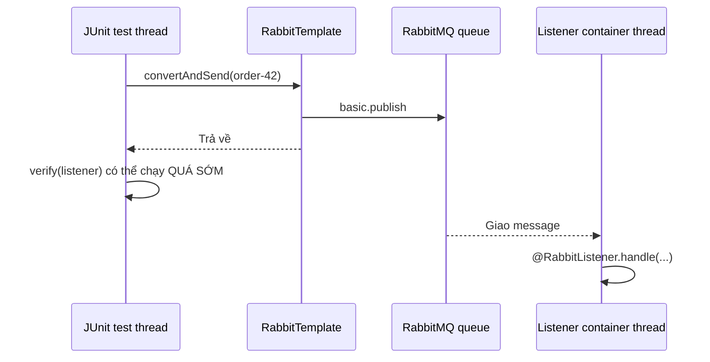
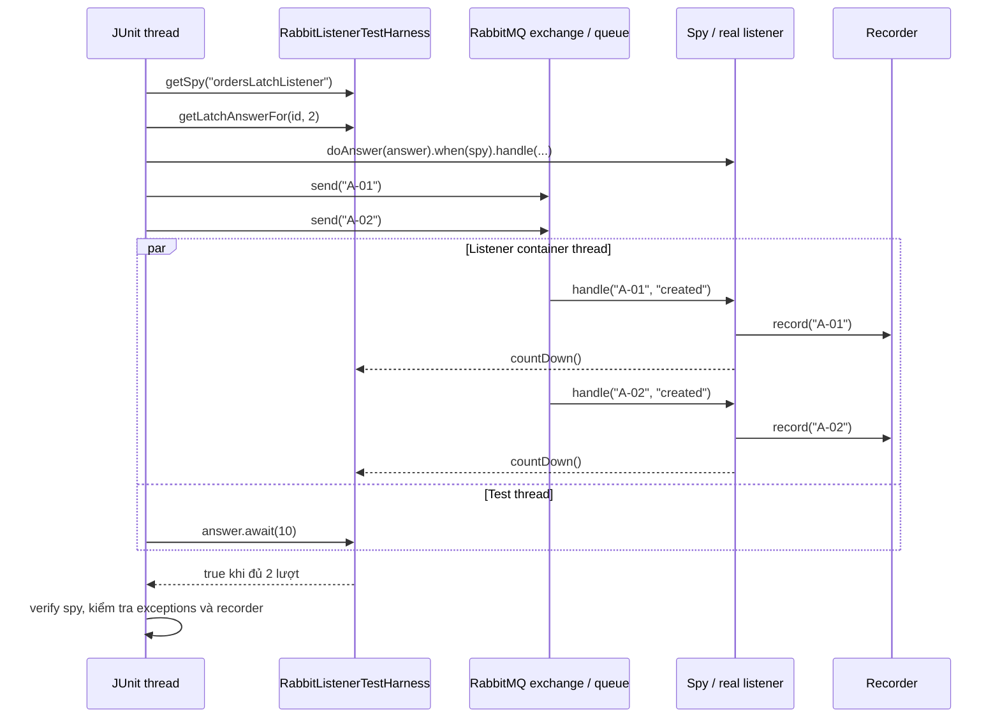
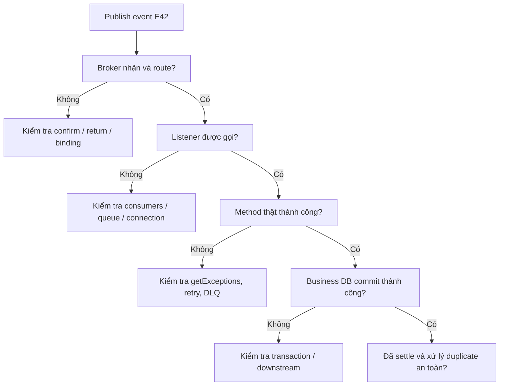

# LatchCountDownAndCallRealMethodAnswer và chờ kết quả không đồng bộ

> **Chương:** Kiểm thử. **Phạm vi:** trong **SPRING_AMQP**, ứng dụng gửi message bằng `RabbitTemplate`, định tuyến qua exchange/queue/binding và xử lý bằng `@RabbitListener`. Bài này tập trung vào cách **đợi listener bất đồng bộ chạy thật** bằng `LatchCountDownAndCallRealMethodAnswer` của `spring-rabbit-test`, thay cho `Thread.sleep(...)`; đồng thời phân biệt việc *listener đã được gọi*, *nghiệp vụ thành công* và *broker đã xác nhận giao nhận*.

## 1. Bài toán: test kết thúc trước khi listener kịp chạy

Giả sử `OrderPublisher` gửi event `order.created` đến direct exchange `orders.events` với routing key `created`. Exchange định tuyến event sang queue `orders.jobs`, còn một Spring `@RabbitListener` chạy trên thread của listener container để cập nhật trạng thái đơn hàng.

Một bài kiểm thử ngây thơ thường có dạng:

```java
// Ví dụ CHƯA ĐÚNG về đồng bộ giữa hai thread:
rabbitTemplate.convertAndSend("orders.events", "created", "order-42");
verify(orderListener).handle("order-42", "created");
```

Ngay sau `convertAndSend(...)`, thread JUnit có thể tiến tới `verify(...)` trong khi consumer **chưa nhận** message. Kết quả là test có lúc pass, có lúc fail tùy lịch thread, thời gian vận chuyển message và tải máy chạy CI. Việc gửi thành công cũng không có nghĩa listener đã xử lý xong.



**Cách đúng:** tạo một tín hiệu đồng bộ đếm số lượt listener đã được gọi. `LatchCountDownAndCallRealMethodAnswer` kết hợp Mockito `Answer` và `CountDownLatch` để **gọi method thật**, giảm latch sau các lượt invocation và cho thread test **đợi có timeout**. Sau khi đợi, test tiếp tục kiểm chứng tham số, exception và side effect thật.

## 2. Vai trò của `spring-rabbit-test` và bốn thành phần

`spring-rabbit-test` là module hỗ trợ test của Spring AMQP, cung cấp `@RabbitListenerTest`, `RabbitListenerTestHarness`, các Mockito `Answer` và `TestRabbitTemplate`.

| Thành phần | Package / API chính | Trách nhiệm |
| --- | --- | --- |
| `@RabbitListenerTest` | `org.springframework.amqp.rabbit.test.RabbitListenerTest` | Thay listener post-processor bằng test harness; bật spy hoặc capture advice |
| `RabbitListenerTestHarness` | `org.springframework.amqp.rabbit.test.RabbitListenerTestHarness` | Lấy spy theo listener `id`, tạo Answer đúng delegate, thu invocation data |
| `LatchCountDownAndCallRealMethodAnswer` | `org.springframework.amqp.rabbit.test.mockito` | Mockito Answer cho **method trả về `void`**, gọi method thật và giảm latch |
| Mockito `doAnswer(...).when(spy)...` | `org.mockito.Mockito` | Gắn Answer vào method trên spy |
| `answer.await(seconds)` | `boolean await(int timeout)` | Đợi latch về 0 trong số **giây** quy định |
| `answer.getExceptions()` | `Collection<Exception>`, có thể nullable | Đọc exception của method thật đã được Answer ghi nhận |

**Lưu ý về API:** Javadoc hiện hành ghi rõ `await(int timeout)` nhận số **giây** và ném `InterruptedException`. `getLatch()` trả `CountDownLatch` nếu cần dùng API JDK trực tiếp; `getExceptions()` có từ Spring AMQP **2.2.3**. Constructor thủ công `new LatchCountDownAndCallRealMethodAnswer(count, delegate)` có tồn tại, nhưng **khi test `@RabbitListener` qua harness phải ưu tiên `harness.getLatchAnswerFor(id, count)`** để có delegate đúng. <https://docs.spring.io/spring-amqp/reference/testing.html>

### 2.1. Vì sao không chỉ dùng Mockito `verify(timeout(...))`?

Mockito có hỗ trợ:

```java
verify(spy, timeout(10_000).times(2))
    .handle(anyString(), anyString());
```

Kỹ thuật này có ích nếu chỉ muốn đợi số lần invocation. Nhưng `LatchCountDownAndCallRealMethodAnswer` là lựa chọn trực tiếp trong Spring AMQP khi cần đồng thời:

- **Gọi implementation thật** thay vì biến listener thành mock không thực hiện logic.
- Đợi **đủ N lượt** gọi trong một thời hạn xác định.
- Nhận `getExceptions()` của method thật để biết lỗi không chỉ qua log/container.
- Sau khi đợi, dùng Mockito `verify(...)` khẳng định **đúng payload và routing key**.

Không coi latch là công cụ đo độ trễ end-to-end; nó là **tín hiệu đồng bộ cho test**, không phải publisher confirm, consumer ACK hay transaction manager.

### 2.2. Vì sao `Thread.sleep(2000)` thường là anti-pattern?

| Chờ bằng `Thread.sleep` | Chờ bằng latch + timeout |
| --- | --- |
| Luôn đợi đủ 2 giây dù listener đã xong sau 20 ms | Trả về ngay khi đạt đủ lượt |
| Trên CI chậm có thể quá ngắn, vẫn flake | Có deadline rõ và phản hồi pass/fail |
| Không chỉ ra listener đã được gọi bao nhiêu lần | `count` mô tả chính xác số invocation mong đợi |
| Không xác nhận side effect hay exception | Có thể kết hợp `verify` và `getExceptions` |
| Dễ lãng phí thời gian ở hàng trăm test | Thường giảm thời gian test khi xử lý nhanh |

Đợi bằng latch cũng có thể timeout khi broker/consumer gặp lỗi; đó là **thất bại cần điều tra**, không phải lý do tăng timeout vô hạn.

## 3. Các điều kiện để harness hoạt động

`@RabbitListenerTest` thay `RabbitListenerAnnotationBeanPostProcessor` tiêu chuẩn bằng `RabbitListenerTestHarness`. Annotation này có `@EnableRabbit`, giúp đăng ký xử lý `@RabbitListener` trong test context.

| Điều kiện | Vì sao |
| --- | --- |
| Có dependency `spring-rabbit-test` ở **test scope** | Class harness và Answer không nằm trong `spring-rabbit` runtime thông thường |
| Mockito/JUnit ở test classpath | Harness tạo Mockito spy; test dùng `doAnswer`/`verify` |
| Listener có **`id` tường minh** | Harness tra spy/delegate theo listener ID, không theo queue name |
| Method `@RabbitListener` **không final** | Final method không thể được spy/advised theo giới hạn của harness |
| Listener bean được tạo trong context có `@RabbitListenerTest` | Nếu listener đã xử lý bởi post-processor tiêu chuẩn, `harness.getSpy(id)` có thể không tồn tại |
| `spy=true` | Đây là tùy chọn mặc định, cần để `getSpy(...)` và `doAnswer(...)` hoạt động |
| Bean/template/container kết nối cùng broker/vhost | Producer gửi vào đúng queue mà listener đang tiêu thụ |
| Tạo Answer và gắn stub **trước khi publish** | Nếu message tới quá sớm, spy có thể đã xử lý nhưng latch chưa đếm |
| Test có deadline hợp lý | Test bị kẹt không chờ mãi làm treo CI |

Hai thuộc tính chính của annotation:

```java
@RabbitListenerTest(spy = true, capture = false) // Mặc định

// Hoặc để thu dữ liệu lời gọi:
@RabbitListenerTest(spy = false, capture = true)

// Có thể dùng cả hai:
@RabbitListenerTest(spy = true, capture = true)
```

**Chỉ gắn annotation thực sự cần thiết lên một class cấu hình trong test context.** Tránh để hai cấu hình test độc lập cùng đăng ký những post-processor không rõ thứ tự. `spy=false` sẽ không cung cấp Mockito spy cho `getLatchAnswerFor(...)` theo mẫu bài này; dùng `capture=true` để quan sát invocation bằng cơ chế khác.

## 4. Khai báo dependency cho test

Với Maven đã quản lý phiên bản Spring AMQP qua Spring Boot BOM hoặc Spring AMQP BOM:

```xml
<dependency>
    <groupId>org.springframework.amqp</groupId>
    <artifactId>spring-rabbit-test</artifactId>
    <scope>test</scope>
</dependency>

<dependency>
    <groupId>org.springframework.boot</groupId>
    <artifactId>spring-boot-starter-test</artifactId>
    <scope>test</scope>
</dependency>
```

Với Gradle có version management tương ứng:

```groovy
testImplementation 'org.springframework.amqp:spring-rabbit-test'
testImplementation 'org.springframework.boot:spring-boot-starter-test'
```

Phần runtime ứng dụng vẫn cần dependency RabbitMQ/Spring AMQP phù hợp (`spring-boot-starter-amqp` với Boot 3.x hoặc starter RabbitMQ tương ứng với Boot 4.x). **Không hardcode version `spring-rabbit-test` khác dòng với `spring-rabbit`.** Ví dụ bài này hướng tới API `spring-rabbit-test` **3.2/4.x**; nhóm package `org.springframework.amqp.rabbit.test.*` giữ vai trò như tài liệu chính thức.

### Kiểm thử có cần RabbitMQ thật không?

**Bài thực hành chính có.** `RabbitTemplate.convertAndSend(...)` sẽ đi qua broker và container nhận message trên thread riêng. Có thể dùng một RabbitMQ instance cô lập do Testcontainers cung cấp hoặc broker dành riêng cho test. **`@RabbitListenerTest` tự nó không giả lập RabbitMQ** và không khởi chạy broker.

`TestRabbitTemplate` là công cụ khác cho kiểm thử **không cần broker**: nó tìm listener container và gọi listener ngay trên **test thread**, chỉ hỗ trợ định tuyến cơ bản theo queue name. Nếu dùng `TestRabbitTemplate`, phép thử không còn xác minh mạng, exchange/binding thực hay cơ chế bất đồng bộ giống broker; vì vậy không dùng nó để chứng minh hành vi timing của producer → broker → consumer.

## 5. Ví dụ tích hợp hoàn chỉnh: gửi hai event, đợi hai lần xử lý thật

Ví dụ sử dụng **JUnit 5 + Spring Boot + Mockito/AssertJ + RabbitMQ thật**. Mục đích là chứng minh listener thực hiện nghiệp vụ và nhận đúng tham số sau khi message đi qua broker.

**Topology của bài thử:**

- Exchange: `test.orders.events`, kiểu `direct`.
- Queue: `AnonymousQueue` với tên ngẫu nhiên, tránh đụng các test song song.
- Binding: `created` từ exchange tới queue.
- Listener ID: `ordersLatchListener`, là khóa để `RabbitListenerTestHarness` tìm spy.
- Listener method: `void handle(String, String)`, lưu payload vào một recorder thread-safe.



### 5.1. Cấu hình test và listener

Trong ví dụ này, tất cả các thành phần được đặt trong **một test class** để dễ hình dung; khi triển khai dự án thật có thể tách listener, recorder và cấu hình thành các class riêng. `@SpringBootConfiguration` + `@EnableAutoConfiguration` cung cấp RabbitMQ connection factory/template/admin, còn `@RabbitListenerTest` kích hoạt test harness.

```java
import java.util.List;
import java.util.concurrent.CopyOnWriteArrayList;

import org.junit.jupiter.api.Test;
import org.springframework.amqp.core.AnonymousQueue;
import org.springframework.amqp.core.Binding;
import org.springframework.amqp.core.BindingBuilder;
import org.springframework.amqp.core.DirectExchange;
import org.springframework.amqp.core.Queue;
import org.springframework.amqp.rabbit.annotation.RabbitListener;
import org.springframework.amqp.rabbit.core.RabbitTemplate;
import org.springframework.amqp.rabbit.listener.RabbitListenerEndpointRegistry;
import org.springframework.amqp.rabbit.test.RabbitListenerTest;
import org.springframework.amqp.rabbit.test.RabbitListenerTestHarness;
import org.springframework.amqp.rabbit.test.mockito.LatchCountDownAndCallRealMethodAnswer;
import org.springframework.amqp.support.AmqpHeaders;
import org.springframework.beans.factory.annotation.Autowired;
import org.springframework.boot.SpringBootConfiguration;
import org.springframework.boot.autoconfigure.EnableAutoConfiguration;
import org.springframework.boot.test.context.SpringBootTest;
import org.springframework.context.annotation.Bean;
import org.springframework.messaging.handler.annotation.Header;

import static org.assertj.core.api.Assertions.assertThat;
import static org.mockito.ArgumentMatchers.anyString;
import static org.mockito.Mockito.doAnswer;
import static org.mockito.Mockito.times;
import static org.mockito.Mockito.verify;

@SpringBootTest(classes = OrderListenerLatchIT.TestApp.class)
class OrderListenerLatchIT {

    @Autowired RabbitTemplate rabbitTemplate;
    @Autowired RabbitListenerTestHarness harness;
    @Autowired RabbitListenerEndpointRegistry registry;
    @Autowired SeenOrders seenOrders;

    @Test
    void waitsForTwoListenerInvocations() throws Exception {
        OrderListener listenerSpy =
            harness.getSpy("ordersLatchListener");
        assertThat(listenerSpy).isNotNull();
        assertThat(registry.getListenerContainer("ordersLatchListener"))
            .isNotNull();

        LatchCountDownAndCallRealMethodAnswer answer =
            harness.getLatchAnswerFor("ordersLatchListener", 2);

        // QUAN TRỌNG: gắn Answer trước khi gửi message.
        doAnswer(answer).when(listenerSpy)
            .handle(anyString(), anyString());

        rabbitTemplate.convertAndSend(
            "test.orders.events", "created", "A-01");
        rabbitTemplate.convertAndSend(
            "test.orders.events", "created", "A-02");

        // Số 10 tính theo GIÂY; false nghĩa là chưa đạt đủ count.
        assertThat(answer.await(10))
            .as("Listener phải xử lý 2 lượt trong vòng 10 giây")
            .isTrue();

        // Latch đủ số lượt KHÔNG tự chứng minh method thành công.
        assertThat(answer.getExceptions()).isNullOrEmpty();

        verify(listenerSpy, times(1)).handle("A-01", "created");
        verify(listenerSpy, times(1)).handle("A-02", "created");

        // Chứng minh method thật đã thực sự gọi recorder.
        assertThat(seenOrders.snapshot())
            .containsExactlyInAnyOrder("A-01", "A-02");
    }

    @SpringBootConfiguration
    @EnableAutoConfiguration
    @RabbitListenerTest(spy = true)
    static class TestApp {
        @Bean
        Queue testOrdersQueue() {
            return new AnonymousQueue();
        }

        @Bean
        DirectExchange testOrdersExchange() {
            return new DirectExchange("test.orders.events");
        }

        @Bean
        Binding testOrdersBinding(
                Queue testOrdersQueue,
                DirectExchange testOrdersExchange) {
            return BindingBuilder.bind(testOrdersQueue)
                .to(testOrdersExchange)
                .with("created");
        }

        @Bean
        SeenOrders seenOrders() {
            return new SeenOrders();
        }

        @Bean
        OrderListener orderListener(SeenOrders recorder) {
            return new OrderListener(recorder);
        }
    }

    static class OrderListener {
        private final SeenOrders recorder;

        OrderListener(SeenOrders recorder) {
            this.recorder = recorder;
        }

        // Cần id rõ ràng và method KHÔNG final.
        @RabbitListener(
            id = "ordersLatchListener",
            queues = "#{testOrdersQueue.name}")
        public void handle(
                String orderId,
                @Header(AmqpHeaders.RECEIVED_ROUTING_KEY)
                String routingKey) {
            recorder.record(orderId);
        }
    }

    static class SeenOrders {
        private final List<String> orders = new CopyOnWriteArrayList<>();

        void record(String orderId) {
            orders.add(orderId);
        }

        List<String> snapshot() {
            return List.copyOf(orders);
        }
    }
}
```

**Yêu cầu để chạy ví dụ:**

- Broker RabbitMQ thử nghiệm phải lắng nghe cấu hình kết nối của Spring Boot (`spring.rabbitmq.host`/`port`, username và password đối với Boot 3.x).
- `spring-boot-starter-test`, `spring-rabbit-test` và runtime RabbitMQ/Spring AMQP tương thích có trên classpath.
- Spring Boot auto-config phải được phép tạo `RabbitTemplate`, `RabbitAdmin` và listener container. `RabbitAdmin` tạo `AnonymousQueue`, exchange và binding khi connection được thiết lập. Nếu dự án tắt auto declaration (`spring.rabbitmq.dynamic=false`) thì phải provision topology trước.
- `AnonymousQueue` tạo queue không durable, exclusive/auto-delete với tên ngẫu nhiên; nó phù hợp với **integration test**, không phải ví dụ cho queue durable production.
- Nếu nhiều test class chạy cùng lúc, cần cô lập exchange/queue/vhost phù hợp hoặc dùng tên exchange riêng. Queue có tên ngẫu nhiên tránh tranh consumer giữa các test, nhưng vẫn có thể có cạnh tranh ở resource broker chung.
- `CopyOnWriteArrayList` là công cụ đơn giản cho test; khi xử lý production, side effect thường là giao dịch database hoặc gọi dịch vụ bên ngoài, phải kiểm tra chúng bằng bằng chứng thật.

Để dùng RabbitMQ trong CI, có thể cho test khởi tạo RabbitMQ bằng **Testcontainers** và truyền host/port vào Spring bằng `@DynamicPropertySource`. Phần đó là lớp setup môi trường độc lập với cách dùng `LatchCountDownAndCallRealMethodAnswer`, không bắt buộc cho từng test method.

### 5.2. Từng dòng quan trọng trong test

| Đoạn lệnh | Chính xác điều gì xảy ra? |
| --- | --- |
| `harness.getSpy("ordersLatchListener")` | Lấy Mockito spy theo **listener ID**; không phải tên queue |
| `harness.getLatchAnswerFor(id, 2)` | Tạo Answer có delegate đúng để gọi method thực; latch bắt đầu với count 2 |
| `doAnswer(answer).when(spy).handle(...)` | Gắn Answer cho đúng overload và đúng số/thứ tự tham số |
| `rabbitTemplate.convertAndSend(...)` | Publish vào exchange; **không tự đợi listener xử lý** |
| `answer.await(10)` | Đợi tối đa 10 giây để nhận đủ hai invocation |
| `answer.getExceptions()` | Đọc exception mà Answer bắt được khi gọi thực |
| `verify(spy).handle("A-01", "created")` | Khẳng định đúng payload và routing key đã đi tới listener |
| `seenOrders.snapshot()` | Khẳng định logic thật đã chạy thay vì chỉ đếm invocation |

Nếu dùng `verify(spy, times(2)).handle(anyString(), anyString())` thay cho verify từng payload, test chỉ biết có **hai lời gọi**, không đảm bảo hai event **khác nhau**. Với queue có redelivery, một event có thể bị xử lý hai lần và làm latch về 0 dù event thứ hai chưa từng tới listener.

## 6. Vì sao phải dùng `getLatchAnswerFor(...)` chứ không tự `new Answer`?

Theo Javadoc, `LatchCountDownAndCallRealMethodAnswer` là một `Mockito Answer` có constructor nhận `count` và **delegate**. Harness sử dụng một **spy proxy** bao quanh listener, nên “real method” cần được gọi trên đúng listener thật (delegate), không tùy tiện gọi trên spy/proxy rồi tạo vòng gọi đệ quy.

Sơ đồ quan hệ:

```text
@RabbitListener annotated bean
  └── RabbitListenerTestHarness
        ├── getSpy(listenerId)  ---> Mockito spy trên proxy
        ├── getDelegate(id)     ---> listener object thực
        └── getLatchAnswerFor(id, count)
              └── Answer được cấu hình delegate đúng
                    ├── gọi real listener method
                    ├── ghi nhận exception (nếu có)
                    └── đếm latch
```

**Mẫu nên dùng:**

```java
OrderListener spy = harness.getSpy("ordersLatchListener");
LatchCountDownAndCallRealMethodAnswer answer =
    harness.getLatchAnswerFor("ordersLatchListener", 2);

doAnswer(answer).when(spy).handle(anyString(), anyString());
```

**Không nên dùng trong harness:**

```java
// Sai hướng dẫn đối với harness spy:
// LatchCountDownAndCallRealMethodAnswer answer =
//     new LatchCountDownAndCallRealMethodAnswer(2, spy);
// doAnswer(answer).when(spy).handle(anyString(), anyString());
```

Khi viết Answer tùy chỉnh cho harness, tài liệu khuyên subclass `ForwardsInvocations`, lấy actual listener qua `harness.getDelegate(id)` và gọi `super.answer(invocation)`. Tuy nhiên, bài này không cần tự viết Answer, vì `getLatchAnswerFor` đã thực hiện đúng wiring và tránh lỗi proxy/delegate.

**Đặc biệt lưu ý Mockito spy:** cú pháp `when(spy.handle(...)).thenAnswer(...)` có thể **gọi method thật ngay trong lúc stubbing**, tạo side effect trước khi publish. Với listener `void`, cú pháp `doAnswer(answer).when(spy).handle(...)` là cách đúng, không thực thi method thật tại thời điểm gắn stub.

## 7. `await` và `CountDownLatch`: hiểu điều được bảo đảm

`LatchCountDownAndCallRealMethodAnswer` lưu một `CountDownLatch` nội bộ. Khi một invocation phù hợp được Answer xử lý, latch giảm một. Phương thức `await(int timeout)` **chặn thread test** tối đa `timeout` giây, trả:

- `true` nếu đủ lượt count down **trước khi timeout**;
- `false` nếu quá thời hạn nhưng latch vẫn còn lượt chưa hoàn tất;
- `InterruptedException` nếu test thread bị interrupt trong khi chờ.

```java
// Đợi N lời gọi listener đã được Answer đếm.
LatchCountDownAndCallRealMethodAnswer answer =
    harness.getLatchAnswerFor("ordersLatchListener", 2);

doAnswer(answer).when(listenerSpy).handle(anyString(), anyString());

sendTwoMessages();

boolean finished = answer.await(10); // 10 GIÂY
assertThat(finished).isTrue();
```

Một cách chờ tương đương ở cấp JDK:

```java
import java.util.concurrent.TimeUnit;

boolean finished = answer.getLatch().await(10, TimeUnit.SECONDS);
assertThat(finished).isTrue();
```

**Không gọi cả hai kiểu `await` trong cùng test vì tưởng chúng đếm hai giai đoạn khác nhau.** Cả hai cùng đợi **một latch**. Sau khi count đã về 0, gọi `await` lại trả `true` ngay; nó không tự tạo chu kỳ test mới.

### 7.1. Điều có và chưa có sau khi `await` trả `true`

| Điều muốn chứng minh | `await(10) == true` đủ chưa? | Cần kiểm chứng thêm |
| --- | --- | --- |
| Đã quan sát ít nhất N invocation mà Answer đếm | **Có**, theo CountDownLatch | Đảm bảo Answer gắn đúng listener/method |
| Listener nhận đúng **N message khác nhau** | **Chưa** | Mockito verify theo message ID/payload; dedup khi cần |
| Method thật không ném exception | **Chưa** | `answer.getExceptions()` (nullable) và business assertion |
| Có side effect nghiệp vụ mong muốn | **Chưa** | Kiểm tra recorder, database, HTTP mock, output event |
| Consumer ACK đã tới RabbitMQ | **Chưa** | Quan sát ack/queue state hoặc kiểm thử end-to-end phù hợp |
| Broker đã lưu message durable/confirmed | **Chưa** | Publisher confirm, routing, durable topology, integration test riêng |
| Retry/DLX đã thực thi đúng | **Chưa** | Test retry, requeue, DLQ với broker thật và policy rõ ràng |
| Không có message nào xử lý trùng | **Chưa** | Verify theo event ID và business idempotency |

Điểm này đặc biệt quan trọng khi listener làm việc với database: `handle(...)` có thể đã chạy xong nhưng **DB transaction commit do proxy bao ngoài thực hiện sau đó**, hoặc container còn cần gửi ACK. Đừng lấy latch làm điểm chứng minh transaction đã commit hay message bị xóa khỏi queue.

### 7.2. Lý do không đợi bằng `while` và polling thủ công

```java
// KHÔNG NÊN: vòng đợi không giới hạn, dễ treo CI.
while (seenOrders.snapshot().size() < 2) {
    // busy-wait
}
```

Nếu bắt buộc chờ dữ liệu có trạng thái ngoài listener, sử dụng một cơ chế có **deadline**, ví dụ Awaitility hoặc CompletableFuture:

```java
import static org.awaitility.Awaitility.await;
import java.time.Duration;

await().atMost(Duration.ofSeconds(10))
    .untilAsserted(() ->
        assertThat(repository.countProcessedOrders()).isEqualTo(2));
```

Ví dụ Awaitility là **minh họa một điều kiện nghiệp vụ khác**, không thay thế trực tiếp `harness.getLatchAnswerFor(...)` khi mục tiêu test là spy listener. `repository` ở đây là đối tượng do ứng dụng cung cấp; muốn chạy cần dependency Awaitility tương thích.

### 7.3. Thread-safety và khả năng nhìn thấy dữ liệu

`CountDownLatch` có **memory-consistency effects**: những thao tác diễn ra **trước `countDown()`** trên thread listener trở nên nhìn thấy đối với thread đã `await()` thành công theo quy tắc happens-before của JDK.

Trong ví dụ mục 5, `recorder.record(orderId)` xảy ra trong method thật trước khi Answer đếm latch; test đợi latch rồi xem `snapshot()`. Sử dụng collection thread-safe (`CopyOnWriteArrayList`, `ConcurrentLinkedQueue`...) cũng giúp tránh race khi listener đồng thời xử lý nhiều message.

Tuy nhiên, bảo đảm bộ nhớ của CountDownLatch **không mở rộng tới các tác vụ bất đồng bộ mà listener chỉ mới lên lịch**. Nếu listener gọi `executor.submit(...)` rồi trả về trước khi task thực hiện, latch có thể về 0 trong khi task phụ còn đang chạy; cần đợi **đúng completion của task phụ**.

## 8. Lỗi thường gặp: listener bất đồng bộ bên trong

Xét listener sau:

```java
@RabbitListener(id = "asyncOrderListener", queues = "orders.async")
public void handle(String orderId) {
    executor.execute(() -> orderService.process(orderId));
    // Method trả về NGAY, task phụ vẫn chạy.
}
```

Với method trả `void` như trên, `LatchCountDownAndCallRealMethodAnswer` đếm **lượt gọi `handle(...)`**, không tự biết khi nào `orderService.process(...)` chạy xong. Nguy hiểm hơn, nếu container ở `AcknowledgeMode.AUTO`, nó có thể ACK delivery sau khi `handle` trả về thành công dù business task phụ còn đang chờ.

**Nếu yêu cầu là “chờ nghiệp vụ async thực sự hoàn tất”, phải đồng bộ ở nơi nghiệp vụ hoàn tất:**

```java
// Ví dụ service test có tín hiệu sau khi business work thành công.
CountDownLatch businessFinished = new CountDownLatch(1);

doAnswer(invocation -> {
    // Gọi implementation thật trên spy, không gọi lại spy bằng tay.
    Object result = invocation.callRealMethod();
    businessFinished.countDown();
    return result;
}).when(orderService).process(anyString());

// Sau khi publish, đợi cả listener invocation và business completion:
assertThat(listenerAnswer.await(10)).isTrue();
assertThat(businessFinished.await(10, TimeUnit.SECONDS)).isTrue();
```

Trong đoạn ví dụ này, `orderService` phải là **Mockito spy có implementation thật** để `invocation.callRealMethod()` thực hiện nghiệp vụ. Nếu dùng mock không có code thật thì signal chỉ chứng minh callback stub đã chạy, không phải business DB thật. Đặt count down **sau** real method giúp tín hiệu biểu thị kết thúc bình thường; nếu method ném exception, test sẽ timeout và cần kiểm tra lỗi. Mỗi phép thử phải làm rõ đâu là unit test và đâu là integration test.

Với các phiên bản Spring AMQP hỗ trợ `@RabbitListener` trả về `CompletableFuture` hoặc kiểu reactive phù hợp, nên **trả completion về container** để settlement gắn với kết quả async, thay vì fire-and-forget. Khi đó test có thể đợi future/completion thực sự hoặc quan sát side effect sau khi future thành công.

### 8.1. Method listener không trả `void`

`LatchCountDownAndCallRealMethodAnswer` được thiết kế cho **void-returning method**. Nếu listener trả về `String` để làm request–reply:

```java
@RabbitListener(id = "replyOrderListener", queues = "orders.request")
public String handle(String orderId) {
    return "accepted:" + orderId;
}
```

thì sử dụng cách kiểm thử phù hợp hơn:

- `RabbitTemplate.convertSendAndReceive(...)` đợi reply, rồi assert nội dung reply và verify spy.
- `@RabbitListenerTest(spy=false, capture=true)` và `harness.getNextInvocationDataFor(...)` để đợi invocation, xem arguments/result/throwable.
- `harness.getLambdaAnswerFor(id, true, callback)` nếu cần Mockito Answer tùy biến vẫn gọi method thật và xử lý return value.

**Không gắn `LatchCountDownAndCallRealMethodAnswer` vào method có return value rồi coi việc trả `null` như reply nghiệp vụ bình thường.** Bạn có thể làm hỏng test request–reply hoặc làm listener trả reply sai định dạng.

## 9. Đọc exception của listener bằng `getExceptions()`

Ngay cả khi latch đã đếm đủ số lượt, method thật có thể ném exception. Javadoc của Answer từ Spring AMQP **2.2.3** cung cấp `getExceptions()` để đọc các exception được ghi lại.

```java
// Trong test riêng, listener có nhánh ném IllegalArgumentException
// khi nhận payload không hợp lệ.
OrderListener spy = harness.getSpy("ordersLatchListener");
LatchCountDownAndCallRealMethodAnswer answer =
    harness.getLatchAnswerFor("ordersLatchListener", 1);
doAnswer(answer).when(spy).handle(anyString(), anyString());

rabbitTemplate.convertAndSend(
    "test.orders.events", "created", "INVALID");

assertThat(answer.await(10)).isTrue();
assertThat(answer.getExceptions()).isNotNull().isNotEmpty();
```

**Điều kiện của ví dụ:** listener thực tế phải có code ném exception khi nhận `"INVALID"`; listener ở mục 5 hiện chỉ ghi recorder nên **không ném lỗi**. Để chạy bài kiểm thử lỗi, thay listener bằng một test fixture riêng hoặc thêm nhánh validate trong một test context cô lập. Giữ thời gian chờ và số lần requeue có giới hạn để không tạo retry storm.

### Đừng dùng `getExceptions()` để thay thế kiểm thử broker error handling

`getExceptions()` trả về lỗi được **Mockito Answer** ghi lại trong đường spy test. Điều này không đủ để chứng minh listener container đã chuyển lỗi qua retry advice, reject/requeue, DLX hay error handler như production. Tùy cách Answer chuyển tiếp/ghi nhận exception, đường xử lý tại spy có thể không trùng hoàn toàn đường xử lý của listener thật không bị instrument.

Để kiểm thử **retry/DLQ/ack** cần một test độc lập cho:

1. Listener thực ném exception (không mock/stub che mất lỗi).
2. `defaultRequeueRejected`, retry interceptor và DLX/delivery-limit được cấu hình rõ.
3. Message được consumer nhận lại hoặc đi tới DLQ đúng kỳ vọng.
4. Thời gian/giới hạn retry có thể quan sát bằng logs, queue state hoặc test-specific metrics.

Nếu chỉ cần xác minh *listener business method ném đúng exception*, unit test method hoặc capture advice là đủ và dễ lý giải hơn việc kiểm tra side effect broker qua một Mockito Answer.

## 10. Phương án khác: `capture=true` và `getNextInvocationDataFor(...)`

Ngoài spy, `RabbitListenerTestHarness` có chế độ **capture advice**. Nó ghi lại arguments, result và throwable của listener invocation, rồi đưa vào một blocking queue. Thread test có thể đợi dữ liệu theo listener ID mà **không cần cấu hình Mockito Answer**.

Đặt annotation trên **cấu hình của test case capture** (không đặt đồng thời một cấu hình thứ hai có `@RabbitListenerTest` khác cho cùng context):

```java
import org.springframework.amqp.rabbit.test.RabbitListenerTest;
import org.springframework.context.annotation.Configuration;

@Configuration
@RabbitListenerTest(spy = false, capture = true)
class CaptureOnlyListenerTestConfig {
    // @RabbitListener beans được test context đăng ký như bình thường.
}
```

Sau khi listener có `@RabbitListener(id = "ordersLatchListener", ...)` và được kích hoạt trong context có capture advice, test có thể chờ một invocation:

```java
import java.util.concurrent.TimeUnit;
import org.springframework.amqp.rabbit.test.RabbitListenerTestHarness;

RabbitListenerTestHarness.InvocationData data =
    harness.getNextInvocationDataFor(
        "ordersLatchListener", 10, TimeUnit.SECONDS);

assertThat(data).as("Listener phải được gọi").isNotNull();
assertThat(data.getArguments()[0]).isEqualTo("A-01");
assertThat(data.getResult()).isNull();      // Listener void.
assertThat(data.getThrowable()).isNull();   // Không ném lỗi.
```

Nếu listener trả giá trị reply, `data.getResult()` có thể chứa reply. Nếu method ném exception, `data.getThrowable()` có thể chứa throwable để điều tra. Đây là cách thuận tiện khi muốn **ghi nhận đầu vào/đầu ra và lỗi**, không chỉ đếm số lần method chạy.

| Tiêu chí | Spy + `LatchCountDownAndCallRealMethodAnswer` | Capture advice |
| --- | --- | --- |
| Cấu hình annotation | `@RabbitListenerTest(spy=true)` | `@RabbitListenerTest(spy=false,capture=true)` |
| Lấy kết quả | `getSpy(id)`, `getLatchAnswerFor(id,N)` | `getNextInvocationDataFor(id, timeout, unit)` |
| Mục tiêu | Đợi **N invocation** và verify Mockito | Đợi **từng invocation**, đọc args/result/throwable |
| Có thể inspect exception | `answer.getExceptions()` | `data.getThrowable()` |
| Phải gắn Mockito stubbing? | **Có** — `doAnswer(answer).when(spy)...` | **Không** |
| Phù hợp method có return value | Không phải use case chính | **Có**, xem `getResult()` |
| Chặn test thread | `answer.await(seconds)` | `getNextInvocationDataFor(id, wait, unit)` |

Có thể bật **`spy=true, capture=true`** khi cần cả hai khả năng, nhưng phải kiểm soát xem hai cơ chế đang ghi nhận những giai đoạn nào và tránh nhầm dữ liệu invocation từ test trước. Với listener trả `CompletableFuture`, capture có thể thấy **đối tượng future** mà method trả về; nếu muốn khẳng định future đã hoàn thành, vẫn cần đợi kết quả của future hoặc side effect.

### 10.1. `LambdaAnswer` khi cần xử lý giá trị trả về

`spring-rabbit-test` còn cung cấp `LambdaAnswer<T>`. Với harness, dùng:

```java
import org.springframework.amqp.rabbit.test.mockito.LambdaAnswer;

LambdaAnswer<String> answer =
    harness.getLambdaAnswerFor(
        "replyOrderListener",
        true, // callRealMethod
        (invocation, realResult) -> realResult);

doAnswer(answer).when(replySpy).handle(anyString());
```

`replySpy` ở đây phải là spy của một listener **trả `String`**, không phải listener `void` trong mục 5. Mục đích của ví dụ là cho thấy API tương ứng; việc kiểm thử request–reply đơn giản thường nên dùng `RabbitTemplate.convertSendAndReceive(...)` và assert reply trực tiếp.

**Lưu ý về isolation:** ví dụ capture-only và LambdaAnswer là **những lựa chọn thay thế** cho ví dụ latch ở mục 5. Nếu sao chép tất cả vào cùng một test context mà không tổ chức riêng, có thể gặp trùng listener ID, bean test infrastructure hoặc stubbing từ test khác.

## 11. Kết hợp với kiểm thử exchange, queue, binding và tính tin cậy

Đợi listener là **một mốc** của kiểm thử Spring AMQP. Những yêu cầu tin cậy khác cần thêm tín hiệu đúng tầng, không thể dựa toàn bộ vào latch.

| Mục tiêu kiểm thử | Công cụ/điểm quan sát chính | Tại sao latch chưa đủ? |
| --- | --- | --- |
| Route đúng qua direct exchange | Publish routing key, verify `@Header(AmqpHeaders.RECEIVED_ROUTING_KEY)`, topology broker | Latch không nói message đến từ binding nào |
| Publisher confirm ACK | Correlated confirms và `CorrelationData.getFuture()` | Listener invocation không chứng minh producer quan sát được confirm |
| Unroutable message | `mandatory=true` + returns / `ReturnedMessage` | Latch timeout có thể do nhiều nguyên nhân khác, không chỉ routing |
| Consumer chạy business method | `LatchCountDownAndCallRealMethodAnswer` + recorder/DB assertion | Latch có thể đếm invocation ném exception |
| Manual ACK | Channel/`AcknowledgeMode.MANUAL` và queue state/delivery | Latch không xác nhận broker nhận consumer ACK |
| Retry hữu hạn | Retry interceptor, counter theo event ID, thời gian/backoff | Latch đếm **attempt**, không tự đếm unique event |
| Dead-letter | Queue DLX/DLQ, reject policy và message bên queue lỗi | Latch không kiểm tra routing vào DLQ |
| Transactional outbox | DB rows, publisher confirm, trạng thái outbox | Latch không đảm bảo DB và broker nhất quán |
| Redelivery idempotent | Unique event ID / inbox DB | Hai lần listener được gọi có thể là cùng message |

Ví dụ một luồng kiểm thử độ tin cậy:



**Không suy diễn exactly-once:** nếu consumer commit DB xong nhưng connection mất trước ACK, broker có thể redeliver. Một test dùng latch count 2 có thể pass nhờ **hai lần xử lý E42** thay vì E42 và E43. Cần lưu event ID ổn định, kiểm chứng payload từng lần và dùng idempotency cho side effect.

### 11.1. Test lỗi xử lý với DLQ: định hướng thiết lập

Khi muốn kiểm tra listener lỗi không làm requeue vô hạn:

1. Tạo queue input `orders.jobs` với `x-dead-letter-exchange` trỏ đến `orders.dlx`, binding queue lỗi `orders.failed` qua routing key phù hợp.
2. Cấu hình container `defaultRequeueRejected=false` hoặc dùng exception loại bỏ có chủ đích sau khi hết retry. Không trộn với retry vô hạn trong cùng test.
3. Publish payload lỗi duy nhất, ví dụ `INVALID-E42`.
4. Quan sát một invocation lỗi **bằng cơ chế không thay đổi exception propagation**, rồi đợi message xuất hiện ở DLQ với timeout.
5. Xác nhận metadata (ví dụ `x-death`), payload và số lần thử; dọn dữ liệu thử nghiệm an toàn.

`LatchCountDownAndCallRealMethodAnswer` giúp một số test quan sát invocation, nhưng **không nên là bằng chứng duy nhất cho error handler hoặc DLQ**. Khi test mục tiêu là DLQ, ưu tiên kiểm tra broker queue state và test fixture giữ nguyên đường ném exception thật.

## 12. Chẩn đoán test không ổn định (flaky test)

Nếu `answer.await(10)` trả `false`, hãy phân loại theo quan sát thay vì tăng timeout lên 120 giây:

| Triệu chứng | Nguyên nhân có thể | Cách kiểm tra |
| --- | --- | --- |
| `harness.getSpy(id) == null` | ID sai, listener thiếu `id`, `@RabbitListenerTest` chưa kích hoạt, method final | Kiểm tra annotation trên config, ID và class/method không final |
| `doAnswer(...)` không match | Sai overload, số tham số, matcher `anyString()` không match null | Xem method signature và headers được resolve thực tế |
| Answer không giảm count | Stub gắn sau khi message đã xử lý hoặc listener không được gọi | Đăng ký Answer trước publish, kiểm tra listener startup |
| Listener container không chạy | Broker down, credential/vhost sai, queue không tồn tại, quyền thiếu | Container registry, logs, Management UI consumer count |
| Producer publish nhưng queue không có message | Routing key/exchange/binding sai, queue name khác | Xem broker topology và mandatory returns |
| Latch về 0 nhưng recorder thiếu event | Spy có thể không gọi method thật, business async chưa xong hoặc test race | Dùng `getLatchAnswerFor`, kiểm tra exception và business completion |
| Đủ 2 invocation nhưng chỉ 1 event ID | Redelivery, listener retry, producer gửi trùng | Verify payload từng event, message ID và dedup |
| Test pass local, fail CI | Container broker chưa sẵn sàng, CI quá tải, test chạy song song, timeout quá thấp | Readiness, random queue, isolate vhost/test context, timeout hợp lý |
| Test sau bị ảnh hưởng bởi test trước | Mockito stubbing/counters còn lại trong cached Spring context | Dùng test fixture độc lập hoặc refresh context có chọn lọc |
| Message vào DLQ bất ngờ | Error handler/requeue policy của test và production khác | Kiểm tra retry, `defaultRequeueRejected`, `x-death` |

### 12.1. Kiểm tra listener đã đăng ký và đang chạy

`RabbitListenerEndpointRegistry` giúp xem listener container có tồn tại theo ID:

```java
import org.springframework.amqp.rabbit.listener.RabbitListenerEndpointRegistry;
import org.springframework.amqp.rabbit.listener.MessageListenerContainer;

MessageListenerContainer container =
    registry.getListenerContainer("ordersLatchListener");

assertThat(container).as("Đã đăng ký listener container").isNotNull();
assertThat(container.isRunning()).as("Listener container đang chạy").isTrue();
```

`container.isRunning()` là tín hiệu hữu ích nhưng **không bảo đảm** container đã hoàn tất mọi bước subscribe, consumer có quyền đọc queue, hoặc broker đã giao message. Nếu cần, quan sát thêm consumer startup logs, Management UI consumer count hoặc kiểm tra một message thử nghiệm.

### 12.2. Không cho test chia sẻ queue sản xuất

Tránh:

```java
@RabbitListener(id = "testListener", queues = "orders.jobs")
public void testListener(String payload) { /* ... */ }
```

nếu `orders.jobs` cũng được một replica ứng dụng khác tiêu thụ. Hai listener trên cùng queue thông thường **cạnh tranh** message; test có thể không nhận được message mình gửi vì consumer khác đã xử lý. Dùng `AnonymousQueue`, queue có prefix test riêng, hoặc virtual host RabbitMQ riêng để cô lập.

### 12.3. Quản lý test context và spy giữa các test

`@SpringBootTest` thường cache `ApplicationContext` giữa các test có cùng cấu hình. Nếu một test đã `doAnswer(...)` vào spy mà test tiếp theo không bỏ stubbing, kết quả có thể phụ thuộc thứ tự chạy.

Một số cách:

- Thiết kế mỗi test dùng listener ID/queue riêng và reset data trước mỗi test một cách có kiểm soát.
- Nếu có thể, đặt scenario thành **một test tích hợp độc lập**, thay vì nhiều test phụ thuộc chung một queue/spy.
- Cân nhắc `@DirtiesContext` khi cần cô lập hoàn toàn bean và listener container; đánh đổi là chi phí khởi tạo lại Spring context cao.
- Tránh `Mockito.reset(spy)` đúng lúc container vẫn đang thực hiện message, vì có thể đổi stubbing trong khi background thread đang chạy.
- Không tái sử dụng cùng một `LatchCountDownAndCallRealMethodAnswer` cho các lượt kiểm thử độc lập; `CountDownLatch` không reset lại được sau khi đã về 0.

### 12.4. Không dùng test synchronous giả để kết luận async hoạt động

`TestRabbitTemplate` tìm message listener trong container và **gọi trực tiếp trên thread JUnit** khi gửi theo queue name. Test có thể pass ngay, nhưng không chứng minh listener thread scheduling, reconnect, prefetch, routing của exchange hoặc broker ACK.

Với logic đơn giản, test kiểu này vẫn rất có giá trị vì nhanh và không phụ thuộc broker. Nhưng khi yêu cầu là **“chờ kết quả không đồng bộ sau RabbitTemplate.publish”**, hãy kiểm tra với **broker thật hoặc môi trường mô phỏng có behavior tương đương**, và dùng harness + latch để đồng bộ.

## 13. Bài thực hành từng bước

### 13.1. Bài A — Hai message hợp lệ tới đúng listener

**Mục tiêu:** vận dụng trọn bộ `harness.getSpy` → `getLatchAnswerFor(id, 2)` → `doAnswer` → `convertAndSend` → `await(10)` → `verify`.

Thực hiện:

1. Khởi động RabbitMQ cô lập cho test, dùng cấu hình tích hợp ở mục 5.
2. Chạy `waitsForTwoListenerInvocations()`, kiểm tra JUnit pass với `A-01` và `A-02`.
3. Thay đổi một expected value từ `"A-01"` sang `"A-99"` ở `verify(...)`; bài test **phải fail** dù latch vẫn về 0.
4. Thêm event `A-03` và đổi count thành 3; kiểm chứng ba event thực sự khác nhau.
5. Kiểm tra thời gian test: với broker/consumer hoạt động tốt, `await(10)` **không bắt buộc chờ đủ 10 giây**.

**Tiêu chí pass:** `await` trả `true`, `getExceptions()` không có exception, đúng ba lần gọi theo payload, recorder phản ánh đúng ba event.

### 13.2. Bài B — Timeout có ý nghĩa gì?

Tạo test độc lập với một queue riêng; đặt count 3 nhưng **chỉ gửi 2 message**. Mong đợi:

```java
LatchCountDownAndCallRealMethodAnswer answer =
    harness.getLatchAnswerFor("ordersLatchListener", 3);

doAnswer(answer).when(spy)
    .handle(anyString(), anyString());

// Chỉ gửi A-01 và A-02.
send("A-01");
send("A-02");

assertThat(answer.await(2)).isFalse();
```

**Điều kiện:** code `send(...)` là helper do test tự định nghĩa, queue mới phải không có message cũ/duplicate và không có retry làm tăng invocation count ngoài hai lượt. Bài này cố tình cho thấy latch yêu cầu **đủ số lần**; nếu chỉ 2 invocation, chờ 2 giây phải trả false thay vì treo mãi.

**Không nên xây production test theo cách “hy vọng sẽ timeout” nếu có nguồn message khác:** message ngoài test, redelivery hoặc parallel test có thể làm latch về 0 bất ngờ. Tạo queue riêng, test instance riêng và fixture được dọn sạch.

### 13.3. Bài C — Exception trong method thật

Đổi listener ở một test fixture mới:

```java
@RabbitListener(id = "failingListener", queues = "#{failingTestQueue.name}")
public void handle(String payload) {
    if ("INVALID".equals(payload)) {
        throw new IllegalArgumentException("Invalid order event");
    }
    recorder.record(payload);
}
```

Gắn `LatchCountDownAndCallRealMethodAnswer` count 1 và gửi `INVALID` vào queue. Đợi với deadline, sau đó dùng `answer.getExceptions()` để xác minh lỗi được ghi nhận. **Không** suy ra message tự vào DLQ: bài D kiểm tra riêng đường đi broker.

### 13.4. Bài D — Kiểm tra policy retry và DLQ thật

Tạo input queue có DLX, queue lỗi và binding. Cấu hình retry hữu hạn hoặc `defaultRequeueRejected=false` rồi:

1. Gửi một message lỗi có ID duy nhất.
2. Đợi **message xuất hiện tại queue lỗi** bằng API RabbitTemplate/management test utility có timeout.
3. Assert payload và thông tin death/routing phù hợp.
4. Kiểm tra không còn vòng requeue liên tục và tổng số attempt phù hợp policy.

**Tiêu chí pass:** kết quả broker phản ánh chính sách retry/DLX, không chỉ có một Mockito exception. Nếu dùng TestRabbitTemplate không có broker, không thể đánh giá đường đi DLX thực tế.

### 13.5. Bài E — Business task còn chạy sau listener

Cho `handle(...)` chỉ submit một tác vụ xử lý dài, rồi trả về ngay. Sử dụng Answer latch count 1. Test phải nhận ra:

- `answer.await(10) == true` có thể xảy ra **trước** khi side effect của task phụ hoàn tất.
- Kiểm tra nghiệp vụ lúc này có thể chưa thấy dữ liệu; đây **không** phải lỗi của latch.
- Muốn test đúng, đợi `CompletableFuture`, một `CountDownLatch` đặt ở cuối task phụ, hoặc polling có deadline dựa trên trạng thái business.
- Nếu đây là listener production, xem xét tránh fire-and-forget và gắn settlement với kết quả hoàn tất thực sự.

### 13.6. Bài F — Kiểm tra redelivery không tạo trùng side effect

Dùng listener ghi event ID vào bảng `processed_events` với unique key rồi thực hiện side effect trong **cùng DB transaction**. Mô phỏng broker giao lại cùng event ID hoặc producer publish lại do mất confirm.

| Thứ cần kiểm tra | Kỳ vọng |
| --- | --- |
| Invocation count | Có thể >1 vì delivery lặp |
| Unique event ID | Chỉ 1 event logic |
| Side effect nghiệp vụ | Được commit **một lần** |
| Latch count 2 | Có thể đúng vì 2 attempt, **không chứng minh exactly once** |
| DB/consumer ACK | Cần kiểm tra riêng theo transaction và listener container |

Lưu ý `verify(spy, times(2))` chứng minh method được gọi hai lần, nhưng **không** nói side effect thành công đúng một lần. Đó là trách nhiệm của logic idempotency và test dữ liệu nghiệp vụ.

## 14. Checklist trước khi đánh dấu test hoàn tất

| Hạng mục | Câu hỏi xác minh |
| --- | --- |
| Đúng dependency | `spring-rabbit-test` cùng version Spring AMQP, Mockito và JUnit có trên test classpath? |
| Harness | `@RabbitListenerTest(spy=true)` ở đúng test configuration? |
| Listener | Có `@RabbitListener(id="...")`, method không final, đúng parameter signature? |
| Spy | `harness.getSpy(id)` trả non-null? |
| Answer | Tạo bằng `harness.getLatchAnswerFor(id, count)`, không tự forward sai delegate? |
| Thời điểm gắn stub | `doAnswer(...)` chạy **trước** khi gửi message? |
| Topology | Exchange/queue/binding đúng, có broker, routing key khớp, vhost đúng? |
| Timeout | `await(int)` dùng đơn vị giây, có deadline không quá thấp? |
| Business verification | Có assert exception và side effect thật ngoài latch? |
| Duplicate | Có kiểm chứng **payload/event ID**, không chỉ đếm số invocation? |
| Ack/retry/DLQ | Có test riêng cho settlement/transaction/requeue/DLX nếu nghiệp vụ đòi hỏi? |
| Isolation | Queue/vhost test riêng, không tranh với consumer production/parallel test? |
| CI stability | Có broker readiness, cấu hình kết nối rõ và timeout dựa trên điều kiện thực? |
| Context cleanup | Spy/counters không bị reuse vô ý giữa các test? |

## 15. Câu hỏi tự kiểm tra

1. Tại sao lời gọi `rabbitTemplate.convertAndSend(...)` không khiến `verify(listener)` ngay sau đó luôn đúng?
2. `LatchCountDownAndCallRealMethodAnswer` có gọi implementation thật của listener không? Trong trường hợp dùng `@RabbitListenerTest`, nên lấy Answer bằng cách nào?
3. `answer.await(10)` đợi bao lâu, trả về giá trị gì, và khi nào có thể ném exception?
4. Vì sao cần `@RabbitListener(id = "...")` và method không được final để harness spy/advice hoạt động?
5. Nếu latch count 2 đã về 0, làm sao xác nhận có **hai event khác nhau** chứ không phải redelivery cùng event?
6. `answer.getExceptions()` giúp kiểm tra điều gì? Có đủ chứng minh message đã vào DLQ không?
7. Khi nào nên dùng `@RabbitListenerTest(spy=false,capture=true)` và `getNextInvocationDataFor` thay cho latch Answer?
8. Tại sao `TestRabbitTemplate` nhanh nhưng không chứng minh asynchronous listener behavior đi qua broker?
9. Vì sao listener trả về `CompletableFuture` hoặc gọi executor cần một điểm đợi khác để xác nhận **completion**?
10. Những dấu hiệu nào khiến test pass local nhưng fail CI, và điều chỉnh cấu hình nào đúng hơn việc thêm `Thread.sleep`?

## 16. Tài liệu tham khảo chính thức

- [Spring AMQP — Testing Support](https://docs.spring.io/spring-amqp/reference/testing.html): `spring-rabbit-test`, `@RabbitListenerTest`, `RabbitListenerTestHarness`, `LatchCountDownAndCallRealMethodAnswer`, `LambdaAnswer`, `TestRabbitTemplate` và capture advice.
- [Spring AMQP — LatchCountDownAndCallRealMethodAnswer Javadoc](https://docs.spring.io/spring-amqp/api/org/springframework/amqp/rabbit/test/mockito/LatchCountDownAndCallRealMethodAnswer.html): constructor, `answer`, `await(int)`, `getLatch()`, `getExceptions()`.
- [Spring AMQP — RabbitListenerTestHarness Javadoc](https://docs.spring.io/spring-amqp/docs/3.2.x/api/org/springframework/amqp/rabbit/test/RabbitListenerTestHarness.html): `getSpy`, `getDelegate`, `getLatchAnswerFor`, `getNextInvocationDataFor`.
- [Spring AMQP — RabbitListenerTest Javadoc](https://docs.spring.io/spring-amqp/docs/3.2.x/api/org/springframework/amqp/rabbit/test/RabbitListenerTest.html): `spy`, `capture` và giới hạn listener.
- [Spring AMQP — Annotation-driven Listener Endpoints](https://docs.spring.io/spring-amqp/reference/amqp/receiving-messages/async-annotation-driven/enable.html): `@RabbitListener`, listener container, ack mode và xử lý lỗi.
- [Java SE — CountDownLatch](https://docs.oracle.com/en/java/javase/21/docs/api/java.base/java/util/concurrent/CountDownLatch.html): `await`, `countDown`, timeout, interruption và memory-consistency effects.
- [Mockito — Documentation](https://site.mockito.org/): spy, `doAnswer`, `verify`, matcher và asynchronous verification.
- [Spring Boot — Testing with Testcontainers](https://docs.spring.io/spring-boot/reference/testing/testcontainers.html): khởi động broker cô lập, truyền địa chỉ động vào Spring context.

**Ghi nhớ:** `LatchCountDownAndCallRealMethodAnswer` giúp thread JUnit **đợi đủ số lần method `@RabbitListener` được gọi**, trong khi vẫn chạy **logic thật** của listener qua harness. Cách dùng đáng tin cậy là `getSpy(id)` → `getLatchAnswerFor(id, N)` → `doAnswer(...)` **trước publish** → `await(timeout)` → `getExceptions()` → `verify(...)` → kiểm tra **side effect nghiệp vụ**. Latch giải quyết đồng bộ của bài test; nó **không thay thế** publisher confirm, consumer ACK, retry/DLQ, transaction hoặc kiểm thử idempotency của hệ thống Spring AMQP.
