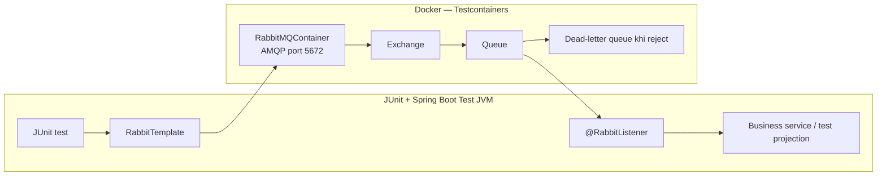

# RabbitMQContainer, Testcontainers và cấu hình kết nối cho Spring Boot

Khi viết ứng dụng bất đồng bộ bằng **Spring AMQP**, các unit test cho service hoặc converter không thể chứng minh rằng `RabbitTemplate` đã publish đúng exchange/routing key, broker đã định tuyến vào queue, `@RabbitListener` nhận được message và cơ chế ACK/NACK, retry hay dead-letter hoạt động đúng. Những điều này phụ thuộc **RabbitMQ thật**.

**Testcontainers** cho phép tạo RabbitMQ trong container Docker, chạy cùng JUnit và tự dọn sau khi kiểm thử. Đặc biệt, **`RabbitMQContainer`** cung cấp host, port và credentials thực tế, trong khi Spring Boot có thể tự kết nối qua **`@ServiceConnection`** hoặc **`@DynamicPropertySource`**. Nhờ vậy, máy của lập trình viên và CI không cần giả định RabbitMQ luôn chạy ở `localhost:5672`.

Bài học thuộc chương **Kiểm thử** của module **SPRING_AMQP**. Ta thực hành kiểm thử từ publisher tới consumer, exchange–queue–binding, đường ACK, lỗi message, DLQ, và bàn tới isolation, lifecycle, môi trường CI và khác biệt phiên bản Spring Boot/Testcontainers.

> **Phạm vi ví dụ chính:** Java 17+, **Spring Boot 3.5.x**, **Testcontainers 1.21.x** và RabbitMQ AMQP **0-9-1**, sử dụng `spring-boot-starter-amqp`. Phần riêng cuối bài chỉ rõ cách đổi sang **Spring Boot 4.2 + Testcontainers 2.0.x**, vì tên artifact và package Java đã thay đổi. Các mã minh họa là những đoạn có thể đặt vào dự án mẫu đúng dependency; không phải kết quả test đã được chạy trong bài học.

## 1. Mục tiêu học tập

Sau bài này, bạn có thể:

1. Phân biệt unit test, mock-based listener test, integration test broker thật và end-to-end test qua nhiều dịch vụ.
2. Khởi động `RabbitMQContainer` bằng Testcontainers + JUnit Jupiter.
3. Dùng `getHost()`, `getAmqpPort()`, `getAmqpUrl()`, credentials và port mapping động đúng cách.
4. Kết nối Spring Boot tới RabbitMQ container bằng **`@ServiceConnection`** (Spring Boot 3.1+) hoặc **`@DynamicPropertySource`**.
5. Viết một integration test gửi message qua `RabbitTemplate`, nhận bằng `@RabbitListener` và chờ kết quả bất đồng bộ bằng Awaitility.
6. Kiểm thử topology exchange–queue–binding, đường lỗi tới DLQ, retry và tính idempotent mà không tạo test flaky.
7. Quản lý lifecycle, isolation, ApplicationContext caching và Docker/CI.
8. Nhận diện khác biệt Testcontainers **1.x → 2.x** và Spring Boot **3.x → 4.2** để tránh import/artifact sai.

## 2. Vì sao cần RabbitMQ thật trong kiểm thử?

Giả sử producer gửi sự kiện đặt hàng:

```text
HTTP/API
   -> OrderService
   -> RabbitTemplate.convertAndSend(exchange, routingKey, payload)
   -> RabbitMQ exchange
   -> binding
   -> orders.work.q
   -> @RabbitListener
   -> database/side effect
   -> ACK, hoặc reject/DLQ khi lỗi
```

Một unit test có thể mock `RabbitTemplate` và xác minh `convertAndSend(...)` đã được gọi. Nhưng nó **không** chứng minh:

- Exchange/queue/binding có tên và loại chính xác.
- Routing key có đưa message vào đúng queue hay không.
- JSON/content-type có được listener converter giải mã đúng không.
- Broker có giới hạn prefetch, tạo consumer và xử lý ACK/redelivery như mong đợi không.
- Queue có cấu hình dead-letter exchange và routing key tương thích hay không.
- Consumer có thể khôi phục khi kết nối bị gián đoạn hoặc message được gửi lại không.

Testcontainers chạy broker thật nên có thể kiểm tra những ranh giới đó.



**Không cần Docker Compose** nếu chỉ cần một RabbitMQ broker. Testcontainers tự tạo/khởi động container, đợi readiness theo chiến lược của module, cấp mapped port và dọn tài nguyên. Cần có **container runtime tương thích** đang hoạt động (Docker Desktop, Docker Engine hoặc môi trường Testcontainers được cấu hình hỗ trợ).

## 3. Chọn đúng phiên bản trước khi copy code

Hai thay đổi dễ gây lỗi compile nhất là **tên artifact Testcontainers** và **Spring Boot AMQP starter**.

| Bộ thư viện | RabbitMQ module Testcontainers | Import Java | AMQP 0-9-1 starter của Boot |
| --- | --- | --- | --- |
| **Spring Boot 3.5.x + Testcontainers 1.21.x** | `org.testcontainers:rabbitmq` | `org.testcontainers.containers.RabbitMQContainer` | `org.springframework.boot:spring-boot-starter-amqp` |
| **Spring Boot 4.2.x + Testcontainers 2.0.x** | `org.testcontainers:testcontainers-rabbitmq` | `org.testcontainers.rabbitmq.RabbitMQContainer` | `org.springframework.boot:spring-boot-starter-rabbitmq` |

JUnit Jupiter module cũng đổi từ `org.testcontainers:junit-jupiter` (1.x) sang `org.testcontainers:testcontainers-junit-jupiter` (2.x).

**Không dùng code import nhánh 1.x với dependency chỉ chứa module 2.x rồi cast hoặc thêm phụ thuộc tùy tiện.** Khi nâng lên Boot 4.2, `spring-boot-starter-amqp` giờ phục vụ **generic AMQP 1.0**, không phải RabbitMQ AMQP 0-9-1 như Boot 3.x. Các property `spring.rabbitmq.*` vẫn dùng cho nhánh RabbitMQ 0-9-1.

### Chọn image RabbitMQ

Ví dụ dùng:

```text
rabbitmq:4.1-management
```

Tag `-management` hỗ trợ RabbitMQ Management UI/API ngoài AMQP. Pin một tag có phiên bản rõ ràng, thay vì `rabbitmq:latest`: thay đổi image ngoài ý muốn sẽ tạo khác biệt giữa các lần test. Với pipeline cần tái lập chặt, cân nhắc pin image digest và có lịch cập nhật bảo mật.

**Lưu ý:** RabbitMQ broker 4.1 và Testcontainers 1.21 là **hai phiên bản độc lập**. Số `1.21` không phải phiên bản RabbitMQ, cũng không phải AMQP protocol version.

## 4. Gradle dependencies cho Spring Boot 3.5

Với dự án Gradle đã bật Spring Boot dependency management hoặc BOM, có thể khai báo:

```gradle
dependencies {
    implementation("org.springframework.boot:spring-boot-starter-amqp")

    testImplementation("org.springframework.boot:spring-boot-starter-test")
    testImplementation("org.springframework.boot:spring-boot-testcontainers")

    testImplementation("org.testcontainers:rabbitmq")
    testImplementation("org.testcontainers:junit-jupiter")

    // Dùng khi muốn polling/assertion bất đồng bộ tường minh.
    testImplementation("org.awaitility:awaitility")
}

tasks.named("test") {
    useJUnitPlatform()
}
```

Các version Testcontainers 1.21.x được Spring Boot 3.5.x BOM quản lý. Không cần hard-code version từng module khi dự án đã sử dụng BOM đúng. `spring-boot-testcontainers` cung cấp tích hợp **ServiceConnection**; `org.testcontainers:junit-jupiter` cung cấp `@Testcontainers` và `@Container`.

Nếu dùng Maven, bổ sung tương ứng các dependency ở `test` scope và bảo đảm JUnit Platform/Surefire phiên bản tương thích.

### Những yêu cầu bên ngoài project

1. Container runtime đang chạy và Testcontainers có thể truy cập Docker API.
2. Người chạy test có quyền tạo container, network và volume tạm thời.
3. Máy có khả năng pull image RabbitMQ (hoặc registry mirror đã được cấu hình).
4. Bộ test có đủ tài nguyên RAM/CPU để broker boot; lần đầu pull image thường chậm hơn các lần sau.
5. Không dùng endpoint/credentials của broker production làm giá trị mặc định trong test integration.

## 5. RabbitMQContainer thực sự cung cấp gì?

Với Testcontainers 1.x:

```java
import org.testcontainers.containers.RabbitMQContainer;
import org.testcontainers.utility.DockerImageName;

RabbitMQContainer rabbit = new RabbitMQContainer(
        DockerImageName.parse("rabbitmq:4.1-management"))
    .withAdminUser("it_user")
    .withAdminPassword("it_password");
```

Đoạn trên chỉ **tạo đối tượng Java**. Container chưa chạy cho tới khi gọi `rabbit.start()` hoặc được JUnit/Spring quản lý lifecycle.

Khi container đã start, các phương thức sau cho biết kết nối thật:

| API | Ví dụ kết quả giả định | Mục đích |
| --- | --- | --- |
| `rabbit.getHost()` | `localhost` hoặc hostname runtime | Host có thể truy cập từ **process đang chạy test**. |
| `rabbit.getAmqpPort()` | `32789` | Port host được map tới port **5672 bên trong container**. |
| `rabbit.getAmqpUrl()` | `amqp://localhost:32789` | URI AMQP do module xây, **không chứa username/password**. |
| `rabbit.getAdminUsername()` | `it_user` | User kết nối đã cấu hình. |
| `rabbit.getAdminPassword()` | `it_password` | Mật khẩu test. |
| `rabbit.getHttpUrl()` | `http://localhost:32790` | Management HTTP URL, hữu ích khi dùng image `-management`. |
| `rabbit.isRunning()` | `true` | Container process còn chạy; không tự chứng minh mọi message đã xử lý. |
| `rabbit.getLogs()` | Broker logs | Chẩn đoán startup, port, plugin và lỗi broker. |

Các giá trị port trên **chỉ là minh họa**. Testcontainers cấp mapped port động để nhiều test/CI job có thể dùng RabbitMQ mà không tranh host port 5672. **Đừng hard-code 5672 trên host**: `5672` là cổng AMQP **bên trong** container.

### Mô hình địa chỉ mạng

```text
JUnit/Spring Boot process (host)
    host = rabbit.getHost()
    port = rabbit.getAmqpPort()   // ví dụ 32789
          |
          | Docker port mapping
          v
RabbitMQ container
    internal AMQP port = 5672
    internal HTTP management port = 15672
```

Khi chạy trên Docker remote hoặc Testcontainers Cloud, `getHost()` có thể **khác localhost**. Lấy giá trị từ API thay vì tự ghép `127.0.0.1`. Nếu *một container khác* gọi RabbitMQ trong cùng Docker network, nó cần alias và internal port phù hợp, **không** dùng mapped host port như ứng dụng test chạy trên host.

## 6. Cách khuyến nghị: @ServiceConnection (Spring Boot 3.1+)

Spring Boot tích hợp với Testcontainers qua annotation **`@ServiceConnection`**. Khi Spring nhận diện một `RabbitMQContainer`, Boot tạo bean kết nối RabbitMQ (`RabbitConnectionDetails`) phù hợp rồi truyền các thông tin host, mapped port và credentials cho RabbitMQ auto-configuration.

Đây là đường ngắn gọn khi test dùng **Spring Boot** và một container được hỗ trợ.

### 6.1 Test class tối thiểu

```java
import org.junit.jupiter.api.Test;
import org.springframework.boot.test.context.SpringBootTest;
import org.springframework.boot.testcontainers.service.connection.ServiceConnection;
import org.testcontainers.containers.RabbitMQContainer;
import org.testcontainers.junit.jupiter.Container;
import org.testcontainers.junit.jupiter.Testcontainers;
import org.testcontainers.utility.DockerImageName;

import static org.assertj.core.api.Assertions.assertThat;

@SpringBootTest
@Testcontainers
class RabbitConnectionIntegrationTest {

    @Container
    @ServiceConnection
    static final RabbitMQContainer rabbit =
            new RabbitMQContainer(
                DockerImageName.parse("rabbitmq:4.1-management"))
                .withAdminUser("it_user")
                .withAdminPassword("it_password");

    @Test
    void rabbitContainerIsAvailable() {
        assertThat(rabbit.isRunning()).isTrue();
        assertThat(rabbit.getAmqpPort()).isPositive();
    }
}
```

Trong test này:

- `@Testcontainers` bật JUnit 5 extension.
- `@Container` trên field **static** khiến một container được dùng cho cả test class và dừng sau class.
- `@ServiceConnection` đăng ký `RabbitConnectionDetails` cho Boot để cấu hình connection factory.
- `@SpringBootTest` khởi tạo application context và các bean Spring AMQP thật.
- Không cần hard-code `spring.rabbitmq.host` hoặc `spring.rabbitmq.port` trong `application-test.yml`.

**Giới hạn của assertion ở ví dụ đầu:** `rabbit.isRunning()` chỉ chứng minh container process chạy, chưa chứng minh Spring thật sự kết nối tới broker hay listener có nhận message. Integration test đúng cần kiểm chứng **hành vi send–route–receive** ở mục tiếp theo.

### 6.2 Độ ưu tiên cấu hình

Trong cấu hình Spring Boot đã nhận `RabbitConnectionDetails` từ `@ServiceConnection`, các connection details được ưu tiên so với property connection thông thường. Ví dụ test profile có:

```yaml
spring:
  rabbitmq:
    host: rabbitmq.internal.example
    port: 5672
```

Khi `@ServiceConnection` hoạt động, Spring Boot sẽ dùng **container host/port/credentials** thay cho connection properties nói trên. Đây là tính năng tốt để tách test khỏi hạ tầng thật; nhưng nếu bạn vô tình tạo thêm `ConnectionFactory` bằng tay và bỏ qua Boot auto-configuration, service connection chưa chắc được bean riêng đó sử dụng.

### 6.3 Khi nào @ServiceConnection không đủ?

- Ứng dụng tự tạo `CachingConnectionFactory` không dùng Spring Boot `RabbitConnectionDetails`.
- Container dùng image/module tùy biến mà Boot không thể xác định loại service.
- Cần thiết lập vài property/credential hoặc vhost phi tiêu chuẩn ngoài cách service connection hỗ trợ.
- Test cần một loại client khác AMQP 0-9-1, ví dụ Streams hoặc AMQP 1.0: connection details cần được chọn đúng protocol.

Trong những trường hợp này, sử dụng `@DynamicPropertySource` hoặc explicit connection beans với lifecycle rõ ràng.

## 7. Cách linh hoạt: @DynamicPropertySource

`@DynamicPropertySource` của Spring Framework cho phép test thêm **property có giá trị runtime** vào Spring Environment trước khi tạo bean kết nối.

Thay vì đặt `@ServiceConnection`, ta công bố host, port, user và password:

```java
import org.junit.jupiter.api.Test;
import org.springframework.boot.test.context.SpringBootTest;
import org.springframework.test.context.DynamicPropertyRegistry;
import org.springframework.test.context.DynamicPropertySource;
import org.testcontainers.containers.RabbitMQContainer;
import org.testcontainers.junit.jupiter.Container;
import org.testcontainers.junit.jupiter.Testcontainers;
import org.testcontainers.utility.DockerImageName;

import static org.assertj.core.api.Assertions.assertThat;

@SpringBootTest
@Testcontainers
class RabbitDynamicPropertiesIntegrationTest {

    @Container
    static final RabbitMQContainer rabbit =
        new RabbitMQContainer(
            DockerImageName.parse("rabbitmq:4.1-management"))
            .withAdminUser("it_user")
            .withAdminPassword("it_password");

    @DynamicPropertySource
    static void rabbitProperties(DynamicPropertyRegistry registry) {
        registry.add("spring.rabbitmq.host", rabbit::getHost);
        registry.add("spring.rabbitmq.port", rabbit::getAmqpPort);
        registry.add("spring.rabbitmq.username", rabbit::getAdminUsername);
        registry.add("spring.rabbitmq.password", rabbit::getAdminPassword);
    }

    @Test
    void brokerPortIsMapped() {
        assertThat(rabbit.getAmqpPort()).isPositive();
    }
}
```

**Lưu ý cú pháp:** method `@DynamicPropertySource` phải là **static**. Mỗi `registry.add(...)` nhận một *Supplier*, vì thế dùng method reference như `rabbit::getHost` thay vì đánh giá giá trị sớm khi container chưa start.

Nếu ứng dụng đang cấu hình `spring.rabbitmq.addresses`, nó có thể ghi đè lựa chọn `host/port` vì Spring RabbitMQ auto-config có quy tắc chọn addresses riêng. Khi đó công bố chính thuộc tính `addresses` trong test, chẳng hạn:

```java
registry.add("spring.rabbitmq.addresses", rabbit::getAmqpUrl);
registry.add("spring.rabbitmq.username", rabbit::getAdminUsername);
registry.add("spring.rabbitmq.password", rabbit::getAdminPassword);
```

Phương thức `getAmqpUrl()` **không tự chứa credential**, nên vẫn cần truyền username/password nếu không dùng giá trị mặc định phù hợp. Không đặt đồng thời `@ServiceConnection` và `@DynamicPropertySource` cho **cùng connection** mà không có lý do: hai nguồn cấu hình có độ ưu tiên khác nhau, khiến người đọc khó hiểu giá trị nào thực sự thắng.

### Bảng chọn đường cấu hình

| Tiêu chí | @ServiceConnection | @DynamicPropertySource |
| --- | --- | --- |
| Spring Boot tối thiểu | **3.1+**. | Dùng được với Spring Framework hỗ trợ DynamicPropertySource, kể cả các Boot cũ hơn 3.1. |
| Test dependency thêm | `spring-boot-testcontainers`. | Không bắt buộc có `spring-boot-testcontainers`, vẫn cần Testcontainers. |
| Mã cấu hình | Rất ngắn, container được Boot nhận diện. | Tự khai báo property host, mapped port, credentials/vhost. |
| Kết nối AMQP 0-9-1 | Boot tạo `RabbitConnectionDetails`. | Boot đọc `spring.rabbitmq.*` từ Environment. |
| Phù hợp | Ứng dụng Boot auto-config và container được hỗ trợ. | Custom broker settings, Boot cũ, nhiều connection factories. |
| Rủi ro chính | Custom `ConnectionFactory` có thể không dùng connection details. | Đặt sai property, dùng `5672` thay mapped port, quên credentials. |

## 8. Ví dụ xuyên suốt: publish → exchange → queue → @RabbitListener

Để integration test chứng minh luồng hoạt động thật, ta xây một ứng dụng mẫu rất nhỏ.

### 8.1 Topology dùng trong bài test

Tạo direct exchange, work queue, dead-letter exchange và DLQ. Dùng tên có prefix `it.orders` để phân biệt với hệ thống production:

```java
import org.springframework.amqp.core.Binding;
import org.springframework.amqp.core.BindingBuilder;
import org.springframework.amqp.core.DirectExchange;
import org.springframework.amqp.core.Queue;
import org.springframework.amqp.core.QueueBuilder;
import org.springframework.beans.factory.annotation.Qualifier;
import org.springframework.context.annotation.Bean;
import org.springframework.context.annotation.Configuration;

@Configuration
public class TestOrderTopology {
    public static final String WORK_EXCHANGE = "it.orders.events.x";
    public static final String WORK_QUEUE = "it.orders.work.q";
    public static final String WORK_KEY = "it.order.created";
    public static final String DEAD_EXCHANGE = "it.orders.dead.x";
    public static final String DEAD_QUEUE = "it.orders.dead.q";
    public static final String DEAD_KEY = "it.order.failed";

    @Bean
    DirectExchange workExchange() {
        return new DirectExchange(WORK_EXCHANGE);
    }

    @Bean
    DirectExchange deadExchange() {
        return new DirectExchange(DEAD_EXCHANGE);
    }

    @Bean
    Queue workQueue() {
        return QueueBuilder.durable(WORK_QUEUE)
                .deadLetterExchange(DEAD_EXCHANGE)
                .deadLetterRoutingKey(DEAD_KEY)
                .build();
    }

    @Bean
    Queue deadQueue() {
        return QueueBuilder.durable(DEAD_QUEUE).build();
    }

    @Bean
    Binding workBinding(
            @Qualifier("workQueue") Queue queue,
            @Qualifier("workExchange") DirectExchange exchange) {
        return BindingBuilder.bind(queue)
                .to(exchange)
                .with(WORK_KEY);
    }

    @Bean
    Binding deadBinding(
            @Qualifier("deadQueue") Queue queue,
            @Qualifier("deadExchange") DirectExchange exchange) {
        return BindingBuilder.bind(queue)
                .to(exchange)
                .with(DEAD_KEY);
    }
}
```

Với `spring-boot-starter-amqp` và auto-configuration thông thường, `RabbitAdmin` có thể declare các `@Bean` queue/exchange/binding khi kết nối broker được thiết lập. Các bean phải nằm trong component scan hoặc được `@Import` vào Spring context mà test khởi chạy.

**Không cần** gọi Testcontainers `withQueue(...)` hay `withExchange(...)` nếu Spring đã khai báo topology đúng cách. Tránh khai báo cùng queue hai lần với arguments khác nhau vì broker có thể báo `PRECONDITION_FAILED`.

### 8.2 Projection test an toàn dưới nhiều consumer

Để quan sát listener có chạy, ta dùng một bean in-memory đồng bộ hóa dữ liệu. Trong bài test nó đóng vai trò **test probe**, không phải giải pháp lưu nghiệp vụ production:

```java
import java.util.concurrent.ConcurrentHashMap;
import java.util.concurrent.ConcurrentMap;
import java.util.concurrent.atomic.AtomicInteger;
import org.springframework.stereotype.Component;

@Component
public class OrderTestProjection {
    private final ConcurrentMap<String, AtomicInteger> counts =
            new ConcurrentHashMap<>();

    public void record(String eventId) {
        counts.computeIfAbsent(eventId, k -> new AtomicInteger())
              .incrementAndGet();
    }

    public int processedCount(String eventId) {
        AtomicInteger counter = counts.get(eventId);
        return counter == null ? 0 : counter.get();
    }
}
```

Dùng `ConcurrentHashMap` và `AtomicInteger` vì listener chạy trên thread container, còn test assertion chạy trên JUnit thread. `HashMap` thông thường không đủ an toàn để đọc/ghi đồng thời.

### 8.3 Listener xử lý cả luồng thành công và lỗi dữ liệu

```java
import org.springframework.amqp.AmqpRejectAndDontRequeueException;
import org.springframework.amqp.rabbit.annotation.RabbitListener;
import org.springframework.stereotype.Component;

@Component
public class OrderTestListener {
    private final OrderTestProjection projection;

    public OrderTestListener(OrderTestProjection projection) {
        this.projection = projection;
    }

    @RabbitListener(
        id = "it-orders-listener",
        queues = TestOrderTopology.WORK_QUEUE)
    public void receive(String eventId) {
        if (eventId.startsWith("poison:")) {
            // Chỉ dùng nhánh giả lập lỗi này cho bài học/test.
            throw new AmqpRejectAndDontRequeueException(
                "Invalid test payload");
        }
        projection.record(eventId);
    }
}
```

Khi message bắt đầu bằng `poison:`, exception yêu cầu container reject **không requeue**. Với DLX/DLQ đã định nghĩa, broker có thể đưa message sang `it.orders.dead.q`. Với message bình thường, listener hoàn tất để container `AUTO` ACK.

Mã `record(...)` **không** lưu bằng transaction database. Bài này kiểm tra **routing, conversion, listener invocation và DLX**; không coi đó là kiểm chứng durable business transaction hay effectively-once.

### 8.4 Integration test thực sự gửi và nhận message

Giả sử project có class `@SpringBootApplication OrdersApplication` và ba class ở trên nằm dưới package scan của ứng dụng.

```java
import java.time.Duration;
import java.util.UUID;

import org.junit.jupiter.api.Test;
import org.springframework.amqp.rabbit.core.RabbitTemplate;
import org.springframework.beans.factory.annotation.Autowired;
import org.springframework.boot.test.context.SpringBootTest;
import org.springframework.boot.testcontainers.service.connection.ServiceConnection;
import org.testcontainers.containers.RabbitMQContainer;
import org.testcontainers.junit.jupiter.Container;
import org.testcontainers.junit.jupiter.Testcontainers;
import org.testcontainers.utility.DockerImageName;

import static org.assertj.core.api.Assertions.assertThat;
import static org.awaitility.Awaitility.await;

@SpringBootTest(classes = OrdersApplication.class)
@Testcontainers
class OrdersRabbitIntegrationTest {

    @Container
    @ServiceConnection
    static final RabbitMQContainer rabbit =
        new RabbitMQContainer(
            DockerImageName.parse("rabbitmq:4.1-management"))
            .withAdminUser("it_user")
            .withAdminPassword("it_password");

    @Autowired
    RabbitTemplate rabbitTemplate;

    @Autowired
    OrderTestProjection projection;

    @Test
    void routedMessageReachesListener() {
        String eventId = "order:" + UUID.randomUUID();

        rabbitTemplate.convertAndSend(
            TestOrderTopology.WORK_EXCHANGE,
            TestOrderTopology.WORK_KEY,
            eventId
        );

        await().atMost(Duration.ofSeconds(10))
               .untilAsserted(() ->
                   assertThat(projection.processedCount(eventId))
                       .isEqualTo(1));
    }
}
```

**Vì sao dùng UUID trong test?** Mỗi test dùng một event ID riêng. Khi Spring cache ApplicationContext hoặc nhiều test dùng cùng queue, dữ liệu của một test trước không làm assertion của test sau đạt sai. Tuy nhiên, nếu hai test đang dùng chung một listener và queue, message có thể bị **competing consumer** nhận bởi test khác; phần isolation sẽ giải quyết.

**Vì sao không `Thread.sleep(2000)` rồi assert?** Listener chạy bất đồng bộ; thời gian xử lý và startup phụ thuộc tài nguyên CI. Awaitility thử lại điều kiện đến timeout, thường kết thúc ngay khi kết quả xuất hiện. Timeout 10 giây chỉ là budget của bài thử nghiệm, không phải bảo đảm hiệu năng hệ thống.

**Điều test này thực sự chứng minh:** Spring có thể mở kết nối tới broker container, RabbitTemplate gửi tới exchange, binding route vào queue, listener nhận một payload String và cập nhật test projection. Nó không chứng minh ACK đã tới broker trong mọi failure window, không khẳng định event sẽ chỉ được xử lý đúng một lần trong production và không bao gồm publisher confirms.

## 9. Kiểm thử dead-letter một cách có kiểm soát

Bổ sung một test vào class `OrdersRabbitIntegrationTest` ở mục 8.4:

```java
@Test
void invalidMessageGoesToDeadLetterQueue() {
    String payload = "poison:" + UUID.randomUUID();

    rabbitTemplate.convertAndSend(
        TestOrderTopology.WORK_EXCHANGE,
        TestOrderTopology.WORK_KEY,
        payload
    );

    await().atMost(Duration.ofSeconds(10))
           .untilAsserted(() -> {
               Object dead = rabbitTemplate.receiveAndConvert(
                   TestOrderTopology.DEAD_QUEUE, 300);
               assertThat(dead).isEqualTo(payload);
           });
}
```

Test này dựa trên:

1. Work queue có `x-dead-letter-exchange` và `x-dead-letter-routing-key` hợp lệ.
2. Listener nhận poison payload và ném `AmqpRejectAndDontRequeueException`.
3. Container reject không requeue, RabbitMQ áp dụng dead-letter routing.
4. Test dùng RabbitTemplate **pull** message từ DLQ để kiểm chứng.

**Lưu ý quan trọng về việc đọc DLQ trong assertion:** lời gọi `receiveAndConvert` tiêu thụ/ACK message nó lấy được. Vì vậy, chỉ nên dùng với **DLQ riêng của test** và bảo đảm không có consumer DLQ khác đang tranh nhận. Nếu test có nhiều poison messages chạy song song, phải thiết kế cách ghép event ID, không giả định message đọc đầu tiên luôn thuộc test hiện tại.

Cũng cần lưu ý rằng đường xử lý DLX của broker và x-death metadata được xác minh **qua message thực**. Nếu muốn assert `x-death`, nhận `org.springframework.amqp.core.Message` bằng `rabbitTemplate.receive(queue, timeout)` rồi đọc `MessageProperties.getXDeathHeader()` theo phiên bản Spring AMQP; không dùng convertAndReceive thành String khi muốn xem headers.

### Nếu muốn thử retry trước khi DLQ

Một kịch bản retry đúng cần làm rõ **retry ở đâu**:

| Lớp retry | Hành vi | Cần kiểm thử |
| --- | --- | --- |
| Spring Retry advice trong listener | Có thể retry trong cùng listener invocation trước khi reject. | Số lần attempt, backoff, exception cuối, thời điểm DLQ. |
| Broker redelivery do requeue | Message quay lại queue và có thể giao lại. | Không requeue vô hạn lỗi cố định; kiểm tra redelivery. |
| TTL + dead-letter retry queue | Chuyển message qua một queue delay rồi quay lại. | TTL, routing, số lần thử, x-death và điểm dừng. |
| Republish-message recoverer | Ứng dụng publish một message lỗi tới error exchange. | Publish confirm/ACK tương ứng; không đồng nhất với broker DLX. |

Đừng viết một test chỉ chờ “chắc khoảng 2 giây” rồi cho là retry đã đúng. Dùng latch, spy, counter hoặc persisted attempt record để kiểm chứng số lần thử; dùng Awaitility cho **kết quả cuối**, với timeout lớn hơn backoff budget có kiểm soát.

## 10. Đưa RabbitMQContainer vào lifecycle của Spring context

Dùng static `@Container` trong JUnit là cách dễ hiểu. Nhưng có một chi tiết thực tế:

- Spring TestContext có thể **cache ApplicationContext** qua nhiều test class.
- Với JUnit Jupiter extension, static container thường được **dừng sau test class**.
- Nếu Spring reuse context cũ ở test class khác, các bean `ConnectionFactory` hoặc listener vẫn đang trỏ tới một container đã bị dừng.

Spring Boot tài liệu khuyến nghị một cách khác khi muốn container sống đúng bằng vòng đời của Spring context: khai báo **container như Spring bean trong `@TestConfiguration`**.

```java
import org.springframework.boot.test.context.TestConfiguration;
import org.springframework.boot.testcontainers.service.connection.ServiceConnection;
import org.springframework.context.annotation.Bean;
import org.testcontainers.containers.RabbitMQContainer;
import org.testcontainers.utility.DockerImageName;

@TestConfiguration(proxyBeanMethods = false)
public class RabbitTestContainersConfig {

    @Bean
    @ServiceConnection
    RabbitMQContainer rabbitMQContainer() {
        return new RabbitMQContainer(
            DockerImageName.parse("rabbitmq:4.1-management"))
            .withAdminUser("it_user")
            .withAdminPassword("it_password");
    }
}
```

Dùng trong test:

```java
import org.junit.jupiter.api.Test;
import org.springframework.boot.test.context.SpringBootTest;
import org.springframework.context.annotation.Import;

@SpringBootTest(classes = OrdersApplication.class)
@Import(RabbitTestContainersConfig.class)
class OrdersRabbitWithSpringManagedContainerTest {

    @Test
    void loadsContextAndContainer() {
        // Broker container được Spring quản lý cùng ApplicationContext.
    }
}
```

Ở cách này **không cần `@Testcontainers`/`@Container`** trên field vì Spring quản lý bean container; nó start container trước các bean ứng dụng phụ thuộc và dừng container sau khi các bean đó được destroy. Cách này thường phù hợp với integration suite dùng context cache.

**Đừng thêm đồng thời một static `@Container` và một `@Bean RabbitMQContainer` khác nếu không muốn khởi động hai broker.** Chọn một ownership/lifecycle cụ thể, rồi chia sẻ đúng cách.

## 11. Spring Boot 4.2 và Testcontainers 2.x: cách chuyển đổi

Khi upgrade project từ Boot 3.5 sang **Boot 4.2**, cả starter AMQP 0-9-1 và Testcontainers module đổi tên. Với BOM mới:

```gradle
dependencies {
    implementation("org.springframework.boot:spring-boot-starter-rabbitmq")

    testImplementation("org.springframework.boot:spring-boot-starter-test")
    testImplementation("org.springframework.boot:spring-boot-testcontainers")

    testImplementation("org.testcontainers:testcontainers-rabbitmq")
    testImplementation("org.testcontainers:testcontainers-junit-jupiter")
    testImplementation("org.awaitility:awaitility")
}
```

Testcontainers 2.0.5 (ví dụ dòng do Boot 4.2 quản lý) chuyển class sang package:

```java
import org.testcontainers.rabbitmq.RabbitMQContainer;
import org.testcontainers.utility.DockerImageName;

RabbitMQContainer rabbit =
    new RabbitMQContainer(
        DockerImageName.parse("rabbitmq:4.1-management"));
```

Annotation `@ServiceConnection` vẫn là:

```java
import org.springframework.boot.testcontainers.service.connection.ServiceConnection;
```

Trong Spring Boot 4.2, connection details cho AMQP 0-9-1 vẫn được nhận diện từ `RabbitMQContainer` và dùng cho starter RabbitMQ. Nên xác minh exact BOM/version trong build vì **Testcontainers 2.x** cũng thay đổi package của nhiều module khác.

### Bảng di trú cụ thể

| Hạng mục | Boot 3.5 / Testcontainers 1.21 | Boot 4.2 / Testcontainers 2.0 |
| --- | --- | --- |
| Dependency AMQP 0-9-1 | `spring-boot-starter-amqp` | **`spring-boot-starter-rabbitmq`** |
| RabbitMQ Testcontainers artifact | `org.testcontainers:rabbitmq` | **`org.testcontainers:testcontainers-rabbitmq`** |
| JUnit Testcontainers artifact | `org.testcontainers:junit-jupiter` | **`org.testcontainers:testcontainers-junit-jupiter`** |
| Java import | `org.testcontainers.containers.RabbitMQContainer` | **`org.testcontainers.rabbitmq.RabbitMQContainer`** |
| Service connection annotation | `org.springframework.boot.testcontainers.service.connection.ServiceConnection` | Cùng package annotation. |
| Properties 0-9-1 | `spring.rabbitmq.*` | Vẫn **`spring.rabbitmq.*`**. |
| @DynamicPropertySource | Có. | Có. |

Trong Boot 4.2, `spring-boot-starter-amqp` phục vụ generic AMQP 1.0, `spring-boot-starter-amqp-rabbitmq` phục vụ RabbitMQ-specific AMQP 1.0. Nếu bài test hiện đang dùng `RabbitTemplate` và `@RabbitListener` kiểu AMQP 0-9-1, hãy chọn **starter RabbitMQ 0-9-1** chứ không vô tình chuyển giao thức.

### Lưu ý nếu thử RabbitMQ Streams

RabbitMQContainer có thể hỗ trợ test Streams, nhưng **không đồng nghĩa `@ServiceConnection` AMQP 0-9-1 tự thiết lập stream protocol**. Spring Boot mới yêu cầu opt-in `RabbitStreamConnectionDetails` khi dùng service connection cho stream và container cần expose port **5552** (hoặc 5551 với SSL). Bài này chỉ kiểm thử AMQP 0-9-1; đừng dùng `getAmqpPort()` 5672 làm stream port.

## 12. Quản lý dữ liệu và test isolation

Một test ổn định cần kiểm soát **ai đọc queue**, **message còn lại**, **state của bean** và **cách chạy song song**.

### 12.1 Test isolation theo cấp độ

| Cách | Ưu điểm | Đánh đổi |
| --- | --- | --- |
| **Mỗi test class một RabbitMQContainer** | Broker mới, dữ liệu/topology được cô lập khỏi test class khác. | Startup tốn thời gian; cần tránh context cache trỏ vào broker cũ. |
| **Spring-managed container bean cho context** | Lifecycle nhất quán với Spring context, có thể reuse context qua test class. | Dữ liệu queue tồn tại qua nhiều test dùng cùng context, cần tách test state. |
| **Queue riêng theo test class/suite** | Tránh competing consumers giữa các suite. | Phải provision và cleanup topology; tên phù hợp. |
| **Event ID ngẫu nhiên mỗi test** | Assertion không bị đánh lừa bởi event cũ. | Không ngăn hai consumer khác nhau cạnh tranh trên cùng queue. |
| **Purge queue trước test** | Loại message cũ dễ hiểu khi không có consumer. | Không an toàn nếu listener đang active, có delivery unacked hoặc test song song. |
| **Dùng `@DirtiesContext`** | Bắt buộc context mới khi thực sự cần. | Tốn startup, có thể che lỗi isolation trong thiết kế test. |

### 12.2 Không purge queue khi listener đang xử lý

Nếu gọi `RabbitAdmin.purgeQueue(...)` trong `@BeforeEach` nhưng listener của test trước vẫn còn message unacked, purge có thể không loại những delivery đó. Sau khi listener hoàn tất/redelivery, chúng có thể ảnh hưởng test hiện tại.

Nên ưu tiên:

1. Queue riêng cho test class/suite, tách khỏi consumer của service khác.
2. Unique event ID, kiểm tra output tương ứng với ID.
3. Chỉ purge khi đảm bảo không có consumer/in-flight messages.
4. Nếu muốn chứng minh queue rỗng, kiểm tra ready/unacked trong thời gian đủ và tránh assert dựa trên một lần đọc không đồng bộ.
5. Chạy tuần tự những test đang sửa cùng một queue/state, hoặc mỗi test một resource độc lập.

### 12.3 Đừng dùng sleep cố định để đồng bộ

Không nên:

```java
rabbitTemplate.convertAndSend(exchange, key, eventId);
Thread.sleep(1000);
assertThat(projection.processedCount(eventId)).isEqualTo(1);
```

Ở máy nhanh, lãng phí thời gian; ở CI chậm, 1 giây không đủ. Dùng Awaitility, CountDownLatch, polling database hoặc queue state với timeout rõ ràng. Timeout phải dựa trên SLA/mức tải của môi trường test, không biến thành chờ vô hạn.

### 12.4 Test nhiều consumer và idempotency

Nếu muốn chứng minh **một event không gây hiệu ứng hai lần**, đừng chỉ khẳng định listener được gọi đúng một lần. At-least-once transport có thể gây redelivery sau DB commit khi ACK mất.

Thiết kế test nên có **database thật** (có thể thêm PostgreSQLContainer), schema có unique constraint và transaction:

```sql
CREATE TABLE processed_events (
    consumer_name TEXT NOT NULL,
    event_id TEXT NOT NULL,
    PRIMARY KEY (consumer_name, event_id)
);
```

Publish cùng `eventId` nhiều lần và xác nhận **số effect nghiệp vụ** không tăng gấp đôi. Nếu chủ động mô phỏng mất ACK, làm trong test tách biệt với `AcknowledgeMode.MANUAL`, đóng connection sau commit và kiểm tra marker. Không dùng in-memory `OrderTestProjection` của phần 8 làm bằng chứng durable idempotency.

## 13. Testing publisher confirms và returns

Một test gửi được message vào queue không chứng minh **producer đã nhận publisher confirm** hoặc xử lý unroutable message. Với bài toán quan trọng, có thể bổ sung test:

- Bật `publisherConfirmType=CORRELATED` trên `CachingConnectionFactory` (hoặc property Spring Boot thích hợp).
- Dùng `RabbitTemplate.invoke/CorrelationData` hoặc `RabbitTemplate.ConfirmCallback` để kiểm tra ACK/NACK publisher.
- Bật publisher returns và `mandatory=true` khi muốn phát hiện routing key không dẫn tới queue.
- Gửi message tới routing key không có binding và assert **return** đến callback/correlation theo API phiên bản đang dùng.
- Kiểm tra trường hợp publish bị timeout/connection loss: kết quả có thể không chắc chắn; producer retry có thể tạo duplicate và cần event ID ổn định.

**Không nhầm producer ACK với consumer ACK:** publisher confirm nghĩa broker đã chấp nhận publish theo semantics của nó, không phải consumer đã commit database. Kiểm thử end-to-end nên có assertion business effect riêng.

## 14. Testing retry, dead-letter và recovery

Một bộ test hữu ích nên bao phủ các tình huống sau:

| Kịch bản | Hành động test | Kết quả cần xác minh |
| --- | --- | --- |
| **Happy path** | Publish event hợp lệ. | Listener xử lý, service state được cập nhật và không còn lỗi. |
| **Routing** | Publish tới exchange/routing key dự kiến. | Message vào đúng queue, đúng consumer. |
| **Non-retryable failure** | Publish poison payload. | Reject không requeue; message tới DLQ có metadata phù hợp. |
| **Transient error/retry** | Làm stub downstream thất bại vài lần. | Retry có backoff và giới hạn; cuối cùng xử lý thành công hoặc vào DLQ. |
| **Duplicate** | Publish cùng event ID hai lần. | Business effect được bảo vệ bằng unique key/inbox. |
| **Consumer restart** | Dừng/kích hoạt consumer hoặc mất connection trong môi trường test. | Container phục hồi, message mới được nhận. |
| **Ack-loss** | Commit business rồi làm mất ACK trong test riêng. | Redelivery không tạo duplicate business effect. |
| **Bad topology** | Mismatch queue arguments trong broker test. | Test fail rõ nguyên nhân thay vì lặng lẽ skip. |
| **Large payload** | Gửi payload vượt kích thước thường gặp. | Converter/headers/prefetch và giới hạn broker phù hợp. |
| **Concurrent consumers** | Publish nhiều event, tăng concurrency. | Không có race nghiệp vụ; thứ tự chỉ được bảo đảm trong phạm vi thiết kế. |

Với test mô phỏng broker shutdown, cần quản lý lifecycle chủ động; nếu dùng `@Container` rồi gọi `stop()` giữa test, extension không tự bảo đảm start lại đúng lúc cho các test kế tiếp. Cân nhắc một test class cô lập hoặc điều khiển container qua Spring-managed bean trong context riêng.

## 15. CI và Docker runtime

Testcontainers chạy test giống hệt về logic ở local và CI, nhưng điều kiện **container runtime** là bắt buộc.

### 15.1 Checklist CI

- Có Docker Engine/container runtime tương thích và socket/endpoint mà Testcontainers truy cập được.
- Có quyền pull image, tạo container và port mapping; không hard-code hostname `localhost`.
- Có RAM/CPU đủ cho RabbitMQ boot và chạy tests; có cache image nếu CI tải image nhiều lần.
- Không reuse RabbitMQ test container giữa các job độc lập một cách vô tình.
- Tách integration test Docker khỏi unit tests nếu muốn feedback nhanh; vẫn chạy integration tests trong pipeline bắt buộc.
- Bảo đảm test failure rõ ràng khi không có Docker nếu đây là bước quality gate, thay vì tự skip và tuyên bố pass.
- Thu thập logs của RabbitMQ/Testcontainers và application khi CI fail.
- Giới hạn parallel execution đối với test cùng queue và không bật experimental reusable containers trong CI nếu không có chiến lược isolation rõ ràng.

### 15.2 Vì sao hard-code localhost:5672 hay fail ở CI?

Trong CI, Docker daemon có thể chạy trên một host khác process test, hoặc test chạy trong container. Port map 5672 bên trong RabbitMQ không nhất thiết là 5672 trên test host.

**Đúng:** dùng `rabbit.getHost()` + `rabbit.getAmqpPort()` hoặc `@ServiceConnection`. **Sai:** ép `spring.rabbitmq.host=localhost` và `spring.rabbitmq.port=5672` bất kể runtime.

Khi JVM test cũng chạy trong Docker container khác, cần chú ý Docker-in-Docker/host network, alias, `TESTCONTAINERS_HOST_OVERRIDE` nếu môi trường yêu cầu và cách Docker socket được mount; không tự giả định cấu hình giống chạy trực tiếp trên laptop.

### 15.3 Lưu ý bảo mật

Container test chỉ cần credential dành cho test. Không để secrets production trong `application-test.yml`, không đưa broker production vào địa chỉ fallback. Dù phần lớn test dùng guest hoặc user test, nên tạo user riêng trong container nếu muốn mô phỏng permission/vhost. Không log password hoặc URI có credential. Image test phải được cập nhật theo chính sách bảo mật của tổ chức.

## 16. Các công cụ Spring AMQP testing khác và khi nào dùng

Testcontainers **không thay thế** thư viện `spring-rabbit-test`; mỗi công cụ giải quyết lớp khác nhau.

| Công cụ | Broker thật? | Trọng tâm |
| --- | --- | --- |
| Mockito + unit test service | Không | Logic nghiệp vụ, exception path, việc gọi `RabbitTemplate`. |
| `TestRabbitTemplate` | **Không** | Gọi trực tiếp `MessageListener` trên thread test theo queue name; không kiểm tra broker routing/ACK/DLX. |
| `@RabbitListenerTest` / `RabbitListenerTestHarness` | Không bắt buộc broker | Spy/capture invocation của listener, đếm lần gọi, lấy exception. |
| `@SpringRabbitTest` | Không tự yêu cầu broker | Tạo hạ tầng Spring AMQP trong Spring test context, hữu ích khi không dùng Boot auto-config. |
| `@RabbitAvailable` | Dùng broker có sẵn theo điều kiện | Kiểm tra broker bên ngoài có sẵn, có thể purge/tạo queue test. |
| **RabbitMQContainer + @SpringBootTest** | **Có** | Kiểm tra exchange, binding, actual publish/consume, conversion, ACK, DLX/DLQ, recovery. |

`spring-rabbit-test` được Spring AMQP giới thiệu từ phiên bản **1.6**. Nếu dùng `@SpringBootTest`, Boot thường tự tạo những bean AMQP tương đương `@SpringRabbitTest`, không cần đồng thời thêm cả hai chỉ để có `RabbitTemplate`.

Ví dụ không có broker:

Nếu muốn dùng `TestRabbitTemplate` (khác ví dụ RabbitMQContainer ở trên), thêm dependency test `org.springframework.amqp:spring-rabbit-test` và đăng ký bean với `ConnectionFactory`:

```java
import org.springframework.amqp.rabbit.connection.ConnectionFactory;
import org.springframework.amqp.rabbit.test.TestRabbitTemplate;
import org.springframework.context.annotation.Bean;

@Bean
TestRabbitTemplate testRabbitTemplate(ConnectionFactory connectionFactory) {
    return new TestRabbitTemplate(connectionFactory);
}
```

Khi bean được tạo trong Spring test context, nó phát hiện listener containers và cho phép gọi `convertAndSend("my-queue", "hello")` trực tiếp tới listener trên thread test theo **tên queue**. Nó **không** chứng minh exchange routing, broker durability, publisher confirms, ACK hoặc DLQ. Nếu mục tiêu là kiểm thử broker thật, chọn RabbitMQContainer thay vì direct invocation.

## 17. Thực hành theo cấp độ

### Bài A — đổi từ địa chỉ cố định sang port động

Bắt đầu với một Spring Boot project `RabbitTemplate`/`@RabbitListener`, viết test đang dùng `localhost:5672`. Chuyển sang `RabbitMQContainer` + `@DynamicPropertySource`. Chạy trên hai máy hoặc hai CI jobs có mapped port khác nhau và xác nhận test vẫn pass.

**Điều cần giải thích:** vì sao `getAmqpPort()` có thể là 32789 mà RabbitMQ container vẫn listen trên 5672?

### Bài B — dùng @ServiceConnection

Thêm `spring-boot-testcontainers`, chuyển sang `@ServiceConnection` và xóa dynamic properties. Kiểm tra RabbitTemplate thực sự kết nối container và không dùng endpoint của file cấu hình test.

**Điều cần giải thích:** `RabbitConnectionDetails` được Boot tạo và được ưu tiên thế nào so với `spring.rabbitmq.host`?

### Bài C — end-to-end routing

Tạo exchange, queue và binding theo mục 8. Publish 10 event ID khác nhau, đợi mỗi ID xuất hiện trong projection. Chạy với concurrency 1 và 3, đo tổng thời gian và thảo luận vì sao số lượng listener lớn không đảm bảo thứ tự hoàn tất.

### Bài D — DLQ

Cho listener ném `AmqpRejectAndDontRequeueException` khi payload bắt đầu bằng `poison:`. Quan sát message xuất hiện ở DLQ, kiểm tra body và `x-death` header bằng RabbitTemplate khi cần. Sau đó thử bỏ dead-letter binding và quan sát test fail — điều này chứng minh test có thể bắt lỗi topology thực sự.

### Bài E — idempotency qua database thật

Thêm PostgreSQLContainer. Tạo bảng có `PRIMARY KEY (consumer_name, event_id)` và ghi marker + cập nhật nghiệp vụ trong cùng transaction. Publish cùng event nhiều lần và kiểm tra chỉ một business effect. Mô phỏng crash sau COMMIT trước ACK ở môi trường thử nghiệm riêng để chứng minh retry an toàn.

### Bài F — lifecycle/caching

Cho hai test class dùng chung Spring context. So sánh static JUnit `@Container` với Spring-managed `@Bean @ServiceConnection RabbitMQContainer`. Quan sát vấn đề reuse cached ApplicationContext khi broker của class trước đã bị stop, rồi chuyển sang ownership theo context.

### Bài G — nâng Boot/Testcontainers

Tạo một branch thử nghiệm Boot 4.2 / Testcontainers 2.0.x, đổi `spring-boot-starter-amqp` sang `spring-boot-starter-rabbitmq`, thay module và import Testcontainers mới. Kiểm tra `@ServiceConnection` vẫn cấp host, mapped port và credentials đúng, đặc biệt khi project chứa AMQP 1.0 dependencies cùng lúc.

## 18. Lỗi thường gặp và cách sửa

| Lỗi | Nguyên nhân có thể | Giải pháp |
| --- | --- | --- |
| `Could not find a valid Docker environment` | Docker runtime không sẵn sàng hoặc Testcontainers không truy cập được. | Kiểm tra Docker/CI socket và permissions. |
| `Connection refused localhost:5672` | Spring không dùng mapped port hoặc không nhận service connection. | Kiểm tra `@ServiceConnection`/`@DynamicPropertySource` và connection factory thật. |
| Port khác mỗi lần chạy | Hành vi bình thường của Docker port mapping. | Luôn dùng `getAmqpPort()`. |
| `ACCESS_REFUSED` | Credentials/vhost khác cấu hình trong RabbitMQContainer. | Dùng `getAdminUsername/getAdminPassword` hoặc service connection. |
| `NOT_FOUND - no queue` | Queue không được declare, bean topology không được scan/import. | Kiểm tra `RabbitAdmin` và topology. |
| `PRECONDITION_FAILED` | Cùng tên queue nhưng khác durable/DLX arguments. | Sửa cấu hình để hai bên cùng một contract, không tự xóa dữ liệu production. |
| Test pass ở local, fail ở CI | Docker networking, image pull, máy chậm hoặc timeout quá ngắn. | Dùng mapped host/port, log container, timeout hợp lý và CI resources. |
| Test chờ mãi sau publish | Listener không chạy, routing sai, message converter sai, ACK/retry lỗi. | Quan sát consumer count, queue depth, exception và DLQ. |
| Test flaky do `Thread.sleep` | Race giữa JUnit và listener thread. | Awaitility/latch hoặc durable state assertion. |
| Test khác nhận mất message | Nhiều listener cạnh tranh cùng queue/container. | Cô lập queue, event ID và context; kiểm soát parallel execution. |
| Context cache trỏ broker đã stop | Static `@Container` đã bị JUnit dừng nhưng Spring context còn cached. | Dùng Spring-managed container bean hoặc tách context rõ ràng. |
| `ClassNotFoundException RabbitMQContainer` | Trộn Testcontainers 1.x/2.x artifact hoặc import. | Dùng module/package đúng bảng phiên bản. |
| `@ServiceConnection` không tác dụng | Thiếu `spring-boot-testcontainers`, Boot quá cũ hoặc custom ConnectionFactory. | Thêm dependency hoặc dùng DynamicPropertySource. |
| Không thấy DLQ message | Listener đang requeue hoặc DLX/binding sai; test khác tiêu thụ DLQ. | Reject không requeue và kiểm tra topology/consumer. |
| Kiểm thử “exactly-once” bằng một lần nhận | Thiếu tình huống duplicate/ACK loss; in-memory state không bền. | Test unique constraint/inbox và transaction với database thật. |

## 19. Checklist trước khi hoàn tất bài kiểm thử

- Đã xác định **Spring Boot + Testcontainers major version** và đúng artifact/package.
- Testcontainers chạy broker thật, không phụ thuộc RabbitMQ local có sẵn.
- Spring kết nối bằng **ServiceConnection** hoặc **dynamic host/port/credentials**, không hard-code 5672 trên host.
- Queue/exchange/binding được khai báo bởi test/application, dùng tên riêng và có lifecycle rõ.
- Test chờ consumer bằng **Awaitility** thay vì sleep cố định.
- Có test happy path và ít nhất một negative path (DLQ hoặc converter failure).
- Phân biệt kết quả **send**, **publisher confirm**, **consume**, **ACK** và **business commit**.
- Dữ liệu giữa các test được cô lập; không purge khi còn listener/in-flight messages.
- Docker/CI có quyền và tài nguyên đủ; test fail rõ nếu Docker không có.
- Nếu cần kiểm chứng idempotency, sử dụng DB thật, unique constraint và tình huống redelivery, không chỉ spy một listener.

## 20. Ghi nhớ cốt lõi

- **`RabbitMQContainer` + Testcontainers** giúp kiểm tra Spring AMQP với **RabbitMQ thật**, không cần broker chạy sẵn ở `localhost:5672`.
- Với **Spring Boot 3.1+**, **`@ServiceConnection`** là cách gọn nhất khi dùng Boot auto-configuration và container được hỗ trợ; **`@DynamicPropertySource`** linh hoạt hơn khi cần điều khiển properties cụ thể.
- **Luôn dùng `getHost()` và `getAmqpPort()`**: port bên trong container 5672 không phải mapped host port.
- **JUnit `@Container` và Spring `@Bean` container có lifecycle khác nhau**. Với cached ApplicationContext dùng lại nhiều test, Spring-managed container bean có thể an toàn hơn.
- **Testcontainers 2.x chuyển RabbitMQContainer sang `org.testcontainers.rabbitmq`** và đổi tên artifact; **Boot 4.2 đổi AMQP 0-9-1 starter thành `spring-boot-starter-rabbitmq`**.
- **Kiểm tra kết quả bất đồng bộ bằng Awaitility và business state**, không dựa vào sleep hay số lần gọi mock.
- **Broker test thành công không tự bảo đảm exactly-once**. Vẫn phải thử ACK/redelivery, idempotency, publisher confirms, retry và DLQ ở lớp phù hợp.

## Tài liệu tham khảo

- [Testcontainers for Java — RabbitMQ Module](https://java.testcontainers.org/modules/rabbitmq/): artifact RabbitMQ module và cách sử dụng.
- [Testcontainers for Java — JUnit 5 Quickstart](https://java.testcontainers.org/quickstart/junit_5_quickstart/): `@Testcontainers`, `@Container`, lifecycle và dependency.
- [Testcontainers for Java — Networking and Communicating with Containers](https://java.testcontainers.org/features/networking/): mapped port và `getHost()`.
- [Spring Boot 3.5 — Testcontainers](https://docs.spring.io/spring-boot/3.5/reference/testing/testcontainers.html): `@ServiceConnection`, `@DynamicPropertySource`, JUnit extension và Spring-managed container lifecycle.
- [Spring Boot 4.2 — Testcontainers](https://docs.spring.io/spring-boot/reference/testing/testcontainers.html): `RabbitConnectionDetails`, service connection và Streams-specific opt-in.
- [Spring Boot 4.2 — AMQP](https://docs.spring.io/spring-boot/reference/messaging/amqp.html): khác biệt generic AMQP 1.0, RabbitMQ-specific AMQP 1.0 và RabbitMQ AMQP 0-9-1 starter.
- [Spring Boot 4.2 Release Notes](https://github.com/spring-projects/spring-boot/wiki/Spring-Boot-4.2.0-Release-Notes): đổi tên AMQP 0-9-1 starter sang `spring-boot-starter-rabbitmq`.
- [Testcontainers 2.0 Release Notes](https://github.com/testcontainers/testcontainers-java/releases/tag/2.0.0): di chuyển package của module containers và thay đổi artifact.
- [Spring AMQP — Testing Support](https://docs.spring.io/spring-amqp/reference/testing.html): `spring-rabbit-test`, `@RabbitListenerTest`, `TestRabbitTemplate` và `@RabbitAvailable`.
- [Spring AMQP — Message Listener Container Configuration](https://docs.spring.io/spring-amqp/reference/amqp/containerAttributes.html): ACK/NACK, retry/requeue và listener configuration.
- [RabbitMQ — Dead Letter Exchanges](https://www.rabbitmq.com/docs/dlx): dead-letter routing và các điều kiện dead-letter.
- [RabbitMQ — Consumer Acknowledgements and Publisher Confirms](https://www.rabbitmq.com/docs/confirms): ACK, publisher confirms, redelivery và điều kiện mất xác nhận.
