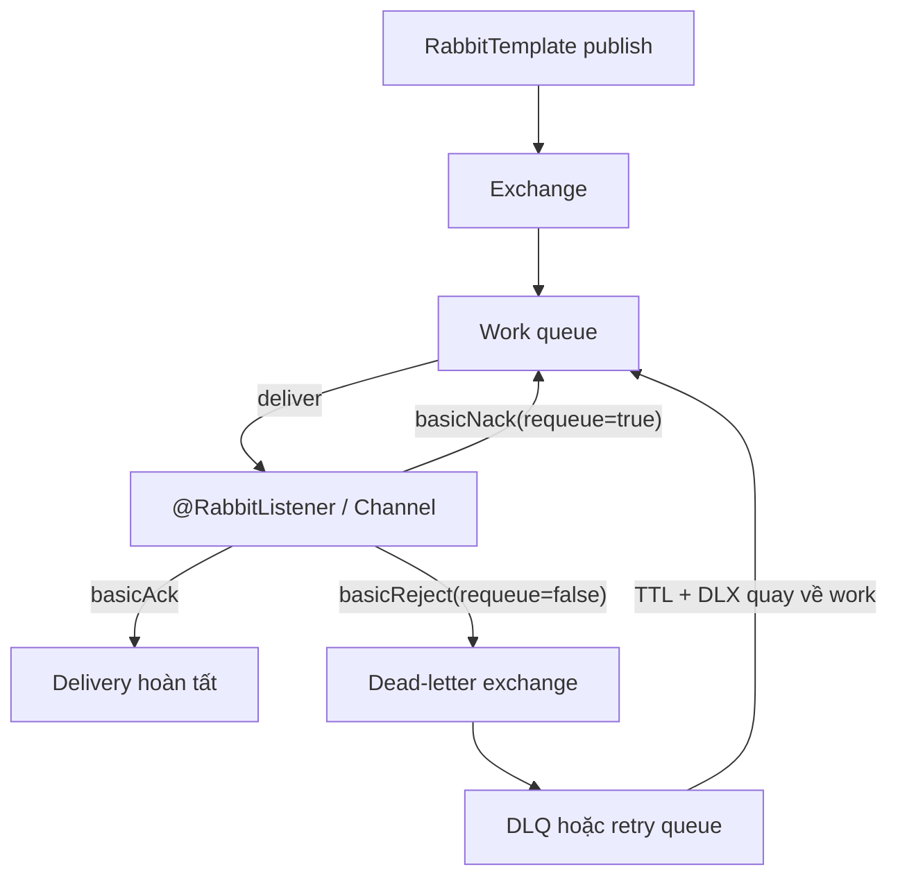
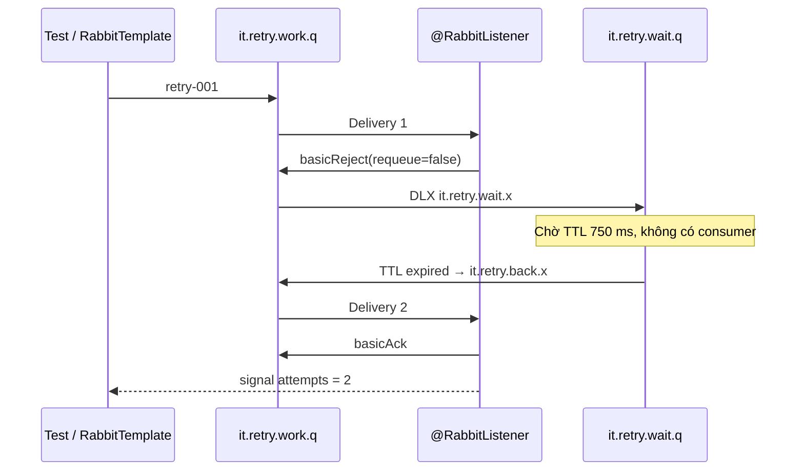

# Kiểm thử ack, requeue, retry và DLQ bằng broker RabbitMQ thật

## 1. Vì sao mock không đủ để kiểm thử độ tin cậy giao nhận?

Trong module **SPRING_AMQP**, producer gọi `RabbitTemplate` để publish message, exchange và binding định tuyến tới queue, còn consumer `@RabbitListener` xử lý và phản hồi bằng **ack** hoặc **nack/reject**. Khi tích hợp retry, dead-letter exchange (DLX), transaction và cơ chế phục hồi kết nối, hệ thống phải hoạt động đúng ngay cả khi handler lỗi hoặc broker giao lại message.

Unit test với Mockito rất hữu ích để kiểm tra luật nghiệp vụ, ví dụ service gọi repository đúng tham số. Tuy nhiên, việc mock `Channel.basicAck(...)` không chứng minh:

- Broker đã xóa delivery khỏi danh sách **unacked** sau ack.
- `basicNack(requeue=true)` làm message thực sự có thể được giao lại.
- `basicReject(requeue=false)` làm message đi qua **DLX và binding** vào đúng DLQ.
- Message đã được dead-letter vào **retry queue có TTL** rồi được route lại work queue.
- Listener container, converter, queue arguments, authorization và connection factory đã được lắp ghép đúng.

Những hành vi này thuộc **giao thức và broker**, nên cần ít nhất một lớp **integration test sử dụng RabbitMQ thật**. Bài này dùng **Testcontainers + JUnit 5 + Spring Boot Test** để khởi chạy RabbitMQ trong container, thao tác bằng `RabbitTemplate` và xác minh kết quả trên broker.

### Kết quả mong muốn

| Kịch bản | Tín hiệu phải quan sát |
| --- | --- |
| **Ack** | Listener xử lý thành công, gửi `basicAck`; message không còn chờ xử lý ở queue. |
| **Requeue** | Lần đầu `basicNack(requeue=true)`; broker giao lại, lần sau `basicAck`. |
| **Retry có delay** | Nack/reject không requeue; DLX chuyển message tới retry queue; TTL hết thì message quay về work queue. |
| **DLQ** | Poison message bị reject không requeue; broker dead-letter vào DLQ; còn payload và dấu vết `x-death`. |

Phạm vi bài tập là **RabbitMQ AMQP 0-9-1 với classic/quorum queue**. Với RabbitMQ Streams, tiến độ tiêu thụ dựa trên offset, không thể dùng nguyên semantics `basicAck`/`basicNack` của queue.

## 2. Mô hình delivery và các chế độ ack cần nhớ



### 2.1. Ba chế độ acknowledgment của Spring AMQP

| `AcknowledgeMode` | Ai gửi ack? | Phù hợp với |
| --- | --- | --- |
| `AUTO` | Spring listener container **sau khi listener hoàn tất bình thường**; lỗi gây reject/nack theo cấu hình. | Phần lớn handler đồng bộ. |
| `MANUAL` | Ứng dụng tự gọi `Channel.basicAck`, `basicNack` hoặc `basicReject`. | Khi cần kiểm soát cụ thể từng delivery; **được dùng ở bài test này**. |
| `NONE` | Broker dùng no-ack, không chờ consumer ack. | Chỉ khi chấp nhận semantics at-most-once; không dùng để thử unacked/requeue. |

**`AUTO` không phải broker auto-ack.** Với `AUTO`, exception mặc định có thể khiến message bị requeue và tạo vòng lặp nếu không thiết kế retry. Với `MANUAL`, nếu listener không gửi ack/nack và channel vẫn mở, delivery có thể giữ ở trạng thái **unacked**.

### 2.2. Delivery tag và cờ redelivered

Mỗi delivery có `deliveryTag` gắn với **channel hiện tại**. Ví dụ:

```java
long tag = message.getMessageProperties().getDeliveryTag();
channel.basicAck(tag, false);
```

Tham số `multiple=false` chỉ ack delivery đang chỉ định; `multiple=true` có thể ack một loạt delivery trên **cùng channel**. Dùng tag cũ với channel mới hoặc ack trùng có thể gây channel exception, do đó test cần theo dõi chính xác lần ack/nack.

Cờ `message.getMessageProperties().isRedelivered()` thường có giá trị `true` khi broker **giao lại cùng message sau requeue**. Nó **không** phải khóa chống trùng nghiệp vụ: producer có thể publish lại một event logic với delivery mới và cờ `redelivered=false`. Sau dead-letter sang queue khác rồi được publish lại, đừng dựa vào cờ này để đếm số lần retry; hãy theo dõi `x-death`/retry metadata và event ID theo hợp đồng rõ ràng.

## 3. Vì sao sử dụng Testcontainers?

Testcontainers khởi động **RabbitMQ server thật** trong một Docker container cô lập:

1. Bài test tạo exchange, queue và binding bằng Spring AMQP.
2. Listener container kết nối broker bằng một AMQP connection thật.
3. Test gửi message qua `RabbitTemplate`.
4. Broker thực hiện ack, requeue, dead-letter và TTL thực sự.
5. Test đọc tín hiệu từ listener và DLQ để đối chiếu.

Đây là **integration test** chứ không phải unit test; nó đòi Docker/container runtime hoạt động trên máy local và runner CI. Không mock `RabbitTemplate`, `Channel`, `RabbitAdmin` hoặc `ConnectionFactory` trong bài test kiểm chứng hành vi broker.

### 3.1. Dependencies

Với dự án Spring Boot có BOM quản lý phiên bản, thêm:

```xml
<dependency>
    <groupId>org.springframework.boot</groupId>
    <artifactId>spring-boot-starter-amqp</artifactId>
</dependency>
<dependency>
    <groupId>org.springframework.boot</groupId>
    <artifactId>spring-boot-starter-test</artifactId>
    <scope>test</scope>
</dependency>
<dependency>
    <groupId>org.testcontainers</groupId>
    <artifactId>rabbitmq</artifactId>
    <scope>test</scope>
</dependency>
<dependency>
    <groupId>org.testcontainers</groupId>
    <artifactId>junit-jupiter</artifactId>
    <scope>test</scope>
</dependency>
```

Chọn version Testcontainers tương thích với Spring Boot/BOM đang dùng. Ví dụ ở dưới dùng Spring Boot 3.x, JUnit Jupiter, Java 17+ và image minh họa `rabbitmq:4.1-management`. Với CI, nên pin image tag/digest theo chính sách của tổ chức thay vì dùng `latest`.

### 3.2. Bốn work queue độc lập

Để mỗi test không làm hỏng trạng thái test khác, ví dụ sử dụng **bốn queue riêng**:

```text
it.ack.q                 -> listener ACK
it.requeue.q             -> listener NACK lần đầu, ACK lần hai

it.poison.q
   DLX it.poison.dlx -> it.poison.dlq

it.retry.work.q
   reject -> DLX it.retry.wait.x -> it.retry.wait.q (TTL 750 ms)
   expire -> DLX it.retry.back.x -> it.retry.work.q
```

Không có listener trên `it.poison.dlq` hoặc `it.retry.wait.q`: test đọc DLQ trực tiếp, còn retry queue chỉ giữ message trong lúc chờ hết TTL. Tên tài nguyên cố định là hợp lý vì Testcontainers tạo **một broker mới** cho lớp test; nếu chia sẻ broker hoặc chạy nhiều lớp cùng lúc, cần prefix độc nhất hoặc tạo namespace/vhost riêng.

## 4. Bộ kiểm thử tích hợp: Testcontainers + Spring AMQP

Tạo file `src/test/java/example/amqp/AckRequeueRetryDlqTest.java`. Đây là **một ví dụ hoàn chỉnh trong một lớp test**, các loại message sử dụng payload UTF-8 đơn giản để tập trung vào semantics giao nhận.

### 4.1. Khởi tạo Spring Boot test context và RabbitMQContainer

```java
package example.amqp;

import com.rabbitmq.client.Channel;
import java.io.IOException;
import java.nio.charset.StandardCharsets;
import java.util.concurrent.BlockingQueue;
import java.util.concurrent.LinkedBlockingQueue;
import java.util.concurrent.TimeUnit;
import java.util.concurrent.atomic.AtomicInteger;
import org.junit.jupiter.api.Test;
import org.springframework.amqp.core.BindingBuilder;
import org.springframework.amqp.core.Declarables;
import org.springframework.amqp.core.DirectExchange;
import org.springframework.amqp.core.Message;
import org.springframework.amqp.core.Queue;
import org.springframework.amqp.core.QueueBuilder;
import org.springframework.amqp.rabbit.annotation.EnableRabbit;
import org.springframework.amqp.rabbit.annotation.RabbitListener;
import org.springframework.amqp.rabbit.core.RabbitTemplate;
import org.springframework.beans.factory.annotation.Autowired;
import org.springframework.boot.SpringBootConfiguration;
import org.springframework.boot.autoconfigure.EnableAutoConfiguration;
import org.springframework.boot.test.context.SpringBootTest;
import org.springframework.boot.test.context.TestConfiguration;
import org.springframework.context.annotation.Bean;
import org.springframework.context.annotation.Import;
import org.springframework.test.context.DynamicPropertyRegistry;
import org.springframework.test.context.DynamicPropertySource;
import org.testcontainers.containers.RabbitMQContainer;
import org.testcontainers.junit.jupiter.Container;
import org.testcontainers.junit.jupiter.Testcontainers;
import org.testcontainers.utility.DockerImageName;
import static org.assertj.core.api.Assertions.assertThat;

@Testcontainers
@SpringBootTest(classes = AckRequeueRetryDlqTest.TestApp.class)
class AckRequeueRetryDlqTest {
    static final String ACK_Q = "it.ack.q";
    static final String REQUEUE_Q = "it.requeue.q";
    static final String POISON_Q = "it.poison.q";
    static final String POISON_DLQ = "it.poison.dlq";
    static final String POISON_DLX = "it.poison.dlx";
    static final String RETRY_WORK_Q = "it.retry.work.q";
    static final String RETRY_WAIT_Q = "it.retry.wait.q";
    static final String RETRY_WAIT_X = "it.retry.wait.x";
    static final String RETRY_BACK_X = "it.retry.back.x";

    @Container
    static final RabbitMQContainer RABBIT =
            new RabbitMQContainer(
                    DockerImageName.parse("rabbitmq:4.1-management"))
                    .withEnv("RABBITMQ_DEFAULT_USER", "it")
                    .withEnv("RABBITMQ_DEFAULT_PASS", "itpass");

    @DynamicPropertySource
    static void rabbitProperties(DynamicPropertyRegistry registry) {
        registry.add("spring.rabbitmq.host", RABBIT::getHost);
        registry.add("spring.rabbitmq.port", RABBIT::getAmqpPort);
        registry.add("spring.rabbitmq.username", () -> "it");
        registry.add("spring.rabbitmq.password", () -> "itpass");
        registry.add("spring.rabbitmq.dynamic", () -> "true");
    }

    @SpringBootConfiguration
    @EnableAutoConfiguration
    @EnableRabbit
    @Import({Topology.class, Consumers.class})
    static class TestApp { }

    @Autowired RabbitTemplate rabbitTemplate;
    @Autowired Consumers consumers;

    // Topology, listeners và test methods nằm ở các mục tiếp theo
    // trong CÙNG class AckRequeueRetryDlqTest.
}
```

`@Container` cho Testcontainers điều khiển start/stop broker theo vòng đời lớp test. `@DynamicPropertySource` cung cấp host và mapped AMQP port động cho Spring context; **không dùng hard-code port 5672 phía host** vì Testcontainers thường map ra một port ngẫu nhiên. User `it/itpass` chỉ dùng trong container test, không sử dụng tài khoản này trong production.

`spring.rabbitmq.dynamic=true` cho phép Spring Boot tạo `RabbitAdmin` khi cấu hình thông thường được kích hoạt. `RabbitAdmin` auto-declare các bean `Declarables` trước/qua quá trình container kết nối. Nếu dự án có auto-configuration AMQP tùy biến, cần bảo đảm vẫn có `RabbitAdmin` phù hợp và quyền declare topology.

### 4.2. Topology thật cho ACK, requeue, retry và DLQ

Đặt lớp nested sau **bên trong `AckRequeueRetryDlqTest`**:

```java
@TestConfiguration
static class Topology {
    @Bean
    Declarables integrationTestDeclarables() {
        Queue ack = QueueBuilder.durable(ACK_Q).build();
        Queue requeue = QueueBuilder.durable(REQUEUE_Q).build();

        DirectExchange poisonDlx = new DirectExchange(POISON_DLX);
        Queue poisonWork = QueueBuilder.durable(POISON_Q)
                .deadLetterExchange(POISON_DLX)
                .deadLetterRoutingKey("dead")
                .build();
        Queue poisonDead = QueueBuilder.durable(POISON_DLQ).build();

        DirectExchange retryWaitX = new DirectExchange(RETRY_WAIT_X);
        DirectExchange retryBackX = new DirectExchange(RETRY_BACK_X);
        Queue retryWork = QueueBuilder.durable(RETRY_WORK_Q)
                .deadLetterExchange(RETRY_WAIT_X)
                .deadLetterRoutingKey("wait")
                .build();
        Queue retryWait = QueueBuilder.durable(RETRY_WAIT_Q)
                .ttl(750)
                .deadLetterExchange(RETRY_BACK_X)
                .deadLetterRoutingKey("back")
                .build();

        return new Declarables(
                ack, requeue, poisonDlx, poisonWork, poisonDead,
                retryWaitX, retryBackX, retryWork, retryWait,
                BindingBuilder.bind(poisonDead).to(poisonDlx)
                        .with("dead"),
                BindingBuilder.bind(retryWait).to(retryWaitX)
                        .with("wait"),
                BindingBuilder.bind(retryWork).to(retryBackX)
                        .with("back")
        );
    }
}
```

Các queue đều durable để việc khai báo có ý nghĩa giống production. Nhưng đây là broker **test mới**, không cần giữ message sau khi test dừng. `QueueBuilder.ttl(750)` gắn `x-message-ttl=750` **trên retry waiting queue**. Khi không có consumer giữ message trong queue đó, broker sẽ dead-letter message hết hạn trở lại work queue qua `it.retry.back.x`.

**Lưu ý:** Không tự thêm listener cho `RETRY_WAIT_Q`, nếu không message có thể bị consume trước khi TTL hết và không quay về work queue. Nếu main queue đang tồn tại với arguments khác, broker có thể trả `PRECONDITION_FAILED`; cô lập broker/test topology giúp tránh lỗi do tài nguyên cũ.

### 4.3. Bốn listener dùng manual ack/nack

Đặt lớp nested sau **trong cùng `AckRequeueRetryDlqTest`**:

```java
static class Consumers {
    final BlockingQueue<String> acked = new LinkedBlockingQueue<>();
    final BlockingQueue<Boolean> redelivered = new LinkedBlockingQueue<>();
    final BlockingQueue<String> rejected = new LinkedBlockingQueue<>();
    final BlockingQueue<Integer> retried = new LinkedBlockingQueue<>();
    final AtomicInteger requeueAttempts = new AtomicInteger();
    final AtomicInteger retryAttempts = new AtomicInteger();

    private static String payload(Message message) {
        return new String(message.getBody(), StandardCharsets.UTF_8);
    }

    private static long tag(Message message) {
        return message.getMessageProperties().getDeliveryTag();
    }

    @RabbitListener(queues = ACK_Q, ackMode = "MANUAL")
    public void onAck(Message message, Channel channel) throws IOException {
        // Trong ứng dụng thật: commit thay đổi nghiệp vụ TRƯỚC khi ack.
        String body = payload(message);
        channel.basicAck(tag(message), false);
        acked.offer(body);
    }

    @RabbitListener(queues = REQUEUE_Q, ackMode = "MANUAL")
    public void onRequeue(Message message, Channel channel)
            throws IOException {
        int attempt = requeueAttempts.incrementAndGet();
        if (attempt == 1) {
            // Không ack lần đầu. Broker cho phép giao lại message.
            channel.basicNack(tag(message), false, true);
            return;
        }
        // Lần thứ hai có thể quan sát cờ redelivered=true.
        boolean wasRedelivered =
                message.getMessageProperties().isRedelivered();
        channel.basicAck(tag(message), false);
        redelivered.offer(wasRedelivered);
    }

    @RabbitListener(queues = POISON_Q, ackMode = "MANUAL")
    public void onPoison(Message message, Channel channel)
            throws IOException {
        channel.basicReject(tag(message), false);
        rejected.offer(payload(message));
    }

    @RabbitListener(queues = RETRY_WORK_Q, ackMode = "MANUAL")
    public void onRetry(Message message, Channel channel)
            throws IOException {
        int attempt = retryAttempts.incrementAndGet();
        if (attempt == 1) {
            // Main queue DLX -> retry.wait.q -> TTL -> main queue.
            channel.basicReject(tag(message), false);
            return;
        }
        channel.basicAck(tag(message), false);
        retried.offer(attempt);
    }
}
```

Lần đầu ở retry path dùng `basicReject(requeue=false)`, nhưng message không mất vì **main queue có cấu hình DLX đến retry queue**. Cũng là `requeue=false` ở poison path, nhưng topology khác sẽ đưa message tới **DLQ cuối**. Chính cấu hình queue/DLX quyết định đích, không phải kiểu exception trong code.

Trong demo, listener `onRetry` thành công ở lần thứ hai. **Không áp dụng nguyên logic này cho production**: khi handler luôn thất bại, vòng TTL → main → TTL có thể tiếp diễn vô hạn. Cần retry budget, backoff và terminal DLQ/parking queue theo contract ứng dụng.

## 5. Kiểm thử ACK bằng broker thật

Thêm test method vào `AckRequeueRetryDlqTest`:

```java
@Test
void ackAfterHandling() throws Exception {
    rabbitTemplate.convertAndSend("", ACK_Q, "ack-001");

    String processed = consumers.acked.poll(20, TimeUnit.SECONDS);
    assertThat(processed).isEqualTo("ack-001");

    // Đây chỉ là kiểm tra bổ sung ready queue; vì có listener chạy,
    // receive() == null KHÔNG tự chứng minh unacked đã về 0.
    assertThat(rabbitTemplate.receive(ACK_Q, 100)).isNull();
}
```

Test này kiểm chứng listener thực đã nhận message và **gọi `basicAck` thành công trên channel** trước khi phát tín hiệu `acked`. Broker có thể xử lý frame ack bất đồng bộ sau lời gọi; nếu cần khẳng định **unacked = 0 ở broker**, dùng Management API/Prometheus và chờ điều kiện hội tụ thay vì dựa duy nhất vào việc `receive(...)` không trả thêm message.

Trong một số môi trường CI, `@RabbitListener` có thể chưa được đăng ký khi producer vừa khởi chạy. Với bean `Declarables` và broker test, message vẫn nằm trong queue và được giao khi consumer sẵn sàng. Nếu muốn fail nhanh khi listener chưa start, bổ sung assert container state/consumer count trong test infrastructure.

## 6. Kiểm thử `basicNack(requeue=true)`

Thêm test:

```java
@Test
void nackWithRequeueCausesAnotherDelivery() throws Exception {
    rabbitTemplate.convertAndSend("", REQUEUE_Q, "requeue-001");

    Boolean redelivered = consumers.redelivered.poll(
            20, TimeUnit.SECONDS);

    assertThat(consumers.requeueAttempts.get()).isEqualTo(2);
    assertThat(redelivered).isTrue();
}
```

**Luồng thực tế:**

```text
broker deliver attempt 1
    -> channel.basicNack(tag, multiple=false, requeue=true)
    -> broker đưa message trở lại trạng thái có thể giao
broker deliver attempt 2
    -> redelivered flag thường true
    -> channel.basicAck(tag, multiple=false)
    -> test nhận tín hiệu
```

Vì test chỉ có **một listener** trên queue `it.requeue.q`, hai lần giao sẽ về cùng listener. Khi có nhiều consumer, broker có thể giao lại cho consumer **khác**; không được viết assertion yêu cầu cùng một JVM hoặc cùng một channel trừ khi topology/test chủ động bảo đảm điều đó.

`basicNack(..., true)` không tạo delay. Nếu handler cứ ném exception/nack lại liên tục, hệ thống có thể rơi vào **hot requeue loop**: CPU/broker traffic tăng nhưng không tiến triển nghiệp vụ. Nack requeue **không phải retry strategy có backoff**.

## 7. Kiểm thử poison message vào DLQ

Thêm test:

```java
@Test
void rejectWithoutRequeueRoutesToDlq() throws Exception {
    rabbitTemplate.convertAndSend("", POISON_Q, "poison-001");

    assertThat(consumers.rejected.poll(
            20, TimeUnit.SECONDS)).isEqualTo("poison-001");

    Message deadLetter = rabbitTemplate.receive(POISON_DLQ, 20_000);
    assertThat(deadLetter).isNotNull();
    assertThat(new String(
            deadLetter.getBody(), StandardCharsets.UTF_8))
            .isEqualTo("poison-001");

    // Broker thêm metadata dead-letter.
    assertThat(deadLetter.getMessageProperties().getHeaders())
            .containsKey("x-death");
}
```

RabbitMQ dead-letter message khi consumer reject/nack với `requeue=false` **và** queue nguồn có cấu hình DLX hợp lệ. Cần kiểm tra:

1. `it.poison.q` có `x-dead-letter-exchange=it.poison.dlx`.
2. Routing key dead-letter là `dead`.
3. DLX `it.poison.dlx` có binding với `it.poison.dlq`.
4. Không có consumer khác đang lấy message trong DLQ trước assertion.

`rabbitTemplate.receive(POISON_DLQ, 20_000)` là một thao tác consume chủ động của **test**; khi nhận thành công qua `RabbitTemplate`, message có thể được ack và biến mất khỏi DLQ. Trong production, DLQ cần được bảo vệ khỏi các công cụ test/inspection làm mất message. Nếu cần kiểm tra DLQ mà **không consume**, sử dụng Management API để đọc `messages_ready`/`messages_unacknowledged` và headers bằng cơ chế quan sát phù hợp, hoặc cấu hình observer có quyền giới hạn.

`x-death` ghi nhận việc message được dead-letter (exchange, queue, reason, count, thời gian tùy broker). Cấu trúc/header có thể khác theo phiên bản RabbitMQ; chỉ assert những điều kiện ổn định trong hợp đồng cần kiểm thử. Đừng nhầm `x-death` với một retry budget tự động: bạn cần quy tắc đếm retry được thiết kế cụ thể.

## 8. Kiểm thử retry qua TTL + DLX

Thêm test:

```java
@Test
void delayedRetryReturnsToWorkQueue() throws Exception {
    rabbitTemplate.convertAndSend("", RETRY_WORK_Q, "retry-001");

    Integer attempts = consumers.retried.poll(
            20, TimeUnit.SECONDS);

    assertThat(attempts).isEqualTo(2);
    assertThat(consumers.retryAttempts.get()).isEqualTo(2);
}
```

Với topology mục 4.2, luồng retry là:



Ưu điểm của test này: nó sử dụng **broker thật** để kiểm chứng policy TTL và hai lượt dead-letter routing, không tự giả lập bằng `Thread.sleep` trong listener.

**Những điểm phải hiểu:**

- `x-message-ttl=750` là TTL của message khi nằm trong waiting queue, **không phải cam kết retry đúng sau 750 ms**. Lịch xử lý và tình trạng broker khiến thời điểm giao lại dao động.
- Với TTL + DLX, message quay về work queue là một lần **publish nội bộ do broker dead-letter**; cờ `redelivered` của delivery mới không phải thước đo retry đáng tin.
- Nếu có poison message thất bại mãi, mô hình luân phiên hai queue có thể tạo vòng lặp. Production cần **số lần thử tối đa** và một **terminal DLQ** hoặc parking queue.
- RabbitMQ có cơ chế dead-letter cycle detection, queue policies và quorum delivery limit khác nhau theo phiên bản; không dựa vào một chuỗi DLX lặp để mặc định có retry limit. Cần theo dõi và kiểm thử rõ ràng trên broker/version được dùng.
- Khi cần retry có độ tin cậy cao, thiết kế chiến lược dead-letter phù hợp (đặc biệt khi dùng quorum queues và yêu cầu at-least-once dead-lettering). Không giả định mọi đường DLX chuyển message đều không thể mất.

## 9. Khác biệt giữa broker retry và Spring Retry interceptor

Không phải mọi “retry” đều có cùng ý nghĩa.

| Cơ chế | Message ở đâu trong lúc chờ? | Điểm mạnh | Điều cần cẩn trọng |
| --- | --- | --- | --- |
| `basicNack(requeue=true)` | Quay lại queue gần như ngay. | Đơn giản để test redelivery. | Dễ tạo hot loop; không có delay. |
| Spring Retry interceptor | Listener thực hiện lại handler trong cùng một delivery. | Retry nhanh cho lỗi tạm thời, có backoff và recoverer. | Worker vẫn bận; không bảo đảm broker-level delayed retry. |
| Retry queue TTL + DLX | Message ở một queue chờ; broker đưa lại work queue khi TTL hết. | Không giữ thread listener trong lúc chờ. | Cần DLX/binding, retry budget và kế hoạch cho poison message. |
| Delayed-message mechanism | Message chờ theo cơ chế broker/plugin/producer tương ứng. | Delay linh hoạt theo message. | Phụ thuộc khả năng broker/plugin và policy. |
| Quorum queue delivery limit | Broker giới hạn số lần delivery theo cấu hình quorum queue. | Hạn chế poison requeue loop. | Không giống TTL retry, version và DLX semantics cần kiểm thử riêng. |

### 9.1. Ví dụ Spring Retry cho `AUTO` acknowledgement

Một phương án khác là dùng `AcknowledgeMode.AUTO` cùng advice chain, thay vì `MANUAL` trong các test trên:

```java
import org.springframework.amqp.rabbit.config.SimpleRabbitListenerContainerFactory;
import org.springframework.amqp.rabbit.connection.ConnectionFactory;
import org.springframework.amqp.rabbit.retry.RejectAndDontRequeueRecoverer;
import org.springframework.amqp.rabbit.config.RetryInterceptorBuilder;
import org.springframework.context.annotation.Bean;

@Bean
SimpleRabbitListenerContainerFactory retryingListenerFactory(
        ConnectionFactory connectionFactory) {
    SimpleRabbitListenerContainerFactory factory =
            new SimpleRabbitListenerContainerFactory();
    factory.setConnectionFactory(connectionFactory);
    factory.setAdviceChain(
            RetryInterceptorBuilder.stateless()
                    .maxAttempts(3)  // Tính cả lần xử lý ban đầu.
                    .backOffOptions(200, 2.0, 2000)
                    .recoverer(new RejectAndDontRequeueRecoverer())
                    .build());
    return factory;
}
```

Khi `@RabbitListener(containerFactory="retryingListenerFactory")` xử lý thất bại:

1. Interceptor thử lại handler trong cùng lượt nhận, tối đa 3 attempts.
2. Sau khi hết retry, `RejectAndDontRequeueRecoverer` yêu cầu reject không requeue.
3. **DLQ chỉ nhận message nếu queue nguồn có DLX/binding hợp lệ**.

Đây là hướng triển khai **khác** với retry TTL ở mục 8. Không gắn retry interceptor này vào listener test `MANUAL` rồi coi nó tự đảm nhiệm ack/nack, vì khi đã chọn `MANUAL` ứng dụng phải làm rõ quyền sở hữu acknowledgment và cách xử lý exception.

Nếu mục tiêu là kiểm chứng retry count của Spring Retry, có thể cài handler tăng `AtomicInteger` rồi ném exception, sau đó assert được gọi đúng ba lần và broker dead-letter message khi recoverer kết thúc; trường hợp cần bean thực có thể tạo một test riêng dùng `AUTO` container factory.

## 10. Cách xác minh chính xác queue ready và unacked

`RabbitTemplate.receive(...) == null` chỉ cho biết **không lấy được message đang ready** tại lúc đó. Nó **không chứng minh**:

- Không có delivery nào còn **unacked**.
- Message đã được xử lý thành công trong DB.
- Message không bị route sang queue/DLQ khác.

### 10.1. Passive queue declare cho ready count

RabbitMQ Java Client có:

```java
long ready = rabbitTemplate.execute(channel ->
        channel.queueDeclarePassive(ACK_Q).getMessageCount());
```

`getMessageCount()` trả số message **ready**, không phải tổng `ready+unacked`. Không dùng nó làm một assertion duy nhất cho ack thành công. Passive declare có thể đóng channel nếu queue không tồn tại; trong test topology sai cần phân tích lỗi gốc.

### 10.2. Management HTTP API cho cả ready và unacked

Với image `rabbitmq:4.1-management` và port Management API được expose/configure phù hợp, endpoint:

```text
GET /api/queues/%2F/it.ack.q
```

Các trường trả về:

```json
{
  "messages": 0,
  "messages_ready": 0,
  "messages_unacknowledged": 0,
  "consumers": 1
}
```

**Đây là ví dụ kết quả mong muốn**, không phải response tức thời luôn xuất hiện. Trong integration test, hãy **poll có timeout** đến khi `messages_ready == 0 && messages_unacknowledged == 0` thay vì assert ngay một snapshot có thể chưa cập nhật. Management API cần permission/credential phù hợp, và `RabbitMQContainer.getHttpPort()` cung cấp mapped HTTP port trong cấu hình Testcontainers có expose Management UI. RabbitMQ Management statistics có thể được cập nhật theo chu kỳ; khi cần test timing chính xác, kết hợp sự kiện listener với metric broker.

**Khuyến nghị:** test transport semantics bằng listener signal + DLQ message thật; dùng Management API/Prometheus trong bài test vận hành hoặc test sâu hơn. Không yêu cầu mọi test unit phải khởi tạo Management plugin.

## 11. Kiểm thử ack sau transaction và chống duplicate

Các bài test ở mục 5–8 kiểm tra **giao thức**. Chúng chưa chứng minh business transaction an toàn. Để kiểm thử độ tin cậy đầu cuối, bổ sung database thật (ví dụ Testcontainers PostgreSQL) và service `@Transactional`:

```sql
CREATE TABLE processed_events (
    event_id VARCHAR(128) PRIMARY KEY,
    processed_at TIMESTAMPTZ NOT NULL DEFAULT now()
);

CREATE TABLE order_stats (
    id BIGINT PRIMARY KEY,
    event_count BIGINT NOT NULL
);

INSERT INTO order_stats (id, event_count) VALUES (1, 0);
```

```java
import org.springframework.jdbc.core.JdbcTemplate;
import org.springframework.stereotype.Service;
import org.springframework.transaction.annotation.Transactional;

@Service
public class IdempotentOrderService {
    private final JdbcTemplate jdbc;

    public IdempotentOrderService(JdbcTemplate jdbc) {
        this.jdbc = jdbc;
    }

    @Transactional
    public void apply(String eventId) {
        int inserted = jdbc.update("""
            INSERT INTO processed_events(event_id)
            VALUES (?)
            ON CONFLICT (event_id) DO NOTHING
            """, eventId);
        if (inserted == 0) {
            return; // Một lần giao trước đã commit event này.
        }
        jdbc.update("""
            UPDATE order_stats
            SET event_count = event_count + 1
            WHERE id = 1
            """);
    }
}
```

Listener `MANUAL` phải gọi service **qua Spring proxy**, chờ service hoàn tất DB transaction, rồi mới ack:

```java
@RabbitListener(queues = "orders.business.q", ackMode = "MANUAL")
public void onBusinessEvent(
        String eventId, com.rabbitmq.client.Channel channel,
        @org.springframework.messaging.handler.annotation.Header(
            org.springframework.amqp.support.AmqpHeaders.DELIVERY_TAG)
        long deliveryTag) throws java.io.IOException {
    orderService.apply(eventId); // Trả về sau khi transaction commit.
    channel.basicAck(deliveryTag, false);
}
```

Ví dụ này giả định `orderService` là bean được inject và queue `orders.business.q` đã được khai báo trong môi trường test bổ sung; **không tự nhận là một phần của lớp test bốn queue ở mục 4**.

Trường hợp test:

1. Gửi `event-101`; xác minh `order_stats.event_count = 1` và ack được gửi.
2. Cố tình làm mất channel/connection **sau DB commit nhưng trước ack** bằng fault injection có kiểm soát.
3. Khi message được giao lại, service thấy `processed_events.event_id` đã tồn tại, không tăng count lần hai.
4. Xác minh tổng số tác động nghiệp vụ vẫn bằng **1**, kể cả khi listener được gọi nhiều hơn một lần.

Một transaction PostgreSQL **không tự atomically commit cùng ack RabbitMQ**. Do đó redelivery sau DB commit là bình thường trong mô hình at-least-once; idempotency là bảo vệ chính. Test ép crash tại một thời điểm quá chính xác có thể khó ổn định; hãy dùng latch/hook giữa commit và ack, hoặc test lớp idempotency bằng replay cùng event ID bên cạnh kiểm thử lỗi kết nối.

## 12. Tránh flaky test khi broker và listener chạy bất đồng bộ

### 12.1. Đừng dựa vào `Thread.sleep` làm assertion

Mã sau dễ thất bại ngẫu nhiên trên CI:

```java
rabbitTemplate.convertAndSend("", ACK_Q, "ack-001");
Thread.sleep(200);
assertThat(someCounter.get()).isEqualTo(1);
```

Máy CI bận, Docker khởi động chậm, network hoặc listener container chưa sẵn sàng đều làm `200 ms` không đủ. Trong ví dụ chính, `BlockingQueue.poll(timeout)` chờ **tín hiệu đến từ listener sau thao tác ack/nack**. Có thể dùng Awaitility với `await().atMost(...).untilAsserted(...)` cho metric hoặc DB state eventually consistent.

### 12.2. Bảo đảm độc lập giữa các test

- Mỗi kịch bản dùng queue riêng; **không** để hai test ngẫu nhiên cùng đọc một message.
- Mỗi test gửi event ID riêng; không dùng dữ liệu từ một bài test khác làm tiền điều kiện.
- Với suite lớn, dùng broker/container riêng theo class hoặc vhost/prefix riêng. Không `purge` queue đang có message của test chạy song song.
- Tránh chạy test methods của **cùng class** song song nếu chúng chia sẻ `AtomicInteger`/probe; hoặc thay thiết kế probe bằng key `eventId` tách biệt theo từng test.
- Nếu tắt `@RabbitListener` container trong test, nhớ bật lại trong `finally` hoặc dùng context riêng.
- Không dùng `@DirtiesContext` cho mọi method chỉ để “chữa flakiness”: khởi tạo lại Spring context và container rất tốn tài nguyên; trước hết sửa đồng bộ/độc lập state.

### 12.3. Đồng bộ sau ack, không trước ack

Trong test ACK, `acked.offer(body)` nằm **sau `channel.basicAck(...)`**; nếu offer trước, assertion có thể hoàn tất dù ack chưa được gửi. Nhưng lời gọi Java Client trả về cũng chỉ cho biết frame đã được phát ở phía client; để khẳng định broker xử lý, kiểm tra thêm `unacked` eventually về 0 hoặc hành vi của queue qua broker metrics.

### 12.4. Đừng vô tình tạo “false positive”

- Nếu test kiểm tra DLQ, hãy xác nhận payload/event ID và route, không chỉ `messages_ready > 0` (có thể là message từ test cũ).
- Nếu test requeue, đếm số lần handler được gọi, xác minh cờ redelivered **nếu có ý nghĩa với cùng queue**, không chỉ chờ “đã nhận một message”.
- Nếu test retry TTL, đo **ít nhất hai lượt xử lý** và lộ trình qua waiting queue, không chỉ assert handler kết thúc.
- Nếu test ack, đừng chỉ xem “queue ready bằng 0”, vì message còn có thể unacked.
- Với retry policy có số lần thử giới hạn, tính rõ **lần đầu** có được tính vào `maxAttempts` hay không.

## 13. Matrix cần kiểm thử trước khi đưa lên production

| Kịch bản | Input/fault injection | Kỳ vọng | Điểm đo |
| --- | --- | --- | --- |
| Xử lý thành công | Event hợp lệ | DB commit rồi ack; không còn delivery đang chờ. | Handler signal, DB state, unacked. |
| Handler lỗi một lần | Exception tạm thời | Requeue hoặc retry theo policy, sau đó thành công. | Attempt counter, retry metadata, ack. |
| Poison message | Payload sai schema | Reject không requeue; DLQ nhận message. | DLQ payload, `x-death`, logs. |
| Retry queue TTL | First attempt fail, next pass | Waiting queue giữ message rồi route lại. | 2 attempts, TTL/DLX config, timeline. |
| Retry hết lượt | Handler luôn fail | Dừng retry và đi terminal DLQ, không loop vô hạn. | Retry budget, DLQ. |
| Consumer crash trước ack | Kill channel/connection | Message có thể redeliver; business idempotent. | event ID, DB count, redelivered, ack. |
| DB lỗi | SQL transaction rollback | Không ack thành công, có retry theo chính sách. | DB state, handler exception, queue/DLQ. |
| Producer mất confirm | Publish thành công hoặc unknown outcome | Retry có event ID ổn định, không side effect lặp. | Confirms, returns, outbox. |
| Sai routing key | Publish unroutable | Publisher returns/alert, không âm thầm coi là delivered. | Mandatory returns, topology. |
| DLX/binding thiếu | Reject poison | Quan sát lỗi/drop rõ ràng, alert topology. | DLX/binding, DLQ count. |
| Broker restart | Stop/start container hoặc proxy network | Listener phục hồi, message chưa ack có thể redeliver. | Connection logs, consumer count, DB/idempotency. |

Đối với quorum queues, hãy bổ sung test **delivery limit**, DLX strategy và hành vi delivery count theo phiên bản RabbitMQ. Đối với classic queues, không dựa vào quorum-specific redelivery limit. Trong cả hai loại queue, đừng coi một test thành công bằng broker local là bảo đảm điều kiện HA, disk alarm, partition hoặc tải lớn trong production.

## 14. Chạy bộ kiểm thử và điều tra lỗi

Với Maven Surefire có cấu hình JUnit 5 đúng:

```bash
./mvnw -Dtest=AckRequeueRetryDlqTest test
```

Với Gradle/JUnit Platform:

```bash
./gradlew test --tests 'example.amqp.AckRequeueRetryDlqTest'
```

Đây là **lệnh tham khảo**, chưa được chạy trong bước viết bài. Máy phải có container runtime tương thích Testcontainers. Không ép test thành công bằng cách bỏ assertion hoặc tăng timeout vô hạn khi CI báo lỗi.

| Triệu chứng | Gợi ý kiểm tra |
| --- | --- |
| Testcontainers không khởi động được RabbitMQ | Docker daemon, quyền chạy container, pull image và resource limit. |
| `ACCESS_REFUSED` ở broker | User/vhost/permission `configure/write/read`; credentials test có được provision không. |
| `PRECONDITION_FAILED` khi declare queue | Tên queue đã tồn tại với arguments/DLX/TTL khác; test broker không cô lập hoặc khai báo trùng. |
| Listener không nhận message | Queue/binding, container state, vhost, startup, listener annotation và Spring bean import. |
| `basicAck` gây channel exception | Ack trùng, sai delivery tag hoặc dùng tag từ channel khác. |
| Test requeue nhận nhiều hơn 2 lần | Test song song/shared queue, code nack lặp vô hạn hoặc listener gặp lỗi khác. |
| Test DLQ timeout | Không có DLX, binding sai routing key, dead-letter thất bại hoặc có consumer khác đọc DLQ. |
| Retry TTL không quay về | Waiting queue có consumer, x-message-ttl sai, DLX back/binding thiếu, queue declare bị lỗi. |
| Test “queue empty” pass dù unacked còn lớn | Chỉ kiểm tra `receive() == null` hoặc `queueDeclarePassive().getMessageCount()`. |
| Flaky trên CI | Race conditions, state dùng chung, chờ bằng `sleep`, thiếu timeout/diagnostics. |

Khi cần quan sát tại broker thử nghiệm:

```bash
# Nếu có rabbitmqctl và chạy trong chính broker/container test:
rabbitmqctl list_queues -p / \
  name messages_ready messages_unacknowledged consumers
```

Hoặc dùng RabbitMQ Management API `/api/queues/%2F/<queue-name>` qua port Management được mapping từ Testcontainers. Đừng dùng port 15672 hard-code từ host vì Testcontainers có thể ánh xạ sang port khác.

## 15. Câu hỏi tự đánh giá

1. Vì sao mock `RabbitTemplate` và `Channel` không thể xác nhận queue thật đã dead-letter message?
2. Trong `Channel.basicNack(tag, false, true)`, tham số `true` có ý nghĩa gì? Vì sao nó có thể tạo hot loop?
3. Lệnh `basicReject(tag, false)` của poison listener và retry listener giống nhau, nhưng vì sao message có đích khác nhau?
4. Vì sao test DLQ nên đọc lại đúng payload và `x-death` thay vì chỉ thấy DLQ depth tăng?
5. Trong retry TTL, vì sao không cần `Thread.sleep(750)` trong listener?
6. `@RabbitListener(ackMode="MANUAL")` có được framework tự ack sau khi method return không?
7. Vì sao `receive(queue) == null` không chứng minh broker đã nhận ack?
8. Khi database đã commit nhưng broker chưa nhận ack, consumer mới có thể làm gì và ta cần bảo vệ thế nào?
9. `RetryInterceptorBuilder.stateless().maxAttempts(3)` khác broker requeue ba lần như thế nào?
10. Để tránh flaky integration test, có thể dùng những tín hiệu đồng bộ nào thay cho một thời gian sleep cố định?

**Gợi ý trả lời:** (1) Mock không chạy giao thức và topology thật; (2) yêu cầu requeue, có thể giao lại tức thì liên tục; (3) DLX/binding của queue nguồn khác nhau; (4) xác minh đúng event và route, không nhầm dữ liệu cũ; (5) broker tự thực thi TTL trong waiting queue; (6) không, ứng dụng phải ack/nack; (7) message có thể đã deliver nhưng đang unacked; (8) redeliver, dùng event ID + idempotent DB transaction; (9) interceptor retry handler trong cùng delivery và tính cả lần đầu, không bắt broker requeue theo từng attempt; (10) `BlockingQueue`, `CountDownLatch`, Awaitility và broker/DB metrics eventually consistent.

## 16. Tổng kết

**Kiểm thử ack, requeue, retry và DLQ bằng broker thật** giúp xác minh các semantics không thể kiểm tra đầy đủ bằng mock:

- **Ack:** listener hoàn tất và gửi `basicAck`; broker không còn giữ delivery cần xử lý.
- **Requeue:** `basicNack(requeue=true)` khiến message có thể được giao lại, nhưng không tự tạo delay hay retry budget.
- **Retry:** TTL + DLX chuyển message giữa work queue và waiting queue theo topology thật; cần giới hạn số lần thử và terminal DLQ khi áp dụng production.
- **DLQ:** reject không requeue dead-letter thành công chỉ khi exchange/binding/policy đúng; phải assert được payload/header thực tế.

Kết hợp Testcontainers, Spring AMQP listener, synchronization không dựa vào `sleep`, idempotency, database transaction và broker metrics sẽ giúp ứng dụng xử lý bất đồng bộ đáng tin cậy trước khi đưa lên production. **Integration test là bằng chứng hành vi trong cấu hình được thử nghiệm, không phải bảo đảm exactly-once xuyên RabbitMQ và database.**

## Tài liệu tham khảo

- [Spring AMQP — Testing Support](https://docs.spring.io/spring-amqp/reference/testing.html): `spring-rabbit-test`, `RabbitListenerTestHarness`, `TestRabbitTemplate` và cách kiểm thử listener.
- [Spring AMQP — Message Listener Container Configuration](https://docs.spring.io/spring-amqp/reference/amqp/containerAttributes.html): ack mode, prefetch, requeue và recovery.
- [Spring AMQP — Resilience: Recovering from Errors and Broker Failures](https://docs.spring.io/spring-amqp/reference/amqp/resilience-recovering-from-errors-and-broker-failures.html): `AmqpRejectAndDontRequeueException`, retry interceptor và recoverer.
- [Testcontainers — RabbitMQ Module](https://java.testcontainers.org/modules/rabbitmq/): RabbitMQContainer và endpoint động.
- [Testcontainers — JUnit 5 Quickstart](https://java.testcontainers.org/test_framework_integration/junit_5/): `@Testcontainers`, `@Container` và lifecycle.
- [RabbitMQ — Consumer Acknowledgements and Publisher Confirms](https://www.rabbitmq.com/docs/confirms): `basicAck`, `basicNack`, `basicReject` và redelivery.
- [RabbitMQ — Dead Letter Exchanges](https://www.rabbitmq.com/docs/dlx): DLX, routing, `x-death` và điều kiện dead-letter.
- [RabbitMQ — Time-to-Live and Expiration](https://www.rabbitmq.com/docs/ttl): message TTL, expired message và retry queue.
