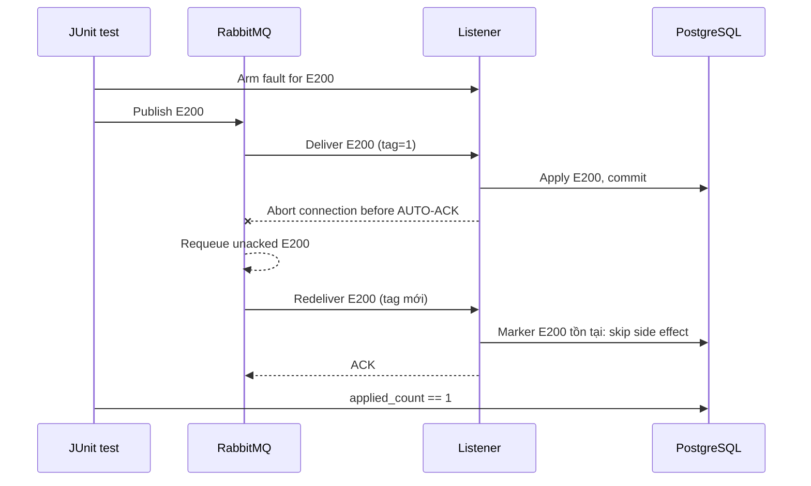

# Mô phỏng trùng lặp, mất kết nối và khởi động lại consumer

> **Chương:** Kiểm thử  
> **Module:** SPRING_AMQP — học tích hợp RabbitMQ với Spring AMQP qua `RabbitTemplate`, `@RabbitListener`, exchange, queue và binding; thực hành định tuyến message, acknowledgment, retry, dead-letter, giao dịch và quan sát hệ thống để xây dựng xử lý bất đồng bộ đáng tin cậy.
>
> **Mục tiêu thực hành:** Kiểm thử hệ thống trong các điều kiện không thuận lợi: producer gửi trùng sự kiện; consumer đang xử lý thì channel/connection bị đóng; ứng dụng dừng rồi khởi động listener trở lại; và database đã commit nhưng broker chưa nhận ACK. Tập trung vào **kết quả nghiệp vụ**, không chỉ số lần handler được gọi.

## 1. Những gì cần chứng minh

Sau bài này, bạn có thể:

1. Phân biệt **duplicate publish**, **broker redelivery**, **retry trong listener** và **replay từ DLQ**.
2. Thiết kế phép thử tích hợp bằng **JUnit 5, Spring Boot Test, RabbitMQ Testcontainers, PostgreSQL Testcontainers và Awaitility**.
3. Kiểm thử idempotent consumer bằng khóa `eventId` và transaction database; quan sát một sự kiện được giao nhiều lần nhưng chỉ có **một side effect**.
4. Dừng rồi khởi động lại một `@RabbitListener` qua `RabbitListenerEndpointRegistry` mà không tắt toàn bộ Spring context.
5. Mô phỏng đóng kết nối bằng `CachingConnectionFactory.resetConnection()` và phân biệt nó với broker outage thật.
6. Chủ động tạo cửa sổ **DB commit thành công nhưng AMQP ACK chưa tới broker**, kiểm tra redelivery và tránh xử lý trùng.
7. Dùng retry/DLX/DLQ, publisher confirms, metrics và fault injection để đánh giá cách ứng dụng phục hồi.
8. Viết assertion ổn định cho ứng dụng bất đồng bộ, tránh `Thread.sleep`, flaky test và kết luận sai về exactly-once.

### 1.1. Sự khác biệt giữa “một message” và “một sự kiện”

| Khái niệm | Ví dụ | Hệ quả kiểm thử |
|---|---|---|
| **Business event** | `OrderCreated(eventId=E100)` | Khóa `eventId` ổn định; một event có thể có nhiều publish attempt |
| **Publish attempt** | Producer thử gửi E100 lần 1, lần 2 | Có thể có hai bản tin vật lý chứa cùng `eventId` |
| **Delivery** | RabbitMQ giao E100 cho listener | Mỗi delivery có `deliveryTag` thuộc **channel hiện tại** |
| **Redelivery** | Message chưa ACK được broker giao lại | Có thể có `redelivered=true`; tag và consumer có thể khác lần đầu |
| **Handler attempt** | Spring Retry gọi lại callback | Có thể tăng số lần chạy handler mà **không** có thêm broker delivery |
| **Business effect** | Thêm một bản ghi hoặc cập nhật số dư | Kết quả cần đúng số lần theo hợp đồng nghiệp vụ |

Một test tốt không chỉ khẳng định “listener đã chạy” mà phải hỏi: **Sau khi message trùng và kết nối gián đoạn, trạng thái DB, outbox, downstream và các message còn lại có đúng không?**

## 2. Bản chất at-least-once và những cửa sổ sự cố

Với consumer ack sau xử lý, RabbitMQ có thể giao lại một delivery nếu channel/connection biến mất trước khi broker ghi nhận ACK. RabbitMQ không biết một database transaction nằm ngoài nó đã commit hay chưa.

```mermaid
sequenceDiagram
    participant P as Producer
    participant Q as RabbitMQ Queue
    participant C as Spring @RabbitListener
    participant D as PostgreSQL
    P->>Q: Publish E100
    Q->>C: Deliver E100 (tag=7)
    C->>D: BEGIN; apply E100; COMMIT
    D-->>C: Commit thành công
    Note over C,Q: Connection bị cắt trước basic.ack
    Q-->>Q: Unacked delivery được requeue
    Q->>C: Redeliver E100 (tag mới)
    C->>D: Kiểm tra processed_events(E100)
    D-->>C: Đã xử lý: không tạo side effect trùng
    C-->>Q: ACK delivery mới
```

### 2.1. Ma trận thời điểm lỗi

| Thời điểm gây lỗi | Trạng thái DB | Trạng thái ACK ở broker | Điều có thể xảy ra sau recovery |
|---|---|---|---|
| Trước khi listener bắt đầu xử lý | Chưa thay đổi | Delivery có thể chưa có hoặc đang outstanding | Broker tiếp tục giao/đưa lại message |
| Trong transaction trước commit | Transaction rollback khi lỗi đúng cách | Chưa ACK | Redelivery có thể xử lý lại từ đầu |
| **Sau DB commit, trước broker ACK** | **Đã commit** | **Chưa ghi nhận ACK** | **Redelivery: cần idempotency** |
| Sau broker đã ghi nhận ACK | Đã commit nếu ứng dụng thiết kế đúng | ACK thành công | Broker không cần redeliver delivery đó; producer khác vẫn có thể publish cùng event |
| Trong publisher gửi nhưng chưa nhận confirm | Có thể DB nguồn đã commit | Không liên quan consumer ACK | Publish outcome **UNKNOWN**; producer retry có thể tạo duplicate |

Kết luận: **Không kiểm chứng exactly-once chỉ bằng RabbitMQ acknowledgment.** Với tác dụng phụ trong một database, có thể đạt **effectively-once** bằng unique event ID + transaction; với API ngoài database, cần idempotency key ở hệ thống đích, outbox/saga hoặc đối soát.

### 2.2. Phân biệt ba loại test dễ bị gộp làm một

1. **Duplicate test:** cố ý publish cùng `eventId` hai lần; kiểm tra business effect bằng một.
2. **Listener restart test:** stop/start listener; queue giữ message trong lúc listener không chạy, sau đó tiếp tục nhận. Không mặc nhiên tạo redelivery nếu message **chưa từng được giao**.
3. **Connection/ACK-window test:** đóng connection **khi delivery đang unacked**, đặc biệt sau DB commit; kiểm tra broker redeliver và consumer loại trùng.

Chạy ba test độc lập để biết điều gì thực sự được chứng minh. Chỉ dừng container sau khi tất cả message đã ACK **không tạo** bài kiểm thử redelivery.

## 3. Chiến lược kiểm thử: từ unit tới failure injection

| Cấp | Công cụ | Kiểm tra tốt | Không kiểm tra được đầy đủ |
|---|---|---|---|
| Unit | JUnit 5, Mockito | Đúng khóa idempotency, phân loại exception, nhánh retry/recoverer | Real ack, connection mất, broker routing |
| Listener slice | `spring-rabbit-test`, `@RabbitListenerTest`, `TestRabbitTemplate` | Tham số/callback listener, spy/capture, logic xử lý | Broker thật, mạng, DLX/confirm thực tế |
| Integration | Spring Boot Test + RabbitMQ + DB Testcontainers | Publish/routing, redelivery, transaction, consumer restart | Cluster HA, mạng production, broker disk failure |
| Fault injection | Chặn mạng qua proxy, ngắt connection, broker restart riêng | Cửa sổ lỗi và recovery đa dạng | Không mô phỏng chính xác mọi sự cố hạ tầng |
| Staging / resilience | Nhiều replica, broker cluster, chaos engineering có giới hạn | Failover, network partition, high load, queue replication | Không thay được test hợp đồng nghiệp vụ ở tầng application |

**TestRabbitTemplate** gọi listener trực tiếp và không dùng broker. Nó hữu ích cho test logic nhưng **không chứng minh** cách RabbitMQ requeue/redelivery, durable queue hay Spring container reconnect. Vì vậy, các test trọng tâm trong bài này sử dụng **broker thật trong Testcontainers**.

### 3.1. Tiêu chí pass rõ ràng

Ví dụ test duplicate pass khi:

- Handler nhận cùng `eventId` ít nhất **hai lần** theo kịch bản đã tạo.
- Database lưu đúng **một** processed marker cho `eventId` đó.
- Side effect chỉ tăng **một** lần.
- Không còn message “đang treo” do ACK sai; listener còn xử lý message mới sau thử nghiệm.

Nếu chỉ assert `appliedCount == 1` ngay sau publish, test có thể pass **trước khi bản duplicate thứ hai được giao**. Phải chờ đủ dấu hiệu đã xử lý cả hai lần rồi mới kết luận.

## 4. Chuẩn bị môi trường Spring Boot và Testcontainers

Các ví dụ Java dưới đây dùng **Spring Boot 3.5.x, Spring AMQP 3.x, JUnit Jupiter**, Testcontainers bản được Boot BOM hỗ trợ và PostgreSQL. Mục đích là mô tả một fixture có thể ghép thành project thử nghiệm; mã của từng class cần đặt trong **file Java tương ứng, cùng package hoặc import phù hợp**. Không trộn các block có cùng vai trò vào một file.

### 4.1. Dependencies Maven

```xml
<dependencies>
    <dependency>
        <groupId>org.springframework.boot</groupId>
        <artifactId>spring-boot-starter-amqp</artifactId>
    </dependency>
    <dependency>
        <groupId>org.springframework.boot</groupId>
        <artifactId>spring-boot-starter-jdbc</artifactId>
    </dependency>
    <dependency>
        <groupId>org.postgresql</groupId>
        <artifactId>postgresql</artifactId>
        <scope>runtime</scope>
    </dependency>

    <dependency>
        <groupId>org.springframework.boot</groupId>
        <artifactId>spring-boot-starter-test</artifactId>
        <scope>test</scope>
    </dependency>
    <dependency>
        <groupId>org.testcontainers</groupId>
        <artifactId>junit-jupiter</artifactId>
        <scope>test</scope>
    </dependency>
    <dependency>
        <groupId>org.testcontainers</groupId>
        <artifactId>rabbitmq</artifactId>
        <scope>test</scope>
    </dependency>
    <dependency>
        <groupId>org.testcontainers</groupId>
        <artifactId>postgresql</artifactId>
        <scope>test</scope>
    </dependency>
    <dependency>
        <groupId>org.awaitility</groupId>
        <artifactId>awaitility</artifactId>
        <scope>test</scope>
    </dependency>
</dependencies>
```

Thí dụ dùng tọa độ dependency Testcontainers **1.x** thường được quản lý bởi Spring Boot 3.5; ở Testcontainers 2.x, tên module/artifact có thể thay đổi. **Không trộn phiên bản** và không copy một version Testcontainers ngẫu nhiên vào project có BOM. Cần Docker/engine container chạy được trong môi trường CI.

### 4.2. Khởi động RabbitMQ và PostgreSQL riêng cho test

```java
import org.junit.jupiter.api.Test;
import org.springframework.boot.test.context.SpringBootTest;
import org.springframework.test.context.DynamicPropertyRegistry;
import org.springframework.test.context.DynamicPropertySource;
import org.testcontainers.containers.PostgreSQLContainer;
import org.testcontainers.containers.RabbitMQContainer;
import org.testcontainers.junit.jupiter.Container;
import org.testcontainers.junit.jupiter.Testcontainers;
import org.testcontainers.utility.DockerImageName;

@Testcontainers
@SpringBootTest
class OrderMessagingIntegrationTest {
    @Container
    static final RabbitMQContainer RABBIT =
        new RabbitMQContainer(
            DockerImageName.parse("rabbitmq:4.1-management")
        );

    @Container
    static final PostgreSQLContainer<?> POSTGRES =
        new PostgreSQLContainer<>("postgres:16-alpine");

    @DynamicPropertySource
    static void testProperties(DynamicPropertyRegistry props) {
        props.add("spring.rabbitmq.host", RABBIT::getHost);
        props.add("spring.rabbitmq.port", RABBIT::getAmqpPort);
        props.add("spring.datasource.url", POSTGRES::getJdbcUrl);
        props.add("spring.datasource.username", POSTGRES::getUsername);
        props.add("spring.datasource.password", POSTGRES::getPassword);
        props.add("spring.sql.init.mode", () -> "always");
        props.add("spring.rabbitmq.listener.simple.concurrency", () -> 1);
        props.add("spring.rabbitmq.listener.simple.prefetch", () -> 1);
    }

    @Test
    void contextLoads() {
        // Các test thực tế sẽ được bổ sung trong phần 8–11.
    }
}
```

Đây là **khung test**, không phải toàn bộ class cuối cùng. Trong project ghép ví dụ, thêm các `@Autowired` và methods của các phần sau **vào cùng class test**, không tạo nhiều test classes với các static container y hệt nếu không cần.

`RabbitMQContainer` map AMQP port vào một **host port động**; phải lấy từ `getAmqpPort()`. Không hardcode `localhost:5672` vì CI và Docker Desktop có thể cấp port khác. PostgreSQL cũng sử dụng `getJdbcUrl()` từ container.

**Lưu ý môi trường:** Với image/test library mới hơn, cần kiểm tra image tương thích phiên bản Testcontainers đang dùng. Pin image để test tái lập và nâng version có chủ đích. Không phụ thuộc một broker production hoặc tài khoản/vhost dùng chung cho integration test.

### 4.3. App và Rabbit topology thử nghiệm

```java
import org.springframework.boot.SpringApplication;
import org.springframework.boot.autoconfigure.SpringBootApplication;

@SpringBootApplication
public class OrderTestingApplication {
    public static void main(String[] args) {
        SpringApplication.run(OrderTestingApplication.class, args);
    }
}
```

```java
import org.springframework.amqp.core.BindingBuilder;
import org.springframework.amqp.core.Declarables;
import org.springframework.amqp.core.DirectExchange;
import org.springframework.amqp.core.Queue;
import org.springframework.amqp.core.QueueBuilder;
import org.springframework.context.annotation.Bean;
import org.springframework.context.annotation.Configuration;

final class Routes {
    static final String EXCHANGE = "test.orders.x";
    static final String KEY = "order.created";
    static final String WORK = "test.orders.work.q";
    static final String DLX = "test.orders.dead.x";
    static final String DEAD_KEY = "order.failed";
    static final String DLQ = "test.orders.dead.q";
    private Routes() {}
}

@Configuration
class MessagingTopology {
    @Bean
    Declarables declaredTopology() {
        DirectExchange workX =
            new DirectExchange(Routes.EXCHANGE, true, false);
        DirectExchange deadX =
            new DirectExchange(Routes.DLX, true, false);
        Queue workQ = QueueBuilder.durable(Routes.WORK)
            .deadLetterExchange(Routes.DLX)
            .deadLetterRoutingKey(Routes.DEAD_KEY)
            .build();
        Queue deadQ = QueueBuilder.durable(Routes.DLQ).build();

        return new Declarables(
            workX, deadX, workQ, deadQ,
            BindingBuilder.bind(workQ).to(workX).with(Routes.KEY),
            BindingBuilder.bind(deadQ).to(deadX).with(Routes.DEAD_KEY)
        );
    }
}
```

Queue durable và message persistent giúp kiểm thử broker restart/persistence có ý nghĩa, nhưng **không biến mọi cấu hình thành replicated/HA**. Một classic queue trên node đơn có đặc tính khác quorum queue trong cluster. Testcontainers broker chỉ nhằm kiểm thử thực tế một node, không chứng minh cluster failover.

### 4.4. Dữ liệu cho idempotent consumer

Tạo `src/test/resources/schema.sql` (ví dụ PostgreSQL):

```sql
CREATE TABLE processed_events (
    consumer_name VARCHAR(80) NOT NULL,
    event_id VARCHAR(128) NOT NULL,
    processed_at TIMESTAMPTZ NOT NULL DEFAULT CURRENT_TIMESTAMP,
    PRIMARY KEY (consumer_name, event_id)
);

CREATE TABLE order_effects (
    order_id VARCHAR(80) PRIMARY KEY,
    applied_count INTEGER NOT NULL DEFAULT 0
);
```

Hai bảng này đủ để kiểm chứng rằng `eventId=E100` chỉ áp dụng một lần bởi logical consumer `order-projection`. Đừng chỉ dùng một `ConcurrentHashMap` hoặc counter trên JVM làm chống trùng: sau khi pod/consumer restart, bộ nhớ có thể mất, và hai replica có thể xử lý đồng thời. Unique constraint trong DB là hàng rào đáng tin cậy hơn.

## 5. Consumer idempotent: side effect và marker trong cùng transaction

### 5.1. Service xử lý sự kiện

```java
import org.springframework.jdbc.core.JdbcTemplate;
import org.springframework.stereotype.Service;
import org.springframework.transaction.annotation.Transactional;

@Service
public class OrderProjectionService {
    private final JdbcTemplate jdbc;

    public OrderProjectionService(JdbcTemplate jdbc) {
        this.jdbc = jdbc;
    }

    @Transactional
    public void apply(String eventId, String orderId) {
        int inserted = jdbc.update(
            """
            INSERT INTO processed_events(consumer_name, event_id)
            VALUES (?, ?)
            ON CONFLICT DO NOTHING
            """,
            "order-projection", eventId
        );

        if (inserted == 0) {
            return; // Đã commit event này trước đó.
        }

        jdbc.update(
            """
            INSERT INTO order_effects(order_id, applied_count)
            VALUES (?, 1)
            ON CONFLICT (order_id)
              DO UPDATE SET applied_count =
                  order_effects.applied_count + 1
            """,
            orderId
        );
    }
}
```

Đây là cơ chế **deduplication trong một database**. Nếu handler xử lý cùng `eventId` lần thứ hai, unique key khiến `inserted=0` và không tăng `applied_count`. Cả marker và thay đổi bảng `order_effects` phải commit/rollback trong **cùng transaction**.

**Tại sao service tách khỏi listener?** Vì `@Transactional` hoạt động qua Spring proxy, listener gọi bean service độc lập để transaction kết thúc **trước khi** handler trả về cho container ACK. Nếu tự gọi phương thức `@Transactional` trên cùng bean (`self-invocation`), proxy có thể bị bỏ qua.

### 5.2. Ghi lại số lần delivery để tránh test pass sớm

```java
import java.util.concurrent.ConcurrentHashMap;
import java.util.concurrent.ConcurrentMap;
import java.util.concurrent.atomic.AtomicInteger;
import org.springframework.stereotype.Component;

@Component
public class DeliveryRecorder {
    private final ConcurrentMap<String, AtomicInteger> attempts =
        new ConcurrentHashMap<>();
    private final ConcurrentMap<String, AtomicInteger> completed =
        new ConcurrentHashMap<>();
    private final ConcurrentMap<String, Boolean> redelivered =
        new ConcurrentHashMap<>();

    public void received(String eventId, boolean wasRedelivered) {
        attempts.computeIfAbsent(eventId, ignored -> new AtomicInteger())
            .incrementAndGet();
        if (wasRedelivered) {
            redelivered.put(eventId, true);
        }
    }

    public void completed(String eventId) {
        completed.computeIfAbsent(eventId, ignored -> new AtomicInteger())
            .incrementAndGet();
    }

    public int attempts(String id) {
        AtomicInteger counter = attempts.get(id);
        return counter == null ? 0 : counter.get();
    }

    public int completedAttempts(String id) {
        AtomicInteger counter = completed.get(id);
        return counter == null ? 0 : counter.get();
    }

    public boolean sawRedelivery(String id) {
        return Boolean.TRUE.equals(redelivered.get(id));
    }
}
```

Trong bài thực hành, `DeliveryRecorder` hỗ trợ assertion cho **một JVM** với eventId ngẫu nhiên và test không chạy song song. Trong production, dùng Micrometer/structured logs và DB audit; không phụ thuộc JVM counter để chứng minh dữ liệu bền vững hay làm idempotency.

### 5.3. Hook chỉ dành cho fault injection trong test

Ta cần mô phỏng lỗi **sau khi `OrderProjectionService.apply()` đã return và DB commit**, nhưng trước khi container AUTO-ACK. Tạo interface mở rộng để không đưa code phá kết nối vào logic nghiệp vụ:

```java
import com.rabbitmq.client.Channel;

@FunctionalInterface
public interface AfterCommitHook {
    void afterCommit(String eventId, Channel deliveryChannel);
}
```

```java
import org.springframework.context.annotation.Bean;
import org.springframework.context.annotation.Configuration;

@Configuration
class ProductionHookConfig {
    @Bean
    AfterCommitHook noopAfterCommitHook() {
        return (eventId, channel) -> { };
    }
}
```

Bean mặc định không làm gì. Trong integration test ở phần 11, `@TestConfiguration` cung cấp bean `@Primary` để **cắt connection đúng một lần**. Đây là test seam rõ ràng, giúp code chính không chứa ngẫu nhiên hoặc `Thread.sleep`.

### 5.4. Listener nhận message và trả về cho container ACK

```java
import com.rabbitmq.client.Channel;
import java.nio.charset.StandardCharsets;
import org.springframework.amqp.core.Message;
import org.springframework.amqp.rabbit.annotation.RabbitListener;
import org.springframework.amqp.rabbit.support.AmqpRejectAndDontRequeueException;
import org.springframework.stereotype.Component;

@Component
public class OrderEventsListener {
    private final OrderProjectionService service;
    private final DeliveryRecorder recorder;
    private final AfterCommitHook hook;

    public OrderEventsListener(
        OrderProjectionService service,
        DeliveryRecorder recorder,
        AfterCommitHook hook
    ) {
        this.service = service;
        this.recorder = recorder;
        this.hook = hook;
    }

    @RabbitListener(
        id = "order.events.listener",
        queues = Routes.WORK,
        containerFactory = "orderListenerFactory"
    )
    public void onMessage(Message raw, Channel channel) {
        String text = new String(raw.getBody(), StandardCharsets.UTF_8);
        String[] parts = text.split("\\|", 2); // "eventId|orderId"
        if (parts.length != 2 || parts[0].isBlank()
            || parts[1].isBlank()) {
            throw new AmqpRejectAndDontRequeueException(
                "Invalid eventId|orderId payload"
            );
        }

        String eventId = parts[0];
        String orderId = parts[1];
        recorder.received(
            eventId, raw.getMessageProperties().isRedelivered()
        );

        service.apply(eventId, orderId); // DB commit trước khi return
        recorder.completed(eventId);

        // Test có thể đóng connection tại đây; AUTO-ACK diễn ra sau
        // khi listener trả về thành công theo chính sách container.
        hook.afterCommit(eventId, channel);
    }
}
```

Đoạn này dùng `AcknowledgeMode.AUTO` của listener container: Spring ACK khi handler hoàn tất bình thường, xử lý lỗi theo policy khi handler ném exception. Nó **không** tự gọi `channel.basicAck`, tránh ack hai lần.

Khi test cố tình đóng channel/connection trong hook, listener/container có thể ghi lỗi channel shutdown; broker sẽ cân nhắc requeue các delivery đang unacked. Cấu hình retry tại chỗ **chưa được bật** để dễ đếm broker deliveries.

### 5.5. Một consumer, prefetch=1 cho thí nghiệm dễ tái lập

```java
import org.springframework.amqp.rabbit.config.SimpleRabbitListenerContainerFactory;
import org.springframework.amqp.rabbit.connection.ConnectionFactory;
import org.springframework.context.annotation.Bean;
import org.springframework.context.annotation.Configuration;

@Configuration
class OrderListenerConfiguration {
    @Bean("orderListenerFactory")
    SimpleRabbitListenerContainerFactory orderListenerFactory(
        ConnectionFactory connectionFactory
    ) {
        var factory = new SimpleRabbitListenerContainerFactory();
        factory.setConnectionFactory(connectionFactory);
        factory.setConcurrentConsumers(1);
        factory.setMaxConcurrentConsumers(1);
        factory.setPrefetchCount(1);
        factory.setDefaultRequeueRejected(false);
        return factory;
    }
}
```

Vì cần thấy quan hệ giữa delivery và ACK, ví dụ cố tình chọn **một consumer / prefetch=1**. Điều này không phải cấu hình throughput tối ưu cho production. `defaultRequeueRejected(false)` giữ poison message khỏi vòng requeue vô hạn, và DLX/DLQ trong topology sẽ nhận message nếu reject không requeue. Sự cố connection/channel làm mất unacked delivery vẫn có thể gây redelivery **dù defaultRequeueRejected=false**.

## 6. Hạ tầng test: quan sát DB và publish event có ID ổn định

Thêm vào `OrderMessagingIntegrationTest` các dependency và helper:

```java
@Autowired
RabbitTemplate rabbit;

@Autowired
JdbcTemplate jdbc;

@Autowired
DeliveryRecorder recorder;

@Autowired
RabbitListenerEndpointRegistry listenerRegistry;

@Autowired
CachingConnectionFactory connectionFactory;

@Autowired
AbortOnceHook abortOnceHook; // Bean chỉ tồn tại nhờ @TestConfiguration.

private void publish(String eventId, String orderId) {
    rabbit.convertAndSend(
        Routes.EXCHANGE,
        Routes.KEY,
        eventId + "|" + orderId,
        message -> {
            message.getMessageProperties().setMessageId(eventId);
            message.getMessageProperties().setHeader("event-id", eventId);
            message.getMessageProperties().setDeliveryMode(
                MessageDeliveryMode.PERSISTENT
            );
            return message;
        }
    );
}

private int appliedCount(String orderId) {
    return jdbc.queryForObject(
        """
        SELECT COALESCE(
            (SELECT applied_count
             FROM order_effects WHERE order_id = ?),
            0
        )
        """,
        Integer.class,
        orderId
    );
}
```

Đây là **fragment nằm trong test class** (không phải một class biên dịch độc lập). Các import tương ứng: `RabbitTemplate`, `JdbcTemplate`, `DeliveryRecorder`, `RabbitListenerEndpointRegistry`, `CachingConnectionFactory`, `MessageDeliveryMode` và `@Autowired`.

Mỗi test tạo `UUID` mới cho `eventId` và `orderId`. Nhờ vậy không cần xóa dữ liệu của test khác, và assertion không bị nhầm bởi message từ bài thử trước. Để chạy song song, cần thêm cơ chế cách ly queue/consumer hoặc chuyển sang một vhost/container cho từng test.

## 7. Fault hook chỉ chạy trong test: cắt connection sau DB commit

### 7.1. Một lần phá kết nối có kiểm soát

```java
import com.rabbitmq.client.Channel;
import java.util.concurrent.atomic.AtomicReference;

public final class AbortOnceHook implements AfterCommitHook {
    private final AtomicReference<String> armedEvent =
        new AtomicReference<>();

    public void arm(String eventId) {
        armedEvent.set(eventId);
    }

    @Override
    public void afterCommit(String eventId, Channel channel) {
        if (armedEvent.compareAndSet(eventId, null)) {
            // Chỉ dành cho TEST. Hủy connection sở hữu delivery
            // sau khi DB transaction đã commit, trước container ACK.
            channel.getConnection().abort();
        }
    }
}
```

`Connection.abort()` trên RabbitMQ Java client đóng connection không theo luồng chờ graceful close. Điều này làm mất các channel thuộc connection đó, bao gồm delivery unacked. Ở lần redelivery tiếp theo, hook đã tự tắt nhờ compare-and-set nên consumer có thể ACK bình thường.

**Phạm vi mô phỏng:** Đây là lỗi **một connection của ứng dụng**, không phải khởi động lại node RabbitMQ thật. Trong Spring AMQP, một `CachingConnectionFactory` có thể được chia sẻ giữa publisher và consumer; cắt connection sẽ ảnh hưởng các thao tác khác đang chạy trên connection đó. Vì vậy chỉ dùng trong fixture riêng, không chạy test này cạnh ứng dụng production.

### 7.2. Ghi đè hook bằng @TestConfiguration

```java
import org.springframework.boot.test.context.TestConfiguration;
import org.springframework.context.annotation.Bean;
import org.springframework.context.annotation.Primary;

@TestConfiguration
class ChaosHookTestConfiguration {
    @Bean
    @Primary
    AbortOnceHook abortOnceHook() {
        return new AbortOnceHook();
    }
}
```

Thêm `@Import(ChaosHookTestConfiguration.class)` vào `OrderMessagingIntegrationTest`. Bean `AbortOnceHook` là `@Primary` nên listener sử dụng nó thay vì `noopAfterCommitHook`; test có thể `@Autowired AbortOnceHook` để arm lỗi cho một event cụ thể.

### 7.3. Tách fault hook khỏi quá trình khởi tạo production

Không viết logic kiểu “đóng connection theo random probability” trong service production chỉ để phục vụ test. Các điểm fault injection nên bị giới hạn bởi test profile, `@TestConfiguration` hoặc môi trường chaos được phê duyệt. Trong production, bean no-op và listener vẫn hoạt động bình thường.

## 8. Test 1 — Publish trùng: cùng eventId, chỉ một side effect

```java
import static org.assertj.core.api.Assertions.assertThat;
import static org.awaitility.Awaitility.await;

import java.time.Duration;
import java.util.UUID;
import org.junit.jupiter.api.Test;

@Test
void duplicatePublishIsIdempotent() {
    String eventId = "evt-" + UUID.randomUUID();
    String orderId = "order-" + UUID.randomUUID();

    publish(eventId, orderId);
    publish(eventId, orderId); // Cùng eventId: duplicate có chủ đích.

    await().atMost(Duration.ofSeconds(20))
        .untilAsserted(() -> {
            assertThat(recorder.completedAttempts(eventId))
                .isGreaterThanOrEqualTo(2);
            assertThat(appliedCount(orderId)).isEqualTo(1);
        });
}
```

**Vì sao test có ý nghĩa?** Có hai publish attempts (cùng business event), listener hoàn tất xử lý ít nhất hai lần, nhưng projection chỉ tăng một lần. Nếu chỉ assert `appliedCount==1` mà không chờ `completedAttempts>=2`, test có thể pass trong lúc message thứ hai vẫn đang ở queue.

### 8.1. Các biến thể cần thử

- Cùng `eventId` nhưng **messageId khác**: idempotency vẫn phải hoạt động; không dùng `MessageProperties.messageId` như khóa nếu producer không bảo đảm ổn định.
- Event thứ hai được gửi từ process/replica khác: unique constraint vẫn ngăn cập nhật trùng.
- Hai consumer nhận duplicate đồng thời: unique constraint + transaction phải chặn race; cần mở concurrency ở một test riêng, không trộn với test recovery prefetch=1.
- Cùng `orderId` nhưng **hai eventId khác nhau hợp lệ**: có thể cần áp dụng hai side effects; không được dedupe chỉ theo orderId.

Nếu xử lý là thanh toán/email ngoài DB, test còn phải mô phỏng API downstream idempotency và assert số lần **thực hiện thành công**, không chỉ số request HTTP đã gửi.

## 9. Test 2 — Dừng rồi khởi động lại @RabbitListener

Spring AMQP quản lý các container tạo bởi `@RabbitListener` thông qua `RabbitListenerEndpointRegistry`. Từ ID `order.events.listener` có thể lấy container, dừng nhận message, rồi khởi động lại.

```java
import static org.assertj.core.api.Assertions.assertThat;
import static org.awaitility.Awaitility.await;

import java.time.Duration;
import java.util.UUID;
import java.util.concurrent.CountDownLatch;
import java.util.concurrent.TimeUnit;
import org.junit.jupiter.api.Test;
import org.springframework.amqp.rabbit.listener.MessageListenerContainer;

@Test
void queuedMessageIsProcessedAfterListenerRestart() throws Exception {
    MessageListenerContainer container =
        listenerRegistry.getListenerContainer("order.events.listener");
    assertThat(container).isNotNull();

    String eventId = "evt-" + UUID.randomUUID();
    String orderId = "order-" + UUID.randomUUID();

    CountDownLatch stopped = new CountDownLatch(1);
    container.stop(stopped::countDown);
    assertThat(stopped.await(10, TimeUnit.SECONDS)).isTrue();

    try {
        publish(eventId, orderId);
        // Không có consumer active của listener này: event đang chờ.
        assertThat(appliedCount(orderId)).isZero();
    } finally {
        // Luôn khởi động lại, kể cả khi assertion ở trên thất bại.
        container.start();
    }

    await().atMost(Duration.ofSeconds(20))
        .untilAsserted(() -> {
            assertThat(recorder.completedAttempts(eventId)).isEqualTo(1);
            assertThat(appliedCount(orderId)).isEqualTo(1);
        });
}
```

**Điểm quan trọng:**

- `stop(Runnable)` giúp chờ container thực sự dừng trước khi publish, giảm race so với gọi `stop()` rồi giả định đã ngắt mọi consumer tức thì.
- Khi message được publish **sau khi listener đã dừng**, nó đang **ready** trong queue. Sau `start()`, đây thường là **delivery đầu tiên**, không phải redelivery.
- Stop bình thường có thể cho phép consumer hoàn tất những delivery đã lấy trước đó rồi ACK. Vì vậy test này **không phải test mất ACK**; muốn kiểm tra redelivery phải cắt kết nối trong cửa sổ unacked ở phần 11.
- Nếu queue còn consumer khác từ service/test khác, message có thể bị bên đó nhận. Dùng queue/vhost riêng và kiểm soát số consumer để test có thể tái lập.

### 9.1. Graceful stop khác force stop

`SimpleMessageListenerContainer` có tùy chọn `forceStop` (trong các phiên bản hỗ trợ) để dừng sau message hiện tại thay vì drain toàn bộ prefetched deliveries; những message chưa được xử lý có thể được requeue. Một phép thử muốn đo **graceful shutdown** và một phép thử muốn đo **stop đột ngột** nên tách riêng.

Không dùng `@DirtiesContext` cho mọi trường hợp stop/start nếu chỉ cần quản lý một listener; restart cả Spring context làm test chậm và dễ che nguyên nhân. Nhưng khi cần test **process restart thật**, phải khởi động một Spring application instance mới thay vì chỉ stop/start container.

## 10. Test 3 — Reset connection, chờ Spring tự reconnect

Spring AMQP `CachingConnectionFactory.resetConnection()` đóng các connection hiện có trong factory; lần sử dụng tiếp theo sẽ tạo connection mới. Listener container xử lý kết nối bị mất theo recovery policy; khác với `destroy()` — thao tác thường dùng khi shutdown factory cuối đời.

```java
import static org.assertj.core.api.Assertions.assertThat;
import static org.awaitility.Awaitility.await;

import java.time.Duration;
import java.util.UUID;
import org.junit.jupiter.api.Test;

@Test
void listenerRecoversAfterConnectionReset() {
    String eventId = "evt-" + UUID.randomUUID();
    String orderId = "order-" + UUID.randomUUID();

    connectionFactory.resetConnection(); // Chỉ dùng trong test riêng.
    publish(eventId, orderId);

    await().atMost(Duration.ofSeconds(30))
        .untilAsserted(() -> {
            assertThat(recorder.completedAttempts(eventId))
                .isGreaterThanOrEqualTo(1);
            assertThat(appliedCount(orderId)).isEqualTo(1);
        });
}
```

Test này chứng minh ứng dụng **tiếp tục xử lý sau khi client connection được reset**. Nếu `publish()` diễn ra đúng lúc consumer chưa đăng ký lại, message vẫn có thể nằm trong durable queue và được nhận khi consumer phục hồi.

**Không được khẳng định:** Test này chưa chứng minh message đã nhận trước outage sẽ redeliver; lúc reset có thể không có unacked delivery. Nó cũng **không tương đương broker restart** vì RabbitMQ server vẫn hoạt động trong toàn bộ test.

Nếu producer có publisher connection riêng, `resetConnection()` trên một factory có thể không tác động tới tất cả connection phụ; khi mô phỏng outage, đối chiếu số connection thực và các factory đang dùng.

## 11. Test 4 — DB commit rồi cắt connection trước ACK

Đây là test quan trọng nhất cho **at-least-once + idempotent consumer**.

1. Test `arm(eventId)` trên hook.
2. Consumer nhận message, tăng `DeliveryRecorder.attempts`.
3. `OrderProjectionService.apply()` commit transaction và tăng `order_effects.applied_count`.
4. Listener gọi `AfterCommitHook` **trước khi container AUTO-ACK**; hook cắt AMQP connection một lần.
5. Broker requeue delivery chưa được ACK và gửi lại sau recovery.
6. Consumer vào lại `apply(eventId)`, thấy `processed_events` đã có marker nên không tăng side effect lần nữa.
7. Lần thứ hai không còn hook gây lỗi; container có thể ACK.



### 11.1. Test implementation

```java
import static org.assertj.core.api.Assertions.assertThat;
import static org.awaitility.Awaitility.await;

import java.time.Duration;
import java.util.UUID;
import org.junit.jupiter.api.Test;

@Test
void commitBeforeLostAckDoesNotDuplicateEffect() {
    String eventId = "evt-" + UUID.randomUUID();
    String orderId = "order-" + UUID.randomUUID();
    abortOnceHook.arm(eventId);

    publish(eventId, orderId);

    await().atMost(Duration.ofSeconds(30))
        .untilAsserted(() -> {
            assertThat(recorder.attempts(eventId)).isGreaterThanOrEqualTo(2);
            assertThat(recorder.completedAttempts(eventId))
                .isGreaterThanOrEqualTo(2);
            assertThat(recorder.sawRedelivery(eventId)).isTrue();
            assertThat(appliedCount(orderId)).isEqualTo(1);
        });
}
```

Test này đo **ít nhất hai delivery attempts** và đúng một DB side effect. Trong môi trường CI tải cao, container recovery và broker scheduling có thể cần timeout khác; không cố dùng `Thread.sleep(100)` rồi assert.

**Quan trọng về độ tin cậy:** Fault injection có thể khiến listener nhận log channel closed hoặc callback ACK thất bại, điều đó được **mong đợi**. Nhưng nếu test chỉ thấy một delivery rồi timeout, cần xem consumer có được đăng ký lại không, hook có cắt đúng connection không, queue có còn message unacked không và broker có đang dead-letter message do policy nào khác không.

### 11.2. Tại sao không chỉ gọi throw sau DB commit?

Với container `defaultRequeueRejected=false`, việc listener ném exception sẽ khiến message thường bị **reject không requeue** (và dead-letter nếu có DLX). Đây **khác** mất connection sau DB commit, vốn có thể làm broker tự requeue unacked message.

Để thử redelivery do mất ACK phải mô phỏng **channel/connection failure** ở đúng cửa sổ. Đừng bật `defaultRequeueRejected=true` và gọi đó là “mô phỏng mạng đứt”: nó là một lỗi xử lý được application yêu cầu requeue, không phải broker bất ngờ mất consumer.

### 11.3. Hạn chế của mô phỏng trong cùng process

Ví dụ dùng `abort()` tạo điều kiện mất connection tương đối chính xác, nhưng không mô phỏng:

- Đóng băng JVM/process rồi bị kill bởi orchestrator.
- Broker restart làm mất toàn bộ các connections của node.
- Network partition kéo dài, heartbeat timeout và reconnect storm.
- Các channel nằm trên connection khác, ví dụ publisher connection riêng.

Với các yêu cầu đó, làm bài thử chaos có broker/proxy riêng ở phần 12 và kiểm tra cả side effect ngoài PostgreSQL.

## 12. Test 5 — Broker outage thật và khởi động lại process

### 12.1. Vì sao không nên gọi container.stop()/start() tùy tiện?

`RabbitMQContainer` của Testcontainers sử dụng **host port được Docker cấp động**. Nếu dừng container rồi tạo lại container trong giữa `@SpringBootTest`, host port có thể thay đổi, trong khi Spring `CachingConnectionFactory` vẫn giữ địa chỉ cũ. Một test thất bại sau `stop(); start()` có thể do **kết nối sai port**, không phải recovery logic của Spring AMQP.

Do đó, có ba lựa chọn đáng tin hơn:

| Mục tiêu | Cách thử | Lưu ý |
|---|---|---|
| Cắt connection của client đang chạy | `connectionFactory.resetConnection()` hoặc hook `abort()` | Broker vẫn sống; phù hợp test nhanh |
| Giả lập outage mạng nhưng giữ endpoint cố định | Proxy mạng như **Toxiproxy** giữa Spring và broker, bật/tắt kết nối qua proxy | Cấu hình container networking; đo reconnect và timeout |
| Kiểm thử **broker process/node restart** | Broker test có endpoint ổn định hoặc orchestration điều khiển restart tại chỗ | Cần bảo toàn volume/identity để đánh giá durability; tránh remap host port |

Ở test riêng, có thể dừng RabbitMQ **process bên trong container đang chạy** và khởi động lại mà không thay host port, nhưng cú pháp lệnh điều khiển phụ thuộc image/environment; nên thiết kế fixture/CI phục hồi node/queue đúng trạng thái rồi xác nhận broker health trước khi tiếp tục. Không thêm lệnh khởi động lại production broker vào test tự động.

### 12.2. Phác thảo test Toxiproxy với mạng lỗi

```text
Spring Application
  -> endpoint cố định của proxy cho AMQP 0-9-1
       -> RabbitMQ Container (broker đang sống)

1. Khởi động Spring và listener qua proxy.
2. Publish E300, xác nhận queue đã sẵn sàng.
3. Trong lúc E300 unacked: disable proxy / cut sockets.
4. Đợi consumer mất kết nối (heartbeat/IO timeout phù hợp).
5. Enable proxy và đợi listener recover.
6. Assert E300 cuối cùng xử lý, DB side effect đúng một lần.
7. Gửi E301 để chứng minh pipeline vẫn chạy sau recovery.
```

Test network partition nên dùng timeout đủ lớn để heartbeat và recovery kịp chạy; không chọn `await(1 giây)` rồi coi failure là bug. Đối với producer, nếu mất connection giữa publish và confirm, kết quả có thể **UNKNOWN**: test phải có eventId để đối soát, không tự động assert “message chắc chắn chưa được gửi”.

### 12.3. Khởi động lại consumer process thật

Stop/start `RabbitListenerEndpointRegistry` chỉ restart listener container **trong cùng JVM**. Nếu muốn kiểm thử process restart:

- Chạy hai giai đoạn **Spring application context** hoặc hai process test riêng liên tiếp trên cùng broker/DB test đã giữ data.
- Phase A nhận event, ghi DB marker; tạo condition crash hoặc dừng trước ACK.
- Phase B khởi động ứng dụng mới, cùng logical consumer identity và DB cũ.
- Assert event có thể redeliver và side effect vẫn chỉ một lần.
- Kiểm tra cả việc recreate exchange/queue/binding qua `RabbitAdmin` nếu queue không được giữ sau node restart.

Khi dùng Testcontainers, đừng tự để PostgreSQL container bị xóa giữa phase A/B, nếu không DB marker biến mất và test “idempotency sau restart” mất ý nghĩa.

## 13. Kiểm thử retry, dead-letter và publisher confirms trong cùng chiến lược

### 13.1. Không đánh đồng retry tại chỗ với broker redelivery

| Cách tạo lỗi | Listener có thể chạy lại? | Broker `redelivered` có nhất thiết true? | DLQ tự tăng? |
|---|---|---|---|
| Spring Retry stateless trong lời gọi handler | Có | **Không**; vẫn có thể là một delivery | Không, trừ khi recoverer/reject cuối cùng chuyển message đi |
| Consumer `basicNack(requeue=true)` | Có | Thường ở delivery tiếp theo | Không; message requeue về work queue |
| Mất channel/connection khi unacked | Có | Thường là true khi broker redeliver | Không chỉ vì connection loss |
| Reject với `requeue=false` và có DLX hợp lệ | Không còn ở work queue lúc đó | Không phải trọng tâm | Có thể tới DLQ theo route |
| Republish từ DLQ sang work exchange | Có | Delivery mới có thể `redelivered=false` | Phụ thuộc workflow replay |

Một test kiểm retry phải đếm **handler attempts** và nguyên nhân exception; test redelivery cần quan sát **broker deliveries** hoặc header `redelivered`. `x-death` chỉ đếm dead-letter theo quy tắc broker, không đo mọi retry interceptor.

### 13.2. Test đường đi malformed payload → DLQ

Với topology ở phần 4 và `defaultRequeueRejected=false`, listener ở phần 5 ném `AmqpRejectAndDontRequeueException` khi body không có dạng `eventId|orderId`.

```java
import static org.assertj.core.api.Assertions.assertThat;
import static org.awaitility.Awaitility.await;

import java.time.Duration;
import java.util.UUID;
import java.util.concurrent.atomic.AtomicReference;
import org.junit.jupiter.api.Test;
import org.springframework.amqp.core.Message;

@Test
void malformedEventIsDeadLettered() {
    String badMessage = "invalid-" + UUID.randomUUID();
    rabbit.convertAndSend(Routes.EXCHANGE, Routes.KEY, badMessage);

    AtomicReference<Message> captured = new AtomicReference<>();
    await().atMost(Duration.ofSeconds(20))
        .until(() -> {
            Message fromDlq = rabbit.receive(Routes.DLQ);
            if (fromDlq == null) {
                return false;
            }
            captured.set(fromDlq);
            return true;
        });

    Message deadLetter = captured.get();
    assertThat(deadLetter).isNotNull();
    assertThat(deadLetter.getMessageProperties().getHeaders())
        .containsKey("x-death");
}
```

**Chú ý:** `RabbitTemplate.receive(Routes.DLQ)` thực sự **tiêu thụ và ACK** message trong DLQ của test; không dùng một observer như vậy trên DLQ production nếu chưa có kho quarantine bền vững. Ở integration test isolated queue, việc đọc bằng template để assert là hợp lý.

Nếu đã có listener khác tự consume DLQ, race có thể khiến test không bắt được message; dùng queue riêng hoặc tắt DLQ listener khi test. Và nếu reject xảy ra nhưng message không tới DLQ, cần kiểm tra DLX/binding và broker logs, không chỉ tăng timeout.

### 13.3. Test publisher confirm và return

Giới hạn test consumer ở trên chưa chứng minh **publish accepted**. Với yêu cầu publisher outcome, cấu hình test:

```yaml
spring:
  rabbitmq:
    publisher-confirm-type: correlated
    publisher-returns: true
    template:
      mandatory: true
```

Và assert dùng `CorrelationData`:

```java
import java.util.UUID;
import java.util.concurrent.TimeUnit;
import org.springframework.amqp.rabbit.connection.CorrelationData;

CorrelationData data = new CorrelationData(UUID.randomUUID().toString());
rabbit.convertAndSend(
    Routes.EXCHANGE,
    "no.binding.for.this.key",
    "test-return",
    data
);
CorrelationData.Confirm result =
    data.getFuture().get(10, TimeUnit.SECONDS);

// Broker có thể ACK publish đồng thời return vì không có route.
assertThat(result.isAck()).isTrue();
assertThat(data.getReturned()).isNotNull();
```

Đây là **fragment nằm trong một test method** (import `assertThat`, test signature `throws Exception`). `Routes.EXCHANGE` tồn tại nhưng routing key không khớp binding. `basic.return` và publisher confirm ACK có thể cùng xuất hiện; ACK không đồng nghĩa đã vào queue.

### 13.4. Trường hợp timeout/connection mất giữa publish và confirm

Nếu future timeout, kết quả publish là **UNKNOWN** theo quan sát của producer. Broker có thể đã lưu message trước khi connection bị cắt. Test cần audit theo `eventId` và xác minh không xử lý trùng nếu producer retry. Không viết assertion “sau timeout queue chắc chắn rỗng”.

## 14. Tối ưu độ ổn định của integration test

### 14.1. Không dùng sleep để đồng bộ bất đồng bộ

**Sai:**

```java
rabbit.convertAndSend(Routes.EXCHANGE, Routes.KEY, "E1|O1");
Thread.sleep(500);
assertThat(appliedCount("O1")).isEqualTo(1);
```

Môi trường CI có thể chậm hơn máy cá nhân, khiến 500 ms không đủ. Khi handler nhanh hơn, test chỉ tốn thời gian vô ích.

**Đúng:** dùng `Awaitility.await().atMost(...).untilAsserted(...)` để đợi trạng thái nghiệp vụ quan sát được đạt điều kiện. Cần timeout hữu hạn và thông tin chẩn đoán khi timeout; đừng chờ vô hạn.

### 14.2. Test independence

- Dùng `eventId` và `orderId` riêng từng test, hoặc queue/vhost riêng.
- Không dùng queue production; topology test khai báo bằng `RabbitAdmin` và phải có quyền.
- Không chạy song song các test cùng gọi `resetConnection()` trên một CCF chia sẻ; chúng có thể gây lỗi cho nhau không liên quan assertion.
- Khôi phục listener container trong `finally` hoặc `@AfterEach` nếu test đã stop; tránh ảnh hưởng test kế tiếp.
- Không xóa hàng loạt bảng DB để “dọn” khi consumer còn chạy; đó là race có thể tạo redelivery sai.
- Nếu dùng `@DirtiesContext`, hiểu chi phí tạo context mới và ảnh hưởng static containers.

### 14.3. Kiểm soát thời gian và broker topology

| Biến gây flaky | Cách giảm thiểu |
|---|---|
| Không biết container đã register consumer chưa | Wait container running và/hoặc RabbitMQ consumer count phù hợp |
| Publish ngay trong lúc listener stop chưa xong | Chờ callback `stop(Runnable)` |
| Nhiều active consumer trên cùng work queue | Dùng queue riêng, một consumer trong fixture |
| Prefetch quá cao, nhiều in-flight | Đặt `prefetch=1` trong bài thử ordering/ack-window |
| Port Testcontainers thay đổi | `@DynamicPropertySource` từ mapped host/port |
| Ghi log thay thế assertion DB | Assert database committed state, không chỉ xem console |
| Check “có một lần xử lý” trước khi duplicate tới | Chờ recorder/marker của đủ attempts |
| Lỗi mạng và recover vượt timeout | Timeout hợp lý, nhận diện việc broker/consumer chưa hồi phục |
| Test replay bị lỗi do DLQ đã được đọc | Đặt consumer observation rõ; đừng âm thầm auto-ACK DLQ |

### 14.4. Bằng chứng nên lưu khi test fail

```text
test name / test seed / eventId / orderId
RabbitMQ image, Spring Boot / Spring AMQP, Testcontainers version
publish attempts + confirms/returns
consumer ID, connection close reason, redelivered flag, delivery tag
handler attempts, completedAttempts, retry count
processed_events rows, order_effects.applied_count
queue ready, unacked, DLQ messages, x-death reason
timestamps của fault injection và recovery
```

Ghi structured logs theo `eventId` để tương quan message giữa producer, broker và consumer. Không dùng `eventId` làm Prometheus metric label vì cardinality quá cao; lưu trong log/traces và database audit.

## 15. Ma trận kiểm thử tổng hợp cho dự án

| Test case | Fault tạo ra | Assertion chính | Điều không nên kết luận |
|---|---|---|---|
| **A. Happy path** | Không có | Event được nhận, DB count=1, ACK, message không còn ready | “Không bao giờ có duplicate” |
| **B. Duplicate publish** | Hai publish cùng eventId | Ít nhất 2 handler completions, DB count=1 | Broker tự dedupe mọi event |
| **C. Listener stop/start** | Dừng listener trước publish | Message được xử lý sau start, DB count=1 | Đây là redelivery |
| **D. Connection reset khi idle** | `resetConnection()` | Listener nhận event mới sau reconnect | Đã kiểm tra cửa sổ mất ACK |
| **E. Post-commit pre-ACK cut** | `abort()` sau DB commit | Redelivery, 2 attempts, 1 side effect | Exactly-once delivery |
| **F. Broker/network outage** | Toxiproxy/broker restart test | Event cuối cùng xử lý, recover đúng | Tất cả outage đều giống nhau |
| **G. Process restart** | Kill/restart app có DB giữ nguyên | Dedupe marker tồn tại, side effect không trùng | Stop/start container là process restart |
| **H. Poison event** | Invalid payload | Message bị reject vào DLQ, có `x-death` | Mỗi handler failure là một DLX hop |
| **I. Retry transient** | DB timeout rồi phục hồi | Retry budget/attempts và success | Handler retry = broker redelivery |
| **J. Unroutable publish** | Sai routing key với mandatory | Publisher return, có thể confirm ACK | Confirm ACK bảo đảm queue nhận |
| **K. Confirm timeout** | Cắt connection giữa publish và confirm | Outcome UNKNOWN được đối soát | Broker chắc chắn chưa ghi |
| **L. Concurrent duplicates** | Hai consumers + cùng eventId | Unique constraint, DB count=1 | JVM lock đủ bảo vệ nhiều replicas |
| **M. DLQ replay** | Publish lại cùng eventId | Không lặp side effect; audit replay ID | Replay mặc định giữ delivery tag cũ |
| **N. Rolling restart** | Nhiều replica lên/xuống | Không mất xử lý; consumer/connection phục hồi | Một-node test chứng minh HA cluster |

## 16. Các lỗi thiết kế kiểm thử phổ biến

**1. Chỉ test một lần publish:** Không kiểm tra producer retry, message redelivery hoặc DLQ replay.

**2. Nhầm thời điểm DB commit:** Trong test, nếu service lưu DB bất đồng bộ và hook cắt connection trước commit, kết quả là test transaction rollback/partial failure, **không** phải post-commit pre-ACK. Cần đặt fault hook đúng sau khi transactional service return.

**3. Giả lập lỗi bằng cách ném exception:** `throw` trong listener thường đi qua error handler/requeue policy; nó không tương đương một kết nối TCP bị cắt sau commit.

**4. Dùng `@MockBean` cho RabbitTemplate rồi kỳ vọng kiểm tra broker:** Mock chỉ chứng minh code gọi template, không chứng minh routing, durable queue hay redelivery.

**5. Dựa vào `redelivered=false` để kết luận chưa từng xử lý:** Producer có thể gửi bản publish mới với cùng eventId; dedupe phải dựa vào business identity.

**6. Chỉ kiểm tra DB count nhưng không chờ duplicate:** Test pass sớm, khó phát hiện listener không chạy lần hai.

**7. Stop/start broker container giữa test mà không giữ endpoint:** Host mapped port có thể thay đổi; ứng dụng không reconnect được vì địa chỉ khác, tạo false negative.

**8. Đọc DLQ bằng observer AUTO-ACK trong production:** Có thể tiêu thụ và xóa bằng chứng lỗi; test nên dùng queue riêng và mục tiêu đọc rõ ràng.

**9. Không cleanup trạng thái sau fault injection:** Một listener chưa start hoặc một proxy còn disabled làm các test sau fail dây chuyền.

**10. Kết luận “exactly-once” khi chỉ một side effect trong PostgreSQL:** Nếu handler còn gửi email, HTTP hoặc publish tới exchange khác ngoài transaction, từng side effect ấy cần idempotency/transactional outbox/compensation riêng.

## 17. Bài tập mở rộng

### Tình huống A — Cắt kết nối sau thanh toán

Consumer nhận `PaymentCaptured(E500)`, trừ hạn mức voucher trong DB rồi connection đóng trước ACK. Sau khi reconnect, broker giao lại E500. Hãy viết test có fault hook sau transaction và assert:

- Voucher chỉ giảm một lần.
- Có ít nhất hai delivery attempts và tối thiểu một redelivered flag.
- Consumer tiếp tục xử lý E501 sau recovery.
- Nếu gửi E500 lại bằng publisher mới thì không lặp hiệu ứng, kể cả `redelivered=false`.

### Tình huống B — Gửi mail ngoài DB transaction

Consumer lưu processed marker rồi gọi API gửi email. Connection mất trước ACK. Test chỉ assert DB marker có đủ an toàn không? **Không**: nếu email đã được gửi nhưng ACK mất, hoặc ngược lại nếu DB marker commit trước API lỗi, hệ thống có thể gửi trùng hoặc bỏ sót email.

Yêu cầu cải tiến: lưu một **email outbox** trong cùng transaction với marker/đơn hàng; worker gửi email dùng idempotency key, ghi delivery state và retry có giới hạn. Viết test crash giữa từng bước để chứng minh đúng hiệu ứng.

### Tình huống C — Test failover có nhiều consumer

Hai instance cùng đọc một quorum queue. Consumer 1 xử lý A chậm, consumer 2 xử lý B nhanh, sau đó instance 1 bị kill. Hãy phân biệt thứ tự **delivery**, **DB commit**, **broker ACK** và **redelivery**. Với sự kiện cùng `aggregateId`, bổ sung kiểm tra version/sequence để không áp dụng B trước A nếu nghiệp vụ yêu cầu.

### Câu hỏi tự kiểm tra

1. Vì sao duplicate publish cần dùng cùng `eventId` nhưng có thể khác `publishAttemptId`?
2. Khi consumer đã ACK message trước khi restart, RabbitMQ có bắt buộc giao lại không?
3. `RabbitListenerEndpointRegistry.stop()/start()` khác kill JVM ở điểm nào?
4. `CachingConnectionFactory.resetConnection()` khác broker outage thật thế nào?
5. Vì sao cắt connection **sau DB commit, trước ACK** là kịch bản quan trọng?
6. Test DB count=1 ngay sau publish hai message đã đủ chưa? Thiếu assertion nào?
7. `redelivered=true` có chứng minh message đã xử lý business thành công lần trước không?
8. Vì sao `defaultRequeueRejected=false` không ngăn redelivery khi connection bất ngờ bị mất?
9. Vì sao không được coi publisher confirm ACK là consumer đã commit DB?
10. Khi Testcontainers host port đổi sau restart, cần điều chỉnh test harness như thế nào?

## 18. Ghi nhớ và tài liệu tham khảo

**Điều cần kiểm chứng trong Spring AMQP không phải “message chỉ đến một lần”, mà là “nghiệp vụ vẫn đúng khi message đến nhiều lần hoặc đường truyền gián đoạn”.** Bắt đầu bằng kiểm thử duplicate publish với eventId ổn định, sau đó thử listener stop/start, connection reset, và cuối cùng là lỗi **post-commit pre-ACK**. Kết hợp PostgreSQL unique constraint + transaction với idempotent consumer để tránh side effect trùng.

Testcontainers cung cấp RabbitMQ/DB thật; `RabbitListenerEndpointRegistry` điều khiển lifecycle của annotated consumers; `CachingConnectionFactory.resetConnection()` mô phỏng client reconnect; fault hook `abort()` mở ra cửa sổ redelivery. Dùng Awaitility và assertion trên DB/delivery counts để bài test không phụ thuộc timing may rủi. Với network partition/broker restart/cluster failover, cần thêm thử nghiệm hạ tầng riêng. Publisher confirms, retry, dead-letter và audit tiếp tục là những phần không thể thiếu của một hệ thống bất đồng bộ đáng tin cậy.

**Tài liệu chính thức:**

- Spring AMQP — Testing Support (`spring-rabbit-test`, `@RabbitListenerTest`, `TestRabbitTemplate`): https://docs.spring.io/spring-amqp/reference/testing.html
- Spring AMQP — Container Management (`RabbitListenerEndpointRegistry`): https://docs.spring.io/spring-amqp/reference/amqp/receiving-messages/async-annotation-driven/container-management.html
- Spring AMQP — Connection and Resource Management: https://docs.spring.io/spring-amqp/reference/amqp/connections.html
- Spring AMQP — Error Handling and Retry: https://docs.spring.io/spring-amqp/reference/amqp/resilience-recovering-from-errors-and-broker-failures.html
- Spring AMQP — Publisher Confirms and Returns: https://docs.spring.io/spring-amqp/reference/amqp/template.html
- RabbitMQ — Consumer Acknowledgements and Publisher Confirms: https://www.rabbitmq.com/docs/confirms
- RabbitMQ — Dead Letter Exchanges: https://www.rabbitmq.com/docs/dlx
- Testcontainers — RabbitMQ Module: https://java.testcontainers.org/modules/rabbitmq/
- Testcontainers — JUnit 5 Integration: https://java.testcontainers.org/test_framework_integration/junit_5/
- Awaitility — Documentation: https://github.com/awaitility/awaitility/wiki/Usage
