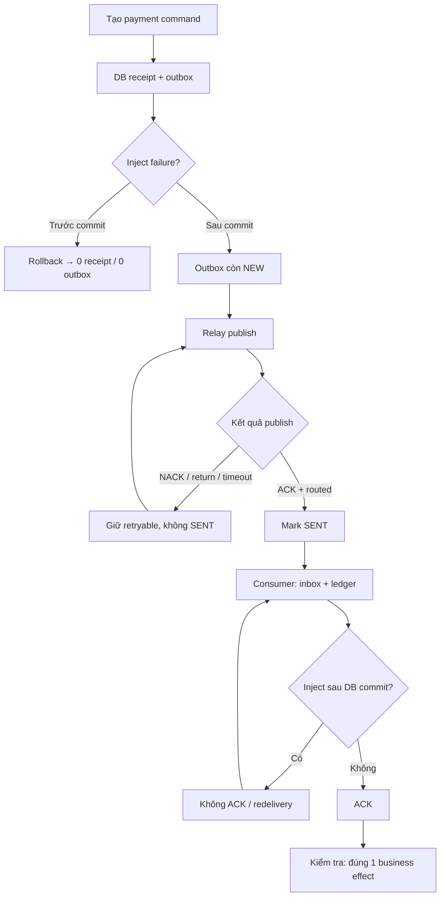

# Kiểm thử giao dịch, outbox và tác động nghiệp vụ có tính lặp an toàn

## 1. Mục tiêu của kiểm thử độ tin cậy đầu-cuối

Trong chương **Kiểm thử** của module **SPRING_AMQP**, ứng dụng sử dụng `RabbitTemplate`, `@RabbitListener`, exchange, queue và binding để xử lý công việc bất đồng bộ. Khi luồng nghiệp vụ còn liên quan đến cơ sở dữ liệu, API bên ngoài, retry và dead-letter, câu hỏi quan trọng không phải chỉ là *“message có đi tới consumer không?”* mà là:

> **Khi một thành phần hỏng tại bất kỳ thời điểm nào, nghiệp vụ có bị mất, áp dụng hai lần hoặc báo hoàn tất sai không?**

Ví dụ: Payment Service nhận kết quả thanh toán, ghi bản ghi `payment_receipts` vào PostgreSQL rồi phát sự kiện `PaymentPaid`. Loyalty Service nhận sự kiện và cộng điểm. Hệ thống cần đạt ba tính chất:

1. **Atomicity trong database của producer:** bản ghi thanh toán và bản ghi **outbox** phải cùng commit hoặc cùng rollback; không xuất hiện thanh toán đã ghi nhưng không có ý định phát sự kiện.
2. **At-least-once publish có kiểm soát:** khi RabbitMQ lỗi hoặc publisher confirm bị mất, outbox vẫn giữ ý định phát; relay có thể gửi lại cùng event, kể cả khi broker đã nhận trước đó.
3. **Tác động nghiệp vụ lặp an toàn:** dù consumer nhận cùng message hoặc hai message khác `eventId` nhưng cùng thao tác thanh toán, điểm thưởng chỉ được cộng **một lần theo khóa nghiệp vụ**.

Những tính chất này cần được **kiểm chứng bằng trạng thái dữ liệu** và bằng fault injection, chứ không chỉ dùng `verify(listener).handle(...)` hoặc đếm số lần gửi.

### Điều không nên hứa

RabbitMQ và PostgreSQL thường không nằm trong **một transaction nguyên tử duy nhất**. Spring AMQP hỗ trợ `channelTransacted` và đồng bộ với transaction ngoài theo mô hình *Best Efforts 1 Phase Commit*, nhưng vẫn có khoảng lỗi khi một bên commit còn bên kia thất bại. `RabbitTransactionManager` không cung cấp XA transaction dùng chung với JDBC.

Vì vậy mẫu **transactional outbox + idempotent consumer** thường là cơ sở thực tế để kiểm thử các tình huống mất kết nối, phát lại, xác nhận thất lạc và crash giữa các bước. Nó không tạo ra “exactly-once delivery” trên dây; nó hướng tới **một tác động nghiệp vụ hợp lệ**.

## 2. Kiến trúc mẫu và các điểm có thể hỏng

```mermaid
sequenceDiagram
    participant API as Payment API
    participant PG1 as Producer PostgreSQL
    participant R as Outbox Relay
    participant MQ as RabbitMQ
    participant C as Loyalty Consumer
    participant PG2 as Consumer PostgreSQL
    API->>PG1: BEGIN; INSERT payment_receipts + outbox_event
    PG1-->>API: COMMIT
    R->>PG1: Claim outbox event
    PG1-->>R: Payload + stable eventId
    R->>MQ: Publish PaymentPaid
    MQ-->>R: Confirm/return
    R->>PG1: Mark SENT khi confirm ACK và đã route
    MQ->>C: Deliver (unacked)
    C->>PG2: BEGIN; INSERT inbox + loyalty_ledger
    PG2-->>C: COMMIT
    C->>MQ: Consumer ACK
    Note over R,MQ: Confirm thất lạc → relay có thể phát lại
    Note over C,MQ: ACK thất lạc → broker có thể redeliver
```

Sơ đồ trình bày hai database logic; trong test có thể dùng **cùng một PostgreSQL container nhưng tách schema hoặc bảng**. Không được nhầm điều đó với việc chúng có cùng transaction xuyên message broker.

### 2.1. Ma trận trạng thái cần xác minh

| Thời điểm lỗi | Trạng thái mong đợi | Bất biến cần assert |
| --- | --- | --- |
| Sau khi insert payment, **trước** insert outbox | Rollback cả hai bản ghi | Không có payment hoặc outbox nửa vời |
| Sau khi insert outbox, **trước** DB commit | Rollback cả hai | Không có sự kiện giả đã được tạo |
| Sau DB commit, **trước** publish | Outbox còn `NEW`/`IN_FLIGHT` | Relay có thể tiếp tục khi RabbitMQ phục hồi |
| Broker nhận publish, **confirm bị mất** | Relay chưa thể đánh dấu `SENT` chắc chắn | Có thể publish lại, nhưng vẫn cùng `eventId` |
| Publisher confirm ACK nhưng routing sai | Message có thể được broker trả lại | Không đánh dấu `SENT` nếu mandatory return xảy ra |
| Sau publish confirm, **trước** mark `SENT` | Outbox vẫn cần retry | Phát lặp không tạo điểm thưởng trùng |
| Consumer insert inbox, **trước** insert ledger | Rollback inbox và ledger | Không có marker “đã xong” giả |
| Consumer commit ledger, **trước** ACK | Broker có thể redeliver | Ledger có đúng một lần cộng điểm |
| Hai consumer xử lý cùng business key đồng thời | Unique constraint phân xử | Chỉ một transaction được áp dụng |
| API ngoài đã thực hiện tác động nhưng client timeout | Kết quả có thể không rõ | Cần idempotency key ở **API đích** hoặc reconcile |

Chìa khóa của kiểm thử là xác định **trạng thái bền vững** ở mỗi hàng: DB rows, publisher confirmation/return, delivery/redelivery, DLQ và kết quả nghiệp vụ.

## 3. Chọn đúng cấp độ kiểm thử

Không nên kiểm tra tất cả bằng một bài test end-to-end lớn. Dùng một “tháp kiểm thử” hợp lý:

| Tầng | Phạm vi | Công cụ | Chứng minh được | Không chứng minh được |
| --- | --- | --- | --- | --- |
| Unit | Quy tắc chọn khóa, retry policy, phân loại lỗi | JUnit 5, Mockito | Logic thuần và nhánh xử lý | Commit thật, unique constraint, ack thật |
| Repository/DB integration | Transaction, unique key, lock, `ON CONFLICT` | PostgreSQL Testcontainers | Rollback/commit, tranh chấp DB | RabbitMQ delivery, confirm/return |
| Messaging integration | Exchange/queue/binding, conversion, listener, ack, retry | RabbitMQ Testcontainers + Spring Boot | Luồng AMQP và lỗi ở broker | Atomicity với DB nếu không nối DB thật |
| End-to-end | DB producer → outbox relay → RabbitMQ → DB consumer | PostgreSQL + RabbitMQ Testcontainers | Bất biến nghiệp vụ qua toàn luồng | Không chứng minh mọi crash thực tế nếu chỉ chạy một đường happy path |
| Fault/chaos | Kill process, đóng connection, mất confirm, timeout | Fault hooks, proxy mạng, container restart | Khả năng phục hồi trong cửa sổ lỗi | Không loại bỏ mọi xác suất lỗi production |

Spring AMQP có `spring-rabbit-test` với `@RabbitListenerTest`, `RabbitListenerTestHarness` và `TestRabbitTemplate`. Chúng hữu ích để quan sát lời gọi listener hoặc thử logic **không cần broker**, nhưng `TestRabbitTemplate` gọi listener trực tiếp trên test thread và không mô phỏng queue durability, broker ACK/confirm, network partition hay redelivery sau mất connection. Các bất biến ở phần 2 cần một số phép thử với **RabbitMQ và PostgreSQL thật**.

## 4. Hợp đồng nghiệp vụ: định danh và dữ liệu mẫu

Giả định mỗi **payment transaction** chỉ được cộng điểm một lần, kể cả publisher gửi nhiều lần hoặc consumer chạy nhiều replica.

```java
import java.util.UUID;

public record PaymentPaidEvent(
        UUID eventId,
        String paymentId,
        String orderId,
        String customerId,
        int points
) {}
```

Phân biệt:

- `eventId`: ID logic của event, phải **giữ nguyên** qua mọi lần outbox relay retry.
- `paymentId`: khóa nghiệp vụ ở ví dụ này — một khoản thanh toán thành công được cộng điểm một lần.
- `orderId`: ID đơn hàng để truy vết; **không dùng** làm khóa duy nhất nếu đơn có thể thanh toán nhiều lần hợp lệ.
- `consumerName`: phạm vi bảo vệ, ví dụ `loyalty-credit`; service khác vẫn có thể xử lý cùng event theo mục đích riêng.

Một publisher có thể tạo event ID mới do lỗi application nhưng vẫn đang nói về **cùng payment**. Vì vậy, kiểm thử cần cả **trùng eventId** và **khác eventId, trùng paymentId**.

## 5. Schema PostgreSQL phục vụ kiểm thử transaction, outbox và inbox

Dùng PostgreSQL vì các test cần kiểm tra **`ON CONFLICT DO NOTHING`, `UNIQUE`, transaction thật và `FOR UPDATE SKIP LOCKED`**. H2 có thể không tái tạo chính xác semantics dưới tranh chấp đồng thời.

```sql
CREATE TABLE payment_receipts (
    payment_id TEXT PRIMARY KEY,
    order_id TEXT NOT NULL,
    customer_id TEXT NOT NULL,
    amount_cents BIGINT NOT NULL CHECK (amount_cents > 0),
    created_at TIMESTAMPTZ NOT NULL DEFAULT now()
);

CREATE TABLE outbox_event (
    event_id UUID PRIMARY KEY,
    payment_id TEXT NOT NULL REFERENCES payment_receipts(payment_id),
    payload JSONB NOT NULL,
    status TEXT NOT NULL DEFAULT 'NEW'
        CHECK (status IN ('NEW', 'IN_FLIGHT', 'SENT')),
    attempts INT NOT NULL DEFAULT 0,
    claim_token UUID,
    lease_until TIMESTAMPTZ,
    created_at TIMESTAMPTZ NOT NULL DEFAULT now(),
    published_at TIMESTAMPTZ
);

CREATE INDEX ix_outbox_pending
    ON outbox_event (status, lease_until, created_at);

CREATE TABLE consumer_inbox (
    consumer_name TEXT NOT NULL,
    dedupe_key TEXT NOT NULL,
    first_event_id UUID NOT NULL,
    processed_at TIMESTAMPTZ NOT NULL DEFAULT now(),
    PRIMARY KEY (consumer_name, dedupe_key)
);

CREATE TABLE loyalty_ledger (
    id BIGSERIAL PRIMARY KEY,
    payment_id TEXT NOT NULL,
    customer_id TEXT NOT NULL,
    points INT NOT NULL CHECK (points > 0),
    operation TEXT NOT NULL,
    created_at TIMESTAMPTZ NOT NULL DEFAULT now(),
    CONSTRAINT uq_loyalty_payment_operation
        UNIQUE (payment_id, operation)
);
```

**Hai lớp phòng vệ** trong consumer:

1. `consumer_inbox`: đánh dấu business key đã được áp dụng bởi consumer `loyalty-credit`.
2. `loyalty_ledger`: unique constraint tại **nguồn dữ liệu nghiệp vụ**, vẫn chặn trùng nếu luồng code khác vô tình bỏ qua inbox.

Cả hai bảng cần được ghi trong **cùng một PostgreSQL transaction**; ghi marker vào một DB, cộng điểm vào DB khác mà chỉ dùng `@Transactional` sẽ **không tự nguyên tử**.

Với bài tập, đặt DDL này vào một migration/schema fixture được nạp khi test bắt đầu. Không để các test tự xóa dữ liệu không thuộc về test, và không chạy `DROP TABLE` trên database dùng chung.

## 6. Producer: ghi payment và outbox trong cùng transaction

Dưới đây là service minh họa dùng Spring JDBC. `JdbcTemplate` và `ObjectMapper` được inject từ Spring Boot. Event ID được sinh **một lần cho outbox record mới**; retry của relay đọc lại chính record đó thay vì sinh UUID mới.

```java
import com.fasterxml.jackson.core.JsonProcessingException;
import com.fasterxml.jackson.databind.ObjectMapper;
import java.util.UUID;
import org.springframework.jdbc.core.JdbcTemplate;
import org.springframework.stereotype.Service;
import org.springframework.transaction.annotation.Transactional;

@Service
class PaymentCommandService {
    private final JdbcTemplate jdbc;
    private final ObjectMapper json;

    PaymentCommandService(JdbcTemplate jdbc, ObjectMapper json) {
        this.jdbc = jdbc;
        this.json = json;
    }

    @Transactional
    public void recordPaid(String paymentId, String orderId,
                           String customerId, long amountCents,
                           int points) {
        // Idempotency cho chính command HTTP/API của producer.
        int inserted = jdbc.update("""
                INSERT INTO payment_receipts
                  (payment_id, order_id, customer_id, amount_cents)
                VALUES (?, ?, ?, ?)
                ON CONFLICT (payment_id) DO NOTHING
                """, paymentId, orderId, customerId, amountCents);

        if (inserted == 0) {
            return; // Cùng payment đã được ghi; không tạo outbox event mới.
        }

        var event = new PaymentPaidEvent(
                UUID.randomUUID(), paymentId, orderId, customerId, points);

        final String payload;
        try {
            payload = json.writeValueAsString(event);
        }
        catch (JsonProcessingException ex) {
            // Runtime exception → @Transactional rollback cả receipt.
            throw new IllegalStateException("Cannot serialize event", ex);
        }

        jdbc.update("""
                INSERT INTO outbox_event
                  (event_id, payment_id, payload, status)
                VALUES (?, ?, CAST(? AS jsonb), 'NEW')
                """, event.eventId(), paymentId, payload);
    }
}
```

**Điều cần test:** nếu insert outbox ném exception, bản ghi payment cũng phải rollback. Nếu cùng `paymentId` được gọi hai lần tuần tự hoặc đồng thời, chỉ một transaction tạo receipt và outbox. `INSERT ... ON CONFLICT DO NOTHING` dựa vào khóa chính DB để tránh race, không chỉ dựa trên câu `SELECT` trước khi ghi.

**Giới hạn ví dụ:** nếu request thứ hai dùng cùng `paymentId` nhưng amount/customer khác, ví dụ sẽ return như duplicate. Production phải so khớp hoặc lưu fingerprint request để phân biệt **retry hợp lệ** với **xung đột dữ liệu**, trả lỗi/audit khi có mâu thuẫn.

## 7. Outbox relay: claim, publish confirm, rồi mới đánh dấu SENT

Tác vụ relay làm hai việc theo **hai bước transaction tách biệt**:

1. **Claim một outbox record** trong transaction DB ngắn, commit claim rồi thả connection.
2. **Publish bên ngoài DB transaction**, chờ xác nhận; chỉ khi broker confirm thành công **và không bị return do unroutable**, mới cập nhật `SENT`.

Không giữ transaction hoặc row lock của DB trong suốt nhiều giây chờ mạng/broker. Với nhiều relay instance, dùng lease/claim token để xử lý worker chết hoặc slow worker.

### 7.1. SQL claim theo lô có khóa an toàn

Một claim atomic kiểu PostgreSQL:

```sql
WITH candidate AS (
    SELECT event_id
    FROM outbox_event
    WHERE status = 'NEW'
       OR (status = 'IN_FLIGHT' AND lease_until < now())
    ORDER BY created_at
    FOR UPDATE SKIP LOCKED
    LIMIT 1
)
UPDATE outbox_event AS o
SET status = 'IN_FLIGHT',
    claim_token = :token,
    lease_until = now() + INTERVAL '45 seconds',
    attempts = attempts + 1
FROM candidate
WHERE o.event_id = candidate.event_id
RETURNING o.event_id, o.payload::text, o.claim_token;
```

**Mục tiêu của `SKIP LOCKED`:** hai relay cùng tìm hàng pending không nhất thiết chờ nhau rồi cùng claim một hàng. Khi claim transaction commit, row lock được nhả nhưng `status/lease_until/claim_token` vẫn lưu bền vững.

Các ranh giới cần hiểu:

- `lease_until` không tự đảm bảo đúng một publish: worker chậm quá 45 giây có thể bị worker khác claim lại và publish cùng event. **Trùng publish là điều phải chịu được**.
- Khi đánh dấu `SENT`, phải dùng điều kiện `WHERE event_id=:id AND claim_token=:token` để worker cũ không ghi đè trạng thái của claim mới.
- Thời gian lease, confirm timeout, retry backoff và clock cần được thiết kế phù hợp; nên dùng giờ phía database khi kiểm soát lease.
- Nếu publish thất bại, **không xóa record**. Nó sẽ được claim lại khi lease hết hạn hoặc sau khi đặt retry schedule riêng.

### 7.2. Repository claim và mark SENT

```java
import java.util.UUID;
import org.springframework.jdbc.core.JdbcTemplate;
import org.springframework.stereotype.Repository;
import org.springframework.transaction.annotation.Transactional;

record ClaimedOutbox(UUID eventId, String payload, UUID claimToken) {}

@Repository
class OutboxRepository {
    private final JdbcTemplate jdbc;

    OutboxRepository(JdbcTemplate jdbc) {
        this.jdbc = jdbc;
    }

    @Transactional
    public ClaimedOutbox claimOne() {
        UUID token = UUID.randomUUID();

        return jdbc.query("""
                WITH candidate AS (
                    SELECT event_id FROM outbox_event
                    WHERE status = 'NEW'
                       OR (status = 'IN_FLIGHT'
                           AND lease_until < now())
                    ORDER BY created_at
                    FOR UPDATE SKIP LOCKED
                    LIMIT 1
                )
                UPDATE outbox_event AS o
                SET status = 'IN_FLIGHT',
                    claim_token = ?,
                    lease_until = now() + INTERVAL '45 seconds',
                    attempts = attempts + 1
                FROM candidate
                WHERE o.event_id = candidate.event_id
                RETURNING o.event_id, o.payload::text, o.claim_token
                """,
                rs -> rs.next()
                    ? new ClaimedOutbox(
                            rs.getObject("event_id", UUID.class),
                            rs.getString("payload"),
                            rs.getObject("claim_token", UUID.class))
                    : null,
                token);
    }

    @Transactional
    public boolean markSent(UUID eventId, UUID token) {
        return jdbc.update("""
                UPDATE outbox_event
                SET status = 'SENT',
                    published_at = now(),
                    lease_until = NULL,
                    claim_token = NULL
                WHERE event_id = ?
                  AND claim_token = ?
                  AND status = 'IN_FLIGHT'
                """, eventId, token) == 1;
    }
}
```

Vì `claimOne()` và `markSent()` là các phương thức trên **Spring bean khác với relay**, proxy `@Transactional` có thể đảm bảo claim được commit **trước** khi relay publish. Nếu gọi phương thức `@Transactional` qua `this.claimOne()` trong cùng class, Spring proxy mặc định có thể **không** mở transaction như người viết mong đợi.

### 7.3. Spring AMQP topology và publisher confirms

```java
import org.springframework.amqp.core.Binding;
import org.springframework.amqp.core.BindingBuilder;
import org.springframework.amqp.core.DirectExchange;
import org.springframework.amqp.core.Queue;
import org.springframework.amqp.core.QueueBuilder;
import org.springframework.context.annotation.Bean;
import org.springframework.context.annotation.Configuration;

@Configuration
class PaymentMessagingTopology {
    @Bean
    DirectExchange paymentEventsExchange() {
        return new DirectExchange("payments.events.x", true, false);
    }

    @Bean
    DirectExchange paymentDlx() {
        return new DirectExchange("payments.dlx", true, false);
    }

    @Bean
    Queue loyaltyPaymentQueue() {
        return QueueBuilder.durable("loyalty.payment.q")
                .deadLetterExchange("payments.dlx")
                .deadLetterRoutingKey("payment.invalid")
                .build();
    }

    @Bean
    Queue loyaltyPaymentDlq() {
        return QueueBuilder.durable("loyalty.payment.dlq").build();
    }

    @Bean
    Binding paymentRoute(Queue loyaltyPaymentQueue,
                         DirectExchange paymentEventsExchange) {
        return BindingBuilder.bind(loyaltyPaymentQueue)
                .to(paymentEventsExchange)
                .with("payment.paid");
    }

    @Bean
    Binding paymentDlqRoute(Queue loyaltyPaymentDlq,
                            DirectExchange paymentDlx) {
        return BindingBuilder.bind(loyaltyPaymentDlq)
                .to(paymentDlx)
                .with("payment.invalid");
    }
}
```

Với Spring Boot sử dụng đường RabbitMQ AMQP 0.9.1:

```yaml
spring:
  rabbitmq:
    publisher-confirm-type: correlated
    publisher-returns: true
    template:
      mandatory: true
    listener:
      simple:
        acknowledge-mode: auto
        concurrency: 2
        max-concurrency: 2
        prefetch: 10
```

**Phân biệt confirm và return:** broker có thể confirm ACK vì đã nhận message vào exchange, nhưng nếu routing key không trúng queue nào và `mandatory=true`, message được **returned**. Để outbox coi đã gửi tới queue mong muốn, phải kiểm tra **cả ACK lẫn không có return**. Tên queue/route và trạng thái topology vẫn cần được kiểm thử.

### 7.4. Relay dùng RabbitTemplate với CorrelationData

```java
import java.nio.charset.StandardCharsets;
import java.util.concurrent.TimeUnit;
import org.slf4j.Logger;
import org.slf4j.LoggerFactory;
import org.springframework.amqp.core.Message;
import org.springframework.amqp.core.MessageDeliveryMode;
import org.springframework.amqp.core.MessageProperties;
import org.springframework.amqp.rabbit.connection.CorrelationData;
import org.springframework.amqp.rabbit.core.RabbitTemplate;
import org.springframework.scheduling.annotation.Scheduled;
import org.springframework.stereotype.Component;

@Component
class PaymentOutboxRelay {
    private static final Logger log =
            LoggerFactory.getLogger(PaymentOutboxRelay.class);

    private final OutboxRepository outbox;
    private final RabbitTemplate template;

    PaymentOutboxRelay(OutboxRepository outbox, RabbitTemplate template) {
        this.outbox = outbox;
        this.template = template;
    }

    // Cần @EnableScheduling trong @Configuration hoặc Spring Boot setup.
    @Scheduled(fixedDelayString = "${app.outbox.poll-ms:1000}")
    public void publishOne() {
        ClaimedOutbox row = outbox.claimOne();
        if (row == null) {
            return;
        }

        var props = new MessageProperties();
        props.setMessageId(row.eventId().toString()); // Stable across retry.
        props.setContentType(MessageProperties.CONTENT_TYPE_JSON);
        props.setDeliveryMode(MessageDeliveryMode.PERSISTENT);

        var message = new Message(
                row.payload().getBytes(StandardCharsets.UTF_8), props);

        // Correlation ID unique per publish attempt; messageId remains stable.
        var correlation = new CorrelationData(
                row.eventId() + ":" + row.claimToken());

        try {
            template.send("payments.events.x", "payment.paid",
                    message, correlation);

            var result = correlation.getFuture().get(10, TimeUnit.SECONDS);

            if (result.isAck() && correlation.getReturned() == null) {
                boolean changed =
                        outbox.markSent(row.eventId(), row.claimToken());
                if (!changed) {
                    log.warn("Stale outbox claim: {}", row.eventId());
                }
            }
            else {
                // Do not mark SENT; retry once lease expires.
                log.warn("Outbox not confirmed/routed: {}", row.eventId());
            }
        }
        catch (InterruptedException ex) {
            Thread.currentThread().interrupt();
            log.warn("Relay interrupted: {}", row.eventId());
        }
        catch (Exception ex) {
            // Connection failed or confirm timed out: outcome is ambiguous.
            log.warn("Outbox publish pending retry: {}", row.eventId(), ex);
        }
    }
}
```

Đây là **relay tối giản để học và kiểm thử**, không phải scheduler production hoàn chỉnh. Khi triển khai thật cần giới hạn attempt, backoff, chia batch, xử lý message độc hại, health check, và cảnh báo outbox age. Nếu một row thất bại liên tục, có thể chuyển sang trạng thái cần can thiệp nhưng **không xóa ý định phát**.

Những điều nên test riêng:

- Khi `result.isAck() == false`, không mark `SENT`.
- Khi `result.isAck() == true` nhưng `correlation.getReturned() != null`, không mark `SENT`.
- Khi future bị timeout hoặc connection mất, giữ row retryable.
- Khi mark `SENT` thất bại **sau** confirm ACK, lần claim sau sẽ publish cùng `messageId`.
- Khi hai relay tranh một row, claim token ngăn stale worker mark sai; duplicate publish vẫn có thể xảy ra nếu lease hết trước khi relay cũ hoàn tất.

**Publisher confirm chỉ xác nhận ở mức broker theo cấu hình RabbitMQ**, không phải “consumer đã áp dụng loyalty points”.

## 8. Consumer: inbox + ledger trong một transaction

### 8.1. Ghi business effect đúng một lần

```java
import org.springframework.jdbc.core.JdbcTemplate;
import org.springframework.stereotype.Service;
import org.springframework.transaction.annotation.Transactional;

@Service
class LoyaltyCreditService {
    private final JdbcTemplate jdbc;

    LoyaltyCreditService(JdbcTemplate jdbc) {
        this.jdbc = jdbc;
    }

    @Transactional
    public boolean creditOnce(PaymentPaidEvent event) {
        String key = "payment-paid:" + event.paymentId();

        int first = jdbc.update("""
                INSERT INTO consumer_inbox
                  (consumer_name, dedupe_key, first_event_id)
                VALUES ('loyalty-credit', ?, ?)
                ON CONFLICT (consumer_name, dedupe_key) DO NOTHING
                """, key, event.eventId());

        if (first == 0) {
            return false; // Duplicate: no business effect.
        }

        jdbc.update("""
                INSERT INTO loyalty_ledger
                  (payment_id, customer_id, points, operation)
                VALUES (?, ?, ?, 'PAYMENT_PAID')
                """, event.paymentId(), event.customerId(), event.points());

        return true;
    }
}
```

**Vì sao phương án này chịu được lỗi?**

- Nếu insert ledger thất bại, `@Transactional` rollback cả inbox marker lẫn ledger.
- Nếu commit đã thành công nhưng consumer ACK thất lạc, redelivery gặp unique key inbox, không cộng điểm lần nữa.
- Nếu có hai message với **event ID khác nhau nhưng payment ID giống nhau**, business key `payment-paid:{paymentId}` vẫn chặn cộng trùng.
- Nếu hai consumer xử lý đồng thời, ràng buộc khóa chính ở `consumer_inbox` và unique constraint ở ledger là “trọng tài” ở database. `SELECT` rồi `INSERT` không có unique constraint là không đủ.

Nếu cùng business key nhưng nội dung `points`, `customerId` khác nhau, production cần ghi nhận **conflicting duplicate** hoặc đối chiếu payload fingerprint. Không nên âm thầm bỏ mọi message khác nội dung rồi coi dữ liệu hợp lệ. Bài test nên có trường hợp đó.

### 8.2. Listener chỉ ACK sau khi service commit

```java
import com.fasterxml.jackson.core.JsonProcessingException;
import com.fasterxml.jackson.databind.ObjectMapper;
import org.springframework.amqp.AmqpRejectAndDontRequeueException;
import org.springframework.amqp.core.Message;
import org.springframework.amqp.rabbit.annotation.RabbitListener;
import org.springframework.stereotype.Component;

@Component
class LoyaltyPaymentListener {
    private final ObjectMapper json;
    private final LoyaltyCreditService loyalty;

    LoyaltyPaymentListener(ObjectMapper json, LoyaltyCreditService loyalty) {
        this.json = json;
        this.loyalty = loyalty;
    }

    @RabbitListener(id = "loyaltyPayments", queues = "loyalty.payment.q")
    public void handle(Message message) {
        String messageId = message.getMessageProperties().getMessageId();
        final PaymentPaidEvent event;

        try {
            event = json.readValue(message.getBody(), PaymentPaidEvent.class);
        }
        catch (JsonProcessingException ex) {
            throw new AmqpRejectAndDontRequeueException("Invalid JSON", ex);
        }

        if (event == null || event.eventId() == null
                || messageId == null
                || !messageId.equals(event.eventId().toString())
                || event.paymentId() == null || event.paymentId().isBlank()
                || event.customerId() == null || event.customerId().isBlank()
                || event.points() <= 0) {
            throw new AmqpRejectAndDontRequeueException(
                    "Invalid PaymentPaid event");
        }

        loyalty.creditOnce(event);
        // @Transactional service has committed before this method returns.
        // Spring AUTO mode will acknowledge successful delivery.
    }
}
```

**Không gọi `Channel.basicAck()` thủ công** trong listener trên nếu container đang dùng `AcknowledgeMode.AUTO`. Khi database tạm lỗi, exception phải lan ra để container áp dụng retry/nack; khi payload không thể sửa, ví dụ dùng `AmqpRejectAndDontRequeueException` để đi tới DLQ đã định tuyến.

Với listener đồng bộ thông thường, `@Transactional` đặt tại **service khác bean** giúp Spring transaction proxy commit trước khi `@RabbitListener` return. Không dùng `@Transactional` trên cả test method rồi tin rằng nó mô phỏng đúng luồng consumer chạy trên thread khác.

## 9. Thiết lập test integration với RabbitMQ và PostgreSQL

### 9.1. Dependencies và phiên bản

Các thành phần điển hình:

- Spring Boot starter cho AMQP 0.9.1, JDBC, PostgreSQL driver.
- `spring-boot-starter-test` và `spring-rabbit-test`.
- JUnit 5, Awaitility (đợi điều kiện bất đồng bộ), Testcontainers RabbitMQ + PostgreSQL.

**Version-sensitive:** Testcontainers **2.x** đổi artifact names so với 1.x. Với 2.0.5, tên module dùng trong tài liệu Testcontainers chính thức:

```groovy
dependencies {
    testImplementation "org.springframework.boot:spring-boot-starter-test"
    testImplementation "org.springframework.amqp:spring-rabbit-test"

    testImplementation platform("org.testcontainers:testcontainers-bom:2.0.5")
    testImplementation "org.testcontainers:testcontainers-junit-jupiter"
    testImplementation "org.testcontainers:testcontainers-rabbitmq"
    testImplementation "org.testcontainers:testcontainers-postgresql"

    testImplementation "org.awaitility:awaitility"
    runtimeOnly "org.postgresql:postgresql"
}
```

Với Testcontainers **1.x**, thường dùng các artifact `org.testcontainers:junit-jupiter`, `org.testcontainers:rabbitmq`, `org.testcontainers:postgresql` và package container trong `org.testcontainers.containers`. Không ghép một nửa API 1.x với một nửa dependency 2.x. Nếu Spring Boot BOM đã quản lý Testcontainers, chọn tập version tương thích với BOM hoặc override **toàn bộ** module theo cùng version một cách nhất quán.

### 9.2. JUnit 5 Testcontainers và DynamicPropertySource

Đoạn skeleton dưới đây dành cho **Testcontainers 2.x** và Spring Boot 3.x / Spring AMQP 3.x, Java 17+.

```java
import org.junit.jupiter.api.Test;
import org.springframework.beans.factory.annotation.Autowired;
import org.springframework.boot.test.context.SpringBootTest;
import org.springframework.jdbc.core.JdbcTemplate;
import org.springframework.test.context.DynamicPropertyRegistry;
import org.springframework.test.context.DynamicPropertySource;
import org.testcontainers.junit.jupiter.Container;
import org.testcontainers.junit.jupiter.Testcontainers;
import org.testcontainers.rabbitmq.RabbitMQContainer;
import org.testcontainers.postgresql.PostgreSQLContainer;

@Testcontainers
@SpringBootTest(properties = "spring.sql.init.mode=always")
class PaymentReliabilityIT {

    @Container
    static final RabbitMQContainer RABBIT =
            new RabbitMQContainer("rabbitmq:4.1-management");

    @Container
    static final PostgreSQLContainer POSTGRES =
            new PostgreSQLContainer("postgres:16-alpine");

    @DynamicPropertySource
    static void connections(DynamicPropertyRegistry registry) {
        registry.add("spring.rabbitmq.host", RABBIT::getHost);
        registry.add("spring.rabbitmq.port", RABBIT::getAmqpPort);
        registry.add("spring.rabbitmq.username", () -> "guest");
        registry.add("spring.rabbitmq.password", () -> "guest");

        registry.add("spring.datasource.url", POSTGRES::getJdbcUrl);
        registry.add("spring.datasource.username", POSTGRES::getUsername);
        registry.add("spring.datasource.password", POSTGRES::getPassword);
    }

    @Autowired JdbcTemplate jdbc;
    @Autowired PaymentCommandService paymentCommand;

    @Test
    void applicationContextStarts() {
        // Khởi động 2 service backing connections trong môi trường cô lập.
        // Các test bên dưới bổ sung assertions về trạng thái thực.
    }
}
```

Để skeleton khởi động đúng, test class cần dùng **application configuration có các beans ở phần 6–8**, khai báo topology và nạp schema PostgreSQL (ví dụ bằng migration test hoặc `src/test/resources/schema.sql`). Chú ý Spring Boot có thể khởi động scheduled outbox relay ngay khi context sẵn sàng; muốn **kiểm thử claim/publish có điều khiển**, nên đặt relay scheduling dưới một property test và gọi `publishOne()` bằng tay.

Ví dụ một cách tắt scheduling trong test:

```text
Production:  @ConditionalOnProperty(name="app.outbox.auto", havingValue="true")
             áp dụng lên scheduling adapter; default true theo thiết kế.
Tests:       app.outbox.auto=false
             gọi relay.publishOne() theo từng bước fault injection.
```

Đó là **gợi ý thiết kế**, không phải property có sẵn của Spring AMQP. Code minh họa `PaymentOutboxRelay` ở phần 7 chưa gắn annotation conditional; cần thêm điều kiện/test fixture phù hợp nếu sử dụng cấu hình này.

### 9.3. Không đặt @Transactional trên toàn test end-to-end

Một test method có `@Transactional` thường bị Spring Test **rollback ở cuối test**. Điều đó làm test dễ qua sai: producer insert outbox trong transaction của test chưa commit, trong khi relay dùng thread/transaction khác không nhìn thấy row đó.

**Quy tắc:**

- Với test end-to-end bất đồng bộ, **không** gắn `@Transactional` lên method test nếu cần kiểm tra commit thật.
- Mỗi test dùng `paymentId`/`eventId` riêng, hoặc dọn dữ liệu khi đã dừng listener/relay đúng quy trình.
- Nếu test cần quan sát trạng thái giữa hai bước, dùng `TransactionTemplate` hay service method có ranh giới transaction rõ ràng.
- Không chỉ assert object trả về; query lại PostgreSQL từ transaction mới để xác minh trạng thái bền vững.

### 9.4. Awaitility thay vì Thread.sleep

Message processing và scheduling không hoàn tất đúng thời điểm method publish return. Đừng dùng `Thread.sleep(2000)` như một bằng chứng; sẽ flaky khi CI chậm.

```java
import java.time.Duration;
import static org.awaitility.Awaitility.await;
import static org.junit.jupiter.api.Assertions.assertEquals;

void awaitOneLoyaltyEntry(JdbcTemplate jdbc, String paymentId) {
    await().atMost(Duration.ofSeconds(15))
            .pollInterval(Duration.ofMillis(100))
            .untilAsserted(() -> {
                Long count = jdbc.queryForObject("""
                        SELECT count(*) FROM loyalty_ledger
                        WHERE payment_id = ?
                        """, Long.class, paymentId);
                assertEquals(1L, count);
            });
}
```

Awaitility giúp **đợi điều kiện đạt** nhưng test “exactly one” cần thêm một khoảng quan sát đủ dài hoặc kiểm chứng **sau khi đã chủ động làm hoàn tất tất cả delivery/retry đang chờ**. Ngay khi count thành 1 không chứng minh lần publish lặp tiếp theo chưa tới. Tốt hơn là phát hai bản sao, đợi cả hai attempt được ghi nhận/queue drain, rồi assert ledger vẫn là một.

## 10. Các test cốt lõi về giao dịch

### 10.1. Ghi payment và outbox là một đơn vị atomic

Test happy path:

```java
@Test
void recordsPaymentAndOutboxTogether() {
    String paymentId = "PAY-" + java.util.UUID.randomUUID();

    paymentCommand.recordPaid(paymentId, "ORD-7", "CUS-9", 100_000, 10);

    Long payments = jdbc.queryForObject("""
            SELECT count(*) FROM payment_receipts WHERE payment_id = ?
            """, Long.class, paymentId);
    Long outbox = jdbc.queryForObject("""
            SELECT count(*) FROM outbox_event WHERE payment_id = ?
            """, Long.class, paymentId);

    org.junit.jupiter.api.Assertions.assertEquals(1L, payments);
    org.junit.jupiter.api.Assertions.assertEquals(1L, outbox);
}
```

Test rollback cần **cố ý làm bước ghi outbox thất bại sau khi payment đã được insert**. Có thể đặt test-only hook tại ranh giới giữa hai thao tác:

```java
// Trong PaymentCommandService ở môi trường kiểm thử:
jdbc.update("INSERT INTO payment_receipts ...", ...);
faultHook.afterReceiptInserted(paymentId); // Test-only hook; production no-op
jdbc.update("INSERT INTO outbox_event ...", ...);
```

Test cấu hình hook ném một `RuntimeException` đúng một lần, gọi service và assert **cả hai bảng không có row cho payment đó**. Nếu code service bắt exception rồi return bình thường, test phải thất bại vì tạo receipt mà không có outbox.

### 10.2. Consumer rollback cả marker và tác động nghiệp vụ

Vì `loyalty_ledger.points` có `CHECK(points > 0)`, ta có thể cố tình gửi giá trị không hợp lệ **trực tiếp vào transaction service** để kiểm tra rollback. Đây là test tầng DB, **không** cần đi qua listener (listener thực tế đã validate points).

```java
import java.util.UUID;
import org.springframework.dao.DataIntegrityViolationException;

import static org.junit.jupiter.api.Assertions.assertEquals;
import static org.junit.jupiter.api.Assertions.assertThrows;

@Test
void rollsBackInboxWhenLedgerInsertFails() {
    String paymentId = "PAY-" + UUID.randomUUID();
    var invalid = new PaymentPaidEvent(
            UUID.randomUUID(), paymentId, "ORD-7", "CUS-9", -5);

    assertThrows(DataIntegrityViolationException.class,
            () -> loyaltyCreditService.creditOnce(invalid));

    Long inboxRows = jdbc.queryForObject("""
            SELECT count(*) FROM consumer_inbox
            WHERE consumer_name = 'loyalty-credit'
              AND dedupe_key = ?
            """, Long.class, "payment-paid:" + paymentId);

    Long ledgerRows = jdbc.queryForObject("""
            SELECT count(*) FROM loyalty_ledger WHERE payment_id = ?
            """, Long.class, paymentId);

    assertEquals(0L, inboxRows);
    assertEquals(0L, ledgerRows);
}
```

Test này chỉ đạt mục tiêu nếu `LoyaltyCreditService.creditOnce` thật sự được gọi qua Spring proxy, hai bảng dùng **cùng datasource/transaction manager**, và exception khiến transaction rollback.

### 10.3. Producer retry cùng paymentId không tạo event mới

```java
@Test
void duplicatePaymentCommandCreatesOneOutboxEvent() {
    String paymentId = "PAY-" + java.util.UUID.randomUUID();

    paymentCommand.recordPaid(paymentId, "ORD-7", "CUS-9", 100_000, 10);
    paymentCommand.recordPaid(paymentId, "ORD-7", "CUS-9", 100_000, 10);

    Long rows = jdbc.queryForObject("""
            SELECT count(*) FROM outbox_event WHERE payment_id = ?
            """, Long.class, paymentId);
    org.junit.jupiter.api.Assertions.assertEquals(1L, rows);
}
```

Bổ sung test **hai HTTP/API command đồng thời** cùng payment ID: database primary key phải đảm bảo chỉ một receipt/outbox được commit. Không kiểm tra race chỉ bằng hai lời gọi tuần tự.

## 11. Test outbox relay: success, confirm mất, unroutable và claim race

### 11.1. Test publisher confirm + return

Theo Spring AMQP, `CorrelationData` chứa future confirm và `getReturned()`; returned message (nếu có) được gắn trước khi future hoàn tất. Với `mandatory=true`, một routing key không tới queue nào có thể nhận **publisher ACK nhưng cũng có return**.

Cần phân biệt:

| Confirm | Returned | Đánh dấu outbox SENT? | Lý do |
| --- | --- | --- | --- |
| ACK | `null` | **Có thể** | Broker xác nhận publish và không báo unroutable |
| ACK | khác `null` | **Không** | Message không tới queue đích |
| NACK | bất kỳ | **Không** | Publish không được xác nhận thành công |
| Timeout/exception | không rõ | **Không** | Không biết broker đã nhận hay chưa; để retry |
| ACK nhưng DB mark SENT lỗi | chưa SENT | **Không được xóa row** | Sẽ phát lại, consumer dedup |

**Không mock RabbitTemplate rồi tuyên bố đã test broker routing.** Unit test logic relay có thể mock các outcome trên, nhưng integration test phải dùng exchange/queue/binding thật để xác nhận `mandatory` và `returns` hoạt động.

### 11.2. Test giả lập crash sau confirm, trước mark SENT

Fault hook tại vị trí:

```text
RabbitMQ nhận publish và gửi ACK
        |
        v
CorrelationData.getFuture() hoàn tất
        |
        +--> [TEST INJECTION: ném exception / kill relay]
        |
        v
outbox.markSent(eventId, claimToken)
```

Kỳ vọng sau lỗi: row vẫn `IN_FLIGHT`; khi lease hết hạn, một relay khác hoặc lần poll tiếp theo claim lại và publish **cùng `eventId`**. Consumer cuối chỉ có một ledger row.

Để test nhanh và quyết định, cho phép cấu hình **lease duration trong profile test** hoặc điều chỉnh bằng một repository test helper có transaction, thay vì chờ 45 giây thực. Không tùy tiện sửa `created_at`/`published_at` của production dữ liệu.

### 11.3. Test tranh chấp giữa hai relay

Khởi động hai luồng thực hiện `claimOne()` cùng lúc (barrier/latch). Với **một pending outbox row** chưa hết lease:

- Một luồng lấy được `ClaimedOutbox`.
- Luồng kia nhận `null` hoặc một row khác (nếu có).
- Sau khi commit, query DB thấy `attempts=1` và claim token ổn định.
- Nếu cố tình cho lease hết rồi claim lại, token mới phải khác token cũ. Worker dùng token cũ gọi `markSent` phải trả **false**.

Test này nên chạy trên **PostgreSQL thật**, không dùng mock của repository hoặc H2 thay thế khi muốn xác minh `SKIP LOCKED`.

### 11.4. Test broker không khả dụng

Không nên dùng một `@Testcontainers` container static chung cho toàn test class rồi dừng nó tùy ý ở một method: những method sau có thể bị ảnh hưởng. Dành **một class/fixture chaos riêng** quản lý lifecycle và Spring context.

Kịch bản:

1. Đảm bảo producer ghi receipt và outbox thành công.
2. Dừng RabbitMQ **sau DB commit** nhưng trước relay publish, hoặc đặt Toxiproxy chặn đường TCP giữa relay và broker.
3. Gọi relay, kỳ vọng `SENT` **không tăng**; row vẫn có thể retry sau lease/backoff.
4. Khôi phục RabbitMQ, cho relay publish lại, đợi `SENT`.
5. Đợi consumer xử lý; assert đúng một ledger row.

Nếu broker ngắt **sau khi đã nhận message nhưng trước confirm**, không thể biết chắc broker đã nhận. Test phải cho phép **duplicate delivery**, nhưng **không** cho phép duplicate business effect.

## 12. Test consumer idempotency: trùng ID, trùng business key, crash và concurrency

### 12.1. Helper gửi message raw với messageId ổn định

```java
import com.fasterxml.jackson.databind.ObjectMapper;
import org.springframework.amqp.core.Message;
import org.springframework.amqp.core.MessageProperties;
import org.springframework.amqp.rabbit.core.RabbitTemplate;

void sendPaymentPaid(RabbitTemplate template,
                     ObjectMapper mapper,
                     PaymentPaidEvent event) throws Exception {
    var props = new MessageProperties();
    props.setContentType(MessageProperties.CONTENT_TYPE_JSON);
    props.setMessageId(event.eventId().toString());

    template.send("payments.events.x", "payment.paid",
            new Message(mapper.writeValueAsBytes(event), props));
}
```

Helper publish trực tiếp giúp kiểm thử **riêng consumer** mà không phụ thuộc vào outbox relay; test relay ở phần 11, sau đó dùng ít test end-to-end tích hợp cả hai phía.

### 12.2. Gửi cùng event hai lần

```java
import java.util.UUID;

@Test
void sameEventTwiceCreditsOnlyOnce() throws Exception {
    String paymentId = "PAY-" + UUID.randomUUID();
    var event = new PaymentPaidEvent(
            UUID.randomUUID(), paymentId, "ORD-7", "CUS-9", 10);

    sendPaymentPaid(rabbitTemplate, objectMapper, event);
    sendPaymentPaid(rabbitTemplate, objectMapper, event);

    await().atMost(java.time.Duration.ofSeconds(15))
            .untilAsserted(() -> {
                Long count = jdbc.queryForObject("""
                        SELECT count(*) FROM loyalty_ledger
                        WHERE payment_id = ?
                        """, Long.class, paymentId);
                org.junit.jupiter.api.Assertions.assertEquals(1L, count);
            });

    // Sau khi xác định cả hai delivery đã được xử lý hoặc queue drained,
    // assert lại ledger không đổi; chỉ count=1 quá sớm là chưa đủ.
}
```

### 12.3. Event ID khác nhau nhưng cùng tác động nghiệp vụ

```java
@Test
void differentEventIdsSamePaymentStillCreditOnce() throws Exception {
    String paymentId = "PAY-" + UUID.randomUUID();
    var first = new PaymentPaidEvent(
            UUID.randomUUID(), paymentId, "ORD-7", "CUS-9", 10);
    var retryWithNewId = new PaymentPaidEvent(
            UUID.randomUUID(), paymentId, "ORD-7", "CUS-9", 10);

    sendPaymentPaid(rabbitTemplate, objectMapper, first);
    sendPaymentPaid(rabbitTemplate, objectMapper, retryWithNewId);

    awaitOneLoyaltyEntry(jdbc, paymentId);
    // Đợi cả hai attempts kết thúc, rồi assert ledger và inbox = 1.
}
```

Đây là kiểm thử **business key**, mạnh hơn chỉ dedup theo `eventId`. Hãy thêm trường hợp **hai paymentId khác nhau cùng customerId** phải có **hai** ledger rows — tránh khóa quá rộng làm mất tác động hợp lệ.

### 12.4. Giả lập crash **sau DB commit nhưng trước consumer ACK**

Đây là kịch bản quan trọng nhất trong việc chứng minh consumer idempotent:

```text
RabbitMQ delivers event
    |
    v
@RabbitListener -> LoyaltyCreditService.creditOnce(event)
    |
    v
DB transaction COMMIT
    |
    +-- TEST INJECTION: throw RuntimeException đúng một lần
    |
    v
Listener chưa return thành công → container không ACK, message redeliver
    |
    v
Consumer lần sau: inbox conflict → không ghi ledger lần hai → ACK
```

Có thể thêm một **test-only one-shot failure hook** vào listener, *sau* lời gọi transactional service:

```java
loyalty.creditOnce(event);      // đã commit khi method trả về
testFaultHook.failAfterCommitOnce(event.eventId()); // test-only, ném 1 lần
// Listener return -> AUTO ACK
```

Test setup:

- Arm hook cho một `eventId`, ghi một counter `attempts`.
- Gửi event và đợi `attempts >= 2` (lần đầu fail, lần sau nhận lại).
- Assert bảng `loyalty_ledger` có đúng **một** row cho payment và `consumer_inbox` đúng một marker.
- Assert lỗi không đưa message vào DLQ nếu chính sách của test cho phép requeue lỗi tạm thời.
- Tránh hook ném lỗi mãi: sẽ gây requeue vô hạn và test flaky.

**Phân biệt:** ném exception từ listener sau commit là **mô phỏng điều kiện chưa ACK**, không hoàn toàn giống kill process hay đứt TCP. Nên có thêm một test chaos riêng dùng broker/client connection nếu cần kiểm tra chính xác cơ chế RabbitMQ redelivery khi connection bị đóng.

### 12.5. Hai consumer chạy đồng thời

Bật `concurrency=2` hoặc chạy hai replica; gửi hai bản sao (cùng hoặc khác event ID) với cùng business key, dùng latch/barrier ở thời điểm trước insert inbox để tăng xác suất race.

Kỳ vọng:

- Chỉ một transaction insert thành công vào inbox.
- Transaction còn lại bị unique constraint từ chối (hoặc chờ commit của transaction đầu).
- Chỉ một ledger row đã commit.
- Không xảy ra deadlock vô hạn, lỗi constraint không bị bắt rồi ack sai, và message không bị kẹt unacked.

**Không chứng minh concurrency chỉ bằng vòng lặp gửi tuần tự**: hai delivery có thể tình cờ được xử lý bởi cùng consumer tại hai thời điểm khác nhau. Để chứng minh tranh chấp thật, cần barrier/fault hook hoặc tải đủ lớn, đồng thời kiểm tra log/metrics cho thấy overlap.

## 13. Kiểm thử tác động nghiệp vụ ngoài PostgreSQL

Ví dụ consumer không cộng điểm trong cùng DB mà gọi API đối tác:

```text
Consumer nhận PaymentPaid
  -> HTTP POST /rewards/credit
  -> API đối tác đã cộng điểm thành công
  -> Consumer timeout trước khi nhận response
  -> RabbitMQ redelivery
  -> HTTP POST /rewards/credit lần nữa
```

`@Transactional` trên consumer **không** bao gồm transaction của HTTP API ngoài. Inbox ở DB của consumer cũng không tự làm API call và ghi marker trở thành một đơn vị nguyên tử.

### 13.1. Dùng idempotency key ở service đích

Nếu API hỗ trợ idempotency, gửi header:

```http
POST /rewards/credit HTTP/1.1
Idempotency-Key: loyalty-credit:PAY-123
Content-Type: application/json

{"paymentId":"PAY-123","customerId":"CUS-9","points":10}
```

Bài test dùng fake HTTP server hoặc sandbox của API:

1. Nhận lần gọi thứ nhất với key `loyalty-credit:PAY-123`; phía API giả lập commit một khoản cộng.
2. Cố tình **không trả response** hoặc reset connection.
3. Consumer retry cùng **idempotency key**; phía API trả kết quả đã xử lý trước đó.
4. Assert **provider-side ledger** chỉ có **một tác động**, dù số HTTP attempts có thể là hai.
5. Gửi cùng key nhưng payload khác, assert API từ chối hoặc báo conflict theo hợp đồng đã định.

**Không dùng “số HTTP request == 1” làm invariant** khi mạng có thể timeout sau commit. Số request có thể >1; **số tác động nghiệp vụ** mới phải bằng 1.

### 13.2. Nếu service đích không hỗ trợ idempotency

Nếu API không có idempotency key, chỉ dựa vào retry có thể tạo side effect trùng. Cần chiến lược khác: truy vấn trạng thái giao dịch từ phía đích, reconciliation theo external transaction ID, saga/bù trừ hoặc giao thức đối soát. Test các trường hợp outcome **không xác định**; không tự tuyên bố exactly-once.

### 13.3. Outbox để phát bước tiếp theo

Nếu một consumer vừa ghi ledger vừa cần publish `LoyaltyCredited`, ghi **outbox mới trong cùng transaction với inbox + ledger**; relay thứ hai phát tới RabbitMQ. Test:

- DB rollback → không có ledger và không có outbox kế tiếp.
- DB commit → tồn tại cả ledger và outbox kế tiếp.
- Relay phát lại → downstream consumer vẫn idempotent theo event/business key.

Đây là cấu trúc composable: mỗi service chịu trách nhiệm transaction **nội bộ** của nó và chấp nhận giao nhận at-least-once giữa các service.

## 14. Test retry và dead-letter không làm sai nghiệp vụ

Một pipeline đạt “một lần cộng điểm” nhưng requeue lỗi vô hạn vẫn có thể gây quá tải. Test reliability nên gồm:

| Trường hợp | Hành vi mong đợi | Assertion |
| --- | --- | --- |
| JSON không hợp lệ | Reject không requeue | Không có inbox/ledger; DLQ có message nếu đã cấu hình |
| Thiếu `eventId`/business key | Reject hoặc cách ly | Không có side effect; log có mã lỗi đã chuẩn hóa |
| DB tạm mất kết nối | Retry có backoff/hạn mức | Không ack thành công giả; sau phục hồi chỉ áp dụng một lần |
| Unique duplicate hợp lệ | Return bình thường, ACK | Không lỗi lặp; ledger vẫn một |
| Cùng key nhưng payload khác | Cảnh báo conflict/audit theo policy | Không âm thầm ghi dữ liệu mới |
| Retry hết giới hạn | Chuyển DLQ hoặc trạng thái can thiệp | Message không biến mất không dấu vết |
| Replay message từ DLQ | Tiếp tục chống trùng | Không tăng ledger nếu đã được xử lý |

`defaultRequeueRejected` của container và `ConditionalRejectingErrorHandler` có thể ảnh hưởng việc lỗi được requeue hay reject; behavior cụ thể tùy exception, retry interceptor và broker DLX. **Đừng giả định chỉ tạo một queue tên `.dlq` là message lỗi tự vào đó.** Phải khai báo dead-letter exchange/route và viết test với broker thực.

## 15. Quan sát kết quả test: phải đo “effect”, không chỉ “delivery”

### 15.1. Bộ assertion nên thu thập

| Chỉ số | Ý nghĩa |
| --- | --- |
| `payment_receipts` count | Command producer đã commit thành công bao nhiêu lần |
| `outbox_event` count / status / attempts | Có ý định phát còn sót, đã confirm hay bị retry |
| Publisher confirms ACK/NACK | Broker xác nhận hay từ chối publish |
| Publisher returned messages | Publish tới exchange nhưng không route tới queue |
| `consumer_inbox` unique keys | Có bao nhiêu business effect đã được chấp nhận |
| `loyalty_ledger` count và tổng points | Kết quả nghiệp vụ cuối cùng |
| Consumer delivery/redelivery attempts | Có thật sự nhận lặp không |
| RabbitMQ ready/unacked, DLQ depth | Message đang chờ, chưa ack hoặc lỗi |
| Outbox age (oldest unsent) | Độ trễ phục hồi và tình trạng relay |
| End-to-end completion p95/p99 | SLA từ payment commit đến effect commit |

Một test “at-least-once” đầy đủ phải chứng minh **ít nhất một delivery dẫn tới kết quả** trong điều kiện bình thường, và **gửi lại không tăng tác động** trong điều kiện lỗi. Chỉ đếm `@RabbitListener` invocation không đủ: code có thể chạy hai lần nhưng DB unique đã chặn trùng, hoặc code chạy một lần rồi transaction rollback.

### 15.2. SQL kiểm tra invariant

```sql
-- Mỗi payment chỉ một receipt:
SELECT payment_id, count(*) AS n
FROM payment_receipts
GROUP BY payment_id HAVING count(*) > 1;

-- Không có 2 marker trùng theo consumer/business key:
SELECT consumer_name, dedupe_key, count(*) AS n
FROM consumer_inbox
GROUP BY consumer_name, dedupe_key HAVING count(*) > 1;

-- Không có 2 lần cộng cùng payment/operation:
SELECT payment_id, operation, count(*) AS n
FROM loyalty_ledger
GROUP BY payment_id, operation HAVING count(*) > 1;

-- Receipt thiếu outbox event:
SELECT p.payment_id
FROM payment_receipts p
LEFT JOIN outbox_event o ON o.payment_id = p.payment_id
WHERE o.event_id IS NULL;
```

Ba câu query đầu thường phải trả **0 dòng** vì primary/unique constraints; câu cuối kiểm tra invariant producer, nhưng cần lưu ý ứng dụng có thể lưu một số receipt **không yêu cầu phát event** theo nghiệp vụ khác. Với schema mẫu của bài, mọi receipt đều phải có outbox event.

**Không chỉ kiểm tra duplicate count = 0** rồi kết luận đúng: nếu hệ thống bỏ qua **tất cả** message, bảng ledger vẫn không trùng. Test phải đồng thời xác nhận expected effect count, tổng points, event payload đúng và latency trong SLA.

## 16. Ma trận fault injection nên chạy trong CI



| Test ID | Fault point | Assertion bắt buộc |
| --- | --- | --- |
| TX-01 | Sau receipt insert, trước outbox insert | Rollback cả receipt/outbox |
| TX-02 | Sau outbox insert, trước commit | Rollback cả hai |
| TX-03 | Hai command producer cùng paymentId | Một receipt và một outbox |
| PUB-01 | Broker down trước publish | Outbox retryable, không lost event |
| PUB-02 | Confirm ACK, nhưng routing trả lại message | Không mark SENT |
| PUB-03 | Confirm đã tới, mark SENT lỗi | Republish cùng eventId, consumer chỉ một effect |
| PUB-04 | Hai relay claim song song | Không claim trùng khi lease còn hiệu lực |
| PUB-05 | Stale relay mark với claim token cũ | Update 0 rows; không ghi đè claim mới |
| CON-01 | Ledger insert lỗi sau inbox insert | Rollback cả inbox/ledger |
| CON-02 | Hai delivery cùng eventId | Một ledger row |
| CON-03 | Hai eventId khác nhau, cùng paymentId | Một ledger row |
| CON-04 | Consumer DB commit, listener fail trước ACK | Redelivery; ledger không nhân đôi |
| CON-05 | Hai consumer đồng thời cùng paymentId | Unique constraint bảo vệ atomic effect |
| CON-06 | Hai paymentId khác nhau của cùng customer | Hai effect hợp lệ, không dedup quá rộng |
| EXT-01 | API ngoài commit rồi timeout | Retry cùng idempotency key, một effect phía provider |
| ERR-01 | Payload không hợp lệ | Reject/DLQ, không có effect |
| REC-01 | Broker restart giữa pipeline | Sau recovery đạt kết quả đúng và không mất event |

Các test ở trên chia thành suite nhanh (DB + messaging integration) và suite chaos chậm hơn (restart/kết nối bị cắt). Với fault khó kích hoạt đúng nanosecond, **test hook đặt ngay tại ranh giới** giúp kiểm chứng logic quyết định; chaos test bổ sung bằng chứng về network/connection recovery.

## 17. Tránh test flaky và kết quả “xanh giả”

**Dùng `Thread.sleep` để kết luận không có duplicate.** Đợi 1 giây rồi thấy một row không chứng minh retry không xảy ra lúc 2 giây. Hãy đợi delivery attempts được xử lý, queue drain hoặc dùng latch/test hook rõ ràng.

**Dùng `@Transactional` trên test end-to-end.** Test rollback khiến outbox chưa commit; relay thread không thấy record và test không phản ánh production.

**Chỉ mock RabbitTemplate trong test publisher confirm.** Mock không thể xác minh broker ACK, mandatory returns hay routing. Dùng broker thật ở ít nhất một integration test.

**Dùng H2 thay PostgreSQL cho `SKIP LOCKED` và unique race.** DB behavior không giống hoàn toàn; dùng PostgreSQL Testcontainers cho transaction/concurrency tests.

**Xóa queue khi listener vẫn đang consume.** Dễ tạo sự cố ngẫu nhiên và rò message giữa test. Đặt eventId/paymentId duy nhất, dùng test isolation hoặc stop listener trước purge khi cần.

**Cho scheduler tự chạy trong test đang cố inject fault.** Relay có thể lấy row trước khi test arm hook. Cấu hình manual polling trong suite deterministic và một suite khác thử auto scheduling thực tế.

**Sử dụng cùng database/schema giữa các test chạy parallel.** Hai test có thể xóa/claim outbox của nhau; dùng schema riêng hoặc thiết kế test isolation. JUnit/Testcontainers extension không đảm bảo phù hợp với mọi kiểu parallel lifecycle.

**Không quan sát publisher return.** Confirm ACK cho một message không route vẫn có thể làm test xanh giả nếu chỉ kiểm tra `isAck()`.

**Đếm HTTP attempts thay vì business effects.** Với timeout sau commit, HTTP request có thể được gọi lại; mục tiêu là một tác động tại provider nhờ idempotency key.

**Suy ra atomicity DB–RabbitMQ từ `channelTransacted=true`.** Spring AMQP transaction synchronization là best-effort; các test phải có cửa sổ hai bên không đồng bộ và outbox bền vững.

**Giữ `eventId` khác giữa các lần relay retry.** Consumer dedup theo eventId thất bại. Test phải assert outbox ID cố định, ngay cả khi correlation ID theo publish attempt thay đổi.

**Bắt exception và return bình thường ở listener.** Container `AUTO` có thể ACK dù DB chưa commit; test cần inject lỗi để bảo đảm exception không bị nuốt.

## 18. Checklist trước khi chấp nhận hệ thống

1. Đã định nghĩa **bất biến nghiệp vụ** bằng số dòng, số tiền/điểm và khóa duy nhất chưa?
2. `payment_receipts` và `outbox_event` có commit/rollback **cùng transaction DB** không?
3. Command lặp cùng `paymentId` có tạo thêm event không? Payload khác nhưng cùng key có được phát hiện xung đột?
4. Outbox relay có **claim atomic, lease và claim token** để chạy nhiều instance không?
5. Khi publisher **timeout hoặc mất confirm**, row có còn retryable không và `eventId` có giữ nguyên?
6. Khi broker ACK nhưng message **unroutable**, relay có từ chối mark SENT không?
7. Consumer có **business key** thích hợp và unique constraint trong database không?
8. Inbox marker và side effect có cùng commit/rollback không? Có test lỗi sau insert marker không?
9. Có test **DB commit xong nhưng chưa ACK** và **hai consumer xử lý đồng thời** không?
10. Tác động ngoài DB có idempotency key tại đích hoặc phương án reconcile không?
11. Có test retry/DLQ, poison message và broker recovery mà không tạo requeue storm không?
12. Test end-to-end có chạy **broker + database thật**, tách dữ liệu và không bị `@Transactional` test rollback che lỗi không?
13. Có quan sát cả **completion, duplicate, outbox age, confirm/return, redelivery và DLQ** không?
14. Có chạy lại suite dưới tải song song và diễn tập broker outage ở CI/pre-production không?

**Kết luận:** với Spring AMQP, kiểm thử đáng tin cậy không dừng ở việc `RabbitTemplate` đã gửi và `@RabbitListener` đã được gọi. Hãy **chứng minh transaction DB nguyên tử ở từng service, outbox không đánh mất ý định gửi, broker confirm/return được kiểm tra đúng và consumer idempotent giữ một tác động nghiệp vụ qua mọi lần redelivery/retry**. Kết hợp test unit, PostgreSQL/RabbitMQ Testcontainers, fault injection, Awaitility và quan sát invariant sẽ giúp phát hiện các lỗi chỉ xuất hiện ở những khoảnh khắc xấu nhất của hệ thống bất đồng bộ.

## Tài liệu tham khảo

- [Spring AMQP — Transactions](https://docs.spring.io/spring-amqp/reference/amqp/transactions.html): `channelTransacted`, `RabbitTransactionManager`, best-effort one-phase commit và giới hạn XA.
- [Spring AMQP — Testing Support](https://docs.spring.io/spring-amqp/reference/testing.html): `spring-rabbit-test`, `@RabbitListenerTest`, `RabbitListenerTestHarness`, `TestRabbitTemplate` và test với broker.
- [Spring AMQP — Correlated Publisher Confirms and Returns](https://docs.spring.io/spring-amqp/reference/amqp/template.html): `CorrelationData.getFuture()`, `getReturned()`, `mandatory` và thứ tự return trước confirm.
- [Spring AMQP — Message Listener Container Configuration](https://docs.spring.io/spring-amqp/reference/amqp/containerAttributes.html): `AcknowledgeMode.AUTO`, requeue/retry và container behavior.
- [Spring AMQP — Exception Handling](https://docs.spring.io/spring-amqp/reference/amqp/exception-handling.html): lỗi fatal, reject không requeue và phối hợp DLQ.
- [Spring Boot — Testcontainers](https://docs.spring.io/spring-boot/reference/testing/testcontainers.html): `@ServiceConnection` và `@DynamicPropertySource`.
- [Testcontainers for Java — RabbitMQ Module](https://java.testcontainers.org/modules/rabbitmq/): dependency RabbitMQ module và container test.
- [Testcontainers for Java — PostgreSQL Module](https://java.testcontainers.org/modules/databases/postgres/): PostgreSQL thật cho SQL/transaction tests.
- [Testcontainers for Java — JUnit 5 Integration](https://java.testcontainers.org/test_framework_integration/junit_5/): `@Testcontainers`, `@Container` và lifecycle.
- [RabbitMQ — Publisher Confirms](https://www.rabbitmq.com/docs/confirms): publisher ACK/NACK, consumer acknowledgment, mất kết nối và redelivery.
