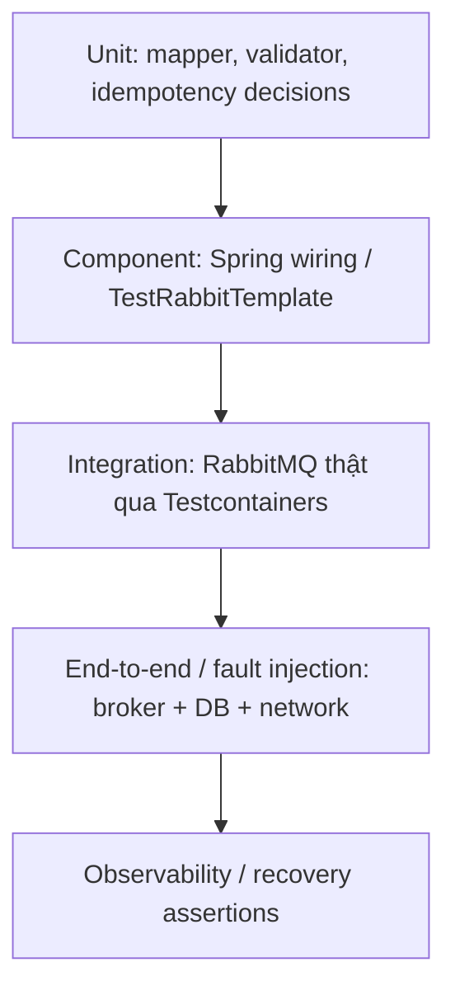
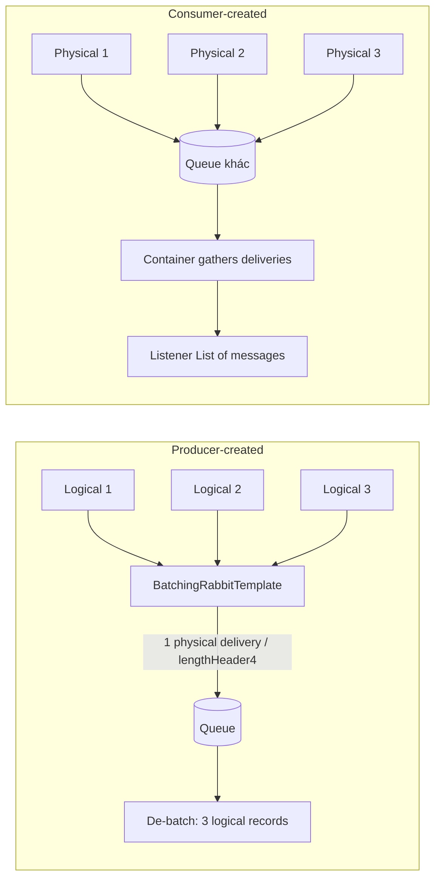
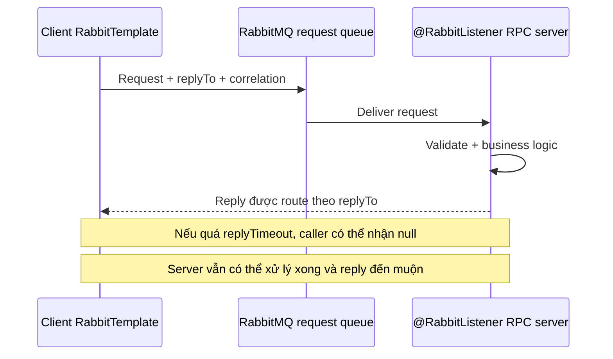
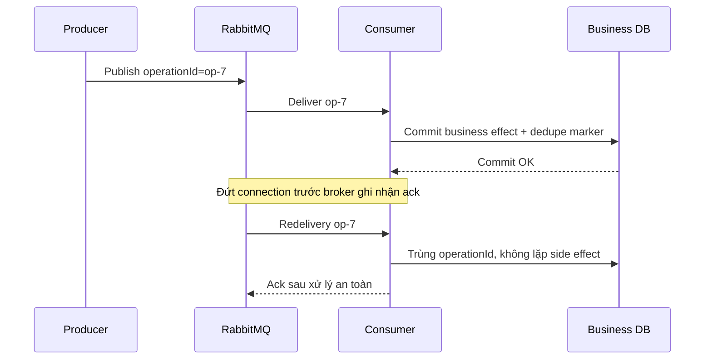

# Kiểm thử batch, RPC, stream và protocol theo phạm vi sử dụng

> **Chương:** Kiểm thử  
> **Công nghệ:** Spring AMQP, RabbitMQ, `RabbitTemplate`, `@RabbitListener`, `spring-rabbit-test`, JUnit 5, Testcontainers và RabbitMQ Stream  
> **Trọng tâm:** Chọn kiểm thử **theo loại giao tiếp ứng dụng thực sự dùng**: batch message, request/reply (RPC), stream và khả năng tương tác giữa các protocol. Không đánh đồng việc một unit test chạy qua mock với bảo đảm giao nhận thật của RabbitMQ.

## 1. Tình huống: cùng dùng RabbitMQ nhưng bốn tính năng cần bốn phép thử khác nhau

Một nền tảng bán hàng tích hợp RabbitMQ với Spring AMQP:

- `OrderService` dùng `RabbitTemplate` gửi sự kiện vào exchange `orders.events`, queue được binding theo routing key; `@RabbitListener` tiêu thụ sự kiện.
- Một luồng nhập dữ liệu gom nhiều bản ghi **theo batch** để tiết kiệm overhead.
- Một API nội bộ gửi request và chờ **reply** từ worker để tính giá vận chuyển.
- Một dịch vụ phân tích đọc **RabbitMQ Stream** và cần phát lại dữ liệu theo offset.
- Trong quá trình nâng cấp, một ứng dụng chuyển từ **AMQP 0-9-1** sang **AMQP 1.0** nhưng vẫn chia sẻ RabbitMQ và queue.

Nếu chỉ viết một bài test `rabbitTemplate.convertAndSend(...)` rồi xác nhận không có exception, ta chưa chứng minh được việc de-batch, correlation của RPC, offset replay, hay chuyển đổi thuộc tính message giữa hai protocol. Ngược lại, nếu ứng dụng **không dùng Stream** mà vẫn dựng cả hệ thống Stream trong mỗi lần chạy test, bộ test sẽ nặng, chậm và khó bảo trì mà không tăng mức bảo đảm có ý nghĩa.

**Nguyên tắc xuyên suốt:** phân tích **feature thực sự bật trong production**, xác định điều kiện thành công/thất bại cụ thể, chọn loại test nhỏ nhất có thể chứng minh điều đó, sau cùng giữ một số integration/end-to-end test với broker thật cho những ranh giới quan trọng.

### Mục tiêu học tập

Sau bài này, bạn sẽ:

1. Thiết kế ma trận kiểm thử **basic messaging / batch / RPC / stream / protocol** có phạm vi và tiêu chí pass rõ ràng.
2. Dùng `spring-rabbit-test`, `TestRabbitTemplate`, `@RabbitListenerTest` và Testcontainers đúng vai trò.
3. Phân biệt **producer-created batch** với **consumer-created batch**, kiểm tra ranh giới ack và dữ liệu bị gom.
4. Kiểm tra reply, timeout, late reply, correlation, duplicate business effect và lỗi định tuyến trong RPC.
5. Kiểm tra RabbitMQ Stream qua offset/retention/replay, không gán semantics queue `basic.ack` lên stream.
6. Viết test interoperability AMQP 0-9-1 ↔ AMQP 1.0 dựa trên client/protocol thực thay vì dựa vào port.

## 2. Lập bản đồ phạm vi trước khi viết mã kiểm thử

Một application chỉ publish rồi consume message thông thường **không bắt buộc** phải kiểm thử batch, RPC và stream. Sử dụng bảng dưới như bộ lọc:

| Tính năng triển khai | Công cụ phía Spring/RabbitMQ | Test tối thiểu | Test lỗi có giá trị |
| --- | --- | --- | --- |
| Publish/consume cơ bản | `RabbitTemplate`, `@RabbitListener`, exchange/queue/binding | Publish → queue → consumer → dữ liệu đã commit | Sai routing key, requeue/DLQ, redelivery/idempotency |
| Producer-created batch | `BatchingRabbitTemplate`, `SimpleBatchingStrategy` | N message logic → một message AMQP vật lý mang batch → de-batch thành N phần tử | Batch chưa đủ size, flush/timeout, lỗi một phần tử, producer chết trước flush |
| Consumer-created batch | `SimpleRabbitListenerContainerFactory` + `consumerBatchEnabled` | N delivery riêng → `List<Message>` ở listener | Partial batch do timeout, kích thước vượt `batchSize` khi có producer batch, lỗi xử lý một phần |
| Request/reply | `RabbitTemplate.convertSendAndReceive`, `@RabbitListener` trả giá trị | Reply đúng request, đúng payload/correlation | Timeout, reply đến muộn, duplicate request, unroutable request |
| RabbitMQ Stream | `spring-rabbit-stream`, `RabbitStreamTemplate`, `StreamListenerContainer` | Append → consumer nhận và đọc lại từ offset đã chọn | Restart, offset tracking, retention, duplicate processing, stream unavailable |
| Tương tác protocol | AMQP 0-9-1 và AMQP 1.0 clients | Producer protocol A → consumer protocol B trên cùng topology | Khác biệt message properties, chuyển đổi kiểu, settlement, routing, auth/TLS |

**Phân biệt phạm vi:** queue có `x-queue-type=stream` chưa chứng minh ứng dụng dùng **native Stream protocol**; RabbitMQ cho phép tương tác với stream qua những giao thức khác. Chỉ khi ứng dụng thực sự sử dụng native stream client/consumer offsets mới cần bộ test dành riêng cho client Stream. Tương tự, port `5672` có thể phục vụ cả **AMQP 0-9-1 và AMQP 1.0** trên RabbitMQ 4.x; test cần kiểm tra **client library/handshake**, không suy từ cổng.

## 3. Tháp kiểm thử cho hệ thống bất đồng bộ



| Tầng | Phụ thuộc thực | Nên chứng minh | Không thể chứng minh |
| --- | --- | --- | --- |
| **Unit** | JUnit, Mockito, không broker | Routing key được chọn đúng, schema, số lần gọi service, retry policy, logic phân loại lỗi. | Exchange/binding thực tế, broker ack/confirm, timeout mạng. |
| **Component** | Spring context, `TestRabbitTemplate` hoặc `RabbitListenerTestHarness` | Annotation, message converter, listener handler, wiring service. | Broker delivery, TTL/DLX thực, SASL/TLS, queue tồn tại sau restart. |
| **Broker integration** | RabbitMQ thật (ví dụ Testcontainers) | Declare topology, routing, consumer, batch wire format, RPC, stream link, protocol conversion. | Mất vùng, race nhiều node, failover cluster thật nếu chỉ có một container. |
| **End-to-end/resilience** | Broker + database/IdP/stream plugin, fault injector | Redelivery, kết quả nghiệp vụ, retries/DLQ, recovery, timeout, idempotency. | Không thể khẳng định exactly-once trong mọi sự cố nếu chưa có thiết kế và chứng cứ đầy đủ. |

Các test đồng bộ như `assertEquals("ok", service.handle(...))` rất hữu ích, nhưng **không đủ** để kết luận message sẽ được định tuyến/ack đúng khi chạy nhiều instance. Ngược lại, test integration không cần mô phỏng mọi thành phần cloud: chỉ mang vào đúng dependency cần thiết cho giả thuyết đang kiểm tra.

### 3.1. Công cụ Spring AMQP hỗ trợ kiểm thử

Thư viện `org.springframework.amqp:spring-rabbit-test` cung cấp:

- **`TestRabbitTemplate`**: gửi trực tiếp đến listener trong Spring context mà không cần broker; chủ yếu route theo **queue name** và gọi listener trên test thread, nên không kiểm chứng exchange, binding, publisher confirms hoặc real queue semantics.
- **`@RabbitListenerTest` và `RabbitListenerTestHarness`**: spy/capture tham số, kết quả và exception ở các listener có `id`; phù hợp kiểm tra handler bất đồng bộ mà không phải đặt `Thread.sleep()`.
- **`@SpringRabbitTest`**: bổ sung hạ tầng Spring Rabbit ở test thuần Spring Framework; **không cần thêm** khi `@SpringBootTest` đã auto-configure tương ứng.
- **`@RabbitAvailable`**: JUnit 5 condition kiểm tra RabbitMQ có sẵn và có thể tạo/purge queue thử nghiệm; phù hợp môi trường broker quản lý riêng, nhưng test có thể **skip** nếu broker không tồn tại. Với CI bắt buộc kiểm tra messaging, ưu tiên Testcontainers hoặc cấu hình broker-required để không vô tình có pipeline xanh do skip.

Ví dụ dependency Gradle, chọn version tương thích từ BOM Spring Boot/Spring AMQP:

```groovy
dependencies {
    // Spring AMQP 0-9-1: ứng dụng đã có starter phù hợp phiên bản Boot.
    testImplementation 'org.springframework.amqp:spring-rabbit-test'
    testImplementation 'org.springframework.boot:spring-boot-starter-test'
    // Testcontainers 2.x: dùng tên artifact có tiền tố testcontainers-.
    testImplementation 'org.testcontainers:testcontainers-junit-jupiter'
    testImplementation 'org.testcontainers:testcontainers-rabbitmq'
}
```

Ví dụ sử dụng **Testcontainers 2.x**; dòng 1.x dùng artifact `org.testcontainers:rabbitmq` và `org.testcontainers:junit-jupiter` cùng package `org.testcontainers.containers.RabbitMQContainer`. Với Spring Boot 4.x, một số starter/test có thể được tách hoặc đổi theo BOM. **Không tự khóa version tùy ý** khi chưa kiểm tra Spring Boot/Testcontainers stack của dự án. Cùng với JUnit 5, cần Docker/Podman runtime có khả năng chạy container cho integration tests; worker soạn tài liệu **không chạy** Docker hoặc build trong bước này.

## 4. Unit test: xác minh quyết định nghiệp vụ trước khi kết nối broker

Ví dụ ứng dụng có publisher nhận `RabbitOperations` (interface dễ mock) và một service độc lập với RabbitMQ:

```java
import org.springframework.amqp.rabbit.core.RabbitOperations;

public final class OrderEventPublisher {
    private final RabbitOperations rabbit;

    public OrderEventPublisher(RabbitOperations rabbit) {
        this.rabbit = rabbit;
    }

    public void publishPaid(String operationId, long orderId) {
        if (operationId == null || operationId.isBlank()) {
            throw new IllegalArgumentException("operationId required");
        }
        rabbit.convertAndSend("orders.events", "order.paid",
                operationId + "|" + orderId);
    }
}
```

```java
import static org.junit.jupiter.api.Assertions.assertThrows;
import static org.mockito.Mockito.mock;
import static org.mockito.Mockito.verify;
import static org.mockito.Mockito.verifyNoInteractions;

import org.junit.jupiter.api.Test;
import org.springframework.amqp.rabbit.core.RabbitOperations;

class OrderEventPublisherTest {
    @Test
    void usesContractedExchangeAndRoutingKey() {
        RabbitOperations rabbit = mock(RabbitOperations.class);
        new OrderEventPublisher(rabbit).publishPaid("op-42", 42L);

        verify(rabbit).convertAndSend("orders.events", "order.paid", "op-42|42");
    }

    @Test
    void rejectsMissingOperationIdBeforePublish() {
        RabbitOperations rabbit = mock(RabbitOperations.class);
        assertThrows(IllegalArgumentException.class,
                () -> new OrderEventPublisher(rabbit).publishPaid("", 42L));
        verifyNoInteractions(rabbit);
    }
}
```

Đây là **unit test của quyết định publish**, không phải test broker. Nó bắt được lỗi exchange/routing key trong code, nhưng **không biết** exchange `orders.events` có tồn tại không, key `order.paid` có binding hay không hoặc message đã được lưu bền vững chưa. Các điều đó phải chuyển sang integration test.

## 5. Integration baseline: RabbitMQ thật bằng Testcontainers

Thiết lập một broker cô lập giúp test routing/ack/consumer mà không phụ thuộc broker `localhost:5672` trên máy lập trình viên. Ví dụ dưới dùng **Spring Boot AMQP 0-9-1** (properties `spring.rabbitmq.*`) và JUnit 5. Mỗi test suite nên dùng queue riêng, hoặc tên ngẫu nhiên, tránh tác động dữ liệu của người khác.

```java
import static org.assertj.core.api.Assertions.assertThat;

import java.util.concurrent.CountDownLatch;
import java.util.concurrent.TimeUnit;
import org.junit.jupiter.api.Test;
import org.springframework.amqp.core.AnonymousQueue;
import org.springframework.amqp.rabbit.annotation.RabbitListener;
import org.springframework.amqp.rabbit.core.RabbitTemplate;
import org.springframework.beans.factory.annotation.Autowired;
import org.springframework.boot.test.context.SpringBootTest;
import org.springframework.boot.test.context.TestConfiguration;
import org.springframework.context.annotation.Bean;
import org.springframework.context.annotation.Import;
import org.springframework.test.context.DynamicPropertyRegistry;
import org.springframework.test.context.DynamicPropertySource;
import org.testcontainers.rabbitmq.RabbitMQContainer;
import org.testcontainers.junit.jupiter.Container;
import org.testcontainers.junit.jupiter.Testcontainers;
import org.testcontainers.utility.DockerImageName;

@Testcontainers
@SpringBootTest
@Import(RabbitRoundTripIT.ProbeConfiguration.class)
class RabbitRoundTripIT {
    @Container
    static final RabbitMQContainer RABBIT = new RabbitMQContainer(
            DockerImageName.parse("rabbitmq:4.1-management"))
            .withEnv("RABBITMQ_DEFAULT_USER", "test")
            .withEnv("RABBITMQ_DEFAULT_PASS", "test-secret-only-for-ci");

    @DynamicPropertySource
    static void rabbitProperties(DynamicPropertyRegistry props) {
        props.add("spring.rabbitmq.host", RABBIT::getHost);
        props.add("spring.rabbitmq.port", RABBIT::getAmqpPort);
        props.add("spring.rabbitmq.username", () -> "test");
        props.add("spring.rabbitmq.password", () -> "test-secret-only-for-ci");
    }

    @Autowired RabbitTemplate template;
    @Autowired AnonymousQueue itOrdersQueue;
    @Autowired Probe probe;

    @Test
    void sendsThroughRealBrokerAndReachesListener() throws Exception {
        template.convertAndSend("", itOrdersQueue.getName(), "order-42");
        assertThat(probe.received.await(10, TimeUnit.SECONDS)).isTrue();
        assertThat(probe.payload).isEqualTo("order-42");
    }

    static class Probe {
        final CountDownLatch received = new CountDownLatch(1);
        volatile String payload;
    }

    @TestConfiguration(proxyBeanMethods = false)
    static class ProbeConfiguration {
        @Bean AnonymousQueue itOrdersQueue() {
            return new AnonymousQueue();
        }

        @Bean Probe probe() {
            return new Probe();
        }

        @Bean ItListener itListener(Probe probe) {
            return new ItListener(probe);
        }

        static class ItListener {
            private final Probe probe;

            ItListener(Probe probe) {
                this.probe = probe;
            }

            @RabbitListener(queues = "#{itOrdersQueue.name}")
            public void receive(String payload) {
                probe.payload = payload;
                probe.received.countDown();
            }
        }
    }
}
```

Đây là **mẫu cấu trúc test**: ứng dụng thật cần có Spring Boot entrypoint và AMQP listener infrastructure phù hợp. Trong dự án có nhiều queue/bean cùng kiểu, dùng `@Qualifier` hoặc tên bean riêng; khi chạy nhiều test methods, tạo/reset `Probe` theo test để tránh latch đã đếm về 0 từ test trước. Ở đây chỉ có **một** test method để minh họa.

Test này chứng minh message qua **broker thật**, nhưng đang dùng **default exchange** (`""`) với routing key là tên queue; nó **chưa** kiểm thử exchange `orders.events` và binding của ứng dụng. Với topology production, thêm một test dùng exchange/routing key nghiệp vụ và assertion đúng queue nhận được. `AnonymousQueue` dùng cho test cô lập, không thay queue bền vững của production.

### 5.1. Khi nào cần `@ServiceConnection`?

Với Spring Boot có hỗ trợ Testcontainers service connections, có thể dùng `@ServiceConnection` trên `RabbitMQContainer` thay `@DynamicPropertySource`. Tuy nhiên các loại `ConnectionDetails` và cách match thay đổi theo phiên bản/stack (RabbitMQ AMQP 0-9-1, AMQP 1.0, Stream). **Chỉ sử dụng khi xác nhận Boot đã cung cấp chính xác loại connection details ứng dụng cần**; cách khai báo host/port động ở trên minh họa rõ giao thức 0-9-1 và dễ chẩn đoán khi nâng cấp.

### 5.2. Đợi bằng điều kiện, không dùng thời gian ngủ cố định

Viết test bất đồng bộ bằng `CountDownLatch.await(timeout)` hoặc Awaitility với `atMost(...)`. Tránh `Thread.sleep(500)` rồi đọc queue: trên CI chậm, 500 ms có thể thiếu; trên máy nhanh, mỗi test lại lãng phí thời gian. Một assertion có **timeout hữu hạn** cũng giúp pipeline thất bại rõ ràng khi consumer chết thay vì treo mãi.

Nếu kiểm tra kết quả trong database, đợi đến khi trạng thái **đã commit** chứ không chỉ đến lúc listener được gọi:

```java
await().atMost(Duration.ofSeconds(10)).untilAsserted(() ->
        assertThat(orderRepository.findById(42L).orElseThrow().getStatus())
                .isEqualTo("PAID"));
```

Mẫu trên cần dependency Awaitility và các import `await`, `Duration`/`assertThat`; nó là **đoạn assertion** trong integration test có database, không phải class Java độc lập. Kiểm tra trạng thái nghiệp vụ có ý nghĩa hơn kiểm tra chỉ có log “received”.

## 6. Batch: phân biệt producer-created và consumer-created trước khi test

**Hai khái niệm khác nhau:**

1. **Producer-created batch**: `BatchingRabbitTemplate` gom N message logic vào **một delivery AMQP vật lý**; Spring dùng header `springBatchFormat=lengthHeader4` để container de-batch khi nhận. Nếu producer chết trước khi batch được gửi, dữ liệu đang buffer trong bộ nhớ có thể mất.
2. **Consumer-created batch**: producer gửi **N delivery riêng**; `SimpleMessageListenerContainer` gom các delivery theo `batchSize`/timeout và gọi listener **một lần với danh sách**. Nếu trong số delivery có producer batch, kết quả de-batch có thể tạo danh sách **lớn hơn `batchSize`**.



### 6.1. Producer-created batch: kiểm tra wire format và flush

Ví dụ cấu hình nguyên tắc, với `ConnectionFactory` AMQP 0-9-1 và `TaskScheduler` có lifecycle:

```java
import org.springframework.amqp.rabbit.batch.SimpleBatchingStrategy;
import org.springframework.amqp.rabbit.core.BatchingRabbitTemplate;
import org.springframework.amqp.rabbit.connection.ConnectionFactory;
import org.springframework.scheduling.TaskScheduler;

// Trong factory method hay test setup:
var strategy = new SimpleBatchingStrategy(3, 64 * 1024, 1_000);
var batchingTemplate =
        new BatchingRabbitTemplate(connectionFactory, strategy, taskScheduler);

batchingTemplate.convertAndSend("", "it.batch.producer", "A");
batchingTemplate.convertAndSend("", "it.batch.producer", "B");
batchingTemplate.convertAndSend("", "it.batch.producer", "C");
// Khi đủ 3 phần tử, strategy có thể phát ra một batch message.
// Với batch chưa đủ size ở test khác, gọi batchingTemplate.flush().
```

**Assertion quan trọng** cần thực hiện với broker thật:

- Trước khi listener de-batch, **một** delivery AMQP mang header `springBatchFormat=lengthHeader4` và body đóng gói nhiều phần tử. Để kiểm tra raw frame/delivery, dùng native RabbitMQ Java client `basicGet` khi **không có consumer khác** trên queue, thay vì suy từ số lần gọi listener.
- Sau khi container có de-batching, listener nhận đủ ba phần tử logic `A`, `B`, `C` theo mô hình listener đã cấu hình.
- Khi chỉ gửi hai phần tử, `flush()`/timeout có thể phát một batch chưa đủ size; không đặt test lệ thuộc đồng hồ hệ thống khi có thể chủ động flush.
- Khi producer crash **trước flush**, không được kỳ vọng broker đã giữ các phần tử còn nằm trong RAM; muốn bảo đảm không mất business event cần outbox hoặc hàng đợi bền vững khác ở phía nguồn.

`SimpleBatchingStrategy` dùng chung exchange/routing key trong một batch; nếu gửi sang routing key khác, phải hiểu cách strategy giải phóng batch và kiểm tra routing cho mỗi key. Với lỗi xử lý một phần tử trong **một delivery vật lý**, việc reject/redelivery có thể áp dụng cho **cả producer batch**, không phải chỉ phần tử logic thứ ba.

### 6.2. Consumer-created batch: cấu hình và kiểm tra danh sách

```java
import java.util.List;
import org.springframework.amqp.core.Message;
import org.springframework.amqp.rabbit.annotation.RabbitListener;
import org.springframework.amqp.rabbit.config.SimpleRabbitListenerContainerFactory;
import org.springframework.amqp.rabbit.connection.ConnectionFactory;
import org.springframework.context.annotation.Bean;
import org.springframework.context.annotation.Configuration;
import org.springframework.stereotype.Component;

@Configuration(proxyBeanMethods = false)
class BatchTestConfig {
    @Bean("consumerBatchFactory")
    SimpleRabbitListenerContainerFactory consumerBatchFactory(ConnectionFactory cf) {
        var factory = new SimpleRabbitListenerContainerFactory();
        factory.setConnectionFactory(cf);
        factory.setConsumerBatchEnabled(true);
        factory.setBatchListener(true);
        factory.setBatchSize(3);
        factory.setReceiveTimeout(500L);
        return factory;
    }
}

@Component
class OrderBatchListener {
    @RabbitListener(queues = "it.batch.consumer",
            containerFactory = "consumerBatchFactory")
    void onBatch(List<Message> messages) {
        for (Message message : messages) {
            // Production: parse + idempotent service; test kiểm tra dữ liệu đã commit.
            System.out.println(new String(message.getBody(),
                    java.nio.charset.StandardCharsets.UTF_8));
        }
    }
}
```

`consumerBatchEnabled=true` cần **de-batching** để xử lý producer batch; factory sẽ bảo đảm cấu hình cần thiết. Ở Spring AMQP mới, `consumerBatchEnabled` cũng khiến listener được xem là batch listener; code đặt rõ `batchListener=true` để dễ đọc. **`batchSize=3` không đảm bảo mọi lần listener luôn nhận đúng 3 phần tử**: có partial batch do timeout, và de-batching producer-created batch có thể làm tổng logic items lớn hơn 3.

**Case cần kiểm tra**:

| Input và hoàn cảnh | Assertion hợp lệ | Assertion dễ sai |
| --- | --- | --- |
| 3 delivery độc lập, single consumer, queue rỗng trước test | Mỗi message được xử lý đúng một lần business, danh sách có thể gom đủ 3 nếu timing cho phép. | Mọi môi trường chắc chắn chỉ gọi listener đúng một lần. |
| 2 delivery, không có message thứ ba | Partial batch được phát sau timeout phù hợp cấu hình. | Phải treo mãi cho đủ `batchSize`. |
| Một producer batch chứa 5 logic items | De-batching bảo toàn 5 logic items; một list có thể vượt `batchSize` của physical delivery. | List phải có tối đa 3 phần tử. |
| Một item gây exception | Cần chính sách retry/requeue/DLQ và idempotency cho toàn batch hoặc từng item. | RabbitMQ tự ack thành công hai item còn lại của cùng physical batch. |

**Chiến lược ổn định:** trong test nghiệp vụ, assertion theo **tổng tập `operationId` đã commit** thay vì assertion cứng vào số callback `List` (vì batch boundaries chịu ảnh hưởng scheduling, prefetch, timeout). Chỉ kiểm tra kích thước batch chính xác khi bạn **cố tình kiểm soát** môi trường, số consumer và điều kiện flush/timeout để kiểm thử chính batch boundary.

## 7. RPC: test phản hồi, correlation và trạng thái chưa biết khi timeout

`RabbitTemplate.convertSendAndReceive()` gửi request rồi chờ một reply được correlate. Khi broker hỗ trợ **Direct Reply-To**, Spring AMQP thường sử dụng cơ chế này theo mặc định; reply không phải queue bền vững để replay cho caller sau khi mất connection. Đừng dùng kiểu khẳng định “send thành công tức remote method đã commit”.



### 7.1. Test đường thành công

RPC handler:

```java
import org.springframework.amqp.rabbit.annotation.RabbitListener;
import org.springframework.stereotype.Component;

@Component
class ShippingQuoteRpcHandler {
    @RabbitListener(queues = "it.rpc.quotes")
    public String quote(String request) {
        if (!request.startsWith("weight:")) {
            throw new IllegalArgumentException("Invalid quote request");
        }
        return "quote:" + request.substring("weight:".length());
    }
}
```

Test integration sau khi queue `it.rpc.quotes` và listener đã được khai báo/chạy:

```java
@Test
void rpcReplyIsCorrelatedToRequest() {
    Object reply = rabbitTemplate.convertSendAndReceive(
            "", "it.rpc.quotes", "weight:5");
    assertThat(reply).isEqualTo("quote:5");
}
```

Ở đây `rabbitTemplate` là bean của test context đã kết nối broker thật; đoạn test **không tự tạo queue hoặc khởi động listener**. Trong test có nhiều caller đồng thời, gửi các request payload/correlation khác nhau và assert mọi reply khớp yêu cầu tương ứng, không chỉ đếm tổng reply.

### 7.2. Timeout không chứng minh server chưa xử lý

Với `RabbitTemplate`, `replyTimeout` mặc định thường là **5 giây**; khi hết hạn, `convertSendAndReceive(...)` có thể trả **`null`**. Kiểm thử một queue **có tồn tại nhưng không có consumer** để tránh nhầm timeout với lỗi message không route được:

```java
RabbitTemplate shortTimeoutTemplate = new RabbitTemplate(connectionFactory);
shortTimeoutTemplate.setReplyTimeout(250L); // test-only

Object reply = shortTimeoutTemplate.convertSendAndReceive(
        "", "it.rpc.no-consumer", "operation:op-101");

assertThat(reply).isNull();
// Cleanup queue it.rpc.no-consumer sau test: request có thể còn đang chờ!
```

`it.rpc.no-consumer` phải được tạo trước và không có consumer; template không đặt `mandatory` theo cách khiến unroutable request ném exception. Timeout thấp phù hợp cho test lab có điều kiện đã kiểm soát; không chọn `250 ms` như SLA production. Khi request **đã đến** server nhưng reply muộn, caller vẫn có thể nhận `null` dù server đã commit side effect. Kết luận đúng là trạng thái **UNKNOWN**, không tự động là “nghiệp vụ thất bại”.

### 7.3. Ba case RPC quan trọng nhất

| Case | Kết quả cần assert | Điều cần tránh |
| --- | --- | --- |
| Reply trong hạn | Payload đúng, correlation đúng, không lẫn reply giữa các request. | Chỉ kiểm tra reply không null mà không kiểm tra request ID. |
| Reply đến sau timeout | Caller timeout; late reply được xử lý/ghi nhận qua `replyErrorHandler` hoặc cơ chế được cấu hình. | Lấy late reply của request cũ làm kết quả cho request mới. |
| Retry request sau timeout | `operationId` giữ nguyên; server-side inbox/idempotency ngăn side effect bị nhân đôi. | Tạo request ID mới rồi thực hiện thanh toán/lưu đơn lần thứ hai. |

Thêm kiểm thử request **không định tuyến được** bằng `mandatory` và publisher returns phù hợp: phân biệt lỗi `NO_ROUTE` với consumer timeout. Nếu server ném exception, cách trả lỗi về RPC caller phụ thuộc cấu hình reply/error handler; không giả định một Java exception sẽ tự xuyên qua mạng giống call method nội bộ.

**Batch RPC là bài toán khác:** batch listener `List<?>` không hỗ trợ reply tương quan 1:1 theo cách một-message–một-reply; không đặt `@RabbitListener` batch vào pipeline RPC rồi kỳ vọng Spring tự biết reply nào thuộc phần tử nào. Nếu cần RPC trên N phần tử, thiết kế request envelope chứa list với **một response envelope**, hoặc từng request có correlation riêng.

## 8. RabbitMQ Stream: offset/replay khác ack của queue thông thường

RabbitMQ Stream là **append-only log**, cho phép nhiều consumer đọc cùng message từ những offset khác nhau trong phạm vi dữ liệu còn retention. Consumer stream không làm message biến mất khỏi log khi “ack” như queue AMQP thông thường. Vì vậy bộ kiểm thử stream cần những tiêu chí riêng:

- Producer publish một record và nhận publisher confirmation/result theo API native stream.
- Consumer bắt đầu từ `first`, `next`, offset cụ thể hoặc vị trí đã lưu; kiểm tra khả năng **replay** theo yêu cầu nghiệp vụ.
- Khi consumer restart, trạng thái offset tracking có thể quyết định bắt đầu lại ở đâu; cần kiểm tra duplicate và **idempotency**.
- Dữ liệu có thể bị xóa bởi **retention policy**, nên không khẳng định mọi offset sẽ tồn tại vĩnh viễn.

### 8.1. Môi trường dùng native stream client

Spring AMQP có module `org.springframework.amqp:spring-rabbit-stream` với `RabbitStreamTemplate` và `StreamListenerContainer`/`StreamRabbitListenerContainerFactory`. RabbitMQ cần bật **plugin `rabbitmq_stream`**, mặc định Stream protocol lắng nghe **port `5552`**, khác port 5672 của AMQP thông thường.

```bash
# Chỉ minh họa lệnh trong môi trường thử nghiệm được phép quản trị.
rabbitmq-plugins enable rabbitmq_stream
```

```java
import com.rabbitmq.stream.Environment;
import com.rabbitmq.stream.OffsetSpecification;
import org.springframework.amqp.rabbit.listener.RabbitListenerContainerFactory;
import org.springframework.rabbit.stream.listener.StreamListenerContainer;
import org.springframework.rabbit.stream.config.StreamRabbitListenerContainerFactory;
import org.springframework.rabbit.stream.producer.RabbitStreamTemplate;
import org.springframework.context.annotation.Bean;
import org.springframework.context.annotation.Configuration;

@Configuration(proxyBeanMethods = false)
class StreamTestConfig {
    @Bean
    RabbitStreamTemplate streamTemplate(Environment env) {
        return new RabbitStreamTemplate(env, "it.stream.orders");
    }

    @Bean("streamTestListenerFactory")
    RabbitListenerContainerFactory<StreamListenerContainer> streamTestListenerFactory(
            Environment env) {
        var factory = new StreamRabbitListenerContainerFactory(env);
        factory.setConsumerCustomizer((id, builder) ->
                builder.offset(OffsetSpecification.first()));
        return factory;
    }
}
```

`Environment env` ở đây là **`com.rabbitmq.stream.Environment`**, *không phải* `org.springframework.core.env.Environment` hoặc `com.rabbitmq.client.amqp.Environment` của AMQP 1.0. Cần tạo bean stream environment trỏ tới đúng `5552` và dùng URI/credentials/network theo cấu hình plugin; **không dùng `CachingConnectionFactory` 0-9-1** thay thế.

```java
import org.springframework.amqp.rabbit.annotation.RabbitListener;
import org.springframework.stereotype.Component;

@Component
class StreamOrdersListener {
    @RabbitListener(id = "it-stream-orders", queues = "it.stream.orders",
            containerFactory = "streamTestListenerFactory")
    public void onEvent(String payload) {
        // Test ghi nhận eventId; business effect phải idempotent khi replay.
        System.out.println("stream event=" + payload);
    }
}
```

Stream listener factory chỉ hỗ trợ một tập con annotation properties so với listener queue thường; `queues` ở stream listener nên chỉ trỏ **một stream**. Không mặc định `concurrency`/ack/requeue của `SimpleRabbitListenerContainerFactory` hoạt động như cũ.

### 8.2. Test publish và offset replay

```java
// Trong integration test, stream và Environment đã được tạo trước.
Boolean accepted = streamTemplate.convertAndSend("event-42")
        .get(10, java.util.concurrent.TimeUnit.SECONDS);
assertThat(accepted).isTrue();
```

`RabbitStreamTemplate.convertAndSend` trả `CompletableFuture<Boolean>`; một `true` từ send future **không chứng minh** downstream analytics đã commit DB. Test replay nên dùng **native consumer/stream listener với `OffsetSpecification.first()`** trên một stream riêng cho test và **kiểm tra event ID** xuất hiện lại trong consumer mới. Với offset tracking lưu ở broker, cần thử cả consumer name mới và consumer identity cũ sau restart, nếu đó là tính năng ứng dụng sử dụng.

**Không đặt test kiểu** “sau khi consume message phải biến mất khỏi queue” cho Stream. Thay vào đó, assert offset/record và chính sách retention. Nếu production dùng super stream, phải thêm test routing/partition, offset riêng theo partition và hành vi single-active-consumer theo thiết kế, không chỉ thử một stream đơn lẻ.

### 8.3. Testcontainers cho Stream cần chú ý hơn việc expose port

Một `RabbitMQContainer` dùng cho AMQP 0-9-1 **không bảo đảm** plugin Stream đã bật hoặc port 5552 đã mở. Integration test phải:

1. Dùng image/config bật `rabbitmq_stream` trước khi kết nối.
2. Expose port `5552` theo cơ chế Testcontainers và kết nối qua **mapped port**, không hardcode `localhost:5552`.
3. Xử lý metadata/advertised host và port mà Stream client nhận từ broker, nhất là khi broker ở trong Docker network. **Mở cổng ngoài chưa đủ** nếu broker quảng bá địa chỉ nội bộ không thể truy cập từ JVM test.
4. Provision stream trước khi publish, đặt retention/consumer offset chủ động, cleanup resource sau test.

Một test không thể kết nối broker vì metadata Stream sai nên được phân loại **environment/network test failure**, không được báo “stream replay sai” hay âm thầm skip. Đối với project chỉ dùng `RabbitTemplate` trên queue thường, **không** đưa Stream plugin vào baseline CI nếu không dùng.

## 9. Kiểm thử protocol: AMQP 0-9-1, AMQP 1.0 và interoperability

RabbitMQ **4.0+** hỗ trợ AMQP 1.0 native và AMQP 0-9-1 trên broker; mặc định port **5672** có thể nhận cả hai, broker phân biệt bằng **protocol header/handshake**. Muốn xác nhận application dùng protocol nào, phải kiểm tra loại client thật:

| Protocol/client | API phía Spring | Điều phải kiểm tra |
| --- | --- | --- |
| AMQP 0-9-1 | `RabbitTemplate`, `CachingConnectionFactory`, `@RabbitListener` với SMLC/DMLC | Exchange, binding, queue, `basic.ack`/`basic.nack`, confirms/returns, headers 0-9-1. |
| RabbitMQ AMQP 1.0 | `RabbitAmqpTemplate` và các bean listener/connection factory AMQP 1.0 tương ứng | Address v2, sender outcome, link/settlement, SASL, properties 1.0. |
| Native RabbitMQ Stream protocol | `RabbitStreamTemplate`, Stream client `Environment` | Stream metadata, offset, retention, super stream partitions, publisher confirmation. |

**Đừng lấy một test AMQP 0-9-1 rồi chỉ đổi port để gọi là protocol test.** Có thể cả hai protocol dùng cổng 5672 nhưng semantics acknowledgement, message properties và API hoàn toàn khác. Một protocol test phải thật sự dựng **hai client/stack** hoặc xác nhận API được dùng là AMQP 1.0.

### 9.1. Ma trận test tương tác qua cùng queue

Giả sử broker RabbitMQ 4.x có exchange `it.interop.events` và queue `it.interop.received` với binding `created`. Chạy trong **một vhost test**; dữ liệu payload dùng UTF-8/JSON với schema cố định.

| Producer | Consumer | Assertion quan trọng |
| --- | --- | --- |
| AMQP 0-9-1 `RabbitTemplate` | AMQP 0-9-1 listener | Baseline routing/body/headers, ack/retry theo 0-9-1. |
| AMQP 1.0 `RabbitAmqpTemplate` | AMQP 1.0 listener | Sender outcome, address v2 và settlement/consumer đúng 1.0. |
| AMQP 0-9-1 `RabbitTemplate` | AMQP 1.0 listener | Broker chuyển message properties đúng phần hợp đồng; payload, content type, correlation ID được kiểm tra. |
| AMQP 1.0 `RabbitAmqpTemplate` | AMQP 0-9-1 listener | Chuyển ngược properties/headers, routing key, redelivery; không mất business payload. |

Để tránh **competing consumers** gây kết quả không xác định, chỉ bật **một consumer cho queue** trong mỗi ô của ma trận, hoặc dùng queue tách biệt nhưng cùng quy tắc khai báo. Khi consumer A và B cùng nghe một queue, RabbitMQ có thể phân phối message cho một trong hai; test nhận được ở A không chứng minh B hoạt động. Nếu muốn **broadcast**, tạo **hai queue có bindings riêng** vào cùng exchange.

### 9.2. Những thuộc tính dễ sai khi đổi protocol

- `messageId`, `correlationId`, `replyTo`, `contentType`, headers/application properties, delivery mode/persistence.
- Routing address: AMQP 1.0 ở RabbitMQ khuyến nghị **address v2** (`/exchanges/<exchange>/<routing-key>`, `/queues/<queue>`); không giả định exchange name từ API 0-9-1 luôn map nguyên xi trong URI tự ghép.
- Kiểu dữ liệu header: một số map/list/byte array và annotation có thể được broker/client chuyển đổi; hãy assert **giá trị theo hợp đồng** chứ không dựa vào implementation-specific Java class khi không cần.
- TTL, delay, dead-letter, redelivery, priority, stream-specific properties; chọn case chỉ nếu ứng dụng thật dùng.
- Xác thực/đường truyền: SASL, TLS/mTLS, quyền vhost; không được dùng tài khoản admin chung để che mất lỗi quyền runtime.

Mục đích là đảm bảo **business envelope** giữ nguyên và quy tắc routing/settlement chính xác, không phải chứng minh mọi metadata bên ngoài hợp đồng phải round-trip byte-for-byte.

## 10. Fault injection: kiểm thử cửa sổ lỗi không xuất hiện trong happy path



Test cần **inject lỗi đúng ranh giới** thay vì chỉ `kill -9` container tại một thời điểm ngẫu nhiên. Các ranh giới hay gặp:

| Cửa sổ lỗi | Kết quả có thể xảy ra | Assertion nên đặt |
| --- | --- | --- |
| Producer DB commit trước broker publish | Có dữ liệu DB nhưng event chưa phát nếu crash. | Outbox được ghi cùng transaction, relay có thể phát lại. |
| Broker nhận message nhưng confirm không tới producer | Producer retry và tạo bản sao. | Consumer idempotent: một business effect. |
| Batch producer chưa flush, JVM crash | Những logic item còn trong RAM có thể mất. | Không hứa durability; test outbox nếu nghiệp vụ bắt buộc không mất. |
| Batch consumer xử lý được 2/3, item 3 lỗi | Physical batch hoặc consumer batch bị retry/ack theo cấu hình container. | Không nhân đôi 2 item đã commit; kiểm tra DLQ/partial failure policy. |
| RPC đã commit ở server, reply bị mất | Caller timeout, server có thể đã thành công. | Lookup/reconciliation theo `operationId`, không gửi lại như thao tác mới. |
| Stream consumer lưu DB rồi crash trước offset store | Replay record sau restart. | Offset được phục hồi đúng cơ chế, business effect idempotent. |
| AMQP 1.0 delivery chưa settle | Có thể redeliver khi link/connection khôi phục. | Thông điệp không gây duplicate side effect. |

### 10.1. Kiểm tra idempotency bằng dữ liệu, không chỉ `verify(times(1))`

Giả sử consumer `PaymentEventService` ghi vào PostgreSQL, nên dùng constraint duy nhất `(consumer_name, operation_id)` ở **cùng transaction** với update trạng thái thanh toán:

```sql
CREATE TABLE processed_events (
    consumer_name VARCHAR(80) NOT NULL,
    operation_id VARCHAR(100) NOT NULL,
    PRIMARY KEY (consumer_name, operation_id)
);
```

Phép thử tích hợp quan trọng:

1. Gửi event có `operationId=op-7` **hai lần** (hoặc gây redelivery sau commit).
2. Đợi database có business state mong đợi.
3. Assert **số side effect nghiệp vụ bằng 1**, marker dedupe đúng 1, không chỉ listener được gọi bao nhiêu lần.
4. Kiểm tra ack/DLQ/retry và metric attempt để biết message trùng có được nhận diện rõ.

Nếu test chỉ assert `verify(service, times(1))`, có thể nó **che mất** redelivery thật khi broker đã gửi hai lần. Test độ tin cậy phải chủ động cho phép duplicate delivery nhưng ngăn duplicate **business effect**.

### 10.2. Chọn điểm gây lỗi có thể lặp lại

- Dùng một **failpoint** do test điều khiển ngay sau DB commit/trước ack hoặc ngay sau publish/trước confirm được client ghi nhận; tránh chờ “đúng lúc” trong vài mili-giây.
- Ngắt connection/stop consumer/container có kiểm soát rồi khôi phục, đợi trạng thái bằng condition với timeout.
- Đặt tên queue/vhost riêng cho test và cleanup. Khi thử DLX, dùng queue nguồn và DLQ riêng; xác nhận nội dung và `x-death`/metadata theo broker version.
- Không gây fault injection trên RabbitMQ production hoặc một cluster CI dùng chung cho nhiều nhóm không có cô lập.

## 11. Chống flaky tests: concurrency, isolation và timeout

Các test messaging dễ flaky vì một số yếu tố bị hiểu sai:

| Anti-pattern | Tại sao sai | Thay thế |
| --- | --- | --- |
| `Thread.sleep(300)` trước assert | Scheduling/CI chậm làm test lúc pass lúc fail. | Awaitility hoặc latch với deadline rõ ràng. |
| Test A, B cùng dùng `orders.work` | Message lẫn nhau, consumer giành message. | Queue/virtual host test cô lập, tên unique hoặc context riêng. |
| `purgeQueue()` khi còn listener active | Có thể xóa message đang được test khác xử lý. | Không share queue; cleanup khi đã stop container. |
| Assert callback batch phải luôn nhận đúng N | Batch boundary phụ thuộc prefetch/timeout và producer batch. | Assert IDs đã xử lý; kiểm soát boundary khi đó là đối tượng test. |
| Assert thứ tự toàn hệ thống với nhiều consumers | RabbitMQ không bảo đảm trình tự business effect tuyệt đối qua retry/redelivery/parallelism. | Kiểm thử sequence theo khóa nghiệp vụ hoặc giới hạn concurrency. |
| Test RPC timeout bằng queue không tồn tại | Đây có thể là lỗi routing thay vì timeout chờ worker. | Queue tồn tại, không consumer, bật/tắt mandatory có chủ đích. |
| Stream test mặc định consumer từ `next` | Bỏ lỡ record publish trước khi đăng ký. | Chọn `OffsetSpecification.first()` hoặc offset có chủ ý. |
| Unit mock và gọi là end-to-end | Không chạy broker/protocol. | Testcontainers/broker thật cho hợp đồng messaging. |
| Chỉ assert số message, không assert DB | Có thể message đến nhưng side effect thất bại. | Verify transaction/marker/idempotency đúng. |
| Dùng queue/stream không cleanup | Backlog/offset cũ làm các lần chạy sau khác nhau. | Isolated names, lifecycle cleanup, container per suite. |

**Phân biệt tính xác định và thực tế:** test đơn vị cần deterministic tuyệt đối; integration messaging có thể có trễ nên kiểm tra **eventually** trong thời hạn. Nhưng không bao giờ được biến timeout thành `catch(Exception ignored) {}` hay skip case khi broker không kết nối được trong pipeline bắt buộc.

## 12. Ma trận kiểm thử cuối cùng theo sản phẩm thực tế

| Sản phẩm/luồng | Baseline bắt buộc | Bổ sung khi có batch | Bổ sung khi có RPC | Bổ sung khi có stream | Bổ sung khi đổi protocol |
| --- | --- | --- | --- | --- | --- |
| Notification worker dùng queue AMQP 0-9-1 | Routing, ack/retry/DLQ, idempotency | Không | Không | Không | Không |
| Import worker gom record | Routing + database commit | Producer vs consumer batch, partial flush, item failure | Không | Không | Nếu client mix protocol |
| Shipping quote RPC | Topology request/reply | Không dùng batch listener cho 1:1 reply | Correlation, late reply, timeout, UNKNOWN, retry dedupe | Không | Nếu một đầu thay protocol |
| Analytics replay với stream | Event schema + dữ liệu commit | Chỉ nếu ứng dụng thực sự gom record | Không | Offset, retention, restart, super stream | Nếu producer AMQP và consumer Stream cần interoperability |
| Hệ thống đang chuyển 0-9-1 → 1.0 | Routing + dữ liệu cuối cùng | Theo feature cũ nếu có | Theo RPC nếu có | Theo stream nếu có | Hai chiều interop + headers/settlement/TLS |

### 12.1. Điều kiện coi bài kiểm thử đạt

Một nhóm test có giá trị khi nó trả lời được **câu hỏi nghiệp vụ** và **câu hỏi vận hành**:

1. Message đến **đúng queue/stream** và đúng schema sau exchange/binding/address mapping.
2. Khi consumer thành công, dữ liệu nghiệp vụ đã commit và ack/settlement theo semantics phù hợp.
3. Khi thất bại, retry/requeue/DLQ/timeout phản ánh **đúng loại lỗi**, không làm mất message âm thầm hoặc tạo retry vô hạn.
4. Với batch, kiểm tra đúng **phần tử logic**, số **delivery vật lý** và policy partial failure; không lẫn lộn chúng.
5. Với RPC, phản hồi thuộc đúng request, và timeout/late reply không gây business effect lặp.
6. Với stream, offset/replay/retention phù hợp mô hình log, không áp giả định queue truyền thống.
7. Với protocol, client thực sự dùng 0-9-1/1.0/Stream tương ứng, message contract và quyền truy cập vẫn hợp lệ.
8. Test có điều kiện dừng rõ ràng, tài nguyên cô lập và kết quả lặp lại được trên CI.

## 13. Những hiểu lầm thường gặp

| Nhận định sai | Kết luận đúng |
| --- | --- |
| “`TestRabbitTemplate` pass là RabbitMQ routing/confirm chắc đúng.” | Nó gọi listener trực tiếp theo queue name, **không có broker**; dùng broker integration cho routing/confirm. |
| “`batchSize=3` thì callback luôn có đúng ba phần tử.” | Partial batch và producer de-batching có thể làm số logic items khác 3. |
| “Batch là N message vật lý trên broker.” | Producer-created batch thường đóng gói N logic items vào **một** physical delivery; consumer batch lại gom nhiều delivery. |
| “RPC hết timeout nghĩa là worker chưa làm gì.” | Worker có thể đã commit; trạng thái là **UNKNOWN** cho đến khi đối soát. |
| “Một listener batch có thể tự trả N RPC reply tương quan.” | Batch listener không tự có quan hệ 1:1 giữa từng input và từng reply. |
| “Stream consume là xóa message khỏi queue.” | Stream là append-only log, consumer quản lý offset trong phạm vi retention. |
| “Đổi 5672 thành 5671/5552 là đổi AMQP 0-9-1 sang 1.0.” | 5671 thường là TLS, 5552 là native Stream; 0-9-1 và 1.0 có thể cùng dùng 5672. |
| “Publisher confirm nghĩa là consumer đã cập nhật DB.” | Confirm là ranh giới broker accept/persist theo ngữ cảnh, không xác nhận business side effect. |
| “Đã chạy Testcontainers thì khỏi cần unit tests.” | Unit tests bảo vệ mapping/domain rẻ và nhanh; broker tests bảo vệ hợp đồng messaging ở tầng khác. |

## 14. Tổng kết

Kiểm thử Spring AMQP phải đi **từ phạm vi sản phẩm tới tầng kỹ thuật**, không phải bắt đầu bằng việc dựng mọi plugin RabbitMQ có thể có. Với luồng queue thông thường, ưu tiên unit tests, một số test `spring-rabbit-test` và integration qua RabbitMQ thực. **Batch** đòi hỏi phân biệt producer-created và consumer-created, flush/partial list và ack granularity. **RPC** đòi hỏi correlation, timeout, late reply và xử lý UNKNOWN bằng idempotency/đối soát. **Stream** đòi hỏi offset, replay, retention và metadata của Stream protocol. **Protocol tests** đòi hỏi clients 0-9-1/1.0 thực sự và phép thử interoperability hai chiều khi có thay đổi stack.

**Bảo đảm cuối cùng phải được đo ở dữ liệu nghiệp vụ**, không chỉ ở log listener hay phương thức `convertAndSend()`. Kết hợp publisher confirms, consumer acknowledgements/settlement, retry, dead-letter, transaction và `operationId` idempotent giúp biến bài test bất đồng bộ thành một bằng chứng có giá trị cho độ tin cậy đầu cuối.

### Tài liệu tham khảo

- [Spring AMQP — Testing Support](https://docs.spring.io/spring-amqp/reference/testing.html): `spring-rabbit-test`, `TestRabbitTemplate`, `@RabbitListenerTest`, `@SpringRabbitTest`, `@RabbitAvailable`.
- [Spring AMQP — Sending Messages / Batching](https://docs.spring.io/spring-amqp/reference/amqp/sending-messages.html): `BatchingRabbitTemplate`, `SimpleBatchingStrategy`, flush và producer-created batch.
- [Spring AMQP — `@RabbitListener` with Batching](https://docs.spring.io/spring-amqp/reference/amqp/receiving-messages/batch.html): `consumerBatchEnabled`, batch listener, partial batches và ack implications.
- [Spring AMQP — Request/Reply Messaging](https://docs.spring.io/spring-amqp/reference/amqp/request-reply.html): direct reply-to, `replyTimeout`, `replyErrorHandler` và late replies.
- [Spring AMQP — RabbitMQ Stream Support](https://docs.spring.io/spring-amqp/reference/stream.html): `RabbitStreamTemplate`, `StreamListenerContainer`, offset và super stream.
- [Spring Boot — Testcontainers](https://docs.spring.io/spring-boot/reference/testing/testcontainers.html): `@ServiceConnection`, `@DynamicPropertySource` và connection details.
- [Testcontainers for Java — RabbitMQ Module](https://java.testcontainers.org/modules/rabbitmq/): dependency và `RabbitMQContainer` cho Testcontainers 2.x.
- [RabbitMQ — Streams and Super Streams](https://www.rabbitmq.com/docs/streams): offset, retention, stream semantics.
- [RabbitMQ — Stream Plugin](https://www.rabbitmq.com/docs/stream): plugin, Stream protocol và listener port 5552.
- [RabbitMQ — AMQP 1.0](https://www.rabbitmq.com/docs/amqp): hai protocol, version negotiation và interoperability.
