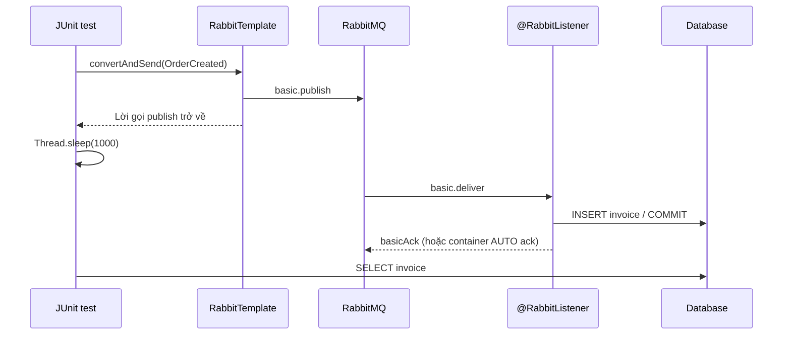

# Đồng bộ chờ bằng điều kiện thay vì sleep cố định

Trong kiểm thử tích hợp **Spring AMQP**, lời gọi `RabbitTemplate.convertAndSend(...)` thường trả về **trước khi** `@RabbitListener` nhận message, trước khi transaction nghiệp vụ commit và trước khi broker nhận consumer acknowledgement. Nếu test gửi message rồi kiểm tra database ngay, assertion có thể thất bại dù ứng dụng chạy đúng. Cách chữa thường thấy là thêm `Thread.sleep(2000)`. Nhưng chờ một số mili giây **không phải** cách đồng bộ: chạy máy nhanh thì lãng phí, chạy CI chậm hoặc có đợt GC/network delay thì vẫn thất bại ngẫu nhiên.

Giải pháp là **chờ một điều kiện quan sát được** với **thời hạn tối đa** (*bounded condition-based waiting*): chẳng hạn bản ghi đã được commit, một event có ID cụ thể xuất hiện trong test probe, consumer đã subscribe vào queue, hoặc message lỗi đã tới DLQ. Test hoàn tất ngay khi điều kiện đúng; nếu quá hạn, test thất bại với thông tin chẩn đoán. Đây là tư duy **eventually consistent assertion**, không phải đợi đủ lâu rồi hy vọng kết quả đúng.

Bài thuộc chương **Kiểm thử** của module **SPRING_AMQP**, sử dụng các thành phần `RabbitTemplate`, `@RabbitListener`, exchange, queue, binding, publisher confirm, consumer ack, retry và dead-letter để minh họa kiểm thử một pipeline bất đồng bộ đáng tin cậy.

**Sau bài học, bạn có thể:**

- Giải thích tại sao `Thread.sleep` không đồng bộ được producer, broker, listener và database.
- Chọn **điều kiện kết thúc phù hợp với yêu cầu nghiệp vụ** thay vì chỉ quan sát một side effect trung gian.
- Sử dụng **Awaitility**, `CountDownLatch`, `BlockingQueue` hoặc công cụ test của Spring AMQP khi phù hợp.
- Viết integration test bằng **Testcontainers RabbitMQ** và assertion polling có timeout rõ ràng.
- Kiểm tra retry, DLQ, duplicate, consumer readiness và các trạng thái âm tính mà không dựa vào sleep cố định.
- Thiết kế test độc lập, có tín hiệu chẩn đoán, hoạt động ổn định khi chạy song song trong CI.

## 1. Vì sao sleep cố định tạo flaky test?

Xét luồng tạo hóa đơn:



`convertAndSend` trả về không đồng nghĩa consumer đã xử lý. Ngay cả khi bật publisher confirms và nhận confirm ACK, tín hiệu đó xác nhận **phía broker tiếp nhận lần publish**, **không phải database ở consumer đã commit**.

### Một test dễ thất bại ngẫu nhiên

```java
@Test
void shouldCreateInvoice() throws Exception {
    rabbitTemplate.convertAndSend(
            "orders.events", "order.created", orderId);

    Thread.sleep(1_000); // Sai: hy vọng listener xong trong 1 giây.

    assertThat(invoiceRepository.existsByOrderId(orderId)).isTrue();
}
```

| Tình huống chạy | Với sleep 1 giây | Hệ quả |
| --- | --- | --- |
| Listener commit sau 20 ms | Test vẫn chờ thêm ~980 ms | Test suite chậm không cần thiết |
| Listener commit sau 1.5 giây do CI quá tải | Assertion chạy quá sớm | Test đỏ không ổn định |
| Listener chết hoặc queue không có consumer | Test chờ 1 giây rồi thất bại | Không có thông tin nguyên nhân |
| Message bị requeue và xử lý thành công sau retry | Có thể vượt 1 giây | Test đỏ dù hệ thống vận hành theo thiết kế |
| Producer chưa route đúng queue | Test cứ ngủ | Không kiểm tra publisher return/topology |

Tăng sleep lên 5 hoặc 10 giây chỉ làm **xác suất thất bại giảm tạm thời**, đồng thời kéo dài toàn bộ suite. Nếu chạy 300 test, mỗi test chờ 2 giây bất kể tốc độ xử lý, phần chờ vô ích có thể lên tới 10 phút.

**Nguyên tắc:** test phải **chờ sự kiện hoặc trạng thái**, không chờ một khoảng thời gian dự đoán. Một timeout tối đa vẫn cần để test không treo vô hạn; timeout không giống fixed sleep.

## 2. Chọn đúng điều kiện: test đang muốn chứng minh gì?

Không có một điều kiện chờ phù hợp cho mọi assertion. Hãy chọn **oracle** theo mục tiêu:

| Mục tiêu kiểm thử | Điều kiện chờ nên dùng | Điều kiện **không đủ** |
| --- | --- | --- |
| Listener đã được gọi | Test harness ghi nhận invocation chứa `eventId` | `convertAndSend` trả về |
| Listener xử lý xong và DB commit | Query DB thấy bản ghi/trạng thái cuối cùng | Invocation bắt đầu, log “received” |
| Consumer đã subscribe | Container running **và** broker thấy consumer trên đúng queue | Chỉ kiểm tra `ApplicationContext` tạo thành công |
| Publisher đã được broker xác nhận | Correlated publisher confirm và kiểm tra return nếu cần routing | Chỉ gọi `RabbitTemplate` |
| Message đã chuyển DLQ | Queue DLQ có message/event ID mong đợi | Listener vừa ném exception |
| Idempotency khi gửi trùng | Hai delivery đã đến **và** chỉ một business side effect được commit | Chỉ thấy một bản ghi trong khi delivery thứ hai còn đang chờ |
| Workflow hoàn tất | Business status `COMPLETED`/saga state, sau các bước cần thiết | Queue `messages_ready=0` |
| Không có side effect sau lỗi vĩnh viễn | Quan sát **tín hiệu terminal** (DLQ/failure event) rồi assert DB không thay đổi | Assert DB chưa có bản ghi ngay sau publish |

**Phải phân biệt ba mốc:** producer gửi xong, broker đã route/deliver, và nghiệp vụ đã commit. Nếu yêu cầu của test là **hoàn tất nghiệp vụ**, hãy chờ **trạng thái được commit**. Nếu yêu cầu là **broker phát lại khi consumer chết**, hãy đo redelivery và idempotency tương ứng.

## 3. Awaitility: polling assertion có timeout

**Awaitility** là thư viện Java cho phép chờ một `Callable<Boolean>` hoặc chạy lại một assertion cho tới khi đúng. Với Spring AMQP, cách `untilAsserted` đặc biệt hữu ích vì có thể giữ nguyên AssertJ/JUnit assertion, chỉ bổ sung cơ chế chờ.

Maven (phiên bản do BOM/dependency management tương thích quản lý):

```xml
<dependency>
    <groupId>org.awaitility</groupId>
    <artifactId>awaitility</artifactId>
    <scope>test</scope>
</dependency>
```

### 3.1. Chuyển từ sleep sang untilAsserted

```java
import static org.assertj.core.api.Assertions.assertThat;
import static org.awaitility.Awaitility.await;

import java.time.Duration;

@Test
void shouldCreateInvoice() {
    String orderId = UUID.randomUUID().toString();
    rabbitTemplate.convertAndSend(
            "orders.events", "order.created", orderId);

    await()
        .alias("invoice for " + orderId)
        .atMost(Duration.ofSeconds(10))
        .pollInterval(Duration.ofMillis(100))
        .untilAsserted(() ->
            assertThat(invoiceRepository.existsByOrderId(orderId))
                .isTrue());
}
```

`invoiceRepository`, exchange, binding và listener là các thành phần do ứng dụng cung cấp. `UUID` giúp mỗi test dùng một business ID riêng. Khi bản ghi đã xuất hiện, test **thoát ngay**, không đợi hết 10 giây. Nếu sau 10 giây vẫn chưa có, Awaitility ném exception kèm assertion chưa đạt.

**Điểm mạnh:** lambda được chạy lại; assertion được đặt ở nơi gần nhất với kết quả nghiệp vụ. Không cần thêm flag toàn cục như `boolean listenerDone`.

### 3.2. until, untilAsserted và điều kiện ổn định

```java
// Chờ boolean trở thành true.
await().atMost(Duration.ofSeconds(10))
       .until(() -> invoiceRepository.existsByOrderId(orderId));

// Chờ một tập nhiều điều kiện cùng đạt.
await().atMost(Duration.ofSeconds(10))
       .untilAsserted(() -> {
           assertThat(invoiceRepository.statusOf(orderId))
               .isEqualTo("CREATED");
           assertThat(invoiceRepository.invoiceCount(orderId))
               .isEqualTo(1);
       });

// Chỉ thành công nếu điều kiện duy trì liên tục trong một khoảng.
await().atMost(Duration.ofSeconds(5))
       .during(Duration.ofMillis(500))
       .until(() -> healthProbe.isConsumerHealthy());
```

`during` hữu ích cho **tính ổn định trong cửa sổ thời gian có giới hạn**. Nhưng không chứng minh “không bao giờ xảy ra duplicate” ngoài cửa sổ đó. Với các **tính chất âm tính** như “không tạo hai invoice”, nên phát sinh đủ input, chờ tín hiệu **cả hai delivery đã được xử lý**, sau đó mới kiểm tra invariant.

### 3.3. Chọn poll interval hợp lý

Một cấu hình ví dụ:

```java
await()
    .pollDelay(Duration.ZERO)
    .pollInterval(Duration.ofMillis(100))
    .atMost(Duration.ofSeconds(15))
    .untilAsserted(() -> assertThat(
            projectionRepository.statusOf(orderId))
            .isEqualTo("COMPLETED"));
```

**Không poll DB mỗi 1 ms** khi chạy hàng trăm test song song: bản thân test sẽ tạo tải, đẩy hệ thống xa hơn khỏi trạng thái cần đo. Với workflow có backoff vài giây, poll 100–300 ms thường dễ quan sát hơn và không tạo quá nhiều truy vấn; chọn theo độ trễ kỳ vọng, SLA và chi phí của phép đo.

Chỉ poll **phép đọc không gây side effect**. Một method như `processNextEvent()` không phù hợp làm điều kiện polling vì mỗi lần gọi có thể thay đổi trạng thái hệ thống.

## 4. Ví dụ tích hợp tự chứa: Testcontainers + Spring AMQP + Awaitility

Ví dụ sau tạo **RabbitMQ thật trong Docker**, khai báo exchange/queue/binding, gửi qua `RabbitTemplate`, nhận qua `@RabbitListener` và chờ **tín hiệu thread-safe** từ một test probe. Mục tiêu của fixture này là chứng minh delivery tới listener; nó **không phải** bài kiểm tra database transaction hoặc publisher confirms.

### 4.1. Phụ thuộc test

```xml
<!-- Bổ sung vào ứng dụng đã dùng spring-boot-starter-amqp. -->
<dependency>
    <groupId>org.springframework.boot</groupId>
    <artifactId>spring-boot-starter-test</artifactId>
    <scope>test</scope>
</dependency>
<dependency>
    <groupId>org.testcontainers</groupId>
    <artifactId>junit-jupiter</artifactId>
    <scope>test</scope>
</dependency>
<dependency>
    <groupId>org.testcontainers</groupId>
    <artifactId>rabbitmq</artifactId>
    <scope>test</scope>
</dependency>
<dependency>
    <groupId>org.awaitility</groupId>
    <artifactId>awaitility</artifactId>
    <scope>test</scope>
</dependency>
```

Tên artifact và BOM quản lý phiên bản Testcontainers có thể thay đổi ở các dòng major; hãy dùng bộ dependency tương thích với Spring Boot/Testcontainers của dự án. Ví dụ dùng image `rabbitmq:4.1-management` chỉ để cố định test broker; có thể thay bằng tag được nhóm vận hành cho phép và đã kiểm thử.

### 4.2. Một integration test độc lập

```java
import static org.assertj.core.api.Assertions.assertThat;
import static org.awaitility.Awaitility.await;

import java.time.Duration;
import java.util.UUID;
import java.util.concurrent.ConcurrentHashMap;
import java.util.concurrent.ConcurrentMap;
import java.util.concurrent.atomic.AtomicInteger;

import org.junit.jupiter.api.Test;
import org.springframework.amqp.core.Binding;
import org.springframework.amqp.core.BindingBuilder;
import org.springframework.amqp.core.DirectExchange;
import org.springframework.amqp.core.Queue;
import org.springframework.amqp.core.QueueBuilder;
import org.springframework.amqp.rabbit.annotation.EnableRabbit;
import org.springframework.amqp.rabbit.annotation.RabbitListener;
import org.springframework.amqp.rabbit.core.RabbitTemplate;
import org.springframework.beans.factory.annotation.Autowired;
import org.springframework.boot.SpringBootConfiguration;
import org.springframework.boot.autoconfigure.EnableAutoConfiguration;
import org.springframework.boot.test.context.SpringBootTest;
import org.springframework.boot.test.context.TestConfiguration;
import org.springframework.context.annotation.Bean;
import org.springframework.context.annotation.Import;
import org.springframework.test.context.DynamicPropertyRegistry;
import org.springframework.test.context.DynamicPropertySource;
import org.testcontainers.containers.RabbitMQContainer;
import org.testcontainers.junit.jupiter.Container;
import org.testcontainers.junit.jupiter.Testcontainers;
import org.testcontainers.utility.DockerImageName;

@Testcontainers
@SpringBootTest(classes = RabbitAwaitIT.TestApplication.class)
class RabbitAwaitIT {
    @Container
    static final RabbitMQContainer broker = new RabbitMQContainer(
        DockerImageName.parse("rabbitmq:4.1-management"));

    @DynamicPropertySource
    static void rabbitProperties(DynamicPropertyRegistry registry) {
        registry.add("spring.rabbitmq.host", broker::getHost);
        registry.add("spring.rabbitmq.port", broker::getAmqpPort);
        registry.add("spring.rabbitmq.username",
                broker::getAdminUsername);
        registry.add("spring.rabbitmq.password",
                broker::getAdminPassword);
    }

    @Autowired RabbitTemplate template;
    @Autowired DeliveryProbe probe;

    @Test
    void listenerEventuallyReceivesTheEvent() {
        String eventId = UUID.randomUUID().toString();
        template.convertAndSend(
                "it.orders.events", "order.created", eventId);

        await().alias("delivery of " + eventId)
            .atMost(Duration.ofSeconds(10))
            .pollInterval(Duration.ofMillis(100))
            .untilAsserted(() ->
                assertThat(probe.attempts(eventId))
                    .isGreaterThanOrEqualTo(1));
    }

    @SpringBootConfiguration
    @EnableAutoConfiguration
    @EnableRabbit
    @Import(Fixture.class)
    static class TestApplication {}

    @TestConfiguration(proxyBeanMethods = false)
    static class Fixture {
        @Bean DirectExchange testExchange() {
            return new DirectExchange("it.orders.events");
        }
        @Bean Queue testQueue() {
            return QueueBuilder.durable("it.orders.created").build();
        }
        @Bean Binding testBinding(Queue testQueue,
                                  DirectExchange testExchange) {
            return BindingBuilder.bind(testQueue)
                    .to(testExchange).with("order.created");
        }
        @Bean DeliveryProbe deliveryProbe() {
            return new DeliveryProbe();
        }
        @Bean TestListener testListener(DeliveryProbe probe) {
            return new TestListener(probe);
        }
    }

    static class TestListener {
        private final DeliveryProbe probe;
        TestListener(DeliveryProbe probe) {
            this.probe = probe;
        }
        @RabbitListener(id = "itOrdersListener",
                        queues = "it.orders.created")
        public void onEvent(String eventId) {
            probe.record(eventId);
        }
    }

    static class DeliveryProbe {
        private final ConcurrentMap<String, AtomicInteger> attempts =
                new ConcurrentHashMap<>();

        void record(String eventId) {
            attempts.computeIfAbsent(eventId,
                     ignored -> new AtomicInteger()).incrementAndGet();
        }
        int attempts(String eventId) {
            AtomicInteger value = attempts.get(eventId);
            return value == null ? 0 : value.get();
        }
    }
}
```

**Điều kiện thực thi:** Docker phải chạy, RabbitMQ container có thể tải được image, ứng dụng dùng Spring Boot + `spring-boot-starter-amqp`, Spring Boot auto-configures `RabbitAdmin` để khai báo các bean topology khi connection được mở và không có bean cùng tên xung đột. `@EnableRabbit` bảo đảm cơ chế đăng ký `@RabbitListener` hoạt động trong fixture độc lập.

Đoạn trên là một **minimum test harness**, cố ý ghi nhận số lần listener được gọi bằng `ConcurrentHashMap`/`AtomicInteger` để thread test và thread listener nhìn thấy cùng dữ liệu an toàn. Không dùng `ArrayList` hoặc `boolean` thông thường để truyền tín hiệu giữa hai thread mà không có đồng bộ bộ nhớ.

**Hạn chế quan trọng:** `probe.record(eventId)` xảy ra **trong listener trước khi container AUTO ack**; test chỉ chứng minh listener đã chạy tới dòng đó. Để chứng minh nghiệp vụ đã commit, hãy **đổi điều kiện chờ thành kết quả ở DB** (mục 5). Để chứng minh broker nhận publisher confirm hoặc trạng thái ack, cần thêm kiểm tra riêng theo giao thức/broker, không lấy probe làm bằng chứng cho tất cả các mốc.

## 5. Kiểm thử database commit: assertion trên nguồn chân lý nghiệp vụ

Ở ứng dụng thực, một listener thường gọi service có `@Transactional`:

```java
@Component
public class OrderCreatedListener {
    private final InvoiceService invoiceService;

    public OrderCreatedListener(InvoiceService invoiceService) {
        this.invoiceService = invoiceService;
    }

    @RabbitListener(id = "invoiceConsumer",
                    queues = "invoice.commands")
    public void onOrderCreated(String orderId) {
        invoiceService.createInvoiceOnce(orderId);
    }
}

@Service
public class InvoiceService {
    private final InvoiceRepository invoices;

    public InvoiceService(InvoiceRepository invoices) {
        this.invoices = invoices;
    }

    @Transactional
    public void createInvoiceOnce(String orderId) {
        invoices.insertIfAbsent(orderId); // Unique key orderId.
    }
}
```

Trong ví dụ này, `InvoiceRepository.insertIfAbsent` là phương thức do ứng dụng triển khai, phải dùng **unique constraint/transaction** phù hợp. Khi method `InvoiceService` trả về qua Spring transactional proxy, transaction đã hoàn tất; listener có thể trả về để container AUTO ack. Nếu ứng dụng dùng manual ack, chỉ ack **sau khi** service commit.

Test nên quan sát **DB thật của ứng dụng**:

```java
@Test
void shouldCommitInvoiceExactlyOncePerOrder() {
    String orderId = UUID.randomUUID().toString();
    rabbitTemplate.convertAndSend(
            "orders.events", "order.created", orderId);

    await().atMost(Duration.ofSeconds(15))
           .pollInterval(Duration.ofMillis(150))
           .untilAsserted(() -> {
               assertThat(invoiceRepository.findByOrderId(orderId))
                   .isPresent();
               assertThat(invoiceRepository.countByOrderId(orderId))
                   .isEqualTo(1);
           });
}
```

Đoạn test dùng tên repository minh họa, không phải một lớp Spring Data được sinh tự động nếu chưa định nghĩa. Phải kết nối test tới database và schema của ứng dụng, hoặc dùng Testcontainers database phù hợp. `countByOrderId==1` ở thời điểm đầu tiên đạt điều kiện **không chứng minh** không thể xuất hiện duplicate về sau; để kiểm thử duplicate, kích hoạt và quan sát **hai lần xử lý có chủ đích** trước khi kiểm invariant (mục 8).

### Bẫy: @Transactional đặt trên test

`@Transactional` trên method test có thể khiến dữ liệu setup **chưa commit** trong transaction của thread JUnit. Listener chạy ở thread/container khác nên **không thấy** dữ liệu đó ở database, rồi thất bại hoặc requeue. Bản thân test cũng có thể rollback trong khi listener đã commit ở transaction riêng.

Với integration test bất đồng bộ, thường nên **không** gắn `@Transactional` lên toàn bộ test. Thay vào đó, setup dữ liệu trong transaction đã commit trước publish, dùng id duy nhất hoặc dọn dữ liệu sau test một cách có kiểm soát. Nếu buộc dùng Spring test transaction, cần chủ động kết thúc/commit đúng ranh giới bằng API testing phù hợp trước khi gửi message.

## 6. Chờ consumer thật sự subscribe trước khi gửi

Đôi khi test gửi message khi Spring context vừa khởi tạo, listener vẫn đang đăng ký. Queue durable có thể đệm message cho đến khi consumer xuất hiện, nhưng một bài test về **consumer readiness** phải kiểm tra subscription thật thay vì `Thread.sleep(500)`.

`RabbitListenerEndpointRegistry` cho phép lấy container theo `id`:

```java
import org.springframework.amqp.rabbit.listener.RabbitListenerEndpointRegistry;
import org.springframework.amqp.rabbit.listener.MessageListenerContainer;

@Autowired RabbitListenerEndpointRegistry listenerRegistry;

@Test
void shouldHaveStartedListener() {
    await().atMost(Duration.ofSeconds(10))
           .untilAsserted(() -> {
               MessageListenerContainer container =
                       listenerRegistry.getListenerContainer(
                               "itOrdersListener");
               assertThat(container).isNotNull();
               assertThat(container.isRunning()).isTrue();
           });
}
```

**`isRunning()` chưa chứng minh broker đã đăng ký subscription**: container có thể đang khởi tạo/recovery, hoặc queue thiếu. Nếu yêu cầu phải xác nhận consumer hiện hữu trên queue, có thể dùng passive queue metadata qua `RabbitAdmin` trong test environment có quyền cần thiết:

```java
import java.util.Properties;
import org.springframework.amqp.rabbit.core.RabbitAdmin;

@Autowired RabbitAdmin rabbitAdmin;

@Test
void shouldHaveRealConsumerOnQueue() {
    await().atMost(Duration.ofSeconds(15))
           .pollInterval(Duration.ofMillis(200))
           .untilAsserted(() -> {
               Properties props = rabbitAdmin.getQueueProperties(
                       "it.orders.created");
               assertThat(props).isNotNull();
               assertThat(
                  ((Number) props.get(
                      RabbitAdmin.QUEUE_CONSUMER_COUNT)).intValue())
                  .isGreaterThan(0);
           });
}
```

`getQueueProperties` sử dụng kết quả declare/passive query và có thể trả `null` khi queue không tồn tại. Đừng dùng `RabbitAdmin` để **tạo hoặc purge queue** trong cùng lúc test nghiệp vụ đang chạy nếu các test dùng chung tài nguyên.

Ngoài cách query broker, có thể quan sát `ConsumeOkEvent` để nhận biết subscription vừa được chấp nhận. Khi dùng event, đăng ký observer **trước khi** listener được khởi động; nếu observer được tạo sau sự kiện, không thể kỳ vọng nhận lại event cũ.

## 7. CountDownLatch: chờ một tín hiệu hoàn tất cụ thể

Nếu test chủ động kiểm soát listener hoặc có một **test-only probe**, `CountDownLatch` là lựa chọn gọn, không cần polling:

```java
import java.util.UUID;
import java.util.concurrent.ConcurrentHashMap;
import java.util.concurrent.ConcurrentMap;
import java.util.concurrent.CountDownLatch;
import java.util.concurrent.TimeUnit;

public class CompletionSignals {
    private final ConcurrentMap<String, CountDownLatch> waiting =
            new ConcurrentHashMap<>();

    public void register(String eventId) {
        if (waiting.putIfAbsent(eventId, new CountDownLatch(1)) != null) {
            throw new IllegalStateException("Already registered: " + eventId);
        }
    }

    public void completed(String eventId) {
        CountDownLatch signal = waiting.get(eventId);
        if (signal != null) {
            signal.countDown();
        }
    }

    public boolean awaitCompletion(String eventId, long timeoutSeconds)
            throws InterruptedException {
        CountDownLatch signal = waiting.get(eventId);
        if (signal == null) {
            throw new IllegalArgumentException("Unknown event: " + eventId);
        }
        try {
            return signal.await(timeoutSeconds, TimeUnit.SECONDS);
        } finally {
            waiting.remove(eventId);
        }
    }
}
```

Test dùng tín hiệu này như sau:

```java
@Test
void waitsForOneObservedCompletion() throws InterruptedException {
    String eventId = UUID.randomUUID().toString();
    signals.register(eventId);            // Phải trước publish.
    rabbitTemplate.convertAndSend(
            "orders.events", "order.created", eventId);

    assertThat(signals.awaitCompletion(eventId, 10)).isTrue();
    assertThat(projectionRepository.isApplied(eventId)).isTrue();
}
```

`signals.completed(eventId)` chỉ được gọi ở phía listener/probe **sau** thao tác cần xác nhận, lý tưởng là sau DB commit. Nếu gọi `countDown()` ngay lúc listener vừa nhận message, test có thể xanh **trước khi nghiệp vụ hoàn tất**. Trong phương thức dùng `@Transactional`, hãy phát tín hiệu từ chỗ gọi **sau khi transaction commit** (ví dụ listener gọi service transactional rồi phát tín hiệu, hoặc dùng hook sau commit thích hợp).

**Giới hạn:** latch phù hợp cho **một tín hiệu một lần**. Nếu message bị redeliver và cần đếm nhiều lần xử lý, dùng `CountDownLatch(N)`/`BlockingQueue`/counter thread-safe và gắn mỗi tín hiệu với đúng `eventId`. Dọn registry sau test để tránh leak; test song song phải có ID riêng.

## 8. Kiểm thử duplicate và tính bất biến: đợi đủ đầu vào

Kiểm thử “gửi hai lần cùng event nhưng chỉ tạo một hóa đơn” thường mắc lỗi:

```java
// Test yếu: vừa gửi xong đã assert COUNT==1.
rabbitTemplate.convertAndSend(EXCHANGE, KEY, eventId);
rabbitTemplate.convertAndSend(EXCHANGE, KEY, eventId);
assertThat(invoiceRepository.countByEventId(eventId)).isEqualTo(1);
```

Nếu delivery thứ hai **chưa tới consumer**, assertion có thể xanh mà không hề chứng minh idempotency. Cần hai mốc:

1. Đã xác nhận **cả hai lần delivery** đến nhánh xử lý test, qua counter/harness/probe.
2. Business side effect sau xử lý vẫn chỉ được commit **một lần**.

```java
@Test
void duplicatesDoNotCreateTwoInvoices() {
    String eventId = UUID.randomUUID().toString();
    rabbitTemplate.convertAndSend(EXCHANGE, KEY, eventId);
    rabbitTemplate.convertAndSend(EXCHANGE, KEY, eventId);

    // deliveryProbe được cài ở test boundary sau khi lần xử lý kết thúc.
    await().atMost(Duration.ofSeconds(10))
           .untilAsserted(() ->
               assertThat(deliveryProbe.finishedAttempts(eventId))
                   .isGreaterThanOrEqualTo(2));

    assertThat(invoiceRepository.countByEventId(eventId))
        .isEqualTo(1);
}
```

Các tên `EXCHANGE`, `KEY`, `deliveryProbe` và `InvoiceRepository` là fixture/application API được test định nghĩa. Với dữ liệu ghi DB, `finishedAttempts` chỉ nên tăng **sau commit hoặc sau nhánh xác nhận duplicate**, không phải khi vừa bắt đầu listener. Nếu thực sự cần chứng minh hành vi khi broker **redeliver do mất ACK**, phải dùng kịch bản fault injection ở ranh giới commit–ack; hai lần publish chủ động không hoàn toàn tương đương redelivery.

### Trạng thái âm tính: phải có tín hiệu kết thúc

Với message sai schema, test có thể:

1. Publish message lỗi.
2. Chờ **DLQ chứa đúng `eventId`** hoặc bộ xử lý báo `PERMANENT_FAILURE`.
3. Sau đó assert **không có business record** và message không bị xử lý như thành công.

Chỉ assert `invoiceRepository.countByEventId(eventId) == 0` ngay sau publish **không có ý nghĩa**: việc chưa xảy ra tại thời điểm đó không chứng minh không xảy ra về sau.

## 9. Retry, backoff và DLQ: không đoán thời gian bằng sleep

Giả sử listener lỗi database lần đầu, sau đó được xử lý lại bằng một retry queue/DLX hoặc retry policy có giới hạn.

**Test tốt** không đoán rằng “sau 3 giây chắc message đã retry”. Thay vào đó, đợi trạng thái kết thúc có thể kiểm chứng:

```java
@Test
void transientFailureEventuallySucceeds() {
    String eventId = UUID.randomUUID().toString();
    failureInjector.failNextAttempt(eventId);
    rabbitTemplate.convertAndSend(EXCHANGE, KEY, eventId);

    await().atMost(Duration.ofSeconds(20))
           .pollInterval(Duration.ofMillis(200))
           .untilAsserted(() -> {
               assertThat(attemptsRepository.countFor(eventId))
                   .isGreaterThanOrEqualTo(2);
               assertThat(invoiceRepository.statusFor(eventId))
                   .isEqualTo("COMPLETED");
           });
}
```

Fixture `failureInjector` và `attemptsRepository` phải được triển khai theo test và **không làm sai transaction**; ví dụ count attempt có thể là probe riêng hoặc persistent audit nếu cần sống qua rollback. Với retry ở listener container, số lần listener được gọi và số lần message được **broker redeliver** là hai con số khác nhau: retry tại client có thể diễn ra **trong cùng một delivery** mà không tăng broker redelivery counter.

### DLQ assertion: đọc message cẩn thận

Nếu test gọi `rabbitTemplate.receive("invoice.dlq", 5000)`, đây là một **blocking receive có timeout**, không phải fixed sleep; hàm có thể trở về ngay khi message đến. Tuy vậy:

- `receive` thường **lấy message ra khỏi queue**; test không nên làm điều này trên DLQ dùng chung với production hoặc test khác.
- Không thể khẳng định message từ test chỉ bằng `messages_ready > 0` nếu DLQ đã có message của phiên khác.
- Đối chiếu `messageId`/`eventId` trước khi assert; dùng queue test cô lập hoặc một consumer test riêng.
- Nếu message có thể đến muộn hơn timeout, phép đo sẽ fail đúng theo SLA test; không che giấu bằng vòng sleep vô hạn.

Nếu policy retry sử dụng TTL/DLX, cần cấu hình đầy đủ exchange, queue và binding trong fixture. Chờ **đích cuối** (business success hoặc DLQ có event ID) chứ không kiểm thử bằng số mili giây cố định.

## 10. RabbitListenerTestHarness và test event-driven của Spring AMQP

Spring AMQP có module **`spring-rabbit-test`** và annotation **`@RabbitListenerTest`**. Với các listener có `id` rõ ràng, `RabbitListenerTestHarness` có thể **spy** invocation hoặc **capture** dữ liệu lời gọi để test đồng bộ dựa trên sự kiện.

Ví dụ ý tưởng cấu hình:

```java
import org.springframework.amqp.rabbit.test.RabbitListenerTest;

@RabbitListenerTest(spy = true, capture = true)
@Configuration
class ListenerHarnessConfiguration {
    // Đảm bảo listener đích có @RabbitListener(id = "invoiceConsumer", ...).
}
```

Trong test có thể inject `RabbitListenerTestHarness` và gọi API như `getNextInvocationDataFor("invoiceConsumer", timeout, TimeUnit.SECONDS)` để chờ invocation data. Điều này thuận tiện cho việc xác minh listener **đã được gọi**, argument nào được chuyển đổi, hoặc listener trả lời gì. **Nó không tự chứng minh DB commit, consumer ACK hay khả năng retry end-to-end** nếu không có điều kiện nghiệp vụ bổ sung.

`TestRabbitTemplate` cũng nằm trong `spring-rabbit-test`, nhưng cần phân biệt: nó có thể **gọi trực tiếp listener** cho unit/integration test mà **không đi qua RabbitMQ broker thật**. Dùng nó để test handler/conversion, **không dùng thay thế** cho Testcontainers khi muốn kiểm chứng exchange, binding, network, confirm, DLX hoặc broker redelivery.

## 11. Tổ chức test để tránh race condition và nhiễu chéo

Condition-based waiting chỉ giải quyết **thời điểm assertion**, không tự sửa mọi nguyên nhân flaky:

| Rủi ro | Biểu hiện | Cách giảm |
| --- | --- | --- |
| Hai test dùng cùng business ID | Test B đọc kết quả của A | UUID/correlation ID riêng cho mỗi test |
| Test A purge queue trong khi B đang consume | Message của B bị xóa | Queue/vhost/container cô lập; không purge resource dùng chung |
| Listener chưa subscribe | Test tưởng mất message hoặc timing fail | Chờ readiness thực hoặc queue durable đúng topology |
| Event probe dùng `ArrayList`/`boolean` | Thread test không thấy cập nhật đúng | `ConcurrentHashMap`, `AtomicInteger`, `BlockingQueue`, latch |
| Gửi trước khi đăng ký latch | Tín hiệu hoàn tất bị bỏ lỡ | Đăng ký observer/tracker trước publish |
| `@Transactional` trên JUnit test | Listener không thấy row chưa commit | Setup commit trước publish; DB riêng/cleanup rõ |
| Dùng kết quả broker làm business oracle | Test xanh dù DB rollback | Query trạng thái nghiệp vụ đã commit |
| Timeout quá ngắn cho CI | Flaky dưới tải | Time budget đo được, polling phù hợp, ghi diagnostic |
| Timeout quá lớn cho mọi test | Suite chậm khi lỗi thật | Phân loại SLA, fail-fast cho lỗi cấu hình chắc chắn |
| Test chỉ assert “sẽ không xảy ra” ngay lập tức | Test xanh giả | Đợi terminal outcome hoặc chứng minh tất cả input đã được xử lý |

### Tách các tầng test

| Loại test | Nên quan sát | Có cần RabbitMQ thật? |
| --- | --- | --- |
| Unit test business service | Return, exception, DB repo mock | Không |
| Unit test listener adapter | Argument conversion, handler invocation | Không nhất thiết; dùng harness/test template tùy mục tiêu |
| Integration test producer/broker/consumer | Exchange/binding, subscription, delivery, DB result | **Có**, dùng broker test/Testcontainers |
| Fault/reliability test | Requeue, connection loss, DLQ, commit–ack gap | **Có**, môi trường cô lập và fault injection |
| Load/performance test | Throughput, lag, retry, p95/p99 | Broker gần giống production, không dùng sleep assertion làm phép đo |

Không nên ép mọi unit test khởi động container. Dùng **đúng tầng** để giữ suite nhanh và giúp người phát triển biết lỗi thuộc handler hay hạ tầng.

## 12. Chẩn đoán khi await bị timeout

Một timeout chỉ có ích nếu test có đủ tín hiệu giải thích. Khi `await()` quá hạn, nên kèm:

- **Event ID**, listener ID, queue/exchange/routing key (không in payload nhạy cảm).
- Trạng thái `RabbitListenerEndpointRegistry`: container có đang `running` hay không.
- RabbitMQ queue existence, `messages_ready`, `messages_unacknowledged`, consumer count theo queue nếu test có quyền đọc.
- Publisher confirm/return nếu test yêu cầu xác minh routing.
- Last exception từ listener, retry attempts, dead-letter count, transaction rollback reason.
- Kết quả query DB tại thời điểm timeout, thời gian broker/consumer bắt đầu, tổng thời gian chờ.

Awaitility hỗ trợ `alias` để đặt tên điều kiện và các listener/dump hook theo API của phiên bản đang sử dụng. Không nên xây vòng polling thủ công chỉ để in log mỗi 10 ms: dễ spam log và vô tình làm test tốn tài nguyên.

### Không swallow lỗi hạ tầng trong điều kiện polling

Nếu query DB thất bại vì credentials sai, việc lặp lại mọi exception trong 30 giây có thể chỉ che lỗi rõ ràng. Phân loại:

- **Trạng thái tạm thời hợp lệ:** record chưa có, consumer chưa subscribe, status còn `PENDING` → tiếp tục chờ.
- **Lỗi fatal/configuration:** schema sai, queue không tồn tại vĩnh viễn, thiếu quyền, query SQL invalid → test nên **fail-fast** với nguyên nhân.
- **Lỗi transient có recovery:** mất kết nối ngắn hoặc database failover → retry trong budget đã định; giám sát thời gian và số lần.

Khi dùng `failFast(...)` của Awaitility, điều kiện fatal phải đủ chắc chắn. Một container đang ở trạng thái `starting` không tự động là lỗi; chỉ fail-fast khi có tín hiệu khẳng định không thể thành công trong lần test này.

## 13. Test thời gian retry: Clock abstraction và virtual time

Đối với một **hàm tính backoff** như `nextDelay(attempt)`, unit test nên kiểm tra toán học mà **không ngủ**:

```java
@Test
void exponentialBackoffIsCapped() {
    RetryPolicy policy = new RetryPolicy(
            Duration.ofMillis(200), Duration.ofSeconds(3));

    assertThat(policy.delayFor(1)).isEqualTo(
            Duration.ofMillis(200));
    assertThat(policy.delayFor(2)).isEqualTo(
            Duration.ofMillis(400));
    assertThat(policy.delayFor(5)).isEqualTo(
            Duration.ofSeconds(3));
}
```

`RetryPolicy` là abstraction ví dụ do ứng dụng triển khai. Nếu logic có deadline/expiry, inject `java.time.Clock` để unit test có thể điều khiển thời gian:

```java
Clock fixed = Clock.fixed(
        Instant.parse("2026-01-01T00:00:00Z"),
        ZoneOffset.UTC);
// Service dùng fixed clock để kiểm tra thời điểm timeout/hết hạn.
```

**Đừng đồng nhất virtual time với thời gian của RabbitMQ broker.** Khi kiểm thử TTL, DLX hoặc broker-delayed retry thật, broker vẫn có đồng hồ riêng; một `Clock.fixed` trong JVM không làm TTL của RabbitMQ trôi nhanh hơn. Phân tách:

1. Unit test retry/backoff/expiry với fake clock hoặc scheduler ảo.
2. Integration test RabbitMQ thật, chờ **outcome** với timeout đã tính dư cho delay.
3. Performance/SLA test đo thời gian thực dưới tải bằng công cụ phù hợp, không dùng sleep cứng làm bằng chứng.

## 14. Hai kịch bản kiểm thử mẫu

### Kịch bản A — Kiểm thử success path

**Yêu cầu:** `OrderCreated` phải tạo hóa đơn, không trùng.

1. Chuẩn bị database test, exchange, queue, binding và listener. Nếu setup order row, phải commit trước publish.
2. Tạo `eventId`/`orderId` duy nhất.
3. Đảm bảo producer và queue sẵn sàng; nếu test riêng readiness, chờ consumer đã subscribe.
4. Publish qua `RabbitTemplate`. Nếu test yêu cầu broker acceptance/routing, chờ correlated confirm và kiểm tra returned message.
5. Dùng Awaitility chờ invoice xuất hiện trong DB với đúng `orderId`.
6. Kiểm tra dữ liệu invoice, trạng thái và bất biến. Nếu thử duplicate, gửi lại cùng event và chờ đủ attempts trước khi assert chỉ có một side effect.

**Không làm:** `sleep(2000)` rồi assert row. Nó không phân biệt broker chậm, consumer chưa chạy hay transaction lỗi.

### Kịch bản B — Kiểm thử lỗi vĩnh viễn và dead-letter

**Yêu cầu:** một message sai schema không tạo invoice và được chuyển vào DLQ.

1. Dùng queue/DLX/DLQ riêng cho test và xóa dữ liệu test trước khi chạy, không đụng tài nguyên dùng chung.
2. Gửi message có `eventId` và payload sai.
3. Chờ **DLQ chứa đúng event ID** bằng receiver chuyên biệt hoặc test probe, với timeout hữu hạn.
4. Chỉ sau terminal outcome đó mới assert **invoice không tồn tại**.
5. Kiểm tra broker không bị requeue nóng vô hạn, số attempts/retry nằm trong budget và listener vẫn xử lý message hợp lệ tiếp theo.

Nếu sử dụng `receive` để lấy message khỏi DLQ, test phải hiểu đó là một **thao tác consume**, không phải truy vấn chỉ đọc. Không nên để test khác cùng đọc queue đó.

## 15. Checklist trước khi đưa test vào CI

| Câu hỏi | Tiêu chí đạt |
| --- | --- |
| Test có `Thread.sleep` để “đợi listener” không? | Thay bằng điều kiện có timeout, hoặc giải thích rõ sleep chỉ dùng mô phỏng latency trong fixture |
| Điều kiện chờ có phản ánh đúng mục tiêu? | DB commit, invocation, subscription, DLQ hay workflow terminal theo từng case |
| Có thời hạn tối đa không? | Có; timeout hợp lý theo SLA và CI |
| Polling có side effect không? | Không; đọc trạng thái an toàn, tần suất vừa phải |
| Test có event/business ID riêng không? | Có; tránh giả dương giữa các test |
| Test có đợi **đủ attempts** trước khi assert không trùng? | Có; không kết luận từ thời điểm quá sớm |
| Tín hiệu async có thread-safe không? | Có; concurrent collections, latch, queue hoặc DB |
| Test có transaction JUnit chưa commit? | Không; setup commit trước publish |
| Có cô lập queue, vhost và broker thử nghiệm không? | Có, nhất là khi purge, nhận DLQ, chaos/recovery |
| Timeout có giúp tìm lỗi không? | Có eventId, listener, broker, DB và exception |
| Có phân biệt publisher confirm và consumer completion không? | Có, hai mốc được kiểm tra riêng |
| Có test retry và DLQ bằng outcome không? | Có, không phụ thuộc một sleep cố định |

**Kết luận:** một integration test Spring AMQP tốt không nói “đợi 2 giây rồi kiểm tra”, mà nói **“đợi tối đa 10 giây cho đến khi hóa đơn của event này thực sự được commit; nếu không, xuất ra tín hiệu giúp điều tra”**. Tư duy ấy vừa giảm flaky test, vừa buộc đội ngũ xác định đúng ranh giới giữa **publish, delivery, acknowledgement và business success**.

## 16. Câu hỏi tự kiểm tra

1. Vì sao `RabbitTemplate.convertAndSend` trả về không phải điều kiện đủ để assert DB đã được consumer cập nhật?
2. `Thread.sleep(1000)` và `await().atMost(1 second).untilAsserted(...)` khác nhau như thế nào về tốc độ, độ tin cậy và thông tin thất bại?
3. Khi test cần chứng minh message đã vào queue, nên theo dõi mốc nào? Khi cần chứng minh nghiệp vụ hoàn tất, nên theo dõi mốc nào?
4. Vì sao `isRunning()` của listener container chưa đủ chứng minh broker đã có consumer subscription?
5. Với `CountDownLatch`, tại sao phải đăng ký latch trước khi publish và chỉ `countDown` sau mốc nghiệp vụ thật sự?
6. Vì sao “gửi hai bản sao rồi kiểm tra ngay `count == 1`” là một test idempotency yếu?
7. `RabbitListenerTestHarness` giúp kiểm tra gì và vì sao nó không thay thế kiểm tra DB commit?
8. Điều gì khiến `@Transactional` trên toàn bộ JUnit test dễ gây lỗi với `@RabbitListener` chạy trên thread khác?
9. Tại sao một consumer test đọc message từ DLQ bằng `RabbitTemplate.receive(...)` cần queue cô lập?
10. Khi retry do RabbitMQ TTL/DLX, vì sao `Clock.fixed` trong JVM không giúp chạy nhanh thời gian TTL của broker?

## Tài liệu tham khảo

- [Spring AMQP — Testing Support](https://docs.spring.io/spring-amqp/reference/testing.html): `spring-rabbit-test`, `@RabbitListenerTest`, `RabbitListenerTestHarness` và `TestRabbitTemplate`.
- [Spring AMQP — Annotation-driven Listener Endpoints](https://docs.spring.io/spring-amqp/reference/amqp/receiving-messages/async-annotation-driven.html): `@RabbitListener`, conversion, endpoint lifecycle.
- [Spring AMQP — Message Listener Container Configuration](https://docs.spring.io/spring-amqp/reference/amqp/containerAttributes.html): consumer ack, retry, concurrency, prefetch.
- [Spring AMQP — Receiving Messages](https://docs.spring.io/spring-amqp/reference/amqp/receiving-messages.html): listener container và receive semantics.
- [Spring Boot — Testcontainers](https://docs.spring.io/spring-boot/reference/testing/testcontainers.html): tích hợp container trong kiểm thử.
- [Testcontainers — RabbitMQ Module](https://java.testcontainers.org/modules/rabbitmq/): sử dụng broker RabbitMQ thật cho integration test.
- [Awaitility — Usage Guide](https://github.com/awaitility/awaitility/wiki/Usage): `untilAsserted`, `atMost`, `pollInterval`, `during` và condition listeners.
- [RabbitMQ — Consumer Acknowledgements and Publisher Confirms](https://www.rabbitmq.com/docs/confirms): khác nhau giữa publisher confirm, consumer ack, redelivery.
- [RabbitMQ — Dead Letter Exchanges](https://www.rabbitmq.com/docs/dlx): cách test message lỗi đi vào DLQ theo topology.
