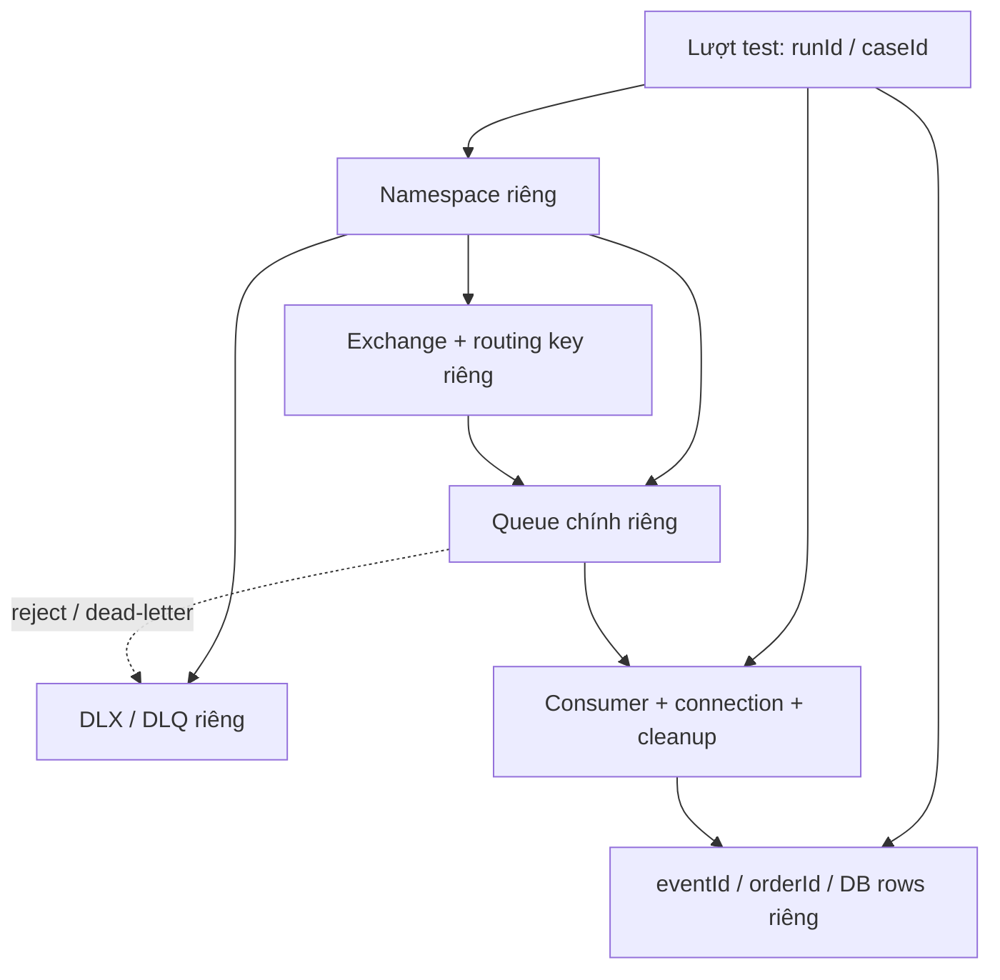
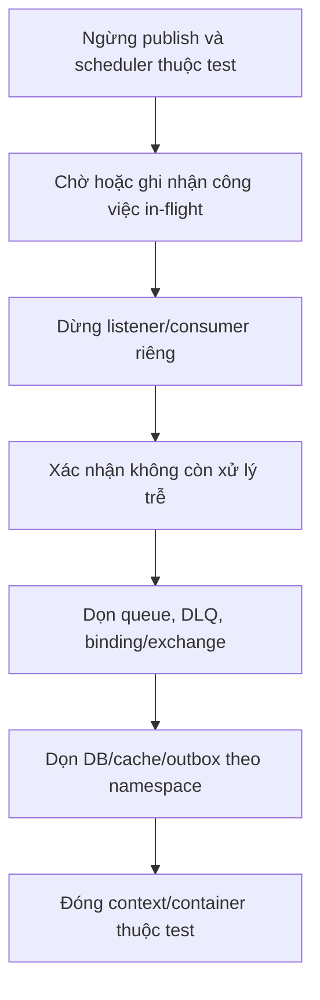

# Cô lập queue, dữ liệu và tài nguyên giữa các lượt kiểm thử

## 1. Vấn đề: test đúng nhưng kết quả thay đổi theo thứ tự chạy

Trong chương **Kiểm thử** của **Spring AMQP**, chúng ta kiểm tra các luồng bất đồng bộ sử dụng `RabbitTemplate`, `@RabbitListener`, exchange, queue, binding, acknowledgement, retry và dead-letter. Các thành phần ấy giữ **trạng thái bên ngoài JVM**. Nếu nhiều bài kiểm thử dùng chung tài nguyên mà không có quy tắc cô lập, bài test có thể pass khi chạy riêng nhưng fail ngẫu nhiên khi chạy cả bộ hoặc chạy song song trong CI.

Ví dụ hai test `A` và `B` đều gửi tới queue `orders.paid.test`:

1. Test A publish `OrderPaid(A-101)`, nhưng listener xử lý chậm.
2. Test A hết thời gian chờ và kết thúc, **message của A vẫn còn trong queue**.
3. Test B bắt đầu, publish `OrderPaid(B-202)` và gọi `RabbitTemplate.receive()`.
4. Test B có thể nhận **message của A**; hoặc listener của A vẫn hoạt động và nhận mất message của B.
5. Nếu B chỉ khẳng định “có message”, test báo pass dù kiểm sai dữ liệu. Nếu B kiểm đúng ID, test fail phụ thuộc vào thứ tự chạy.

Một kiểu rò rỉ khác là test trước đưa message lỗi vào dead-letter queue, khiến test sau tưởng xử lý lỗi vừa chạy đã tạo ra DLQ record. Database cũng có thể lưu `eventId` cũ làm idempotency của test tiếp theo bỏ qua message hợp lệ.

**Mục tiêu bài học:** Mỗi lượt kiểm thử phải biết chính xác **queue/exchange/binding nào thuộc về mình, message nào do mình tạo, dữ liệu nghiệp vụ nào được phép sửa và ai chịu trách nhiệm dọn tài nguyên**. Khi test xong, nó không được ảnh hưởng đến lượt khác.

### Sau bài học, bạn sẽ có thể

- Lựa chọn cô lập ở mức **test method**, **test class**, **test suite/CI worker** hoặc **container/broker**.
- Tạo tên tài nguyên duy nhất và định tuyến sao cho producer/consumer không đọc nhầm message.
- Cấu hình Spring Boot Testcontainers, `@ServiceConnection`, `RabbitAdmin` và những thành phần cần thiết để kiểm thử RabbitMQ thật.
- Quản lý lifecycle của listener, connection, queue, binding, retry queue, DLQ và database fixture.
- Tránh hiểu lầm về `exclusive`, `autoDelete`, `purgeQueue`, `@Transactional` và Spring test context caching.
- Viết bài test có deadline rõ ràng, chịu được thời gian xử lý bất đồng bộ và chạy song song có kiểm soát.

## 2. Ba trục cô lập: hạ tầng, message và trạng thái nghiệp vụ

Chỉ đặt `eventId` khác nhau **chưa đủ** khi hai test cùng dùng một queue với các consumer cạnh tranh. Ngược lại, dùng queue riêng vẫn có thể sai nếu database chung chứa dữ liệu trùng.

| Trục | Các tài nguyên cần xem xét | Rủi ro khi không cô lập |
|---|---|---|
| **RabbitMQ topology** | Exchange, queue, binding, virtual host, DLX/DLQ, retry queue | Message đi nhầm tuyến; binding cũ còn lại; DLQ bị nhiễu |
| **Message / correlation** | `eventId`, `messageId`, `correlationId`, routing key, order ID, headers | Test B nhận event của A; bản retry bị nhầm thành nghiệp vụ mới |
| **Trạng thái nghiệp vụ** | Database rows, idempotency/inbox, outbox, cache, object storage | Bản ghi còn từ test trước gây duplicate/no-op hoặc sai assertion |
| **Runtime** | `@RabbitListener` container, connection/channel, scheduler, thread pool | Consumer cũ lấy message, reconnect/redeclare sau khi test dọn queue |
| **Môi trường** | RabbitMQ container, PostgreSQL container, Spring context, CI worker | Hàng đợi/DB của nhiều test class hoặc job cùng tồn tại |
| **Quan sát** | Logs, metrics, trace IDs, retry counters | Test đếm kết quả của một lượt khác, che giấu nguyên nhân lỗi |



**Invariant quan trọng:** Một test chỉ được **consume, delete, purge và assert trên tài nguyên do nó sở hữu**, trừ khi đó là bài test được thiết kế riêng để kiểm một môi trường dùng chung.

## 3. Chọn ranh giới cô lập phù hợp

| Phạm vi | Cách cô lập | Ưu điểm | Cần lưu ý |
|---|---|---|---|
| Một **method** | Tên exchange/queue/binding/routing key + ID riêng cho từng method | Chạy song song linh hoạt, không cần khởi tạo broker cho mỗi test | Listener đăng ký tĩnh trong Spring context cần quản lý động |
| Một **class** | Một RabbitMQ container và topology riêng cho class, fixture mới cho mỗi method | Cân bằng tốc độ và độ độc lập | Không chạy song song các method dùng chung queue nếu cùng consume |
| Một **test suite** | Một container hoặc vhost cho suite, namespace theo class/test | Ít tốn startup | Cần cleanup chặt; context/test process có thể dùng lại |
| Một **CI worker / job** | Broker/vhost/DB độc lập theo job ID | Không ảnh hưởng giữa các pipeline | Tốn hạ tầng; phải quản lý quota và dọn khi job bị kill |
| Một **broker/container mỗi test** | Testcontainers lifecycle per-method | Mức cô lập rất cao, hợp fault injection | Chậm, tiêu tốn CPU/RAM; không phải mặc định cho mọi test |

**Khuyến nghị thực hành:** Unit test dùng mock không cần broker; integration test với broker thật nên dùng **container riêng cho test class** và **tên queue/exchange riêng cho test method** khi test dùng `RabbitTemplate.receive()`. Với listener container đã khởi động và subscribe cố định, ưu tiên **queue riêng cho class**, test tuần tự hoặc tạo listener động có lifecycle rõ ràng. Dành broker riêng mỗi test cho các kịch bản restart, partition, disk alarm hoặc thay đổi cấu hình broker.

## 4. Quy ước đặt tên để tránh đụng nhau

Thay vì khai báo mọi bài test dùng `orders.paid.queue`, tạo namespace gồm mục đích và giá trị duy nhất:

```text
it.<test-type>.<random-suffix>.<resource>

it.routing.a93b...ex
it.routing.a93b...main
it.routing.a93b...dlq
it.routing.a93b...retry
```

Tên nên được sinh **một lần cho mỗi lượt test**, giữ lại để cleanup và ghi log chẩn đoán. Với những queue test dài hạn, thêm tên suite/run ID để hỗ trợ truy vết; nhưng tránh tên quá dài hoặc chứa dữ liệu cá nhân.

```java
import java.util.UUID;

public final class AmqpTestNames {
    private final String prefix;

    public AmqpTestNames(String scenario) {
        if (!scenario.matches("[a-z][a-z0-9-]{1,24}")) {
            throw new IllegalArgumentException("Unsafe scenario name");
        }
        String random = UUID.randomUUID().toString().replace("-", "");
        this.prefix = "it." + scenario + "." + random;
    }

    public String exchange() { return prefix + ".exchange"; }
    public String queue() { return prefix + ".queue"; }
    public String dlx() { return prefix + ".dlx"; }
    public String dlq() { return prefix + ".dlq"; }
    public String retryQueue() { return prefix + ".retry"; }
    public String routingKey() { return prefix + ".event"; }
    public String eventId() { return prefix + ".evt"; }
}
```

Ví dụ trên dùng UUID có xác suất trùng cực thấp, thích hợp test isolation; không dùng `System.currentTimeMillis()` hoặc `Thread.currentThread().getId()` làm nguồn duy nhất khi nhiều process chạy cùng lúc. Nếu môi trường yêu cầu tên theo quy chuẩn nghiêm ngặt, có thể hash/giới hạn độ dài nhưng không được để hai test dùng lại cùng namespace.

**Cần nhất quán:** Mọi thành phần của một bài test phải cùng dùng `AmqpTestNames` đó. Chỉ đổi tên queue mà vẫn dùng một routing key chung tới exchange chung có thể khiến **một publish được fan-out tới cả queue của test khác** nếu có nhiều binding trùng key.

## 5. Hiểu chính xác `durable`, `exclusive`, `autoDelete` và cleanup

RabbitMQ cung cấp vài cơ chế có thể hỗ trợ tạo queue ngắn hạn, nhưng chúng có ý nghĩa khác nhau:

| Thuộc tính | Ý nghĩa | Có tự giải quyết toàn bộ isolation? |
|---|---|---|
| `durable=true` | Định nghĩa queue tồn tại sau broker restart | Không; queue có thể còn lại và làm nhiễu test sau |
| `exclusive=true` | Queue gắn với **connection khai báo**, connection khác không được sử dụng queue; sẽ bị xóa khi connection đó mất | Không phù hợp nếu admin/publisher/listener dùng các connection khác nhau |
| `autoDelete=true` | Queue được xóa sau khi **đã từng có consumer** và consumer cuối rời đi | **Không** tự xóa queue chỉ được dùng qua `basic.get`/polling |
| `x-expires` / queue TTL | Queue không được sử dụng trong thời gian cấu hình có thể bị xóa | Chỉ là cleanup dự phòng, không thay việc test dọn đúng lúc |
| Xóa tường minh qua `AmqpAdmin.deleteQueue(...)` | Đề nghị broker xóa đúng queue đã tạo | Phải bảo đảm consumer đã ngừng và tên thuộc sở hữu của test |

RabbitMQ khuyến nghị queue **exclusive, server-named** cho tình huống temporary/reply-to phụ thuộc một connection. Tuy nhiên, với bài kiểm thử producer và listener ở các connection khác nhau, `exclusive` dễ gây `RESOURCE_LOCKED`. Vì vậy không “thêm `exclusive=true` cho an toàn” một cách máy móc.

**Điểm dễ bỏ sót:** `RabbitTemplate.receive(queue)` dùng thao tác đọc một message theo nhu cầu, không đăng ký consumer dài hạn giống `@RabbitListener`. Một queue `autoDelete` **chưa từng có consumer** không nhất thiết được xóa khi test kết thúc. Dùng tên duy nhất và xóa tường minh trong `finally`. Ngoài ra, các phiên bản RabbitMQ hiện đại hạn chế/deprecate queue classic **non-durable, non-exclusive**; ví dụ dưới đây cố ý dùng queue durable nhưng **được xóa có kiểm soát** để tránh phụ thuộc hành vi queue tạm giữa các phiên bản.

Không xóa queue production hay queue test của người khác chỉ vì nó có tiền tố `it.`. Chỉ xóa **tên được chính lượt test tạo và lưu lại**.

## 6. Integration test độc lập: Testcontainers + topology mỗi method

Khi cần kiểm broker thực sự định tuyến theo exchange và binding, hãy sử dụng RabbitMQ Testcontainers với Spring Boot. Ví dụ dùng:

- JUnit Jupiter;
- Spring Boot với `spring-boot-starter-amqp` và `spring-boot-starter-test`;
- `spring-boot-testcontainers`, Testcontainers RabbitMQ/JUnit module theo BOM;
- RabbitMQ container với cổng được ánh xạ **động**.

Ví dụ dependency Maven (phiên bản và artifact ID Testcontainers phụ thuộc major version trong BOM):

```xml
<dependency>
    <groupId>org.springframework.boot</groupId>
    <artifactId>spring-boot-starter-test</artifactId>
    <scope>test</scope>
</dependency>
<dependency>
    <groupId>org.springframework.boot</groupId>
    <artifactId>spring-boot-testcontainers</artifactId>
    <scope>test</scope>
</dependency>
<!-- Chọn đúng artifact Testcontainers RabbitMQ và JUnit Jupiter
     theo major version/BOM dự án (1.x khác 2.x). -->
```

### 6.1. Một test không dùng listener cạnh tranh

Ví dụ sau gửi qua **exchange và binding thật** rồi đọc chính queue của method. Vì không có `@RabbitListener` nào subscribe vào queue vừa tạo, `RabbitTemplate.receive()` không bị consumer khác “lấy mất” message.

```java
import static org.junit.jupiter.api.Assertions.assertEquals;
import static org.junit.jupiter.api.Assertions.assertNotNull;

import java.nio.charset.StandardCharsets;
import org.junit.jupiter.api.Test;
import org.springframework.amqp.core.AmqpAdmin;
import org.springframework.amqp.core.Binding;
import org.springframework.amqp.core.BindingBuilder;
import org.springframework.amqp.core.DirectExchange;
import org.springframework.amqp.core.Message;
import org.springframework.amqp.core.Queue;
import org.springframework.amqp.core.QueueBuilder;
import org.springframework.amqp.rabbit.core.RabbitTemplate;
import org.springframework.beans.factory.annotation.Autowired;
import org.springframework.boot.test.context.SpringBootTest;
import org.springframework.boot.testcontainers.service.connection.ServiceConnection;
import org.testcontainers.containers.RabbitMQContainer;
import org.testcontainers.junit.jupiter.Container;
import org.testcontainers.junit.jupiter.Testcontainers;
import org.testcontainers.utility.DockerImageName;

@Testcontainers
@SpringBootTest
class PerTestQueueIsolationIT {

    @Container
    @ServiceConnection
    static final RabbitMQContainer rabbit = new RabbitMQContainer(
            DockerImageName.parse("rabbitmq:4.1-management"));

    @Autowired AmqpAdmin admin;
    @Autowired RabbitTemplate template;

    @Test
    void sendsAndReceivesOnlyThroughOwnedQueue() {
        AmqpTestNames names = new AmqpTestNames("routing");
        DirectExchange exchange =
                new DirectExchange(names.exchange(), true, false);
        Queue queue = QueueBuilder.durable(names.queue()).build();
        Binding binding = BindingBuilder.bind(queue)
                .to(exchange).with(names.routingKey());

        try {
            admin.declareExchange(exchange);
            admin.declareQueue(queue);
            admin.declareBinding(binding);

            String payload = names.eventId() + "|order-1|PAID";
            template.convertAndSend(
                    names.exchange(), names.routingKey(), payload);

            Message received = template.receive(names.queue(), 5_000);
            assertNotNull(received, "Message never reached owned queue");
            assertEquals(payload, new String(
                    received.getBody(), StandardCharsets.UTF_8));
        } finally {
            // Xóa các tài nguyên của chính test này, kể cả khi assertion fail.
            admin.deleteQueue(names.queue());
            admin.deleteExchange(names.exchange());
        }
    }
}
```

**Điều kiện chạy:** Spring context phải có `AmqpAdmin`/`RabbitAdmin` và `RabbitTemplate`; Spring Boot thường tạo khi dependency/cấu hình tương ứng có mặt. `@ServiceConnection` hỗ trợ cấu hình connection details từ container ở các phiên bản Spring Boot phù hợp (3.1+). Nếu không dùng `@ServiceConnection`, cấu hình host/port/credentials động bằng `@DynamicPropertySource`. Testcontainers cần Docker/compatible runtime trong máy local/CI.

**Những gì test trên chứng minh:** Exchange tồn tại, binding nhận đúng routing key, message đến queue test và nội dung chưa bị trộn. Nó **không** kiểm `@RabbitListener`, retry, ack dưới lỗi hoặc database transaction; đó là những test khác.

**Lưu ý cleanup:** Nếu broker chết ngay khi test chạy, `deleteQueue/deleteExchange` trong `finally` cũng có thể thất bại. Trong suite production-grade, ghi lại cleanup failure và để Testcontainers phá hủy **container test thuộc sở hữu của nó** ở cuối class. Không bắt lỗi xóa rồi im lặng coi tài nguyên đã được dọn sạch.

### 6.2. Cô lập giữa hai bài test chạy song song

Hai method có thể chạy song song khi **cả hai** sinh namespace riêng như ví dụ và không cùng listener:

```text
test A:
  exchange = it.routing.A.exchange
  queue    = it.routing.A.queue
  key      = it.routing.A.event

test B:
  exchange = it.routing.B.exchange
  queue    = it.routing.B.queue
  key      = it.routing.B.event

A publish -> only A queue
B publish -> only B queue
```

Nếu phải dùng **exchange chung để kiểm một tính năng**, có thể dùng **routing key riêng theo test** và binding chính xác, nhưng cần chứng minh không có wildcard/topic binding khác vô tình bắt cả hai message. Đối với `fanout exchange`, chỉ đổi routing key **không đủ**, vì fanout không dựa vào routing key; hãy tạo exchange riêng hoặc dùng broker/vhost riêng.

## 7. Với @RabbitListener: queue phải tồn tại trước khi container subscribe

Một listener dạng:

```java
@RabbitListener(queues = "orders.paid.test")
public void handle(String body) {
    // ...
}
```

luôn subscribe cùng tên queue và dễ cạnh tranh message giữa các test. Muốn cô lập **mỗi test class** có thể khai báo queue có tên ngẫu nhiên trong `@TestConfiguration` rồi tham chiếu qua SpEL:

```java
import java.util.UUID;
import org.springframework.amqp.core.Queue;
import org.springframework.amqp.core.QueueBuilder;
import org.springframework.boot.test.context.TestConfiguration;
import org.springframework.context.annotation.Bean;

@TestConfiguration(proxyBeanMethods = false)
class IsolatedListenerQueueConfiguration {
    @Bean
    Queue isolatedListenerQueue() {
        String name = "it.listener." + UUID.randomUUID();
        return QueueBuilder.durable(name).build();
    }
}
```

```java
import org.springframework.amqp.rabbit.annotation.RabbitListener;
import org.springframework.stereotype.Component;

@Component
class IsolatedListener {
    @RabbitListener(
            id = "isolatedListener",
            queues = "#{@isolatedListenerQueue.name}")
    void onMessage(String payload) {
        // Xử lý bằng fake/spy/DB fixture của đúng context test.
    }
}
```

Đây là **mảnh cấu hình minh họa** dùng trong test context có import `IsolatedListenerQueueConfiguration` và tạo/khai báo bean queue trước listener startup. Khi cần kiểm routing exchange thật, khai báo thêm exchange/binding cũng dùng namespace của class đó.

**Bẫy Spring test context cache:** Spring Test có thể **tái sử dụng ApplicationContext** giữa nhiều test class có cấu hình giống nhau. Bean `isolatedListenerQueue` chỉ được tạo **một lần cho một context**, không phải một lần cho mỗi `@Test` hoặc mỗi class. Khi cần tách theo class, hãy cấu hình test context thực sự khác nhau hoặc dùng `@DirtiesContext(classMode = AFTER_CLASS)` có cân nhắc chi phí startup. Không gán nhãn “per-class isolation” chỉ vì bean dùng `UUID.randomUUID()`.

### 7.1. Không xóa queue khi listener vẫn subscribe

Nếu test tự xóa queue trong lúc listener đang chạy, container có thể phát hiện missing queue rồi **cố gắng reconnect/redeclare**, làm test tiếp theo gặp queue bất ngờ. Quy trình shutdown đúng:

1. Ngừng publish, chờ các message của test hoàn tất hoặc ghi trạng thái cần điều tra.
2. Lấy đúng container qua `RabbitListenerEndpointRegistry` và gọi `stop()`, đợi thực sự dừng theo cơ chế callback/lifecycle.
3. Xác minh không còn delivery in-flight do listener đó xử lý.
4. Mới xóa queue, DLQ, exchange/bindings **thuộc sở hữu test**.
5. Đóng Spring context/connection đúng phạm vi; không dừng listener dùng chung của test khác.

```java
import org.springframework.amqp.rabbit.listener.MessageListenerContainer;
import org.springframework.amqp.rabbit.listener.RabbitListenerEndpointRegistry;

MessageListenerContainer container =
        registry.getListenerContainer("isolatedListener");
if (container != null) {
    container.stop();
}
// Sau khi xác nhận consumer đã ngừng và không còn công việc in-flight:
// admin.deleteQueue(ownedQueueName);
```

Đoạn này thuộc setup/teardown của test, chưa minh họa đầy đủ việc đợi asynchronous stop và kiểm broker consumer count. Nếu test dùng container/registry chung, **không dừng một listener production được nhiều test cùng dùng**. Cách đơn giản nhất vẫn là context, queue và container test chuyên biệt.

## 8. Cô lập DLQ, retry queue và message chưa ack

Một test lỗi không chỉ đụng queue chính. Khi message bị reject, nack, hết retry hoặc chuyển qua TTL-based retry, nó có thể xuất hiện ở **DLQ hoặc retry queue** sau khi test đã hết thời gian chờ.

Ví dụ một topology riêng cho test:

```text
it.fail.<id>.exchange
     |
     +-- key event --> it.fail.<id>.main
                            |
                            +-- reject(no requeue)
                                  |
                                  v
                         it.fail.<id>.dlx
                                  |
                                  +-- key failed --> it.fail.<id>.dlq
```

```java
import org.springframework.amqp.core.BindingBuilder;
import org.springframework.amqp.core.DirectExchange;
import org.springframework.amqp.core.Queue;
import org.springframework.amqp.core.QueueBuilder;

AmqpTestNames names = new AmqpTestNames("failure");
DirectExchange input = new DirectExchange(
        names.exchange(), true, false);
DirectExchange dead = new DirectExchange(
        names.dlx(), true, false);

Queue main = QueueBuilder.durable(names.queue())
        .deadLetterExchange(names.dlx())
        .deadLetterRoutingKey("failed")
        .build();
Queue dlq = QueueBuilder.durable(names.dlq()).build();

// Dùng cùng admin của test context:
admin.declareExchange(input);
admin.declareExchange(dead);
admin.declareQueue(main);
admin.declareQueue(dlq);
admin.declareBinding(BindingBuilder.bind(main)
        .to(input).with(names.routingKey()));
admin.declareBinding(BindingBuilder.bind(dlq)
        .to(dead).with("failed"));
```

Đây là đoạn setup đặt trong một test hoặc fixture class, phải giữ lại các tên đã tạo để teardown. Sau khi publish message lỗi, hãy **chờ đúng event ID xuất hiện trong DLQ thuộc test**, thay vì assert `DLQ message count > 0` trên queue chung. Nếu có consumer đang subscribe DLQ, đừng gọi `RabbitTemplate.receive()` cùng lúc rồi giả định mình sẽ đọc được record.

### 8.1. Tại sao purge không phải isolation?

`AmqpAdmin.purgeQueue(queue, false)` xóa các message **ready** tại thời điểm purge; nó không thay thế việc dừng publisher/consumer hoặc bảo đảm những delivery chưa ack sẽ không xuất hiện lại. Cũng không thể chặn một delayed/retry message đến sau khi purge. Nếu test khác đang dùng queue, purge của bạn có thể xóa dữ liệu của họ.

**Không dùng `purgeQueue("orders.paid")` ở `@BeforeEach` trên môi trường chung.** Cách đúng là queue mới thuộc riêng test; sau khi hoàn tất, stop consumer và **delete chính queue đó**. Với test cố ý đo tác dụng của purge thì dùng queue riêng, ghi rõ precondition và xác minh bằng chứng.

### 8.2. Những trạng thái vẫn còn dù `ready=0`

| Trạng thái | Vì sao có thể làm hỏng lượt sau? |
|---|---|
| `messages_unacknowledged > 0` | Consumer cũ còn xử lý; khi connection đóng, message có thể requeue |
| Message trong DLQ | Test tiếp theo có thể đọc nhầm lỗi cũ |
| Delayed/retry message | Có thể được chuyển trở lại queue sau khi test mới bắt đầu |
| Publisher confirm pending | Producer cũ có thể retry cùng event sau timeout |
| Container Spring còn running | Consumer có thể tự reconnect và subscribe lại |
| Queue declaration do RabbitAdmin quản lý | Spring context reconnect có thể redeclare tài nguyên đã xóa |

Để kiểm các tình huống này, ưu tiên **namespace và lifecycle riêng** hơn một phép đo queue count tại một thời điểm.

## 9. Cô lập dữ liệu database, idempotency và outbox

Giả sử consumer xử lý `PaymentRecorded(eventId, orderId)` và ghi bảng `processed_events` để không cập nhật số dư hai lần. Nếu test A ghi `eventId=evt-1` rồi test B cũng dùng `evt-1`, test B có thể bị consumer xem là **duplicate hợp lệ**.

Nên sinh ID riêng theo method:

```java
String suffix = UUID.randomUUID().toString();
String eventId = "it-event-" + suffix;
String orderId = "it-order-" + suffix;
```

Nếu một test **cố tình kiểm replay/duplicate**, hãy dùng **cùng eventId trong các lần gửi lại của chính test đó**, không tạo ID mới cho từng attempt.

### 9.1. Đừng dựa hoàn toàn vào `@Transactional` ở method test

`@Transactional` trên JUnit test thường rollback các thay đổi thực hiện trong **test thread**. Nhưng `@RabbitListener` xử lý ở **thread khác**, với transaction database khác. Nếu listener đã commit, rollback ở test thread **không rollback** dữ liệu của consumer. Vì vậy cần:

- Dùng database Testcontainer riêng theo class/suite hoặc **schema/database riêng** khi cần độ cô lập cao.
- Tạo `orderId`, `eventId` và row fixtures duy nhất cho từng test.
- Đợi consumer commit và kết thúc; xóa dữ liệu **theo ID thuộc test** ở teardown.
- Dùng unique constraint và transaction thực để kiểm idempotency/race condition, không chỉ mock repository.
- Dọn cả outbox/inbox và bản ghi side effect, cache/test sink liên quan.

Ví dụ kế hoạch dữ liệu:

```sql
-- Lược đồ minh họa; trong hệ thống thật, kiểm cả FK và bảng phụ thuộc.
SELECT COUNT(*)
FROM processed_events
WHERE event_id = :owned_event_id;

SELECT status
FROM orders
WHERE order_id = :owned_order_id;

-- Teardown chỉ xóa những row thuộc chính test sau khi consumer đã dừng.
DELETE FROM processed_events WHERE event_id = :owned_event_id;
DELETE FROM orders WHERE order_id = :owned_order_id;
```

**Không** dùng `TRUNCATE processed_events` hoặc `DELETE FROM orders` không có điều kiện khi nhiều test cùng database. Với quan hệ foreign key, trigger hoặc audit table, cần kế hoạch cleanup nhất quán hoặc đơn giản sử dụng **database/schema mới** cho mỗi môi trường test quan trọng.

### 9.2. Cache, scheduler và nguồn dữ liệu khác

Kiểm thử đầy đủ có thể phải cô lập Redis keys, file test, S3 prefix, HTTP fake server state, scheduled outbox relay, dead-letter replay job và metrics in-memory. Một listener còn hoạt động sau assertion có thể ghi database hoặc cache **sau khi teardown**; thứ tự dọn phải phụ thuộc vào lifecycle:



Nếu không thể bảo đảm test khác không chạy song song, ưu tiên tách tài nguyên thay vì cố dọn shared state thật nhanh.

## 10. Cô lập Spring Test context, Testcontainers và CI

### 10.1. Vòng đời container không đồng nhất với vòng đời Spring context

Với `@Container static RabbitMQContainer`, Testcontainers thường quản lý broker ở **phạm vi test class**. Trong khi đó, Spring TestContext có thể **cache ApplicationContext** sau khi class kết thúc. Nếu class tiếp theo tái sử dụng context có connection details hoặc beans gắn với container trước **đã dừng**, các lỗi connection bất thường có thể xảy ra.

Vì thế:

1. Với test class dùng container riêng, bảo đảm **context có vòng đời phù hợp**, ví dụ `@DirtiesContext(classMode = DirtiesContext.ClassMode.AFTER_CLASS)` khi cần cô lập hoàn toàn.
2. Nếu chủ động chia sẻ một broker giữa nhiều class để tăng tốc, quản lý container ở scope suite và duy trì nó cho đến khi **toàn bộ context dùng nó** đã dừng.
3. Không sử dụng `withReuse(true)` như một giải pháp mặc định cho CI: container có thể mang state giữa các lần chạy.
4. Không giả định mỗi `@SpringBootTest` tạo một context mới; các class có cấu hình giống nhau có thể dùng chung bean/listener.

```java
import org.springframework.test.annotation.DirtiesContext;

@DirtiesContext(
        classMode = DirtiesContext.ClassMode.AFTER_CLASS)
class ContextIsolatedIntegrationTest {
    // Kết hợp với @SpringBootTest, @Testcontainers và topology riêng.
}
```

`@DirtiesContext` có chi phí startup; chỉ áp dụng khi thực sự có lý do vòng đời, không bật trên mọi unit test. Nó **không tự dọn** exchange/queue durable còn trên broker dùng chung; tài nguyên RabbitMQ vẫn phải được dọn đúng sở hữu.

### 10.2. Khi nhiều CI worker chạy song song

| Tình huống | Cách tránh xung đột |
|---|---|
| Hai worker cùng dùng `localhost:5672` | Mỗi worker có Testcontainers broker riêng và port mapping động |
| Hai job dùng RabbitMQ test server chung | Vhost hoặc broker namespace riêng, credentials hạn chế, tên queue/exchange riêng |
| Test restart broker | Broker **riêng** cho test fault injection, tuyệt đối không restart shared broker |
| Hai suite cùng database | Database/schema hoặc prefix key tách theo runId |
| Hai class dùng chung ApplicationContext | Giữ lifecycle đồng bộ hoặc làm context khác nhau có kiểm soát |
| Tests chạy trong cùng JVM bằng JUnit parallel | Không chia sẻ queue/listener/in-memory fake mutable mà thiếu đồng bộ |

Nếu dùng chung một **virtual host**, mọi queue trong đó vẫn có thể nhìn thấy bằng quyền phù hợp; vhost riêng vừa cô lập tên tài nguyên vừa giới hạn quyền. Nhưng tạo/xóa vhost đòi quyền quản trị và có thể tốn thời gian, nên thực tế thường dùng **broker riêng hoặc vhost mỗi CI job**, cộng queue per-test khi cần parallelism.

### 10.3. Tên của kết nối và log chẩn đoán

Gắn test run ID, test case ID và event ID vào logs/metrics ở mức an toàn, nhưng không ghi token/password trong RabbitMQ URL. Với Testcontainers, ghi version image, mapped port (nếu không nhạy cảm), test class và namespace queue để debug. Không in toàn bộ message body chứa PII vào failure report.

## 11. Kiểm thử bất đồng bộ: chờ điều kiện chứ không ngủ cố định

Một test có thể đã route đúng nhưng consumer cần thời gian để xử lý. Việc dùng `Thread.sleep(1000)` vừa không bảo đảm đủ trên CI vừa làm test chậm khi hệ thống hoàn tất sớm.

```java
// DỄ FLAKY:
publisher.publish(event);
Thread.sleep(1000);
assertEquals("PAID", repository.findStatus(orderId));
```

Thay bằng điều kiện có deadline rõ ràng, ví dụ **Awaitility** (thêm dependency test phù hợp):

```java
import static org.awaitility.Awaitility.await;
import static org.junit.jupiter.api.Assertions.assertEquals;
import java.time.Duration;

publisher.publish(event);

await().atMost(Duration.ofSeconds(15))
        .pollInterval(Duration.ofMillis(100))
        .untilAsserted(() ->
                assertEquals("PAID", repository.findStatus(orderId)));
```

**Chờ kết quả bền**, không chỉ chờ listener được gọi. Nếu listener count-down latch trước khi DB commit, test có thể pass trong khi transaction rollback ngay sau đó.

### 11.1. Đừng dùng receive để “ngó queue” khi có active listener

Nếu `@RabbitListener` đang tiêu thụ queue đó, `RabbitTemplate.receive(queue)` cạnh tranh cùng message. Bạn có thể vô tình lấy mất message cần test, dẫn đến lỗi giả. Thay vào đó:

- Kiểm tra database/event sink/spy có correlation ID đúng.
- Dùng một queue quan sát riêng qua binding phù hợp nếu contract yêu cầu **một bản sao** event (đây là test routing khác, không phải trộm message từ queue chính).
- Khi kiểm chính nội dung queue, **không khởi động competing listener**.

### 11.2. Thất bại cần có diagnostics đủ nhưng an toàn

Nếu chờ hết hạn, ghi test class, `runId`, `eventId`, tên queue, retry attempts, consumer count, queue depth, DLQ depth và trạng thái DB liên quan. Không dump toàn bộ payload/token hoặc nội dung DLQ nhạy cảm vào CI logs.

Một bài test thất bại phải chỉ ra **bằng chứng nào thiếu**: không có binding, không consumer, đã vào DLQ, DB rollback, hoặc timeout. “Expected true but was false” không đủ để chẩn đoán bất đồng bộ.

## 12. Một kịch bản cô lập thật sự: retry, DLQ và database

Giả sử hai integration test chạy đồng thời:

**Test A — happy path**

- Tạo `AmqpTestNames("paid-ok")`, exchange/queue/binding riêng.
- Tạo `eventId` và `orderId` mới trong DB.
- Publish `OrderPaid`, chờ trạng thái `PAID`.
- Kiểm đúng ID, không lấy tổng số message của mọi queue làm bằng chứng.
- Ngừng listener thuộc A, cleanup topology và rows thuộc A.

**Test B — poison message**

- Tạo `AmqpTestNames("paid-invalid")`, queue chính, DLX và DLQ riêng.
- Publish event sai schema với `eventId` của B.
- Khi listener reject không requeue, chờ **đúng ID** ở DLQ của B.
- Kiểm không có side effect trong DB, không có retry vô hạn.
- Ngừng listener thuộc B và cleanup cả retry queue/DLQ.

Hai test dùng **khác queue, binding, ID và row**, nên không có lý do để cạnh tranh message. Nếu cả hai chạy trong cùng Spring context, cần đảm bảo **hai listener khác nhau được gắn đúng queue**; không để một `@RabbitListener(queues = "orders.paid.queue")` production còn hoạt động và đọc nhầm test message.

### Ma trận kiểm thử isolation

| Tình huống | Dấu hiệu lỗi nếu cô lập sai | Bằng chứng mong đợi |
|---|---|---|
| Chạy riêng từng test rồi chạy chung | Chỉ fail khi chạy chung | Cả hai kết quả giống nhau |
| Đổi thứ tự test A/B | B nhận message cũ từ A | Không có cross-talk, đúng event ID |
| Chạy parallel trong cùng JVM | Hai listener lấy message của nhau | Queue/DB namespace độc lập |
| Chạy hai CI jobs cùng lúc | `PRECONDITION_FAILED` hoặc cướp queue | Broker/vhost/port và names tách riêng |
| Test A timeout, có retry đến muộn | DLQ B nhận lỗi của A | Retry/DLQ thuộc namespace A |
| Restart broker ở fault test | Test B mất connection | Fault test dùng broker riêng |
| Test A đã commit DB rồi teardown | Test B thấy duplicate | Rows/events riêng, cleanup theo ID |
| Test kết thúc không bình thường | Resource còn tồn đọng | Container teardown hoặc TTL/quota dự phòng |

## 13. Những sai lầm thường gặp

| Sai lầm | Hậu quả | Cách khắc phục |
|---|---|---|
| Gán mọi test vào `myapp.test.queue` | Message bị trộn, test phụ thuộc thứ tự | Queue/routing namespace riêng |
| Đổi queue nhưng giữ routing key chung trên fanout exchange | Một event đi tới nhiều test | Exchange riêng hoặc vhost/broker riêng |
| Tin `autoDelete` xóa queue polling | Queue chưa từng có consumer vẫn tồn tại | `deleteQueue` tường minh, fallback queue TTL |
| Dùng `exclusive=true` với admin và listener khác connection | `RESOURCE_LOCKED` | Chỉ dùng exclusive khi đúng connection ownership |
| `purgeQueue` trước mọi test trên broker chung | Xóa message của test khác, không xử lý unacked | Không purge shared queue; tạo queue riêng |
| Tạo UUID trong bean Spring rồi cho rằng mỗi test có queue mới | Context caching tái dùng cùng bean | Xác định lifecycle thực; queue per-method hay context per-class |
| Xóa queue trong khi listener chạy | Container reconnect/redeclare, message thất lạc | Dừng listener, đợi in-flight, rồi cleanup |
| Rollback `@Transactional` ở test và nghĩ consumer cũng rollback | Listener thread đã commit riêng | DB namespace, cleanup rows và transaction thực |
| Chỉ kiểm `queue_count=0` | DLQ, unacked, retry hay outbox vẫn còn | Kiểm toàn vòng đời và trạng thái nghiệp vụ |
| Dùng fixed `Thread.sleep` | Test flaky/chậm | Awaitility/latch có deadline, assert trạng thái bền |
| Chạy fault test trên broker chia sẻ | Làm hỏng nhiều test không liên quan | Broker container độc lập |
| Dọn tài nguyên theo prefix quá rộng | Xóa tài nguyên người khác | Chỉ xóa names do test hiện tại sở hữu |

## 14. Checklist áp dụng trong dự án

Trước khi merge một integration/E2E test Spring AMQP, kiểm tra:

1. **Ownership:** Exchange, queue, binding, DLX/DLQ, retry queue có tên duy nhất theo test hoặc được cấp từ một broker/vhost riêng?
2. **Message identity:** `eventId`, order ID, correlation ID không trùng với test khác; retry cùng nghiệp vụ giữ đúng ID cũ?
3. **Topology:** Đã tạo exchange/queue/binding trước khi gửi/subscribe? Có loại binding nào route tới nhiều test không?
4. **Broker lifecycle:** Container và Spring context có vòng đời nhất quán? Có dùng `@ServiceConnection`/`@DynamicPropertySource` đúng và không hardcode cổng?
5. **Listener lifecycle:** Listener dành riêng cho test đã được stop trước khi delete? Có listener chung đang cạnh tranh trên queue không?
6. **Database:** Không phụ thuộc rollback ở test thread cho dữ liệu consumer commit? Dọn cả inbox/outbox/cache?
7. **Failure paths:** DLQ/retry state có namespace riêng, không bị bỏ sót sau test timeout?
8. **Assertions:** Kiểm đúng event ID và trạng thái nghiệp vụ; không chỉ `messageCount > 0` hoặc method được gọi?
9. **Parallelism:** Chạy test đảo thứ tự và song song vẫn cho cùng kết quả? Các test có dùng chung fake mutable không?
10. **Cleanup:** Có `try/finally`/`@AfterEach` đúng scope, cleanup lỗi được báo, và container teardown làm lớp dự phòng?
11. **Diagnostics:** Khi timeout có log metadata an toàn, không dump payload/token/PII?
12. **CI:** Môi trường nhiều worker không đụng host/port/vhost/DB fixture; có giới hạn tài nguyên và deadline?

## 15. Câu hỏi và bài tập ôn tập

1. Vì sao `RabbitTemplate.receive(queue)` không làm `autoDelete` trở thành cơ chế cleanup đáng tin cậy cho queue chưa có consumer?
2. Khi nào nên dùng queue `exclusive`, và vì sao `RabbitAdmin` với `@RabbitListener` trên những connection khác nhau có thể gặp `RESOURCE_LOCKED`?
3. Hai test dùng queue khác nhau nhưng cùng topic exchange và binding `orders.#`. Có thể nhận nhầm message không? Hãy đề xuất binding/key an toàn.
4. Viết một JUnit test tạo `DirectExchange`, `Queue` và `Binding` riêng bằng `AmqpAdmin`; dùng `finally` để dọn mà không xóa queue chung.
5. Vì sao `@Transactional` trên test method không rollback thay đổi do một listener thread đã commit?
6. Một DLQ chung chứa message từ test cũ. Làm sao cải tiến assertion để không pass nhầm?
7. Spring TestContext cache có thể khiến `UUID.randomUUID()` trong `@Bean Queue` không tạo tên mới cho class tiếp theo như thế nào?
8. Nếu test dừng publisher, nhưng còn message chưa ack và retry queue, thứ tự shutdown/cleanup nên như thế nào?
9. Thiết kế isolation cho bốn CI worker chạy song song, mỗi worker thực hiện 100 test methods với RabbitMQ và PostgreSQL.
10. Tại sao việc dùng `Thread.sleep(2000)` sau publish gây flaky? Hãy viết assertion Awaitility theo trạng thái database.
11. Làm sao kiểm thử hệ thống với một consumer có chủ đích xử lý message trùng mà không làm ảnh hưởng lượt test kế tiếp?
12. Nếu test cần restart RabbitMQ để kiểm reconnect, nó nên cô lập tới mức nào và vì sao?

## 16. Tài liệu tham khảo

- [Spring AMQP — Testing Support](https://docs.spring.io/spring-amqp/reference/testing.html): `TestRabbitTemplate`, `@RabbitListenerTest`, `@RabbitAvailable` và test utilities.
- [Spring AMQP — Configuring the Broker](https://docs.spring.io/spring-amqp/reference/amqp/broker-configuration.html): `AmqpAdmin`/`RabbitAdmin`, khai báo và xóa queue, exchange, binding, `purgeQueue`.
- [Spring AMQP — Listener Concurrency](https://docs.spring.io/spring-amqp/reference/amqp/listener-concurrency.html): consumer/container concurrency ảnh hưởng việc test nhận message.
- [Spring Boot — Testcontainers](https://docs.spring.io/spring-boot/reference/testing/testcontainers.html): `@ServiceConnection` và lifecycle kết nối test.
- [Spring Framework — TestContext Framework](https://docs.spring.io/spring-framework/reference/testing/testcontext-framework/ctx-management/caching.html): cache `ApplicationContext` và tác động tới bean dùng chung.
- [Testcontainers — RabbitMQ Module](https://java.testcontainers.org/modules/rabbitmq/): chạy RabbitMQ cô lập cho integration tests.
- [RabbitMQ — Queues](https://www.rabbitmq.com/docs/queues): `durable`, `exclusive`, `autoDelete`, server-named queues, TTL và queue lifecycle.
- [RabbitMQ — Consumer Acknowledgements and Publisher Confirms](https://www.rabbitmq.com/docs/confirms): `ready`/`unacked` và ý nghĩa của ack/confirm khi dọn test.

**Ghi nhớ:** Kiểm thử bất đồng bộ đáng tin cậy đòi hỏi cô lập **cả topology, message identity, database state và lifecycle consumer**, không chỉ đổi tên queue. Mỗi test phải sở hữu rõ tài nguyên, dùng ID riêng, chờ kết quả nghiệp vụ với deadline, dừng consumer trước cleanup và không xóa/purge shared state. Khi ranh giới tài nguyên được quản lý đúng, integration test với RabbitMQ thật vẫn có thể chạy nhanh, ổn định và song song mà không phụ thuộc thứ tự thực thi.
