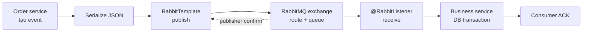
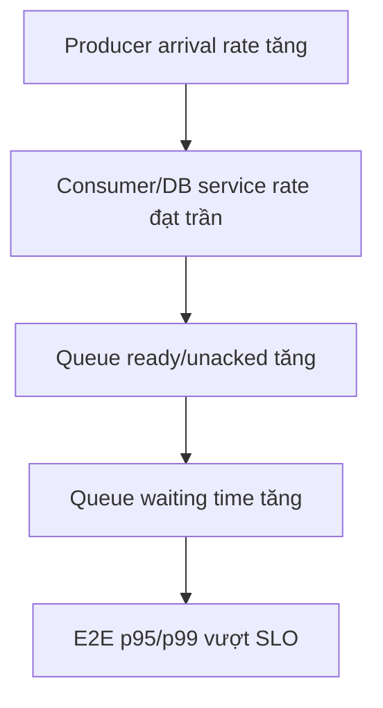
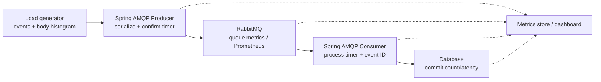

# Đo thông lượng, độ trễ và kích thước thông điệp thực tế

## 1. Hiệu năng Spring AMQP phải được đo ở đúng ranh giới

Trong hệ thống sử dụng **Spring AMQP** với `RabbitTemplate`, `@RabbitListener`, exchange, queue và binding, một thao tác publish có thể nhanh nhưng **toàn bộ xử lý nghiệp vụ vẫn chậm**. Producer chỉ thực hiện lệnh gửi; broker còn phải định tuyến, ghi dữ liệu, có thể nhân bản queue, chuyển delivery cho consumer; consumer giải mã payload, thực hiện transaction, xác nhận ACK và có thể retry.

Vì vậy câu hỏi “RabbitMQ xử lý được bao nhiêu message mỗi giây?” cần được chia thành các câu hỏi đo được:

- Producer **đã thử gửi** bao nhiêu message mỗi giây?
- Broker **đã xác nhận publish** bao nhiêu message mỗi giây?
- Có bao nhiêu message **được định tuyến tới queue** và bao nhiêu delivery được giao cho consumer?
- Consumer **hoàn tất nghiệp vụ thành công**, commit DB và ACK được bao nhiêu message mỗi giây?
- Người dùng hoặc dịch vụ downstream phải chờ **bao lâu từ lúc phát sinh sự kiện đến khi trạng thái nghiệp vụ có hiệu lực**?
- Một message thực tế lớn bao nhiêu: **body đã serialize**, header, metadata, overhead giao thức, kích thước sau nén và tải mạng?
- Khi tốc độ đến vượt tốc độ xử lý, **backlog tăng nhanh thế nào**, độ trễ ở p95/p99 thay đổi ra sao?

Bài học thuộc chương **Hiệu năng** của module **SPRING_AMQP**, tiếp nối việc cấu hình RabbitTemplate, @RabbitListener, exchange/queue/binding, publisher confirms, consumer acknowledgments, retry, dead-letter, transaction và observability nhằm xây hệ thống bất đồng bộ **đúng và đáng tin cậy**, không chỉ có con số benchmark cao.

### Mục tiêu học tập

Sau bài này, bạn có thể:

1. Định nghĩa throughput, latency, queue waiting time, consumer processing time và payload size **không nhập nhằng**.
2. Dùng **Micrometer** để ghi số message, byte, latency histogram và outcome trên producer/consumer Spring AMQP.
3. Quan sát **RabbitMQ Prometheus metrics** và đối chiếu với số liệu từ ứng dụng, DB và hạ tầng.
4. Tính tốc độ đến, tốc độ rời queue, mức backlog tăng/giảm và diễn giải p50/p95/p99.
5. Đo kích thước **JSON thật sau chuyển đổi**, thay vì dùng độ dài chuỗi hoặc kích thước DTO trong RAM.
6. Thiết kế thử tải với workload thực, các mức payload, header, prefetch, concurrency, confirms, retry và queue type.
7. Nhận biết giới hạn của mỗi phép đo, sai lệch đồng hồ, phép benchmark tự tạo và **coordinated omission**.
8. Đưa ra quyết định tuning theo dữ liệu, đồng thời giữ nguyên hợp đồng về ordering, idempotency và độ bền.

## 2. Cùng một luồng, nhiều điểm bắt đầu và kết thúc

Xét nghiệp vụ cập nhật đơn hàng:



Từng chỉ số đo một đoạn khác nhau của luồng:

| Chỉ số | Điểm bắt đầu | Điểm kết thúc | Có nói lên nghiệp vụ đã hoàn tất? |
|---|---|---|---|
| Producer call duration | Trước `convertAndSend`/`send` | Phương thức gửi trả về | **Không** |
| Serialization latency | Trước serialize DTO | Nhận được body bytes | **Không** |
| Publisher confirm latency | Trước publish | Future/callback nhận confirm | **Không** |
| Time to delivery | Timestamp trước publish | Consumer bắt đầu nhận | **Chưa** |
| Consumer processing latency | Trước xử lý trong listener | DB commit/service hoàn tất | Chỉ phần xử lý ứng dụng |
| Delivery-to-ACK latency | Broker giao delivery | Broker ghi nhận ACK | Gần hơn, nhưng phải hiểu nguồn metric |
| End-to-end business latency | Event nghiệp vụ phát sinh | Trạng thái cần thiết commit thành công | **Có**, nếu định nghĩa đúng |
| Queue age/backlog delay | Message vào queue | Message được nhận để xử lý | Cho biết chờ đợi; không bằng thời gian DB |

**Không dùng một con số latency duy nhất mà không ghi điểm đầu/cuối.** “p99 = 250 ms” vô nghĩa nếu không biết đó là publisher call, confirm, consumer handler hay end-to-end.

### 2.1. Publisher confirm không phải consumer ACK

- **Publisher confirm ACK**: broker chấp nhận publish theo ngữ nghĩa confirms của RabbitMQ. Nếu message không được route vào queue mà `mandatory` không được xử lý, producer vẫn có thể thấy **confirm ACK**.
- **Publisher return**: broker trả message unroutable khi publisher dùng `mandatory` và có returns support; cần quan sát riêng.
- **Consumer ACK**: consumer xác nhận delivery trên đúng channel sau khi đã xử lý theo hợp đồng của nó.
- **DB commit**: transaction nghiệp vụ đã commit, nhưng consumer ACK có thể chưa tới broker.

Do đó `publisher_confirm_acks_per_second` không thể dùng làm `orders_processed_per_second`. Đếm message đã xử lý tại **ranh giới DB commit/idempotency** hoặc business completion.

### 2.2. Định nghĩa “một message” phải nhất quán

Một sự kiện nghiệp vụ `OrderPaid` có thể được publish một lần nhưng route vào ba queue. Khi đó:

```text
1 business event
  -> 1 publish tới exchange
  -> 3 queue copies
  -> 3 consumer deliveries
  -> 3 business projections khác nhau
```

Nếu một delivery bị redeliver ba lần trước khi thành công, broker có thể ghi bốn deliveries nhưng vẫn chỉ là **một event unique**. Các phép đo vì thế phải phân biệt:

- `publish_attempts`;
- `publish_confirms_ack` / `publish_confirms_nack` / `publish_returns`;
- `deliveries` (có thể gồm redelivery);
- `consumer_attempts` / `consumer_failures`;
- `business_events_committed_unique`;
- `duplicate_events_ignored`.

Đặt tên metric theo **điểm đo**, không theo kỳ vọng.

## 3. Thông lượng: đơn vị, công thức và cách diễn giải

**Thông lượng (throughput)** là lượng công việc hoàn tất tại một ranh giới trong một đơn vị thời gian. Với một cửa sổ đo có độ dài `T` giây:

\[
\text{throughput} = \frac{\text{số lượng hoàn tất trong cửa sổ}}{T}
\]

Có thể biểu diễn theo **messages/second**, **unique business events/second**, **bytes/second** hoặc **transactions/second**.

### 3.1. Ví dụ số liệu trong một phút

Giả sử trong một phút ổn định:

| Điểm đo | Số lượng trong 60 giây | Tốc độ |
|---|---:|---:|
| Producer gọi gửi | 60.000 | 1.000 attempt/s |
| Broker confirm ACK trong cửa sổ | 59.400 | 990 confirm/s |
| RabbitMQ deliveries | 55.200 | 920 delivery/s |
| Business transaction commit thành công | 49.800 | 830 commit/s |
| Event ID unique được áp dụng | 49.200 | 820 unique event/s |
| Redelivery được quan sát | 1.200 | 20 redelivery/s |

Các con số này **chỉ minh họa**, không phải benchmark RabbitMQ. Không được lấy `60.000 - 49.200` rồi kết luận chính xác có `10.800` message mất: một phần có thể còn chờ confirm, nằm trong queue, ở trạng thái unacked, retry hoặc được route nhiều đích. Để đối soát cần cùng cửa sổ đo, cùng phạm vi queue, event ID và trạng thái in-flight.

### 3.2. Tốc độ đến, tốc độ rời và backlog

Với **một queue không có thêm luồng chuyển trạng thái phức tạp**, có thể ước lượng:

\[
\frac{\Delta \text{backlog}}{\Delta t}
\approx \lambda_{\text{queue-in}} - \mu_{\text{queue-out}}
\]

Trong đó:

- `λ`: message vào queue trên giây;
- `μ`: message rời queue sau xử lý/ACK hoặc bị loại theo các cơ chế tương ứng trên giây;
- `backlog`: số message còn chờ hoặc tổng trạng thái liên quan, cần định nghĩa nhất quán.

Ví dụ queue nhận khoảng **1.000 message/s** nhưng chỉ hoàn tất **830 message/s** trong một khoảng ổn định, phần chênh **170 message/s** tương đương backlog có thể tăng **10.200 message/phút**, nếu không có TTL, drop, dead-letter hoặc thay đổi luồng khác. Cần xác minh bằng `messages_ready`, `messages_unacknowledged`, ingress và ACK rates của đúng queue.

**Cảnh báo:** `messages_ready` và `messages_unacknowledged` là **snapshot**, không phải throughput. Queue có `ready=0` nhưng consumer xử lý quá chậm với prefetch lớn vẫn có thể tồn tại hàng nghìn message `unacked`.

### 3.3. Tốc độ theo byte

Kích thước message ảnh hưởng throughput mạng/đĩa:

\[
\text{payload throughput (byte/s)}
= \text{messages/s} \times \text{mean serialized body bytes}
\]

Nếu rate là **800 message/s**, body trung bình **4 KiB** thì tổng body là khoảng **3.200 KiB/s ≈ 3,125 MiB/s** theo đơn vị nhị phân. Đây chỉ là **body bytes**, chưa bao gồm AMQP header, framing, replication, confirm, TCP/TLS, ACK và overhead broker.

Một workload có 50.000 message/s × 200 byte rất khác 5.000 message/s × 200 KiB. Báo cáo “message/s” mà không có phân bố payload size có thể gây hiểu lầm lớn.

## 4. Độ trễ: không chỉ có trung bình

Giả sử hai hệ thống cùng có average latency = 50 ms nhưng một hệ thống có nhiều request kéo dài 3 giây. Đối với người dùng và SLA, **tail latency** thường quan trọng hơn số trung bình.

### 4.1. p50, p95, p99

| Percentile | Ý nghĩa trực quan |
|---|---|
| `p50` | Khoảng 50% quan sát có latency không lớn hơn giá trị này |
| `p95` | Khoảng 95% quan sát có latency không lớn hơn giá trị này |
| `p99` | Khoảng 99% quan sát có latency không lớn hơn giá trị này |
| `max` | Giá trị lớn nhất quan sát trong cửa sổ (rất nhạy với nhiễu) |

Ví dụ minh họa:

| Phép đo | p50 | p95 | p99 |
|---|---:|---:|---:|
| Publish → confirm | 8 ms | 25 ms | 90 ms |
| Listener business processing | 20 ms | 80 ms | 220 ms |
| Event → DB commit | 55 ms | 250 ms | 1.200 ms |

Không cộng các **percentile riêng rẽ** để suy ra percentile end-to-end. Ví dụ `p99(confirm) + p99(handler)` **không phải** `p99(end-to-end)` do tương quan và phân bố độ trễ khác nhau. Muốn có end-to-end p99, phải đo end-to-end trên chính từng event.

### 4.2. Queue waiting time thường chi phối p99 khi bão hòa

Khi producer gửi nhanh hơn consumer xử lý, message phải chờ trong queue. Producer confirm vẫn có thể ổn định vì broker tiếp nhận nhanh, nhưng **event-to-commit latency tăng liên tục**.



Kết luận: **confirm latency thấp không đủ chứng minh throughput end-to-end tốt**. Mỗi báo cáo phải kèm queue depth và completion rate.

### 4.3. Thời gian đơn điệu và đồng hồ giữa các máy

Có hai kiểu đo:

1. **Cùng một JVM/process:** dùng `System.nanoTime()` để đo *duration*. Nó là nguồn monotonic phục vụ hiệu số thời gian, không phải epoch timestamp.
2. **Giữa producer và consumer trên hai máy:** cần timestamp tương ứng với **wall clock** như epoch milliseconds, đồng bộ đồng hồ bằng NTP/chrony và theo dõi clock skew. Không được trừ `System.nanoTime()` của máy consumer với nanoTime của máy producer.

Nếu producer ghi `producedAtEpochMs` và consumer đo `System.currentTimeMillis() - producedAtEpochMs`, kết quả có thể âm hoặc sai khi đồng hồ lệch. Khi đó phải gắn nhãn **clock skew / invalid sample**, đồng bộ clock hoặc chuyển sang phép đo sử dụng hạ tầng tracing đáng tin cậy. Event time và processing time cũng khác nhau: event có thể được tạo nhiều phút trước khi publisher phát vào RabbitMQ.

**Với SLA người dùng**, định nghĩa start là **lúc nghiệp vụ phát sinh** hay **lúc publish**. Hai thời điểm có thể khác xa nhau nếu dùng transactional outbox/relay.

## 5. Kích thước message thật là gì?

Một Java DTO không có kích thước cố định “trên wire”. Ví dụ:

```java
public record OrderCreatedEvent(
        String eventId,
        String orderId,
        long producedAtEpochMs,
        String note) {}
```

Body sau serialize JSON có thể là:

```json
{
  "eventId": "evt-1001",
  "orderId": "order-77",
  "producedAtEpochMs": 1740000000000,
  "note": "Giao hàng tiêu chuẩn"
}
```

Để đo đúng phải phân biệt:

| Đại lượng | Ví dụ | Đo ở đâu? |
|---|---|---|
| **Body bytes đã serialize** | UTF-8 JSON bytes | `Message.getBody().length` sau `MessageConverter` |
| AMQP properties và headers | `contentType`, `messageId`, `correlationId`, custom headers | `MessageProperties`; kích thước bảng cần cách đo rõ |
| AMQP protocol overhead | Method/header/body frames, framing | Packet capture hoặc đo tổng lưu lượng và protocol |
| TLS/TCP overhead | TLS records, TCP/IP headers, retries | Network metrics/capture phù hợp |
| Disk/replication overhead | Queue writes, quorum replica copies | RabbitMQ và OS storage metrics |
| Kích thước sau giải nén | JSON body được giải nén | Ngay sau giải nén với giới hạn an toàn |
| Java heap footprint | DTO, byte[], String, listener buffers | Profiling JVM; **không bằng body bytes** |

**`String.length()` không phải kích thước byte UTF-8**. Tiếng Việt, emoji và nhiều ký tự Unicode có độ dài byte khác số UTF-16 code units trong Java. Hãy đo `byte[].length` sau serialize bằng encoder được dùng thực tế.

### 5.1. Vì sao header cũng quan trọng?

Hai message có body cùng 512 byte nhưng khác header:

```text
Message A:
  body = 512 B
  eventId header = 30 B
  trace headers = 80 B

Message B:
  body = 512 B
  30 custom headers, mỗi value dài 2 KiB
```

Body size giống nhau, nhưng **wire traffic và chi phí parse header** khác biệt. Header `x-death` có thể phình theo đường retry/dead-letter. Không giả định `MessageProperties.getContentLength()`, `body.length` hay `headers.size()` đều bằng **đúng tổng byte trên mạng**.

Trong benchmark nghiêm ngặt, thu thập song song:

- histogram `bodyBytes` sau conversion;
- tổng số application headers và phân bố kích thước các header đã được định nghĩa;
- lưu lượng mạng thật mỗi connection hoặc node;
- publish count, replication traffic, disk writes;
- tỉ lệ nén, CPU giải nén nếu workflow có compression.

### 5.2. Đo kích thước JSON bằng ObjectMapper cấu hình thật

Nếu ứng dụng dùng một `ObjectMapper` nhất quán để serialize event, có thể đo trực tiếp:

```java
import com.fasterxml.jackson.databind.ObjectMapper;

public class JsonSizeProbe {
    private final ObjectMapper mapper;

    public JsonSizeProbe(ObjectMapper mapper) {
        this.mapper = mapper;
    }

    public int bodyBytes(OrderCreatedEvent event) throws Exception {
        byte[] body = mapper.writeValueAsBytes(event);
        return body.length;
    }
}
```

Điều quan trọng là **dùng cùng configuration** như lúc publish thật: field naming, date formatting, custom serializers, null inclusion, polymorphism, encoding... Nếu test `ObjectMapper` mặc định nhưng production dùng converter khác, số byte benchmark không đại diện.

### 5.3. MessagePostProcessor thấy body sau conversion

Với `RabbitTemplate.convertAndSend`, `MessagePostProcessor` được chạy sau bước tạo Spring AMQP `Message` thông qua converter. Vì vậy callback có thể đo body bytes chuẩn bị gửi:

```java
rabbitTemplate.convertAndSend(
        "orders.events",
        "order.created",
        event,
        message -> {
            int bodyBytes = message.getBody().length;
            registry.summary("bench.producer.body.bytes")
                    .record(bodyBytes);
            return message;
        });
```

Đoạn này **chỉ đo body bytes** (và không tự động có publisher confirm). Nó không đo chính xác mọi AMQP frames hoặc phần replication. Nếu message được nén/chỉnh body ở postprocessor khác, hãy bảo đảm **thứ tự postprocessor** tương ứng với thứ muốn đo.

### 5.4. Đừng kiểm tra size rồi vô tình tạo “compression bomb”

Nếu producer gửi gzip body 2 KiB mà consumer giải nén thành 50 MiB, message trên broker có thể nhỏ nhưng consumer chịu nhiều CPU/memory. Với payload nén, ghi nhận **compressed bytes và decompressed bytes**, đặt trần cả hai, đo thời gian nén/giải nén và giới hạn độ giãn nở.

## 6. Xác định kịch bản benchmark đại diện hệ thống thật

Đo với 1 KiB ASCII lặp lại không đủ nếu production có PDF, JSON nested, Unicode, headers dài và business logic gọi DB.

### 6.1. Workload mix

Ví dụ giả định một ứng dụng xử lý đơn hàng:

| Loại event | Tỷ trọng | Body size dự kiến | Side effect |
|---|---:|---|---|
| `OrderCreated` | 55% | 0,5–2 KiB | Insert projection |
| `OrderPaid` | 25% | 1–4 KiB | Update đơn, ghi ledger |
| `OrderShipmentUpdated` | 15% | 2–16 KiB | Update + webhook/outbox |
| `OrderDocumentAttached` | 5% | 16–128 KiB | Ghi metadata, tham chiếu object storage |

Đây là **dữ liệu minh họa**. Với thực tế, hãy trích **phân bố kích thước đã loại dữ liệu nhạy cảm**, giữ đúng tỉ trọng, schema version, số header và mức trùng/retry. File lớn thường nên được gửi dưới dạng **object storage reference** thay vì nhét toàn bộ binary vào message, tùy hợp đồng hệ thống.

Đo ít nhất ba bộ:

1. **Small:** 512 B–2 KiB, hầu hết event metadata.
2. **Mixed:** workload mô phỏng histogram production, gồm Unicode và trace headers.
3. **Large/edge:** 32 KiB–128 KiB hoặc ngưỡng hợp đồng thật, bao gồm các header điển hình.

### 6.2. Giữ ổn định những biến số có ảnh hưởng

| Biến | Vì sao ảnh hưởng benchmark |
|---|---|
| RabbitMQ version, queue type | Classic/quorum và version có đường ghi/replication khác nhau |
| Replication/member placement | Thay đổi chi phí disk/network và khả năng chịu lỗi |
| Durable queue/message persistence | Publish không bền có thể nhanh hơn nhưng khác yêu cầu nghiệp vụ |
| Publisher confirms/mandatory returns | Ảnh hưởng throughput/latency, đặc biệt khi có backpressure |
| Prefetch, consumer concurrency | Quyết định lượng in-flight và số handler chạy đồng thời |
| DB/API latency | Thường là bottleneck chính, không phải broker |
| Payload size/encoding/compression | Ảnh hưởng CPU, network và disk |
| VM/container limits | CPU throttling, RAM, file descriptors và IOPS |
| Routing topology | 1 queue hay nhiều queue, fanout, DLX, priority |
| Producer load model | Open-loop/closed-loop khác nhau; ảnh hưởng tail latency |
| Broker resource alarms | Memory/disk alarm và flow control có thể làm publisher chậm/block |

**Không tối ưu bằng cách tắt durability/confirms trong benchmark rồi so sánh với SLA production yêu cầu thông điệp đáng tin cậy.** So sánh phải giữ nguyên yêu cầu reliability.

### 6.3. Kiến trúc đo



Load generator **không nên đo bằng cùng một tài nguyên bottleneck** nếu có thể: một producer chạy trên cùng container thiếu CPU với broker có thể làm số liệu phản ánh resource contention của phép thử hơn là năng lực broker.

## 7. Micrometer ở producer: bytes, attempts, publish-to-confirm

Một producer đo “đã gọi `convertAndSend`” không đủ. Khi cần xác nhận publish, Spring AMQP hỗ trợ **correlated publisher confirms**.

### 7.1. Cấu hình publisher confirms và returns

```yaml
spring:
  rabbitmq:
    publisher-confirm-type: correlated
    publisher-returns: true
    template:
      mandatory: true
```

Cấu hình này cho phép producer gắn `CorrelationData` với publish. Khi có confirm, `getFuture()` hoàn tất với kết quả ACK/NACK theo contract. Khi message **unroutable**, publisher return là tín hiệu cần quan sát riêng; **confirm ACK vẫn có thể dương** ngay cả khi message bị return.

### 7.2. Ví dụ producer chủ động đo dữ liệu thật

Ví dụ Spring Boot 3.x, Spring AMQP 3.x, Jackson và Micrometer. `OrderCreatedEvent` ở mục 5 là DTO minh họa; service tạo nó với `eventId` ổn định và `producedAtEpochMs` khi nghiệp vụ phát sinh, **không thay ID/timestamp tùy tiện mỗi lần retry**.

```java
import java.util.concurrent.TimeUnit;

import com.fasterxml.jackson.core.JsonProcessingException;
import com.fasterxml.jackson.databind.ObjectMapper;
import io.micrometer.core.instrument.MeterRegistry;
import org.springframework.amqp.AmqpException;
import org.springframework.amqp.core.Message;
import org.springframework.amqp.core.MessageDeliveryMode;
import org.springframework.amqp.core.MessageProperties;
import org.springframework.amqp.rabbit.connection.CorrelationData;
import org.springframework.amqp.rabbit.core.RabbitTemplate;
import org.springframework.stereotype.Service;

@Service
public class MeasuredOrderPublisher {
    private final RabbitTemplate template;
    private final ObjectMapper mapper;
    private final MeterRegistry metrics;

    public MeasuredOrderPublisher(
            RabbitTemplate template,
            ObjectMapper mapper,
            MeterRegistry metrics) {
        this.template = template;
        this.mapper = mapper;
        this.metrics = metrics;
    }

    public void publish(OrderCreatedEvent event)
            throws JsonProcessingException {

        long serializationStarted = System.nanoTime();
        byte[] body = mapper.writeValueAsBytes(event);
        metrics.timer("bench.producer.serialization")
                .record(System.nanoTime() - serializationStarted,
                        TimeUnit.NANOSECONDS);

        // Đây là bytes của body sau JSON serialize,
        // không phải tổng số bytes trên mạng.
        metrics.summary("bench.producer.body.bytes")
                .record(body.length);

        MessageProperties properties = new MessageProperties();
        properties.setContentType(MessageProperties.CONTENT_TYPE_JSON);
        properties.setContentEncoding("UTF-8");
        properties.setMessageId(event.eventId());
        properties.setDeliveryMode(MessageDeliveryMode.PERSISTENT);
        properties.setHeader("x-business-key",
                "order:" + event.orderId());

        Message message = new Message(body, properties);

        CorrelationData correlation =
                new CorrelationData(event.eventId());

        long publishStarted = System.nanoTime();
        correlation.getFuture().whenComplete((confirm, error) -> {
            metrics.timer("bench.publisher.confirm.latency")
                    .record(System.nanoTime() - publishStarted,
                            TimeUnit.NANOSECONDS);

            if (error != null) {
                metrics.counter("bench.publisher.confirm",
                        "outcome", "error").increment();
            } else if (confirm != null && confirm.isAck()) {
                metrics.counter("bench.publisher.confirm",
                        "outcome", "ack").increment();
            } else {
                metrics.counter("bench.publisher.confirm",
                        "outcome", "nack").increment();
            }

            if (correlation.getReturned() != null) {
                metrics.counter("bench.publisher.returns")
                        .increment();
            }
        });

        metrics.counter("bench.publisher.attempts").increment();

        try {
            // Dùng send(...) khi tự serialize body để biết bytes thật.
            template.send("orders.events", "order.created",
                    message, correlation);
        } catch (AmqpException ex) {
            metrics.counter("bench.publisher.synchronous.errors")
                    .increment();
            throw ex;
        }
    }
}
```

Đoạn code có chủ ý phân biệt:

- `serialization`: Java DTO → JSON bytes;
- `body.bytes`: đúng số byte Spring Message body được chuẩn bị gửi;
- `attempts`: số lần ứng dụng gọi publish;
- `confirm.latency`: từ trước `send` tới completion của publisher confirm;
- `confirm{outcome=ack|nack|error}` và `returns`: kết quả broker ở các đường khác nhau.

**Không suy diễn quá mức từ snippet:** asynchronous confirm có thể không tới trước timeout hoặc lúc JVM dừng; ví dụ này **chưa** triển khai timeout tracking/cleanup cho publish đang chờ, chưa bảo đảm bảng outbox, chưa có backpressure theo số pending confirms, chưa tự đối soát outstanding publish. Với production, cần thêm những thành phần đó và **đối chiếu return đúng thời điểm** theo API/version Spring AMQP.

`CorrelationData` phải có identity ổn định và duy nhất cho lần publish cần đối chiếu. Nếu một event được gửi tới nhiều destination, có thể dùng một `correlation ID` phân biệt **event + destination + attempt**, trong khi **business eventId** giữ nguyên để consumer idempotent. Không dùng event ID làm metric tag riêng cho từng message vì cardinality sẽ nổ.

### 7.3. Khi nào đo publish call duration?

Có thể ghi thêm thời gian phương thức `template.send(...)` trả về:

```java
long t0 = System.nanoTime();
template.send(exchange, routingKey, message, correlationData);
metrics.timer("bench.publisher.call.latency")
        .record(System.nanoTime() - t0,
                java.util.concurrent.TimeUnit.NANOSECONDS);
```

Nhưng đây chỉ là **client call duration**, không phải broker confirm. Một call trả về nhanh và chưa có confirm vẫn là một publish có kết quả **chưa rõ**. Không thay confirm timer bằng call timer.

## 8. Micrometer ở consumer: processing, duplicates và e2e

Khi listener nhận message, cần đo **thời gian xử lý đến khi service hoàn thành**, đồng thời ghi outcome. Nếu consumer dùng `AcknowledgeMode.AUTO`, container thường ACK sau khi listener **trả về thành công**, không phải trước khi service commit.

### 8.1. Listener đo thời gian bằng System.nanoTime()

```java
import java.util.concurrent.TimeUnit;

import com.fasterxml.jackson.core.JsonProcessingException;
import com.fasterxml.jackson.databind.ObjectMapper;
import io.micrometer.core.instrument.MeterRegistry;
import org.springframework.amqp.core.Message;
import org.springframework.amqp.rabbit.annotation.RabbitListener;
import org.springframework.stereotype.Component;

@Component
public class MeasuredOrderListener {
    private final ObjectMapper mapper;
    private final OrderProjectionService service;
    private final MeterRegistry metrics;

    public MeasuredOrderListener(
            ObjectMapper mapper,
            OrderProjectionService service,
            MeterRegistry metrics) {
        this.mapper = mapper;
        this.service = service;
        this.metrics = metrics;
    }

    @RabbitListener(queues = "orders.bench",
            containerFactory = "benchListenerFactory")
    public void onMessage(Message message)
            throws JsonProcessingException {

        metrics.counter("bench.consumer.deliveries").increment();
        metrics.summary("bench.consumer.body.bytes")
                .record(message.getBody().length);

        if (message.getMessageProperties().isRedelivered()) {
            metrics.counter("bench.consumer.redeliveries")
                    .increment();
        }

        long started = System.nanoTime();
        String outcome = "failure";
        try {
            OrderCreatedEvent event = mapper.readValue(
                    message.getBody(), OrderCreatedEvent.class);

            // Service cần transaction và idempotency.
            // true = sự kiện mới thực sự được áp dụng.
            boolean applied = service.applyOnceAndCommit(event);

            outcome = applied ? "applied" : "duplicate";
            metrics.counter("bench.consumer.business.events",
                    "outcome", outcome).increment();

            long clockDelta = System.currentTimeMillis()
                    - event.producedAtEpochMs();

            if (clockDelta >= 0 && clockDelta < 86_400_000L) {
                metrics.timer("bench.order.event_to_commit")
                        .record(clockDelta, TimeUnit.MILLISECONDS);
            } else {
                // Clock skew hoặc event quá cũ: cần metric riêng.
                metrics.counter("bench.order.invalid_time_sample")
                        .increment();
            }
        } finally {
            metrics.timer("bench.consumer.processing",
                    "outcome", outcome)
                    .record(System.nanoTime() - started,
                            TimeUnit.NANOSECONDS);
        }
    }
}
```

Ví dụ yêu cầu `OrderProjectionService.applyOnceAndCommit(event)` là **một service do ứng dụng tự triển khai**, hoàn tất transaction trước khi trả về. Nếu nó throw, listener tiếp tục throw để container xử lý theo retry/reject policy. `outcome=failure` ghi cả lỗi parser lẫn lỗi DB trong ví dụ, có thể mở rộng thành nhóm lỗi có **cardinality thấp**.

**Quan trọng về tên metric:** `event_to_commit` trong snippet được đo **ngay sau khi service trả về sau commit**, có thêm một khoảng rất nhỏ để ghi metric. Nó **chưa đo thời điểm broker nhận consumer ACK**, vì ACK thường do container thực hiện sau khi listener return. Không đặt tên là “end-to-end ACK latency”.

`event.producedAtEpochMs()` trong ví dụ được giả định tạo ở nguồn; nếu clock producer/consumer khác máy, sample lệch đồng hồ có thể sai. Trong nghiên cứu nghiêm ngặt nên dùng clock synchronized và kiểm tra quality; hoặc bổ sung timestamp lúc consumer receive và trace tương quan. Giới hạn 24 giờ trong ví dụ là **quy ước lọc sample**, không phải đặc tính RabbitMQ; không dùng nó để giấu các event quá hạn một cách âm thầm.

### 8.2. Cấu hình concurrency và prefetch minh họa

```java
import org.springframework.amqp.core.AcknowledgeMode;
import org.springframework.amqp.rabbit.config.SimpleRabbitListenerContainerFactory;
import org.springframework.amqp.rabbit.connection.ConnectionFactory;
import org.springframework.context.annotation.Bean;
import org.springframework.context.annotation.Configuration;

@Configuration
public class BenchListenerConfig {

    @Bean("benchListenerFactory")
    SimpleRabbitListenerContainerFactory benchListenerFactory(
            ConnectionFactory cf) {
        SimpleRabbitListenerContainerFactory factory =
                new SimpleRabbitListenerContainerFactory();
        factory.setConnectionFactory(cf);

        factory.setConcurrentConsumers(4);
        factory.setMaxConcurrentConsumers(4);
        factory.setPrefetchCount(20);
        factory.setAcknowledgeMode(AcknowledgeMode.AUTO);

        return factory;
    }
}
```

Một listener container có bốn consumer active và prefetch 20 có thể giữ khoảng **tối đa 80 delivery chưa ACK theo các điều kiện QoS tương ứng**. Đây là **cửa sổ tối đa gần đúng**, không phải cam kết có đúng 80 job đồng thời chạy. Khi concurrency nhiều hơn một, thứ tự hoàn tất của các message trên một queue có thể khác thứ tự broker giao; **không tăng concurrency tùy tiện nếu nghiệp vụ cần per-key ordering**.

### 8.3. Đo commit thành công, không chỉ callback được gọi

Một listener được gọi 1.000 lần có thể gồm 100 redeliveries và 20 lần lỗi DB. Nếu bạn báo throughput từ `deliveries`, số liệu bị thổi phồng. Để đo **unique business completion**:

- Đếm trong service sau khi transaction commit thành công hoặc cập nhật counter theo hợp đồng nhất quán.
- Phân biệt `applied` với `duplicate`, `failed`, `invalid`.
- Nếu metric callback xảy ra sau commit nhưng tiến trình crash trước increment, counter có thể thiếu; để đối soát tuyệt đối dùng **DB state/outbox/inbox** làm nguồn sự thật.
- Đối chiếu với ACK/deliver metrics của RabbitMQ, chấp nhận các cửa sổ không nguyên tử giữa DB và ACK.

## 9. Cấu hình Spring AMQP và Micrometer Observation

Trong Spring Boot/Spring AMQP tương thích, có thể bật observation cho producer và listener. Ví dụ cấu hình thường dùng ở các nhánh Spring Boot 3.x:

```yaml
management:
  endpoints:
    web:
      exposure:
        include: health,info,metrics,prometheus
  metrics:
    distribution:
      percentiles-histogram:
        bench.publisher.confirm.latency: true
        bench.consumer.processing: true
        bench.order.event_to_commit: true

spring:
  rabbitmq:
    template:
      observation-enabled: true
    listener:
      simple:
        observation-enabled: true
```

Cấu hình này giả định có **Micrometer Registry/Prometheus** và dependencies tương thích; `micrometer-registry-prometheus` cùng actuator thường cần khi xuất metrics. Tên property/hành vi có thể khác ở các dòng Boot, hãy kiểm chứng trên chính phiên bản ứng dụng.

**Lưu ý không đếm trùng:** Spring AMQP observation sẵn có có thể ghi các span/timer cho send/receive; các metric `bench.*` của bài là **custom application measurements** với điểm đầu/cuối riêng. Khi xây dashboard, không cộng chúng như thể tất cả là các event độc lập.

### 9.1. Histogram thay vì chỉ quan sát average

Nếu muốn p95/p99 trong Prometheus/Grafana theo service, nên cấu hình **histogram buckets** phù hợp SLO thay vì chỉ lấy trung bình. Micrometer `Timer` hỗ trợ `publishPercentileHistogram()` hoặc phân phối theo cấu hình properties:

```java
import io.micrometer.core.instrument.MeterRegistry;
import io.micrometer.core.instrument.Timer;

Timer confirmTimer = Timer.builder(
        "bench.publisher.confirm.latency")
        .description("Publish-to-confirm duration")
        .publishPercentileHistogram()
        .register(meterRegistry);
```

Trong Prometheus, histogram có thể tổng hợp trên nhiều instance bằng các phép truy vấn thích hợp như `histogram_quantile` từ bucket rate. **Không lấy trung bình cộng các p99 từ từng instance** để suy ra p99 của hệ thống; percentile không có tính cộng gộp như count/sum.

### 9.2. Giữ tag cardinality thấp

Nên dùng các tag:

```text
queue=orders.bench
event_type=OrderCreated
outcome=applied|duplicate|failure
region=vn|sg
```

Tránh:

```text
event_id=evt-100000123
order_id=order-983425
payload_hash=...
trace_id=...
```

Tag có hàng triệu giá trị khác nhau khiến Prometheus/metrics backend phình to, tăng CPU/memory và chi phí lưu trữ. ID chi tiết nên nằm trong **trace/log có sampling và kiểm soát dữ liệu**, không đưa làm time-series label.

## 10. Thu thập metrics RabbitMQ tại broker

RabbitMQ có plugin Prometheus và các cơ chế quản trị/quan sát hỗ trợ hiển thị trạng thái node, queue, channel, connection và consumer. Với môi trường lab có quyền quản trị:

```bash
rabbitmq-plugins enable rabbitmq_prometheus
```

Endpoint Prometheus thường là `http://broker:15692/metrics` (phụ thuộc cấu hình và hệ thống mạng). Không công khai endpoint metrics chứa metadata nhạy cảm ra Internet; cấu hình truy cập theo chính sách bảo mật.

Đối với RabbitMQ, hãy theo dõi **các nhóm chỉ số**, vì tên chính xác và mức chi tiết metric có thể thay đổi theo plugin, phiên bản và chế độ scrape:

| Nhóm | Nên tìm |
|---|---|
| Queue depth | Messages ready, unacknowledged, total |
| Message rates | Publish, deliver/get, ACK, redeliver, reject |
| Publisher result | Publish confirm và returned/unroutable, nếu instrumentation cung cấp |
| Consumer | Consumer count, consumer capacity/utilization nếu khả dụng |
| Resources | Memory, disk free, alarms, file descriptors, sockets |
| Node/connection | Node up, connections/channels, blocked publishers, reconnect |
| Quorum queue | Leader, member placement, quorum availability, replication-related pressure |
| Storage/network | Disk I/O, network bytes, TCP retransmits, CPU pressure |

**Không dùng một metric `queue_messages_ready=0` để kết luận consumer đã hoàn thành nghiệp vụ.** Message có thể ở `unacked` hoặc route sang nhiều queue. Cũng không dùng ack rate làm unique business completion khi consumer có duplicate hoặc nghiệp vụ trả về “duplicate: already applied”.

### 10.1. Dashboard tối thiểu

```text
Hàng 1: Publish attempts/s | Confirm ACK/s | Business commits/s
Hàng 2: Queue ready       | Queue unacked | Queue waiting age
Hàng 3: Confirm p50/p95/p99 | Handler p50/p95/p99 | E2E p50/p95/p99
Hàng 4: Body bytes p50/p95/p99 | Network byte/s | Disk IOPS
Hàng 5: Redelivery/s | Retry/s | DLQ/s | Consumer errors/s
Hàng 6: CPU/Garbage Collection | DB pool | Broker memory/disk alarms
```

Cần đảm bảo các chart có cùng **cửa sổ thời gian** và đơn vị. Dễ xảy ra lỗi nếu chart A dùng rate 1 phút, chart B dùng giá trị trung bình 5 phút rồi so chúng trong một phép đánh giá bottleneck.

### 10.2. Diễn giải một triệu chứng

Giả sử:

- Publisher confirm p99 vẫn thấp.
- Queue `ready` tăng nhanh.
- Consumer unique commit/s không tăng dù producer tăng rate.
- DB CPU và transaction duration tăng.

Khả năng cao bottleneck nằm ở consumer/DB hoặc mức concurrency thích hợp, **không nhất thiết ở RabbitMQ publish**. Tuning producer thêm thread có thể làm backlog và p99 end-to-end xấu hơn.

Một triệu chứng khác: consumer CPU thấp, queue `ready` nhiều, `unacked` thấp; có thể thiếu consumer, lỗi container subscription, route, prefetch nhỏ hoặc blocked worker. Phải đối chiếu metrics và log, không kết luận chỉ từ một chart.

## 11. Kiểm thử hiệu năng: open-loop và closed-loop

Hai cách tạo tải có thể cho kết quả khác nhau:

### 11.1. Open-loop / fixed arrival rate

Load generator phát theo lịch **không đợi** completion của event trước mới phát tiếp, ví dụ 500, 800, 1.000, 1.200 message/s. Cách này gần với hệ thống có tải đến độc lập, giúp thấy backlog, queue age và tail latency khi vượt năng lực.

Nhưng load generator phải đo được việc nó **không đáp ứng lịch** (missed sends), hoặc báo workload bị thấp đi do thread generator bị block. Nếu không, benchmark dễ bị **coordinated omission**: phép thử vô tình ngừng phát khi hệ thống chậm nên không ghi lại các độ trễ đáng lẽ đã xảy ra.

### 11.2. Closed-loop / fixed concurrency

Load generator giữ N hoạt động song song: mỗi hoạt động hoàn tất rồi mới phát công việc tiếp theo. Phù hợp đo một số đường request-response hoặc loop controlled benchmark, nhưng khi hệ thống chậm, **arrival rate tự giảm**.

Vì vậy:

- **Closed-loop** có thể cho throughput/latency nhìn “đẹp” ở điểm bão hòa do generator tự chậm lại.
- **Open-loop** cho phép quan sát queue tăng và SLO bị phá, nhưng cần bộ phát đủ mạnh và cơ chế đo scheduled vs actual arrival.
- Báo cáo phải ghi rõ mô hình nào; không so số liệu hai mô hình như cùng điều kiện.

### 11.3. Đặt thời lượng đo đủ dài

Một phiên benchmark thường có:

1. **Warm-up:** JVM JIT, cache và connection/channel ổn định.
2. **Steady-state:** đo trong cửa sổ đủ dài để p99 có đủ mẫu, tránh chỉ đo các giây đầu.
3. **Ramp:** tăng arrival rate qua nhiều mức, không chỉ một giá trị.
4. **Drain:** dừng producer nhưng tiếp tục đo thời gian để queue xử lý hết backlog.
5. **Recovery:** thử reconnect, broker failover hoặc DB chậm để quan sát đáp ứng dưới lỗi.
6. **Cooldown/cleanup:** dọn test queue và dữ liệu, reset điều kiện cho lần kế tiếp.

Ví dụ lab: warm-up 60 giây; đo 3–5 phút mỗi mức; drain tới khi `ready` và `unacked` về mức kỳ vọng; lặp 3 lần cho mỗi cấu hình. Đây là **đề xuất thực hành**, không phải một chuẩn cố định. Với p99.9 và workload ít message/s, cần thời gian/số mẫu lớn hơn.

## 12. RabbitMQ PerfTest và benchmark ứng dụng khác nhau ra sao?

RabbitMQ có công cụ **PerfTest** để tạo tải publish/consume và đo năng lực của đường message broker. Một ví dụ lệnh CLI (đối chiếu `--help` với phiên bản PerfTest đang dùng):

```bash
rabbitmq-perf-test \
  --uri amqp://localhost:5672 \
  --queue orders.bench \
  --producers 2 \
  --consumers 4 \
  --size 1024 \
  --rate 1000 \
  --time 120
```

Các cờ/phương thức chạy có thể khác theo packaging và version của PerfTest. Lệnh trên chỉ thể hiện cấu trúc thử nghiệm: **hai producer**, **bốn consumer**, **body giả 1 KiB**, **target rate 1.000/s**, thời gian giả định 120 giây. Chạy `rabbitmq-perf-test --help` hoặc tài liệu của artifact đã cài đặt trước khi dùng nguyên xi.

**PerfTest không thay thế Spring AMQP business benchmark.** Nó giúp tách bottleneck broker/network khỏi chi phí JSON, Micrometer, DB, HTTP call, idempotency và exception/retry của code nghiệp vụ.

| Công cụ | Phù hợp | Không đo được |
|---|---|---|
| RabbitMQ PerfTest | Broker path, queue type, network, publisher/consumer load, payload size mẫu | Logic thực của service, DB transaction và idempotency |
| JUnit/JMH microbenchmark | Serialization, mapping nhỏ trong JVM | Broker network, queue waiting và end-to-end |
| Spring application load test | Payload thật, listener, DB, confirm/ACK | Không luôn dễ tách riêng hiệu năng broker |
| RabbitMQ Prometheus + Micrometer | Dữ liệu vận hành liên tục, SLO trend, tài nguyên | Không thay thế controlled experiment |
| Distributed tracing | Mẫu per-event, đường đi qua services | Sampling và clock skew có thể làm thiếu dữ liệu |

Tốt nhất là **kết hợp**: PerfTest kiểm tra baseline broker, application benchmark phản ánh SLA thật, metrics/tracing giải thích bottleneck.

## 13. Prefetch và concurrency: đo thay vì đoán

### 13.1. Prefetch ảnh hưởng in-flight và phân bố tải

Trong Spring AMQP với SimpleRabbitListenerContainerFactory:

```yaml
spring:
  rabbitmq:
    listener:
      simple:
        concurrency: 4
        max-concurrency: 4
        prefetch: 20
        acknowledge-mode: auto
```

Một consumer có prefetch 20 có thể giữ một cửa sổ delivery chưa ACK; bốn consumer tương đương một giới hạn gần đúng `4 × 20 = 80` delivery chưa ACK trong một cách triển khai phổ biến. Con số thực tế còn phụ thuộc broker QoS, consumer state và timing.

| Prefetch | Concurrency | Cửa sổ in-flight gần đúng | Rủi ro cần đo |
|---:|---:|---:|---|
| 1 | 1 | 1 | Idle khi round-trip/handler latency, throughput thấp |
| 10 | 4 | 40 | Cân bằng throughput với lượng giữ ở consumer |
| 50 | 4 | 200 | Memory/unacked tăng, message có thể tập trung không đều |
| 100 | 16 | 1.600 | DB pool và thread count dễ quá tải |

Các con số là **ước lượng về quyền nhận**, không phải số message đang xử lý trong CPU cùng lúc.

### 13.2. Tăng concurrency có thể giảm hiệu năng

Tăng `concurrency=4` lên 32 không bảo đảm throughput tăng tám lần:

- Nếu DB có pool chỉ 10 connections, 32 listener threads có thể đợi DB nhiều hơn.
- Nếu queue yêu cầu **per-aggregate ordering**, nhiều consumer có thể khiến các event cùng aggregate hoàn tất lệch thứ tự.
- Nếu message body lớn, nhiều in-flight làm heap/GC tăng.
- Nếu broker có quorum queue replica I/O bottleneck, tăng consumer không sửa được giới hạn ghi đĩa.
- Nếu downstream rate-limit, tăng concurrency làm retry/429 tăng và throughput **giảm**.

Dùng một **sweep** kiểm soát:

```text
Cùng workload, durability, broker, DB và payload distribution
1. concurrency=1,  prefetch=1
2. concurrency=2,  prefetch=10
3. concurrency=4,  prefetch=20
4. concurrency=8,  prefetch=20
5. concurrency=8,  prefetch=50
```

Ghi **unique commits/s**, p95/p99 end-to-end, queue age, DB pool wait, CPU/GC, redeliveries. Chọn điểm đáp ứng SLO có dư địa an toàn, không chỉ điểm throughput đỉnh.

### 13.3. ACK và batching

Spring AMQP cho phép điều chỉnh consumer acknowledgment và một số chiến lược batching theo container. Nhưng ACK trễ hoặc batch nhiều có thể:

- Tăng số message chưa ACK và thời gian giữ tài nguyên.
- Khi consumer crash, làm nhiều delivery phải redeliver.
- Tăng latency cho một message đang chờ batch hoàn tất.
- Thay đổi sự cân bằng giữa throughput và mức replay sau lỗi.

Nếu cần high throughput, thử batching **với ràng buộc durability, idempotency và ordering**. Không mặc định rằng “ít ACK hơn” luôn tốt cho SLA nghiệp vụ.

## 14. Áp dụng Little’s Law để kiểm tra số liệu

Trong một hệ thống **ổn định**, trung bình:

\[
L = \lambda \times W
\]

Ở đây:

- `L`: số công việc trung bình **đang nằm trong hệ thống được đo**;
- `λ`: throughput trung bình qua hệ thống, jobs/s;
- `W`: thời gian trung bình một công việc ở trong hệ thống, giây.

Ví dụ throughput thực `800/s` và thời gian trung bình từ khi queue nhận tới khi xử lý xong là `0,05s` thì trung bình có khoảng `40` công việc trong phạm vi đo đó.

**Giới hạn quan trọng:**

- Chỉ dùng công thức cho một ranh giới được định nghĩa nhất quán (queue + consumer hay toàn pipeline).
- Trong pha backlog đang tăng vô hạn, hệ thống **không ổn định**, không lấy snapshot rồi áp dụng như steady state.
- Little’s Law nói về **giá trị trung bình**, không dự báo trực tiếp p99.
- Nếu đo `ready` nhưng `W` bao gồm thời gian đang xử lý `unacked`, phạm vi không khớp.
- Với fanout nhiều queue, “một event” có thể sinh nhiều delivery; không trộn đơn vị event và delivery.

Công thức là cách **kiểm tra tính hợp lý** của báo cáo, không thay thế đo đạc.

## 15. Chọn SLO và nhận biết điểm bão hòa

SLO cần kết hợp tối thiểu ba chiều:

1. **Completion throughput:** ví dụ xử lý được tối thiểu 800 **unique order events/s**.
2. **End-to-end latency:** ví dụ p99 từ event creation đến DB commit **không quá 2 giây** ở tải mục tiêu.
3. **Backlog/recovery:** ví dụ khi producer ngừng, queue test phải **drain trong 5 phút**; sau một lần restart không mất event và chỉ sinh redelivery được idempotency xử lý.

Tất cả giá trị trên là **SLO minh họa**, không phải SLO chuẩn RabbitMQ. Hãy chọn theo nhu cầu thực của hệ thống.

### 15.1. Điểm gãy của throughput

Khi tăng arrival rate từng nấc, thường quan sát:

```text
Tải thấp:
  throughput tăng cùng arrival rate, p99 ổn

Gần bão hòa:
  throughput tăng chậm, p99 bắt đầu tăng mạnh

Vượt năng lực:
  throughput gần như không tăng, queue depth và p99 tăng

Khủng hoảng tài nguyên:
  GC, disk alarm, DB pool wait hoặc retries bùng lên
  throughput có thể giảm
```

**Capacity có ý nghĩa** là điểm tải cao nhất còn đáp ứng **tất cả SLO** với headroom, không phải đỉnh messages/s trong 10 giây.

### 15.2. Không lấy TPS từ lần test chỉ đo mấy giây

Một spike 30 giây có thể được RabbitMQ hấp thụ vào queue mà consumer chưa xử lý xong. Nếu báo producer 20.000 message/s trong 30 giây và kết luận hệ thống xử lý bền vững 20.000 event/s, đó là **đánh đồng broker buffering với business capacity**.

Cần steady-state hoặc đo **drain time** và lượng backlog cuối. Đo cả xác suất backlog tiếp tục tăng khi duy trì tải.

## 16. Retry, dead-letter và idempotency ảnh hưởng hiệu năng

Không thể tách hiệu năng khỏi reliability:

| Cơ chế | Tác động lên metrics |
|---|---|
| Publisher retry | Attempts/s có thể lớn hơn unique events/s |
| Consumer redelivery | Deliveries/s có thể lớn hơn unique commits/s |
| Retry có backoff | Độ trễ e2e tăng; giảm hot-loop và giảm tải downstream |
| Dead-letter | Queue nguồn có thể giảm backlog nhưng không có nghĩa nghiệp vụ hoàn tất |
| Quorum replication | Tốn thêm disk/network nhưng tăng khả năng chịu lỗi |
| Idempotency DB | Thêm chi phí unique check/transaction; cần đo độ trễ |
| Transactional outbox | Thêm một bước lưu DB/relay; đổi lại không bỏ sót lúc crash |
| Compression | Giảm network bytes, tăng CPU nén/giải nén |
| Consumer batching | Có thể tăng throughput nhưng tăng retry unit và tail latency |

### 16.1. Đừng đếm DLQ như success

Nếu 1.000 message được nhận, 900 commit, 50 duplicate và 50 vào DLQ:

- Broker có thể báo 1.000 deliveries và một số ACK/reject outcomes.
- Business thực sự áp dụng **900 event mới**.
- 50 duplicate đã được xử lý an toàn nhưng **không tăng số nghiệp vụ duy nhất**.
- 50 message DLQ là **chưa hoàn tất** và cần quy trình phục hồi.

Dashboard phải có bộ đếm DLQ/retry và unique event, không chỉ tổng ACK.

### 16.2. Test failover và độ trễ phục hồi

Khi consumer chết giữa DB commit và ACK:

- Broker có thể redeliver message.
- Unique commit throughput tạm giảm rồi hồi phục.
- p99 e2e có thể spike.
- Duplicate rate tăng.
- Idempotency ngăn side effect lặp, nhưng có chi phí DB query/lock.

Benchmark một hệ thống “không có lỗi bao giờ” không phản ánh đường vận hành quan trọng. Nên có bài test **mất consumer, broker node, DB timeout, thiếu disk** trong môi trường kiểm soát để đo recovery và mức độ suy giảm.

## 17. Một kế hoạch benchmark thực hành từ đầu đến cuối

### 17.1. Topology lab

```java
import org.springframework.amqp.core.Binding;
import org.springframework.amqp.core.BindingBuilder;
import org.springframework.amqp.core.DirectExchange;
import org.springframework.amqp.core.Queue;
import org.springframework.amqp.core.QueueBuilder;
import org.springframework.context.annotation.Bean;
import org.springframework.context.annotation.Configuration;

@Configuration
public class BenchmarkTopology {

    @Bean
    DirectExchange benchmarkExchange() {
        return new DirectExchange("orders.events", true, false);
    }

    @Bean
    Queue benchmarkQueue() {
        return QueueBuilder.durable("orders.bench").build();
    }

    @Bean
    Binding benchmarkBinding(
            Queue benchmarkQueue,
            DirectExchange benchmarkExchange) {
        return BindingBuilder.bind(benchmarkQueue)
                .to(benchmarkExchange)
                .with("order.created");
    }
}
```

**Chỉ chạy trên môi trường benchmark có namespace riêng**; không tự tạo queue `orders.bench` trên broker dùng chung nếu có thể làm ảnh hưởng production. Với Spring Boot, bean `RabbitAdmin` có thể khai báo topology khi kết nối mở; cách provisioning và số replica nên nhất quán trong từng lần test.

### 17.2. Ma trận tham số

| Run | Payload | Rate mục tiêu | Concurrency | Prefetch | Durability |
|---|---|---:|---:|---:|---|
| A | 1 KiB | 200/s | 1 | 1 | Durable + persistent |
| B | 1 KiB | 800/s | 4 | 20 | Như A |
| C | Mixed production-like | 800/s | 4 | 20 | Như A |
| D | Mixed | 1.200/s | 4 | 20 | Như A |
| E | Mixed | 1.200/s | 8 | 20 | Như A |
| F | 64 KiB | 300/s | 4 | 20 | Như A |
| G | Mixed + 1% retry | 800/s | 4 | 20 | Như A |

Giữ nguyên broker version/queue type, machine resources, DB và publisher confirm mode trong các run mà bạn muốn **so sánh nhân quả**. Khi thử queue type khác, hãy đánh dấu đó là một biến độc lập riêng.

### 17.3. Quy trình mỗi run

1. **Dọn test queue và database** theo cách không ảnh hưởng hệ thống khác; xác nhận điểm bắt đầu tương đương.
2. Ghi metadata: phiên bản RabbitMQ, Spring AMQP, JVM, queue type, replica, resource limit, xác nhận publish, schema payload, consumer settings.
3. Warm-up để JIT, TLS/connection, cache và pool ổn định.
4. Bắt đầu producer theo lịch open-loop, ghi intended/sent/confirmed counts.
5. Thu thập Micrometer, RabbitMQ Prometheus và OS/DB metrics cùng timestamp.
6. Duy trì tải trong cửa sổ đo, ghi p50/p95/p99, throughput và queue depth.
7. Dừng producer; tiếp tục quan sát tới khi queue về trạng thái drain đã định nghĩa.
8. Xuất kết quả, đánh dấu timeouts, negative/skewed latency samples và redeliveries.
9. Lặp lại run ít nhất vài lần để phân biệt nhiễu ngẫu nhiên với cải thiện thực.
10. Chỉ thay **một nhóm biến** giữa các run so sánh trực tiếp, tránh thay prefetch, concurrency, DB pool và queue type cùng lúc.

### 17.4. Mẫu báo cáo

```text
Run ID: benchmark-2026-11-26-B
Workload: 80% 1KiB JSON, 15% 4KiB, 5% 64KiB
Producer model: open-loop, target 800 events/s
RabbitMQ: cluster 3 nodes, quorum queue 3 members
Publisher confirms: correlated, mandatory returns enabled
Consumer: concurrency=4, prefetch=20, AUTO ack
DB: PostgreSQL, pool=12

Producer:
  attempted/s:
  confirmed ACK/s:
  returned/s:
  body bytes p50/p95/p99:

Consumer:
  deliveries/s:
  unique commits/s:
  duplicates/s:
  processing p50/p95/p99:
  event-to-commit p50/p95/p99:

Broker:
  ready/unacked avg and peak:
  publish/deliver/ack rates:
  network bytes/s:
  disk/CPU/memory alarms:

Reliability:
  redelivery/s:
  retry/s:
  DLQ/s:
  unconfirmed/unknown outcomes:

Result:
  Meets SLO? yes/no
  First bottleneck:
  What changed vs baseline:
  Reproducibility/confidence:
```

Các nhãn trong mẫu chỉ là cấu trúc. Báo cáo phải **điền con số đo được**, không lấy giá trị minh họa của bài này làm kết quả benchmark.

## 18. Diễn giải kết quả và chọn hướng tối ưu

| Tín hiệu | Giả thuyết chính | Thử nghiệm kế tiếp |
|---|---|---|
| Producer CPU cao, serialization p99 tăng | Converter/JSON hoặc large payload | Profile serializer, giảm payload, cân nhắc schema gọn |
| Publish calls nhanh, confirm p99 tăng, broker disk pressure | Ghi đĩa/quorum I/O chậm | Đo storage, replication, disk alarms |
| Confirm tốt, queue ready tăng, DB pool chờ | Consumer/DB bottleneck | Tối ưu query/index/transaction, điều chỉnh concurrency |
| Unacked cao, ready thấp, completion thấp | Handler giữ nhiều delivery | Giảm prefetch, đo DB/API latency, kiểm tra thread |
| p99 tăng mạnh khi rate vừa tăng nhẹ | Hệ thống gần bão hòa | Giảm target rate, thêm headroom, tìm bottleneck |
| Large body làm network đầy | Payload quá lớn, không hiệu quả serialization | Tách object storage reference, thử compression có kiểm soát |
| Retry/deliveries cao, unique commits thấp | Poison messages hoặc idempotency/retry issue | Phân loại lỗi, backoff, DLQ, fix source |
| Nhiều consumer nhưng DB throughput không tăng | DB lock contention, pool nhỏ, hot keys | Kiểm tra lock, connection pool, partition key |
| Queue backlog không drain sau dừng producer | Consumer không hoạt động hoặc retry loop | Kiểm tra listener state, DLQ, logs và broker |
| Latency mẫu âm hoặc bất thường | Clock skew, timestamp sai nghĩa | Kiểm tra NTP, timezone, event timestamp |
| CPU/GC tăng theo prefetch | Nhiều message giữ trong heap | Giảm prefetch, giới hạn message size, profile JVM |
| Queue throughput tốt nhưng event-to-commit rất cao | Outbox/queue waiting/downstream | Tách latency decomposition, đo age từng tầng |

**Một thay đổi chỉ được xem là tối ưu khi cải thiện mục tiêu ở workload đại diện**, không làm tỷ lệ lỗi, durability, ordering hoặc recovery vượt quá giới hạn chấp nhận được.

## 19. Những sai lầm đo lường phổ biến

### 19.1. “Gửi được 10.000/s tức xử lý được 10.000/s”

Không. Producer chỉ có thể đẩy message vào broker nhanh hơn consumer xử lý. Cần đo **unique commits/s** và thời gian drain.

### 19.2. “Queue ready bằng 0 nên hệ thống không backlog”

Không. Có thể nhiều message `unacked`, retry/delay queue khác, outbox relay pending hoặc DB transaction chậm. Cần tổng hợp tất cả thành phần trong ranh giới SLA.

### 19.3. “Average latency thấp nên p99 cũng ổn”

Không. Percentile đuôi nhạy với GC, disk flush, lock contention và queue waiting. Bật histogram với bucket phù hợp và đủ mẫu.

### 19.4. “Body của DTO khoảng 1 KiB”

Chưa chắc. Phải đo **serialized UTF-8 bytes**, kiểm tra headers, compression và actual network throughput. Kích thước object trong heap không phải kích thước message trên wire.

### 19.5. “Nâng prefetch/concurrency tối đa sẽ nhanh nhất”

Không. Nó có thể tăng unacked, DB contention, memory và làm hỏng per-key ordering. Tuning theo SLO và dữ liệu đo.

### 19.6. “Publisher confirm ACK là business success”

Không. Confirm phản ánh broker acceptance, return phản ánh routing, consumer ACK phản ánh delivery outcome và DB commit phản ánh side effect. Tất cả là các mốc khác nhau.

### 19.7. “Một benchmark không retry đủ đại diện”

Không. Redelivery, poison message, DLQ, idempotency, failover và outbox thay đổi chi phí. Cần workload có tỉ lệ lỗi thực hoặc một số thử nghiệm failure injection có kiểm soát.

### 19.8. “Một mẫu p99 từ 100 message rất đáng tin”

Không. Percentile cao cần đủ số quan sát và phương pháp thống kê phù hợp. Với quá ít message, p99 gần như chỉ là một trong những quan sát lớn nhất, dễ biến động; cần báo size của tập mẫu, cửa sổ đo và khoảng biến thiên qua nhiều lần chạy.

## 20. Bài thực hành có kiểm chứng

### Bài 1 — Phân biệt ba loại throughput

Dùng broker test riêng, gửi 60.000 message trong một phút. Thu thập `attempts`, confirms, deliveries, successful commits và redeliveries. Chứng minh vì sao không dùng attempts/s làm KPI business throughput.

**Kết quả cần nộp:** bảng tốc độ theo từng ranh giới, độ lệch và giải thích message đang in-flight.

### Bài 2 — Đo body bytes đúng sau JSON conversion

Tạo `OrderCreatedEvent` với note tiếng Việt, emoji, ASCII và một trường dài. So sánh `String.length()`, `getBytes(UTF_8).length`, `mapper.writeValueAsBytes` và `Message.getBody().length`.

**Kết quả:** histogram body bytes, giải thích vì sao Unicode và cấu hình JSON ảnh hưởng kích thước.

### Bài 3 — Capture publisher confirm latency

Bật `correlated` confirms và returns. Dùng `CorrelationData.getFuture()` đo publish-to-confirm latency. Gửi tới routing key hợp lệ và routing key không bind. Ghi nhận ACK/NACK và return **riêng**.

**Kết quả:** nhận thấy confirm ACK có thể đi cùng một returned message.

### Bài 4 — p50/p95/p99 của consumer

Thêm Micrometer `Timer` trong listener và các mẫu xử lý có độ trễ giả lập khác nhau. Vẽ histogram hoặc tính percentile trên mẫu đủ lớn. So sánh average với p99 và giải thích tail latency.

**Kết quả:** báo cáo chính xác điểm bắt đầu/kết thúc của timer.

### Bài 5 — Prefetch × concurrency

Thử lần lượt prefetch 1, 10, 20, 50 với concurrency 1, 4, 8. Giữ DB và payload không đổi. Đo ready/unacked, throughput unique, p99 và heap.

**Kết quả:** chọn cấu hình đáp ứng SLO, không chỉ throughput cao nhất.

### Bài 6 — So sánh small, mixed và large message

Thiết kế ba workload 1 KiB, production-like mixture và 64 KiB. Giữ số message/s mục tiêu giống nhau nếu broker chịu được. Ghi body bytes/s, network bytes/s, memory, disk và p99.

**Kết quả:** giải thích vì sao throughput theo message/s không đủ để so sánh workloads.

### Bài 7 — Tạo backlog có chủ đích

Phát open-loop 1.000 message/s trong khi consumer chỉ xử lý khoảng 700–800/s. Đo ready và unacked tăng. Sau 2 phút dừng producer, đo drain time.

**Kết quả:** đối chiếu chênh lệch arrival/departure với tốc độ tăng backlog, nêu giới hạn do retry/drop.

### Bài 8 — Coordinated omission

So sánh generator closed-loop có 10 concurrent operations và generator open-loop target 1.000/s trong lúc consumer/DB bị chậm 2 giây. Ghi target rate, actual rate, missed schedule và p99.

**Kết quả:** chỉ ra vì sao closed-loop có thể báo latency ít xấu hơn do tự giảm tải khi hệ thống chậm.

### Bài 9 — Retry và duplicate làm méo KPI

Mô phỏng 2% message lỗi tạm thời, có retry backoff và một số redelivery sau crash. Đo deliveries/s, unique commits/s và duplicate/s.

**Kết quả:** dashboard phân biệt công việc thật và các lần thử lại.

### Bài 10 — Broker resource limit

Trên test broker, hạn chế CPU hoặc disk IOPS; giữ producer và consumer như baseline. Quan sát confirm p99, disk/network metrics, queue depth và throughput.

**Kết quả:** phân biệt bottleneck broker với bottleneck DB hoặc JVM.

### Bài 11 — End-to-end latency qua hai JVM

Đặt producer và consumer trên hai host, gửi `producedAtEpochMs` và event ID. Đồng bộ clock, đo event-to-commit latency và kiểm tra negative samples. Lặp lại khi cố ý tạo clock skew trong môi trường lab.

**Kết quả:** giải thích tại sao không trừ `System.nanoTime()` của hai máy khác nhau.

### Bài 12 — Xây báo cáo benchmark có quyết định

Hoàn thiện mẫu `benchmark report` ở mục 17 cho ba run: baseline, tuned và fault-injection. Tất cả phải kèm SLO, workload mix, queue type, confirms, p95/p99, throughput unique, body bytes và backlog/drain time.

**Kết quả:** đề xuất tuning có bằng chứng, ghi rõ trade-off về durability, ordering và recovery.

## 21. Câu hỏi tự kiểm tra

1. Producer attempts/s, publisher confirms/s, deliveries/s và unique commits/s khác nhau ra sao?
2. Publisher confirm ACK có chứng minh consumer đã commit DB không? Nếu message unroutable thì sao?
3. Vì sao không lấy `messages_ready` làm throughput?
4. Queue có `ready=0` nhưng `unacked=500` thì có thể đang xảy ra điều gì?
5. p99 là gì và vì sao không nên chỉ báo average?
6. Có thể cộng `p99(confirm)` với `p99(consumer)` để ra p99 end-to-end không?
7. Khi nào dùng `System.nanoTime()`, khi nào dùng epoch milliseconds?
8. Vì sao không được trừ `System.nanoTime()` của hai JVM khác nhau?
9. `String.length()` có cho biết kích thước UTF-8 trên wire không?
10. Đâu là sự khác biệt giữa body bytes, AMQP header bytes, network bytes và disk replication bytes?
11. Nếu producer tạo 2.000 message/s nhưng consumer chỉ commit 1.200 unique/s, điều gì xảy ra khi duy trì tải lâu?
12. Tăng prefetch từ 10 lên 100 có luôn cải thiện throughput không?
13. Khi có nhiều consumer, tại sao concurrency có thể ảnh hưởng đến per-key ordering?
14. Closed-loop load test dễ che giấu loại lỗi đo lường nào khi hệ thống bị chậm?
15. Vì sao RabbitMQ PerfTest không thay thế application benchmark có DB transaction?
16. Trong điều kiện nào có thể vận dụng Little’s Law? Công thức đó có cho trực tiếp p99 không?
17. Metric label nào tạo cardinality cao và vì sao nên tránh?
18. Vì sao retry, DLQ và duplicate phải được tính riêng khi báo cáo business throughput?
19. Kết quả benchmark 10 giây với backlog tăng có chứng minh capacity bền vững không?
20. Những tín hiệu nào cho thấy DB, chứ không phải RabbitMQ broker, đang là bottleneck?

## Ghi nhớ

- **Đo ở đúng ranh giới:** producer call, broker confirm, queue delivery, consumer handling, DB commit và consumer ACK là những mốc khác nhau.
- **Thông lượng nghiệp vụ** cần tính **unique successful completions/s**, đồng thời theo dõi retry, redelivery, DLQ và backlog; chỉ đo publish/s có thể đánh giá sai khả năng phục vụ.
- **Độ trễ** phải định nghĩa start/end rõ, đo p50/p95/p99, phân biệt đồng hồ monotonic cùng process với wall clock giữa các host; không cộng percentile rời rạc.
- **Kích thước message thật** phải đo body **sau serialize**, headers và overhead phù hợp; body bytes không bằng wire bytes hay RAM bytes.
- **Benchmark có kiểm soát** cần workload đại diện, steady-state, queue drain, failure modes, metric theo broker và ứng dụng, so sánh cùng durability và topology.
- **Tối ưu không được phá tính đúng đắn:** prefetch, concurrency, batching, compression và queue type chỉ nên đổi khi vẫn đáp ứng SLO, ordering, idempotency và khôi phục sau lỗi.
- Trong **Spring AMQP**, phối hợp Micrometer, publisher confirms/returns, RabbitMQ Prometheus, consumer transaction, retry/DLQ và thông tin payload size để ra quyết định kỹ thuật dựa trên số đo thay vì đoán.

## Tài liệu tham khảo

- [Spring AMQP — RabbitTemplate và RabbitMQ support](https://docs.spring.io/spring-amqp/reference/amqp.html)
- [Spring AMQP — Micrometer Observation](https://docs.spring.io/spring-amqp/reference/amqp/receiving-messages/micrometer.html)
- [Spring AMQP — Publisher Confirms and Returns](https://docs.spring.io/spring-amqp/reference/amqp/template.html)
- [Spring AMQP — Listener Container Configuration](https://docs.spring.io/spring-amqp/reference/amqp/receiving-messages/async-consumer.html)
- [RabbitMQ — Monitoring](https://www.rabbitmq.com/docs/monitoring)
- [RabbitMQ — Prometheus and Grafana](https://www.rabbitmq.com/docs/prometheus)
- [RabbitMQ — Consumer Prefetch](https://www.rabbitmq.com/docs/consumer-prefetch)
- [RabbitMQ — Performance Testing](https://www.rabbitmq.com/docs/perf-test)
- [Micrometer — Timers](https://docs.micrometer.io/micrometer/reference/concepts/timers.html)
- [Micrometer — Distribution Summaries](https://docs.micrometer.io/micrometer/reference/concepts/distribution-summaries.html)
- [Prometheus — Histograms and Summaries](https://prometheus.io/docs/practices/histograms/)
- [Little’s Law — Queueing Theory (MIT OpenCourseWare)](https://ocw.mit.edu/)
