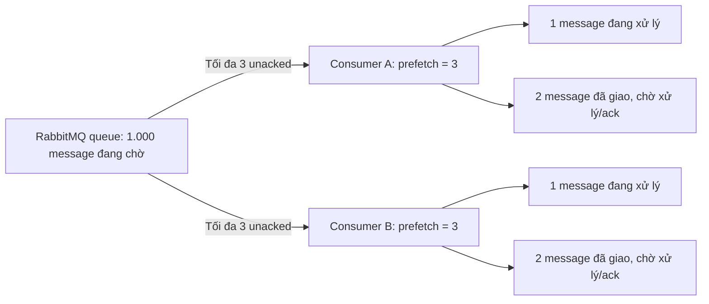
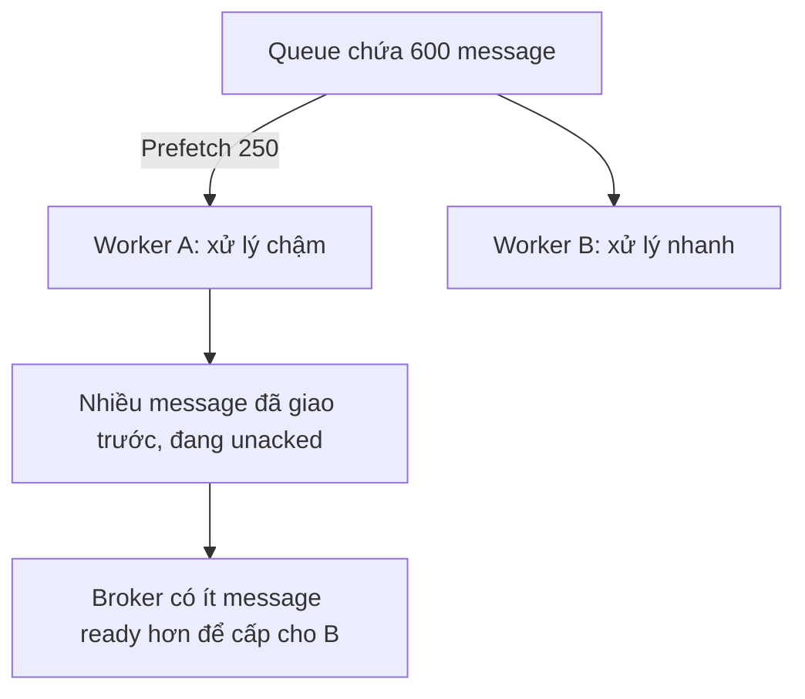

# Chọn prefetch theo thời gian xử lý và dung lượng bộ nhớ trong Spring AMQP

Một ứng dụng Spring AMQP có thể xử lý rất nhanh khi queue có ít message nhưng lại chậm, thiếu công bằng hoặc thiếu bộ nhớ khi tải tăng. Một trong những thông số ảnh hưởng lớn đến tình huống này là **consumer prefetch**: số delivery chưa được xác nhận mà RabbitMQ có thể gửi trước cho consumer.

Ví dụ, một worker xử lý ảnh mất 400 ms cho mỗi message. Nếu đặt prefetch bằng 250, broker có thể giao trước rất nhiều công việc cho worker dù nó chỉ xử lý tuần tự từng ảnh. Message bị giữ ở trạng thái *unacknowledged*, các worker khác có thể bị thiếu việc, trong khi ứng dụng phải chịu thêm áp lực bộ nhớ. Ngược lại, với message rất nhỏ, xử lý trong vài mili giây, prefetch quá thấp có thể làm consumer thường xuyên phải chờ delivery tiếp theo.

Trong chương **Hiệu năng** của **SPRING_AMQP**, bài này hướng dẫn cách chọn prefetch dựa trên **thời gian xử lý, số consumer thực tế, kích thước message, ngân sách bộ nhớ và mức độ công bằng**. Các ví dụ dùng `RabbitTemplate`, `@RabbitListener`, exchange, queue, binding cùng cấu hình `SimpleRabbitListenerContainerFactory`. Bài cũng xem xét ảnh hưởng đến acknowledgement, retry, dead-letter và quan sát hệ thống để việc tối ưu hiệu năng không làm giảm độ tin cậy giao nhận.

## 1. Prefetch là gì?

Trong AMQP 0-9-1, consumer sử dụng cơ chế QoS (`basic.qos`) để giới hạn **số delivery chưa được ack** mà broker có thể phân phối. Trong RabbitMQ, với cấu hình QoS thường dùng (`global=false`), giới hạn prefetch được áp dụng **theo từng consumer**; cách diễn giải này khác với việc xem mọi delivery trên một channel luôn chia sẻ một giới hạn duy nhất.

Nếu prefetch bằng 10, RabbitMQ có thể gửi tối đa khoảng **10 delivery chưa được xác nhận cho consumer đó** trong phạm vi QoS tương ứng. Khi consumer ack một hoặc nhiều delivery, broker có thể gửi thêm để duy trì luồng xử lý.



Trong sơ đồ, queue có thể có nhiều message `ready` nhưng hai consumer chỉ giữ tổng cộng tối đa sáu delivery chưa ack theo cấu hình minh họa. Trên hệ thống thật, con số quan sát còn phụ thuộc thời điểm lấy mẫu, trạng thái connection, cơ chế nhận/ack và các giới hạn QoS khác.

### Phân biệt ba trạng thái

| Khái niệm | Ý nghĩa | Liên quan prefetch |
|---|---|---|
| **Ready** | Message còn trong queue, sẵn sàng giao | Có thể tăng nếu consumer không theo kịp |
| **Unacknowledged (unacked)** | Message đã giao nhưng chưa được broker xác nhận hoàn tất | Bị giới hạn bởi prefetch và cấu hình QoS tương ứng |
| **Đang thực thi nghiệp vụ** | Message mà code listener hiện đang xử lý | Có thể ít hơn nhiều số unacked, đặc biệt khi listener xử lý tuần tự |

**Unacked không đồng nghĩa với đang chạy song song.** Với một consumer xử lý đồng bộ, có thể chỉ một message đang gọi database trong khi hàng chục message khác đã được giao trước và đang chờ đến lượt.

## 2. Prefetch khác concurrency và batch size ra sao?

Spring AMQP có những điều chỉnh thường bị nhầm:

| Thông số | Điều khiển | Không tự bảo đảm |
|---|---|---|
| `prefetchCount` | Số delivery chưa ack được broker cấp trước theo QoS | Số tác vụ Java đang xử lý đồng thời |
| `concurrentConsumers` | Số consumer chạy thường trực của `SimpleMessageListenerContainer` | Mỗi consumer xử lý song song nhiều message |
| `maxConcurrentConsumers` | Giới hạn mở rộng số consumer động của simple container | Đạt throughput nếu CPU/DB/API đã bão hòa |
| `batchSize` | Kích thước batch dùng trong một số cơ chế của simple container, đặc biệt ack/transaction | Tự thay đổi business logic từ đơn lẻ sang batch |
| `messagesPerAck` | Gom ack nhiều message ở các cấu hình hỗ trợ | Broker xử lý nghiệp vụ hoặc message không bị lặp |
| `AcknowledgeMode` | Cách xác nhận message: `AUTO`, `MANUAL`, `NONE` | Thứ tự và tính đúng đắn nghiệp vụ |

Nếu có **C consumer**, mỗi consumer prefetch **P**, giới hạn gần đúng của tổng delivery unacked mà chúng có thể giữ là:

\[
U_{\max} \approx C \times P
\]

Đây là **giới hạn trên mang tính lập kế hoạch**, không phải cam kết rằng mọi thời điểm đều có đúng `C × P` message trong JVM. Với nhiều kênh, `globalQos=true`, message batch, consumer khác nhau hoặc cài đặt broker đặc biệt, phải kiểm tra lại ngữ nghĩa QoS thực tế.

Ví dụ 8 consumer, prefetch 50:

\[
U_{\max} \approx 8 \times 50 = 400\;\text{delivery}
\]

Nhiều delivery có thể đang chờ trong vùng đệm/chuỗi xử lý client, nhưng **tăng từ 50 lên 500 không biến tám consumer đồng bộ thành 800 tác vụ xử lý đồng thời**.

### Về giá trị mặc định

Spring AMQP ở nhiều phiên bản hiện đại sử dụng prefetch mặc định **250** cho listener container thường gặp, khác với các cấu hình cũ. Đừng suy ra rằng 250 là tối ưu cho ứng dụng của mình; khi cần kiểm soát hiệu năng hoặc bộ nhớ, hãy **đặt rõ giá trị và kiểm tra trên phiên bản đang chạy**.

Trong RabbitMQ, `prefetch=0` có thể mang nghĩa **không giới hạn số unacked** theo phạm vi QoS được áp dụng. Không dùng giá trị 0 như cách nói “chỉ giao một message” hoặc một lựa chọn an toàn về bộ nhớ.

## 3. Thời gian xử lý quyết định năng lực tiêu thụ

Giả sử một listener xử lý **đồng bộ và tuần tự**, mỗi consumer hoàn thành trung bình một message sau **T giây**. Nếu bỏ qua overhead khác, năng lực xử lý lý tưởng của một consumer xấp xỉ:

\[
\mu_1 \approx \frac{1}{T}
\]

Với **C consumer** có tốc độ tương đương:

\[
\mu_{\mathrm{total}} \lesssim \frac{C}{T}
\]

Trong đó `μ` tính bằng message/giây. Giới hạn thực có thể thấp hơn vì CPU, I/O, lock, network, database pool, API rate limit và chi phí ack.

### Ví dụ: message xử lý chậm

Một tác vụ tạo thumbnail mất trung bình 400 ms (= 0,4 giây). Một consumer tuần tự xử lý tối đa xấp xỉ:

\[
\mu_1 \approx 1/0{,}4 = 2{,}5\;\text{message/s}
\]

Với 8 consumer:

\[
\mu_{\mathrm{total}} \lesssim 8/0{,}4 = 20\;\text{message/s}
\]

Nếu producer gửi đều **50 message/s**, backlog về lâu dài có xu hướng tăng. **Tăng prefetch từ 10 lên 250 không thể tự tăng năng lực CPU/DB từ 20 lên 50 message/s.**

Khi đó phải xem xét:

- Tối ưu hoặc cache bước xử lý tốn thời gian.
- Tăng concurrency/replica **nếu** CPU, DB pool, API phía sau còn khả năng phục vụ.
- Chia nhỏ công việc hay đưa tác vụ I/O dài ra pipeline riêng nếu nghiệp vụ cho phép.
- Giảm hoặc điều tiết tốc độ producer; áp dụng backpressure/quota theo yêu cầu hệ thống.

**Prefetch chủ yếu quyết định số công việc được giao trước**, còn concurrency và thời gian xử lý mới trực tiếp giới hạn số lần hoàn tất của những consumer đồng bộ.

## 4. Khi nào prefetch lớn hơn 1 giúp tăng throughput?

Một consumer có prefetch bằng 1 thường cần được ack trước khi broker gửi delivery tiếp theo. Nếu xử lý rất nhanh, độ trễ truyền delivery/ack và lịch điều phối có thể khiến consumer bị nhàn rỗi giữa các message.

```text
Prefetch = 1, xử lý rất nhanh:

Broker --delivery #1--> Consumer --process--> ACK -->
       (chờ delivery kế tiếp)
Broker --delivery #2--> Consumer --process--> ACK -->

Prefetch = 10:

Broker --delivery #1..#10--> Consumer
Consumer xử lý #1, #2, #3... khi đã có dữ liệu chờ
ACK trả lại tín dụng để broker giao bổ sung
```

Vì thế prefetch vừa đủ có thể **giấu một phần độ trễ mạng** bằng cách giữ sẵn message chờ xử lý. Hiệu quả rõ hơn khi:

- Mỗi message xử lý nhanh.
- Broker và ứng dụng đặt ở các host/vùng mạng có latency không nhỏ.
- Consumer nhận được nhiều message nhỏ liên tục.
- Việc chuyển sang message kế tiếp có thể thực hiện ngay sau xử lý message hiện tại.

Một ước lượng để **đặt điểm khởi đầu**, không phải công thức QoS chuẩn, là:

\[
P_{\text{khởi đầu}} \approx
\max\left(1,\left\lceil 1+\frac{L_{\text{delivery/ack}}}{T_{\text{process}}}\right\rceil\right)
\]

Trong đó `L` biểu thị độ trễ hiệu dụng từ khi cần thêm delivery đến khi có thể sử dụng, còn `Tprocess` là thời gian xử lý một message. Cần đo `L` thực tế vì broker có thể gửi thêm delivery theo cơ chế credit và quá trình xử lý không đồng nhất với một giao dịch “mỗi ack đổi một delivery”.

Ví dụ Tprocess khoảng 5 ms, độ trễ hiệu dụng khoảng 20 ms: thử prefetch 5–10 trước, rồi đo throughput/latency. **Không suy ra** đặt 1.000 luôn nhanh hơn 10. Khi công việc mất vài trăm mili giây, lợi ích giấu latency thường nhỏ so với thời gian xử lý, trong khi chi phí giữ nhiều message tăng.

## 5. Ngân sách bộ nhớ: prefetch có thể tốn bao nhiêu?

Prefetch được tính theo **số message**, không phải số byte. Hai queue cùng prefetch 50 có thể tạo áp lực bộ nhớ rất khác nếu một queue có message 2 KiB còn queue kia có message 2 MiB.

Ước lượng thận trọng cho footprint do delivery chưa ack:

\[
M_{\mathrm{inflight}} \approx
C \times P \times S_{\mathrm{peak}} \times K
\]

Trong đó:

- **C**: số consumer đang hoạt động, nên tính cả khả năng scale lên `maxConcurrentConsumers`.
- **P**: prefetch mỗi consumer.
- **Speak**: kích thước message đại diện cho **đỉnh tải cần bảo vệ**, không chỉ trung bình.
- **K**: hệ số đo được để phản ánh byte array, envelope, converter, đối tượng Java, payload parse, vùng đệm và những bộ nhớ liên quan. Không có một K cố định đúng cho mọi ứng dụng.

Đây là **mô hình lập ngân sách**, không phải công thức chính xác của bộ nhớ JVM: message chưa ack có thể được quản lý trong nhiều tầng client và broker; không phải toàn bộ `C × P` payload lúc nào cũng tồn tại đồng thời trong heap. Phải đo thực tế bằng profiler/heap/RSS dưới tải.

### Ví dụ 1: message kích thước vừa

Giả sử:

- 12 consumer hoạt động.
- Prefetch = 30.
- Kích thước message dùng để tính ngân sách = 128 KiB.
- Hệ số footprint đo/giả định ban đầu K = 3.

Khi đó:

\[
M_{\mathrm{inflight}}
\approx 12 \times 30 \times 128\;\mathrm{KiB}\times3
=135\;\mathrm{MiB}
\]

Nếu ứng dụng dành tối đa 256 MiB **riêng cho phần in-flight**, ước lượng giới hạn prefetch:

\[
P_{\mathrm{memory}}
\lesssim \left\lfloor
\frac{256\;\mathrm{MiB}}{12\times128\;\mathrm{KiB}\times3}
\right\rfloor = 56
\]

Giá trị 56 là **trần tính toán sơ bộ**, chưa phải lựa chọn production. Prefetch 30 có dư địa theo giả định, nhưng phải dành heap cho business objects, cache, thread stack, thư viện, GC, connection và tải đỉnh khác.

### Ví dụ 2: message có đuôi kích thước lớn

Giả sử trung bình message chỉ 20 KiB nhưng có những message lên đến 2 MiB. Với 8 consumer, prefetch 20 và hệ số K = 2,5:

\[
M_{\mathrm{inflight,peak}}
\approx 8 \times 20 \times 2\;\mathrm{MiB}\times2{,}5
=800\;\mathrm{MiB}
\]

Ngay cả khi không phải mọi message đồng thời lớn 2 MiB, kịch bản cực đoan này cho thấy **tính theo average payload có thể đánh giá thiếu rủi ro**. Để kiểm soát:

- Đặt giới hạn kích thước message được chấp nhận.
- Dùng reference đến object storage thay vì nhét file rất lớn vào RabbitMQ khi phù hợp.
- Chọn prefetch riêng cho queue message lớn và queue message nhỏ.
- Đo heap used, allocation rate, GC pause, RSS và OOM dưới workload đại diện.
- Để headroom khi `maxConcurrentConsumers` tăng hoặc nhiều replica cùng chạy.

## 6. Công bằng giữa consumer và nguy cơ “ôm” message

Với competing consumers trên cùng một queue, broker phân phối delivery theo khả năng nhận và tín dụng QoS. Prefetch rất cao có thể khiến một consumer nhận nhiều message trước khi những consumer khác có cơ hội nhận.



Hệ quả có thể gặp:

1. Worker A đang chậm nhưng đã giữ một lượng message lớn ở trạng thái unacked.
2. Worker B nhanh hơn có thể thiếu message ready để xử lý dù A còn nhiều việc chưa xong.
3. Khi A bị crash, những message chưa ack được broker đưa trở lại trạng thái có thể giao theo cơ chế phù hợp, tạo đợt redelivery.
4. Tính thứ tự, độ trễ cuối hàng và số lần thực thi nghiệp vụ có thể bị ảnh hưởng.

**Prefetch 1** thường giúp phân phối công việc theo tốc độ hoàn tất của mỗi consumer rõ ràng hơn, đặc biệt với task chậm hoặc thời gian xử lý biến động lớn. Đánh đổi là có thể tăng overhead khi message rất nhanh và network latency đáng kể.

Nếu cần fairness, latency thấp hoặc giới hạn lượng công việc đang giữ, hãy thử **1–10** trước rồi tăng có kiểm chứng. Đừng thay quy tắc nghiệp vụ cần thứ tự nghiêm ngặt bằng cách chọn prefetch cao: nhiều consumer/requeue vẫn có thể làm thứ tự xử lý lệch so với thứ tự publish.

## 7. Chọn prefetch bằng hai ràng buộc

Có thể tiếp cận bài toán bằng hai phía độc lập:

1. **Đủ lớn để không tạo khoảng chờ truyền delivery** trong điều kiện tải ổn định.
2. **Đủ nhỏ để đáp ứng giới hạn bộ nhớ, số message đang giữ, fairness và khả năng phục hồi.**

Gọi:

\[
P_{\mathrm{candidate}} =
\min(P_{\mathrm{pipeline}},\,P_{\mathrm{memory}},\,P_{\mathrm{fairness}})
\]

Đây là **khung suy luận**, không phải thuật toán RabbitMQ chuẩn. `Ppipeline` là mức ứng viên đã đo giúp hạn chế nhàn rỗi do delivery; `Pmemory` là trần theo ngân sách bộ nhớ; `Pfairness` là trần do yêu cầu độ trễ/công bằng. Nếu các mục tiêu xung đột, cần thay đổi concurrency, kích thước message, tốc độ xử lý hoặc hạ tầng; không thể giải quyết mọi thứ chỉ bằng một giá trị P.

### Ma trận gợi ý để bắt đầu thử nghiệm

| Workload | Ưu tiên | Dải thử ban đầu, không phải giá trị tối ưu mặc định |
|---|---|---|
| Task dài 0,5–5 giây, thao tác DB/API tốn kém | Giảm message giữ trước, fairness, kiểm soát downstream | **1, 2, 5, 10** |
| Task vừa 20–200 ms, payload nhỏ–vừa | Cân bằng giấu latency với bộ nhớ | **5, 10, 20, 50** |
| Task rất nhanh 1–5 ms, message nhỏ | Giảm chờ delivery và protocol overhead | **10, 25, 50, 100** |
| Message lớn (hàng trăm KiB đến MiB) | Giới hạn footprint/OOM | **1, 2, 5**, tính trước ngân sách |
| Nhiều consumer với thời gian xử lý rất lệch | Tránh giữ message tại consumer chậm | **1, 2, 5** |
| Tác vụ bắt buộc xử lý có thứ tự hoặc bên ngoài giới hạn QPS | Đúng thứ tự/rate limit trước throughput | **1 hoặc nhỏ**, cùng thiết kế concurrency riêng |

Các dải trên chỉ là **kịch bản benchmark để tìm điểm khởi đầu**. Không áp một con số cho tất cả queue. Dùng số đo từ đúng broker, kiểu queue, network, kích thước payload và logic nghiệp vụ của ứng dụng.

## 8. Cấu hình prefetch trong Spring Boot bằng YAML

Với `spring-boot-starter-amqp` và listener sử dụng **simple container factory mặc định** được Spring Boot cấu hình, có thể khai báo:

```yaml
spring:
  rabbitmq:
    host: localhost
    port: 5672
    username: guest
    password: guest
    listener:
      type: simple
      simple:
        acknowledge-mode: auto
        prefetch: 10
        concurrency: 4
        max-concurrency: 8
        default-requeue-rejected: false
```

Ý nghĩa:

- `prefetch: 10`: giới hạn unacked dự kiến cho từng consumer theo QoS tương ứng.
- `concurrency: 4`: duy trì bốn consumer, mỗi consumer xử lý message theo cách listener của nó hoạt động.
- `max-concurrency: 8`: simple container có thể tăng consumer khi thỏa điều kiện scale của nó; không có nghĩa lúc nào cũng có tám consumer.
- `acknowledge-mode: auto`: container ack sau khi listener hoàn tất thành công; exception được xử lý theo cơ chế lỗi.
- `default-requeue-rejected: false`: một message bị reject do xử lý lỗi không được requeue vô hạn theo mặc định; muốn dùng DLQ phải có DLX, queue và binding phù hợp.

`guest/guest` chỉ minh họa RabbitMQ cục bộ; production phải dùng account riêng, credential an toàn, TLS và phân quyền theo vhost. Nếu muốn khai báo listener factory bằng Java như mục tiếp theo, hãy dùng **một nguồn cấu hình rõ ràng**, tránh vô tình tạo hai factory với giá trị prefetch khác nhau.

### Nếu sử dụng direct listener container

Spring AMQP còn có `DirectMessageListenerContainer` và `DirectRabbitListenerContainerFactory`, với cách tổ chức consumer khác simple container. Trong Spring Boot, cấu hình liên quan nằm ở nhánh `spring.rabbitmq.listener.direct.*` và phải chọn `listener.type: direct` khi muốn dùng loại này.

**Không lấy `simple.concurrency` hay `simple.prefetch` rồi giả định nó được áp dụng vào direct container.** Kiểm tra loại listener container thực tế, số consumer per queue và cách property được binding theo phiên bản ứng dụng.

## 9. Ví dụ Java: consumer xử lý ảnh với prefetch có giới hạn

Ví dụ sử dụng **Spring Boot 3.x, Java 17+, Spring AMQP**. Producer dùng `RabbitTemplate` gửi sự kiện vào direct exchange; worker dùng `@RabbitListener` xử lý từ durable queue. Bài này tập trung vào QoS, nên logic xử lý ảnh thật được tách khỏi ví dụ để có thể đo bằng một service có workload đại diện.

### 9.1. Dependencies và topology

```groovy
dependencies {
    implementation 'org.springframework.boot:spring-boot-starter-amqp'
    implementation 'org.springframework.boot:spring-boot-starter-actuator'
}
```

```java
import org.springframework.amqp.core.Binding;
import org.springframework.amqp.core.BindingBuilder;
import org.springframework.amqp.core.DirectExchange;
import org.springframework.amqp.core.Queue;
import org.springframework.amqp.core.QueueBuilder;
import org.springframework.context.annotation.Bean;
import org.springframework.context.annotation.Configuration;

@Configuration
public class ResizeTopology {
    public static final String EXCHANGE = "image.events";
    public static final String QUEUE = "image.resize.requests";
    public static final String ROUTING_KEY = "image.resize";
    public static final String DEAD_EXCHANGE = "image.dead";
    public static final String DEAD_QUEUE = "image.resize.dlq";
    public static final String DEAD_KEY = "image.failed";

    @Bean
    public DirectExchange imageExchange() {
        return new DirectExchange(EXCHANGE);
    }

    @Bean
    public DirectExchange imageDeadExchange() {
        return new DirectExchange(DEAD_EXCHANGE);
    }

    @Bean
    public Queue resizeQueue() {
        return QueueBuilder.durable(QUEUE)
                .deadLetterExchange(DEAD_EXCHANGE)
                .deadLetterRoutingKey(DEAD_KEY)
                .build();
    }

    @Bean
    public Queue resizeDeadQueue() {
        return QueueBuilder.durable(DEAD_QUEUE).build();
    }

    @Bean
    public Binding resizeBinding() {
        return BindingBuilder.bind(resizeQueue())
                .to(imageExchange()).with(ROUTING_KEY);
    }

    @Bean
    public Binding resizeDeadBinding() {
        return BindingBuilder.bind(resizeDeadQueue())
                .to(imageDeadExchange()).with(DEAD_KEY);
    }
}
```

Vì queue có cấu hình DLX, message bị reject không requeue có thể đi tới `image.resize.dlq`. Điều này **không có nghĩa** mọi lỗi của consumer đều được xử lý đúng chỉ bằng DLQ: cần theo dõi, phân loại lỗi, retry có giới hạn và quy trình phát lại an toàn.

### 9.2. Listener factory có prefetch, concurrency và ack rõ ràng

```java
import org.springframework.amqp.core.AcknowledgeMode;
import org.springframework.amqp.rabbit.annotation.EnableRabbit;
import org.springframework.amqp.rabbit.config.SimpleRabbitListenerContainerFactory;
import org.springframework.amqp.rabbit.connection.ConnectionFactory;
import org.springframework.boot.autoconfigure.amqp.SimpleRabbitListenerContainerFactoryConfigurer;
import org.springframework.context.annotation.Bean;
import org.springframework.context.annotation.Configuration;

@Configuration
@EnableRabbit
public class ResizeWorkerConfiguration {
    @Bean("resizeListenerFactory")
    public SimpleRabbitListenerContainerFactory resizeListenerFactory(
            ConnectionFactory connectionFactory,
            SimpleRabbitListenerContainerFactoryConfigurer configurer) {

        SimpleRabbitListenerContainerFactory factory =
                new SimpleRabbitListenerContainerFactory();
        configurer.configure(factory, connectionFactory);

        factory.setConcurrentConsumers(4);
        factory.setMaxConcurrentConsumers(8);
        factory.setPrefetchCount(10);
        factory.setBatchSize(1);
        factory.setAcknowledgeMode(AcknowledgeMode.AUTO);
        factory.setDefaultRequeueRejected(false);
        return factory;
    }
}
```

Với bốn consumer đang hoạt động, ngân sách unacked sơ bộ `4 × 10 = 40` message. Khi container thực sự tăng lên tám consumer, ngân sách tối đa tăng thành `8 × 10 = 80`. Vì thế **phải tính bộ nhớ theo đỉnh consumer có thể đạt tới**, không chỉ theo cấu hình tối thiểu.

`batchSize=1` minh họa listener nhận từng message và container không cần gom nhiều message cho một lần ack. Một số tính năng batch/ack trong Spring AMQP có thể tự nâng mức prefetch lên để phù hợp `batchSize` hoặc `messagesPerAck`. Nếu bật batch, hãy kiểm tra **effective prefetch** trên consumer thay vì chỉ đọc một setter.

### 9.3. Producer và listener

```java
import org.springframework.amqp.rabbit.annotation.RabbitListener;
import org.springframework.amqp.rabbit.core.RabbitTemplate;
import org.springframework.stereotype.Component;
import org.springframework.stereotype.Service;

@Service
public class ResizePublisher {
    private final RabbitTemplate template;

    public ResizePublisher(RabbitTemplate template) {
        this.template = template;
    }

    public void submit(String imageId) {
        if (imageId == null || imageId.isBlank()) {
            throw new IllegalArgumentException("imageId trống");
        }
        template.convertAndSend(
                ResizeTopology.EXCHANGE,
                ResizeTopology.ROUTING_KEY,
                imageId);
    }
}

@Component
public class ResizeListener {
    @RabbitListener(
            id = "resize-worker",
            queues = ResizeTopology.QUEUE,
            containerFactory = "resizeListenerFactory")
    public void handle(String imageId) {
        if (imageId == null || imageId.isBlank()) {
            throw new IllegalArgumentException("imageId trống");
        }
        // Demo: thay bằng xử lý ảnh thực, có đo thời gian và idempotency.
        System.out.println("Resizing image " + imageId);
    }
}
```

Hai class `public` trong ví dụ producer/listener cần ở **hai file Java riêng** khi triển khai. Code tối giản này không có tác vụ chậm nên **không thể dùng để rút kết luận tối ưu prefetch cho xử lý ảnh thật**; phải thay bằng workload đại diện và đo dưới tải.

Nếu producer gửi file ảnh lớn dưới dạng body thay vì chỉ `imageId`, tiêu thụ bộ nhớ sẽ hoàn toàn khác. Đo benchmark phải dùng đúng loại payload dự kiến khi vận hành.

## 10. Tự theo dõi thời gian xử lý để chọn prefetch

Ước lượng thời gian xử lý bằng cảm giác (“mỗi task chắc khoảng 100 ms”) dễ gây sai. Với Micrometer và Spring Boot Actuator, có thể đo riêng thời gian một thao tác nghiệp vụ:

```java
import io.micrometer.core.instrument.MeterRegistry;
import io.micrometer.core.instrument.Timer;
import org.springframework.stereotype.Service;

@Service
public class TimedResizeService {
    private final Timer timer;

    public TimedResizeService(MeterRegistry registry) {
        this.timer = Timer.builder("app.image.resize")
                .description("Thời lượng xử lý một công việc resize")
                .tag("operation", "resize")
                .register(registry);
    }

    public void process(String imageId) {
        timer.record(() -> {
            // Thay nội dung này bằng tác vụ resize thật.
            if (imageId == null || imageId.isBlank()) {
                throw new IllegalArgumentException("imageId trống");
            }
            System.out.println("Processed " + imageId);
        });
    }
}
```

Khi triển khai, listener gọi `timedResizeService.process(imageId)` thay vì xử lý trực tiếp; đảm bảo đang đo **thời gian thao tác thật**, không phải chỉ thời gian log. Không gắn `imageId` hoặc `eventId` làm tag Timer vì cardinality có thể tăng không giới hạn.

Các số cần lấy từ benchmark:

- **Median/P50** và **P95/P99** của thời gian xử lý: đuôi thời gian dài ảnh hưởng fairness và latency.
- **Throughput thành công** theo message/giây, phân biệt số lần thử lại.
- **Độ trễ từ publish đến hoàn tất** nếu có SLO đầu cuối.
- **Queue ready/unacked**, số consumer hoạt động và mức độ phân bố công việc.
- **Heap, RSS, allocation rate, GC pause**, CPU, network, DB connection pool và rate limit hệ thống ngoài.

Timer tích hợp `spring.rabbitmq.listener` có thể giúp đo lời gọi listener; metric của `RabbitTemplate` đo thời lượng thao tác gửi, **không phải thời gian message chờ trong queue hoặc thời gian broker xác nhận publish**. Cần kết hợp metric broker và các timer nghiệp vụ để phân tích đầy đủ.

## 11. Tác động của ack, retry, requeue và dead-letter

Chọn prefetch chỉ theo throughput mà quên acknowledgement có thể làm hệ thống kém tin cậy.

### 11.1. `AUTO` và `MANUAL` khác nhau

- Với `AcknowledgeMode.AUTO`, container xử lý ack/reject dựa trên kết quả gọi listener và chính sách lỗi. Trong ví dụ `batchSize=1`, việc hoàn tất một message giải phóng tín dụng QoS tương ứng sau ack.
- Với `AcknowledgeMode.MANUAL`, ứng dụng phải ack/nack đúng delivery tag trên channel. Nếu code quên ack, message tiếp tục chiếm một slot prefetch; đến khi đầy, consumer có thể ngừng nhận thêm mặc dù CPU đang rảnh.
- Với `AcknowledgeMode.NONE`, broker sử dụng chế độ auto-ack; khái niệm “bao nhiêu delivery đang chờ application ack” không áp dụng giống hai chế độ trên. Đừng dùng việc tăng prefetch để xử lý vấn đề của `NONE`.

Ví dụ manual ack mang tính minh họa:

```java
import com.rabbitmq.client.Channel;
import java.io.IOException;
import org.springframework.amqp.core.Message;
import org.springframework.amqp.rabbit.annotation.RabbitListener;

@RabbitListener(
    queues = "image.resize.requests",
    containerFactory = "manualAckListenerFactory")
public void processManually(Message message, Channel channel)
        throws IOException {
    long tag = message.getMessageProperties().getDeliveryTag();
    try {
        // Chỉ ack sau khi xử lý nghiệp vụ thành công và bền vững.
        doBusinessWork(message);
        channel.basicAck(tag, false);
    } catch (RuntimeException ex) {
        // Ví dụ loại bỏ khỏi queue; chỉ phù hợp nếu có DLX và error policy.
        channel.basicNack(tag, false, false);
    }
}
```

**Đây là minh họa độc lập**, cần tạo `manualAckListenerFactory` với `AcknowledgeMode.MANUAL` và triển khai `doBusinessWork(...)`. Không bật song song cả listener `AUTO` và `MANUAL` trên cùng queue trong bài kiểm thử đơn giản. Trong code production, cần xử lý cả lỗi ack/nack, chính sách retry và trạng thái không rõ kết quả; không âm thầm nuốt exception nghiệp vụ chỉ để giữ consumer chạy.

### 11.2. Prefetch cao làm tăng “bán kính” redelivery

Một consumer giữ 200 delivery chưa ack có thể bị ngắt connection giữa chừng. Broker có thể giao lại những delivery chưa được xác nhận, tùy trạng thái lưu và cơ chế queue. Ứng dụng phải xử lý idempotent nếu một số tác động đã hoàn tất nhưng ack chưa đến broker.

Prefetch thấp **giảm lượng công việc có thể đang in-flight khi sự cố xảy ra**, nhưng không tạo bảo đảm exactly-once; vẫn cần `eventId`, unique constraint/inbox và idempotency key khi gọi API ngoài.

### 11.3. Retry và DLQ không được giải quyết bởi prefetch

Prefetch chỉ giới hạn delivery outstanding. Nó không quyết định:

- Retry bao nhiêu lần khi listener ném exception.
- Bao lâu mới retry (backoff, delayed retry).
- Chuyển message vào DLQ theo điều kiện nào.
- Một message lỗi có thể làm nghẽn worker hoặc gây vòng requeue vô hạn không.

Để tránh poison message làm hại throughput, cần cấu hình retry có giới hạn, dead-letter topology và quy trình điều tra/phát lại. Khi benchmark, **theo dõi riêng số retry, redelivery và DLQ**: nếu throughput tăng do message lỗi bị loại nhanh, đó không phải cải thiện throughput nghiệp vụ thành công.

## 12. Hệ quả với xử lý async, batch và downstream

### Listener trả về `CompletableFuture` hoặc `Mono`

Với listener hỗ trợ kết quả bất đồng bộ, một lần nhận có thể kết thúc lời gọi Java trước khi công việc thực sự hoàn thành; việc ack có thể xảy ra khi async result hoàn tất tùy cơ chế Spring AMQP. Khi đó, số công việc in-flight **khác** số Java thread đang chạy listener đồng bộ. Phải đo:

- Số tác vụ bất đồng bộ chưa hoàn thành.
- Cách acknowledge được gắn với completion và xử lý lỗi.
- Mức concurrency thực tế của executor/reactive pipeline.
- Số lượng message đã prefetch nhưng chưa thể xử lý.

Không dựa vào công thức `C/T` của listener đồng bộ để suy ra thông lượng của một async pipeline có độ song song cao. Giới hạn của executor, connection pool hoặc downstream mới có thể quyết định throughput.

### Batch listener và batch acknowledgement

Nếu bật `consumerBatchEnabled` hoặc `batchListener`, container có thể tích lũy nhiều message rồi giao một list/batch cho listener. `batchSize` và thời gian chờ batch ảnh hưởng số message đang giữ, latency và bộ nhớ. Một số cấu hình có thể khiến effective prefetch được nâng để đáp ứng kích thước batch mong muốn.

Đo tải với kích thước batch **giống production**, vì mỗi phần tử trong list có thể mang payload/đối tượng đã chuyển đổi, gây footprint khác kiểu xử lý đơn lẻ.

### Downstream thường là nút cổ chai

Giả sử application có tám consumer nhưng database chỉ có bốn connection rảnh. Tăng prefetch lên 250 không tạo thêm database connection; nó chỉ tăng số delivery đang chờ. Nếu một API ngoài giới hạn 30 request/giây, tăng concurrency vượt mức đó có thể làm tăng lỗi `429`, timeout, retry và thời gian xử lý trung bình.

Vì vậy cần chọn đồng thời:

- Concurrency phù hợp với CPU và downstream.
- Prefetch đủ để pipeline không nhàn rỗi, không giữ quá nhiều message.
- Timeout, rate limiting, circuit breaker/retry có giới hạn khi cần.
- Ngân sách bộ nhớ tính theo payload thực tế và số worker tối đa.

## 13. Benchmark có kiểm soát: cách tìm điểm prefetch tốt

Một giá trị “tối ưu” chỉ có nghĩa với **workload và tiêu chí thành công xác định**. Nên dùng RabbitMQ thật thay vì gọi trực tiếp method `@RabbitListener` hoặc chỉ dùng `TestRabbitTemplate`: những cách brokerless không tạo tín dụng QoS, unacked delivery hoặc phân phối prefetch thật.

### 13.1. Chuẩn bị

1. Chọn kiểu queue đúng với hệ thống: classic/quorum queue, độ bền, routing, DLX và chính sách ack.
2. Dùng payload đại diện: số lượng message nhỏ/lớn, phân bố kích thước và thời gian xử lý.
3. Ghi rõ số producer, consumer, replica, network, cấu hình JVM và kích thước DB/API pool.
4. Xác định SLO: throughput hoàn tất, P95/P99 end-to-end, heap/RSS tối đa, backlog phục hồi và error rate.
5. Dùng thời gian warm-up trước giai đoạn đo; cố định các biến khác khi thay một thông số.
6. Chạy đủ lâu để thấy steady state và ít nhất một giai đoạn burst; phân biệt metric khi queue còn backlog và khi queue gần rỗng.

### 13.2. Các lần thử đề xuất

Ví dụ giữ bốn consumer đồng bộ và workload 50 ms/message:

| Lần thử | Prefetch | Trần unacked (4 consumer) | Cần quan sát |
|---|---:|---:|---|
| A | 1 | 4 | Tốc độ có bị giới hạn bởi khoảng chờ delivery không? |
| B | 5 | 20 | Throughput tăng bao nhiêu so với A? |
| C | 10 | 40 | Có chạm mức throughput tối đa của logic chưa? |
| D | 25 | 100 | Latency/heap/fairness có xấu đi? |
| E | 50 | 200 | Có thêm lợi ích đáng kể hay chỉ thêm in-flight? |
| F | 100 | 400 | Có backlog/unacked hoặc GC tăng vô ích? |

Nếu throughput B và C gần tương đương, nhưng D–F không tăng throughput mà tăng memory, lag hoặc unacked, **ưu tiên giá trị thấp nhất đạt mục tiêu ổn định**. Không cố chọn số cao nhất vì nó trông “mạnh” hơn.

### 13.3. Tách ảnh hưởng concurrency khỏi prefetch

Sau khi có mức prefetch ứng viên, thử các số consumer **2, 4, 8**. Nếu throughput tăng gần tuyến tính khi tăng consumer và downstream còn khỏe, hệ thống có thể đang giới hạn bởi năng lực xử lý từng consumer. Nếu không tăng, kiểm tra CPU, DB pool, lock và API rate limit thay vì tiếp tục tăng prefetch.

Đặc biệt: Spring simple container có thể tăng consumer động theo tải. Trong benchmark nên cố định concurrency khi đang tìm prefetch, hoặc ít nhất ghi lại **số consumer thực tế theo thời gian** để không gán nhầm tăng throughput cho thay đổi prefetch.

### 13.4. Thử nghiệm failure path

Không chỉ đo khi broker/worker khỏe:

- Ngắt một consumer có nhiều unacked để đo lượng redelivery và thời gian backlog phục hồi.
- Làm downstream chậm đột ngột; đo heap, unacked, queue ready và timeout.
- Tạo 1% message lỗi để xem retry/DLQ có làm nghẽn consumer không.
- Kiểm tra idempotency khi crash sau khi ghi DB nhưng trước khi broker nhận ack.
- Khởi động thêm một replica khi queue đang nhiều message; quan sát fairness giữa các consumer.
- Với message lớn, thử burst theo phân bố kích thước đuôi dài để phát hiện áp lực GC/OOM.

## 14. Quan sát hiệu năng và tìm điểm nghẽn

Trong RabbitMQ Management UI/API hoặc exporter, những tín hiệu cơ bản:

| Chỉ số | Dấu hiệu | Hướng điều tra |
|---|---|---|
| `messages_ready` | Tăng liên tục | Producer nhanh hơn consumer, hoặc consumer mất kết nối |
| `messages_unacknowledged` | Tiệm cận tổng `C × P` | Consumer đã giữ đủ delivery; kiểm tra processing/ack |
| `consumers` | Ít hơn dự kiến | Connection recovery, quyền, container startup |
| Deliver rate | Cao nhưng ack rate thấp | Unacked tăng, consumer xử lý chậm hoặc quên ack |
| Ack rate | Thấp hơn publish rate dài hạn | Backlog có xu hướng tăng |
| Redelivery rate | Tăng khi worker crash/requeue | Kiểm tra retry, idempotency và lỗi nghiệp vụ |
| Listener P50/P95/P99 | Đuôi thời gian xử lý dài | DB/API/GC/lock, workload không đồng đều |
| JVM heap/RSS/GC | Tăng theo prefetch, pause dài | Payload, buffering, object allocation |
| DLQ depth | Tăng cùng tải | Lỗi nghiệp vụ/schema hoặc downstream, không chỉ QoS |

Ví dụ lệnh RabbitMQ CLI (chạy bằng account quản trị trên môi trường phù hợp):

```bash
rabbitmqctl list_queues -p / \
  name messages_ready messages_unacknowledged consumers
```

Muốn xem prefetch trên từng consumer, có thể dùng RabbitMQ Management UI hoặc lệnh `rabbitmqctl list_consumers` với các field mà phiên bản đang chạy hỗ trợ. Không suy rằng cấu hình `prefetch: 10` đã thực sự áp dụng nếu listener dùng một container factory khác.

### Một checklist chẩn đoán

**Trường hợp A — Queue ready tăng, unacked rất thấp:** có thể có quá ít consumer hoặc consumer không nhận message do kết nối/binding/quyền. Tăng prefetch không giúp nếu không có consumer hoạt động.

**Trường hợp B — Unacked gần `C × P`, CPU/DB bão hòa:** giới hạn nằm ở xử lý. Tăng prefetch sẽ giữ nhiều message hơn; ưu tiên giảm processing time hoặc kiểm soát concurrency.

**Trường hợp C — Prefetch 1, CPU nhàn rỗi, network latency đáng kể:** thử 5 hoặc 10; đo throughput và p95 trước khi quyết định.

**Trường hợp D — Heap/GC tăng rõ khi prefetch tăng:** giảm P và kiểm soát payload; kiểm tra message lớn, converter và số consumer thực tế.

**Trường hợp E — Một worker chậm giữ nhiều message, worker khác nhanh lại rảnh:** giảm P để cải thiện phân phối, đồng thời xem lại timeouts và skew của tác vụ.

## 15. Các hiểu lầm thường gặp

**“Prefetch bằng 100 nghĩa là một consumer chạy 100 task song song.”** Không. Nó giới hạn số delivery chưa ack được giao trước; concurrency của code là câu chuyện khác.

**“Prefetch càng lớn thì throughput càng cao.”** Chỉ đúng đến khi giảm được độ trễ chờ nhận. Sau đó tăng P có thể không có lợi và còn tăng footprint, bất công và lượng redelivery.

**“Prefetch 0 nghĩa là chỉ một message.”** Sai. Trong RabbitMQ, 0 có thể mang nghĩa không giới hạn theo QoS tương ứng; đây là lựa chọn tiềm ẩn rủi ro bộ nhớ.

**“Chỉ cần dựa vào kích thước message trung bình để chọn prefetch.”** Không đủ. Phải xét kích thước đỉnh, payload parse, số consumer tối đa, heap/RSS và GC.

**“Tăng prefetch giúp xử lý 50 msg/s dù logic chỉ có năng lực 20 msg/s.”** Không. Sự khác biệt giữa arrival và service rate vẫn khiến backlog tích lũy.

**“Prefetch nhỏ bảo đảm không duplicate.”** Không. Crash sau khi tác động nghiệp vụ hoàn tất nhưng trước ack vẫn có thể gây redelivery; cần idempotency.

**“Đã bật batch listener thì prefetch setter luôn là giới hạn cuối cùng.”** Không nhất thiết. Một số cấu hình `batchSize`/`messagesPerAck` làm tăng effective prefetch; cần quan sát container thực tế.

**“Unacked bằng 0 nghĩa là hệ thống không có công việc.”** Không. Queue có thể có nhiều message ready nhưng không có consumer, hoặc listener đang dùng ack mode/logic khác.

## 16. Quy trình quyết định nhanh và tự kiểm tra

Để lựa chọn ban đầu, hãy xác định **T** (thời gian xử lý thực tế, gồm P95/P99), **C** (số consumer hiện tại và tối đa), **S** (kích thước payload đỉnh), ngân sách **M** cho in-flight và yêu cầu **fairness/SLO**. Chọn một vài mức prefetch nhỏ để benchmark, loại các mức vượt ngân sách bộ nhớ, sau đó giữ **mức nhỏ nhất đạt throughput và latency mục tiêu** dưới tải và khi có lỗi.

### Câu hỏi tự kiểm tra

1. Prefetch khác `concurrentConsumers` như thế nào? Một consumer có prefetch 50 có đang xử lý 50 message song song không?
2. Với 6 consumer, prefetch 20, trần unacked sơ bộ là bao nhiêu? Điều gì làm số thực tế thấp hơn?
3. Nếu mỗi message mất 250 ms và có 4 consumer đồng bộ, thông lượng lý tưởng tối đa khoảng bao nhiêu message/giây?
4. Vì sao message lớn 1 MiB cần prefetch khác message 1 KiB ngay cả khi tốc độ xử lý bằng nhau?
5. Vì sao tăng prefetch có thể làm consumer nhanh nhận ít việc hơn khi một consumer chậm đã giữ nhiều unacked?
6. Khi manual ack bị bỏ quên, dấu hiệu nào xuất hiện ở queue và ứng dụng?
7. Những trường hợp nào nên ưu tiên tăng concurrency hoặc tối ưu downstream hơn là tăng prefetch?
8. Vì sao benchmark chỉ dùng `TestRabbitTemplate` không thể chứng minh giới hạn QoS của RabbitMQ?

**Ghi nhớ:** **Prefetch là ngân sách delivery chưa ack, không phải số luồng xử lý song song.** Chọn prefetch phải xét đồng thời thời gian xử lý, độ trễ delivery/ack, số consumer, kích thước payload đỉnh, bộ nhớ và yêu cầu công bằng. Dùng `SimpleRabbitListenerContainerFactory.setPrefetchCount(...)` hoặc cấu hình Spring Boot tương ứng, đo trên RabbitMQ thật, quan sát ready/unacked, throughput, P95/P99, GC, retry và DLQ. Mục tiêu là **giá trị prefetch nhỏ nhất đủ giữ pipeline bận rộn mà vẫn an toàn về bộ nhớ và đáng tin cậy khi sự cố xảy ra**.
