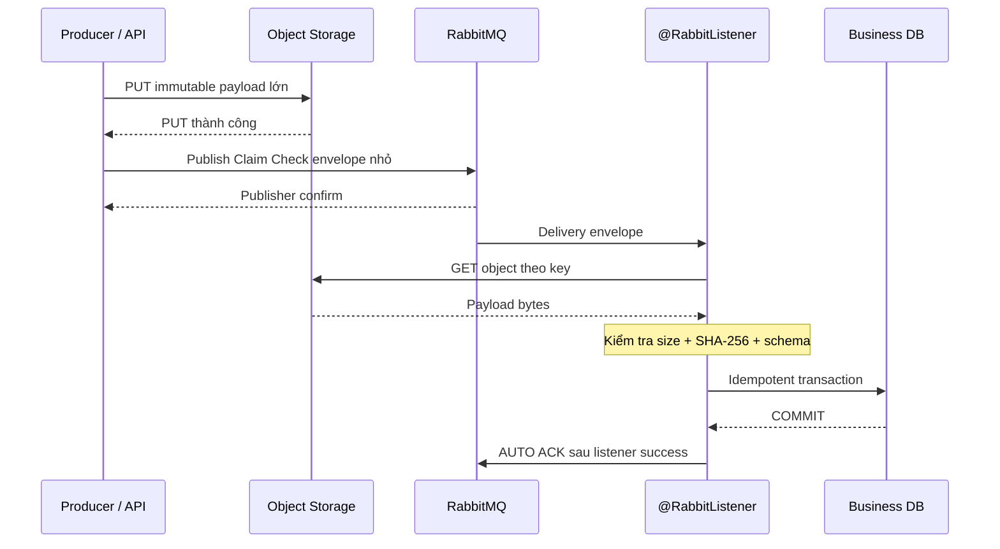
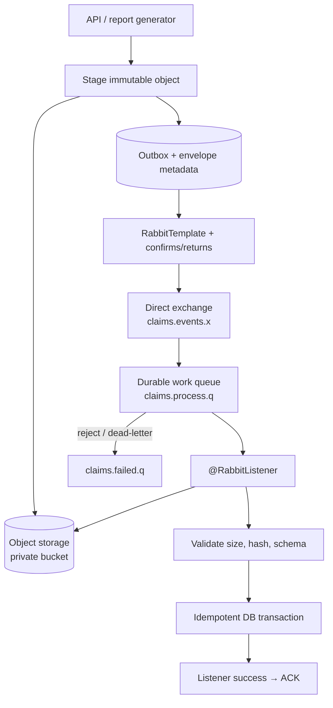
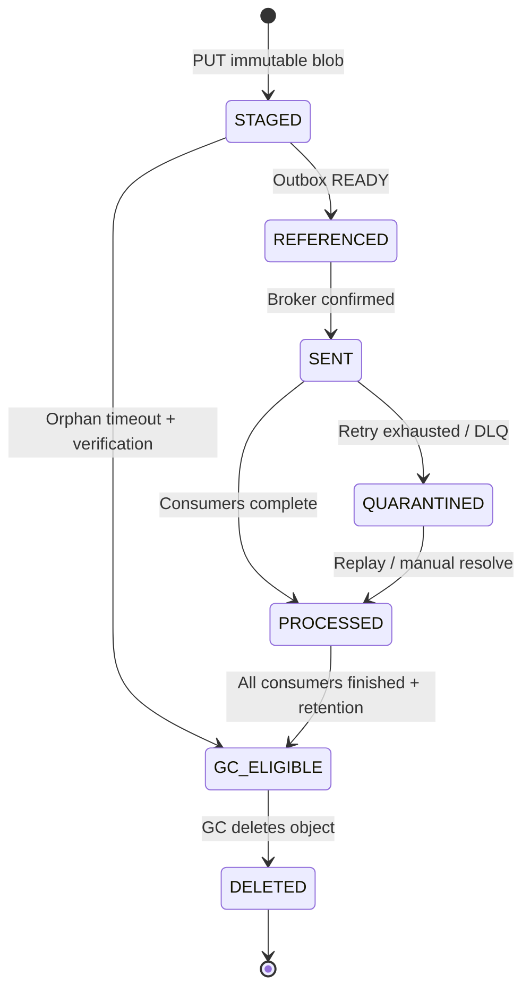

# Giảm kích thước thông điệp bằng tham chiếu tới dữ liệu ngoài

Một ứng dụng Spring AMQP có thể phải gửi báo cáo JSON vài MiB, tài liệu PDF, ảnh, kết quả xử lý AI hoặc một tập bản ghi lớn qua RabbitMQ. Cách đơn giản nhất là đặt toàn bộ dữ liệu vào `RabbitTemplate.convertAndSend(...)` rồi để `@RabbitListener` đọc lại. Nhưng khi số lượng message, số bản sao queue, `prefetch` và số consumer tăng lên, payload lớn có thể khiến lưu trữ broker, mạng, bộ nhớ và độ trễ chịu áp lực đáng kể.

**Claim Check pattern** (mẫu **gửi tham chiếu thay vì gửi toàn bộ nội dung**) giải quyết bằng cách lưu payload lớn vào một **kho dữ liệu ngoài** và chỉ gửi một **thông điệp nhỏ chứa khóa tham chiếu** qua RabbitMQ. Consumer đọc thông điệp nhỏ, tìm lại dữ liệu trong kho ngoài, xác minh tính toàn vẹn và xử lý nghiệp vụ. Đây là lựa chọn thiết kế **có đánh đổi**: giảm gánh nặng cho broker nhưng thêm network hop, chi phí lưu trữ, xử lý vòng đời và nguy cơ tham chiếu hỏng.

Bài học thuộc chương **Hiệu năng** của module **SPRING_AMQP**. Ta dùng kiến thức về `RabbitTemplate`, `@RabbitListener`, exchange, queue, binding, ACK/NACK, retry, dead-letter, giao dịch và quan sát hệ thống để xây một pipeline Claim Check hiệu quả **và đáng tin cậy**, chứ không chỉ làm nhỏ body AMQP.

> **Thông điệp chính:** Chỉ ACK sau khi payload tham chiếu đã được lấy và công việc cần thiết hoàn tất. **Publisher confirm của RabbitMQ không chứng minh object còn tồn tại**, và **object lưu thành công không chứng minh message tham chiếu đã được broker nhận**. Hai hệ thống không chia sẻ một transaction; phải thiết kế phục hồi cho các cửa sổ lỗi.

## 1. Mục tiêu học tập

Sau bài này, bạn có thể:

1. Giải thích Claim Check và sự khác nhau giữa **payload**, **envelope/reference**, **object key**, **event ID**, **checksum** và **business state**.
2. Phân tích khi nào payload lớn gây ảnh hưởng tới broker memory/disk, replication, network, prefetch và consumer concurrency.
3. Thiết kế envelope JSON nhỏ, versioned, có khóa bất biến, kích thước và SHA-256.
4. Viết producer Spring AMQP: lưu payload vào object storage trước, publish reference bằng `RabbitTemplate` và kiểm tra publisher confirms/returns.
5. Viết consumer `@RabbitListener`: đọc reference, tải object, kiểm tra size/checksum, xử lý idempotent và ACK sau transaction.
6. Xử lý tình huống object có nhưng reference chưa publish, reference đã publish nhưng object không tải được, hoặc ACK bị mất.
7. Thiết kế **outbox + cleanup/reconciliation**, TTL/retention và chính sách DLQ để tránh orphan object hoặc dangling reference.
8. Phòng chống truy cập trái phép, rò rỉ presigned URL và nội dung bị thay đổi.
9. Benchmark **hiệu năng toàn hệ thống**, không chỉ độ nhỏ của message RabbitMQ.

## 2. Claim Check hoạt động như thế nào?

Thay vì gửi body JSON 5 MiB qua RabbitMQ, producer làm hai việc:

1. Lưu nguyên payload 5 MiB vào object storage, ví dụ một bucket S3 có khóa `claims/v1/9f0.../payload.json`.
2. Publish một envelope vài trăm byte, chỉ nói **payload nào**, **ở đâu** và **cách xác minh**.

Consumer nhận envelope nhỏ, đọc object tương ứng bằng quyền truy cập của dịch vụ, xác minh hash và mới thực hiện nghiệp vụ.



Đây là **Claim Check**, không chỉ là một message có đường dẫn. Khóa tham chiếu phải ổn định và object phải đủ bền để tồn tại qua backlog, retry, dead-letter và nhu cầu replay hợp lệ.

### 2.1 Envelope đề xuất

```json
{
  "schemaVersion": 1,
  "eventId": "9f036bfe-fb51-4efa-9125-72b06696a8f7",
  "blobKey": "claims/v1/9f036bfe-fb51-4efa-9125-72b06696a8f7/payload.json",
  "contentType": "application/json",
  "sizeBytes": 5242880,
  "sha256": "e25b7b...64-hex-characters"
}
```

Trường `sha256` ở ví dụ chỉ rút gọn để dễ nhìn; **trong thông điệp thật phải là đủ 64 ký tự hexadecimal**. Đừng dùng một giá trị rút gọn để kiểm tra integrity.

| Trường | Mục đích | Quy tắc |
| --- | --- | --- |
| `schemaVersion` | Phiên bản envelope, không phải phiên bản dữ liệu nghiệp vụ. | Bắt buộc; consumer phải từ chối/quarantine phiên bản không hỗ trợ. |
| `eventId` | Định danh logic event để dedup qua retry/republish. | Stable; producer retry không đổi ID. |
| `blobKey` | Định vị object trong **bucket/container cố định**. | Bất biến; không cho client tùy ý điền URL/bucket khác. |
| `contentType` | Diễn giải body, ví dụ `application/json`. | Chỉ chấp nhận allowlist, không tin tuyệt đối metadata từ ngoài. |
| `sizeBytes` | Kiểm soát resource và kiểm tra kích thước đọc về. | Giới hạn trước khi cấp phát bộ nhớ. |
| `sha256` | Hash của **bytes đã lưu**, phát hiện object sai/thay đổi. | Tính khi upload; consumer xác minh sau khi GET. |

Tùy domain có thể thêm `tenantId`, `contentEncoding`, `objectVersionId`, `createdAt`, `traceparent` hoặc schema version của payload. Nhưng envelope càng nhiều dữ liệu thay đổi theo event, càng dễ tạo lỗi tương thích. Chỉ thêm khi thật sự có hợp đồng rõ ràng.

**Không đặt raw presigned URL, access key, token hoặc mật khẩu vào envelope**. Một đường dẫn truy cập có chữ ký có thể hết hạn trong lúc queue còn backlog và có thể bị lộ qua log/DLQ. Ưu tiên key logic + quyền truy cập service-to-service được kiểm soát.

### 2.2 Không nhầm Claim Check với pattern khác

- **Claim Check:** payload thực đã được lưu trong kho bền vững; message chứa khóa để tải đúng payload ấy.
- **Thin event / event notification:** message chỉ báo một entity ID, consumer gọi API lấy **trạng thái hiện tại**, có thể khác trạng thái khi sự kiện xảy ra. Không bảo đảm snapshot nguyên bản.
- **Event sourcing:** toàn bộ thay đổi nghiệp vụ là log sự kiện. Claim Check không yêu cầu event-sourcing architecture.
- **Compression:** làm nhỏ bytes nhưng vẫn gửi payload qua RabbitMQ; có thể kết hợp với Claim Check.
- **Chunking:** chia payload lớn thành nhiều message; có thêm trách nhiệm ráp mảnh, thứ tự và dedup. Không mặc định tối ưu hơn một object + một pointer.

Nếu yêu cầu consumer xử lý **đúng snapshot tại thời điểm publish**, Claim Check cần chỉ vào **object immutable/versioned**, không phải URL trỏ tới tài liệu đang bị cập nhật.

## 3. Khi nào đáng dùng và khi nào không?

RabbitMQ 4.2 có cấu hình `max_message_size` với **mặc định 16 MiB (16.777.216 bytes)**; message quá giới hạn sẽ bị từ chối. Con số này phụ thuộc phiên bản/config và là **giới hạn**, không phải “kích thước message tối ưu”. Ngay cả message 1–5 MiB có thể gây pressure khi message rate cao hoặc nhiều queue replicas.

| Hoàn cảnh | Claim Check có phù hợp? | Lý do |
| --- | --- | --- |
| Event JSON 1–8 KiB, throughput bình thường | **Thường không cần** | Đọc object thêm một lần có thể tốn hơn lợi ích giảm vài KiB. |
| Báo cáo JSON nhiều MiB, image/PDF/document | **Phù hợp** | Broker chỉ giữ thông điệp nhỏ; object storage tối ưu cho blob lớn. |
| Nhiều consumer khác nhau phải đọc cùng payload | **Có thể phù hợp** | Cùng object chia sẻ, nhưng mỗi consumer có GET/egress riêng. |
| Yêu cầu low latency ở mức mili giây, payload nhỏ | **Cẩn trọng** | Thêm latency GET và phụ thuộc mạng/availability. |
| Object phải được xóa rất nhanh vì dữ liệu nhạy cảm | **Cần thiết kế kỹ** | Queue delay, retry, DLQ và audit retention có thể cần giữ object lâu hơn. |
| Hệ thống không được phép phụ thuộc storage ngoài | **Không** nếu không có thiết kế dự phòng | RabbitMQ nhận pointer nhưng consumer không đọc được dữ liệu. |
| Dữ liệu lớn đã có sẵn trong kho phiên bản hóa | **Rất hợp lý** | Không phải upload lại, chỉ gửi reference tới snapshot immutable. |
| Payload thay đổi thường xuyên dưới cùng key | **Không nên** | Consumer nhận dữ liệu khác lúc publish, checksum và tính nhất quán lỗi. |

**Không tồn tại ngưỡng cứng chung như “trên 1 MiB luôn Claim Check”.** Hãy đo kích thước phân phối payload, tỷ lệ message, queue backlog, p95 latency, chi phí object GET, dung lượng broker và nhu cầu replay.

## 4. Hiểu lợi ích hiệu năng bằng một mô hình định lượng

Giả sử ứng dụng nhận **1.000 message/phút**, mỗi payload **2 MiB**. Nếu để nguyên payload trong RabbitMQ, lượng **body được publish** vào broker xấp xỉ:

```text
1.000 message/phút × 2 MiB = 2.000 MiB/phút ≈ 1,95 GiB/phút
```

Nếu envelope trung bình **500 byte**:

```text
1.000 message/phút × 500 byte
  = 500.000 byte/phút ≈ 0,48 MiB/phút
```

Đó là chênh lệch rất lớn ở **đường vào RabbitMQ**. Tuy nhiên hệ thống vẫn phải **PUT 2 MiB vào storage**, **GET 2 MiB về consumer**, trả tiền lưu trữ/request/egress, và xử lý dữ liệu trong memory hoặc streaming. Tổng byte truyền giữa **mọi** thành phần không tự giảm theo tỷ lệ đó.

### 4.1 Prefetch và áp lực bộ nhớ

Nếu một consumer có `prefetchCount=50`:

- Message 2 MiB có thể khiến cửa sổ **50 delivery chưa ACK** mang tổng body khoảng **100 MiB**, chưa tính object overhead, Spring conversion, replication hoặc bộ đệm.
- Envelope 500 byte có tổng body khoảng **25 KiB** trên cùng cửa sổ.
- Nhưng khi consumer đồng thời GET 50 objects 2 MiB, **memory của consumer vẫn có thể tăng mạnh** nếu code dùng `byte[]` và lưu nhiều object cùng lúc.

Do đó, Claim Check giảm pressure **cho broker và đường transport RabbitMQ**, còn consumer cần giới hạn concurrency/object-download buffer. Khi dữ liệu lớn hơn vài MiB, **streaming read** và processing theo chunk là lựa chọn đáng cân nhắc.

### 4.2 Latency có thể tăng

Thời gian end-to-end gần đúng:

```text
Truyền payload trực tiếp:
  t_publish_large + t_queue + t_consume_large + t_business

Claim Check:
  t_object_PUT + t_publish_pointer + t_queue
  + t_object_GET + t_verify + t_business
```

Khoảng PUT có thể ở đường request trước khi publish, hoặc ở một uploader background; độ trễ PUT vẫn là chi phí của hệ thống và không được bỏ khỏi benchmark chỉ vì nằm ngoài listener. Khi GET chậm, queue unacked có thể tăng dù RabbitMQ network nhẹ hơn.

**Không lấy số message/giây của RabbitMQ làm thước đo duy nhất.** SLI quan trọng là **event nghiệp vụ được xử lý thành công/giây**, p95 end-to-end latency, backlog, lỗi retry và tổng chi phí.

## 5. Kiến trúc ví dụ với Spring Boot, RabbitMQ và S3-compatible storage

Ví dụ xuyên suốt:

- Producer nhận nội dung JSON báo cáo, có `eventId` UUID ổn định.
- Storage adapter lưu dữ liệu vào bucket do server cấu hình.
- Producer phát envelope JSON tới direct exchange `claims.events.x` với routing key `claims.ready`.
- Work queue `claims.process.q` có DLX đưa message lỗi tới `claims.failed.q`.
- Consumer đọc envelope, tải object, kiểm tra size + SHA-256, cập nhật bản ghi tổng hợp trong PostgreSQL qua transaction idempotent.
- Chỉ khi listener return thành công thì container `AcknowledgeMode.AUTO` mới ACK delivery.



**Lưu ý thực hành:** mã producer ở các mục sau sẽ tách `stage(...)` và `publishReference(...)` để thấy thứ tự chính xác. Trong production, hãy **persist envelope + trạng thái outbox** trước khi dispatcher publish; đó là phần bắt buộc để chịu được crash giữa object PUT và broker confirm, được phân tích ở mục 10.

### 5.1 Dependency

Ví dụ Java 17+, Spring Boot 3.5.x / Spring AMQP 3.2.x, AWS SDK for Java **v2**, Spring JDBC và PostgreSQL:

```gradle
dependencies {
    implementation("org.springframework.boot:spring-boot-starter-amqp")
    implementation("org.springframework.boot:spring-boot-starter-jdbc")
    implementation("software.amazon.awssdk:s3")
    implementation("com.fasterxml.jackson.core:jackson-databind")
    runtimeOnly("org.postgresql:postgresql")
    testImplementation("org.springframework.boot:spring-boot-starter-test")
}
```

Dự án phải quản lý một phiên bản AWS SDK v2 tương thích (qua AWS BOM hoặc dependency management); không mặc định Spring Boot BOM đã khóa version tất cả AWS modules. Có thể thay S3 bằng MinIO, Azure Blob Storage, GCS hoặc database BLOB, miễn implementation giữ **object immutable**, khả năng đọc bền vững và quy tắc truy cập rõ ràng.

### 5.2 application.yml

```yaml
app:
  claim-check:
    bucket: app-claims-dev

spring:
  rabbitmq:
    publisher-confirm-type: correlated
    publisher-returns: true
    template:
      mandatory: true
    listener:
      type: simple
      simple:
        acknowledge-mode: auto
        concurrency: 3
        prefetch: 4
        default-requeue-rejected: false
        retry:
          enabled: true
          max-attempts: 4
          initial-interval: 500ms
          multiplier: 2
          max-interval: 4s
```

Chú ý:

- `publisher-confirm-type: correlated` cùng `publisher-returns` và `mandatory: true` giúp kiểm tra broker **nhận trách nhiệm publish** và message có **route được** hay không.
- `retry.enabled` / `max-attempts` giới hạn retry **tại consumer**. Sau khi các lần thử bị exhausted và reject không requeue, DLX của broker chuyển message sang DLQ nếu topology đúng.
- `prefetch=4` là điểm xuất phát thận trọng khi mỗi consumer còn phải tải object. Không có một giá trị tối ưu cho mọi workload.
- Thông số storage (bucket/endpoint/TLS/IAM) nên do profile/environment hoặc secret manager quản lý; không đặt access key/secret trực tiếp vào file cấu hình.

## 6. Khai báo RabbitMQ exchange, queue, binding và DLQ

```java
import org.springframework.amqp.core.Binding;
import org.springframework.amqp.core.BindingBuilder;
import org.springframework.amqp.core.DirectExchange;
import org.springframework.amqp.core.Queue;
import org.springframework.amqp.core.QueueBuilder;
import org.springframework.beans.factory.annotation.Qualifier;
import org.springframework.context.annotation.Bean;
import org.springframework.context.annotation.Configuration;

@Configuration
public class ClaimTopology {
    public static final String EXCHANGE = "claims.events.x";
    public static final String ROUTING_KEY = "claims.ready";
    public static final String QUEUE = "claims.process.q";
    public static final String DLX = "claims.dlx";
    public static final String DLQ = "claims.failed.q";
    public static final String DLQ_KEY = "claims.failed";

    @Bean
    DirectExchange claimExchange() {
        return new DirectExchange(EXCHANGE);
    }

    @Bean
    DirectExchange claimDeadLetterExchange() {
        return new DirectExchange(DLX);
    }

    @Bean
    Queue claimQueue() {
        return QueueBuilder.durable(QUEUE)
                .deadLetterExchange(DLX)
                .deadLetterRoutingKey(DLQ_KEY)
                .build();
    }

    @Bean
    Queue claimDeadQueue() {
        return QueueBuilder.durable(DLQ).build();
    }

    @Bean
    Binding claimBinding(
            @Qualifier("claimQueue") Queue queue,
            @Qualifier("claimExchange") DirectExchange exchange) {
        return BindingBuilder.bind(queue)
                .to(exchange).with(ROUTING_KEY);
    }

    @Bean
    Binding claimDeadBinding(
            @Qualifier("claimDeadQueue") Queue queue,
            @Qualifier("claimDeadLetterExchange")
            DirectExchange exchange) {
        return BindingBuilder.bind(queue)
                .to(exchange).with(DLQ_KEY);
    }
}
```

Queue durable + persistent delivery giúp giữ **reference message** qua broker restart theo bảo đảm RabbitMQ; cần kết hợp publisher confirms để biết publish đã được broker nhận an toàn. **Độ bền của object storage phải được đảm bảo riêng** — broker không lưu nội dung payload nữa.

Trong thực tế có thể quản lý DLX qua broker policy thay vì hard-code queue arguments nếu cần thay đổi chính sách linh hoạt. Đừng sửa argument bất biến của queue đã tồn tại trong production rồi mong RabbitAdmin tự migration.

## 7. Hợp đồng Java cho envelope và blob storage

### 7.1 Envelope là một giá trị dữ liệu nhỏ

```java
public record ClaimPointer(
        int schemaVersion,
        String eventId,
        String blobKey,
        String contentType,
        long sizeBytes,
        String sha256) {
}
```

Record không chứa payload thật. Dữ liệu gốc chỉ tồn tại trong object store; envelope có thể gửi bằng JSON text để không phụ thuộc cấu hình `Jackson2JsonMessageConverter` trên cả publisher và listener.

### 7.2 Interface để tách storage khỏi RabbitMQ

```java
public interface ClaimBlobStore {

    // Chỉ tạo object mới, không âm thầm ghi đè key cũ.
    void putImmutable(String key, byte[] content, String contentType);

    // Từ chối object quá giới hạn trước khi tải đầy đủ vào heap.
    byte[] getBounded(String key, long maxBytes);
}
```

Bằng interface này, bài test có thể dùng implementation riêng hoặc S3-compatible storage qua Testcontainers/LocalStack. Code nghiệp vụ không phải biết endpoint, bucket, credentials hay cách retry HTTP.

**Bảo vệ immutability:** một key đã xuất hiện trong envelope phải chỉ tới **cùng một nội dung**. Tốt nhất tạo key dựa trên stable event ID và thực hiện conditional create, không tự cho phép update-in-place. Nếu cần sửa nội dung, tạo **event/key mới** hoặc gắn object version ID rõ ràng.

### 7.3 Adapter S3 tối giản bằng AWS SDK v2

Ví dụ này hỗ trợ object tối đa 8 MiB theo kiểu `byte[]` để tập trung vào luồng Claim Check. Với payload lớn hơn, dùng streaming GET/multipart upload có backpressure thay vì tăng vô hạn giới hạn.

```java
import java.util.Objects;

import org.springframework.beans.factory.annotation.Value;
import org.springframework.stereotype.Component;
import software.amazon.awssdk.core.sync.RequestBody;
import software.amazon.awssdk.services.s3.S3Client;
import software.amazon.awssdk.services.s3.model.GetObjectRequest;
import software.amazon.awssdk.services.s3.model.HeadObjectRequest;
import software.amazon.awssdk.services.s3.model.PutObjectRequest;

@Component
public class S3ClaimBlobStore implements ClaimBlobStore {
    private final S3Client s3;
    private final String bucket;

    public S3ClaimBlobStore(
            S3Client s3,
            @Value("${app.claim-check.bucket}") String bucket) {
        this.s3 = s3;
        this.bucket = Objects.requireNonNull(bucket);
    }

    @Override
    public void putImmutable(
            String key, byte[] content, String contentType) {

        validateKey(key);
        s3.putObject(
            PutObjectRequest.builder()
                .bucket(bucket)
                .key(key)
                .contentType(contentType)
                // Conditional create: không ghi đè object đã tồn tại.
                .ifNoneMatch("*")
                .build(),
            RequestBody.fromBytes(content)
        );
    }

    @Override
    public byte[] getBounded(String key, long maxBytes) {
        validateKey(key);

        var head = s3.headObject(
            HeadObjectRequest.builder()
                .bucket(bucket).key(key).build()
        );
        if (head.contentLength() < 0
                || head.contentLength() > maxBytes) {
            throw new IllegalArgumentException("Oversized object");
        }

        byte[] bytes = s3.getObjectAsBytes(
            GetObjectRequest.builder()
                .bucket(bucket).key(key).build()
        ).asByteArray();

        // Kiểm tra lại sau GET; object cần được đảm bảo immutable.
        if (bytes.length > maxBytes) {
            throw new IllegalArgumentException("Oversized download");
        }
        return bytes;
    }

    private static void validateKey(String key) {
        // Ví dụ dùng UUID canonical và key schema cố định.
        if (key == null || !key.matches(
                "claims/v1/[a-f0-9-]{36}/payload[.]json")) {
            throw new IllegalArgumentException("Invalid blob key");
        }
    }
}
```

Bean `S3Client` mặc định dùng cấu hình credentials/region của AWS SDK:

```java
import org.springframework.context.annotation.Bean;
import org.springframework.context.annotation.Configuration;
import software.amazon.awssdk.services.s3.S3Client;

@Configuration
class S3ClientConfiguration {
    @Bean
    S3Client s3Client() {
        // AWS SDK lấy region/credentials từ default provider chains.
        // Không hard-code access keys trong Java.
        return S3Client.create();
    }
}
```

Lưu ý triển khai:

- `ifNoneMatch("*")` là **conditional PutObject** của Amazon S3: object đã có thường trả **412 Precondition Failed**; concurrent conditional write có thể trả 409. Khi retry, xác minh object hiện có **đúng checksum** rồi dùng lại, không ghi đè. Một số S3-compatible implementations có thể có mức hỗ trợ khác, cần kiểm chứng.
- `HEAD` trước `GET` chỉ là bảo vệ tài nguyên ban đầu; nếu object có thể bị đổi giữa hai lời gọi thì vẫn có race. Dùng **immutable key / object versioning** và kiểm tra checksum để đảm bảo đúng bytes.
- Chưa có policy chi tiết cho retry HTTP/429/503, SSE-KMS, timeout, multipart và circuit breaker. Production phải bổ sung theo SLA, kiểm soát IAM, kích thước và resource limits.
- `RequestBody.fromBytes` và `getObjectAsBytes` nạp toàn bộ body vào heap. Với object hàng trăm MiB, **streaming** là yêu cầu quan trọng để tiết kiệm RAM.
- Một số class SDK khác nhau theo AWS SDK version; ví dụ nhắm SDK v2 có API `PutObjectRequest.ifNoneMatch`.
- Để không lộ bucket tùy ý qua RabbitMQ, `bucket` lấy từ cấu hình backend và **không** xuất hiện trong envelope. Consumer chỉ chấp nhận key theo namespace đã định.

## 8. Producer: upload trước, publish reference sau

### 8.1 Hàm tính checksum

```java
import java.security.MessageDigest;
import java.security.NoSuchAlgorithmException;
import java.util.HexFormat;

public final class PayloadDigest {
    private PayloadDigest() {}

    public static String sha256(byte[] bytes) {
        try {
            return HexFormat.of().formatHex(
                MessageDigest.getInstance("SHA-256").digest(bytes));
        }
        catch (NoSuchAlgorithmException ex) {
            throw new IllegalStateException("SHA-256 unavailable", ex);
        }
    }
}
```

SHA-256 ở đây để **phát hiện dữ liệu sai** khi đọc. Nó không thay thế xác thực nguồn gốc sự kiện hoặc chính sách quyền truy cập; nếu attacker kiểm soát cả bytes lẫn hash, checksum đơn thuần không chứng minh message được gửi bởi một producer đáng tin.

### 8.2 Tách stage và publish để retry có kiểm soát

```java
import java.util.UUID;
import java.util.concurrent.TimeUnit;

import com.fasterxml.jackson.databind.ObjectMapper;
import org.springframework.amqp.core.MessageDeliveryMode;
import org.springframework.amqp.rabbit.connection.CorrelationData;
import org.springframework.amqp.rabbit.core.RabbitTemplate;
import org.springframework.stereotype.Service;

@Service
public class ClaimCheckPublisher {
    private static final int MAX_BYTES = 8 * 1024 * 1024;

    private final ClaimBlobStore blobs;
    private final RabbitTemplate rabbit;
    private final ObjectMapper mapper;

    public ClaimCheckPublisher(
            ClaimBlobStore blobs,
            RabbitTemplate rabbit,
            ObjectMapper mapper) {
        this.blobs = blobs;
        this.rabbit = rabbit;
        this.mapper = mapper;
    }

    // Chỉ gọi khi tạo event mới; eventId đã được cấp ổn định.
    public ClaimPointer stage(UUID eventId, byte[] payload) {
        if (payload == null || payload.length == 0
                || payload.length > MAX_BYTES) {
            throw new IllegalArgumentException("Invalid payload size");
        }

        String key = "claims/v1/" + eventId + "/payload.json";
        blobs.putImmutable(key, payload, "application/json");

        return new ClaimPointer(
            1,
            eventId.toString(),
            key,
            "application/json",
            payload.length,
            PayloadDigest.sha256(payload)
        );
    }

    // Có thể gọi lại cùng pointer nếu confirm không chắc chắn.
    public void publishReference(ClaimPointer pointer) throws Exception {
        String json = mapper.writeValueAsString(pointer);
        CorrelationData correlation =
            new CorrelationData(UUID.randomUUID().toString());

        rabbit.convertAndSend(
            ClaimTopology.EXCHANGE,
            ClaimTopology.ROUTING_KEY,
            json,
            message -> {
                // Envelope được gửi như String với SimpleMessageConverter;
                // giữ text/plain để listener String được chuyển đổi đúng.
                message.getMessageProperties()
                    .setContentType("text/plain");
                message.getMessageProperties()
                    .setMessageId(pointer.eventId());
                message.getMessageProperties()
                    .setDeliveryMode(MessageDeliveryMode.PERSISTENT);
                return message;
            },
            correlation
        );

        var confirm = correlation.getFuture()
                .get(10, TimeUnit.SECONDS);
        if (!confirm.isAck()) {
            throw new IllegalStateException(
                "Broker NACK: " + confirm.getReason());
        }
        if (correlation.getReturned() != null) {
            throw new IllegalStateException(
                "Reference message unroutable");
        }
    }
}
```

Đây là **ví dụ đồng bộ dễ học**, không phải best-performance dispatcher: `get(10, TimeUnit.SECONDS)` chờ confirm từng message, có thể giảm throughput. Production thường publish nhiều envelope và xử lý `CorrelationData.getFuture().whenComplete(...)` theo lô, giới hạn số publish đang chờ và đánh dấu trạng thái outbox dựa trên confirm/return. Vì code gửi **JSON dưới dạng String** với `SimpleMessageConverter` mặc định và listener nhận `String`, AMQP content type được giữ là `text/plain`; đây là encoding của **envelope**, khác với trường `contentType=application/json` mô tả **blob**. Nếu cần AMQP content type `application/json`, hãy cấu hình JSON converter tương thích ở cả hai phía hoặc để listener đọc `byte[]` và parse rõ ràng.

**Cực kỳ quan trọng:** không gọi `stage(...)` lại để giải quyết lỗi confirm không chắc chắn nếu object đã tạo và event vẫn là một event logic. Hãy **lưu nguyên `ClaimPointer` vào outbox** và retry `publishReference(pointer)` với **cùng eventId, blobKey, checksum**, dù correlation ID của mỗi lần publish có thể khác nhau.

**Hai loại xác nhận cần phân biệt:**

1. `CorrelationData.getFuture()` với `confirm.isAck()`: broker báo đã nhận trách nhiệm publish theo semantics của queue. Không đồng nghĩa message **được route vào queue** nếu exchange không có binding.
2. `CorrelationData.getReturned()` khi bật `mandatory/returns`: phát hiện message **không route được**. Vì vậy, kiểm tra **cả confirm lẫn return**.

RabbitMQ có thể confirm một publish **unroutable** sau khi xác định không có queue phù hợp; chỉ nhìn confirm ACK sẽ bỏ sót lỗi binding/routing key.

## 9. Consumer: đọc pointer, GET object, verify rồi mới xử lý

Nguyên tắc an toàn:

1. Parse và validate envelope **trước khi dùng key**.
2. Giới hạn version/content type/size và xác minh key thuộc namespace được phép.
3. GET object, không tin header size của envelope một cách vô điều kiện.
4. So sánh bytes thực với `sizeBytes` và SHA-256.
5. Parse nội dung nghiệp vụ và xử lý transaction/idempotency.
6. Chỉ return thành công khi transaction đã commit. `@RabbitListener` với `AcknowledgeMode.AUTO` sẽ ACK sau khi listener hoàn tất.

### 9.1 @RabbitListener lấy dữ liệu từ kho ngoài

```java
import java.util.UUID;
import com.fasterxml.jackson.databind.JsonNode;
import com.fasterxml.jackson.databind.ObjectMapper;

import org.springframework.amqp.AmqpRejectAndDontRequeueException;
import org.springframework.amqp.rabbit.annotation.RabbitListener;
import org.springframework.stereotype.Component;

@Component
public class ClaimCheckListener {
    private static final long MAX_BYTES = 8L * 1024 * 1024;

    private final ObjectMapper mapper;
    private final ClaimBlobStore blobs;
    private final ReportProcessingService reports;

    public ClaimCheckListener(
            ObjectMapper mapper,
            ClaimBlobStore blobs,
            ReportProcessingService reports) {
        this.mapper = mapper;
        this.blobs = blobs;
        this.reports = reports;
    }

    @RabbitListener(queues = ClaimTopology.QUEUE)
    public void consume(String envelopeJson) throws Exception {
        ClaimPointer pointer = mapper.readValue(
            envelopeJson, ClaimPointer.class);

        validatePointer(pointer);

        byte[] payload = blobs.getBounded(
            pointer.blobKey(), MAX_BYTES);

        if (payload.length != pointer.sizeBytes()
                || !PayloadDigest.sha256(payload)
                      .equalsIgnoreCase(pointer.sha256())) {
            // Dữ liệu không đúng envelope: không retry vô hạn.
            throw new AmqpRejectAndDontRequeueException(
                "Claim Check integrity failure");
        }

        JsonNode document = mapper.readTree(payload);
        String reportType = document.path("reportType").asText("");
        if (reportType.isBlank()) {
            throw new AmqpRejectAndDontRequeueException(
                "Missing reportType");
        }

        // Đây là bean riêng có @Transactional: return sau COMMIT.
        reports.recordOnce(pointer, reportType);

        // AUTO ACK sau khi listener hoàn tất bình thường.
    }

    private void validatePointer(ClaimPointer p) {
        if (p == null
                || p.schemaVersion() != 1
                || p.eventId() == null
                || p.blobKey() == null
                || p.sha256() == null
                || !"application/json".equals(p.contentType())
                || p.sizeBytes() <= 0
                || p.sizeBytes() > MAX_BYTES
                || !p.sha256().matches("[a-fA-F0-9]{64}")) {
            throw new AmqpRejectAndDontRequeueException(
                "Invalid Claim Check envelope");
        }

        UUID eventId;
        try {
            eventId = UUID.fromString(p.eventId());
        }
        catch (IllegalArgumentException ex) {
            throw new AmqpRejectAndDontRequeueException(
                "Invalid event ID", ex);
        }

        String expectedKey =
            "claims/v1/" + eventId + "/payload.json";
        if (!expectedKey.equals(p.blobKey())) {
            throw new AmqpRejectAndDontRequeueException(
                "Unexpected object key");
        }
    }
}
```

Với đường error handling của ví dụ:

- Envelope sai format/schema, size/hash sai, JSON payload không hợp lệ: **lỗi dữ liệu**. Nên reject không requeue rồi đưa vào DLQ/quarantine sau khi lưu đủ bằng chứng.
- Object storage tạm thời trả 503/throttling, DNS timeout: **lỗi hạ tầng tạm thời**. Thử lại có backoff và giới hạn. Nếu sau các lần thử vẫn lỗi, DLQ hoặc retry queue trì hoãn; không requeue nóng vô hạn.
- Object trả **404 Not Found**: có thể là upload chưa hoàn tất/replication/permission-key mismatch hoặc đã bị GC nhầm. Cần chính sách retry ngắn và cảnh báo, sau đó quarantine thay vì giả định 404 luôn transient.
- 403/permission: lỗi cấu hình bảo mật, cần cảnh báo vận hành; không sửa được chỉ bằng tăng consumer concurrency.
- DB transaction thất bại: không ACK, xử lý retry theo loại exception. ACK khi commit thành công.

Lưu ý: đoạn code gọi `mapper.readTree(payload)` mà chưa bọc exception parse thành `AmqpRejectAndDontRequeueException`; với cấu hình retry của mục 5, nó có thể bị thử lại tối đa 4 lần trước khi reject sang DLQ. Production nên phân loại rõ permanent/transient, tránh lãng phí GET cho payload lỗi cố định.

### 9.2 Transaction và marker idempotent trong PostgreSQL

Bảng dữ liệu:

```sql
CREATE TABLE processed_claims (
    consumer_name TEXT NOT NULL,
    event_id      UUID NOT NULL,
    blob_key      TEXT NOT NULL,
    sha256        CHAR(64) NOT NULL,
    processed_at  TIMESTAMPTZ NOT NULL DEFAULT now(),
    PRIMARY KEY (consumer_name, event_id)
);

CREATE TABLE report_projection (
    event_id     UUID PRIMARY KEY,
    report_type  TEXT NOT NULL,
    processed_at TIMESTAMPTZ NOT NULL DEFAULT now()
);
```

Service:

```java
import java.util.UUID;

import org.springframework.jdbc.core.JdbcTemplate;
import org.springframework.stereotype.Service;
import org.springframework.transaction.annotation.Transactional;

@Service
public class ReportProcessingService {
    private static final String CONSUMER = "report-projector";
    private final JdbcTemplate jdbc;

    public ReportProcessingService(JdbcTemplate jdbc) {
        this.jdbc = jdbc;
    }

    @Transactional
    public void recordOnce(ClaimPointer pointer, String reportType) {
        UUID eventId = UUID.fromString(pointer.eventId());

        int inserted = jdbc.update(
            """
            INSERT INTO processed_claims(
                consumer_name, event_id, blob_key, sha256)
            VALUES (?, ?, ?, ?)
            ON CONFLICT (consumer_name, event_id) DO NOTHING
            """,
            CONSUMER, eventId, pointer.blobKey(), pointer.sha256()
        );

        if (inserted == 0) {
            // Nếu cần đảm bảo cùng eventId không trỏ payload khác:
            var original = jdbc.queryForMap(
                """
                SELECT blob_key, sha256 FROM processed_claims
                WHERE consumer_name = ? AND event_id = ?
                """,
                CONSUMER, eventId
            );
            if (!pointer.blobKey().equals(original.get("blob_key"))
                    || !pointer.sha256().equalsIgnoreCase(
                             original.get("sha256").toString().trim())) {
                throw new IllegalStateException(
                    "Event ID reused for another payload");
            }
            return;
        }

        jdbc.update(
            """
            INSERT INTO report_projection(event_id, report_type)
            VALUES (?, ?)
            """,
            eventId, reportType
        );
        // Marker và report_projection COMMIT cùng transaction.
    }
}
```

Nếu connection mất **sau database COMMIT nhưng trước RabbitMQ ACK**, message reference có thể được broker giao lại. Unique constraint bảo đảm lần sau không chèn business effect thứ hai, và listener vẫn có thể hoàn tất để ACK lại delivery.

**Giới hạn ví dụ:** service chỉ lưu loại báo cáo, không cần giữ toàn bộ JSON trong DB. Nếu nghiệp vụ cần lưu cả payload, có thể lưu vào DB hoặc giữ reference lâu dài; hãy cân nhắc chi phí và chính sách dữ liệu. Nếu cần gọi payment API hoặc publish event mới, transaction PostgreSQL **không bảo vệ** side effect ngoài DB: dùng idempotency key ở đích, transactional outbox hoặc orchestration tương ứng.

**Tối ưu có điều kiện:** consumer có thể tra bảng marker **trước khi GET object** để bỏ qua duplicate đã xử lý và giảm egress. Nhưng phải xác minh cùng eventId có **cùng blobKey/hash**, và vẫn cần unique constraint **bên trong transaction cuối** để chống race khi hai consumer nhận trùng đồng thời.

## 10. Bốn cửa sổ lỗi quan trọng giữa storage và broker

Hai hệ thống (**object storage** và **RabbitMQ**) không chia sẻ một transaction ACID. Không thể giả định “upload xong rồi publish” là atomic.

| Thời điểm lỗi | Trạng thái có thể xảy ra | Rủi ro | Cách phục hồi |
| --- | --- | --- | --- |
| **Trước khi PUT thành công** | Chưa có object, chưa có reference. | Event không được gửi. | Retry upload theo event ID; không publish pointer trước thành công. |
| **PUT thành công, trước outbox/publish** | Object tồn tại, RabbitMQ chưa có pointer. | **Orphan object** không ai dùng. | Outbox + staging manifest; cleanup sau grace period. |
| **Outbox đã lưu, publish thất bại** | Object và outbox còn, broker chưa chắc có message. | Event bị treo nếu không retry. | Dispatcher retry từ outbox, giữ nguyên pointer. |
| **Publish đã tới broker, confirm mất** | Broker có thể đã nhận pointer nhưng producer tưởng chưa. | Publish lặp cùng event. | Re-publish **cùng eventId/blobKey**; consumer idempotent. |
| **Pointer đã vào queue, object bị xóa sớm** | Consumer nhận pointer, GET trả 404. | **Dangling reference**, không xử lý được nghiệp vụ. | Giữ object theo chính sách retention đủ dài; quarantine/restore khi có thể. |
| **Consumer đọc object nhưng DB chưa commit** | Message chưa ACK, business effect chưa bền. | Re-delivery và thử lại. | Transaction rollback, retry có giới hạn. |
| **DB COMMIT thành công, ACK mất** | Business effect có, broker có thể giao lại pointer. | Duplicate effect nếu consumer không idempotent. | Unique constraint/inbox, ACK lại sau no-op. |
| **GC xóa object khi DLQ còn lưu pointer** | Reference có trong DLQ nhưng object đã mất. | Không thể replay message thất bại. | DLQ retention + chính sách hold/legal hold + GC dựa trên lifecycle. |

### 10.1 Vì sao transactional outbox có ích?

Thiết kế production nên có một bảng ghi trạng thái **envelope cần publish**. Ví dụ:

```sql
CREATE TABLE claim_outbox (
    event_id       UUID PRIMARY KEY,
    blob_key       TEXT NOT NULL,
    sha256         CHAR(64) NOT NULL,
    size_bytes     BIGINT NOT NULL,
    payload_type   TEXT NOT NULL,
    envelope_json  JSONB NOT NULL,
    status         TEXT NOT NULL
                   CHECK (status IN ('READY', 'DISPATCHING', 'SENT', 'FAILED')),
    attempts       INT NOT NULL DEFAULT 0,
    next_attempt_at TIMESTAMPTZ NOT NULL DEFAULT now(),
    created_at     TIMESTAMPTZ NOT NULL DEFAULT now(),
    sent_at        TIMESTAMPTZ
);
```

Quy trình khả thi:

1. Producer cấp **eventId ổn định**, chuẩn bị bytes và checksum.
2. `PUT` immutable object, xác minh thành công.
3. Ghi **outbox row READY** chứa toàn bộ pointer trong DB transaction nghiệp vụ thích hợp.
4. Dispatcher lấy các row READY hoặc cần retry, publish bằng `RabbitTemplate`.
5. Chỉ đánh dấu `SENT` sau khi có **positive publisher confirm và không bị returned**.
6. Nếu dispatcher chết sau broker nhận message nhưng trước khi ghi `SENT`, row sẽ được gửi lại. Consumer dùng eventId để chống trùng.
7. Có job quét các object đã PUT nhưng chưa có outbox row để xóa **sau thời gian grace** và có kiểm tra nguồn gốc.

**Vì upload object nằm ngoài DB transaction**, vẫn còn cửa sổ orphan ở bước 2–3. Outbox không làm toàn pipeline atomic; nó cung cấp **durable intent** cho message sau khi outbox commit. Muốn giải quyết orphan cần một cơ chế lifecycle/reconciliation riêng.

Một biến thể khác là DB transaction ghi **business record + outbox job** trước, worker upload object rồi mới đưa row sang READY. Khi đó phải có trạng thái `WAITING_UPLOAD` và quy trình retry upload. Chọn thứ tự nào phải mô tả rõ failure recovery của nó, không mập mờ “lưu cả hai cùng lúc”.

### 10.2 Object state machine và retention

Một lifecycle mẫu:



Sơ đồ là **quy trình nghiệp vụ do bạn xây**, không phải state machine được Spring AMQP/RabbitMQ cung cấp sẵn. Cần quyết định **ai** xác nhận `PROCESSED`, đặc biệt khi nhiều queue/consumer groups dùng cùng object. Một ACK ở queue A **không** đồng nghĩa queue B hoặc DLQ sẽ không còn cần object.

### 10.3 Đừng đặt TTL object bằng TTL message

Message có thể chờ queue nhiều giờ, bị retry theo exponential backoff, chuyển sang DLQ để điều tra nhiều ngày, hoặc được replay từ backup. Vì thế:

```text
Object retention tối thiểu cần bao phủ:
  thời gian chờ queue có thể có
+ tổng cửa sổ retry/backoff
+ thời gian giữ DLQ/quarantine
+ thời hạn replay/khắc phục sự cố được cam kết
+ độ trễ replication/cleanup và safety margin
```

Không nhất thiết cộng số học máy móc nếu các cửa sổ chồng nhau; đây là **các ràng buộc thời gian phải được bao phủ**, tùy lifecycle. Nếu không biết một pointer sẽ được tham chiếu tới khi nào, đừng cấu hình xóa tự động ngay sau vài giờ.

**Một object có thể có nhiều consumers**: hệ thống phải giữ dữ liệu đến khi **tất cả subscriber bắt buộc** xử lý xong hoặc hết thời hạn lưu theo hợp đồng. Nếu có legal hold/audit requirement, GC phải tôn trọng. Khi xóa, ghi audit trail để điều tra dangling reference.

## 11. Phân loại lỗi, retry và DLQ đúng

Claim Check đưa một **điểm lỗi mới** vào listener: tải blob. Retry cần phân biệt nguồn lỗi.

| Lỗi | Phân loại gợi ý | Chính sách |
| --- | --- | --- |
| S3 503/429, network timeout | Hạ tầng tạm thời | Bounded retry/backoff + jitter, có circuit breaker khi quá tải. |
| Object 404 ngay sau khi reference xuất hiện | Có thể transient hoặc lỗi thứ tự publish | Retry ngắn, kiểm tra upload contract rồi quarantine nếu vẫn 404. |
| 403 hoặc bucket không được cấp quyền | Cấu hình/bảo mật | Alert và khắc phục IAM; không retry nóng vô hạn. |
| Envelope schema sai / key không nằm namespace | Permanent | Reject/quarantine, không GET URL/key tùy ý. |
| SHA-256 mismatch / sai size | Integrity/permanent | Quarantine, cảnh báo; không xử lý payload khác snapshot. |
| JSON parse sai schema payload | Permanent | Reject/quarantine, lưu metadata điều tra. |
| DB deadlock hoặc connection pool tạm lỗi | Có thể transient | Retry có giới hạn, idempotency và backoff. |
| Event ID trùng nhưng checksum khác | Collision nghiêm trọng | Cảnh báo, không “bỏ qua như duplicate bình thường”. |
| Producer publish confirm timeout | Trạng thái broker không chắc | Retry publish **cùng envelope**, không tạo eventId mới. |

Có ba tầng retry cần tách:

1. **SDK storage retry** cho HTTP/throttling trong một lần GET/PUT, có giới hạn để không nhân latency quá mức.
2. **Spring listener retry** quanh hàm xử lý event, có backoff. Sau khi hết retry, reject/republish vào queue lỗi theo policy.
3. **Broker retry/DLQ** qua routing/TTL và thủ tục replay riêng, có giới hạn số lần và chính sách lưu object tương ứng.

Tránh để cả SDK, listener và broker retry cùng tăng bậc một cách vô kiểm soát. Ví dụ 3 SDK attempts × 4 listener attempts × 5 vòng broker = **tối đa 60 lần GET** cho một event trong chu kỳ, chưa tính các lần replay thủ công. Đo `attempts` và tổng thời gian theo từng tầng.

### DLQ chỉ chứa pointer, không chứa bytes

Khi RabbitMQ dead-letter envelope vào DLQ, message ở DLQ vẫn chỉ chứa `blobKey` và hash. Nếu storage GC xóa blob, DLQ không còn đủ dữ liệu để khắc phục. Có thể:

- Giữ object cho tới khi DLQ case được giải quyết hoặc hết thời hạn lưu.
- Khi quarantine, **copy snapshot** sang vùng lưu trữ điều tra có quyền truy cập riêng nếu cần.
- Nếu payload rất nhạy cảm, ưu tiên encryption/role separation thay vì sao chép tùy ý.
- Chỉ replay sau khi xác nhận blob còn tồn tại, đúng version/hash, schema và quyền truy cập.

**ACK có thể xảy ra sau DB commit nhưng trước khi job GC ghi nhận thành công**. Đừng dựa vào mỗi tín hiệu ACK của RabbitMQ để tự động xóa object nếu không có durable consumer-completion marker.

## 12. Bảo mật và tính toàn vẹn khi đưa payload ra storage

### 12.1 Đừng biến consumer thành trình tải URL tùy ý

Một envelope do broker giao vẫn là **dữ liệu đầu vào**, không phải mệnh lệnh đáng tin hoàn toàn. Nếu consumer chấp nhận một URL bất kỳ rồi thực hiện HTTP GET, attacker có thể thử **SSRF** tới metadata services, hệ thống nội bộ hoặc endpoint không được phép.

**Ưu tiên**: chỉ đưa **object key** như `claims/v1/<UUID>/payload.json`; bucket và endpoint do ứng dụng cấu hình; role/service account của consumer chỉ có quyền đọc prefix được cấp.

Nếu buộc dùng URL:

- Chỉ cho phép **https** và danh sách host/port cố định.
- Từ chối redirects tới host không được phép, nội bộ và metadata IP.
- Chặn scheme không mong đợi, credentials trong URL và URL quá dài.
- Giới hạn download bytes/timeouts.
- Không log query params có token.

### 12.2 Quyền và mã hóa

- Bucket/container **private by default**; IAM role cho producer chỉ `PutObject` ở prefix được phép, consumer chỉ `GetObject`, cleanup job có `DeleteObject` riêng.
- Dùng TLS cho đường truyền, encryption at rest (SSE-S3/SSE-KMS hoặc tương đương) theo yêu cầu tổ chức.
- Nếu multi-tenant, key và IAM policy phải ràng buộc tenant; đừng để caller sửa `tenantId` rồi đọc object của tenant khác.
- Phân quyền truy cập DLQ và observability, vì pointer + metadata có thể chứa thông tin nhạy cảm dù không có payload.
- Có chính sách retention, pháp lý và quyền xóa dữ liệu phù hợp; không biến orphan cleanup thành nơi rò rỉ thông tin.
- Có thể dùng object version ID, object lock/WORM khi cần bất biến hoặc audit lâu dài.

### 12.3 SHA-256, ETag và object version không đồng nghĩa

| Giá trị | Chứng minh điều gì? | Lưu ý |
| --- | --- | --- |
| `SHA-256` do producer tính | Bytes tải về khớp nội dung được publisher ghi trong envelope. | Cần trust publisher/envelope; không xác thực danh tính nguồn một mình. |
| S3 ETag | Metadata của object do storage cấp. | **Không** giả định luôn là MD5 của toàn bộ object, nhất là multipart/encryption. |
| Object version ID | Chỉ tới một phiên bản cụ thể nếu storage có versioning. | Muốn pin version khi GET, consumer phải dùng version ID trong request. |
| Event ID | Định danh logical event, hỗ trợ idempotency. | Không phải hash nội dung và không phải delivery tag. |

Nếu muốn tránh tải nhầm một object bị đổi cùng key, tốt nhất dùng conditional immutable writes và immutable version. Hash phát hiện lỗi trước khi tác động DB; nhưng không sửa được trạng thái object đã bị xóa hoặc bị thay dữ liệu.

### 12.4 Presigned URL hết hạn là một failure mode

Một presigned URL sống 15 phút trong khi message có thể nằm queue 2 giờ sẽ trở thành pointer chết. Để giữ access control mà không nhúng token:

- Envelope chứa stable object key/version.
- Consumer dùng workload identity / role để đọc.
- Nếu cần bên thứ ba truy cập, backend có thể **cấp presigned URL mới tại thời điểm xử lý** sau khi xác thực.
- Không lấy thời hạn của presigned URL làm thời hạn lưu dữ liệu; đó là hai ràng buộc riêng.

## 13. Tối ưu hiệu năng ở producer, consumer và storage

### 13.1 Không offload mọi message

Có thể dùng chiến lược **hybrid envelope** theo ngưỡng đã benchmark:

```json
{
  "schemaVersion": 2,
  "eventId": "some-stable-id",
  "payloadMode": "INLINE",
  "payload": {"type":"SMALL_EVENT","value":1}
}
```

Hoặc với payload lớn:

```json
{
  "schemaVersion": 2,
  "eventId": "some-stable-id",
  "payloadMode": "REFERENCE",
  "blobKey": "claims/v2/.../payload.json",
  "sizeBytes": 5000000,
  "sha256": "full-64-character-hex-sha256"
}
```

**Nhưng** hybrid mode khiến consumer phải hỗ trợ hai kiểu payload, migration/versioning và nhiều nhánh test. Chỉ dùng khi có lợi rõ ràng, ví dụ 95% event dưới 16 KiB nhưng 5% còn lại vài MiB.

### 13.2 Compression

- Nén JSON/text **trước khi PUT** có thể giảm dung lượng object và egress; cần lưu `contentEncoding=gzip` và checksum trên **bytes được lưu** hoặc định nghĩa rõ checksum trên plaintext.
- Đã nén (JPEG/PDF/ZIP) đôi khi không còn lợi ích đáng kể.
- Giới hạn **decompressed size** để tránh zip bombs. Không chỉ giới hạn kích thước blob nén.
- Đảm bảo schema version và content type/encoding thống nhất; test dữ liệu đa ngôn ngữ.

### 13.3 Download streaming và backpressure

Ví dụ `getObjectAsBytes` trong mục 7 phù hợp để học với object tối đa 8 MiB. Khi cần payload 100 MiB:

- Dùng streaming GET/HTTP response stream và xử lý tăng dần hoặc ghi file tạm có quota.
- Giới hạn số download đồng thời theo connection pool và storage rate limit.
- Dùng checksum streaming thay vì tạo thêm bản sao `byte[]` cho từng tầng.
- Chỉ ACK khi toàn bộ công việc đã commit và checksum hợp lệ.
- Nếu pipeline bất đồng bộ, phải gắn ACK với completion, không ACK ngay khi đã xếp task vào executor.
- Áp dụng timeout, cancellation và dọn stream/file handles khi lỗi.

### 13.4 Prefetch, concurrency và downstream

Tăng concurrency từ 4 lên 32 có thể tăng GET song song từ 4 lên 32; điểm nghẽn chuyển từ RabbitMQ sang object storage hoặc database. Hãy theo dõi:

- Object-store GET p50/p95, throughput bytes/sec, 429/503/throttling.
- Connection pool HTTP và timeout.
- Consumer active, prefetch, unacked deliveries.
- CPU dùng JSON parsing, hashing và decompression.
- DB pool, lock contention, p95 transaction duration.
- Total storage request cost/egress và network saturation.

**Một queue mỏng không đồng nghĩa hệ thống nhanh**: nếu RabbitMQ ready gần bằng 0 nhưng GET p95 = 5 giây, latency người dùng có thể xấu hơn trước.

### 13.5 Cache và nhiều consumer groups

Nếu cùng object được nhiều tác vụ đọc:

- Cache ở consumer có thể giảm GET, nhưng phải dùng key kèm **version/hash**; TTL cache không được làm lộ dữ liệu tenant khác.
- Dùng content-addressed storage theo SHA-256 có thể giúp dedup objects, nhưng phải giải bài toán ownership, reference count, GC và quyền truy cập.
- Không dùng cache không giới hạn vì pointer message nhỏ vẫn có thể dẫn tới dữ liệu rất lớn.
- Nếu một group chỉ cần metadata, cho phép **không GET blob** để giảm tải — đó là lợi ích lớn nhất của pattern khi một số subscriber không cần nội dung.

## 14. Benchmark: đo toàn hệ thống trước và sau

Một phép thử công bằng dùng **cùng workload**, số producer/consumer, queue type, RabbitMQ replication, object-store region, TLS, retry và mức độ durability.

| Kích thước cần đo | Gửi payload trực tiếp | Claim Check |
| --- | --- | --- |
| RabbitMQ ingress/egress bytes/s | Cao theo kích thước body. | Thấp theo kích thước envelope. |
| Broker memory/disk & replication I/O | Có thể chịu tải body lớn. | Chủ yếu chịu tải pointer và metadata. |
| Publisher end-to-end latency | Publish large body và confirm. | **PUT + publish pointer + confirm**. |
| Consumer processing latency | Decode/parse trực tiếp. | **GET + verify + decode/parse**. |
| Queue backlog size bằng bytes | Lớn nếu body lớn và đợi xử lý. | Nhỏ hơn, nhưng backlog số message có thể không đổi. |
| Consumer heap / GC | Body AMQP lớn, có thể tạo bản sao khi convert. | Pointer nhẹ, **nhưng GET vẫn có thể tạo body lớn**. |
| Điểm lỗi phụ | Broker và DB. | Broker, DB **và object storage**. |
| Chi phí | Broker disk/replication/network. | Broker nhỏ hơn nhưng thêm PUT/GET/storage/egress. |
| Khả năng replay | Theo queue/retry model. | Phụ thuộc object còn tồn tại và reference còn được giữ. |

### Quy trình benchmark gợi ý

1. Tạo phân bố message thực tế: 50% dưới 64 KiB, 40% 256 KiB–2 MiB, 10% 4–8 MiB (ví dụ; chọn lại theo dữ liệu của bạn).
2. Chạy baseline payload trực tiếp với durability và publisher confirms tương đương.
3. Chạy Claim Check với cùng dữ liệu, lưu object ở cùng region/network tương ứng; tính cả PUT/GET.
4. Tăng rate theo từng nấc, ghi p50/p95/p99 end-to-end latency và successful events/second.
5. Gây lỗi storage 503 hoặc network timeout, xem retry amplification và DLQ.
6. Gây lỗi broker/confirm timeout, xem orphan objects và duplicate publish.
7. Kiểm tra storage cost/GB, egress, API operations, broker memory, queue ready/unacked và CPU.
8. Chọn threshold dựa trên **SLO + cost + failure budget**, không chỉ phần trăm giảm bytes RabbitMQ.

### Metric và trace nên có

| Metric hoặc span | Giải thích |
| --- | --- |
| `claim_blob_upload_seconds` | Thời gian PUT, tách success/failure. |
| `claim_blob_download_seconds` | Thời gian GET, phân theo storage class/bucket logical (không tag key). |
| `claim_blob_bytes` | Phân bố kích thước object thực. |
| `claim_pointer_bytes` | Kích thước envelope sau serialize. |
| `claim_checksum_mismatch_total` | Cảnh báo integrity lỗi; bình thường gần 0. |
| `claim_reference_missing_total` | GET 404 sau xử lý retry; phát hiện dangling refs. |
| `claim_orphan_objects_pending` | Số object staged chưa liên kết với outbox sau grace. |
| `claim_outbox_pending` / `claim_outbox_oldest_age_seconds` | Dispatcher có bị nghẽn không? |
| `claim_dlq_depth` / `claim_dlq_oldest_age_seconds` | Pointer ở DLQ còn cần object đến bao giờ? |
| `claim_duplicate_skipped_total` | Consumer idempotency hoạt động khi redelivery. |
| `claim_business_latency_seconds` | End-to-end từ event tạo tới transaction hoàn tất. |

Đây là **metric nghiệp vụ cần tự instrument**, không phải tên Micrometer có sẵn của Spring AMQP. Có thể dùng `ObservationRegistry`/Micrometer Timer cho PUT, GET, checksum và processing; dùng tracing context qua message để liên kết producer, queue và consumer. **Không đặt event ID/blob key làm low-cardinality Prometheus labels** — cardinality sẽ bùng nổ. ID cụ thể thuộc structured log/span attributes có kiểm soát.

## 15. Kiểm thử integration và failure injection

Với Spring Boot Test + RabbitMQContainer, và một object-store test (LocalStack/MinIO/test environment), nên có ít nhất:

| Test case | Hành động | Kết quả mong đợi |
| --- | --- | --- |
| Happy path | PUT blob → publish pointer → consume. | Blob được đọc, checksum đúng, DB effect đúng một lần, ACK. |
| Pointer nhỏ | So sánh serialized envelope size với body gốc. | Body AMQP nhỏ hơn ngưỡng cho phép. |
| Wrong SHA-256 | Publish pointer hash sai. | Không ghi DB; reject/quarantine, có alert. |
| Size mismatch | Pointer báo size khác object. | Không xử lý nghiệp vụ, không ACK như thành công. |
| Missing object | Publish pointer tới key không tồn tại. | Retry bounded rồi DLQ; không retry vô hạn. |
| Storage unavailable | Làm GET trả 503/time out. | Backoff và metric lỗi; không ACK trước business success. |
| Object upload failure | PUT lỗi trước khi tạo outbox/publish. | Không có dangling pointer mới trên broker. |
| Orphan after upload | Giả lập crash trước khi lưu outbox. | Reconciler/GC xử lý sau grace, không xóa object đang được dùng. |
| Confirm timeout | Broker nhận nhưng confirm mất. | Dispatcher retry **cùng pointer**; DB unique marker bảo vệ business. |
| Unroutable routing key | Exchange không có binding, mandatory returns. | Không mark outbox SENT chỉ vì confirm ACK. |
| DB COMMIT rồi mất ACK | Close connection trước ACK trong test riêng. | Redelivery nhưng không duplicate business effect. |
| DLQ retention | Giữ pointer lỗi vài ngày trong test TTL rút gọn. | Object còn đọc được đến khi DLQ được resolve hoặc hết hợp đồng. |
| Tampered key/tenant | Pointer giả mạo key hoặc request sai tenant. | Không truy cập object ngoài namespace/tenant. |
| Payload quá lớn / zip bomb | Đưa body vượt quota hoặc nén cực cao. | Từ chối an toàn, không OOM. |

### Ví dụ kiểm tra envelope có thực sự nhỏ

```java
import static org.assertj.core.api.Assertions.assertThat;
import com.fasterxml.jackson.databind.ObjectMapper;
import org.junit.jupiter.api.Test;

@Test
void referenceIsMuchSmallerThanPayload() throws Exception {
    byte[] reportJson = generateTestJson(2 * 1024 * 1024);
    ClaimPointer pointer = new ClaimPointer(
        1,
        "9f036bfe-fb51-4efa-9125-72b06696a8f7",
        "claims/v1/9f036bfe-fb51-4efa-9125-72b06696a8f7/payload.json",
        "application/json",
        reportJson.length,
        PayloadDigest.sha256(reportJson)
    );

    byte[] serialized = new ObjectMapper()
            .writeValueAsBytes(pointer);

    assertThat(serialized.length).isLessThan(1024);
    assertThat(serialized.length).isLessThan(reportJson.length);
}
```

`generateTestJson(int targetSize)` là helper test **bạn tự cài đặt** để sinh JSON hợp lệ gần kích thước yêu cầu. Kiểm tra này chứng minh **envelope nhỏ**, nhưng không đo RabbitMQ network/storage performance. Một benchmark chính xác phải đo trên broker và object storage thật.

### Thực hành từng bước

1. Khởi động RabbitMQ và object-store test, tạo work queue + DLQ.
2. Gửi một báo cáo JSON 4 MiB trực tiếp bằng RabbitTemplate; ghi lượng bytes, publisher confirm latency, consumer latency.
3. Gửi cùng báo cáo qua Claim Check; ghi PUT, publish pointer, GET, verify, commit.
4. Gửi 1.000 message với phân bố kích thước giống nhau; so sánh broker memory, ready/unacked và end-to-end p95.
5. Tắt object store trong 30 giây; đo bounded retry/queue depth và số DLQ.
6. Cho publisher confirm timeout; retry nguyên pointer và kiểm tra DB marker chống trùng.
7. Cố tình xóa object của một pointer còn nằm trong DLQ; quan sát 404 rồi khôi phục object trong test để thấy cần retention.
8. Tăng consumer concurrency/prefetch và xác định khi nào storage GET/DB trở thành bottleneck.

## 16. Các sai lầm thường gặp

| Sai lầm | Hệ quả | Cách sửa |
| --- | --- | --- |
| Publish pointer trước khi PUT hoàn tất | Consumer GET 404, event có thể thất bại. | PUT immutable trước, outbox/state và publish sau. |
| Upload thành công, sau đó publish lỗi rồi không retry | Orphan object và event bị mất. | Durable outbox, retry dispatcher, orphan cleaner. |
| Gọi `stage(...)` lần nữa khi publisher confirm timeout | Có thể tạo object/pointer khác hoặc gặp 412. | Lưu và retry **cùng envelope**. |
| Chỉ nhìn publisher confirm ACK | Message có thể unroutable. | Bật mandatory/returns; kiểm tra cả confirm và returned. |
| Đưa presigned URL sống 15 phút vào queue có backlog vài giờ | Token hết hạn, consumer thất bại. | Stable key + service identity/cấp URL lúc xử lý. |
| Dùng key mutable `reports/latest.json` | Consumer có thể đọc version mới chứ không phải snapshot sự kiện. | Unique immutable key hoặc pin version ID. |
| Không xác minh size/hash | Có thể xử lý object hỏng/sai key, gây side effect sai. | Bounded GET + SHA-256/size check trước DB effect. |
| Chỉ tăng prefetch vì envelope nhỏ | Consumer thực tế đồng loạt GET blob, OOM/storage throttling. | Giới hạn concurrency và object downloads, streaming. |
| Dùng event ID khác mỗi lần retry publish | Duplicate business effect. | Stable event ID và consumer idempotency. |
| Xóa object ngay khi một consumer ACK | Consumer khác hoặc DLQ còn cần dữ liệu. | Completion tracking của mọi subscriber + retention policy. |
| Đặt object TTL ngắn hơn retry/DLQ | Dangling refs khi replay. | GC dựa trên lifecycle và replay SLA. |
| Ghi blob key/event ID thành label Prometheus | Cardinality tăng rất lớn. | Low-cardinality tags, ID trong trace/log có kiểm soát. |
| Để consumer GET một URL do message chỉ định | SSRF, tải dữ liệu không được phép. | Fixed bucket/prefix, IAM và validation. |
| Coi SHA-256 là chữ ký nguồn | Attacker sửa cả bytes lẫn hash vẫn có thể trùng với nhau. | Authentication/authorization, message integrity phù hợp. |
| Chỉ đo “bytes RabbitMQ giảm” | Không thấy chi phí GET, egress, latency và lỗi storage. | Benchmark end-to-end và total cost. |
| Dùng ETag như SHA-256 mặc định | Multipart/encryption làm giả định sai. | Hash bytes theo hợp đồng, metadata version rõ ràng. |

## 17. Câu hỏi tự kiểm tra

1. Vì sao Claim Check là **giảm kích thước message trong broker**, không phải chắc chắn giảm tổng dữ liệu qua mọi kết nối?
2. Điều gì xảy ra nếu PUT thành công nhưng publisher chết trước khi ghi outbox? Cần cơ chế dọn dữ liệu nào?
3. Vì sao publisher confirm ACK không đủ để chứng minh message được route vào một queue?
4. Vì sao nên dùng `eventId` ổn định và `blobKey` bất biến khi publish retry?
5. Consumer phải verify những thuộc tính nào trước khi ghi business DB?
6. Nếu consumer ACK nhưng một DLQ/consumer group khác vẫn giữ pointer, có được xóa object chưa?
7. Khi nào nên dùng streaming GET thay cho `getObjectAsBytes()`?
8. Nếu cần xử lý một snapshot bất biến, tại sao `reports/latest.json` là key không tốt?
9. Những lỗi nào nên retry với backoff, lỗi nào nên quarantine ngay?
10. Vì sao `prefetch=50` với envelope nhỏ vẫn có thể khiến consumer OOM?
11. `objectVersionId`, SHA-256, S3 ETag và event ID khác nhau thế nào?
12. Để so sánh hai giải pháp, metric nào cần tính **cả thời gian PUT và GET** thay vì chỉ đo RabbitTemplate?

## 18. Ghi nhớ cốt lõi

- **Claim Check = lưu payload lớn bên ngoài + gửi reference nhỏ qua RabbitMQ.** Pattern này giảm broker payload/network/disk pressure nhưng thêm GET, latency và storage lifecycle.
- **PUT trước khi publish pointer** và dùng **outbox + publisher confirms/returns** để quản lý cửa sổ lỗi không atomic giữa storage và broker.
- Envelope cần **event ID ổn định, key immutable, version, size và checksum**. Không gửi secret hoặc presigned URL ngắn hạn vào queue lâu dài.
- Consumer phải **validate → tải object → verify → COMMIT nghiệp vụ → ACK**, đồng thời idempotent khi ACK mất và message được giao lại.
- **Retention/GC là phần của correctness**, không chỉ tiết kiệm dung lượng. DLQ/retry/subscriber khác còn reference thì chưa thể xóa object tùy tiện.
- **Tối ưu toàn chuỗi**: RabbitMQ mỏng hơn không đủ nếu object GET, database, decompression hoặc concurrency trở thành nút thắt.
- Không có threshold offload áp dụng cho mọi hệ thống; quyết định bằng **measurement, SLO và failure testing**.

## Tài liệu tham khảo

- [Enterprise Integration Patterns — Claim Check](https://www.enterpriseintegrationpatterns.com/patterns/messaging/StoreInLibrary.html): nguồn gốc và mục tiêu của mẫu lưu dữ liệu rồi chuyển khóa tham chiếu.
- [RabbitMQ 4.2 — Configurable Limits](https://www.rabbitmq.com/docs/4.2/limits): `max_message_size` mặc định và giới hạn cấu hình; kiểm tra đúng phiên bản broker đang chạy.
- [RabbitMQ — Publisher Confirms and Consumer Acknowledgements](https://www.rabbitmq.com/docs/confirms): xác nhận publish, mandatory returns, ACK/redelivery và prefetch.
- [RabbitMQ — Consumer Prefetch](https://www.rabbitmq.com/docs/consumer-prefetch): cửa sổ unacked delivery và khả năng overload consumer.
- [RabbitMQ — Dead Letter Exchanges](https://www.rabbitmq.com/docs/dlx): routing DLQ khi reject/TTL và các ràng buộc dead-letter.
- [Spring AMQP — Sending Messages / RabbitTemplate](https://docs.spring.io/spring-amqp/reference/amqp/sending-messages.html): `convertAndSend`, `CorrelationData` và publication.
- [Spring AMQP — Publisher Confirms and Returns](https://docs.spring.io/spring-amqp/reference/amqp/template.html): correlated confirms, futures và `getReturned()`.
- [Spring AMQP — Listener Container Configuration](https://docs.spring.io/spring-amqp/reference/amqp/containerAttributes.html): ACK mode, retry, concurrency/prefetch và failure policy.
- [AWS S3 — Conditional Writes](https://docs.aws.amazon.com/AmazonS3/latest/userguide/conditional-writes.html): `If-None-Match: *` để tránh ghi đè object.
- [AWS SDK for Java v2 — PutObjectRequest](https://docs.aws.amazon.com/java/api/latest/software/amazon/awssdk/services/s3/model/PutObjectRequest.html): API `ifNoneMatch` và các thuộc tính PutObject.
