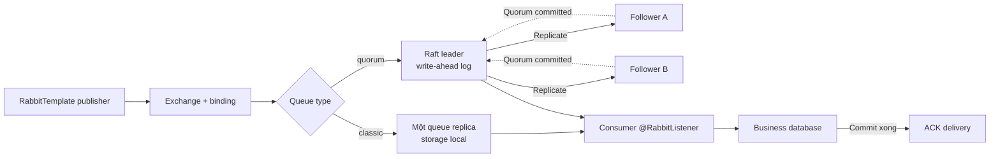
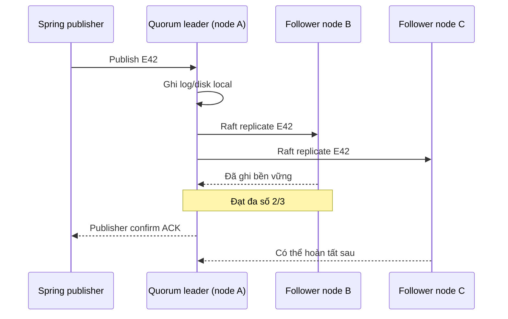

# Chi phí persistence, quorum replication và transaction

## 1. Tối ưu hiệu năng phải bắt đầu từ mức bảo đảm dữ liệu

Trong **Spring AMQP**, ứng dụng có thể gửi sự kiện bằng `RabbitTemplate`, định tuyến qua exchange và binding tới queue, rồi xử lý bằng `@RabbitListener`. Khi đo hiệu năng, chúng ta thường thấy ba câu hỏi:

1. Tại sao **persistent message** và **publisher confirms** làm độ trễ xác nhận publish thay đổi?
2. Tại sao **quorum queue** phải ghi log và đồng bộ qua nhiều node, nhưng một số workload vẫn có throughput tốt hơn classic queue?
3. Tại sao bật `channelTransacted=true` làm giảm số lượt publish/giây, và nó có thật sự thay thế publisher confirms hoặc database transaction không?

Ví dụ hệ thống đặt hàng muốn bảo đảm một sự kiện `OrderPaid` không biến mất sau khi publisher nhận thành công. Ta có thể giảm độ trễ bằng cách bỏ confirms, publish transient message hoặc dùng một queue không nhân bản; nhưng khi đó **đã thay đổi cam kết về dữ liệu**, không đơn thuần tối ưu mã nguồn.

> **Tư tưởng chính:** Persistence, replication và transaction là **ba lớp chi phí có mục đích khác nhau**. Không chọn cấu hình nhanh nhất trước khi xác định độ bền, phạm vi lỗi được chấp nhận và hành vi phục hồi.

Bài thuộc chương **Hiệu năng** của module `SPRING_AMQP`. Ta sẽ phân tích bộ nhớ, đĩa, network, quorum Raft, AMQP transaction, producer confirm, ACK và transaction database; sau đó dùng cấu hình Spring, phép đo và thí nghiệm có kiểm soát để đánh giá sự đánh đổi.

## 2. Ba lớp chi phí không nên gộp làm một



| Lớp | Tài nguyên và thời gian bổ sung | Bảo đảm mà nó hướng tới | Không tự bảo đảm |
| --- | --- | --- | --- |
| **Persistence** | Serialization, bộ đệm, file I/O, ghi/flush đĩa; cách lưu tùy loại queue | Dữ liệu được lưu để phục hồi theo mức bảo đảm của queue và confirm | Queue có nhiều bản sao; consumer xử lý chính xác một lần |
| **Quorum replication** | Raft leader/follower, network giữa node, ghi trên nhiều đĩa, coordination | Message đã được confirm an toàn theo đa số thành viên còn tồn tại | Mọi node đều khỏe; phục vụ được khi mất đa số; transaction nguyên tử với DB |
| **AMQP transaction** | `tx.select`, `tx.commit`/`tx.rollback`, round trip và chi phí phối hợp | Gom các thao tác AMQP trong một transaction trên channel | Distributed transaction giữa RabbitMQ và database; thay thế idempotency |

Một queue **durable** nghĩa là metadata queue được khôi phục sau restart; một message **persistent** nghĩa là publisher yêu cầu lưu bền vững qua delivery mode. Đây là **hai thuộc tính khác nhau**. Với AMQP 0-9-1, chỉ một trong hai thuộc tính chưa đủ để suy ra message sẽ sống sót sau mọi dạng lỗi.

Thêm nữa, từ RabbitMQ 4.0, **classic queue không được nhân bản**; muốn queue có khả năng chịu lỗi một node cần cân nhắc quorum queue hoặc kiến trúc phù hợp khác. Không nhầm lẫn durable classic queue với replicated queue.

## 3. Persistence: những gì broker phải làm trước một publish confirm

### 3.1. Durable queue và persistent message

Hai kiểu khai báo trong Spring AMQP:

```java
Queue workQueue = QueueBuilder.durable("orders.work.q").build();
Queue temporaryQueue = QueueBuilder.nonDurable("orders.lab.tmp.q").build();
```

Queue durable thường được khôi phục khi node khởi động lại. Queue không durable dành cho mục đích tạm thời và **không phù hợp để giữ công việc quan trọng qua restart**. Với RabbitMQ 4.3 trở lên, non-durable **non-exclusive** queue bị hạn chế theo deprecated-feature policy; không dùng ví dụ queue tạm này để thiết kế production.

Đối với message:

```java
import org.springframework.amqp.core.Message;
import org.springframework.amqp.core.MessageDeliveryMode;
import org.springframework.amqp.core.MessageProperties;

MessageProperties props = new MessageProperties();
props.setDeliveryMode(MessageDeliveryMode.PERSISTENT);
props.setContentType("application/json");
props.setMessageId("evt-001");
Message message = new Message(jsonBytes, props);
```

`MessageDeliveryMode.PERSISTENT` tương ứng `delivery_mode=2` trên AMQP 0-9-1. Để ứng dụng biết broker đã tiếp nhận publish theo bảo đảm của queue, cần thêm **publisher confirms**. Với persistent message và durable queue, broker xử lý xác nhận khác với transient message, vì phải xét persistence.

**Không suy rằng mọi thông tin gửi vào disk được fsync giống nhau ở mọi queue:** RabbitMQ classic queue và quorum queue có mô hình storage khác nhau. RabbitMQ nêu rõ classic queue có thể xác nhận durable message sau khi ghi xuống hệ thống tệp nhưng **không nhất thiết chờ `fsync` của dữ liệu trước publisher confirm**; quorum queue đòi kết quả ghi bền vững từ đa số replica trước khi confirm. Do đó “cùng persistent + confirm” **không đồng nghĩa mức an toàn đối với mất điện đồng thời** giống nhau giữa hai loại queue.

### 3.2. Vì sao cần batch và pipeline?

Ghi bền vững từng message theo kiểu **đợi confirm của A rồi mới gửi B** làm producer buộc chờ nhiều lượt network/IO:

```text
Publish A ─── wait confirm A ─── Publish B ─── wait confirm B ─── ...
```

Trong khi đó, publisher confirms cho phép producer gửi nhiều message **đang chờ ACK** trên cùng publishing channel:

```text
Publish A → Publish B → Publish C → Publish D → ...
      ↘         ↘         ↘
        broker batch I/O / quorum replication
              ↙ ACK cho các publish tương ứng
```

RabbitMQ khuyến nghị **asynchronous confirms hoặc publish theo lô rồi chờ** thay vì sync wait cho từng message. Đây thường là cách tăng throughput **mà không bỏ bảo đảm xác nhận**. Số publish in-flight phải **có giới hạn**, nếu không memory producer, hàng đợi callback hoặc số message phải retry có thể tăng không kiểm soát.

### 3.3. Bốn trường hợp thường bị nhầm

| Cấu hình | Khi nào phù hợp | Cảnh báo |
| --- | --- | --- |
| Classic, durable queue + persistent message, **không confirm** | Không nên dùng cho event quan trọng chỉ vì muốn nhanh | Client không biết publish có thực sự được broker tiếp nhận bền vững hay không |
| Classic, durable queue + persistent message + confirm | Cần retention qua node restart, chấp nhận đặc tính single replica | Mất hẳn node/disk có thể mất dữ liệu; không có HA queue |
| Quorum, durable, publisher confirms | Work queue quan trọng, cần khả năng chịu lỗi thành viên thiểu số | Tăng tài nguyên network/disk; yêu cầu quorum hoạt động |
| Transient message hoặc queue tạm | Dữ liệu có thể tái tạo, phản hồi tạm thời, lab | Không thay cho luồng tài chính/đơn hàng quan trọng |

**Chú ý:** Với quorum queue, message được lưu bền vững bất kể delivery mode ban đầu; vẫn nên phát message persistent khi có **dead-lettering sang queue khác** vì message dead-letter giữ delivery mode gốc. Chỉ vì quorum lưu message ban đầu không có nghĩa mọi đường DLX sẽ bền vững nếu message là transient.

## 4. Quorum replication: trả giá cho Raft để chịu lỗi

RabbitMQ **quorum queue** sử dụng **Raft**. Các message và những thay đổi trạng thái queue đi qua **leader**, được replicate tới **followers**. Publisher confirm của quorum queue chỉ được gửi sau khi message đã được phần lớn các thành viên chấp nhận và được ghi bền vững theo cơ chế quorum.



Sơ đồ chỉ thể hiện một thứ tự minh họa; việc gửi frame, ghi đĩa và phản hồi của các follower **thực tế có thể chạy song song**. Không cần tất cả các replica phản hồi trước khi quorum 3 thành viên đạt 2/3, nhưng phải có **đa số** để bảo đảm an toàn.

### 4.1. Đa số là bao nhiêu?

Với `N` thành viên của **một quorum queue**:

\[
\text{quorum}(N) = \left\lfloor\frac{N}{2}\right\rfloor+1
\]

| Số thành viên N | Số thành viên tối thiểu để có quorum | Mức lỗi thành viên tối đa còn chịu được |
| ---: | ---: | ---: |
| 1 | 1 | 0 |
| 2 | 2 | 0 |
| 3 | 2 | 1 |
| 4 | 3 | 1 |
| 5 | 3 | 2 |

Quorum queue mặc định cố tạo **ba thành viên** trên các node khác nhau khi cluster đủ điều kiện. Một queue quorum chạy trên **một node** không có năng lực chịu lỗi node chỉ vì tên nó là “quorum”. Thêm node RabbitMQ mới vào cluster **không tự đồng nghĩa queue cũ có thêm replica**; membership phải được vận hành theo tài liệu RabbitMQ.

Nếu mất một node trong nhóm 3, hai thành viên còn lại vẫn có quorum. Nếu mất hai node, không còn quorum, queue phải ưu tiên tính nhất quán thay vì tiếp tục chấp nhận ghi bừa bãi. Đây là **đổi availability lấy data safety** khi partition.

### 4.2. Nhân bản tác động tới hiệu năng ở đâu?

| Thành phần | Classic queue | Quorum queue |
| --- | --- | --- |
| Replication | Một replica (RabbitMQ 4.x) | Leader + followers theo số thành viên queue |
| Ghi/đọc storage | Queue index/message store local | Raft WAL và storage log của các replica |
| Network nội cluster | Không có traffic replicate message của chính queue | Leader chuyển log/coordination tới followers |
| Publisher confirm | Theo semantics classic và persistence | Đợi message an toàn trên **đa số thành viên** |
| Failover | Mất node chứa queue có thể làm queue không khả dụng/mất dữ liệu | Có thể bầu leader mới nếu đa số còn sống |
| Disk | Một bản dữ liệu queue ở node sở hữu | Dữ liệu trên nhiều node, WAL/metadata và overhead |

Một ước lượng thô cho dung lượng **toàn cluster** của queue replicated 3 thành viên là **khoảng ba lần dữ liệu logic**, trước khi tính WAL/index, compaction, retention, snapshot và overhead khác. Đây không phải một công thức chính xác để cấp phát từng node; hãy đo disk usage thật.

Về latency, network giữa leader và follower, độ trễ SSD/NVMe và vị trí leader ảnh hưởng mạnh. Tuy nhiên **đừng viết “quorum luôn có throughput thấp hơn classic”**. RabbitMQ hiện đại tối ưu batch/log và nhiều workload có throughput rất tốt trên quorum; kết quả thực tế phụ thuộc kích thước message, backlog, số queue, phần cứng, phiên bản broker và concurrency. Quorum thường khó đạt **mức latency cực thấp nhất** vì có consensus và ghi bền vững.

### 4.3. Tăng từ 3 lên 5 thành viên có luôn tốt hơn?

Không. Quorum 5 thành viên chịu lỗi hai thành viên thay vì một, nhưng:

- Tăng số đích replication, traffic network và chi phí ghi đĩa.
- Tăng chi phí resync/rebalancing và quản lý membership.
- Có thể làm confirm latency nhạy cảm hơn với tốc độ của **thành viên thứ ba nhanh nhất** để đạt quorum, thay vì thành viên thứ hai ở nhóm ba.
- Không nhất thiết tăng throughput của một queue đơn lẻ; leader vẫn phải tuần tự hóa các thay đổi trạng thái.

Hãy dùng **3 members** làm điểm xuất phát khi cần HA và chỉ tăng lên 5 nếu yêu cầu chịu lỗi, placement và benchmark chứng minh lợi ích. Không chọn số replica theo tổng số node toàn cluster một cách máy móc.

## 5. AMQP transaction: chi phí round trip và các giới hạn

AMQP 0-9-1 có các lệnh:

```text
tx.select        -> đặt channel vào transactional mode
basic.publish    -> gửi message trong transaction
basic.publish
tx.commit        -> yêu cầu commit transaction
tx.commit-ok     -> broker phản hồi
```

Hoặc consumer có thể thực hiện ACK trong transaction. Nhưng các lệnh này không tạo một distributed transaction **với database** và không bảo đảm hành vi của consumer là exactly-once.

### 5.1. Tại sao transaction thường chậm hơn confirms?

Khi `RabbitTemplate` bật `channelTransacted=true`, Spring sẽ dùng transactional channel để gửi/nhận và commit/rollback các thao tác AMQP. Nếu ứng dụng publish **một message rồi commit ngay**, mỗi message chịu thêm round trip commit và chi phí broker xử lý transaction. Với nhiều message, throughput có thể giảm mạnh so với **publisher confirms bất đồng bộ có pipeline**.

RabbitMQ ghi nhận giao dịch publish từng message có thể gây chênh lệch throughput rất lớn so với confirms; **không dùng một con số cố định** để lập kế hoạch hiệu năng, vì độ lớn phụ thuộc phiên bản broker, đường truyền, storage và workload.

### 5.2. Transaction và publisher confirms không cùng tồn tại trên một channel

Đây là quy tắc AMQP 0-9-1:

- `tx.select` đưa channel vào transactional mode.
- `confirm.select` đưa channel vào publisher confirm mode.
- **Một channel không thể vừa transactional vừa publisher confirm**.

Vì vậy không hợp lệ khi lập một “so sánh” nhưng cố bật cả hai trên cùng channel rồi coi kết quả là config mạnh nhất. Nên có **hai cấu hình thử nghiệm riêng**, hoặc dùng các component/channel khác nhau đúng yêu cầu của Spring.

### 5.3. `@Transactional` Spring không biến DB + RabbitMQ thành atomic commit

Ví dụ:

```java
import org.springframework.amqp.rabbit.core.RabbitTemplate;
import org.springframework.stereotype.Service;
import org.springframework.transaction.annotation.Transactional;

@Service
public class OrderCommandService {
    private final OrderRepository repository;
    private final RabbitTemplate transactionalRabbitTemplate;

    public OrderCommandService(
            OrderRepository repository,
            RabbitTemplate transactionalRabbitTemplate) {
        this.repository = repository;
        this.transactionalRabbitTemplate =
                transactionalRabbitTemplate;
    }

    @Transactional
    public void createOrder(Order order) {
        repository.save(order);
        transactionalRabbitTemplate.convertAndSend(
                "orders.events.x", "orders.created", order.toEvent());
    }
}
```

Để ví dụ này có transaction AMQP, **`transactionalRabbitTemplate` phải được cấu hình `setChannelTransacted(true)`** và transaction manager Spring phù hợp đang quản lý phương thức. Khi đó AMQP commit có thể bị trì hoãn theo transaction đồng bộ hóa với database. Đây là **Best Efforts 1 Phase Commit**, không phải XA/two-phase commit. Nếu database commit thành công rồi AMQP commit thất bại, hai hệ thống có thể **bất nhất**.

**Khuyến nghị đối với event quan trọng:** transaction DB ghi **cả order và outbox row**, sau đó relay publish bằng confirms bất đồng bộ và đánh dấu `PUBLISHED` chỉ khi broker xác nhận. Consumer cần idempotency vì relay có thể gửi lại cùng event sau timeout. Cơ chế này thường phù hợp hơn việc dùng AMQP transaction chỉ để cố kết hợp hai commit.

### 5.4. So sánh ba đường publish

| Đường xử lý | Mô hình | Thường giới hạn bởi | Điểm cần nhớ |
| --- | --- | --- | --- |
| Send không đợi confirms | Publish liên tục; có thể bỏ mất kết quả khi sự cố | I/O và flow control | Không dùng làm baseline “an toàn” cho đơn hàng |
| **Publisher confirms pipelined** | Gửi N message, theo dõi ACK/NACK cho từng lần gửi | Dung lượng in-flight, storage/replication, consumer | Phù hợp reliable publisher khi retry/idempotent |
| **AMQP tx per message** | Publish rồi đợi `tx.commit-ok` | RTT và transaction handling | Không thay thế DB atomicity; dễ giảm throughput mạnh |

## 6. Chỉ số nào phản ánh chi phí thực?

Đo đúng **throughput**, **latency**, **durability outcome** và **resource cost**, thay vì chỉ một biểu đồ “messages/sec”.

### 6.1. Tách đường thời gian

Một request phát sự kiện có thể gồm:

```text
T0: API nhận request
T1: DB transaction commit
T2: RabbitTemplate gửi basic.publish
T3: Broker route vào queue
T4: Broker hoàn tất lưu/replication
T5: Publisher nhận confirm
T6: Consumer nhận delivery
T7: Consumer commit DB nghiệp vụ
T8: Broker nhận consumer ACK
```

Các chỉ số khác nhau:

- **Publish call latency**: từ khi gọi `RabbitTemplate.send(...)` tới khi method trả về. Với async confirms, thời điểm này **chưa chứng minh broker đã xác nhận**.
- **Publisher confirm latency**: từ lúc publish tới confirm ACK/NACK được client ghi nhận (`T5 − T2`).
- **Queue waiting time**: message chờ trong queue trước khi được consume (`T6 − T3`), chịu ảnh hưởng backlog.
- **Business processing latency**: thời gian handler/DB từ nhận tới commit (`T7 − T6`).
- **End-to-end latency**: từ intent nghiệp vụ tới commit ở consumer; có thể gồm nhiều retry/DLX.

Đồng hồ giữa nhiều host có thể lệch; đo latency liên process cần instrumentation/clock phù hợp, không lấy hai timestamp rời từ hai máy rồi cho ra con số chính xác tuyệt đối.

### 6.2. Một phép ước lượng hữu ích

Nếu publisher **đợi từng confirm** với độ trễ trung bình \(L\) giây và chỉ có **một publish outstanding**:

\[
\text{Throughput gần đúng} \lesssim \frac{1}{L}
\]

Nếu có **tối đa \(W\)** publish đang chờ confirm trong pipeline:

\[
\text{Throughput gần đúng} \lesssim \frac{W}{L}
\]

Đây chỉ là **giới hạn theo số in-flight** theo nguyên lý Little's Law, không phải cam kết broker đạt đúng throughput đó. CPU, disk, network, queue leader, consumer và flow control có thể giới hạn thấp hơn.

Ví dụ minh họa (không phải benchmark thực tế):

| Confirm latency trung bình | Max in-flight | Giới hạn lý thuyết chỉ do in-flight |
| ---: | ---: | ---: |
| 20 ms | 1 | 50 message/s |
| 20 ms | 20 | 1.000 message/s |
| 20 ms | 100 | 5.000 message/s |

Không nên tăng \(W\) vô hạn. Nếu broker chậm hoặc partition, hàng nghìn future chưa hoàn tất sẽ tăng memory và tạo một **cơn bão retry** khi timeout. Dùng bounded semaphore/backpressure và một hàng đợi outbox bền vững.

### 6.3. Đơn vị đo phải thống nhất

- `messages/s` phải đi kèm **kích thước body**, headers, encoding, số consumer và số queue đích.
- `MiB/s` đo byte dữ liệu; một message 100 KiB khác hoàn toàn message 100 byte.
- `p50`, `p95`, `p99` và `max` của **confirm latency** quan trọng hơn chỉ mean.
- Ghi **in-flight**, `messages_ready`, `messages_unacknowledged`, disk IO, WAL/disk free, network và CPU của từng RabbitMQ node.
- Ghi tỉ lệ ACK/NACK, returned unroutable, publisher timeout, redelivery, DLQ, lỗi DB và **business duplicates prevented**.

## 7. Ví dụ Spring AMQP: cấu hình và producer có confirms

Các ví dụ sau hướng tới **Java 17+, Spring Boot 3.x/Spring AMQP 3.x**. Với Spring Boot/Spring AMQP major mới hơn, hãy kiểm tra class và property tương thích trước khi áp dụng. Broker thử nghiệm cần có quyền khai báo tài nguyên; khi chuyển từ classic sang quorum phải dùng **queue mới**, không thể đổi `x-queue-type` của queue đang tồn tại bằng redeclare.

### 7.1. Khai báo hai queue benchmark

```java
import org.springframework.amqp.core.BindingBuilder;
import org.springframework.amqp.core.Declarables;
import org.springframework.amqp.core.DirectExchange;
import org.springframework.amqp.core.Queue;
import org.springframework.amqp.core.QueueBuilder;
import org.springframework.context.annotation.Bean;
import org.springframework.context.annotation.Configuration;

@Configuration
public class PerformanceTopology {

    @Bean
    public Declarables performanceDeclarables() {
        DirectExchange exchange =
                new DirectExchange("perf.events.x", true, false);

        Queue classic = QueueBuilder.durable("perf.classic.q").build();
        Queue quorum = QueueBuilder.durable("perf.quorum.q")
                .quorum()
                .build();

        return new Declarables(
                exchange, classic, quorum,
                BindingBuilder.bind(classic)
                        .to(exchange).with("perf.classic"),
                BindingBuilder.bind(quorum)
                        .to(exchange).with("perf.quorum")
        );
    }
}
```

Ví dụ này giả định broker/vhost thử nghiệm **chưa có** hai queue trùng tên. Nếu broker cấu hình `default_queue_type=quorum` thì queue `classic` ở trên cần chỉ định **explicit `x-queue-type=classic`** hoặc cấu hình vhost tương ứng để bảo đảm phép so sánh không nhầm queue type. Có thể thêm `.withArgument("x-queue-type", "classic")` vào builder khi cần.

Một quorum queue trên cluster 3 node có thể có 3 member; trên broker đơn node, phép đo **không có network replication và không đại diện HA**. Thông số `x-quorum-initial-group-size` phải phù hợp với số node hiện có, số node khỏe và placement. Không ép thêm member trên một broker đơn node rồi gọi đó là benchmark production.

### 7.2. Bật publisher confirms và returns

```yaml
spring:
  rabbitmq:
    host: localhost
    port: 5672
    publisher-confirm-type: correlated
    publisher-returns: true
    template:
      mandatory: true
    listener:
      simple:
        concurrency: 2
        max-concurrency: 2
        prefetch: 20
        acknowledge-mode: auto
```

`publisher-confirm-type: correlated` cho phép theo dõi outcome từng publish. `publisher-returns: true` + `mandatory: true` để phát hiện message không route tới queue nào. `acknowledge-mode: auto` của Spring nghĩa là **container ACK sau khi listener thành công**, khác với RabbitMQ consumer `autoAck=true` không chờ xử lý.

### 7.3. Producer giữ `eventId` và đợi confirm một cách có kiểm soát

```java
import java.nio.charset.StandardCharsets;
import java.util.UUID;
import java.util.concurrent.TimeUnit;

import org.springframework.amqp.core.Message;
import org.springframework.amqp.core.MessageDeliveryMode;
import org.springframework.amqp.core.MessageProperties;
import org.springframework.amqp.rabbit.connection.CorrelationData;
import org.springframework.amqp.rabbit.core.RabbitTemplate;
import org.springframework.stereotype.Service;

@Service
public class ReliablePublisher {
    private final RabbitTemplate template;

    public ReliablePublisher(RabbitTemplate template) {
        this.template = template;
    }

    // Demo dùng synchronous wait để minh họa latency,
    // KHÔNG phải cách đạt throughput cao nhất.
    public void publishAndWait(
            String exchange, String routingKey,
            String eventId, byte[] jsonBody) throws Exception {

        MessageProperties props = new MessageProperties();
        props.setContentType("application/json");
        props.setContentEncoding(StandardCharsets.UTF_8.name());
        props.setDeliveryMode(MessageDeliveryMode.PERSISTENT);
        props.setMessageId(eventId);

        // ID này đại diện MỘT publish attempt; eventId vẫn giữ
        // nguyên nếu cùng logical event cần retry.
        CorrelationData attempt = new CorrelationData(
                eventId + "-" + UUID.randomUUID());

        template.send(exchange, routingKey,
                new Message(jsonBody, props), attempt);

        CorrelationData.Confirm confirm =
                attempt.getFuture().get(10, TimeUnit.SECONDS);

        if (!confirm.isAck()) {
            throw new IllegalStateException(
                    "Publisher NACK: " + confirm.getReason());
        }
        if (attempt.getReturned() != null) {
            throw new IllegalStateException(
                    "Unroutable: " + attempt.getReturned().getReplyText());
        }
    }
}
```

**Điều kiện:** Code cần `CorrelationData.getFuture()` (Spring AMQP 3.x trở lên) và cấu hình confirms/returns đã bật. Cấu hình `mandatory` trên template là bắt buộc nếu muốn phát hiện unroutable qua return; confirm ACK có thể xảy ra **dù không có queue nào nhận**.

Ví dụ cố tình **đợi từng confirm**, vì vậy có thể làm publisher chậm. Khi tối ưu production, nên gửi nhiều message có **future riêng**, quản lý bounded in-flight và chờ các confirm một cách bất đồng bộ hoặc theo batch, thay vì block một thread cho mỗi message.

Khi timeout, không được suy ra “broker chưa nhận”; publish lại có thể tạo **duplicate**. Hãy tái sử dụng `eventId`, sử dụng outbox và làm consumer idempotent.

## 8. Cùng giao diện RabbitTemplate, hai kiểu transaction khác nhau

Để đánh giá **AMQP transaction** trong benchmark riêng, cấu hình:

```java
import org.springframework.amqp.rabbit.connection.ConnectionFactory;
import org.springframework.amqp.rabbit.core.RabbitTemplate;
import org.springframework.context.annotation.Bean;
import org.springframework.context.annotation.Configuration;

@Configuration
public class TransactionalTemplateConfiguration {

    @Bean("txRabbitTemplate")
    public RabbitTemplate txRabbitTemplate(
            ConnectionFactory connectionFactory) {
        RabbitTemplate template = new RabbitTemplate(connectionFactory);
        template.setChannelTransacted(true);
        return template;
    }
}
```

Khi không có Spring external transaction đang chạy, thao tác trên template transactional thường được Spring kết thúc bằng AMQP commit/rollback theo phạm vi operation. Nếu có `@Transactional` database bao ngoài và `channelTransacted=true`, transaction RabbitMQ có thể tham gia cơ chế đồng bộ hóa của Spring theo **Best Efforts 1PC**; điều đó **không đảm bảo hai hệ thống commit đồng thời**.

**Quan trọng trong benchmark:** Không dùng cùng một channel cho transactional mode và confirm mode; chúng **loại trừ nhau** ở giao thức AMQP 0-9-1. Trong bài lab hãy tổ chức **hai lượt chạy độc lập** (config confirms và config transaction), tạo lại bean/connection tương ứng để không vô tình tái sử dụng channel sai chế độ.

Tình huống chạy transaction:

```java
import org.springframework.amqp.rabbit.core.RabbitTemplate;
import org.springframework.beans.factory.annotation.Qualifier;
import org.springframework.stereotype.Service;

@Service
public class TransactionalPublishExample {
    private final RabbitTemplate txTemplate;

    public TransactionalPublishExample(
            @Qualifier("txRabbitTemplate") RabbitTemplate txTemplate) {
        this.txTemplate = txTemplate;
    }

    public void sendOne(String eventJson) {
        // Demo: một publish và một commit AMQP.
        txTemplate.convertAndSend(
                "perf.events.x", "perf.classic", eventJson);
    }
}
```

Nếu so sánh với một publisher dùng **asynchronous confirms**, ghi rõ hai đường cung cấp semantics khác nhau. Transaction có thể gom nhiều operation, nhưng việc dùng một transaction lớn để tăng throughput lại kéo dài thời gian treo, tăng rủi ro rollback nhiều message và biến thời điểm xử lý/nhìn thấy message khó dự đoán hơn.

### Khi transaction không cần thiết

| Mục đích | Giải pháp thường phù hợp hơn |
| --- | --- |
| Biết broker đã tiếp nhận event | Publisher confirms + mandatory returns |
| Bảo vệ việc ghi DB rồi publish | Transactional outbox + relay confirms |
| Chặn xử lý message trùng | Inbox/unique constraint + idempotent handler |
| ACK sau khi DB commit | Spring listener đồng bộ + DB transaction, ACK theo kết quả |
| Giảm thời gian publish nhưng giữ reliability | Async confirms có giới hạn in-flight, batch/pipeline |
| Cần transaction nhiều operation **chỉ trong một AMQP channel** | Đánh giá `channelTransacted=true`, chứng minh lợi ích bằng failure tests |

## 9. Consumer throughput: tăng concurrency không sửa chi phí persistence

Một consumer có thể xử lý chậm do database, HTTP downstream hoặc CPU. Tăng `concurrency` và `prefetch` chỉ tác động **phía nhận**, không làm disk fsync/quorum replication ở broker biến mất.

```java
import org.springframework.amqp.core.AcknowledgeMode;
import org.springframework.amqp.rabbit.config.SimpleRabbitListenerContainerFactory;
import org.springframework.amqp.rabbit.connection.ConnectionFactory;
import org.springframework.context.annotation.Bean;
import org.springframework.context.annotation.Configuration;

@Configuration
public class WorkerFactoryConfiguration {

    @Bean("measuredListenerFactory")
    public SimpleRabbitListenerContainerFactory measuredFactory(
            ConnectionFactory connectionFactory) {
        SimpleRabbitListenerContainerFactory factory =
                new SimpleRabbitListenerContainerFactory();
        factory.setConnectionFactory(connectionFactory);
        factory.setConcurrentConsumers(2);
        factory.setMaxConcurrentConsumers(2);
        factory.setPrefetchCount(20);
        factory.setAcknowledgeMode(AcknowledgeMode.AUTO);
        return factory;
    }
}
```

Ở cấu hình này có tối đa **40 delivery đang unacked trên hai consumer** trong điều kiện QoS bình thường. **Không phải** số thread xử lý DB luôn bằng 40: mỗi consumer đồng bộ xử lý listener theo lịch container, còn prefetch chủ yếu quyết định số delivery broker cho phép đang chờ.

### 9.1. Concurrency và prefetch thay đổi điều gì?

| Thay đổi | Có thể cải thiện | Có thể gây hại |
| --- | --- | --- |
| Tăng số consumer | Song song hóa handler, che độ trễ DB/HTTP | Tăng tranh chấp DB, đảo thứ tự hoàn tất, nhiều connection/channel |
| Tăng prefetch | Giảm latency do chờ broker cấp delivery, cải thiện throughput | Tăng memory/unacked, giảm fairness, nhiều redelivery sau crash |
| ACK theo batch/manual nhiều delivery | Giảm số frame ACK trong một số workload | ACK nhầm delivery chưa commit nếu chọn `multiple=true` sai |
| Giảm message size | Giảm network/storage/serialization overhead | Không được bỏ dữ liệu nghiệp vụ bắt buộc |
| Giảm số queue đích của mỗi publish | Giảm số bản ghi/fanout cần lưu | Thay đổi semantics routing/subscriber |
| Tăng replica quorum | Tăng fault tolerance nếu membership hợp lý | Tăng disk/network và có thể tăng confirm latency |

`AcknowledgeMode.AUTO` vẫn phù hợp khi listener đồng bộ chỉ trả về sau khi transaction DB đã commit. Đừng submit task vào executor rồi return ngay: container có thể ACK trước khi side effect xong. Nếu dùng async listener/Future, cần cơ chế ACK theo completion của Spring AMQP và kiểm thử failure window.

### 9.2. Dùng database idempotency để không đánh đổi tính đúng lấy throughput

Nhiều consumer và retry có thể tạo duplicate:

```sql
CREATE TABLE processed_events (
    event_id VARCHAR(128) PRIMARY KEY,
    processed_at TIMESTAMPTZ NOT NULL DEFAULT now()
);
```

Trong **một database transaction**:

```text
BEGIN
  INSERT processed_events(event_id)
    ON CONFLICT DO NOTHING
  IF inserted:
    update business state / create shipment
COMMIT
Spring AMQP listener returns successfully -> ACK
```

Nếu consumer commit DB xong nhưng crash trước ACK, RabbitMQ có thể redeliver. Unique constraint giúp lần tiếp theo là no-op, **không phải vì replication hay publisher confirm tự bảo đảm exactly-once**.

## 10. Thiết kế benchmark đúng: thay một yếu tố tại mỗi lần chạy

Trước khi benchmark, tạo môi trường cô lập với RabbitMQ có **cùng major version, cấu trúc cluster, loại disk và RTT tương tự production**. Nếu chỉ test trên một Docker container ở laptop, số đo không đại diện quorum replication ba node.

### 10.1. Biến kiểm soát

| Nhóm | Giữ cố định |
| --- | --- |
| Payload | Kích thước 1 KiB / 16 KiB / 128 KiB; tỷ lệ nhỏ/lớn đại diện sản phẩm |
| Producer | Số instance, channel, connection, window in-flight và rate limit |
| Routing | Exchange type, số queue nhận trên mỗi publish, key distribution |
| Consumer | Số consumer, prefetch, ACK mode, thời gian giả lập DB |
| Broker | Phiên bản RabbitMQ, loại queue, số replica/membership, leader placement |
| Hạ tầng | CPU, RAM, SSD/NVMe, disk alarms, network giữa node, TLS |
| Data state | Queue ban đầu trống hoặc cùng backlog; không trộn kết quả |
| Measurement | Warm-up, thời gian đo, p50/p95/p99, throughput và số lỗi |

Đừng chạy các test trên broker production chứa đơn hàng thật. Message bão hòa có thể lấp disk và kích hoạt memory/disk alarms, ảnh hưởng toàn bộ vhost/node.

### 10.2. Ma trận thí nghiệm tối thiểu

| Case | Queue | Message | Producer reliability | Ý nghĩa |
| --- | --- | --- | --- | --- |
| A | Classic durable | Persistent | Confirms (pipelined) | Baseline reliable single-replica |
| B | Quorum 3 members | Persistent | Confirms (pipelined) | Chi phí replication và consensus |
| C | Classic durable | Persistent | AMQP transaction per publish | Chi phí commit round trip |
| D | Quorum 3 members | Persistent | AMQP transaction | Xem chi phí kết hợp khi supported; không dùng với confirms trên cùng channel |
| E | Classic durable | Transient | Không confirm | **Chỉ** để đo trần throughput trong lab, không dùng thay case A |
| F | Quorum 3 members | Persistent | Confirms (window 1 vs 100 vs 500) | Hiệu quả pipeline và giới hạn in-flight |

Từng case chạy nhiều lần, thứ tự có thể đảo để tránh bias do warm cache/IO. So sánh không chỉ peak throughput mà cả **confirm p99, disk free, recovery time, queue backlog và lỗi publish**.

### 10.3. RabbitMQ PerfTest trên broker thử nghiệm

[RabbitMQ PerfTest](https://perftest.rabbitmq.com/) mô phỏng publisher/consumer AMQP 0-9-1 và cung cấp các tùy chọn message size, persistence, confirmations, prefetch và loại queue.

Ví dụ chạy trên **shell Bash** sau khi đã tải `perf-test.jar` tương thích:

```bash
# Classic queue: persistent message, 1 publisher,
# 2 consumer, tối đa 200 publish chưa confirm.
java -jar perf-test.jar \
  --id classic-confirm-lab \
  --queue perf-classic-lab \
  --producers 1 --consumers 2 \
  --size 1024 --flag persistent \
  --confirm 200 --qos 100

# Quorum queue: cùng message size, publisher và consumer.
# Phải chạy trên CLUSTER thử nghiệm 3 node nếu muốn đo replication thật.
java -jar perf-test.jar \
  --id quorum-confirm-lab \
  --quorum-queue --queue perf-quorum-lab \
  --producers 1 --consumers 2 \
  --size 1024 --flag persistent \
  --confirm 200 --qos 100
```

Các cờ minh họa theo PerfTest hiện hành: `--quorum-queue` khai báo queue quorum; `--confirm` là số publish chưa confirm tối đa; `--qos` là consumer prefetch. Chú ý **mỗi queue tên mới** để không va chạm queue đã tồn tại khác `x-queue-type`. Kiểm tra `java -jar perf-test.jar --help` của đúng bản đã cài trước khi chạy nếu CLI có thay đổi.

**Không so latency của producer xác nhận với producer bỏ confirms rồi nói loại queue nào “nhanh hơn”**: điều đó thay đổi giao thức xác nhận chứ không chỉ queue. Tương tự, có consumer mới đọc được message chưa chứng minh publish đã an toàn khi cả cluster mất điện.

### 10.4. Ví dụ bảng kết quả cần ghi (không phải số đo thật)

| Case | Throughput (msg/s) | Confirm p95 / p99 | Disk write (MB/s) | Network intra-cluster (MB/s) | Lost/duplicate sau fault test |
| --- | --- | --- | --- | --- | --- |
| A | Điền từ benchmark | Điền số đo | Điền số đo | Điền số đo | Đối soát |
| B | Điền từ benchmark | Điền số đo | Điền số đo | Điền số đo | Đối soát |
| C | Điền từ benchmark | Không có confirm mode; đo `tx.commit` latency | Điền số đo | Điền số đo | Đối soát |
| D | Điền từ benchmark | Đo `tx.commit` latency | Điền số đo | Điền số đo | Đối soát |

**Báo cáo phải kèm SLO và quyết định:** ví dụ “p99 end-to-end dưới 400 ms, đã xác nhận broker durable replicated, chịu được mất một node, không có double charge” là tiêu chí kỹ thuật tốt hơn “đạt 10.000 msg/s” đơn lẻ.

## 11. Tình huống thực hành về độ bền và phục hồi

### Thí nghiệm A — Persistence không bằng successful publish

1. Tạo classic durable queue và dùng persistent messages.
2. Tạm tắt publisher confirms **chỉ trên broker lab**, publish nhiều message rồi mô phỏng sự cố kết nối/đóng publisher.
3. Kiểm tra message thực có trong queue và đối soát ID.
4. Chạy lại với confirms; phân biệt message được confirm và message có outcome **chưa biết**.
5. Kết luận: không được bỏ `eventId`/outbox chỉ vì queue durable.

### Thí nghiệm B — Quorum chịu lỗi một member

1. Dùng cluster ba node; tạo quorum queue có ba members. Kiểm tra membership và leader thực tế bằng Management UI/CLI.
2. Publish persistent messages, đợi **publisher confirms**, ghi mỗi `eventId` được confirm.
3. Làm mất **một** node chứa member theo cách có kiểm soát; quan sát leader election nếu node đó là leader.
4. Tiếp tục publish/consume sau khi hai members còn lại có quorum.
5. Đối soát các event IDs đã confirm với trạng thái consumer/DB; xác định retry gây duplicate nào.
6. Khôi phục node, quan sát follower catch-up. Không dùng môi trường production để cố tình kill node.

### Thí nghiệm C — Mất quorum

1. Trên cluster lab ba node, mô phỏng chỉ còn một member của queue hoạt động.
2. Theo dõi publish timeout/NACK/queue unavailability; đừng coi client không ném exception ngay là broker đã commit.
3. Phục hồi đa số members, chờ leader/replication ổn định.
4. Retry những event chưa có kết quả confirm với cùng logical `eventId`.
5. Kiểm tra inbox/DB idempotency, không tạo side effect trùng.

### Thí nghiệm D — Transaction và confirm theo hai lượt chạy

1. Dùng cấu hình confirm pipelined, đo throughput/confirm latency và CPU.
2. Dừng ứng dụng, dùng config transacted riêng, gửi cùng payload/routing, đo throughput/`tx.commit` latency.
3. Cố ý gây exception trước commit trong một luồng transacted; xác minh rollback theo semantics của AMQP.
4. Thử transaction DB kèm AMQP rồi chèn lỗi **sau DB commit trước AMQP commit** trong môi trường lab; quan sát vì sao Best Efforts 1PC không phải atomic commit.
5. Kết luận giải pháp outbox/inbox có thể khôi phục ra sao.

### Thí nghiệm E — Message lớn và nhiều fanout

1. Chạy các case A/B với message 1 KiB, 16 KiB, 128 KiB.
2. Tăng số queue nhận mỗi publish từ 1 lên 3 trong topology thử nghiệm riêng.
3. Theo dõi **disk, network giữa các node, publisher confirm latency và memory**; fanout làm broker phải đưa message tới nhiều queue, có thể có nhiều nhóm replication.
4. Nếu chỉ dùng một queue duy nhất trong PerfTest, ghi rõ giới hạn đại diện của kết quả khi thực tế có hàng chục queue.

## 12. Tuning theo nguyên nhân, không theo cảm tính

| Nếu đang thấy... | Nên đo tiếp | Cách xử lý có điều kiện |
| --- | --- | --- |
| Confirm p99 cao nhưng CPU publisher thấp | Disk latency, quorum health, network RTT, IO wait | SSD/NVMe, placement leader/followers, async confirms có window phù hợp |
| Throughput thấp với window=1 | RTT và thời gian chờ mỗi confirm | Tăng bounded in-flight; không bỏ confirms |
| DB downstream chậm, queue backlog tăng | DB connection pool, query latency, consumer processing | Tối ưu handler/DB, tăng concurrency có giới hạn |
| `messages_unacknowledged` tăng nhanh | Prefetch, handler hung, DB timeout | Giảm prefetch hoặc xử lý bottleneck, kiểm tra ACK lifecycle |
| Disk alarm kích hoạt | Disk free từng node, WAL backlog, tổng số queue/replica | Tăng capacity, backpressure, giảm retention ở cấu trúc phù hợp |
| Quorum không có leader/không publish được | Members online, majority, network partition | Phục hồi quorum, không ép ghi thiếu đa số |
| Message 128 KiB làm throughput tụt | Bytes/s, disk/network per replica, serialization | Giảm payload hoặc lưu blob ngoài broker và truyền reference **khi phù hợp** |
| Transaction `tx.commit` trở thành bottleneck | RTT, commit frequency, number of operations/tx | Chuyển use case publish tin cậy sang confirms/outbox nếu semantics cho phép |
| CPU broker quá tải vì nhiều queue | Số queue, consumer, leader distribution, churn | Partition/coalesce theo topology được chứng minh; không gộp queue tùy tiện |
| Lỗi publish tăng khi tăng tốc | NACK/return/timeout, flow control, disk alarms | Giới hạn tốc độ và in-flight, retry backoff |

Không đổi nhiều biến cùng lúc. Ví dụ tăng `prefetch`, `concurrency` và số replica trong cùng lần benchmark sẽ làm khó xác định yếu tố tác động hiệu năng.

### Metrics hữu ích khi đối soát

| Layer | Metrics/counters |
| --- | --- |
| Producer Spring | Publish attempted, confirmed ACK/NACK, returns, timeout, p95/p99 confirm |
| RabbitMQ queue | Publish rate, deliver rate, ACK rate, `messages_ready`, `messages_unacknowledged` |
| Quorum | Member count, queue leader, replication lag/health, leader elections, catch-up |
| RabbitMQ node | Disk free/alarm, disk I/O wait, WAL, memory, CPU, network throughput |
| Consumer | Listener latency, error/retry/requeue/DLQ count, DB transaction latency |
| Nghiệp vụ | Event IDs processed, duplicate prevented, missing aggregate version, order state |

Micrometer Observation có thể đo Spring AMQP producer/consumer, nhưng **tracing span hoặc method duration không thay publisher-confirm latency**; cần instrument future callback hoặc scoped confirm timing. Các metric RabbitMQ cluster phải được lấy từ broker exporter/management telemetry tương ứng.

## 13. Những hiểu lầm nguy hiểm

1. **“Durable queue đủ để message chắc chắn không mất.”** Cần xét persistent message, publish confirmation và loại queue.
2. **“Publisher confirm ACK nghĩa là consumer đã ACK và database commit.”** Đó là hai quá trình độc lập.
3. **“Persistent message trên classic và quorum có cùng mức fsync trước confirm.”** Storage/durability semantics khác nhau.
4. **“Quorum queue chạy một node cũng chịu được hỏng một node.”** Một member nghĩa là quorum 1/1, mất nó thì không còn queue hoạt động.
5. **“Cứ tăng số quorum members sẽ tăng throughput.”** Replication tốn tài nguyên và leader vẫn quản lý log.
6. **“Quorum queue luôn chậm hơn classic queue ở mọi workload.”** Cần benchmark đúng phiên bản, phần cứng và workload; không suy từ tên loại queue.
7. **“AMQP transaction và publisher confirms dùng chung một channel để an toàn nhất.”** Hai mode loại trừ nhau.
8. **“`@Transactional` Spring giúp DB commit và RabbitMQ commit nguyên tử.”** Best Efforts 1PC vẫn có failure window; outbox/inbox thường cần thiết.
9. **“Tăng concurrency giúp publish xác nhận nhanh hơn.”** Concurrency consumer không xóa chi phí ghi/replicate của broker.
10. **“`prefetch=500` nghĩa là có 500 thread xử lý.”** Prefetch là số delivery outstanding cho consumer, không phải thread count.
11. **“Một lần gọi `RabbitTemplate.send` return là publish an toàn.”** Nếu confirms async, method return không phải broker confirm.
12. **“Bỏ confirms rồi benchmark nhanh hơn chứng minh hệ thống đã tối ưu.”** Bài toán durability đã bị đổi.
13. **“Retry publish sau timeout chắc chắn không trùng.”** Broker có thể đã nhận; phải giữ logical event ID.
14. **“Benchmark một RabbitMQ node đủ suy ra khả năng chịu lỗi của quorum cluster.”** Cần thử member failure và majority recovery.

## 14. Câu hỏi tự kiểm tra

1. Khác biệt giữa **durable queue**, **persistent message** và **publisher confirm** là gì?
2. Vì sao classic queue RabbitMQ 4.x không bảo vệ khỏi hỏng vĩnh viễn node chứa queue, dù queue durable?
3. Với quorum queue ba members, cần bao nhiêu members còn sống? Thay bằng năm members thì mức chịu lỗi thay đổi ra sao?
4. Những yếu tố network/disk/leader placement nào có thể ảnh hưởng p99 confirm của quorum queue?
5. Vì sao `tx.commit` trên AMQP channel không tự commit nguyên tử một database transaction?
6. Có thể bật `confirm.select` trên channel đã vào `tx.select` không? Vì sao?
7. Nếu consumer DB commit rồi chết trước ACK, quorum replication có ngăn message được giao lại không? Thiết kế nào xử lý trường hợp đó?
8. Khi \(L=20\) ms, vì sao publisher window=1 có thể bị giới hạn throughput khác xa window=100?
9. Nếu `RabbitTemplate.send` trả về ngay mà publisher confirm future chưa hoàn tất, API có thể nói “message đã được lưu bền vững” hay chưa?
10. Hãy xây benchmark so sánh classic persistent+confirms và quorum persistent+confirms, giữ các biến nào cố định?
11. Khi throughput tăng nhưng DLQ/redelivery cũng tăng, tại sao chưa thể kết luận tuning thành công?
12. Nêu các tình huống nên dùng **transactional outbox**, và những điều kiện vẫn cần consumer idempotency.
13. Nếu môi trường production dùng ba RabbitMQ nodes nhưng quorum queue chỉ có một member do cấu hình sai, cần kiểm tra gì trước khi tuyên bố HA?
14. Tại sao cần so sánh **message size và số queue được route** bên cạnh messages/s?

**Ghi nhớ:** Persistence dùng storage để tăng độ bền, quorum replication dùng Raft và đa số để chịu lỗi node, còn AMQP transaction thêm commit semantics với chi phí riêng; **không có cơ chế nào tự mang lại exactly-once hoặc atomicity với database**. Đối với hệ thống sự kiện quan trọng, hãy chọn queue type theo RPO/khả năng chịu lỗi, dùng **persistent messages, publisher confirms pipelined, ACK sau DB commit và idempotency/outbox**. Mọi tối ưu về in-flight, consumer concurrency, prefetch hoặc transaction cần được đo bằng **throughput, p95/p99, disk/network và kết quả fault injection**, không chỉ bằng một con số tốc độ.

### Tài liệu tham khảo chính thức

- [RabbitMQ — Quorum Queues](https://www.rabbitmq.com/docs/quorum-queues): Raft, đa số, publisher confirms, reliability, limitations và membership.
- [RabbitMQ — Classic Queues](https://www.rabbitmq.com/docs/classic-queues): lưu trữ classic queue và phạm vi không nhân bản.
- [RabbitMQ — Consumer Acknowledgements and Publisher Confirms](https://www.rabbitmq.com/docs/confirms): ACK, confirms, batch, latency và hai mode transaction/confirms.
- [RabbitMQ — Persistence Configuration](https://www.rabbitmq.com/docs/persistence-conf): workload, disk I/O, queue storage, WAL và benchmark.
- [RabbitMQ — How Are Messages Stored?](https://www.rabbitmq.com/blog/2025/01/17/how-are-the-messages-stored): so sánh fsync/confirm của classic, quorum và streams.
- [RabbitMQ — Broker Semantics](https://www.rabbitmq.com/docs/semantics): phạm vi transaction và thời điểm hiệu lực của `tx.commit-ok`.
- [Spring AMQP — Transactions](https://docs.spring.io/spring-amqp/reference/amqp/transactions.html): `channelTransacted`, external transaction và Best Efforts 1 Phase Commit.
- [Spring AMQP — RabbitTemplate](https://docs.spring.io/spring-amqp/reference/amqp/template.html): publish, publisher confirms, returned messages và scoped operations.
- [Spring AMQP — QueueBuilder JavaDoc](https://docs.spring.io/spring-amqp/docs/3.2.5/api/org/springframework/amqp/core/QueueBuilder.html): `.durable()`, `.quorum()` và queue arguments.
- [RabbitMQ PerfTest](https://perftest.rabbitmq.com/): benchmark, `--quorum-queue`, confirms, prefetch và queue type.
