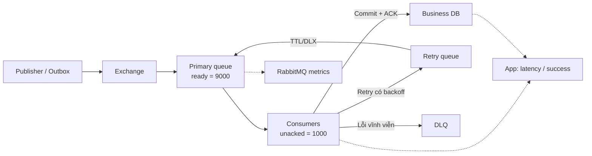
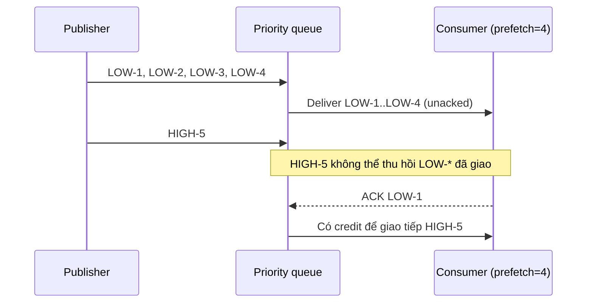
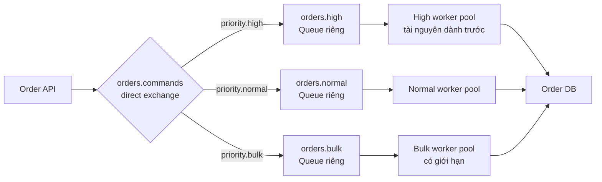
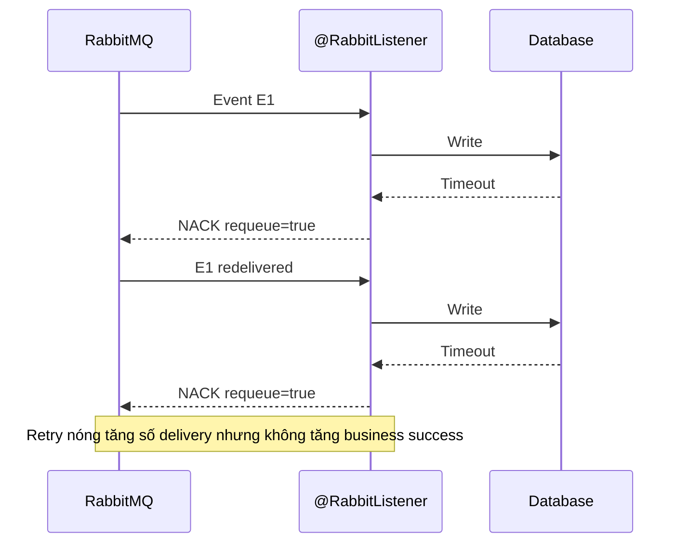

# Đánh giá queue backlog, thông điệp ưu tiên và tải không đồng đều

Một hệ thống dùng **Spring AMQP** có thể nhận 10.000 yêu cầu mỗi phút, publisher nhận confirm thành công và `@RabbitListener` vẫn đang chạy, nhưng người dùng tiếp tục chờ xử lý đơn hàng. Trong RabbitMQ, **queue backlog** có thể tăng vì producer gửi nhanh hơn khả năng xử lý, consumer bị kẹt tài nguyên, message lỗi được retry quá nhiều, hoặc một số queue/shard bị dồn tải trong khi những queue khác gần như rỗng.

Một phản ứng quen thuộc là tăng `prefetch`, tăng số consumer hoặc bật **message priority**. Tuy nhiên, các thay đổi này giải quyết những vấn đề khác nhau. Prefetch không phải số thread, thêm consumer không loại bỏ giới hạn database, còn message priority chỉ ảnh hưởng đến **việc chọn message sẵn sàng giao**, chứ không thu hồi message ưu tiên thấp đã được prefetch và không bảo đảm một giao dịch ưu tiên cao luôn hoàn tất trước.

Bài thuộc chương **Hiệu năng** của module **SPRING_AMQP**. Bằng `RabbitTemplate`, `@RabbitListener`, exchange, queue, binding, publisher confirm, consumer acknowledgement, retry và dead-letter, chúng ta sẽ đánh giá backlog, cơ chế ưu tiên và tải không đồng đều bằng **dữ liệu đo được**, rồi lựa chọn cách điều chỉnh mà không đánh đổi tính đúng đắn nghiệp vụ.

**Sau bài học, bạn có thể:**

- Đọc đúng `messages_ready`, `messages_unacknowledged`, tốc độ publish/deliver/ack, redelivery và tuổi công việc.
- Tính gần đúng tốc độ tăng backlog và thời gian xả khi producer vẫn tiếp tục gửi message.
- Giải thích giới hạn **message priority** của RabbitMQ, quan hệ với `prefetchCount` và khả năng xử lý song song.
- Cấu hình classic priority queue và gửi priority qua `RabbitTemplate` trong Spring AMQP.
- Phát hiện **hot queue**, **hot shard**, **slow consumer**, **poison message** và độ lệch tải giữa instance/node.
- Thiết kế phân vùng theo khóa nghiệp vụ, phân tách lane ưu tiên hoặc dùng admission control/backpressure tùy SLA.
- Tổ chức benchmark và alert để cải thiện **p95/p99 end-to-end latency**, không chỉ tăng số message/giây.

## 1. Queue backlog thực sự là gì?

Backlog là phần công việc đã vào hệ thống nhưng **chưa hoàn tất theo mục tiêu mà ta quan tâm**. Trong RabbitMQ AMQP 0-9-1, broker thường công bố:

| Metric | Ý nghĩa | Một cách hiểu sai |
| --- | --- | --- |
| `messages_ready` | Message đang nằm trong queue và chưa được giao cho consumer | “Đây là toàn bộ công việc chưa hoàn tất” |
| `messages_unacknowledged` | Message đã giao nhưng chưa được ack; có thể đang xử lý hoặc chờ trong prefetch buffer | “Tất cả đều đang chạy trên CPU” |
| `messages` | Thường là tổng `ready + unacknowledged` | “Đây là số business transaction chắc chắn sẽ hoàn thành” |
| `consumers` | Số subscription đang đăng ký trên queue | “Có N consumer là N message được commit mỗi lúc” |
| Publish / deliver / ack rate | Tốc độ các thao tác ở broker | “ACK bằng số nghiệp vụ thành công” |
| Redelivery rate | Số message được giao lại | “Chắc chắn consumer đã xử lý trùng thành công” |
| DLQ depth | Message nằm tại dead-letter queue | “Các message lỗi đã được xử lý xong” |

Ví dụ có `ready=9.000`, `unacked=1.000` và một số retry chờ trong queue phụ. Khi đó **backlog ở queue chính** xấp xỉ 10.000 delivery chưa kết thúc, nhưng **backlog nghiệp vụ đầu cuối** còn có thể gồm message ở retry queue, outbox chưa phát và những task đã ack nhưng downstream chưa hoàn tất.



**Phạm vi quyết định công thức đo:** nếu SLA yêu cầu “đơn hàng có hóa đơn trong vòng 30 giây”, hãy đo **tuổi event chưa có invoice** từ nguồn nghiệp vụ. `messages_ready` thấp nhưng toàn bộ event bị kẹt ở retry queue vẫn là vi phạm SLA.

### 1.1. “Ready = 0” không đồng nghĩa không có tồn đọng

Với 20 consumer và `prefetch=100`, broker có thể giao trước tới hàng nghìn delivery. `messages_ready` giảm về 0, trong khi `messages_unacknowledged` tăng mạnh. Nếu mỗi consumer chỉ xử lý **một** message tại một thời điểm, phần lớn delivery có thể đang nằm chờ trong bộ đệm phía consumer, chưa thực sự được xử lý.

Điều tương tự xảy ra nếu listener đã nhận message nhưng bị kẹt DB, gọi API bên ngoài hoặc quên ack trong manual mode. Muốn biết hệ thống đang tiến triển, cần xem **ack rate, tỷ lệ commit nghiệp vụ, listener duration và tuổi message**, không chỉ độ sâu ready.

## 2. Ước tính tốc độ tăng backlog và thời gian xả

Đặt:

- `λ` (*lambda*): tốc độ message mới đến queue, đơn vị message/giây.
- `μ` (*mu*): tốc độ **hoàn tất hiệu dụng**, thường lấy từ ACK sau xử lý thành công; nếu ACK không đại diện cho thành công, dùng metric nghiệp vụ.
- `B`: backlog hiện có, được đo trong cùng phạm vi.
- `Δt`: khoảng thời gian đo, tính bằng giây.

Trong mô hình giản lược không có vòng retry, không có message bị drop và tốc độ khá ổn định:

\[
\Delta B \approx (\lambda-\mu)\,\Delta t
\]

Khi `μ > λ`, thời gian xả backlog về gần 0 trong lúc vẫn tiếp nhận tải mới xấp xỉ:

\[
T_{\text{drain}}\approx\frac{B}{\mu-\lambda}
\]

Ngược lại, nếu `μ \leq λ` liên tục, **không thể xả backlog chỉ bằng cách chờ**.

### Ví dụ tính toán

Hệ thống nhận **850 message/giây**, nhưng consumer hoàn tất **750 message/giây**:

- Backlog tăng khoảng **100 message/giây**.
- Sau 10 phút, backlog tăng thêm khoảng **60.000 message**.
- Khi tối ưu nâng thông lượng xử lý lên **1.100 message/giây**, với producer giữ nguyên 850 message/giây, năng lực xả thuần khoảng **250 message/giây**.
- Nếu backlog lúc đó là **60.000 message**, thời gian xả ước tính `60.000 / 250 = 240 giây`, tức khoảng **4 phút**.

Tất cả các số trên chỉ để **ước lượng công suất**. Trong thực tế, λ/μ dao động, message khác nhau về thời gian xử lý, các vòng retry có thể tạo thêm delivery, và bottleneck DB hoặc broker có thể đổi theo mức tải.

### 2.1. Dùng Little’s Law nhưng không sai phạm vi

Ở một hệ thống **ổn định** và khi các đại lượng cùng phạm vi đo, định luật Little cho:

\[
L = \lambda_{\text{effective}} \times W
\]

Trong đó `L` là số phần tử trung bình trong **giai đoạn đo**, `λ_effective` là throughput hiệu dụng và `W` là thời gian trung bình phần tử ở **giai đoạn đó**. Không lấy `messages_ready` của riêng queue nhân/chia với thời gian end-to-end gồm cả database, retry và xử lý downstream rồi coi kết quả chính xác.

Ví dụ nếu trung bình **2.000 message đang chờ trong queue** và throughput ổn định là **400 message/giây**, thời gian chờ queue trung bình có thể xấp xỉ **5 giây** theo mô hình ổn định. Nhưng tail latency, message priority, prefetch và tải lệch có thể khiến một nhóm message chờ **lâu hơn nhiều** mức trung bình.

**Kết luận:** đánh giá backlog bằng ít nhất ba chiều: **số lượng chưa hoàn tất**, **tốc độ vào–ra** và **độ tuổi/độ trễ của công việc**.

## 3. Xác định nút thắt trước khi tăng concurrency

Tăng `concurrentConsumers` thường chỉ giúp khi chính năng lực consumer là nút thắt **có thể song song hóa**. Nếu thời gian commit tăng do database đã dùng hết connection pool, thêm consumer còn làm tình trạng tệ hơn.

| Triệu chứng | Nghi vấn ban đầu | Bằng chứng nên tìm |
| --- | --- | --- |
| `ready` tăng, `consumers=0` | Listener chưa subscribe, queue thiếu, lỗi quyền/kết nối | Container events, broker `consumer_count`, logs |
| `ready` tăng, `unacked` rất thấp | Consumer không lấy kịp, prefetch nhỏ, executor kẹt hoặc dispatch lỗi | Deliver rate, thread pool, listener startup, channel close |
| `unacked` gần `prefetch × consumers`, ACK chậm | Listener chậm, DB lock/API timeout, quên ack hoặc prefetch đệm nhiều | p95/p99 listener, DB pool, thread dump, ack mode |
| Redelivery tăng vọt, thông lượng thành công thấp | NACK/requeue nóng, crash loop hoặc poison message | Retry count, DLQ, exception theo nhóm |
| Publisher confirm chậm, connection bị blocked | Broker memory/disk alarm, network hoặc storage pressure | Broker alarms, disk I/O, confirm latency |
| Chỉ một queue/shard tăng backlog | Khóa nóng, định tuyến lệch, consumer chậm ở shard đó | Arrival rate theo shard, key distribution, worker latency |
| CPU broker cao sau bật priority | Priority levels quá nhiều, message churn/queue work | CPU, memory, throughput, priority distribution |

### 3.1. Phân biệt ba độ trễ

1. **Publish latency:** từ `RabbitTemplate` gửi đến khi producer nhận xác nhận của broker, nếu có publisher confirms.
2. **Queue waiting latency:** từ lúc message vào queue đến lúc consumer bắt đầu xử lý; không nhất thiết được đo trực tiếp bởi broker metrics.
3. **Processing/completion latency:** từ lúc listener bắt đầu đến khi transaction/side effect hoàn tất; rồi mới tính ACK/retry.

Độ trễ đầu cuối thường gồm cả ba phần **và các lượt retry**, nhưng không nên cộng chúng một cách cơ học khi một event được phát lại nhiều lần. Phải dùng **event ID** và mốc timestamp đáng tin cậy để đo theo nghiệp vụ.

Nếu tối ưu `prefetch` khiến queue waiting dường như về 0 nhưng listener phải đợi trong prefetch buffer lâu hơn, **end-to-end latency có thể không cải thiện**.

## 4. Message priority trong RabbitMQ hoạt động như thế nào?

**Message priority** là metadata trên message. Broker có thể ưu tiên **message đang sẵn sàng giao trong queue có hỗ trợ ưu tiên** so với message có priority thấp hơn. Nó không có nghĩa message ưu tiên cao sẽ chiếm CPU ngay, dừng công việc thấp đang thực thi hoặc được commit trước mọi message khác.

Với **classic queue** hỗ trợ priority, queue được khai báo argument `x-max-priority`. Một message được publish với `priority` nguyên; broker dùng cấu hình queue để phân loại/so sánh mức ưu tiên. Chọn **ít mức ưu tiên** vì mỗi mức có chi phí tài nguyên/điều phối; RabbitMQ thường khuyến nghị dùng số mức thấp, chẳng hạn **5**, thay vì mặc định trải rộng hàng chục/hàng trăm mức.

```text
orders.priority (classic queue, x-max-priority = 5)

ready: LOW-A(p=1), LOW-B(p=1), HIGH-C(p=5), LOW-D(p=1)

Nếu HIGH-C còn ready khi broker chọn delivery kế tiếp:
   HIGH-C có cơ hội được giao trước LOW-* đang ready.

Nhưng nếu LOW-A/LOW-B đã được prefetch sang consumer trước:
   HIGH-C KHÔNG tự kéo chúng về queue;
   HIGH-C cũng không preempt transaction đang chạy.
```

### 4.1. Phân biệt theo queue type

| Queue type | Cơ chế ưu tiên | Lưu ý quyết định |
| --- | --- | --- |
| **Classic queue** | Hỗ trợ nhiều priority levels qua `x-max-priority` | Tăng số mức gây overhead; priority chủ yếu ảnh hưởng ready messages |
| **Quorum queue** | Các phiên bản RabbitMQ gần đây có cơ chế **hai nhóm ưu tiên** (normal/high) với quy tắc riêng | Không áp đặt `x-max-priority` của classic queue; kiểm tra chính xác phiên bản broker và hành vi của quorum |
| **RabbitMQ stream** | Mô hình append-only log/offset, không phải hàng đợi công việc có reorder theo `x-max-priority` kiểu classic | Chia stream/partition hoặc lane và xử lý ưu tiên ở ứng dụng khi cần |

**Đừng suy ra tương thích chỉ từ chữ “queue”.** Một thiết kế phụ thuộc priority phải kiểm tra queue type và tài liệu đúng **RabbitMQ release** đang chạy. Không thể đổi classic queue hiện có sang quorum queue chỉ bằng cách redeclare cùng tên với argument khác.

### 4.2. Hai điều message priority không thể làm

**Không preempt công việc đang xử lý.** Consumer A có thể đã nhận task ưu tiên thấp và đang gọi API 20 giây. Task ưu tiên cao đến sau vẫn phải chờ tài nguyên thực thi phù hợp.

**Không bảo đảm một SLA nghiêm ngặt.** Nếu lượng message high liên tục quá lớn, low có thể chờ rất lâu; nếu cùng queue có consumer hoặc retry khác nhau, completion order còn phụ thuộc processing time, DB lock, redelivery và routing. Priority là **điều phối ưu tiên tương đối**, không phải hợp đồng deadline.

## 5. Cấu hình classic priority queue bằng Spring AMQP

Ví dụ service có một queue ưu tiên nhận lệnh `invoice.create`:

```java
import org.springframework.amqp.core.Binding;
import org.springframework.amqp.core.BindingBuilder;
import org.springframework.amqp.core.DirectExchange;
import org.springframework.amqp.core.Queue;
import org.springframework.amqp.core.QueueBuilder;
import org.springframework.context.annotation.Bean;
import org.springframework.context.annotation.Configuration;

@Configuration
public class InvoicePriorityTopology {

    @Bean
    DirectExchange invoiceCommandsExchange() {
        return new DirectExchange("invoice.commands", true, false);
    }

    @Bean
    Queue invoicePriorityQueue() {
        // Bài thử chọn CLASSIC queue để minh họa x-max-priority.
        return QueueBuilder.durable("invoice.priority")
                .withArgument("x-queue-type", "classic")
                .withArgument("x-max-priority", 5)
                .build();
    }

    @Bean
    Binding invoicePriorityBinding(Queue invoicePriorityQueue,
                                   DirectExchange invoiceCommandsExchange) {
        return BindingBuilder.bind(invoicePriorityQueue)
                .to(invoiceCommandsExchange)
                .with("invoice.create");
    }
}
```

**Cảnh báo tương thích:** nếu môi trường đã có queue `invoice.priority` khai báo không có `x-max-priority`, redeclare với argument mới có thể gây lỗi `406 PRECONDITION_FAILED`. Priority queue phải được provision đúng ngay từ đầu hoặc migrate có kế hoạch qua queue mới. Nếu broker/vhost có default queue type hoặc policy áp dụng, cần kiểm tra điều kiện vận hành cụ thể.

### 5.1. Đặt priority ở RabbitTemplate

```java
import java.nio.charset.StandardCharsets;
import org.springframework.amqp.core.MessageDeliveryMode;
import org.springframework.amqp.rabbit.core.RabbitTemplate;
import org.springframework.stereotype.Service;

@Service
public class InvoicePriorityPublisher {
    private final RabbitTemplate rabbitTemplate;

    public InvoicePriorityPublisher(RabbitTemplate rabbitTemplate) {
        this.rabbitTemplate = rabbitTemplate;
    }

    public void publish(String invoiceId, int requestedPriority) {
        int normalized = Math.max(0, Math.min(5, requestedPriority));
        String body = "CREATE|" + invoiceId;

        rabbitTemplate.convertAndSend(
                "invoice.commands", "invoice.create", body,
                message -> {
                    message.getMessageProperties().setMessageId(invoiceId);
                    message.getMessageProperties().setPriority(normalized);
                    message.getMessageProperties().setDeliveryMode(
                            MessageDeliveryMode.PERSISTENT);
                    return message;
                });
    }
}
```

`MessageProperties.setPriority(...)` đặt thuộc tính message của AMQP 0-9-1. `x-max-priority` quyết định queue hỗ trợ/đánh giá giá trị đó ra sao; **đặt priority nhưng queue không hỗ trợ sẽ không tạo ưu tiên mong muốn**. Đoạn ví dụ giới hạn đầu vào 0–5, nhưng production cần một **quy tắc nghiệp vụ được kiểm soát**: ai được chọn priority, hạn mức high, có audit, và không lấy mức ưu tiên do client bên ngoài tự khai tùy ý.

**Lưu ý:** message delivery mode persistent và queue durable giúp độ bền theo các điều kiện thích hợp, nhưng không làm việc xử lý “exactly once”. Producer nên có publisher confirms/returns và outbox khi yêu cầu không mất command; consumer nên idempotent và ACK sau commit.

### 5.2. Listener với số consumer và prefetch có chủ đích

```java
import org.springframework.amqp.core.AcknowledgeMode;
import org.springframework.amqp.rabbit.config.SimpleRabbitListenerContainerFactory;
import org.springframework.amqp.rabbit.connection.ConnectionFactory;
import org.springframework.context.annotation.Bean;
import org.springframework.context.annotation.Configuration;

@Configuration
public class InvoicePriorityListenerConfig {
    @Bean("invoicePriorityListenerFactory")
    SimpleRabbitListenerContainerFactory invoicePriorityListenerFactory(
            ConnectionFactory connectionFactory) {
        SimpleRabbitListenerContainerFactory factory =
                new SimpleRabbitListenerContainerFactory();
        factory.setConnectionFactory(connectionFactory);
        factory.setConcurrentConsumers(4);
        factory.setMaxConcurrentConsumers(4);
        factory.setPrefetchCount(5);
        factory.setAcknowledgeMode(AcknowledgeMode.AUTO);
        return factory;
    }
}
```

```java
import org.springframework.amqp.rabbit.annotation.RabbitListener;
import org.springframework.stereotype.Component;

@Component
public class InvoicePriorityListener {
    private final InvoiceService service;

    public InvoicePriorityListener(InvoiceService service) {
        this.service = service;
    }

    @RabbitListener(
        id = "invoice-priority-worker",
        queues = "invoice.priority",
        containerFactory = "invoicePriorityListenerFactory")
    public void onInvoiceCreate(String command) {
        // InvoiceService do ứng dụng triển khai: transaction + idempotency.
        service.processOnce(command);
    }
}
```

Ở `AcknowledgeMode.AUTO`, container ACK sau khi listener trả về thành công, còn exception được xử lý theo cấu hình listener/error handler. Không gọi `basicAck` thủ công trong phương thức AUTO. Trong hệ thống cần quyết định ack từng delivery, có thể dùng `MANUAL` và ACK **sau transaction commit**.

**Không coi `prefetch=5` là giá trị tối ưu.** Nó chỉ là lựa chọn thử nghiệm để cân bằng throughput và thời gian message nằm sẵn trong consumer. Với priority queue, cần **đo latency high/normal/low sau khi thay prefetch**.

## 6. Prefetch ảnh hưởng “độ sắc” của ưu tiên

RabbitMQ không thể ưu tiên lại message **đã được giao** cho consumer. Khi `prefetchCount` cao, nhiều message thấp có thể bị kéo khỏi queue và giữ trong bộ đệm; message cao tới sau phải đợi những delivery đang chiếm credit/slot hoàn tất.



| Cấu hình | Lợi ích khả dĩ | Rủi ro/cái giá |
| --- | --- | --- |
| Một consumer, `prefetch=1` | Cơ hội ưu tiên message ready ở mỗi lần cấp credit; dễ quan sát | Throughput có thể giảm khi message rất ngắn và network latency lớn |
| Nhiều consumer, `prefetch=1` | Có song song, ít delivery nằm đệm ở consumer | High vẫn có thể commit sau low đang xử lý |
| Nhiều consumer, `prefetch=20` | Giảm round-trip/đợi broker, có thể cải thiện throughput | Nhiều low đã ở unacked; high đợi tài nguyên lâu hơn |
| Prefetch lớn + handler bất đồng bộ | Có thể giữ nhiều việc trong client | Phức tạp ACK/thread safety, out-of-order completion, tăng memory |

Giả sử có 4 consumer và `prefetch=20`. Broker có thể giao tới khoảng **80 delivery chưa ACK** trong kịch bản thông thường; con số đó **không có nghĩa 80 message đang xử lý song song**. Với listener đồng bộ của SMLC, thực tế có khoảng bốn luồng consumer đang làm việc, còn các message khác có thể chờ.

**Chiến lược tuning:** tăng prefetch để cải thiện throughput khi thực sự bị network overhead, nhưng nếu mục tiêu là ưu tiên high message, hãy thử giảm prefetch và đo **p95/p99 thời gian chờ của high**, đồng thời so sánh tổng throughput. Không phải lúc nào prefetch thấp nhất cũng thắng vì workload và loại queue khác nhau.

## 7. Message priority khác consumer priority

RabbitMQ còn có cơ chế **consumer priority**, thường truyền argument `x-priority` khi đăng ký `basic.consume`. Nó xác định **consumer nào được ưu tiên nhận delivery** trên cùng queue, không thay đổi priority của **message** trong queue.

| Cơ chế | Được gắn với | Quyết định |
| --- | --- | --- |
| **Message priority** | Message property `priority` + queue hỗ trợ ưu tiên | Chọn message sẵn sàng giao khi có nhiều mức |
| **Consumer priority** | Consumer subscription argument `x-priority` | Ưu tiên consumer nào có thể nhận message |
| **Routing/queue lane priority** | Exchange, queue/binding, pool worker | Cấp năng lực/tài nguyên riêng cho nhóm việc |
| **Business priority** | Hợp đồng nghiệp vụ, deadline, tenant tier | Xác định SLA và quyền xếp loại; không tự có ở RabbitMQ |

Ví dụ hai nhóm consumer đọc cùng queue: nhóm “primary” có consumer priority cao hơn nhóm “standby”. Điều này **không làm message HIGH được xử lý trước LOW** nếu không có message priority hoặc thiết kế lane phù hợp.

Đừng dùng consumer priority như một công cụ điều phối tenant công bằng: ưu tiên consumer không phải thuật toán weighted-fair scheduling theo khách hàng.

## 8. Priority queue hay tách nhiều queue ưu tiên?

Khi chỉ có một nhóm handler với công việc tương tự nhau và yêu cầu “HIGH thường đi trước khi còn ready”, **một classic priority queue** có thể đủ. Khi có deadline nghiêm ngặt hoặc nhóm việc khác nhau quá nhiều về thời gian xử lý, nên cân nhắc **tách lane**:



| Tiêu chí | Một priority queue | Nhiều queue/lane |
| --- | --- | --- |
| Topology | Đơn giản hơn | Nhiều queue, binding và consumer |
| Ưu tiên message ready | Do broker hỗ trợ trong cùng queue | Do routing + công suất phân bổ theo lane |
| Cách ly việc bulk chậm | Hạn chế: cùng pool worker có thể bị bận | Có thể dành worker/CPU/DB connection cho high |
| Rủi ro low bị đói | Có thể có nếu high đến liên tục | Cần quota/fairness; bulk lane cũng có thể bị thiếu tài nguyên |
| Quan sát backlog theo class | Cần gắn metric/application context phù hợp | Có `ready/unacked/age` theo từng queue |
| Thay đổi mức ưu tiên | Hạn chế theo queue arguments/logic | Có thể điều chỉnh worker pool/routing linh hoạt hơn |
| Bảo đảm high luôn đúng SLA | **Không** | Vẫn **không**, nếu downstream chung bão hòa |

**Không tự động đẩy mọi thao tác “VIP” vào priority cao.** Nếu mọi request đều được gắn HIGH, cơ chế ưu tiên mất giá trị. Cần hạn mức và quy trình gán priority dựa trên chính sách nghiệp vụ.

### 8.1. Cấu hình routing theo lane

```java
import org.springframework.amqp.core.Binding;
import org.springframework.amqp.core.BindingBuilder;
import org.springframework.amqp.core.DirectExchange;
import org.springframework.amqp.core.Queue;
import org.springframework.amqp.core.QueueBuilder;
import org.springframework.context.annotation.Bean;
import org.springframework.context.annotation.Configuration;

@Configuration
public class OrderLanesTopology {
    @Bean
    DirectExchange orderCommandsExchange() {
        return new DirectExchange("orders.commands", true, false);
    }

    @Bean Queue highOrdersQueue() {
        return QueueBuilder.durable("orders.high").build();
    }
    @Bean Queue normalOrdersQueue() {
        return QueueBuilder.durable("orders.normal").build();
    }
    @Bean Queue bulkOrdersQueue() {
        return QueueBuilder.durable("orders.bulk").build();
    }

    @Bean
    Binding bindHigh(Queue highOrdersQueue,
                     DirectExchange orderCommandsExchange) {
        return BindingBuilder.bind(highOrdersQueue)
                .to(orderCommandsExchange).with("priority.high");
    }
    @Bean
    Binding bindNormal(Queue normalOrdersQueue,
                       DirectExchange orderCommandsExchange) {
        return BindingBuilder.bind(normalOrdersQueue)
                .to(orderCommandsExchange).with("priority.normal");
    }
    @Bean
    Binding bindBulk(Queue bulkOrdersQueue,
                     DirectExchange orderCommandsExchange) {
        return BindingBuilder.bind(bulkOrdersQueue)
                .to(orderCommandsExchange).with("priority.bulk");
    }
}
```

Sau đó có thể cấu hình **listener factories riêng** cho mỗi queue với concurrency/prefetch phù hợp. Lưu ý **tài nguyên downstream vẫn có thể dùng chung**: ba pool Java khác nhau cùng gọi một database có 20 connections vẫn tranh chấp. Nếu cần dành capacity cho high, phải kiểm soát cả DB concurrency/API rate limiter hoặc reserve phù hợp.

### 8.2. Khi công việc có phụ thuộc thứ tự

Tách HIGH và LOW của **cùng một orderId** vào hai queue có thể làm sự kiện phiên bản mới **vượt qua** sự kiện cũ. Priority không sửa tính đúng đắn nghiệp vụ: cần **event version**, transaction có điều kiện, idempotency hoặc phân vùng theo `orderId`. Với tác vụ kiểu **delta bắt buộc áp dụng đủ**, không được bỏ event cũ chỉ vì một event mới được gắn priority cao hơn.

## 9. Tải không đồng đều: nguyên nhân không chỉ nằm ở queue

**Skew** xuất hiện khi một số queue, key, consumer hoặc node chịu phần lớn lưu lượng/cost, trong khi phần còn lại nhàn rỗi.

### 9.1. Năm dạng lệch thường gặp

| Dạng lệch | Triệu chứng | Nguyên nhân có thể |
| --- | --- | --- |
| **Hot aggregate/key** | Các event của `customerId=A`/`orderId=X` tập trung trên một worker/shard | Phân vùng theo key, “khách hàng lớn” phát nhiều giao dịch |
| **Hot queue** | Queue A có `ready` rất lớn, B/C gần rỗng | Routing/binding lệch hoặc workload không cân |
| **Slow consumer** | Một instance có nhiều unacked, ACK thấp | DB/network tới shard, GC pause, CPU, message nặng |
| **Heavy message mix** | Số lượng message cân nhưng một nhóm xử lý chậm gấp nhiều lần | Mỗi message có chi phí khác nhau (file lớn, API timeout) |
| **Node/leader locality** | Queue leader/replica/node nào đó nóng, node khác rảnh | Queue placement, disk I/O, network, quorum replica, cluster topology |

**Đếm message không đủ để đo tải.** Hai queue cùng 10.000 message/s nhưng queue A mất 2 ms mỗi message, B mất 200 ms mỗi message thì CPU/I/O cần thiết khác nhau rất lớn. Có thể lập chỉ số đơn giản:

\[
\text{workload demand} \approx
\text{arrival rate}\times\text{mean processing time}
\]

Ví dụ A: `100 msg/s × 0,01 s = 1` đơn vị worker bận liên tục. B: `100 msg/s × 0,2 s = 20` worker tương đương, nếu giả định công việc có thể song song và không còn nút thắt ngoài. Đừng đồng nhất số này với CPU core khi handler chờ I/O; đây là cách ước lượng **độ đồng thời** cần thiết theo mô hình đơn giản.

### 9.2. Prefetch có thể làm lệch phân phối

Khi hai consumer cùng đọc một queue nhưng `prefetch` lớn, consumer nhận nhanh có thể giữ nhiều delivery chưa ack. Nếu sau đó consumer ấy chậm vì DB hay GC, phần việc nó đã prefetch **không tự được lấy lại** để chuyển ngay sang consumer đang rảnh. Broker chỉ có thể giao message **còn ready** dựa trên credit hiện có.

Để giảm hiện tượng message “nằm đệm” quá lâu trên consumer chậm, thử giảm prefetch và kiểm tra độ lệch `unacked` theo consumer/channel. Không mặc định broker luôn phân phối tuyệt đối round-robin hoặc fair theo **chi phí xử lý**; đó là mục tiêu không thể suy ra từ message count.

## 10. Phân vùng theo key: giữ thứ tự nhưng phải chấp nhận hot shard

Khi cần xử lý nhiều đơn hàng song song mà **thứ tự trong từng orderId** vẫn quan trọng, có thể định tuyến về nhiều queue shard:

```text
shard = stableHash(orderId) % 4

orders.shards (exchange)
  ├─ orders.shard.0 -> consumer shard 0
  ├─ orders.shard.1 -> consumer shard 1
  ├─ orders.shard.2 -> consumer shard 2
  └─ orders.shard.3 -> consumer shard 3

Mọi event của cùng orderId luôn tới cùng shard.
```

Một producer minh họa cách chọn routing key ổn định theo chuỗi UTF-8:

```java
import java.nio.charset.StandardCharsets;
import java.util.zip.CRC32;
import org.springframework.amqp.rabbit.core.RabbitTemplate;

public class ShardedOrderPublisher {
    private static final int SHARD_COUNT = 4;
    private final RabbitTemplate rabbitTemplate;

    public ShardedOrderPublisher(RabbitTemplate rabbitTemplate) {
        this.rabbitTemplate = rabbitTemplate;
    }

    public void publish(String orderId, String eventPayload) {
        CRC32 crc = new CRC32();
        byte[] key = orderId.getBytes(StandardCharsets.UTF_8);
        crc.update(key, 0, key.length);
        int shard = (int) (crc.getValue() % SHARD_COUNT);

        rabbitTemplate.convertAndSend(
                "orders.shards", "orders.shard." + shard, eventPayload);
    }
}
```

Đây là ví dụ **routing**, không phải triển khai đầy đủ. Phải khai báo exchange và từng queue/binding, có event ID, persistent delivery/outbox và publisher confirms/returns theo yêu cầu. `CRC32` chỉ là hash ổn định để phân vùng, **không dùng làm cơ chế bảo mật**.

### Tại sao shard vẫn bị lệch?

Hash phân bố **số lượng key** tương đối đều khi key đủ đa dạng, nhưng **không bảo đảm tải mỗi key đều nhau**. Nếu một customer/order phát ra lượng event gấp 100 lần các key còn lại, shard chứa key đó vẫn có thể nóng hơn ba shard kia.

Tăng từ 4 lên 8 shard bằng cách đổi `%4` thành `%8` ngay khi backlog cũ còn tồn tại có thể chuyển event của cùng orderId sang queue khác và làm **đảo thứ tự xử lý**. Cần migration có kế hoạch: versioned routing, drain, mapping ổn định hoặc chuyển nguồn phát khi các event cũ đã được xử lý an toàn.

Nếu một key cực nóng gây nghẽn, thêm shard **không chắc** giúp, vì không thể chia cùng key qua nhiều consumer mà vẫn giữ thứ tự tuyệt đối nếu không có cơ chế phiên bản/serialize khác. Cân nhắc tối ưu xử lý key nóng, batching khi hợp lệ hoặc đổi hợp đồng xử lý theo version/commutative operations.

### 10.1. Single consumer per shard không đủ nếu upstream phát sai thứ tự

Giữ một active consumer ở mỗi shard có thể giúp giữ thứ tự delivery và xử lý đồng bộ theo queue, nhưng phải bảo đảm **event cùng key được publish tuần tự đúng sequence**, không có retry tạo reordering và có idempotency khi redelivery. Đặc biệt, nếu publisher chạy song song và phát v3 trước v2, broker không biết thứ tự nghiệp vụ.

Chọn thứ tự theo domain: `aggregateId` + `version`, transaction/outbox ở producer, version check ở consumer và cơ chế xử lý gap nếu cần.

## 11. Retry, DLQ, TTL và queue limits làm backlog khó đọc hơn

Một queue tăng backlog không nhất thiết vì arrival rate nghiệp vụ cao. Có thể vì **một message bị NACK requeue lặp lại**, hoặc retry queue đang chứa một lượng lớn message sẽ quay lại cùng lúc.

### 11.1. Retry storm



Nếu chỉ xem `deliver rate`, hệ thống có thể trông như đang xử lý rất nhanh, trong khi `business_success_rate` gần bằng 0. Retry nóng cạnh tranh tài nguyên với message mới, gây thêm queueing delay và tạo nghẽn lan truyền.

**Giải pháp:** phân loại lỗi transient/permanent, giới hạn số attempt, exponential backoff có jitter, delayed retry khi hợp lý, DLQ/quarantine, và **idempotency**. Đếm retry theo event ID, không dựa duy nhất vào broker `redelivered` vì retry nội bộ tại Spring có thể xảy ra mà không tạo broker redelivery.

### 11.2. TTL, DLX và ngưỡng queue

- TTL có thể làm message hết hạn hoặc chuyển sang DLX nếu cấu hình tương ứng; **không có nghĩa nghiệp vụ đã xử lý thành công**.
- `max-length`, `max-length-bytes` và `overflow` (hoặc policy tương ứng) giới hạn backlog ở một số loại queue/cấu hình; hành vi khi tràn **phải được kiểm tra theo queue type**. Một số cấu hình có thể loại message cũ hoặc từ chối publish.
- Với publisher confirms/returns, phân biệt broker chấp nhận publish, message được route và message thực sự xử lý thành công.
- Nếu ứng dụng dùng retry queue TTL, backlog nghiệp vụ có thể **ẩn ở retry queue**, chưa hiện trong ready của primary queue.
- DLQ không tự làm công việc hoàn tất. Cần chính sách review/replay, alert, retention và đối soát.

**Không giới hạn queue bằng cách xóa message quan trọng để dashboard đẹp.** Khi backlog đe dọa bộ nhớ/disk, cần có **admission control/backpressure** phía ingress, quota theo tenant hoặc cơ chế từ chối có thể phát hiện và retry từ nguồn bền vững. Định nghĩa trước quyết định mất/giữ message theo yêu cầu nghiệp vụ.

## 12. Thí nghiệm benchmark: đo throughput và tail latency theo priority

Một lần benchmark có ý nghĩa phải có **workload và cách đo cố định**, thay đổi từng biến, đo nhiều khoảng thời gian và tách giai đoạn warm-up khỏi số liệu chính.

### 12.1. Bộ tham số thử nghiệm

| Tham số | Bộ giá trị thử | Vì sao |
| --- | --- | --- |
| Consumer count | `1, 4, 8, 16` | Tìm mức scale hữu ích và bão hòa DB |
| Prefetch | `1, 5, 20, 100` | So throughput với latency ưu tiên và unacked |
| Message priority | `0/1/5` trên classic queue đã khai báo đúng | Kiểm tra head-of-line và độ trễ high |
| Tỷ lệ high | `1%, 10%, 50%` | Xem khi nào high áp đảo, low bị đói |
| Thời gian xử lý | `5 ms, 50 ms, 500 ms`; có I/O giả lập được kiểm soát | Message count giống nhau nhưng chi phí khác |
| Phân bố key | Uniform, 80/20, một hot key chiếm 30% | Đo shard skew |
| Retry rate | `0%, 1%, 10%` | Tách lỗi ứng dụng với tải publish mới |
| Replica/queue type | Cấu hình được tổ chức hỗ trợ | So durability/cost; không suy kết quả cho mọi cluster |

**Không mô phỏng latency bằng `Thread.sleep` trong mã production.** Khi thử nghiệm riêng, có thể dùng fault-injection/sleep có chủ đích trong test worker để tạo phân bố processing time, nhưng phải ghi lại và không dùng sleep làm cơ chế đồng bộ assertion.

### 12.2. Ghi nhận chuỗi thời gian

Mỗi event test có:

```text
eventId
aggregateId
priorityClass = HIGH | NORMAL | BULK
producerCreatedAt
publisherConfirmedAt (nếu có)
listenerStartedAt
businessCommittedAt
attemptNumber
result = SUCCESS | RETRY | DLQ | FAILED
```

Từ đó tính:

- **Throughput end-to-end:** số `eventId` duy nhất hoàn tất nghiệp vụ mỗi giây.
- **p50/p95/p99 completion latency theo priority class**, không gộp HIGH/LOW thành một trung bình.
- **Time in queue/consumer:** chênh lệch thời điểm publish và listener start; cần đồng bộ đồng hồ hoặc dùng timestamp trên cùng hệ đo và nêu sai số.
- **Tốc độ tăng `ready + unacked`** và **oldest pending age**; tính riêng retry/DLQ.
- **Saturation:** CPU, memory, disk I/O, broker flow control, DB connection pool, thread executor, publisher confirms.
- **Fairness:** tỷ lệ LOW vẫn được hoàn tất trong mỗi khoảng, kể cả khi HIGH tăng mạnh.

### 12.3. Ví dụ bảng kết quả chưa điền

| Case | Consumers | Prefetch | High mix | Throughput success (msg/s) | High p99 (ms) | Low p99 (ms) | Ready / unacked | Kết luận |
| --- | ---: | ---: | ---: | ---: | ---: | ---: | --- | --- |
| Baseline | 4 | 1 | 10% | Đo thực tế | Đo thực tế | Đo thực tế | Đo thực tế | Mốc so sánh |
| A | 4 | 20 | 10% | Đo thực tế | Đo thực tế | Đo thực tế | Đo thực tế | Xem prefetch có gây nghẽn high? |
| B | 8 | 5 | 10% | Đo thực tế | Đo thực tế | Đo thực tế | Đo thực tế | Xem DB có scale tương ứng? |
| C | 4 | 5 | 50% | Đo thực tế | Đo thực tế | Đo thực tế | Đo thực tế | Kiểm tra low starvation |
| D | 4+4 | 5 | Lane riêng | Đo thực tế | Đo thực tế | Đo thực tế | Đo thực tế | Đối chiếu chi phí cách ly |

Không có bộ số nào ở bảng trên là kết quả đo thật; **không điền số theo kỳ vọng**. Với SLA, quan trọng là *HIGH p99*, *LOW starvation*, *tốc độ hoàn tất nghiệp vụ* và *khả năng hồi phục sau sự cố*, không chỉ throughput cao nhất ở trạng thái bình thường.

## 13. Giám sát backlog và tải lệch bằng Prometheus

RabbitMQ có Management UI/HTTP API và plugin `rabbitmq_prometheus`. Broker cần được scrape bằng endpoint phù hợp; tên metric chi tiết có thể thay đổi theo phiên bản hoặc family được bật. Khi giám sát queue cụ thể, dùng `/metrics/detailed` với nhóm metric cần thiết, thay vì luôn bật toàn bộ per-object metrics.

### 13.1. Tín hiệu nên có trên dashboard

| Nhóm | Tín hiệu | Diễn giải |
| --- | --- | --- |
| Queue | `ready`, `unacked`, consumer count, queue existence | Có công việc đang chờ và có người nhận hay không |
| Broker | Publish/deliver/ack/redeliver rates | Luồng vào–ra và retry storm |
| Publisher | Confirms ACK/NACK/unknown, returns, outbox age | Có publish thành công/route đúng không |
| Spring listener | Success/error, p95/p99 duration, retry count, consumer restarts | Có xử lý và commit nhanh không |
| Capacity | Broker CPU/disk, DB pool/latency, executor active/queued | Tài nguyên đang bão hòa ở đâu |
| Priority | Arrival/success/latency theo HIGH/NORMAL/BULK | High có thực sự nhanh hơn và Low có bị bỏ đói không |
| Shards | Arrival/ACK/oldest age theo shard, hot-key share | Tải có lệch giữa các shard không |
| Business | Pending age, SLA breach, dedup hits, DLQ outcomes | Người dùng có nhận kết quả đúng hạn không |

Một số metric RabbitMQ khi dùng endpoint **detailed** có tên như `rabbitmq_detailed_queue_messages_ready`, `rabbitmq_detailed_queue_messages_unacked` và `rabbitmq_detailed_queue_consumers`. Trước khi copy query, xác minh metric/label/endpoint thực tế trên broker và lưu ý queue có thể chuyển node/leader.

### 13.2. PromQL minh họa

Giả định Prometheus đã scrape đúng các detailed metric và có label `vhost`, `queue`:

```promql
# Backlog ready ở queue xử lý hóa đơn:
rabbitmq_detailed_queue_messages_ready{
  vhost="orders-prod", queue="invoice.priority"
}

# Những delivery đã giao nhưng chưa ack:
rabbitmq_detailed_queue_messages_unacked{
  vhost="orders-prod", queue="invoice.priority"
}

# Consumer count đã về 0:
rabbitmq_detailed_queue_consumers{
  vhost="orders-prod", queue="invoice.priority"
} == 0

# Queue biến mất có thể làm series không tồn tại, không phải bằng 0:
absent(rabbitmq_detailed_queue_consumers{
  vhost="orders-prod", queue="invoice.priority"
})
```

`absent()` cũng có thể báo khi exporter/scrape không hoạt động; hãy kết hợp `up` và giám sát topology. Nếu cùng queue được xuất từ nhiều target hoặc label node khác nhau, cần xác minh logic tổng hợp để tránh **đếm đôi**. Không tự giả định metric ready được cộng trên mọi replica quorum.

### 13.3. Không dùng eventId làm metric label

Một log có `eventId`, `orderId`, priority và thời gian từng giai đoạn rất hữu ích khi truy vết. Nhưng gắn `eventId`/`orderId` thành label Prometheus sẽ tạo số time series khổng lồ. Với metric, dùng **priorityClass**, **queue**, **service**, **environment**, **outcome** (tập giá trị nhỏ). Với trace/log, lưu event ID dưới chính sách bảo mật và retention hợp lý.

## 14. Quy trình điều tra và xử lý backlog production

Khi nhận cảnh báo “queue backlog tăng nhanh”, đi theo thứ tự để tránh một thay đổi tưởng đúng nhưng gây lỗi thứ tự/duplicate.

1. **Xác minh ý nghĩa backlog:** queue/vhost nào, ready hay unacked, retry queue, DLQ, outbox và độ tuổi business event? Queue có bị xóa hay metric exporter mất không?
2. **Phân tích tốc độ:** đo arrival `λ`, ACK/business completion `μ` qua cửa sổ đủ dài; ước tính `λ-μ`. Tách redelivery/retry khỏi message mới.
3. **Kiểm tra consumer:** có subscription không, `@RabbitListener` running không, lỗi channel/permissions/connection recovery gì? Bị kẹt một message hay tất cả?
4. **Kiểm tra tài nguyên:** p95/p99 handler, DB locks/connections, remote API timeout, executor, broker disk/memory alarms; tìm bottleneck thực.
5. **Phân loại tải:** high/normal/bulk chiếm bao nhiêu, key/shard nào nóng, có nhiều message nặng hoặc poison không?
6. **Chọn biện pháp ít rủi ro:** sửa lỗi retry nóng, khôi phục DB/consumer, sửa định tuyến hoặc giới hạn nguồn gửi; sau đó mới cân nhắc tăng concurrency/prefetch.
7. **Nếu thay topology:** ưu tiên queue riêng/capacity reservation khi SLA cần; cân nhắc thứ tự per aggregate và kế hoạch chuyển shard, không redeclare queue type/priority arguments tùy tiện.
8. **Kiểm chứng bằng SLO:** sau thay đổi, so high/low p95/p99, lượng message unique hoàn tất, tuổi backlog, DLQ và duplicate; không chỉ đo `ready` giảm.
9. **Đối soát:** nếu có publisher confirm unknown, consumer crash hoặc retry, dùng event ID/outbox/idempotency để bảo đảm nghiệp vụ không mất/lặp.

### 14.1. Chọn công cụ theo nguyên nhân

| Quan sát xác thực | Hành động ứng viên | Điều phải kiểm chứng |
| --- | --- | --- |
| Consumer chết/không subscribe | Khôi phục listener, queue, permission | Queue có consumer và business completion trở lại |
| DB pool đầy, transaction chậm | Sửa truy vấn/lock, tăng tài nguyên DB hợp lý | Throughput tăng mà DB không bị quá tải |
| Producer đột biến vượt công suất | Admission control, rate limit, scale có kiểm soát | Không mất command; outbox/retry có bảo vệ |
| Prefetch đệm nhiều LOW, HIGH đợi lâu | Giảm prefetch hoặc tách lane | HIGH p99 giảm, throughput/LOW vẫn chấp nhận |
| Một hot shard | Phân tích key, tối ưu/thiết kế partition | Giữ thứ tự per key, không chuyển backlog gây đảo version |
| Retry nóng | Backoff, giới hạn retry, DLQ/quarantine | Redelivery giảm, lỗi thật được điều tra |
| Queue priority overhead lớn | Giảm số priority levels hoặc tách lane | Broker CPU/memory và latency sau thay đổi |
| Tất cả queue nóng trên một node | Xem leader placement/cluster sizing | Không làm mất quorum, bảo đảm độ bền |

**Không purge backlog chỉ để đưa dashboard về 0.** Purge là thao tác phá hủy dữ liệu chưa xử lý. Chỉ thực hiện qua quy trình xử lý sự cố có phê duyệt khi nghiệp vụ cho phép bỏ dữ liệu và đã có phương án đối soát.

## 15. Thực hành định lượng: bốn kịch bản nên chạy

Hãy dùng **RabbitMQ development/Testcontainers**, queue và dữ liệu giả. Ghi lại cấu hình broker, queue type, prefetch, concurrency, số message, kích thước payload, tỷ lệ retry và thời gian xử lý. Không tiến hành benchmark phá tải hoặc xóa queue trên production.

### Kịch bản A — Backlog tăng vì công suất thiếu

1. Publish cố định khoảng **300 message/giây** vào một queue test.
2. Dùng consumer có thời gian xử lý mục tiêu để chỉ hoàn tất khoảng **200 message/giây**.
3. Đo ready/unacked và throughput nghiệp vụ theo 30 giây.
4. Tính dự đoán backlog tăng khoảng **100 message/giây** rồi so với dữ liệu thực.
5. Nâng công suất xử lý **trong môi trường test**, đo tốc độ xả và đối chiếu công thức `B/(μ-λ)`.

**Kiểm tra:** nếu ACK cao nhưng DB chưa ghi thành công, test phải thất bại ở oracle nghiệp vụ, không ghi nhận đã giải quyết backlog.

### Kịch bản B — Priority và prefetch

1. Tạo classic queue với `x-max-priority=5` trước khi gửi.
2. Gửi nhiều LOW (priority 1), sau đó HIGH (priority 5).
3. Chạy một consumer với `prefetch=1`, đo thời gian từ publish đến listener start và đến business commit của HIGH/LOW.
4. Lặp lại với `prefetch=20` và 4 consumer, giữ nguyên workload.
5. Quan sát vì sao một số LOW đã prefetch **không bị thay thế**, và vì sao HIGH không nhất thiết commit đầu tiên.

**Không khẳng định FIFO tuyệt đối trong mọi kết quả**: dispatch phụ thuộc lịch xử lý, thời điểm message vào queue, credit và topology. Muốn thấy rõ tác động priority, tạo backlog LOW **chưa được giao** rồi publish HIGH trong khi consumer đang bận; không dựa vào thứ tự timestamp của nhiều publisher chạy song song.

### Kịch bản C — Tải lệch và hot shard

1. Tạo bốn shard queue, routing cố định theo `orderId`.
2. Với key phân bố đều, đo arrival/ACK rate từng shard và backlog.
3. Cho một `orderId` phát chiếm 30% traffic, giữ nguyên tổng message/giây.
4. Quan sát shard chứa key nóng; xác định xem vấn đề nằm ở **key skew** hay **chi phí xử lý**.
5. So sánh việc thêm consumer trên shard nóng với yêu cầu **giữ thứ tự per key**. Nếu xử lý song song phá version order, kết quả không chấp nhận dù throughput tăng.

### Kịch bản D — Retry storm và priority starvation

1. Gây lỗi transient có kiểm soát cho 10% message, rồi mô phỏng NACK requeue quá nhanh.
2. Đo broker deliver/redeliver rate, business success rate, queue depth và độ trễ HIGH.
3. Thay bằng retry có backoff/giới hạn, DLQ khi quá số lần thử.
4. Thử tỷ lệ HIGH rất lớn, kiểm tra LOW có tiếp tục được hoàn tất trong khoảng SLA không.
5. Đánh giá một priority queue so với các lane queue riêng, cùng giới hạn tài nguyên DB.

**Kết quả cần ghi:** không chỉ “queue hết message”, mà gồm số unique event hoàn tất, retry/DLQ, p95/p99 theo priority, backlog age, CPU/DB saturation và tỷ lệ lỗi.

## 16. Những ngộ nhận thường gặp

| Ngộ nhận | Vì sao sai | Cách nhìn đúng |
| --- | --- | --- |
| “`messages_ready=0` nghĩa là hết backlog” | Delivery có thể đang unacked, retry hoặc pending downstream | Đo cả các giai đoạn và business completion |
| “Tăng consumer lên gấp đôi sẽ gấp đôi throughput” | Có thể nghẽn DB, API, broker hoặc hot key | Tìm bottleneck và đo saturation |
| “`prefetch=100` nghĩa là 100 thread xử lý” | Prefetch là outstanding delivery credit | Phân biệt concurrency/threads với message buffer |
| “Priority 5 luôn hoàn tất trước priority 1” | Không preempt delivery đã giao; xử lý khác thời gian | Đo high completion latency và tail |
| “Đặt property priority là đủ” | Queue có thể không hỗ trợ ưu tiên | Kiểm tra queue type và cấu hình priority |
| “Càng nhiều priority level càng tốt” | Mỗi mức có chi phí/độ phức tạp; ít khi cần | Dùng ít mức và chính sách phân loại rõ |
| “Consumer priority cũng là message priority” | Một bên ưu tiên subscription, một bên ưu tiên message | Chọn đúng cơ chế |
| “Chia shard bằng hash sẽ cân tuyệt đối” | Hot key vẫn dồn một shard | Đo load per key và per shard |
| “Tăng số shard từ 4 lên 8 an toàn” | Cùng key có thể chuyển queue khi còn backlog | Migration, versioned routing, drain |
| “Deliver rate cao chứng minh nghiệp vụ nhanh” | Retry nóng có thể liên tục redeliver | Đo unique business success |
| “Bật DLQ làm lỗi biến mất” | DLQ chứa công việc chưa giải quyết | Alert, review và replay có kiểm soát |
| “Có queue max-length thì không thể mất dữ liệu” | Overflow/TTL có thể loại hoặc từ chối message | Xác định policy, confirm/returns và nguồn phát lại |

## 17. Câu hỏi tự kiểm tra

1. `messages_ready=500`, `messages_unacknowledged=2.000`, 20 consumer với `prefetch=100`. Vì sao không thể kết luận tất cả 2.000 message đang xử lý đồng thời?
2. Producer gửi 600 message/giây, consumer hoàn tất 450 message/giây. Backlog tăng khoảng bao nhiêu sau 5 phút nếu tốc độ ổn định và không retry?
3. Backlog hiện là 90.000 message, producer tiếp tục 500 message/giây và consumer xử lý 800 message/giây. Ước tính thời gian xả là bao nhiêu?
4. Tại sao nâng `prefetch` có thể tăng throughput mà **làm HIGH message chờ lâu hơn** trong một priority queue?
5. `x-max-priority` dùng cho loại queue nào? Khi chuyển sang quorum queue, những giả định nào cần kiểm tra lại?
6. Message priority khác consumer `x-priority` thế nào?
7. Khi nào nên tách HIGH/NORMAL/BULK thành ba queue thay vì một priority queue?
8. Vì sao 4 shard dùng hash theo `orderId` vẫn có thể có một shard nhận 50% chi phí xử lý?
9. Điều gì có thể xảy ra nếu thay `hash(orderId)%4` thành `hash(orderId)%8` khi còn message cũ trên các shard?
10. Vì sao `redelivery rate` tăng mạnh có thể làm `deliver rate` trông tốt nhưng `business_success_rate` không tăng?
11. Với priority cao đến liên tục, cần giám sát thêm điều gì để phát hiện các message LOW bị bỏ đói?
12. Bạn sẽ dùng những metric nào để biết backlog chủ yếu do broker, executor, DB, hot key hay retry storm?

## Tài liệu tham khảo

- [RabbitMQ — Priority Queues](https://www.rabbitmq.com/docs/priority): message priority trong classic queue, `x-max-priority`, ảnh hưởng của prefetch và chi phí các mức ưu tiên.
- [RabbitMQ — Quorum Queues](https://www.rabbitmq.com/docs/quorum-queues): mô hình queue, hỗ trợ ưu tiên theo phiên bản và giới hạn triển khai.
- [RabbitMQ — Consumer Prefetch](https://www.rabbitmq.com/docs/consumer-prefetch): outstanding delivery, QoS và quan hệ với concurrency.
- [RabbitMQ — Consumers](https://www.rabbitmq.com/docs/consumers): competing consumers, consumer priority và giới hạn phân phối.
- [RabbitMQ — Monitoring with Prometheus](https://www.rabbitmq.com/docs/prometheus): queue metrics, exporter, detailed metrics và cardinality.
- [RabbitMQ — Queue Length Limits](https://www.rabbitmq.com/docs/maxlength): `max-length`, `overflow` và những đánh đổi khi queue đầy.
- [RabbitMQ — Dead Letter Exchanges](https://www.rabbitmq.com/docs/dlx): dead-letter, TTL/retry và xử lý message lỗi.
- [RabbitMQ — Consumer Acknowledgements and Publisher Confirms](https://www.rabbitmq.com/docs/confirms): ACK, redelivery, publish confirms và độ tin cậy đầu cuối.
- [Spring AMQP — Message Listener Concurrency](https://docs.spring.io/spring-amqp/reference/amqp/listener-concurrency.html): cấu hình consumer count của SMLC/DMLC.
- [Spring AMQP — Listener Container Properties](https://docs.spring.io/spring-amqp/reference/amqp/containerAttributes.html): `prefetchCount`, acknowledgement, retry và concurrency.
- [Spring AMQP — Configuring the Broker](https://docs.spring.io/spring-amqp/reference/amqp/broker-configuration.html): `QueueBuilder`, exchange, queue và binding.
- [Spring AMQP — RabbitTemplate](https://docs.spring.io/spring-amqp/reference/amqp/sending-messages.html): publish message, `MessagePostProcessor` và xác nhận gửi.
