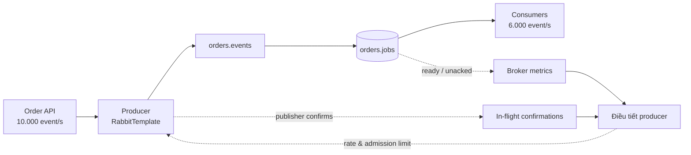
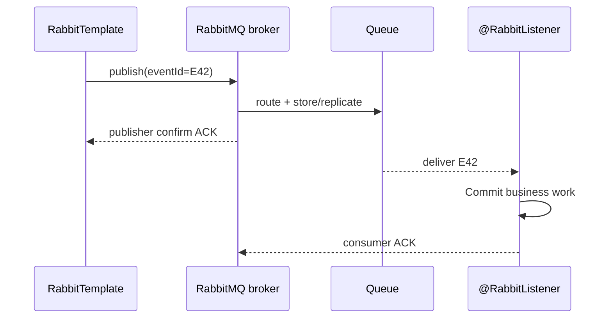
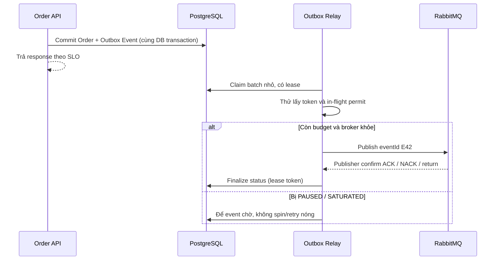

# Điều tiết producer, flow control và giới hạn tài nguyên broker

> **Chương:** Hiệu năng. **Bối cảnh:** Trong **SPRING_AMQP**, một ứng dụng dùng `RabbitTemplate` phát sự kiện qua exchange, routing key và binding đến RabbitMQ; các `@RabbitListener` xử lý bất đồng bộ, thực hiện ACK, retry, dead-letter và đôi khi giao dịch. Bài này tập trung vào **giữ tốc độ publish và số message đang chờ xác nhận trong giới hạn**, hiểu broker **flow control/resource alarms**, và thiết kế cơ chế **backpressure** để hệ thống giữ ổn định khi producer nhanh hơn RabbitMQ hoặc consumer.

## 1. Vì sao một publisher “gửi rất nhanh” có thể làm toàn hệ thống chậm?

Giả sử API đặt hàng nhận 10.000 yêu cầu mỗi giây. Mỗi yêu cầu ghi database rồi phát `OrderCreated` qua `RabbitTemplate` vào exchange `orders.events`, routing key `created`. Exchange bind đến queue `orders.jobs`, còn ba replica `@RabbitListener` tổng cộng chỉ xử lý khoảng 6.000 đơn/giây.



Khi ingress lớn hơn tốc độ xử lý bền vững, số message tồn đọng tăng:

```text
Backlog growth ≈ max(0, publish_rate - consume_rate)

Ví dụ:
10.000 event/s - 6.000 event/s = +4.000 event/s
Sau 5 phút: ~1.200.000 event tồn đọng (nếu tốc độ giữ nguyên).
```

Message còn chiếm disk, memory metadata, queue indexes, network, CPU, quorum replication và khả năng phục hồi sau crash. Một số loại queue phải ghi/replicate dữ liệu trước khi xác nhận publish; broker có thể phát sinh độ trễ confirm và áp lực tài nguyên ngay cả khi TCP vẫn kết nối tốt. Nếu ứng dụng tiếp tục đẩy nhanh vô hạn, RabbitMQ cuối cùng phải **điều tiết**, hoặc kích hoạt **memory/disk alarm** để bảo vệ node.

**Ý chính:** producer phải có **ngân sách công việc đang chờ**. Có thể tăng consumer capacity hoặc dùng partition nhiều queue khi đúng workload, nhưng đó không phải lý do để giữ một backlog không giới hạn.

## 2. Phân biệt bốn loại điều tiết và hai loại ACK

| Cơ chế | Xảy ra ở đâu? | Tín hiệu quan sát | Producer nên làm gì? |
| --- | --- | --- | --- |
| **Ứng dụng rate limiting** | API / producer service | Token bucket hết token, trả 429/503 hoặc hẹn gửi sau | Giảm tốc độ trước khi ghi socket |
| **Giới hạn in-flight** | Producer chờ publisher confirm | Đủ số outstanding attempts, không còn permit | Không gửi thêm; đợi confirm hoặc lưu vào outbox |
| **Transient flow control** | RabbitMQ khi một phần pipeline chậm hơn publisher | Connection/channel state **`flow`** | Giảm tốc độ, theo dõi confirm latency và queue/backlog |
| **Memory/disk resource alarm** | RabbitMQ node/cluster | Connection state **`blocking` / `blocked`**, `connection.blocked` | Ngừng tăng publish, tách đường consume, xử lý nguyên nhân tài nguyên |
| **TCP backpressure** | Socket/OS/network | Write chậm, buffer đầy, timeout, connection issue | Không retry nóng; áp deadline và giữ message chưa rõ |
| **Consumer prefetch** | Broker → consumer | `messages_unacknowledged` và consumer count | Giới hạn message giao cho consumer; **không phải** giới hạn publish |

Không nhầm publisher confirm với consumer ACK:

- **Publisher confirm**: broker xác nhận một publish theo tính bền vững/queue type. Một confirm ACK không nghĩa consumer đã xử lý xong, và vẫn có thể đi kèm mandatory return nếu message không route được.
- **Consumer acknowledgement**: consumer xác nhận một delivery sau khi xử lý. `@RabbitListener` với `AcknowledgeMode.AUTO` nghĩa **Spring container ACK sau khi method hoàn tất thành công**, khác `autoAck=true` ở protocol.



Hai ACK xảy ra độc lập; thậm chí broker có thể đã confirm khi queue còn hàng chục nghìn event chưa xử lý. **Thiết kế đúng** phải giám sát cả đường producer → broker và broker → consumer.

## 3. RabbitMQ `flow`, `blocked` và `blocking` thực chất là gì?

### 3.1. Transient flow control: điều tiết nhiều lần mỗi giây

RabbitMQ dùng flow control tự động khi thành phần xử lý phía sau không theo kịp publisher: queue process, disk I/O, quorum replication hoặc network. Một publishing connection có thể hiển thị **`flow`** trong Management UI, `rabbitmqctl` và HTTP API.

Điểm cần hiểu:

1. `flow` không nhất thiết là lỗi. Broker thường xuyên chặn/mở lại luồng đọc để khống chế tốc độ ingress.
2. Ứng dụng có thể chỉ cảm thấy băng thông hữu dụng giảm hoặc confirm chậm hơn.
3. Flow control không yêu cầu người dùng tự bật; nó là bảo vệ mặc định của broker.
4. Flow control thường **khác** memory/disk alarm: trong flow tạm thời broker có thể vẫn còn headroom; việc điều tiết là do một stage xử lý chậm.

**Không dùng** AMQP 0-9-1 `channel.flow` làm cơ chế app tự điều tiết. Đây không phải API hiện đại mà RabbitMQ khuyến nghị để producer chủ động rate limit. Thay vào đó dùng token bucket, bounded in-flight và quan sát metrics.

### 3.2. Resource alarm: memory hoặc disk chạm ngưỡng

Khi RabbitMQ node dùng memory vượt **high watermark**, hoặc lượng disk free xuống dưới **low watermark**, broker kích hoạt **resource alarm**. Với AMQP 0-9-1, server có thể gửi `connection.blocked` cho publishing connection; khi mọi alarm được dỡ bỏ, nó gửi `connection.unblocked`.

| State trong Management UI | Diễn giải |
| --- | --- |
| `running` | Kết nối đang hoạt động bình thường |
| `flow` | Kết nối bị flow control tạm thời, thường luân phiên chặn/mở |
| `blocking` | Có resource alarm, connection chưa thực hiện publish nên chưa bị chặn hoàn toàn |
| `blocked` | Publishing connection đã bị broker tạm ngừng đọc trong lúc alarm còn hiệu lực |

Memory/disk alarm là **cluster-wide** trong mô hình cluster RabbitMQ: nếu một node phát alarm, publishing connections trên các node của cluster có thể bị chặn. Broker ưu tiên cho consumer tiếp tục lấy và ACK message, nhằm giải phóng tài nguyên; các connection **chỉ consume** thường không bị chặn như publishing connection. Tuy nhiên, nếu producer và consumer dùng chung physical connection, tài nguyên chung vẫn có thể bị ảnh hưởng.

**Khi bị blocked:** không có nghĩa RabbitMQ đã “từ chối từng message” một cách rõ ràng. Broker có thể ngừng đọc TCP socket; client tiếp tục gửi trong một khoảng ngắn đến khi kernel buffer đầy, rồi write chậm/timeout. Message đã ghi vào socket nhưng chưa có publisher confirm phải được coi là **chưa rõ kết quả**. Không bỏ event chỉ vì send timeout.

### 3.3. Sự kiện connection blocked ở Spring AMQP

`CachingConnectionFactory` chuyển thông báo broker thành `ConnectionBlockedEvent` và `ConnectionUnblockedEvent` trong Spring. Có thể dùng chúng như **tín hiệu bổ sung** để ngừng nhận thêm việc publish:

```java
import java.util.concurrent.atomic.AtomicBoolean;
import org.springframework.amqp.rabbit.connection.ConnectionBlockedEvent;
import org.springframework.amqp.rabbit.connection.ConnectionUnblockedEvent;
import org.springframework.context.event.EventListener;
import org.springframework.stereotype.Component;

@Component
public class BrokerPublishGate {
    private final AtomicBoolean brokerBlocked = new AtomicBoolean();

    @EventListener
    public void onBlocked(ConnectionBlockedEvent event) {
        brokerBlocked.set(true);
        // Record broker alarm, connection, reason and timestamp in logs/metrics.
    }

    @EventListener
    public void onUnblocked(ConnectionUnblockedEvent event) {
        brokerBlocked.set(false);
    }

    public boolean allowsNewPublishes() {
        return !brokerBlocked.get();
    }
}
```

**Quan trọng:** nếu dùng nhiều publisher connections, state Boolean đơn ở trên chỉ minh họa một connection/gate. Với nhiều connection, phải theo dõi trạng thái riêng và tránh một sự kiện `unblocked` của connection A vô tình mở gate cho connection B vẫn blocked. Thêm nữa, event đến trễ hoặc mất kết nối hoàn toàn không đồng nghĩa broker đã an toàn; **gate phải phối hợp với confirm timeout, circuit breaker, metrics và trạng thái connection**.

### 3.4. Giải quyết nguyên nhân alarm, không chỉ tăng timeout

| Triệu chứng | Kiểm tra đầu tiên | Hành động phù hợp |
| --- | --- | --- |
| Memory alarm | Memory used vs watermark, queue backlog, message sizes, Erlang VM, OS/container limit | Giảm ingress, cho consumer xử lý, nâng capacity nếu cần, tối ưu payload |
| Disk alarm | Disk free, low watermark, phân vùng lưu queue, retention/TTL | Giảm publish, xử lý queue tồn, mở rộng disk, xóa dữ liệu **theo chính sách** |
| `flow` kéo dài | Confirm latency, throughput, disk I/O, replication, queue leader, consumer capacity | Điều chỉnh publish rate/batch, phân tán workload hợp lý |
| Connection blocked lâu | Alarm ở mọi node, đường consumer còn hoạt động không | Tách publisher/consumer connections và xử lý nguyên nhân tài nguyên |
| Channel creation error | `channel_max`, channel churn, cache size, thread count | Chặn tạo channel vô hạn, nâng cache vừa đủ, áp cap và timeout |

Không tăng watermark hoặc giảm disk limit chỉ để xóa alert mà chưa đánh giá tài nguyên thật. Resource alarms là **phanh khẩn cấp của broker**, không thay thế điều tiết chủ động ở producer.

## 4. Tư duy capacity: tốc độ, số message đang chờ và byte đang nằm trên đường

### 4.1. Ba đại lượng phải đặt ngân sách

1. **Rate**: số message/giây hoặc byte/giây được chấp nhận vào pipeline.
2. **Concurrency/in-flight**: số publish đã gửi nhưng chưa xác định kết quả confirm.
3. **Queue/buffer depth**: số event chờ gửi trong app/outbox và số message đang chờ xử lý trong broker.

Quy luật Little cho một pipeline tương đối ổn định:

```text
L ≈ λ × W

L = số publish đang chờ confirm trung bình
λ = tốc độ gửi bền vững (publish/giây)
W = thời gian đợi confirm trung bình (giây)

Ví dụ λ = 2.000 publish/s, W = 0,050s:
L ≈ 100 outstanding publish.
```

Nếu p99 confirm latency lên 500 ms, số outstanding có thể tăng mạnh dù tốc độ ingress không đổi. `L≈λW` là quan hệ trung bình của hệ thống ổn định, **không dùng trực tiếp p99** để suy ra số slot chắc chắn đủ. Nên sizing theo tải peak, phân phối confirm latency, số instance và mức headroom được đo.

### 4.2. Rate budget toàn cụm

Nếu broker chấp nhận bền vững 20.000 event/s cho workload đang xét, và 10 replica producer đều lấy cấu hình 20.000 event/s, tổng tối đa **200.000 event/s** — cao hơn năng lực broker nhiều lần. Có thể phân ngân sách cho instance:

```text
producer_rate_budget_per_instance
    ≈ sustainable_cluster_publish_rate × safety_factor / active_instances

Ví dụ minh họa:
20.000 event/s × 0,70 / 10 instance = 1.400 event/s mỗi instance.
```

Đây chỉ là **heuristic khởi điểm**: throughput phụ thuộc message bytes, queue type, số bindings, replication, disk, TCP, CPU, publisher confirms và consumer. Khi số replica biến động theo autoscaling, cần recalibrate ngân sách; nếu cần **giới hạn cứng toàn cluster** thì phải có cơ chế phối hợp rate limit phân tán hoặc admission ở upstream.

### 4.3. Byte budget thay vì chỉ đếm message

Hai workload đều 1.000 message/s có thể rất khác nhau:

| Workload | Payload trung bình | Payload ingress thuần |
| --- | ---: | ---: |
| A — event nhỏ | 1 KiB | ~0,98 MiB/s |
| B — event lớn | 256 KiB | ~250 MiB/s |

Số trên **chưa tính** metadata, protocol overhead, compression, queue storage hay replica writes. Vì vậy giới hạn theo **bytes đang chờ** và payload size thường hữu ích hơn chỉ giới hạn message count. Một semaphore 128 permits không bảo vệ heap nếu mỗi permit tương ứng một payload 50 MiB.

## 5. Hàng đợi broker không phải buffer vô hạn

RabbitMQ có nhiều **guardrails** ở node, vhost, user, connection và từng queue:

| Phạm vi | Ví dụ hạn mức | Mục đích |
| --- | --- | --- |
| Node | `max_connections`, `channel_max_per_node`, `max_message_size` | Chặn client tạo quá nhiều connection/channel hoặc payload quá lớn |
| Connection | `max_channels_per_connection` (alias cũ `channel_max`) | Tránh leak channel |
| User/vhost | Giới hạn connections/channels/queues | Bảo vệ tài nguyên được chia sẻ |
| Queue | `max-length`, `max-length-bytes`, `overflow` | Tránh một queue tăng vô hạn |
| Quorum queue | `delivery-limit`, queue-specific limits, replication | Ngăn poison redelivery vô hạn, bảo vệ quorum |
| Stream | `max-age`, `max-length-bytes` theo segment | Quản lý retention log; không phải queue backlog ACK truyền thống |

### 5.1. Ví dụ policy giới hạn queue

Trong môi trường thử nghiệm, có thể đặt policy cho nhóm queue `orders.`:

```bash
# Ví dụ lab: cho phép tối đa 100.000 message chờ hoặc 256 MiB body.
# Khi đầy, từ chối các publish mới thay vì âm thầm đẩy khỏi đầu.
rabbitmqctl set_policy orders-cap '^orders\.' \
  '{"max-length":100000,"max-length-bytes":268435456,"overflow":"reject-publish"}' \
  --apply-to queues
```

Khi cấu hình **`overflow=reject-publish`**, broker có thể **NACK** các publish bị từ chối, thay vì lặng lẽ xóa các message cũ theo kiểu `drop-head` mặc định. Cần bật publisher confirms và xác định chính sách retry/backoff; không coi mọi lần gọi `RabbitTemplate.convertAndSend` không ném exception là đã vào queue.

**Cẩn trọng:**

- Giới hạn độ dài queue đo message trong trạng thái **ready** theo ngữ nghĩa queue type; unacked thường không tính trực tiếp vào `max-length`. Quorum queue có thêm semantics đối với delayed messages và at-least-once dead lettering.
- Queue length policy không kiểm soát toàn bộ memory/disk của broker, vì metadata, unacked, replica và message properties vẫn tiêu thụ tài nguyên.
- Nếu một message route đến nhiều queue, kết quả publisher confirm chịu ảnh hưởng từng queue; rejection/return semantics phải được test thực tế với queue type và topology được chọn.
- Policy được dùng như **lưới an toàn**, không thay thế quota/điều tiết producer. Trong production, phải áp theo SLO và chính sách operator, không tự thay đổi queue policy của nhóm khác.

### 5.2. Đừng nhầm queue depth với độ trễ nghiệp vụ

`messages_ready` đo message chờ giao; `messages_unacknowledged` đo đã giao nhưng chưa ACK. Nếu consumer prefetch lớn, ready có thể xuống 0 trong khi hàng nghìn message đang nằm ở client hoặc worker executor.

Một backlog “0 ready” không bảo đảm mọi đơn hàng đã hoàn tất. Muốn tính end-to-end latency cần timestamp từ lúc business event được tạo tới commit kết quả tại consumer, cùng producer confirm và queue metrics.

## 6. Cấu hình Spring AMQP để publisher không tiêu thụ tài nguyên vô hạn

### 6.1. Publisher confirms, returns và connection riêng

Đối với ứng dụng Spring Boot 3.x dùng AMQP 0-9-1, cấu hình khởi điểm có thể là:

```yaml
spring:
  rabbitmq:
    host: localhost
    port: 5672
    publisher-confirm-type: correlated
    publisher-returns: true
    template:
      mandatory: true
    cache:
      channel:
        size: 64
        checkout-timeout: 2s
```

Ý nghĩa:

- `publisher-confirm-type: correlated`: Spring tương quan confirm với từng `CorrelationData` để biết broker ACK/NACK.
- `publisher-returns: true` và `template.mandatory: true`: nhận thông tin message không route được thay vì mất âm thầm. Broker có thể **return trước confirm ACK**, do đó phải kiểm tra cả hai.
- `cache.channel.size`: số channel được giữ lại để tái sử dụng. Mặc định trong `CachingConnectionFactory`, **cache size không phải giới hạn số channel đang mở**.
- `cache.channel.checkout-timeout > 0`: biến cache size thành **giới hạn số channel đồng thời trên một connection**; khi đã dùng hết, thread chờ tối đa khoảng đặt rồi có thể nhận `AmqpTimeoutException`.

**Lưu ý phiên bản:** cấu hình YAML này minh họa **Spring Boot 3.x**. Với Boot 4.x, phải đối chiếu starter RabbitMQ và namespace đã thay đổi; phần Java `CachingConnectionFactory`/`RabbitTemplate` dưới đây trình bày API Spring AMQP 0-9-1 trực tiếp.

```java
import org.springframework.amqp.rabbit.connection.CachingConnectionFactory;
import org.springframework.amqp.rabbit.core.RabbitTemplate;
import org.springframework.context.annotation.Bean;
import org.springframework.context.annotation.Configuration;

@Configuration(proxyBeanMethods = false)
class PublisherConnectionConfig {
    @Bean
    CachingConnectionFactory connectionFactory() {
        CachingConnectionFactory factory =
            new CachingConnectionFactory("localhost");
        factory.setPort(5672);
        factory.setChannelCacheSize(64);
        factory.setChannelCheckoutTimeout(2_000);
        factory.setPublisherConfirmType(
            CachingConnectionFactory.ConfirmType.CORRELATED);
        factory.setPublisherReturns(true);
        // Credential / TLS / addresses lấy từ cấu hình môi trường thật.
        return factory;
    }

    @Bean
    RabbitTemplate rabbitTemplate(CachingConnectionFactory factory) {
        RabbitTemplate template = new RabbitTemplate(factory);
        template.setMandatory(true);
        template.setUsePublisherConnection(true);
        return template;
    }
}
```

**Hai cách cấu hình trên là lựa chọn thay thế**: trong ứng dụng Boot đã auto-config, đừng sao chép bean thủ công trùng tên chỉ để áp lại cùng property. Chọn một nơi sở hữu connection factory và credentials. Khi mở publish connection riêng, phải đo tổng connections/channels do ứng dụng tạo ra; đây không phải “miễn phí” đối với broker.

### 6.2. Vì sao nên tách producer khỏi consumer connections?

Spring `RabbitTemplate.setUsePublisherConnection(true)` (với factory có hỗ trợ publisher connection) chọn **physical connection riêng** cho publishing, thay vì chia sẻ kết nối của listener container. Điều này đặc biệt quan trọng khi broker đang **blocked** bởi memory/disk alarm: một connection vừa publish vừa consume có thể khiến thao tác ACK/consumer progress bị ảnh hưởng bởi lệnh publish đang block trên chính connection đó.

```text
Consumer connection:
  @RabbitListener --> fetch/consume --> business DB --> basic.ack

Publisher connection:
  RabbitTemplate --> basic.publish --> publisher confirms/returns

Resource alarm:
  Publisher connection: có thể bị block
  Consumer-only connection: vẫn có thể tiếp tục tiêu thụ/giải phóng tài nguyên
```

**Ngoại lệ quan trọng:** không áp dụng tách connection một cách máy móc cho publisher tham gia **cùng transaction RabbitMQ** với consumer thread. Trong trường hợp đó phải dùng channel đã được ràng buộc với transaction của consumer; publisher connection riêng có thể phá ngữ nghĩa transaction.

**Cảnh báo topology:** nếu một `RabbitAdmin` dùng cùng template với `usePublisherConnection=true` để khai báo exclusive queue, queue có thể được tạo trên publisher connection và consumer trên connection khác không sử dụng được. Để admin/topology sử dụng connection thích hợp, tách trách nhiệm rõ ràng.

### 6.3. Channel cache khác với semaphore của ứng dụng

| Công cụ | Giới hạn gì? | Không giới hạn gì? |
| --- | --- | --- |
| `channelCacheSize=64`, checkout timeout 0 | Bao nhiêu idle channel được cache | **Không** giới hạn số channel được tạo |
| `channelCacheSize=64`, checkout timeout >0 | Số channel đồng thời được phép checkout trên một connection | Số publish logic đang chờ confirm của cả ứng dụng qua nhiều connections |
| `max_channels_per_connection` của RabbitMQ | Số AMQP channels trên một connection | Tốc độ publish/bytes/message trên từng channel |
| `Semaphore(128)` phía producer | Số **publish attempts** chưa có kết quả theo logic ứng dụng | Kích thước body và số consumer/queue của broker |
| Token bucket 1.500 tokens/s | Tốc độ tạo publish attempts trung bình | Số message còn đang chờ confirm nếu RTT tăng |

**Không dùng channel cache làm rate limiter.** Cache giúp giảm overhead mở/đóng channel; cố tình ép channel checkout để giảm publish có thể khiến request thread block và timeout khó hiểu. Điều tiết nên đặt ở tầng nghiệp vụ, nơi ta có thể từ chối/hẹn xử lý và phát metric rõ ràng.

## 7. Bounded producer: giới hạn số publish chưa có confirm

Một mẫu triển khai dễ hiểu cho `RabbitTemplate` là dùng **`Semaphore`**. Mỗi publish phải lấy một permit trước khi gửi và chỉ trả permit khi confirm callback/future hoàn tất. Khi hết permit, không tạo thêm request pending trong bộ nhớ.

> **Giả định:** ví dụ dùng Spring AMQP 3.x/4.x, với `CorrelationData.getFuture()` trả `CompletableFuture`. Đây là thành phần minh họa cơ chế capacity và kết quả broker; production cần outbox/persistence, metrics, deadline và circuit breaker ở mục 8.

### 7.1. Định nghĩa event và kết quả publish

```java
import java.util.UUID;

record OutboundEvent(
    UUID eventId, String exchange, String routingKey, String payloadJson) {
}

enum PublishState {
    ACK_ROUTED,
    UNROUTABLE,
    NACK,
    UNCERTAIN,
    SATURATED,
    PAUSED
}

record PublishResult(PublishState state, String description) {
}
```

### 7.2. Producer lấy permit trước khi publish

```java
import java.util.UUID;
import java.util.concurrent.CompletableFuture;
import java.util.concurrent.Semaphore;
import org.springframework.amqp.AmqpException;
import org.springframework.amqp.core.MessageDeliveryMode;
import org.springframework.amqp.core.MessageProperties;
import org.springframework.amqp.rabbit.connection.CorrelationData;
import org.springframework.amqp.rabbit.core.RabbitTemplate;
import org.springframework.stereotype.Component;

@Component
class BoundedConfirmPublisher {
    private final RabbitTemplate rabbitTemplate;
    private final BrokerPublishGate gate;
    private final Semaphore outstanding = new Semaphore(128);

    BoundedConfirmPublisher(RabbitTemplate rabbitTemplate,
                            BrokerPublishGate gate) {
        this.rabbitTemplate = rabbitTemplate;
        this.gate = gate;
    }

    int availableSlots() {
        return outstanding.availablePermits();
    }

    CompletableFuture<PublishResult> publish(OutboundEvent event) {
        if (!gate.allowsNewPublishes()) {
            return CompletableFuture.completedFuture(
                new PublishResult(PublishState.PAUSED, "Broker blocked"));
        }
        if (!outstanding.tryAcquire()) {
            return CompletableFuture.completedFuture(
                new PublishResult(PublishState.SATURATED,
                    "128 outstanding publishes in progress"));
        }

        CompletableFuture<PublishResult> outcome = new CompletableFuture<>();
        // ID của attempt dùng để correlate confirm.
        CorrelationData correlation =
            new CorrelationData(UUID.randomUUID().toString());

        try {
            rabbitTemplate.convertAndSend(
                event.exchange(), event.routingKey(), event.payloadJson(),
                message -> {
                    MessageProperties p = message.getMessageProperties();
                    p.setMessageId(event.eventId().toString());
                    p.setContentType(MessageProperties.CONTENT_TYPE_JSON);
                    p.setDeliveryMode(MessageDeliveryMode.PERSISTENT);
                    return message;
                },
                correlation);

            correlation.getFuture().whenComplete((confirm, error) -> {
                PublishResult result;
                if (error != null || confirm == null) {
                    result = new PublishResult(
                        PublishState.UNCERTAIN, "Confirm unavailable");
                } else if (correlation.getReturned() != null) {
                    result = new PublishResult(
                        PublishState.UNROUTABLE, "Mandatory return");
                } else if (!confirm.isAck()) {
                    result = new PublishResult(
                        PublishState.NACK, String.valueOf(confirm.getReason()));
                } else {
                    result = new PublishResult(
                        PublishState.ACK_ROUTED, "Broker confirmed");
                }

                outstanding.release();
                outcome.complete(result);
            });
        } catch (RuntimeException error) {
            // Có lỗi sau khi bắt đầu send vẫn không chắc broker chưa nhận.
            outstanding.release();
            outcome.complete(new PublishResult(
                PublishState.UNCERTAIN, error.getClass().getSimpleName()));
        }
        return outcome;
    }
}
```

**Cách dùng:** API có thể từ chối hoặc yêu cầu client retry sau khi nhận `SATURATED`/`PAUSED`; outbox relay không lấy thêm event cho đến khi permit trống. Với `UNCERTAIN`, giữ bản ghi event để retry an toàn cùng `eventId` và idempotent consumer. **Không tạo event ID mới khi publish lại**.

**Bốn chi tiết không được bỏ qua:**

1. `tryAcquire()` là **non-blocking**: khi hết capacity, method trả ngay. Không có queue vô hạn trong JVM.
2. Permit được giữ đến khi **future confirm hoàn tất** (ACK/NACK/return/error), không trả ngay sau `convertAndSend(...)`.
3. `CorrelationData.id` **mới cho mỗi attempt**, còn `messageId=event.eventId` **cố định** cho retry/dedup. `getReturned()!=null` phải được xét trước khi coi confirm ACK là route thành công.
4. Callback chỉ phân loại kết quả và release permit; **không thực hiện JDBC/HTTP blocking dài ngay trong callback**. Nếu phải cập nhật outbox, chuyển tác vụ sang executor có queue hữu hạn và giám sát failure của executor đó.

**Hạn chế có chủ ý của ví dụ:** nếu một confirm future **không bao giờ hoàn tất**, permit tương ứng vẫn bị giữ; đó là kiểu **fail closed** để không tiếp tục gửi vô hạn, nhưng cần **watchdog** và cơ chế xử lý `UNCERTAIN` để phục hồi khả năng gửi. Không đơn thuần gọi `orTimeout(...)` trên future rồi tự động thả toàn bộ permit và tiếp tục full-rate: một số publish vật lý có thể vẫn đang chờ broker, khiến số outstanding thực vượt giới hạn. Mục 8 mô tả phục hồi an toàn.

### 7.3. Số lượng permit tính theo tài nguyên thực

Nếu mỗi event có payload ~2 KiB, 128 permits mang tải body đang chờ khoảng 256 KiB (chưa tính metadata/replicas). Với payload 512 KiB, body đang chờ có thể ~64 MiB trên đường producer, cộng với heap object, serialization và network buffers.

Vì vậy khi payload kích thước thay đổi nhiều, nên giới hạn **cả count lẫn bytes**:

```text
admit(event) khi:
  count_in_flight < max_messages
  AND bytes_in_flight + event_size <= max_bytes
  AND rate_tokens >= cost(event_size)
  AND broker_not_blocked
```

Một event lớn có thể cần nhiều token/byte permits. Cần tính toán overflow an toàn và giải phóng ngân sách trong mọi đường completion/error. Không cho phép một event duy nhất lớn hơn `max_bytes` được chờ mãi.

## 8. Khi bị blocked hoặc mất confirm: chống retry storm và mất event

### 8.1. Bốn nhánh kết quả cần xử lý khác nhau

| Tình huống | Điều thực sự biết | Quyết định về event |
| --- | --- | --- |
| **ACK**, không có mandatory return | Broker đã xử lý publish và route được theo semantics mandatory | Đánh dấu `PUBLISHED` sau khi kết quả được lưu bền vững |
| **Mandatory return** (có thể vẫn confirm ACK) | Message không route đến queue nào theo topology/mandatory | Gắn `BLOCKED_ROUTING`, sửa binding/key, không retry nóng |
| **NACK** | Broker báo không thể nhận trách nhiệm publish | Retry có backoff và cùng event ID |
| **Timeout/connection reset** hoặc không nhận confirm | **Không biết** broker đã nhận hay chưa | Gắn `UNCERTAIN`, giữ event và retry cùng event ID sau reconciliation |
| **Bị rate limit trước khi gửi** | Chắc chắn code chưa gọi `convertAndSend` trong attempt này | Chờ slot/tokens; không được đếm là publish fail của broker |

Khi broker chạm memory/disk alarm, việc cố tạo nhiều thread retry `convertAndSend` không làm alarm biến mất. Nếu thread tiếp tục chờ socket, hệ thống có thể dùng cạn HTTP worker pool, heap và channel pool trước khi RabbitMQ phục hồi.

**Chính sách tối thiểu:**

1. Khi `ConnectionBlockedEvent` xuất hiện hoặc confirm p99 tăng bất thường, giảm admission mới; nếu cần, mở circuit breaker tạm dừng publish trực tiếp.
2. Không tạo buffer `LinkedBlockingQueue` không giới hạn. Nơi lưu sự kiện chưa gửi phải **bền vững** (outbox/DB/log với retention) hoặc upstream phải nhận phản hồi quá tải để retry có kiểm soát.
3. Retry với **exponential backoff + jitter**; giữ tổng attempt per second dưới một mức ngân sách. Nhiều replica phải có jitter độc lập.
4. **Đừng dùng “đã gọi send” làm thành công**. Chỉ theo dõi publisher confirms/returns và đánh dấu status event sau khi lưu kết quả.
5. Sau khi `ConnectionUnblockedEvent`, **ramp up** tốc độ dần theo capacity, đừng xả ngay toàn bộ hàng đợi đang chờ bằng maximum concurrency.

### 8.2. Transactional outbox là bộ đệm bền vững, không phải queue vô hạn

Ví dụ với service tạo đơn hàng:



Trong outbox, business row và event được commit nguyên tử; relay đọc sau và điều tiết theo confirm capacity. Nếu publisher nhận timeout hoặc process chết sau send, event có thể đã tới broker nhưng DB chưa ghi thành công; lần retry tiếp theo **có thể tạo duplicate**. Consumer `@RabbitListener` phải idempotent theo `eventId`.

**Outbox không có nghĩa là vô hạn:** cần giám sát `oldest_pending_event_age`, số row, database disk/transaction load, số event `UNCERTAIN` và SLA giao sự kiện. Nếu backlog tăng mãi, phải nâng capacity hoặc **hạn chế tốc độ nhận yêu cầu nghiệp vụ mới**; đẩy toàn bộ áp lực sang database chỉ chuyển vị trí nghẽn.

### 8.3. Timeout và vòng đời permit

Một phần khó của bounded publisher là **timeout không đồng nghĩa publish đã được broker hủy**. Ví dụ:

```text
T0       Producer publish E42; chiếm một permit.
T0+10s   Không thấy confirm; logic nghiệp vụ đánh dấu UNCERTAIN.
T0+11s   Broker vẫn có thể đang lưu/replicate E42.
T0+12s   Confirm ACK cũ xuất hiện (hoặc connection đã mất).
T0+15s   Relay có thể retry E42 với cùng event ID.
```

Nếu ứng dụng trả permit ngay tại T0+10s rồi gửi tiếp full-rate, số publish **thực** mà broker còn đang xử lý có thể cao hơn limit ban đầu. Có hai cách chủ đạo:

- **Fail closed/circuit breaker:** khi nhiều confirm vượt deadline, ngừng nhận publish mới, làm rõ trạng thái connection (reconnect khi cần) và reconcile outbox. Các permit còn treo cảnh báo/giới hạn liveness; cơ chế recovery phải được thiết kế riêng, không ngủ vô hạn.
- **Tách logical permit với physical outstanding budget:** lưu attempt state và deadline; đánh dấu logical outcome `UNCERTAIN` nhưng chỉ giải phóng ngân sách kết nối khi đã quan sát terminal event/reconnect. Cách này đòi hỏi quản lý trạng thái và metric phức tạp hơn.

Trong cả hai hướng, outbox giữ dữ liệu bền vững để resend khi an toàn; không dùng `CompletableFuture.orTimeout` như cách duy nhất để “xử lý xong” broker publish. Nếu cần giới hạn thời gian chờ của HTTP request, **deadline của request** có thể ngắn hơn thời gian reconcile publisher confirm; phản hồi HTTP phải truyền tải rõ trạng thái tiếp nhận, không tuyên bố event đã chắc chắn được broker giao.

## 9. Điều tiết theo tốc độ: token bucket, burst và adaptive rate

Semaphore giới hạn số attempt **đồng thời** nhưng chưa giới hạn tốc độ khi broker trả confirm cực nhanh. Nếu RabbitMQ confirm mỗi message trong 1 ms, 128 permits có thể cho phép producer đẩy rất nhiều event/giây.

### 9.1. Token bucket có hai tham số

```text
capacity = 300 tokens     (burst tối đa)
refillRate = 1.000 tokens/s
cost = 1 token / event nhỏ

Nếu không đủ token: không publish ngay.
Option A: API trả HTTP 429/503 + Retry-After phù hợp
Option B: Outbox relay đợi kỳ phát tiếp theo
```

Token bucket cho phép burst ngắn trong khi giới hạn **tốc độ trung bình**. Dùng một implementation đã được kiểm chứng (ví dụ Bucket4j hoặc Resilience4j RateLimiter với semantics phù hợp) thay vì tự viết scheduler không có giới hạn hoặc sử dụng `Thread.sleep` trên HTTP thread.

Điểm cần cân nhắc:

| Tình huống | Chính sách |
| --- | --- |
| Request ít, còn token | Publish nếu còn in-flight permit và broker khỏe |
| Burst vượt bucket | Trả quá tải hoặc đưa event vào outbox có giới hạn |
| Nhiều replica | Phân budget per-instance hoặc dùng token bucket phân tán nếu cần cap toàn cụm |
| Message kích thước lớn | Tính token theo **byte cost** hoặc dùng 2 budget riêng |
| Quorum queue confirm chậm | Giảm số in-flight/điều chỉnh rate theo confirm p95/p99 |
| Broker blocked | Gate tạm dừng; đừng tích lũy vô hạn pending work ở ứng dụng |

### 9.2. Một admission decision có thứ tự rõ ràng

```text
Incoming event
  -> Kiểm tra kích thước/schema
  -> Kiểm tra rate budget
  -> Kiểm tra broker health / circuit breaker
  -> Kiểm tra bounded in-flight slots
  -> Publish + correlationId
  -> Xử lý ACK/NACK/RETURN/UNCERTAIN
  -> Lưu kết quả bền vững (nếu dùng outbox)
```

Nếu **không** thể lấy token hoặc slot, code **chưa publish**, nên có thể phân loại `NOT_ATTEMPTED` một cách chính xác. Nếu đã gọi publish và gặp network exception, đó là **`UNCERTAIN`**, không phải `NOT_ATTEMPTED`.

### 9.3. Điều tiết thích ứng theo sức khỏe broker

Một bộ điều khiển đơn giản có thể giảm tốc khi confirm p99 tăng, resource alarm xuất hiện hoặc queue age vượt SLO; rồi tăng dần khi ổn định:

```text
Nếu broker_blocked == true:
    rate = 0 (tạm dừng publish trực tiếp)
Ngược lại nếu confirm_timeout_rate tăng hoặc p99 > ngưỡng:
    rate = max(minRate, rate * 0.5)
Ngược lại nếu 5 phút ổn định và backlog nằm trong SLO:
    rate = min(maxRate, rate + step)
```

Đây là **mã giả cho controller**, không phải cấu hình Spring AMQP có sẵn. Bộ điều khiển cần sampling window, hysteresis, floor/ceiling, chống dao động và quyền ưu tiên theo tenant/workload. Không dùng **queue depth duy nhất** làm tín hiệu: một queue có số consumer thấp có thể tăng backlog dù broker vẫn dư capacity; trong trường hợp đó tăng producer rate càng làm SLO xấu hơn.

## 10. Consumer throughput ảnh hưởng trực tiếp producer backpressure

Nếu consumer chậm hơn publisher, RabbitMQ phải giữ message lâu hơn. Có thể tăng listener concurrency, nhưng phải cân đối DB/HTTP downstream và queue type.

Ví dụ một `SimpleRabbitListenerContainerFactory`:

```java
import org.springframework.amqp.core.AcknowledgeMode;
import org.springframework.amqp.rabbit.config.SimpleRabbitListenerContainerFactory;
import org.springframework.amqp.rabbit.connection.ConnectionFactory;
import org.springframework.context.annotation.Bean;
import org.springframework.context.annotation.Configuration;

@Configuration(proxyBeanMethods = false)
class OrderConsumerCapacityConfig {

    @Bean("ordersListenerFactory")
    SimpleRabbitListenerContainerFactory ordersListenerFactory(
            ConnectionFactory connectionFactory) {
        SimpleRabbitListenerContainerFactory factory =
            new SimpleRabbitListenerContainerFactory();
        factory.setConnectionFactory(connectionFactory);
        factory.setConcurrentConsumers(2);
        factory.setMaxConcurrentConsumers(6);
        factory.setPrefetchCount(16);
        factory.setAcknowledgeMode(AcknowledgeMode.AUTO);
        return factory;
    }
}
```

```java
import org.springframework.amqp.rabbit.annotation.RabbitListener;
import org.springframework.stereotype.Component;

@Component
class OrdersListener {
    private final OrderService orderService;

    OrdersListener(OrderService orderService) {
        this.orderService = orderService;
    }

    @RabbitListener(
        queues = "orders.jobs",
        containerFactory = "ordersListenerFactory")
    public void handle(String eventJson) {
        orderService.process(eventJson);
        // Thành công -> container gửi consumer ACK theo AUTO mode.
    }
}
```

`OrderService` là service nghiệp vụ do ứng dụng cung cấp. Tham số `prefetchCount=16` và concurrency 2–6 là **giá trị minh họa cần benchmark**; tính tổng across replicas:

```text
Max message unacked xấp xỉ:
  replica_count × concurrent_consumers_per_replica × prefetch_per_consumer

Ví dụ 10 replica × 6 consumer × prefetch 16 = 960 deliveries chưa ACK.
```

Đây là mức trần lý thuyết theo client prefetch (còn phụ thuộc queue, delivery và state thực tế). Nếu mỗi task dùng 1 JDBC connection trong 2 giây, 60 listener chạy đồng thời có thể làm cạn JDBC pool hoặc gây timeout trước khi throughput tăng; phải phối hợp concurrency với DB capacity.

**Điểm quan trọng:** `prefetch` **không đặt giới hạn số publish producer có thể gửi** và không sửa được broker disk alarm. Nó chỉ điều chỉnh broker đẩy bao nhiêu message chưa ACK tới consumer. Giảm prefetch đôi khi cải thiện fairness và giảm unacked memory; tăng prefetch có thể tăng throughput khi consumer rảnh và RTT cao, nhưng chỉ khi downstream đủ khả năng.

### 10.1. Consumer chậm do chính việc publish lại

Một `@RabbitListener` có thể xử lý event rồi publish event khác:

```java
@RabbitListener(queues = "orders.jobs")
public void handleOrder(String payload) {
    repository.save(...);
    rabbitTemplate.convertAndSend("orders.events", "processed", payload);
}
```

Nếu broker blocked publishers và listener dùng **cùng connection**, thread xử lý có thể mắc kẹt ở publish, không gửi ACK, càng làm hàng đợi tồn lâu hơn. Tách publisher connection khi ngữ nghĩa transaction cho phép và cân nhắc **outbox** cho việc publish event tiếp theo để business transaction không bị giữ bởi broker.

Không áp dụng `RabbitTemplate.setUsePublisherConnection(true)` nếu publisher phải tham gia **cùng transactional channel** đang ràng buộc với consumer. Khi đó nên xem lại kiến trúc transaction/outbox thay vì cố cưỡng ép connection riêng.

## 11. Publisher confirms và tối ưu throughput: đừng chờ từng message tuần tự

RabbitMQ publisher confirms giúp producer biết broker đã nhận trách nhiệm với publish; chúng là cơ chế chủ lực cho **data safety**, đồng thời ảnh hưởng cách tối ưu throughput.

| Chiến lược | Hành vi | Ảnh hưởng đến throughput | Độ phức tạp |
| --- | --- | --- | --- |
| **Publish → wait confirm** cho từng message | Mỗi publish chờ ACK mới gửi message kế | Thấp, bị giới hạn mạnh bởi confirm RTT | Rất dễ nhưng không nên dùng khi tải cao |
| **Publish batch → wait all** | Gửi N message, chờ batch được confirm | Tốt hơn, nhưng batch bị kẹt bởi confirm chậm nhất | Trung bình |
| **Publish streaming + async confirms** | Gửi nhiều message, correlate callback/future | Cao hơn nếu được giới hạn in-flight phù hợp | Cần quản lý outstanding, timeout và failure |

**Không gọi `channel.waitForConfirms()` sau từng `basicPublish` ở mỗi event** nếu throughput là mục tiêu. Với `RabbitTemplate` và `CorrelationData.getFuture()`, có thể dùng streaming async confirms như mục 7, giữ correlation ID cho mỗi attempt và đo `confirm_latency`.

### 11.1. Không tối ưu bằng cách bỏ luôn publisher confirms

Bỏ confirms có thể khiến code publish nhanh hơn trong benchmark, nhưng publisher mất khả năng biết broker có thật sự ghi nhận message hay không khi network/node lỗi. Nếu event quan trọng, đây là **đổi tính đúng đắn lấy số throughput không có ý nghĩa nghiệp vụ**.

Đối với message **persistent** và queue **durable/quorum**, confirm sẽ phản ánh các bước broker/queue cần thực hiện trước khi ACK theo loại queue và workload. Vì vậy cần benchmark với **đúng loại queue, delivery mode và topology thật**, không chỉ với queue transient trên laptop.

`RabbitTemplate.setChannelTransacted(true)` không phải “cách thay confirms nhanh hơn”. AMQP transactions trên channel khác cơ chế confirms và có overhead lớn; không bật cùng channel với publisher confirm. Nếu cần atomicity giữa database và event, dùng transactional outbox hoặc điều phối phù hợp.

### 11.2. Concurrency không đồng nghĩa throughput tăng tuyến tính

Nếu một RabbitMQ node/queue leader chỉ có thể xử lý bền vững một mức publish rate cho kiểu message hiện tại, việc tăng publisher threads từ 4 lên 100 có thể:

- Tăng queue/channel contention và CPU context switching.
- Tăng outstanding confirms và heap giữ `CorrelationData`.
- Làm p99 latency tệ hơn, tạo timeout/retry giả.
- Làm nhiều connection vào trạng thái `flow` hơn.
- Gây pressure lên journal/disk/quorum replication.

**Dấu hiệu đã qua điểm tối ưu:** throughput không tăng đáng kể nhưng p99 confirm latency, memory, channel churn hoặc failure rate tăng. Nên giảm in-flight/threads/rate thay vì tăng tiếp.

## 12. Đo từ RabbitMQ Management và Prometheus

Đối với mỗi thí nghiệm điều tiết producer, cần ít nhất ba nhóm metric:

1. **Admission:** request rate, rejected/saturated/paused count, outbox pending age và số in-flight slot ở ứng dụng.
2. **Broker:** publish/deliver/ACK rate, queue ready/unacked, connections state `flow/blocked`, memory/disk alarms, disk I/O và replication.
3. **Consumer:** số consumer, listener duration, business success/error rate, JDBC/HTTP latency, retry/redelivery/DLQ.

### 12.1. Management UI: nhìn state của publishing connection

Mở RabbitMQ Management UI, vào **Connections**, kiểm tra các connection có tên ứng dụng và các trạng thái `running`, `flow`, `blocked`, `blocking`. Dùng `ConnectionNameStrategy`/client-provided name có ý nghĩa để phân biệt publisher và consumer connections.

Từ HTTP API:

```bash
# Chỉ đọc trạng thái; cần tài khoản có quyền monitoring.
curl -fsS -u monitoring-user \
  'http://localhost:15672/api/connections' \
  | jq '.[] | {name, state, channels, recv_oct, send_oct}'

curl -fsS -u monitoring-user \
  'http://localhost:15672/api/nodes' \
  | jq '.[] | {name, mem_used, mem_limit, disk_free,
                disk_free_limit, mem_alarm, disk_free_alarm}'

curl -fsS -u monitoring-user \
  'http://localhost:15672/api/queues/%2F/orders.jobs' \
  | jq '{messages_ready, messages_unacknowledged,
          consumers, message_stats}'
```

**Giải thích:** vhost mặc định `/` được encode thành `%2F`. Trường `message_stats` có thể thiếu trong một số phiên bản hoặc khi chưa có hoạt động. Khi rất nhiều queue/connection, tránh polling danh sách lớn bằng HTTP API mỗi giây; dùng Prometheus plugin chuyên dụng.

### 12.2. Prometheus plugin: metrics của node và queue

Khi bật `rabbitmq_prometheus`, endpoint mặc định là `http://broker:15692/metrics`. Scrape **từng node** (node-local), không scrape một VIP ngẫu nhiên rồi cộng kết quả như thể đã thu đủ cluster.

Để lấy queue metrics có labels `vhost`/`queue` mà không trả về mọi metric per-object, dùng:

```bash
curl -fsS \
  'http://localhost:15692/metrics/detailed?family=queue_coarse_metrics&family=queue_consumer_count&family=queue_delivery_metrics'
```

Metrics quan trọng ở `/metrics/detailed`:

| Metric | Ý nghĩa |
| --- | --- |
| `rabbitmq_detailed_queue_messages_ready` | Message chờ được giao |
| `rabbitmq_detailed_queue_messages_unacked` | Message đã giao, chưa ACK |
| `rabbitmq_detailed_queue_consumers` | Số consumer |
| `rabbitmq_detailed_queue_messages_acked_total` | Bộ đếm consumer ACK |
| `rabbitmq_detailed_queue_messages_redelivered_total` | Bộ đếm redelivery |
| `rabbitmq_detailed_process_resident_memory_bytes` | Resident memory của RabbitMQ node (cần node metric family phù hợp) |
| `rabbitmq_detailed_resident_memory_limit_bytes` | Memory watermark/limit metric |
| `rabbitmq_detailed_disk_space_available_bytes` | Disk free |
| `rabbitmq_detailed_disk_space_available_limit_bytes` | Disk free low watermark |

Chỉ những metric family được yêu cầu mới xuất hiện từ `/metrics/detailed`; ví dụ trên **chưa hỏi `node_coarse_metrics`/`node_metrics`**, nên cần thêm family đó để có các số liệu memory/disk. Tên `rabbitmq_detailed_*` không phải lúc nào cũng tồn tại trong endpoint `/metrics` aggregated. Đọc tên thực tế trong output của phiên bản RabbitMQ đang chạy trước khi viết alert.

### 12.3. PromQL theo dõi choke point

```promql
# Số message đang chờ ở queue mục tiêu.
rabbitmq_detailed_queue_messages_ready{
  vhost="/", queue="orders.jobs"
}
```

```promql
# Unacked: đã giao nhưng consumer chưa xác nhận.
rabbitmq_detailed_queue_messages_unacked{
  vhost="/", queue="orders.jobs"
}
```

```promql
# Consumer ACK/giây (lấy từ counter bằng rate).
sum by (vhost, queue) (
  rate(rabbitmq_detailed_queue_messages_acked_total{
    vhost="/", queue="orders.jobs"
  }[5m])
)
```

```promql
# Retry/redelivery rate tăng có thể là poison-message loop.
sum by (vhost, queue) (
  rate(rabbitmq_detailed_queue_messages_redelivered_total{
    vhost="/", queue="orders.jobs"
  }[5m])
)
```

```promql
# Khi có node metrics family:
rabbitmq_detailed_process_resident_memory_bytes
/
rabbitmq_detailed_resident_memory_limit_bytes
```

```promql
# Disk headroom so với disk watermark:
rabbitmq_detailed_disk_space_available_bytes
/
rabbitmq_detailed_disk_space_available_limit_bytes
```

**Hạn chế:** với quorum queue, replicas hoặc scrape trùng node, một queue có thể tạo series không nên cộng vô điều kiện. Phải xem labels thực tế và queue placement. `rate` dùng cho **counter `_total`**, không dùng cho gauge `messages_ready`. Cần bổ sung node exporter/OS metrics (CPU, disk latency, network) để giải thích sâu hơn.

### 12.4. Các metric producer nên tự bổ sung

| Metric đề xuất ở ứng dụng | Loại | Gợi ý nhãn cardinality thấp |
| --- | --- | --- |
| `app.rabbit.publish_attempts_total` | Counter | `result=ack/return/nack/uncertain/paused/saturated` |
| `app.rabbit.publish_confirm_duration_seconds` | Timer / histogram | `exchange` hoặc `event_type` nếu số giá trị hữu hạn |
| `app.rabbit.publish_inflight` | Gauge | `service`, `cluster` |
| `app.rabbit.publish_admission_rejected_total` | Counter | `reason=rate/slot/blocked` |
| `app.rabbit.outbox_oldest_pending_age_seconds` | Gauge | `service` hoặc `priority` |
| `app.rabbit.outbox_uncertain_total` | Gauge | `service` |
| `app.rabbit.producer_pending_bytes` | Gauge | `service` |

Đây là **tên đề xuất do ứng dụng tự tạo**, không phải tên mặc định được Spring/RabbitMQ đảm bảo. Với Micrometer, tên hiển thị trong Prometheus có thể được chuẩn hóa; kiểm tra registry thực tế. Không đưa `eventId`, `orderId`, correlation ID, raw payload hoặc exception text vào labels vì cardinality cao.

### 12.5. Alert quan trọng hơn việc chỉ có dashboard

| Tín hiệu | Diễn giải | Hành động ban đầu |
| --- | --- | --- |
| `publish_inflight` liên tục đạt cap | Broker confirm chậm hoặc publisher đang nghẽn | Giảm admission, kiểm tra confirm p95/p99 và connection state |
| `publish_admission_rejected_total` tăng | App đang chủ động bảo vệ capacity | Kiểm tra upstream retry policy và SLO |
| Connection `flow` nhiều phút | Broker đang điều tiết ingress | Xem queue/replication/disk, giảm target publish rate |
| `ConnectionBlockedEvent` hoặc memory/disk alarm | Broker bảo vệ tài nguyên | Tạm dừng publish trực tiếp, duy trì consumer nếu có thể |
| `orders.jobs` ready liên tục tăng | Consumer throughput thấp hơn ingress | Kiểm tra ACK/s, consumer count, downstream |
| Confirm timeout tăng, ACK/s giảm | Kết quả publish có thể chưa rõ | Outbox UNCERTAIN, retry có giới hạn, không xóa event |
| Connection/channel churn tăng | Cơ chế tạo channel/connection hoặc reconnect storm | Kiểm tra cache/pool, auth/heartbeat, backoff jitter |

**Đừng đặt alarm cố định “ready > 0”** cho mọi queue. Một queue có thể có backlog nhỏ bình thường. Tốt hơn là theo dõi **độ tuổi message/event**, tốc độ tăng và SLO; kèm thời gian `for` để tránh alert theo từng spike ngắn.

## 13. Benchmark đúng: tìm tốc độ bền vững chứ không chỉ peak publish

Khi benchmark RabbitMQ, chỉ đo “bao nhiêu lần gọi `RabbitTemplate.convertAndSend` mỗi giây” là thiếu: những lời gọi đó có thể đã trả về trước khi broker confirm, hoặc message đang tích tụ trong queue chờ consumer.

### 13.1. Chuẩn bị workload đủ giống production

| Điều kiện | Vì sao cần giữ giống production? |
| --- | --- |
| **Queue type**: classic hay quorum | Quorum replication và durability có thể làm confirm latency khác xa classic |
| **Payload bytes**: p50/p95/p99 và headers | Payload lớn tiêu thụ network, heap, buffer và disk nhiều hơn |
| **Durable/persistent** message | Nên đo cùng bảo đảm data safety mà ứng dụng thật dùng |
| **Exchange + bindings** | Fanout hoặc một publish tới nhiều queue tăng khối lượng route/store |
| **Publisher confirms + mandatory returns** | Đo con đường an toàn thật, không bỏ xác nhận để làm số đẹp |
| **Consumer processing** | Chỉ bật producer không cho biết backlog có bền vững hay không |
| **RabbitMQ cluster** và network | Single-node localhost không đại diện cho quorum cluster và RTT thật |
| **SLO**: p99 confirm, oldest event age, retry | Tốc độ nhanh nhất có thể không phải tốc độ đáp ứng SLO |

Đo **hai trường hợp**: (1) producer-only để đánh giá ingress/broker, (2) producer + consumer + database/HTTP downstream để tìm throughput **end-to-end bền vững**. Nếu backlog tăng trong suốt benchmark thì đó chưa phải một steady state có thể duy trì lâu dài.

### 13.2. Tăng tải theo bậc

```text
Giai đoạn warm-up:
  2 phút để kết nối/channel/queue ổn định

Các bậc rate giả định:
  500 -> 1.000 -> 1.500 -> 2.000 -> 3.000 msg/s
  mỗi bậc giữ 5 phút và ghi p50/p95/p99 confirm

Ở mỗi bậc:
  đo in-flight count, saturated, pauses, blocked events
  đo ready/unacked, consumer ACK rate, oldest event age
  đo broker memory/disk/CPU và quorum replication

Chọn mức chạy lâu dài:
  rate lớn nhất vẫn giữ queue age và broker headroom trong SLO,
  không tăng backlog qua nhiều khoảng đo,
  và còn biên an toàn cho biến động / failover.
```

Các con số ở trên **là mẫu quy trình**, không phải mức throughput RabbitMQ có thể đạt trong mọi hệ thống. Khi dữ liệu production có nhiều kích cỡ payload, benchmark cả tỷ lệ phân phối payload thực tế, không chỉ một message 100 byte.

### 13.3. Ghi lại dữ liệu so sánh

| Bậc tải | Admission msg/s | Broker confirms/s | Consumer ACK/s | Confirm p99 | Ready max | In-flight max | Connection state | Kết luận |
| --- | ---: | ---: | ---: | ---: | ---: | ---: | --- | --- |
| 500 | Đo | Đo | Đo | Đo | Đo | Đo | Đo | Stable? |
| 1.000 | Đo | Đo | Đo | Đo | Đo | Đo | Đo | Stable? |
| 1.500 | Đo | Đo | Đo | Đo | Đo | Đo | Đo | Stable? |
| 2.000 | Đo | Đo | Đo | Đo | Đo | Đo | Đo | Stable? |
| 3.000 | Đo | Đo | Đo | Đo | Đo | Đo | Đo | Stable? |

**Khi rate tăng mà confirm p99 tăng nhanh, ready bắt đầu tích lũy hoặc connection thường xuyên `flow`, đã tới giới hạn của một phần pipeline.** Giảm bậc và xem bottleneck trước khi mở rộng số publisher threads.

## 14. Thực hành kiểm thử flow control và giới hạn tài nguyên

Môi trường: RabbitMQ cô lập, Spring Boot, producer và `@RabbitListener` như các mục trên, Prometheus/Management UI. **Không cố ý làm đầy memory/disk của broker production** vì có thể ảnh hưởng ứng dụng khác và dẫn tới mất dữ liệu.

### 14.1. Thí nghiệm A — So sánh unbounded và bounded producer

1. Chuẩn bị 100.000 event nhỏ vào tập input dùng cho lab, cùng exchange, queue và persistence settings.
2. Chạy producer **không có semaphore** trong thời gian ngắn, đo throughput gọi send, số outstanding confirm (nếu có theo dõi), memory và p99 latency.
3. Chạy producer với **128 in-flight permits** và rate budget 1.500 event/s, giữ lại `eventId`.
4. Khi không có permit, đo tỷ lệ `SATURATED`; **không** silently drop event đã được nhận vào business flow. Nếu input đi qua API, trả busy response; nếu đi qua outbox, giữ event chờ.
5. So sánh peak heap, confirm p99, queue depth và số lần retry.

**Kỳ vọng:** bounded producer có thể có peak send/s thấp hơn, nhưng dùng tài nguyên dự đoán được hơn; kết quả đúng phải cân bằng throughput, tail latency, backlog và tỷ lệ event được xử lý thực sự.

### 14.2. Thí nghiệm B — Consumer chậm hơn producer

1. Dùng hai consumer, mỗi listener giả lập xử lý chậm trong **môi trường lab**.
2. Đẩy producer rate lớn hơn consumer ACK rate có chủ đích trong vài phút.
3. Quan sát `ready` tăng, `unacked` theo prefetch, latency tăng và có thể có broker flow control.
4. Giảm producer rate xuống gần bằng consumer throughput. Quan sát backlog dần ngừng tăng.
5. Tăng consumer concurrency trong giới hạn downstream chịu được; nếu DB pool bị nghẽn, quay lại mức nhỏ hơn.

**Đừng tăng prefetch lên vô hạn** để làm ready giảm nhanh: nhiều message có thể chỉ chuyển từ queue ready sang unacked, chưa được xử lý.

### 14.3. Thí nghiệm C — Không nhận confirm trong thời gian dài

Sử dụng fault injection hoặc test double của callback future để tạo một attempt không có kết quả. Đánh giá:

| Hành vi | Kết quả đúng |
| --- | --- |
| 128 permits đã chiếm hết | `publish(...)` mới trả `SATURATED` ngay, không tạo thêm pending công việc trong JVM |
| Confirm không về | Alert/watchdog thấy outstanding age vượt ngưỡng |
| Outbox có event đang `IN_FLIGHT` | Sau lease hoặc reconciliation, coi attempt là `UNCERTAIN` |
| Publish lại | Giữ **cùng event ID** và consumer idempotent |
| Broker phục hồi | Controller ramp up dần, không xả toàn bộ backlog một lúc |

Không dùng `Thread.sleep(1000)` trong vòng `while(true)` của HTTP request hoặc một queue vô hạn để che tình trạng thiếu permit. Nếu thiếu capacity, phải có đường **từ chối, trì hoãn bền vững hoặc xếp hàng giới hạn**.

### 14.4. Thí nghiệm D — Quan sát `connection.blocked`

Ở môi trường lab có thể tạo resource pressure có kiểm soát bằng workload synthetic hoặc cấu hình watermark **phù hợp môi trường thử nghiệm**, sau đó khôi phục tài nguyên. Cần chuẩn bị phương án dừng phát sinh tải và rollback cấu hình.

Theo dõi:

- `ConnectionBlockedEvent` và `ConnectionUnblockedEvent` xuất hiện khi resource alarm được kích hoạt/dỡ bỏ.
- Publishing connection đi vào `blocked`, producer gate chuyển sang `PAUSED`.
- Consumer-only connection có thể tiếp tục ACK/giảm backlog.
- Khi alarm được dỡ, gate chỉ mở dần cùng rate control, không tái tạo retry storm.
- Nếu broker disconnect đột ngột, producer lưu `UNCERTAIN` chứ không tự đánh dấu success/failure chắc chắn.

**Cảnh báo an toàn:** việc ép disk free hoặc RAM dưới ngưỡng trong cluster thật có thể làm toàn cluster dừng nhận publish; chỉ thực hành trên broker đơn lẻ/cụm thử nghiệm có thể xóa bỏ.

### 14.5. Thí nghiệm E — Queue overflow

Tạo queue có policy `max-length` nhỏ và `overflow=reject-publish`; gửi nhiều message hơn khả năng consumer xử lý. Quan sát broker NACK hoặc outcome phù hợp và kiểm tra:

- Producer có **publisher confirms** và phân loại NACK chưa?
- Khi NACK, event có được retry sau backoff thay vì gửi nóng không?
- Có ghi nhận tỷ lệ `rejected`/`unroutable` rõ ràng không?
- Có trường hợp một message route nhiều queue, nhưng chỉ một queue vượt giới hạn không? Broker ứng xử thế nào ở topology của lab?

Không suy ra mọi queue type phản ứng giống nhau. Ví dụ RabbitMQ quorum queue có thể khác classic queue ở chính sách length/overflow và at-least-once dead-lettering; đối chiếu với phiên bản broker và kiểm thử trước production.

## 15. Những anti-pattern cần tránh

| Anti-pattern | Rủi ro | Hướng thay thế |
| --- | --- | --- |
| `while(true) { rabbitTemplate.convertAndSend(...); }` | Không giới hạn rate, heap/CPU/socket pressure | Token bucket + in-flight cap + backpressure |
| Retry send ngay trong catch không có backoff | Retry storm khi broker blocked | Outbox + exponential backoff/jitter + circuit breaker |
| Dùng `ConcurrentLinkedQueue` làm pending queue không giới hạn | JVM OOM khi broker down | Bounded queue hoặc transactional outbox có admission |
| Dùng `channelCacheSize` làm giới hạn throughput | Cache không phải giới hạn concurrent channel nếu checkout timeout = 0 | Permit ở tầng producer; đặt channel checkout timeout riêng |
| Tăng số producer threads vì confirm chậm | Tail latency/replication/disk càng nghẽn | Giảm rate, giới hạn in-flight và tìm bottleneck |
| Bỏ publisher confirms cho event quan trọng | Không biết broker đã nhận message chưa | Correlated confirms + returns + retry/idempotency |
| Chỉ xét confirm ACK, bỏ mandatory return | Message không route được vẫn bị coi là thành công | `getReturned()`, topology contract |
| Dùng transaction RabbitMQ trên mọi message để “đi nhanh hơn” | AMQP tx overhead lớn | Publisher confirms, outbox khi cần |
| Publisher và consumer cùng physical connection khi broker blocked | Consumer ACK có thể bị ảnh hưởng | Tách connection khi không có ràng buộc transaction |
| Chỉ nhìn `messages_ready` để xác nhận hệ thống khỏe | Không thấy unacked và downstream chậm | Đo ready + unacked + ACK/s + business latency |
| Purge queue ngay khi disk alarm | Có thể mất dữ liệu | Điều tra backlog và xử lý theo runbook có phê duyệt |
| Giới hạn queue thấp nhưng overflow `drop-head` không được để ý | Message cũ có thể bị loại âm thầm | Chọn overflow policy có chủ đích và test với publisher confirms |

## 16. Checklist triển khai production

| Hạng mục | Câu hỏi phải trả lời |
| --- | --- |
| Workload | Đã đo payload size, routing fanout, queue type, durability và replication thực tế chưa? |
| SLO | Có ngưỡng confirm p99, event end-to-end age, độ trễ backlog và failure rate? |
| Rate budget | Có giới hạn event/s hoặc bytes/s cho từng instance/toàn cluster? |
| In-flight | Có cap trên số publish chưa confirm và byte pending, không queue vô hạn? |
| Confirmation | Có correlated confirms, mandatory returns, đánh giá ACK/NACK/return/uncertain? |
| Admission | Khi SATURATED/PAUSED, upstream sẽ được từ chối hay event được lưu bền vững? |
| Outbox | Event đã nhận có tồn tại bền vững, có lease/fencing, retry cùng ID và dedup? |
| Connection safety | Publisher/consumer connections tách khi cần, ngoại lệ transactional channel rõ? |
| Channel budget | `channelCacheSize`, `channelCheckoutTimeout` và broker channel limits phù hợp? |
| Broker alarms | Có theo dõi `flow`, `blocked`, memory/disk watermark và incident runbook? |
| Queue policies | `max-length`, `max-length-bytes`, `overflow`, DLX và retention được quyết định có chủ đích? |
| Consumer | Concurrency/prefetch phù hợp downstream, ACK đúng và retry/DLQ hữu hạn? |
| Recovery | Sau blocked/unblocked hoặc restart broker có ramp-up và jitter tránh storm? |
| Observability | Prometheus scrape từng node, application confirm/admission metrics và end-to-end trace? |
| Validation | Đã test overload, timeout, network loss, overflow và duplicate trên broker thử nghiệm? |

## 17. Câu hỏi tự kiểm tra

1. Nếu producer gửi 10.000 event/s và consumer chỉ xử lý bền vững 6.000 event/s, backlog tăng bao nhiêu sau năm phút khi các tốc độ không đổi?
2. Vì sao RabbitMQ connection state `flow` khác `blocked` và chúng gợi ý hành động khác nhau?
3. Memory/disk alarm ảnh hưởng đến producer-only và consumer-only connections như thế nào?
4. `channelCacheSize=64` có thật sự giới hạn số channel đang mở không nếu `channelCheckoutTimeout=0`?
5. Khi nào `RabbitTemplate.setUsePublisherConnection(true)` hữu ích, và khi nào không nên dùng?
6. Publisher confirm ACK có đủ chứng minh message đến đúng queue và consumer đã commit database không?
7. Vì sao callback confirm nên chỉ ghi trạng thái nhanh/chuyển tác vụ sang bounded executor thay vì làm JDBC chậm trực tiếp?
8. Có 128 in-flight permits và confirm RTT trung bình 50 ms: ước lượng throughput lý tưởng theo Little's law là bao nhiêu nếu pipeline cân bằng? Vì sao thực tế có thể khác?
9. Nếu confirm timeout nhưng broker có thể đã nhận, tại sao không được tạo `eventId` mới khi retry?
10. Một producer bị rate limit trước khi gọi send khác thế nào với attempt đã gọi send rồi bị connection reset?
11. Tại sao một queue có `ready=0` vẫn có thể chưa hoàn thành nghiệp vụ?
12. Policy `overflow=reject-publish` giúp producer biết vấn đề gì? Vì sao vẫn cần confirms và kiểm thử theo queue type?
13. Khi nhiều replica cùng reconnect sau khi disk alarm được dỡ bỏ, vì sao phải ramp up có jitter?
14. Nếu channel churn tăng và CPU broker cao, có nên tăng `channelCacheSize` trước hay tăng `max_channels_per_connection` trước? Cần dữ liệu gì để quyết định?

## 18. Nguồn tham khảo chính thức

- [RabbitMQ — Flow Control](https://www.rabbitmq.com/docs/flow-control): state `flow`, backpressure tự động và lý do publisher bị điều tiết.
- [RabbitMQ — Memory and Disk Alarms](https://www.rabbitmq.com/docs/alarms): `blocked`/`blocking`, cluster-wide resource alarms và kết nối chỉ consume.
- [RabbitMQ — Blocked Connection Notifications](https://www.rabbitmq.com/docs/connection-blocked): `connection.blocked`/`connection.unblocked`.
- [RabbitMQ — Publishers](https://www.rabbitmq.com/docs/publishers): publisher confirms, async confirm throughput và việc gửi lại publish thiếu confirm.
- [RabbitMQ — Consumer Acknowledgements and Publisher Confirms](https://www.rabbitmq.com/docs/confirms): khác biệt publisher ACK và consumer ACK; data safety theo queue type.
- [RabbitMQ — Queue Length Limit](https://www.rabbitmq.com/docs/maxlength): `max-length`, `max-length-bytes`, `overflow`, `reject-publish` và queue-specific semantics.
- [RabbitMQ — Limits and Timeouts](https://www.rabbitmq.com/docs/limits): connection/channel/user/vhost limits và các guardrails.
- [RabbitMQ — Memory Threshold](https://www.rabbitmq.com/docs/memory): cấu hình memory high watermark và container-specific guidance.
- [RabbitMQ — Free Disk Space Alarms](https://www.rabbitmq.com/docs/disk-alarms): disk free low watermark và phản ứng của broker.
- [RabbitMQ — Monitoring with Prometheus](https://www.rabbitmq.com/docs/prometheus): `/metrics/detailed` và families theo queue/node.
- [Spring AMQP — Connection and Resource Management](https://docs.spring.io/spring-amqp/reference/amqp/connections.html): `CachingConnectionFactory`, channel cache/checkout limit, publisher connections, blocked/unblocked events.
- [Spring AMQP — RabbitTemplate Publisher Confirms and Returns](https://docs.spring.io/spring-amqp/reference/amqp/template.html): `CorrelationData`, returns/mandatory, confirm callback và các lưu ý channel cache.
- [Spring AMQP — RabbitTemplate API](https://docs.spring.io/spring-amqp/docs/3.2.5/api/org/springframework/amqp/rabbit/core/RabbitTemplate.html): `setUsePublisherConnection` và các tùy chọn template.
- [Spring AMQP — Listener Container Attributes](https://docs.spring.io/spring-amqp/reference/amqp/containerAttributes.html): prefetch, concurrency và acknowledgment.

**Ghi nhớ:** broker **flow control và resource alarm là biện pháp bảo vệ cuối cùng**, không phải rate limiter đủ cho ứng dụng. Một producer Spring AMQP hiệu năng cao cần **giới hạn tốc độ, số publish in-flight và byte pending**, theo dõi **publisher confirm/mandatory return**, xử lý timeout là **trạng thái chưa rõ**, tách publisher–consumer connection khi phù hợp, và đo đồng thời **broker queue/bottleneck** cùng **business throughput**. Hiệu năng bền vững là tốc độ **không tích lũy backlog vô hạn và vẫn giữ đúng cam kết giao nhận**, không phải số lần gọi `convertAndSend` cao nhất.
