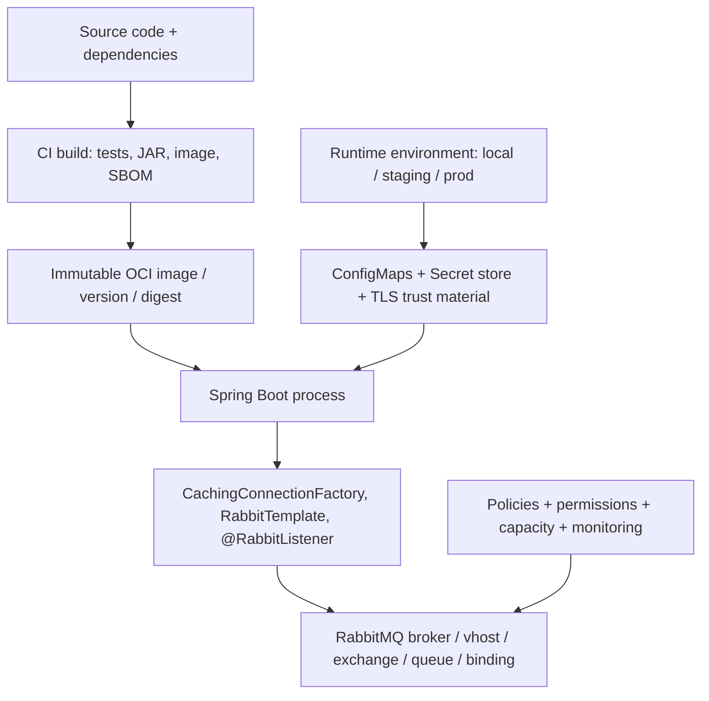
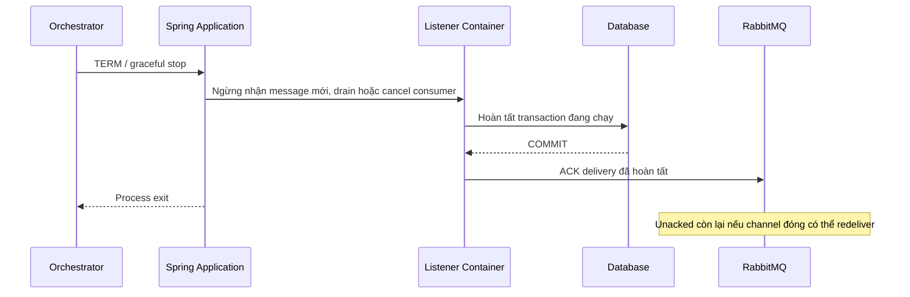
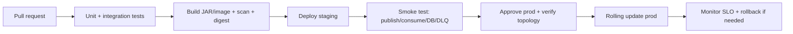
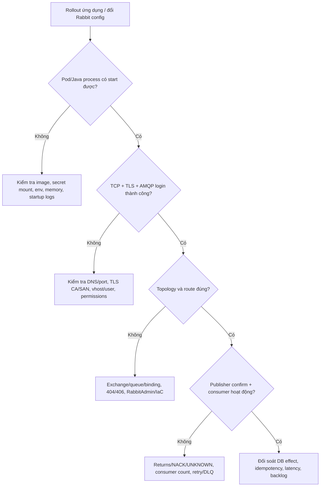

# Đóng gói ứng dụng và quản lý cấu hình RabbitMQ theo môi trường

> **Chương:** Triển khai và vận hành  
> **Module:** SPRING_AMQP — học tích hợp RabbitMQ với Spring AMQP thông qua `RabbitTemplate`, `@RabbitListener`, exchange, queue và binding; xây dựng hệ thống xử lý bất đồng bộ đáng tin cậy bằng publisher confirms, acknowledgments, retry, dead-letter, giao dịch và observability.
>
> **Phạm vi:** Ứng dụng **Spring Boot 3.5.x / Spring AMQP 3.x / Java 21**, giao thức RabbitMQ **AMQP 0-9-1**, có thể đóng gói thành executable JAR và OCI container image. Các ví dụ local, staging, production nhằm minh họa cách tách cấu hình; **không phải một bộ manifest mặc định phù hợp cho mọi tổ chức**.

## 1. Mục tiêu học tập

Sau bài này, bạn có thể:

1. Phân biệt **application artifact**, **container image**, **runtime configuration**, **broker topology** và **broker infrastructure**.
2. Đóng gói ứng dụng Spring Boot thành JAR/OCI image, gắn phiên bản có thể truy vết và chạy dưới tài khoản không phải root.
3. Dùng `application.yml`, profile, environment variables, `spring.config.import=configtree:...`, ConfigMap/Secret để quản lý RabbitMQ theo **local, staging, production**.
4. Cấu hình đầy đủ RabbitMQ endpoint, vhost, credentials, TLS, publisher confirms/returns, listener concurrency, retry và dead-letter bằng đúng nơi sở hữu cấu hình.
5. Tách **khai báo exchange/queue/binding** khỏi những thay đổi có thể phá compatibility; áp dụng policies và migrations có kế hoạch.
6. Triển khai ứng dụng bằng Docker Compose hoặc Kubernetes mà không tạo connection storm, hot requeue loop hay mất kiểm soát in-flight messages.
7. Phân biệt **liveness**, **readiness**, broker connectivity và business readiness; thiết kế graceful shutdown khi rollout.
8. Thiết lập checklist deploy/rollback, cảnh báo, kiểm thử môi trường và quy trình xử lý sự cố.

### Tình huống xuyên suốt

Ứng dụng `order-worker` có hai trách nhiệm:

- Publish `OrderCreated` từ một luồng nghiệp vụ qua `RabbitTemplate` tới `orders.events.x`.
- Consume `PaymentConfirmed` bằng `@RabbitListener` từ `payments.confirmed.q`, ghi dữ liệu vào database và ACK khi xử lý thành công.

Đội phát triển có ba môi trường:

| Môi trường | Mục đích | RabbitMQ | Cách quản lý |
|---|---|---|---|
| **local** | Lập trình, debug, thử nhanh topology | RabbitMQ chạy bằng Docker Compose | Cấu hình đơn giản, credentials chỉ dùng local, có thể khởi tạo lại dữ liệu |
| **staging** | Kiểm thử tích hợp/triển khai giống production | Broker/vhost riêng, topology thử nghiệm | Secrets và TLS thật, metrics, thử rollout/rollback, dữ liệu giả |
| **production** | Giao dịch người dùng thực | Cluster/managed RabbitMQ có chính sách độ bền và vận hành riêng | Mọi secrets/TLS/topology/policy/deploy đều có kiểm soát |

Mục tiêu là **build một artifact đã được kiểm thử và triển khai chính artifact đó sang staging/prod**; chỉ khác cấu hình runtime và cơ sở hạ tầng. Không build lại ứng dụng với mật khẩu production được nhúng bên trong.

## 2. Năm lớp cần quản lý riêng



### 2.1. Ai sở hữu thay đổi nào?

| Lớp | Đơn vị triển khai | Đặc điểm | Rủi ro nếu trộn chung |
|---|---|---|---|
| **Java application** | JAR/image có version, checksum/digest | Business logic, listener, converter, retry policy trong code | Khó rollback nếu môi trường nào cũng build riêng |
| **App config** | YAML, env, mounted files | Broker endpoint, vhost, concurrency, timeouts, flags | Lộ password hoặc cùng image nối nhầm broker |
| **Secrets & trust** | Secret manager, certificate files, SSL bundle | AMQP credentials, client key, CA/trust store | Lộ khóa, TLS xác minh sai hoặc rotation làm outage |
| **Broker topology** | IaC/definitions/RabbitAdmin theo quy ước | Exchange, queue, binding, DLX, retry route | `406 PRECONDITION_FAILED`, binding thiếu, message không route |
| **Broker infrastructure** | Operator/SRE/managed service | Node, disks, network, cluster, HA, limits, alarms | Đổ lỗi cho app khi node hết đĩa hoặc bị blocked |

**Một file `application-prod.yml` không nên vừa chứa mật khẩu vừa tự ý xóa/tạo lại queue production.** Tách trách nhiệm để deploy app không âm thầm thay đổi dữ liệu và tài nguyên broker.

## 3. Đóng gói Spring Boot executable JAR

### 3.1. Ví dụ cấu trúc ứng dụng

```text
order-worker/
  pom.xml
  src/main/java/.../OrderWorkerApplication.java
  src/main/java/.../RabbitMessagingConfig.java
  src/main/java/.../PaymentConfirmedListener.java
  src/main/resources/application.yml
  src/main/resources/application-local.yml
  src/main/resources/application-staging.yml
  src/main/resources/application-prod.yml
  Dockerfile
  compose.yaml
```

Đây là **cấu trúc minh họa**, không phải những file đang được tạo trong workspace của bài học. Một module service chỉ cần một executable artifact, trừ khi có chủ đích tách API, consumer và scheduler thành các deployable khác nhau.

### 3.2. Maven và plugin đóng gói

```xml
<!-- Một phần pom.xml; phiên bản Spring Boot phải được quản lý bằng BOM/parent -->
<properties>
    <java.version>21</java.version>
</properties>

<dependencies>
    <dependency>
        <groupId>org.springframework.boot</groupId>
        <artifactId>spring-boot-starter-amqp</artifactId>
    </dependency>
    <dependency>
        <groupId>org.springframework.boot</groupId>
        <artifactId>spring-boot-starter-actuator</artifactId>
    </dependency>
    <!-- Chỉ thêm starter-web khi cần HTTP API/probes trên web server. -->
    <dependency>
        <groupId>org.springframework.boot</groupId>
        <artifactId>spring-boot-starter-web</artifactId>
    </dependency>
</dependencies>

<build>
    <finalName>order-worker</finalName>
    <plugins>
        <plugin>
            <groupId>org.springframework.boot</groupId>
            <artifactId>spring-boot-maven-plugin</artifactId>
        </plugin>
    </plugins>
</build>
```

Với parent/BOM Spring Boot và plugin phù hợp, `spring-boot-maven-plugin` có thể tạo **executable fat JAR** (kèm dependencies) từ project. Ví dụ lệnh thực hiện trong **project ứng dụng**, không phải lệnh cần chạy để đọc bài:

```bash
./mvnw -B clean verify
./mvnw -B package
java -jar target/order-worker.jar --spring.profiles.active=local
```

`verify` cần bao gồm unit/integration tests trong pipeline CI theo chính sách nhóm. Không dùng `-DskipTests` cho đường build phát hành chuẩn; nếu dùng trong bước đóng gói sau khi CI đã kiểm thử artifact, phải ghi rõ bằng chứng và tránh tạo artifact khác với artifact đã kiểm chứng.

### 3.3. Artifact bất biến và khả năng truy vết

Mỗi bản phát hành nên có:

- `version` và commit hash/build provenance xác định được;
- SHA256/digest của image, SBOM và kết quả vulnerability scan theo chính sách;
- cấu hình profile/secret reference **không** nằm trong image;
- release notes về queue schema, topology và thay đổi retry/DLQ;
- khả năng rollback về đúng image/digest cũ mà không build lại.

Một image dùng cho cả staging/prod giúp giảm khác biệt giữa hai môi trường. **Rollback image không thể rollback tự động queue arguments, broker policy hoặc database schema**; vì vậy phải quản lý migration riêng.

## 4. Đóng gói OCI image: Dockerfile hoặc Cloud Native Buildpacks

### 4.1. Dockerfile chạy JAR dưới non-root

```dockerfile
# Dockerfile minh họa; dùng base JRE có phiên bản được kiểm soát.
FROM eclipse-temurin:21-jre
WORKDIR /app

# Tên JAR khớp với <finalName>order-worker</finalName> trong Maven.
COPY --chown=10001:10001 target/order-worker.jar /app/app.jar

USER 10001:10001
EXPOSE 8080

ENTRYPOINT ["java", "-XX:MaxRAMPercentage=75.0", "-jar", "/app/app.jar"]
```

`EXPOSE 8080` có ý nghĩa vì ví dụ có HTTP/Actuator qua `spring-boot-starter-web`. Với consumer-only worker **không chạy HTTP server**, bỏ EXPOSE và chọn cơ chế health check phù hợp. Không lạm dụng HTTP probe trong một process chưa mở web listener.

Ví dụ build/run **trong môi trường local**:

```bash
./mvnw -B clean verify
docker build -t order-worker:local .
docker run --rm \
  -e SPRING_PROFILES_ACTIVE=local \
  -e SPRING_RABBITMQ_HOST=host.docker.internal \
  -p 8080:8080 \
  order-worker:local
```

`host.docker.internal` thường tiện trên Docker Desktop, nhưng không phải tên DNS được bảo đảm trên mọi Docker/Linux host. Trong Compose (mục 8), service name `rabbitmq` là DNS nội bộ của mạng Compose nên đáng tin cậy hơn cho local.

**Khuyến nghị triển khai image:**

- Pin base image theo release/digest và cập nhật có lịch; tag `21-jre` có thể trỏ sang bản patch mới theo thời gian.
- Dùng image registry riêng, scan trước khi đẩy, ký/xác minh artifact nếu platform yêu cầu.
- Không `COPY` `application-prod.yml` chứa password, CA private key hoặc file `.env` có secret vào image.
- Hạn chế filesystem write, dùng `readOnlyRootFilesystem` khi ứng dụng không cần ghi, và cấu hình mount riêng nếu cần temp/cert.
- Giới hạn CPU/memory; để JVM nhận diện container limits, đo heap/native memory và số thread/channel thực tế.
- Xác minh quyền đọc các file trust store/secret dưới UID 10001, vì chạy non-root thường làm lộ lỗi mount/permissions.

### 4.2. Buildpacks: không cần Dockerfile

Spring Boot Maven plugin hỗ trợ build OCI image:

```bash
./mvnw -B spring-boot:build-image \
  -Dspring-boot.build-image.imageName=registry.example.com/order-worker:1.0.0
```

Cloud Native Buildpacks quản lý layout/layers/runtime theo builder và cấu hình của plugin. Cần container runtime/build environment và builder phù hợp với Java version. Hai phương án **Dockerfile** và **Buildpacks** đều hợp lệ; chọn một con đường chuẩn để CI và người vận hành không vô tình xuất hai artifact có thành phần khác nhau.

Với cả hai cách, cấu hình RabbitMQ vẫn được đưa vào **lúc chạy container**, không phải lúc build image.

## 5. Quy tắc externalized configuration theo môi trường

Spring Boot kết hợp nhiều nguồn cấu hình: `application.yml`, profile-specific files, environment variables, command-line args, config imports và programmatic configuration. Nguồn ưu tiên cao hơn có thể override giá trị thấp hơn; phải biết giá trị cuối cùng đến từ đâu khi debug.

### 5.1. Những thuộc tính nên tách

| Thuộc tính | Local | Staging | Production |
|---|---|---|---|
| `spring.rabbitmq.host/addresses` | `rabbitmq` hoặc `localhost` | DNS RabbitMQ staging | Cluster/managed endpoints prod |
| `port / amqp[s]` | `5672` plaintext chỉ trong local | `amqps://...:5671` | `amqps://...:5671` |
| `virtual-host` | `/orders-dev` | `/orders-staging` | `/orders-prod` |
| `username/password` | User local riêng | Secret manager staging | Secret manager production, rotate theo policy |
| `ssl`/trust material | Có thể tắt trong local cô lập | Bật chain + hostname verification | Bật chain + hostname verification, mTLS nếu yêu cầu |
| `listener.concurrency/prefetch` | Nhỏ để debug | Gần production, benchmark | Theo throughput và tài nguyên đã đo |
| `publisher-confirm-type` | `correlated` khi test reliability | `correlated` | `correlated` nếu ứng dụng cần xác nhận publish |
| `publisher-returns/mandatory` | Bật để phát hiện route sai | Bật | Bật với luồng có yêu cầu bảo đảm routing |
| `retry/DLQ` | Để quan sát dễ | Kiểm thử đầy đủ | Retry bounded, DLQ/policy và alert có quy trình |
| `management endpoints` | Đơn giản trong local | Restrict theo mạng/auth | Bảo vệ, tách quyền, tránh lộ env/config/secrets |

**Không dùng chung vhost/user giữa staging và production.** Nếu chung broker cluster vật lý, vẫn nên tách vhost, users, queue names, permissions và quota; với yêu cầu cách ly cao cân nhắc broker riêng.

### 5.2. Cấu hình chung: application.yml

```yaml
spring:
  application:
    name: order-worker
  rabbitmq:
    requested-heartbeat: 20s
    connection-timeout: 5s
    publisher-confirm-type: correlated
    publisher-returns: true
    template:
      mandatory: true
    listener:
      type: simple
      simple:
        concurrency: 2
        max-concurrency: 4
        prefetch: 10
        default-requeue-rejected: false
        missing-queues-fatal: true
        observation-enabled: true

management:
  endpoint:
    health:
      probes:
        enabled: true
  endpoints:
    web:
      exposure:
        include: health,info,prometheus
```

Đây là **baseline cần được điều chỉnh**, không phải thông số khuyến nghị chung. `prefetch=10` và tối đa 4 consumers có thể tạo tới khoảng 40 unacked deliveries **mỗi instance** trong điều kiện tải phù hợp. Khi scale 8 replicas, tổng in-flight có thể lớn hơn nhiều.

`default-requeue-rejected=false` khiến listener exception cuối cùng có thể reject không requeue; nếu muốn lưu message lỗi, queue cần DLX/DLQ đã được cấu hình và kiểm thử. Không dùng property này như thay thế cho retry budget hoặc business error classification.

### 5.3. Cấu hình local: application-local.yml

```yaml
spring:
  rabbitmq:
    host: localhost
    port: 5672
    virtual-host: /orders-dev
    username: orders_dev
    password: ${RABBITMQ_DEV_PASSWORD}
    ssl:
      enabled: false
    listener:
      simple:
        concurrency: 1
        max-concurrency: 1
        prefetch: 1
```

`RABBITMQ_DEV_PASSWORD` phải do người chạy đặt từ file env/secret ngoài source control, ngay cả trong local nếu dùng máy chung. Không chọn một mật khẩu default đã commit rồi mang cấu hình ấy sang môi trường khác.

### 5.4. Cấu hình staging

```yaml
# application-staging.yml
spring:
  rabbitmq:
    addresses: ${RABBITMQ_ADDRESSES}
    virtual-host: ${RABBITMQ_VHOST}
    username: ${RABBITMQ_USERNAME}
    password: ${RABBITMQ_PASSWORD}
    ssl:
      enabled: true
      verify-hostname: true
      validate-server-certificate: true
      trust-store: file:/etc/rabbitmq/tls/truststore.p12
      trust-store-type: PKCS12
      trust-store-password: ${RABBITMQ_TRUSTSTORE_PASSWORD}
```

Ví dụ `RABBITMQ_ADDRESSES` là danh sách địa chỉ `amqps://rabbit-a.staging.example:5671,amqps://rabbit-b.staging.example:5671`. Đừng nhúng username/password trong URI. Với `addresses`, host/port riêng có thể bị bỏ qua; phải xác nhận endpoint thực tế từ runtime logs.

### 5.5. Cấu hình production

```yaml
# application-prod.yml
spring:
  rabbitmq:
    addresses: ${RABBITMQ_ADDRESSES}
    virtual-host: ${RABBITMQ_VHOST}
    username: ${RABBITMQ_USERNAME}
    password: ${RABBITMQ_PASSWORD}
    ssl:
      enabled: true
      verify-hostname: true
      validate-server-certificate: true
      trust-store: file:/etc/rabbitmq/tls/truststore.p12
      trust-store-type: PKCS12
      trust-store-password: ${RABBITMQ_TRUSTSTORE_PASSWORD}
    listener:
      simple:
        concurrency: ${RABBITMQ_CONSUMERS_MIN:2}
        max-concurrency: ${RABBITMQ_CONSUMERS_MAX:6}
        prefetch: ${RABBITMQ_PREFETCH:10}
```

Các tham số có default ở production (`CONSUMERS_MIN`, `CONSUMERS_MAX`, `PREFETCH`) chỉ nhằm minh họa cú pháp placeholder; giá trị thực tế phải được đo, phê duyệt và đủ tài nguyên broker/downstream. Ngược lại, `addresses`, vhost, credentials và trust-store password là **bắt buộc**, không nên có default nguy hiểm.

**Cảnh báo:** Bật `verify-hostname=true` là bắt buộc để bảo vệ danh tính broker; TLS chỉ an toàn khi certificate chain được trust store xác minh **và** SAN phù hợp hostname client kết nối. Không dùng `validate-server-certificate=false`/`verify-hostname=false` để vượt lỗi staging rồi đem cấu hình sang production.

### 5.6. Môi trường lựa chọn profile thế nào?

```bash
# Chạy local từ JAR:
export SPRING_PROFILES_ACTIVE=local
export RABBITMQ_DEV_PASSWORD='<secret for local only>'
java -jar target/order-worker.jar

# Với staging/prod, platform inject SPRING_PROFILES_ACTIVE và secrets.
# Không ghi password prod vào script, image hay shell history.
```

Spring profile quyết định **tập giá trị cấu hình đang hoạt động**; nó không tạo lớp bảo mật, không thay thế network policy và không tự cấp RabbitMQ permissions. Tránh dùng `@Profile("prod")` để âm thầm thay đổi queue arguments khi có thể quản lý topology qua một quy trình riêng.

## 6. Environment variables, file secrets và configtree

### 6.1. Relaxed binding và các tên biến

Spring Boot map environment variables theo quy tắc relaxed binding. Ví dụ:

| Spring property | Environment variable |
|---|---|
| `spring.profiles.active` | `SPRING_PROFILES_ACTIVE` |
| `spring.rabbitmq.addresses` | `SPRING_RABBITMQ_ADDRESSES` |
| `spring.rabbitmq.virtual-host` | `SPRING_RABBITMQ_VIRTUAL_HOST` |
| `spring.rabbitmq.username` | `SPRING_RABBITMQ_USERNAME` |
| `spring.rabbitmq.password` | `SPRING_RABBITMQ_PASSWORD` |
| `spring.rabbitmq.ssl.enabled` | `SPRING_RABBITMQ_SSL_ENABLED` |
| `spring.rabbitmq.ssl.verify-hostname` | `SPRING_RABBITMQ_SSL_VERIFY_HOSTNAME` |
| `spring.rabbitmq.listener.simple.prefetch` | `SPRING_RABBITMQ_LISTENER_SIMPLE_PREFETCH` |
| `spring.rabbitmq.publisher-returns` | `SPRING_RABBITMQ_PUBLISHER_RETURNS` |

Khi cần thay một property trong Pod mà không chỉnh image, env var là cách đơn giản. Nhưng **secret ở env có thể lộ** qua process inspection, debug, tooling hoặc cấu hình được dump không đúng cách; secret file/secret manager thường cho mức quản trị tốt hơn. Không in toàn bộ `Environment` hay bật actuator `/env` công khai để “debug nhanh”.

### 6.2. Spring Boot configtree với Secret dạng file

Kubernetes/Docker có thể mount mỗi key trong Secret thành một file. Ví dụ:

```text
/run/secrets/rabbitmq/
  spring.rabbitmq.username
  spring.rabbitmq.password
  spring.rabbitmq.ssl.trust-store-password
```

Trong `application-prod.yml` hoặc một file cấu hình bổ sung:

```yaml
spring:
  config:
    import: "configtree:/run/secrets/rabbitmq/"
```

Khi đó tên file `spring.rabbitmq.password` trở thành property và nội dung file được Spring Boot đọc làm giá trị. **Không dùng `optional:configtree:` cho một tập secrets bắt buộc** nếu việc thiếu chúng phải làm ứng dụng fail-fast; `optional:` có nghĩa là thiếu location vẫn được cho phép.

Nếu kết hợp placeholders, env vars và configtree, phải nắm thứ tự ưu tiên để không vô tình để secret cũ từ env override secret mới trên volume. Thêm test kiểm tra giá trị effective **mà không in ra bí mật**.

### 6.3. SSL bundles và chứng chỉ

Spring Boot 3.5 còn hỗ trợ `spring.ssl.bundle.jks`/`spring.ssl.bundle.pem` để định nghĩa tập CA/key material theo tên; `spring.rabbitmq.ssl.bundle` tham chiếu bundle đó. Có thể dùng thay cho các thuộc tính `trust-store` trực tiếp:

```yaml
spring:
  ssl:
    bundle:
      jks:
        rabbitmq-client:
          truststore:
            location: file:/etc/rabbitmq/tls/truststore.p12
            type: PKCS12
            password: ${RABBITMQ_TRUSTSTORE_PASSWORD}
  rabbitmq:
    ssl:
      enabled: true
      verify-hostname: true
      bundle: rabbitmq-client
```

Chọn **một** cách quản lý TLS thống nhất theo phiên bản. Với mTLS, còn phải cung cấp client certificate/private key riêng, cấu hình broker tin client CA, và quyết định cơ chế AMQP authentication (password/SASL EXTERNAL) độc lập với TLS handshake.

**Rotation:** cập nhật file trust store/secret không bảo đảm `CachingConnectionFactory` đang mở sẽ lập tức dùng SSL context mới. Cần quy trình reload/rolling restart và thử kết nối TLS **mới** để xác minh CA/SAN, đặc biệt khi đổi root/intermediate CA.

## 7. Docker Compose cho phát triển local

Ví dụ một `compose.yaml` có RabbitMQ management và ứng dụng build sẵn:

```yaml
services:
  rabbitmq:
    image: rabbitmq:4.1-management
    hostname: rabbitmq
    environment:
      RABBITMQ_DEFAULT_USER: orders_dev
      RABBITMQ_DEFAULT_PASS: "${DEV_RABBITMQ_PASSWORD:?set_DEV_RABBITMQ_PASSWORD}"
      RABBITMQ_DEFAULT_VHOST: /orders-dev
    ports:
      - "127.0.0.1:5672:5672"
      - "127.0.0.1:15672:15672"
    volumes:
      - rabbitmq_local_data:/var/lib/rabbitmq
    healthcheck:
      test: ["CMD", "rabbitmq-diagnostics", "-q", "ping"]
      interval: 10s
      timeout: 5s
      retries: 15

  order-worker:
    image: order-worker:local
    depends_on:
      rabbitmq:
        condition: service_healthy
    environment:
      SPRING_PROFILES_ACTIVE: local
      SPRING_RABBITMQ_HOST: rabbitmq
      SPRING_RABBITMQ_PORT: "5672"
      SPRING_RABBITMQ_VIRTUAL_HOST: /orders-dev
      SPRING_RABBITMQ_USERNAME: orders_dev
      SPRING_RABBITMQ_PASSWORD: "${DEV_RABBITMQ_PASSWORD:?set_DEV_RABBITMQ_PASSWORD}"
    ports:
      - "127.0.0.1:8080:8080"

volumes:
  rabbitmq_local_data:
```

Lệnh tương ứng (thực hiện trong một project ứng dụng thực tế):

```bash
# Đặt DEV_RABBITMQ_PASSWORD trong shell/.env local đã được gitignore.
./mvnw -B package
docker build -t order-worker:local .
docker compose up -d
docker compose ps
docker compose logs --tail=100 rabbitmq order-worker
```

**Giới hạn Compose:**

- `depends_on.condition: service_healthy` chỉ đợi container healthcheck, không bảo đảm đúng exchange/queue/binding đã được khai báo hoặc DB downstream sẵn sàng.
- `rabbitmq-diagnostics ping` xác nhận node phản hồi nhưng không phải phép thử publish/consume end-to-end.
- Bind port lên `127.0.0.1` giúp tránh mở broker management ra toàn mạng máy dev; production phải đặt firewall/network policy phù hợp.
- Volume `rabbitmq_local_data` giữ dữ liệu giữa các lần container restart; không xóa volume nếu muốn tái hiện consumer redelivery/durable state.
- `RABBITMQ_DEFAULT_USER/PASS` của Docker image là **cách bootstrap local**, không phải chiến lược quản lý danh tính và rotation cho production.
- Nếu container application nằm trên mạng Compose, nó kết nối bằng hostname `rabbitmq`, không phải `localhost` (localhost trong container trỏ vào chính container ấy).

## 8. Kubernetes: ConfigMap cho config, Secret cho identity

Đây là mô hình tham khảo cho **một service HTTP + Rabbit listener**. Nếu chỉ chạy background consumer không có HTTP web server, cần dùng probe phù hợp thay vì copy nguyên `httpGet`.

### 8.1. ConfigMap: chỉ chứa giá trị không bí mật

```yaml
apiVersion: v1
kind: ConfigMap
metadata:
  name: order-worker-config
  namespace: orders-prod
data:
  SPRING_PROFILES_ACTIVE: "prod"
  SPRING_RABBITMQ_ADDRESSES: "amqps://rabbit-a.internal.example:5671,amqps://rabbit-b.internal.example:5671"
  SPRING_RABBITMQ_VIRTUAL_HOST: "/orders-prod"
  SPRING_RABBITMQ_SSL_ENABLED: "true"
  SPRING_RABBITMQ_SSL_VERIFY_HOSTNAME: "true"
  SPRING_RABBITMQ_SSL_VALIDATE_SERVER_CERTIFICATE: "true"
  RABBITMQ_CONSUMERS_MIN: "2"
  RABBITMQ_CONSUMERS_MAX: "6"
  RABBITMQ_PREFETCH: "10"
```

`orders-prod` là Kubernetes namespace **khác** RabbitMQ vhost `/orders-prod`. Chúng có thể cùng định danh theo quy ước nhưng hệ thống không tự liên kết hai đối tượng.

**Quy tắc:** ConfigMap có thể chứa hostname, vhost, flags, concurrency, timeout, queue names; **không lưu** username/password bí mật, private keys hay trust-store password. Cả RabbitMQ endpoint nội bộ vẫn có thể là thông tin nhạy cảm về kiến trúc, nên phân quyền đọc ConfigMap theo môi trường.

### 8.2. Secret: tạo qua cơ chế được quản lý

Giả định Kubernetes namespace `orders-prod` đã có:

```text
Secret: order-worker-rabbit-credentials
  username
  password
  truststore-password

Secret: order-worker-rabbit-trust
  truststore.p12
```

Các secrets này nên được phân phối qua Secret manager/External Secrets/CSI hoặc quy trình IaC bảo mật được tổ chức phê duyệt. **Không commit manifest có giá trị `data`/`stringData` production vào Git; base64 không phải mã hóa.** Cần RBAC, encryption at rest phù hợp, audit truy cập và rotation.

### 8.3. Deployment: ghép config và secret, probe, resources

```yaml
apiVersion: apps/v1
kind: Deployment
metadata:
  name: order-worker
  namespace: orders-prod
spec:
  replicas: 3
  strategy:
    type: RollingUpdate
    rollingUpdate:
      maxSurge: 1
      maxUnavailable: 0
  selector:
    matchLabels:
      app: order-worker
  template:
    metadata:
      labels:
        app: order-worker
    spec:
      terminationGracePeriodSeconds: 60
      containers:
        - name: order-worker
          image: registry.example.com/orders/order-worker:1.0.0
          imagePullPolicy: IfNotPresent
          ports:
            - name: http
              containerPort: 8080
          envFrom:
            - configMapRef:
                name: order-worker-config
          env:
            - name: SPRING_RABBITMQ_USERNAME
              valueFrom:
                secretKeyRef:
                  name: order-worker-rabbit-credentials
                  key: username
            - name: SPRING_RABBITMQ_PASSWORD
              valueFrom:
                secretKeyRef:
                  name: order-worker-rabbit-credentials
                  key: password
            - name: RABBITMQ_TRUSTSTORE_PASSWORD
              valueFrom:
                secretKeyRef:
                  name: order-worker-rabbit-credentials
                  key: truststore-password
          volumeMounts:
            - name: rabbit-trust
              mountPath: /etc/rabbitmq/tls
              readOnly: true
          resources:
            requests:
              cpu: 250m
              memory: 512Mi
            limits:
              cpu: "1"
              memory: 1Gi
          startupProbe:
            httpGet:
              path: /actuator/health/liveness
              port: http
            periodSeconds: 5
            failureThreshold: 24
          livenessProbe:
            httpGet:
              path: /actuator/health/liveness
              port: http
            periodSeconds: 10
            failureThreshold: 3
          readinessProbe:
            httpGet:
              path: /actuator/health/readiness
              port: http
            periodSeconds: 5
            failureThreshold: 3
      volumes:
        - name: rabbit-trust
          secret:
            secretName: order-worker-rabbit-trust
            items:
              - key: truststore.p12
                path: truststore.p12
```

Manifest này minh họa cấu trúc, không phải manifest production hoàn chỉnh: cần Service, RBAC, NetworkPolicy, imagePullSecrets, node/pod security policy tương ứng, và bộ cấu hình cấp hạ tầng nếu tổ chức yêu cầu.

**Trước khi production:** thay image tag bằng digest bất biến hoặc có kiểm soát triển khai qua registry policy, chọn resource requests/limits bằng benchmark, bảo đảm volume secret đọc được từ UID non-root, và đặt `maxSurge`/`maxUnavailable` phù hợp ngân sách RabbitMQ connections/consumers.

Trong ví dụ ở mục 5, `application-prod.yml` dùng `trust-store=file:/etc/rabbitmq/tls/truststore.p12`. Đường mount trong Deployment phải khớp tuyệt đối với đường Spring đang đọc. Một ConfigMap đặt `SPRING_RABBITMQ_SSL_TRUST_STORE` sang đường khác sẽ override giá trị YAML; vì thế kiểm tra **effective configuration** sau deploy là cần thiết.

### 8.4. ConfigMap/Secret thay đổi có tự cập nhật app?

**Không mặc định.** Environment variables được process đọc khi startup; sửa ConfigMap hoặc Secret tham chiếu bằng `envFrom`/`valueFrom` không tự cập nhật biến môi trường của **process đang chạy**. Với secret mount dạng volume, Kubernetes có thể cập nhật file sau một khoảng thời gian, nhưng Spring `CachingConnectionFactory` không mặc định reload credential/TLS context và tái thiết lập connection theo file mới.

Với thay đổi endpoint, mật khẩu, CA hoặc queue settings, nên có **đường rollout/reload được thử nghiệm**: cập nhật secret an toàn, khởi động pod mới theo rolling strategy, xác thực các kết nối mới, đối soát publisher/consumer trong giai đoạn chuyển đổi.

### 8.5. Thứ tự apply và cấp quyền

```text
1. Provision broker cluster / vhost / users / permissions / TLS CA.
2. Provision topology (exchange, queue, bindings, DLX/retry) hoặc
   xác nhận RabbitAdmin được phép tự declare topology phù hợp.
3. Tạo/update Secret và ConfigMap trong Kubernetes namespace.
4. Deploy image mới.
5. Xác minh probes và consumer registrations.
6. Thử publish/consume có publisher confirm, return và DB audit.
7. Quan sát backlog, DLQ, error rate trước khi nâng replicas/traffic.
```

Không phải mọi hệ thống cần đúng thứ tự trên, nhưng **topology phải tương thích trước khi listener/publisher mới bắt đầu sử dụng**; nếu code yêu cầu queue mới mà chỉ chạy deployment mới rồi đợi RabbitAdmin tự tạo, cần bảo đảm quyền và quy tắc quản lý queue đã được phê duyệt.

## 9. Quản lý topology: RabbitAdmin, policies hay definitions?

Spring AMQP có thể khai báo exchange, queue, binding qua các Spring `Declarable` beans và `RabbitAdmin`. Ví dụ:

```java
import org.springframework.amqp.core.BindingBuilder;
import org.springframework.amqp.core.Declarables;
import org.springframework.amqp.core.DirectExchange;
import org.springframework.amqp.core.Queue;
import org.springframework.amqp.core.QueueBuilder;
import org.springframework.context.annotation.Bean;
import org.springframework.context.annotation.Configuration;

@Configuration(proxyBeanMethods = false)
class OrderTopology {
    @Bean
    Declarables orderDeclarables() {
        DirectExchange exchange =
            new DirectExchange("orders.events.x", true, false);
        Queue work = QueueBuilder.durable("payments.confirmed.q").build();
        DirectExchange dead =
            new DirectExchange("orders.dead.x", true, false);
        Queue dlq = QueueBuilder.durable("payments.confirmed.dlq").build();
        return new Declarables(
            exchange,
            dead,
            work,
            dlq,
            BindingBuilder.bind(work)
                .to(exchange).with("payment.confirmed"),
            BindingBuilder.bind(dlq)
                .to(dead).with("payment.failed")
        );
    }
}
```

Ở đây DLX routing cho `payments.confirmed.q` **chưa được thiết lập trong queue declaration**. Để reject đi vào DLQ, hãy cung cấp **RabbitMQ policy** hoặc khai báo DLX arguments có chủ đích; chỉ có `orders.dead.x` và `payments.confirmed.dlq` chưa đủ.

### 9.1. Các lựa chọn quản lý topology

| Phương pháp | Điểm mạnh | Giới hạn / lưu ý |
|---|---|---|
| Spring beans + `RabbitAdmin` | Dễ bootstrap local/test, topology đi cùng ứng dụng | Nhiều replica cùng declare; app cần `configure`; mismatch có thể gây channel `406` |
| RabbitMQ definitions import | Seed users/vhosts/exchanges/queues/bindings/policies bằng quy trình hạ tầng | Phải quản lý version/config diff; chỉ import những definition đã review |
| RabbitMQ policies | Đặt TTL, DLX, queue length/overflow và một số queue behaviors theo pattern | Có semantics/precedence với x-arguments; phải kiểm tra chính xác queue type và RabbitMQ version |
| IaC / Kubernetes Operator | Phân quyền, review, drift detection và rollout riêng | Cần owner và kế hoạch migration độc lập với app |

RabbitMQ production guidance khuyến nghị import **definitions** để seed vhosts/users/topology/policies khi deploy hạ tầng. Spring `RabbitAdmin` phù hợp cho local và một số production pattern khi các declarables tương thích; không nên có **hai nguồn chân lý** vừa IaC vừa mọi pod tự thay topology.

### 9.2. Lỗi `406 PRECONDITION_FAILED` khi đổi queue arguments

Giả sử production đã có queue `payments.confirmed.q` durable và không có `x-message-ttl`. Release mới vô tình khai báo lại queue cùng tên nhưng khác `x-message-ttl`:

```java
// Tránh thay đổi trực tiếp như sau lên queue production đang tồn tại:
Queue work = QueueBuilder.durable("payments.confirmed.q")
    .ttl(60_000)
    .build();
```

Broker có thể đóng channel do **inequivalent queue arguments**. **Tăng số lần reconnect không sửa được điều kiện này.** Phải chọn một trong các chiến lược:

1. Điều chỉnh một **policy** phù hợp nếu thuộc tính được policy hỗ trợ và cấu hình hiện hữu không ghi đè.
2. Tạo queue mới `payments.confirmed.v2.q`, triển khai producer/consumer song song, chuyển traffic và drain queue cũ.
3. Với thay đổi không tương thích về queue type, durable/exclusive và các immutable arguments, thiết kế migration riêng; không xóa queue chứa message chỉ để ứng dụng start được.

Khi có nhiều replica tự declare cùng một queue, các replicas phải dùng **tập arguments nhất quán**. Không sử dụng profile dev/prod để tạo cùng queue name nhưng loại queue khác nhau trên cùng vhost.

### 9.3. RabbitMQ policies cho dead-letter và retry

Một policy minh họa ở broker thử nghiệm:

```bash
# Ví dụ: áp policy cho queue có tên payments.confirmed.q
# trong vhost /orders-prod; cần quyền quản trị broker.
rabbitmqctl set_policy -p /orders-prod payments-dlx \
  '^payments[.]confirmed[.]q$' \
  '{"dead-letter-exchange":"orders.dead.x","dead-letter-routing-key":"payment.failed"}' \
  --apply-to queues
```

Policy được quản trị độc lập với image application, dễ đổi hơn hardcoded x-arguments. Nhưng phải kiểm tra **thứ tự ưu tiên giữa x-arguments và policies**, quy tắc matching, các broker policies khác và phiên bản đang dùng. Bảo đảm source queue, DLX, DLQ và binding đã tồn tại trước khi thử reject không requeue.

**Không coi dead-letter là lưu bền vững vô điều kiện.** Broker dead-letter có trường hợp thất bại nếu target không sẵn sàng; với quorum queues có cơ chế at-least-once dead-lettering có điều kiện. Phải thử `source -> DLX -> DLQ` bằng một message không chứa dữ liệu thực trước khi phát hành.

### 9.4. Permission tối thiểu

Ứng dụng consumer cần `read` phù hợp, producer cần `write` tới exchange, và nếu để `RabbitAdmin` tự declare thì còn cần `configure` theo tài nguyên. Với topology quản lý bởi IaC, có thể tách **deployment identity** dùng để khai báo khỏi **runtime identity** chỉ đọc/ghi message.

Không dùng `guest/guest`, tài khoản broker admin hay một user chung cho dev/staging/prod. Trong cluster nhiều tenant, đặt vhost/permission và quota tương ứng; các queue/exchange names là contract nên version hóa.

## 10. Readiness, liveness và phụ thuộc RabbitMQ

Spring Boot Actuator có health endpoints và hỗ trợ Kubernetes probes:

| Endpoint / khái niệm | Trả lời câu hỏi | Có nên phụ thuộc RabbitMQ? |
|---|---|---|
| `/actuator/health/liveness` | JVM/process còn hoạt động đúng mức có thể phục hồi không? | **Không**; broker outage không nên restart mọi pod |
| `/actuator/health/readiness` | Instance có sẵn sàng nhận request mới không? | **Tùy contract**: cân nhắc kỹ ngoại vi dùng chung |
| `/actuator/health` tổng hợp | Các health indicators (có thể gồm Rabbit) hiện ra sao? | Có thể phụ thuộc broker theo cấu hình |
| RabbitMQ consumer count / queue state | Consumer thực sự đã đăng ký và xử lý được không? | Quan sát ở broker/container, không suy ra chỉ từ HTTP liveness |
| Business smoke test | Event có đi qua producer/broker/consumer/DB không? | Có; dùng test riêng tránh gây side effect thật |

**Spring Boot không tự động thêm mọi external health indicator vào liveness/readiness groups.** Đừng gộp RabbitMQ vào liveness: khi broker outage, kubelet sẽ liên tục restart các app pod, làm tình hình tệ hơn.

Readiness có thể gắn RabbitMQ nếu HTTP API của ứng dụng **không thể phục vụ request** khi broker down. Tuy nhiên nếu RabbitMQ là dependency chung và hệ thống có outbox/circuit breaker, đưa broker vào readiness cũng có thể làm toàn bộ service mất endpoint không cần thiết. Quyết định theo SLA, không phải “càng nhiều health checks càng tốt”.

### 10.1. Worker-only không có HTTP server

Một process chỉ chạy `@RabbitListener` (không có Spring MVC/WebFlux server) không thể trả lời `httpGet: /actuator/health/liveness`. Có thể dùng Spring Boot + web starter chỉ cho probe nếu đánh đổi chi phí là chấp nhận được, hoặc dùng `exec` probe/custom app health mechanism được thiết kế phù hợp; nhưng **không** dùng lệnh mở connection broker mỗi 5 giây làm liveness của JVM.

### 10.2. Readiness không đồng nghĩa queue đã rỗng

Một consumer sẵn sàng vẫn có thể có backlog lớn. Readiness chỉ nói service có thể tiếp nhận công việc theo contract; backlog, lag, DLQ, failure rate và consumer registration phải là metrics/cảnh báo **riêng**.

## 11. Graceful shutdown khi rolling deployment

Đối với Spring AMQP listener, vấn đề khó không phải đóng HTTP port mà là hoàn tất **in-flight deliveries** và ACK đúng thời điểm.



### 11.1. Ba timeout có vai trò khác nhau

- **Kubernetes `terminationGracePeriodSeconds`:** giới hạn tổng thời gian pod có để thoát trước khi bị SIGKILL.
- **Spring Boot HTTP graceful shutdown / Spring lifecycle:** điều khiển các phase stop và xử lý HTTP requests đang chạy.
- **Spring AMQP `shutdownTimeout` của listener container:** thời gian container chờ consumer xử lý message đang chạy trước khi buộc đóng channel, tùy container và cấu hình.

Ví dụ ứng dụng HTTP + consumer:

```yaml
server:
  shutdown: graceful

spring:
  lifecycle:
    timeout-per-shutdown-phase: 30s
```

Đoạn này **không tự đồng bộ** mọi timeout của `SimpleMessageListenerContainer`. Muốn tùy chỉnh listener shutdown, dùng container factory theo API phiên bản:

```java
import org.springframework.amqp.rabbit.config.SimpleRabbitListenerContainerFactory;
import org.springframework.amqp.rabbit.connection.ConnectionFactory;
import org.springframework.context.annotation.Bean;
import org.springframework.context.annotation.Configuration;

@Configuration
class ListenerShutdownConfiguration {
    @Bean("paymentListenerFactory")
    SimpleRabbitListenerContainerFactory paymentListenerFactory(
        ConnectionFactory connectionFactory
    ) {
        var factory = new SimpleRabbitListenerContainerFactory();
        factory.setConnectionFactory(connectionFactory);
        factory.setConcurrentConsumers(2);
        factory.setPrefetchCount(10);
        factory.setShutdownTimeout(20_000L);
        factory.setDefaultRequeueRejected(false);
        return factory;
    }
}
```

Với `@RabbitListener` cần chỉ rõ `containerFactory="paymentListenerFactory"`, tránh tưởng một factory bean custom tự được mọi listener sử dụng. `shutdownTimeout` đặt ở đây phải được cân đối với processing p99, downstream latency và `terminationGracePeriodSeconds=60` trong Deployment.

### 11.2. Sự thật về at-least-once khi shutdown

Nếu process bị kill trước khi ACK tới broker, message chưa ack có thể được RabbitMQ **requeue/redeliver**. Consumer phải idempotent theo `eventId` và DB transaction. Ngược lại, khi database commit xong nhưng connection mất trước ACK, event vẫn có thể bị xử lý lại: không có exactly-once tự động giữa DB và broker.

Nếu handler có công việc mất vài phút, một termination grace period 60 giây có thể không đủ. Các lựa chọn gồm giảm kích thước job, tách xử lý dài thành bước có checkpoint, điều chỉnh graceful window, hoặc cho phép redelivery an toàn với idempotency/lease. Không tăng timeout vô hạn rồi mong orchestrator chờ mãi.

### 11.3. Tải tăng trong rolling update

Deployment `replicas=3` và `maxSurge=1` có thể tạm chạy **4 pod**, chưa kể pod cũ trong termination. Nếu mỗi pod mở consumer channels, publisher channels và connection riêng, quota RabbitMQ có thể bị vượt trong rollout dù tải bình thường còn dưới ngưỡng.

Hãy lập resource budget:

```text
Peak connections ≈ peak pods × connections per pod
Peak consumer capacity ≈ peak pods × consumers per pod
Peak unacked deliveries ≈ peak consumers × prefetch
```

Đây là **ước tính**, không phải giới hạn cứng; connection factory có thể dùng publisher connection riêng hoặc nhiều connection khi cache mode khác. Xác minh bằng RabbitMQ Management/Prometheus trước và trong deploy.

## 12. Định tuyến, confirms, retry, DLQ và outbox khi vận hành

### 12.1. Producer: không coi “send return normally” là xong

Với cấu hình:

```yaml
spring:
  rabbitmq:
    publisher-confirm-type: correlated
    publisher-returns: true
    template:
      mandatory: true
```

Producer có thể dùng `CorrelationData.getFuture()` để nhận publisher confirm và `CorrelationData.getReturned()` để kiểm tra unroutable. **Confirm ACK** không chứng minh consumer đã xử lý, và **ACK vẫn có thể đi cùng `basic.return`** nếu message mandatory không route được.

Nếu network mất giữa publish và confirm, outcome có thể **UNKNOWN**, không chắc message đã được broker nhận hay chưa. Cần eventId ổn định, retry có giới hạn, idempotent consumer và transactional outbox nếu sự kiện xuất phát từ DB transaction.

### 12.2. Consumer: retry và DLQ phải được triển khai thực tế

```java
import org.springframework.amqp.rabbit.annotation.RabbitListener;
import org.springframework.stereotype.Component;

@Component
public class PaymentConfirmedListener {
    private final PaymentProjectionService service;

    public PaymentConfirmedListener(PaymentProjectionService service) {
        this.service = service;
    }

    @RabbitListener(
        id = "payment-confirmed",
        queues = "payments.confirmed.q",
        containerFactory = "paymentListenerFactory"
    )
    public void handle(PaymentConfirmed event) {
        service.applyIdempotently(event.eventId(), event.paymentId());
    }
}
```

`PaymentConfirmed` là record/DTO theo schema của dự án; `PaymentProjectionService` phải có DB transaction/idempotency và message converter phù hợp. Đây là **minh họa contract**, chưa phải class biên dịch độc lập (cần định nghĩa DTO/service). Broker và ứng dụng phải dùng cùng schema/version để tránh poison message sau deployment.

Thực hành vận hành:

1. Retry hữu hạn với backoff cho lỗi **có thể phục hồi** như downstream timeout.
2. Lỗi payload/schema không hợp lệ cần quarantine/reject đúng policy, không requeue vô hạn.
3. Khi hết retry, reject không requeue để đi DLQ nếu topology hỗ trợ; kiểm chứng arrival vào DLQ.
4. Theo dõi `x-death.reason`, DLQ depth/age, retry count và redelivery riêng; đừng cộng chúng thành một “retryCount” duy nhất.
5. Khi replay từ DLQ, giữ `eventId`, giới hạn tốc độ và đối soát với business state; không tự động replay tất cả cùng lúc sau outage.

### 12.3. Bảo vệ dữ liệu trong rolling migration

Khi đổi tên queue, exchange hoặc routing key:

- Tạo destination mới và binding trước khi chuyển producer.
- Chạy consumer tương thích với cả schema cũ/mới trong giai đoạn overlap.
- Theo dõi message còn `ready/unacked` trong queue cũ trước khi dỡ consumer.
- Tránh để producer publish sang queue mới trong khi consumer vẫn chỉ nghe queue cũ.
- Chỉ xóa queue/binding cũ khi đã có kế hoạch drain/audit/rollback.

**Không thay hàng loạt tên exchange hoặc routing key bằng cách chỉnh một profile trong khi môi trường khác vẫn phụ thuộc route cũ**. Đường đi của message là contract giữa hai dịch vụ và cần migration có version.

## 13. Kế hoạch triển khai, kiểm thử và rollback

### 13.1. Pipeline phát hành tham khảo



**CI stage** nên có:

- Unit tests về converter, producer routing key, retry policies, consumer idempotency.
- Integration tests với RabbitMQ và database test thật (Testcontainers), publisher confirms/returns, retry/DLQ, redelivery sau mất connection.
- Schema compatibility tests đối với event đã lưu trong queue từ version cũ.
- Artifact integrity, dependency/license/vulnerability scanning và secret scanning.
- Deployment manifests/config validation, dry-run theo công cụ của tổ chức.

**CD stage** nên xác minh:

- Broker endpoint, TLS SAN/CA, permissions/vhost, queue/exchange/bindings đã sẵn sàng.
- Số connection/channel/consumer có headroom cho rolling update.
- Readiness, liveness và application start; không có `403/404/406` lặp lại.
- Publisher confirms/returns, queue ingress, listener ACK, DLQ depth/age và business DB effects.

### 13.2. Lệnh vận hành Kubernetes (ví dụ)

```bash
# Chỉ chạy với kube-context và namespace đã xác minh đúng môi trường.
kubectl --context prod-cluster -n orders-prod \
  rollout status deployment/order-worker

kubectl --context prod-cluster -n orders-prod \
  get pods -l app=order-worker

kubectl --context prod-cluster -n orders-prod \
  describe deployment order-worker

# Chỉ dùng nếu đã chẩn đoán và có phê duyệt rollback:
kubectl --context prod-cluster -n orders-prod \
  rollout undo deployment/order-worker
```

Các lệnh chỉ là **ví dụ trong tài liệu**. `rollout undo` về image cũ **không** đảo ngược migration của RabbitMQ policies/queues, Secrets, ConfigMaps hay database. Hãy xem rollback là **kế hoạch nhiều thành phần**: ứng dụng + event schema + topology + downstream compatibility.

### 13.3. Thay config nhưng không thay image

Ví dụ thay `RABBITMQ_PREFETCH` trong ConfigMap không có nghĩa process đang chạy đã nhận giá trị mới. Quy trình triển khai an toàn:

1. Chỉnh ConfigMap/IaC đã được review.
2. Xác định có cần rolling restart để nạp env mới không.
3. Triển khai lần lượt với headroom broker/consumer phù hợp.
4. Quan sát effective prefetch/concurrency, queue throughput/unacked, DB pool và CPU.
5. Hoàn nguyên qua manifest/versioned config nếu metrics xấu.

Đừng ngầm dựa vào việc mount volume được cập nhật tự động để đổi credentials trong `CachingConnectionFactory` mà không có logic reload đã kiểm thử.

## 14. Quan sát và cảnh báo sau deploy

| Lớp | Tín hiệu | Tác dụng |
|---|---|---|
| Deployment | Pod restarts, readiness failures, OOMKilled, rollout progress | Phát hiện image/config lỗi và resource limits |
| Spring application | Startup errors, consumer failures, retry exhausted, JVM heap, thread/DB pool | Phát hiện application không xử lý được message |
| RabbitMQ connection | Open/close rates, auth failures, channel errors, connection blocked | Phân biệt TLS/permission/topology với network/resource |
| Publisher | Confirm ACK/NACK, return, timeout/UNKNOWN, confirm latency | Không đánh giá publish dựa trên số lần gọi `send()` |
| Consumer | Consumer count, ACK/NACK/redeliver, handler latency, duplicates suppressed | Đo khả năng xử lý thật và tác động reconnect |
| Queue | `ready`, `unacked`, oldest age/backlog, DLQ ingress/depth | Nhận biết thiếu consumer hoặc poison message |
| Broker node | Disk free, memory alarm, file descriptors, network/CPU | Phát hiện node blocked/throttle/capacity issue |
| Business | Outbox pending age, eventId processed, DB commit outcome | Đối soát “đã xảy ra nghiệp vụ” thay vì chỉ “broker còn sống” |

**Tránh metric labels cardinality cao:** `eventId`, `messageId`, user ID hoặc exception message thô phải nằm trong logs/traces/audit, không dùng làm Prometheus labels. Đặt alert theo nhóm queue/env/app/exception family ổn định.

### 14.1. Các smoke checks có giá trị

1. Publish một event test có `eventId` riêng và routing key đúng; nhận publisher confirm **và** không bị returned.
2. Xác nhận consumer xử lý và database có **một** business effect.
3. Publish một payload cố tình invalid trong vhost test: quan sát retry/reject → DLQ, tránh thử trên queue production có dữ liệu thật.
4. Gửi duplicate `eventId` để xác nhận idempotency.
5. Dừng một consumer replica có kiểm soát rồi khởi động lại, quan sát unacked redelivery và processing.
6. Kiểm tra readiness/liveness đúng định nghĩa khi broker không sẵn sàng trong staging.

Trong production có thể giới hạn smoke test vào event được thiết kế **không có side effect người dùng**, hoặc dùng canary queue/vhost; không gửi message giả vào luồng thanh toán thực.

## 15. Runbook: lỗi thường xảy ra khi chuyển môi trường

| Triệu chứng | Khả năng cao | Hướng điều tra đầu tiên | Điều không nên làm |
|---|---|---|---|
| Local chạy, Pod không kết nối | `localhost` trong Pod không phải broker; DNS/network policy sai | Effective `addresses`, DNS, vhost, port 5671/5672 | Mở port bừa ra Internet |
| TLS `PKIX path building failed` | Không trust CA hoặc thiếu intermediate | CA/truststore mount, certificate chain, permissions | Tắt validate certificate |
| TLS hostname mismatch | SAN không khớp hostname trong `addresses` | DNS/SAN của từng endpoint và load balancer | Tắt verify hostname |
| AMQP `ACCESS_REFUSED` | User/vhost permission sai | RabbitMQ auth logs, read/write/configure permissions | Dùng admin/guest credential |
| `404 NOT_FOUND` exchange/queue | Topology chưa tạo hoặc vhost sai | IaC/RabbitAdmin/definitions, deploy order | Retry vô hạn cùng route |
| `406 PRECONDITION_FAILED` | Queue declaration không tương đương | Queue arguments, policy, app version | Xóa queue có dữ liệu để “chạy được” |
| Pod `Running` nhưng không có consumer | Listener container không start hoặc thiếu queue/permission | Listener registry, broker consumer count, error logs | Chỉ nhìn HTTP liveness |
| Confirm ACK nhưng downstream không thấy | Return/unroutable, consumer lỗi, DLQ hoặc DB | Mandatory returns, queue metrics, business audit | Khẳng định broker đã xử lý xong |
| Queue backlog tăng sau deploy | Concurrency, prefetch, DB dependency, schema mismatch | Ready/unacked, consumer count, handler latency | Chỉ tăng số replica không đo DB/broker |
| Connection blocked | RabbitMQ memory/disk alarm | Node resources, publisher flow control | Mở thêm connection vô hạn |
| Pods restart liên tục khi Rabbit down | Liveness phụ thuộc broker | Health group design | Tăng restart aggressiveness |
| Message xử lý trùng khi rolling restart | Mất ACK sau commit / producer retry | eventId/inbox DB, logs redelivery | Hứa exactly-once nhờ auto-ACK |
| Secret đã rotate nhưng app vẫn lỗi | Process giữ config/TLS context cũ | Rollout/reload, file perms, new handshake | Cho rằng volume update là đủ |

### 15.1. Quy trình phân loại lỗi trong vài phút đầu



Khi xảy ra outage, báo cáo nên có **timeline**: image digest, config version, RabbitMQ node/vhost, lần thay Secret/topology, connection close reason, publisher results và eventIds đã được đối soát. Không đưa raw password, private key hay payload nhạy cảm vào incident report.

## 16. Bài thực hành tổng hợp

### 16.1. Đề bài

Bạn có ứng dụng `order-worker` chạy local bằng Compose. Staging đặt RabbitMQ qua TLS. Production dùng Kubernetes 3 replicas, maxSurge=1. Service đang publish và consume những event có `eventId` ổn định; queue chính durable với DLQ. Một release mới bổ sung một field vào event và đổi prefetch.

Thiết kế quy trình triển khai thỏa các yêu cầu:

1. **Một image đã test** đưa tới staging rồi production, không build lại.
2. Production secrets không nằm trong image, Git, ConfigMap hoặc CLI history.
3. Staging và production dùng user/vhost riêng; mỗi environment có trust material phù hợp.
4. Khai báo topology tương thích; nếu muốn đổi queue type/immutable argument phải có migration.
5. Khi rolling update, application không ACK message trước business DB commit.
6. Khi RabbitMQ outage, liveness không tự kích hoạt restart storm.
7. Có bằng chứng publisher confirms/returns, consumer ACK, DB side effects và DLQ.
8. Rollback không làm mất khả năng xử lý message được phát bởi version mới.

### 16.2. Gợi ý đáp án

- Chạy CI tests và tạo image digest; deploy cùng digest tới staging/prod.
- Inject `RABBITMQ_ADDRESSES`, vhost và concurrency bằng ConfigMap/profile; credentials, TLS trust/password từ Secret manager/mount.
- Staging thử TLS SAN/CA, namespace/vhost permission, topology và contract event compatibility.
- Dùng canary/rolling update có headroom cho 4 pods, quan sát consumer count/backlog/DB latency.
- Đối với schema mới, đặt consumer đọc được cả version cũ/mới trong giai đoạn overlap; tránh phá tương thích.
- Dùng idempotent consumer với khóa `eventId` và outbox khi publish phải gắn với DB commit.
- Nếu rollback, quay lại image digest cũ **chỉ sau khi** bảo đảm old code đọc được events mới hoặc có chiến lược drain/transform.

### 16.3. Câu hỏi tự kiểm tra

1. Vì sao không nên build artifact riêng cho mỗi môi trường với password nhúng trong JAR?
2. `SPRING_RABBITMQ_HOST=localhost` có trỏ tới RabbitMQ sidecar/service từ một Pod không?
3. Env var trong Kubernetes Pod có tự thay đổi khi ConfigMap được cập nhật không?
4. `spring.config.import=configtree:/run/secrets/...` giải quyết bài toán gì?
5. Khi dùng `spring.rabbitmq.addresses`, vì sao sửa `host`/`port` có thể không mang lại thay đổi mong muốn?
6. Vì sao `RabbitAdmin` tự declare không phải chiến lược an toàn cho mọi migration queue arguments?
7. Khi queue đang tồn tại, `406 PRECONDITION_FAILED` có tự hết bằng cách reconnect không?
8. Vì sao không đưa RabbitMQ vào `livenessProbe` dù ứng dụng cần RabbitMQ để làm việc?
9. Nếu pod bị kill sau DB commit nhưng trước consumer ACK, chuyện gì xảy ra?
10. Vì sao `kubectl rollout undo` không đủ để rollback một event-schema/topology migration?
11. Publisher confirm ACK mà `basic.return` đã xảy ra thì producer nên ghi nhận kết quả gì?
12. Một Deployment với maxSurge=1 nên ngân sách connections theo replicas bình thường hay peak replicas?

## 17. Checklist trước/sau phát hành

### Trước khi deploy

- [ ] Artifact có version/digest, đã test và scan; image không chứa credentials/private keys.
- [ ] Đã chọn đúng `SPRING_PROFILES_ACTIVE`, `RABBITMQ_ADDRESSES`, vhost/user và TLS material.
- [ ] Trust store được quản lý an toàn; certificate SAN khớp hostname thật, `verify-hostname=true`.
- [ ] Broker permissions và connection/channel quotas có headroom cho rolling deployment.
- [ ] Topology/policies tương thích; queue/DLX/DLQ không thiếu binding, không có thay đổi immutable argument trái phép.
- [ ] Có integration tests về routing, confirm/return, idempotency, retry, dead-letter và restart.
- [ ] Đã xác minh event schema backward/forward compatibility cho giai đoạn rollback.
- [ ] Có runbook và chủ sở hữu on-call cho deployment, broker, database và message contract.

### Sau khi deploy

- [ ] Readiness/liveness phản ánh đúng hợp đồng vận hành; không có restart loop.
- [ ] Connection/channel/consumer count đúng dự kiến trên broker/vhost.
- [ ] Publisher confirms/returns và error/timeout rates ổn định.
- [ ] Queue ready/unacked, retry/DLQ depth/age và handler latency không vượt baseline/SLO.
- [ ] Sự kiện canary được consumer xử lý và database commit đúng một lần.
- [ ] Không có `403/404/406` lặp lại, TLS handshake/certificate errors hay blocked connections.
- [ ] Secrets/config version trên Pod mới đúng phiên bản; pod cũ đã thoát theo policy.
- [ ] Đã ghi nhận image digest, config version, topology version và kết quả smoke test để đối soát/rollback.

## 18. Ghi nhớ và tài liệu tham khảo

Một ứng dụng Spring AMQP sẵn sàng production không chỉ là “đưa JAR lên server”. Cần **artifact bất biến, cấu hình theo môi trường, secret/TLS an toàn, topology được version hóa, quyền truy cập tối thiểu, graceful shutdown và observability end-to-end**. Docker/Buildpacks giải quyết đóng gói; Spring Boot profiles/env/configtree giải quyết cấu hình; RabbitMQ definitions/policies và Spring `RabbitAdmin` có vai trò riêng; Kubernetes quản lý rollout nhưng không đảm bảo business message xử lý exactly-once.

**Quy tắc thực hành:** Build **một lần**, deploy **cùng artifact**, chỉ khác **runtime config**, luôn biết **ai sở hữu topology**, thử **trường hợp thất bại** và kiểm tra **business result** sau rollout. Khi connection bị mất, publisher outcome có thể UNKNOWN và unacked deliveries có thể redeliver; idempotency, outbox, confirms, DLQ và đối soát vẫn là nền tảng độ tin cậy.

**Nguồn chính thức để tra cứu theo version:**

- Spring Boot 3.5 — Externalized Configuration, profiles và configtree: https://docs.spring.io/spring-boot/3.5/reference/features/external-config.html
- Spring Boot 3.5 — Packaging OCI Images with Maven Buildpacks: https://docs.spring.io/spring-boot/3.5/maven-plugin/build-image.html
- Spring Boot 3.5 — RabbitMQ / AMQP 0-9-1: https://docs.spring.io/spring-boot/3.5/reference/messaging/amqp.html
- Spring Boot 3.5 — Common Application Properties (`spring.rabbitmq.*`): https://docs.spring.io/spring-boot/3.5/appendix/application-properties/
- Spring Boot 3.5 — Actuator, Kubernetes Probes và External Dependencies: https://docs.spring.io/spring-boot/3.5/reference/actuator/endpoints.html
- Spring Boot — SSL Bundles: https://docs.spring.io/spring-boot/reference/features/ssl.html
- Spring AMQP — Connection and Resource Management: https://docs.spring.io/spring-amqp/reference/amqp/connections.html
- Spring AMQP — Listener Container Configuration (`shutdownTimeout`, missingQueuesFatal, prefetch): https://docs.spring.io/spring-amqp/reference/amqp/containerAttributes.html
- Spring AMQP — Publisher Confirms, Returns và RabbitTemplate: https://docs.spring.io/spring-amqp/reference/amqp/template.html
- RabbitMQ — Production Deployment Guidelines: https://www.rabbitmq.com/docs/production-checklist
- RabbitMQ — Definition Import and Export: https://www.rabbitmq.com/docs/definitions
- RabbitMQ — Policies: https://www.rabbitmq.com/docs/policies
- RabbitMQ — Dead Letter Exchanges: https://www.rabbitmq.com/docs/dlx
- RabbitMQ — Consumer Acknowledgements and Publisher Confirms: https://www.rabbitmq.com/docs/confirms
- Kubernetes — ConfigMaps, Secrets and Deployment: https://kubernetes.io/docs/concepts/configuration/configmap/ ; https://kubernetes.io/docs/concepts/configuration/secret/ ; https://kubernetes.io/docs/concepts/workloads/controllers/deployment/
