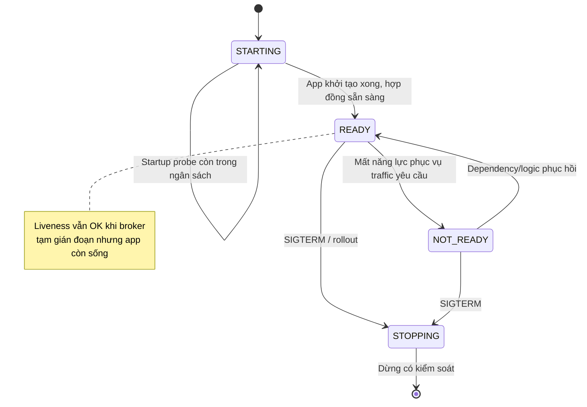
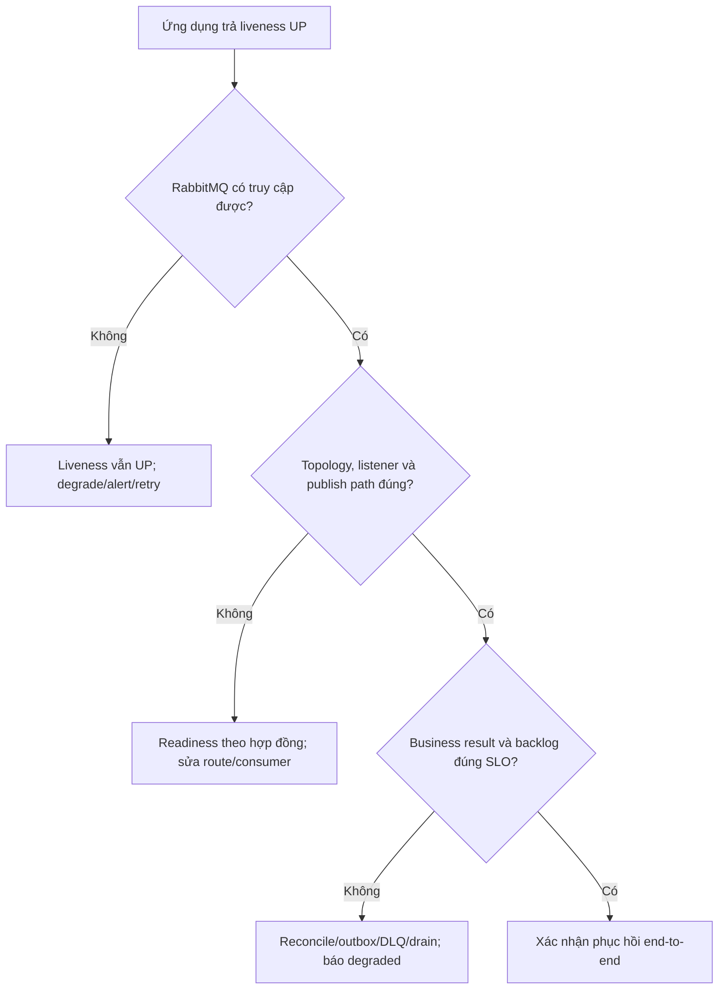
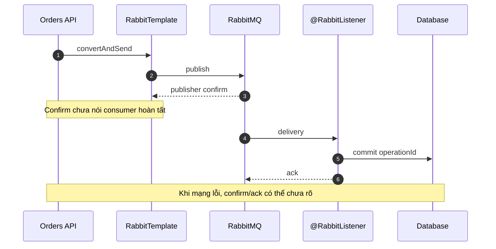
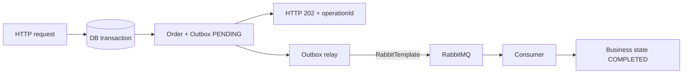
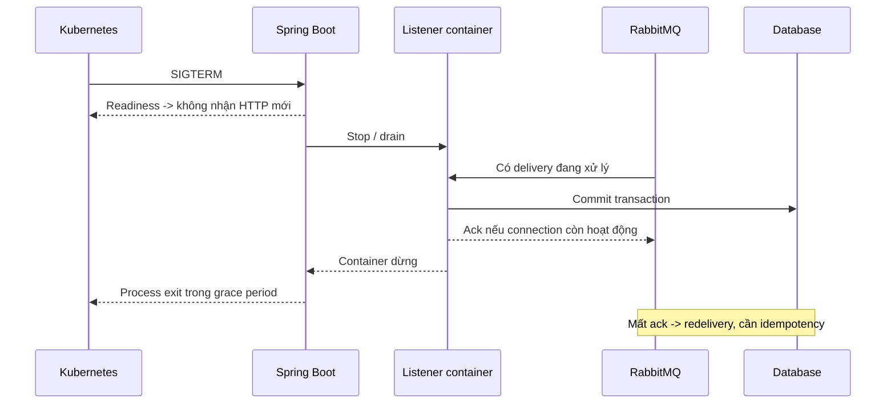

# Readiness, liveness và quyết định khi broker chưa sẵn sàng

## 1. Bài toán: RabbitMQ ngừng hoạt động thì có nên khởi động lại ứng dụng?

Trong chương **Triển khai và vận hành** của **SPRING_AMQP**, hệ thống thường có nhiều ứng dụng trao đổi sự kiện qua RabbitMQ. Một service phát thông điệp bằng `RabbitTemplate`, service khác xử lý với `@RabbitListener`; exchange, queue và binding định tuyến dữ liệu, còn publisher confirms, acknowledgement, retry và dead-letter giúp xử lý lỗi đáng tin cậy.

Hãy hình dung một cụm Kubernetes gồm ba replica của Orders API và hai replica của Payment Worker. Khi RabbitMQ không nhận kết nối trong hai phút:

- **Orders API** còn nhận HTTP request, database vẫn hoạt động nhưng không gửi được `OrderCreated` ngay.
- **Payment Worker** vẫn là một tiến trình Java khỏe mạnh nhưng `@RabbitListener` tạm thời không nhận được delivery.
- Spring AMQP có thể thử kết nối lại, nhưng việc tạo lại connection chưa chứng minh topology, consumer và tác dụng phụ nghiệp vụ đã phục hồi.
- Nếu liveness gọi tới RabbitMQ rồi trả lỗi, Kubernetes có thể restart **toàn bộ pod cùng lúc**, làm sự cố lan rộng hơn.
- Nếu readiness của mọi Orders API đều chuyển `DOWN` khi RabbitMQ lỗi, Kubernetes có thể ngừng định tuyến HTTP tới **tất cả** replica, kể cả endpoint vẫn có thể đáp ứng nhờ transactional outbox.

Vì vậy, không có một quy tắc chung kiểu **“RabbitMQ down thì health down”**. Cần phân biệt **liveness**, **readiness**, **startup**, **broker health** và **khả năng hoàn thành hợp đồng nghiệp vụ** của từng ứng dụng.

### Mục tiêu học tập

Sau bài này, bạn sẽ:

1. Giải thích Kubernetes dùng liveness/readiness/startup probes để làm gì và tại sao các probe không thể thay thế nhau.
2. Hiểu Spring Boot Actuator `ApplicationAvailability` và các endpoint `/actuator/health/liveness`, `/actuator/health/readiness`.
3. Quyết định **có đưa RabbitMQ vào readiness hay không** theo vai trò producer, consumer, API đồng bộ, request–reply và outbox.
4. Viết cấu hình Spring Boot/Kubernetes, xem tín hiệu của listener, publisher confirms và topology mà không tạo vòng lặp restart.
5. Thiết kế hành vi degrade, retry, circuit breaker, graceful shutdown, backlog recovery, metrics và runbook xử lý sự cố.
6. Thử nghiệm broker unavailable lúc startup và lúc runtime, rồi kiểm chứng hệ thống hồi phục ở **mức nghiệp vụ**, không chỉ mức kết nối.

## 2. Liveness, readiness, startup: ba câu hỏi khác nhau

| Probe | Câu hỏi trả lời | Nếu Kubernetes thấy thất bại liên tiếp | Có nên phụ thuộc RabbitMQ? |
|---|---|---|---|
| **Liveness** | Tiến trình này có bị hỏng đến mức **restart chính nó** có thể giúp được không? | Kubelet restart container theo policy | **Không**, broker là dependency bên ngoài |
| **Readiness** | Pod này có thể **nhận loại traffic được Kubernetes chuyển tới** và đáp ứng hợp đồng không? | Pod bị loại khỏi endpoint phục vụ traffic của Service; không tự restart chỉ vì unready | **Tùy hợp đồng của service**, không mặc định |
| **Startup** | Ứng dụng có hoàn tất giai đoạn khởi động trong thời gian cho phép? | Nếu vượt ngưỡng, kubelet restart container | Thường kiểm khả năng startup của ứng dụng, không buộc broker khỏe |

**Điểm quan trọng:** Readiness failure **không làm pod chết**. Liveness failure mới là tín hiệu để kubelet restart container. Startup probe, nếu khai báo, tạm hoãn liveness/readiness probe cho tới khi startup thành công hoặc quá giới hạn.

### 2.1. Vòng đời hợp lý



Khi broker mất kết nối, consumer có thể đang ở trạng thái **recovering**. Đây không mặc nhiên là dấu hiệu process cần restart. Hãy để Spring AMQP thực hiện kết nối lại, đồng thời dùng monitor/alert và chính sách xử lý công việc đang dở.

### 2.2. Kubernetes readiness không điều khiển RabbitMQ consumer

Readiness của pod được Kubernetes dùng để quyết định có đưa pod vào các **Service endpoints** phục vụ lưu lượng mạng hay không. Nó **không gửi lệnh** tới RabbitMQ để dừng consumer, không tự gọi `RabbitListenerEndpointRegistry.stop()` và không cắt kết nối AMQP.

Một pod chỉ có `@RabbitListener`, không cung cấp HTTP business API, có thể vẫn nhận RabbitMQ delivery dù Kubernetes readiness là `false` — miễn listener còn hoạt động và broker đang gửi message. Nếu cần chủ động tạm dừng consumer vì bảo trì hoặc điều kiện nghiệp vụ, phải quản lý **listener container lifecycle** riêng.

## 3. Bốn mức “khỏe” của một ứng dụng Spring AMQP

Không đánh đồng các tín hiệu:

| Mức | Có thể quan sát gì? | Điều **chưa** được chứng minh |
|---|---|---|
| **JVM/web sống** | `/actuator/health/liveness` trả `UP`; HTTP server đáp ứng | Có kết nối RabbitMQ hay không |
| **Broker cơ bản truy cập được** | Rabbit health indicator có thể mở/tương tác connection | Exchange, queue, binding, quyền publish/consume đã đúng |
| **Đường truyền đang hoạt động** | Publisher confirm + return, consumer count, listener events | Message đã commit database hoặc xử lý đúng một lần |
| **Nghiệp vụ phục hồi** | Event ID hoàn thành, outbox drain, DB đúng, backlog/DLQ có kiểm soát | Không nhất thiết mọi endpoint nghiệp vụ đều có cùng SLO |



**Publisher confirm** xác nhận broker đã tiếp nhận publish ở mức giao thức, không phải consumer xử lý thành công. Với `mandatory=true`, một message unroutable có thể vẫn được broker confirm; cần xem **publisher returns**. Consumer `@RabbitListener` có thể chạy nhưng exception/retry liên tục; chỉ kiểm connection không đủ.

## 4. Ra quyết định readiness theo vai trò service

Hãy trả lời câu hỏi: **nếu broker unavailable, ứng dụng còn hoàn thành được những yêu cầu mà Kubernetes sắp chuyển tới nó không?**

| Kiểu ứng dụng | Hành vi khi broker down | Readiness nên phụ thuộc RabbitMQ? | Điều cần theo dõi |
|---|---|---|---|
| **HTTP API bắt buộc gửi message ngay để hoàn thành request** | Không được báo thành công giả; trả lỗi tạm thời/giảm tải hoặc queue bền ở tầng phù hợp | **Cân nhắc có**, nhưng tránh làm tất cả replica cùng biến mất khỏi Service khi chung một broker | Publisher confirm/return, lỗi publish, tỷ lệ API 503 |
| **HTTP API có transactional outbox** | Vẫn có thể commit yêu cầu + outbox và trả `202 Accepted` nếu hợp đồng cho phép xử lý muộn | Thường **không**: readiness phụ thuộc DB/outbox capacity hơn broker | Outbox age/count, relay failures, business lag |
| **Service chỉ consume từ RabbitMQ** | Listener recovery, không có HTTP traffic để nhận | Readiness HTTP thường **không kiểm soát được việc consume**; theo dõi consumer health riêng | Active consumer, delivery/ack rate, backlog, DLQ |
| **API request–reply qua RabbitMQ** | RPC timeout hoặc không có reply; không thể coi như xử lý xong | Cân nhắc broker trong readiness **hoặc** xử lý lỗi theo request/circuit breaker | RPC timeout, correlation, reply queue, SLO |
| **Hybrid API gồm endpoint không phụ thuộc RabbitMQ** | Một phần API vẫn dùng được | Tránh đánh sập toàn bộ ingress chỉ do một chức năng | Readiness tổng, health theo capability, tỷ lệ lỗi từng route |
| **Batch/relay gửi từ outbox** | Tạm hoãn publish, retry có kiểm soát sau khi broker hồi | Kubernetes readiness thường không phải tín hiệu chính; monitor tiến độ relay | Pending events, oldest age, confirm latency |

### 4.1. Nếu mọi replica chung một broker, có nên để readiness của tất cả xuống?

Đưa `rabbit` vào readiness của ba replica Orders API có thể làm **cả ba** trở thành `NotReady` khi broker có sự cố chung. Với Service ClusterIP/NodePort, có thể không còn endpoint khả dụng và caller không nhận được một phản hồi HTTP nghiệp vụ có cấu trúc như `503 Retry-After`; kết nối tới Service có thể thất bại trước khi vào ứng dụng.

Vì vậy có hai chính sách hợp lệ tùy yêu cầu:

- **Fail at ingress:** Chỉ sẵn sàng khi dependency bắt buộc sẵn sàng. Hữu ích nếu nhận traffic luôn thất bại và có tuyến failover khác, nhưng phải chấp nhận việc toàn bộ endpoints có thể biến mất.
- **Fail at request boundary:** Tiếp tục nhận traffic, trả `503`/`429` có kiểm soát cho các endpoint phụ thuộc RabbitMQ, trong khi endpoint độc lập vẫn dùng được. Phù hợp khi muốn giữ khả năng thông báo lỗi chính xác hoặc có fallback.

Không chọn chính sách chỉ theo khẩu hiệu “readiness phải kiểm mọi dependency”; quyết định thuộc **hợp đồng API, SLO và khả năng fallback**.

## 5. Spring Boot Actuator: cấu hình probe đúng

Spring Boot quản lý trạng thái `LivenessState` và `ReadinessState` thông qua `ApplicationAvailability`. Khi dùng Spring Boot Actuator ở môi trường Kubernetes, các nhóm health liveness/readiness được bật; ngoài Kubernetes có thể bật tường minh để kiểm tra local/staging.

### 5.1. Dependency và cấu hình cơ bản

```xml
<dependency>
    <groupId>org.springframework.boot</groupId>
    <artifactId>spring-boot-starter-actuator</artifactId>
</dependency>
<dependency>
    <groupId>org.springframework.boot</groupId>
    <artifactId>spring-boot-starter-amqp</artifactId>
</dependency>
```

Ví dụ `application.yml` cho Spring Boot có Actuator, cùng producer/consumer Spring AMQP:

```yaml
server:
  port: 8080
  shutdown: graceful

spring:
  lifecycle:
    timeout-per-shutdown-phase: 30s
  rabbitmq:
    host: rabbitmq
    port: 5672
    connection-timeout: 5s
    requested-heartbeat: 15s

management:
  endpoints:
    web:
      exposure:
        include: "health,info"
  endpoint:
    health:
      probes:
        enabled: true
        add-additional-paths: true
      group:
        readiness:
          include: "readinessState"
```

Với cấu hình này:

- `GET /actuator/health/liveness`: kiểm liveness của ứng dụng.
- `GET /actuator/health/readiness`: kiểm readiness state của ứng dụng.
- `GET /livez` và `GET /readyz`: các đường probe phụ trên **main server port** khi `add-additional-paths=true`.
- Việc ghi `include: "readinessState"` làm rõ chính sách cơ bản: **không tự thêm broker hoặc DB** vào readiness. Mặc định Spring Boot cũng không tự thêm những indicator bên ngoài vào nhóm readiness.

**Không đưa `rabbit` vào liveness**. Nếu broker tạm mất, tất cả pod có thể bị restart dù JVM vẫn khỏe và listener đủ khả năng tự recover.

### 5.2. Cấu hình readiness phụ thuộc RabbitMQ: chỉ khi có lý do

Nếu một API thực sự không thể phục vụ bất kỳ request nào khi RabbitMQ unavailable **và nhóm đã quyết định muốn loại pod khỏi traffic**, có thể dùng:

```yaml
management:
  endpoint:
    health:
      group:
        readiness:
          include: "readinessState,rabbit"
```

Đây là **phương án thay thế**, không chồng thêm lên ví dụ mặc định một cách vô thức. Chỉ dùng khi Spring Boot tạo health contributor tên `rabbit` (ví dụ RabbitMQ health indicator được auto-configure cùng AMQP dependency). Kiểm tra trong `/actuator/health` hoặc tài liệu phiên bản ứng dụng trước khi triển khai.

RabbitMQ health indicator chỉ là một **probe kết nối/khả năng tương tác với broker**. Nó không khẳng định queue/binding đúng, consumer active, publisher confirm end-to-end, hay consumer đã ghi dữ liệu nghiệp vụ.

Nếu service dùng outbox bền, cân nhắc giữ `readinessState` (và chỉ bổ sung thành phần như DB khi hợp đồng đòi hỏi) thay vì `rabbit`. Broker down phải thể hiện trên **health/metrics riêng** và cảnh báo outbox, không nhất thiết làm HTTP readiness fail.

### 5.3. Đừng dùng một management port độc lập để che lỗi main web port

Nếu `management.server.port` khác `server.port`, health endpoint trên management context có thể trả `UP` dù web connector chính không phục vụ được request. `management.endpoint.health.probes.add-additional-paths=true` đưa `/livez` và `/readyz` lên **main server port**, giúp probe đi qua hạ tầng HTTP thực tế cần giám sát.

Không công khai toàn bộ actuator `/env`, `/beans`, `/configprops` cho Internet. Đường health/probes nên nằm trong mạng quản trị hoặc được kiểm soát truy cập phù hợp; tránh trả chi tiết thông tin broker, credentials hay topology cho caller không tin cậy.

## 6. Ví dụ Deployment trên Kubernetes

Một cấu hình minh họa cho HTTP service lắng nghe cổng 8080:

```yaml
apiVersion: apps/v1
kind: Deployment
metadata:
  name: orders-api
spec:
  replicas: 3
  selector:
    matchLabels:
      app: orders-api
  template:
    metadata:
      labels:
        app: orders-api
    spec:
      terminationGracePeriodSeconds: 60
      containers:
        - name: orders-api
          image: example.invalid/orders-api:1.0.0
          ports:
            - name: http
              containerPort: 8080
          startupProbe:
            httpGet:
              path: /livez
              port: http
            periodSeconds: 5
            failureThreshold: 24
            timeoutSeconds: 2
          livenessProbe:
            httpGet:
              path: /livez
              port: http
            periodSeconds: 10
            failureThreshold: 3
            timeoutSeconds: 2
          readinessProbe:
            httpGet:
              path: /readyz
              port: http
            periodSeconds: 5
            failureThreshold: 2
            successThreshold: 2
            timeoutSeconds: 2
```

**Giải thích:**

1. Startup probe cho tối đa khoảng `5 × 24 = 120 giây` (chưa tính các chi tiết thực thi/timeouts) để ứng dụng bắt đầu đáp ứng; trước khi startup probe thành công, kubelet chưa dùng liveness/readiness probe theo cách thông thường.
2. Liveness dùng `/livez` **không kiểm RabbitMQ**, tránh restart vòng lặp khi broker lỗi.
3. Readiness dùng `/readyz`, có thể từ chối traffic nếu ứng dụng chưa sẵn sàng, đang shutdown hoặc điều kiện nghiệp vụ cần thiết chưa đáp ứng.
4. `terminationGracePeriodSeconds` phải đủ cho graceful shutdown, container stop và commit/ack các message còn đang xử lý. Giá trị 60 giây là ví dụ, cần đo thực tế.
5. `image: example.invalid/...` là **placeholder**, không phải image tồn tại hay được triển khai trong bài.

**Lưu ý:** Nếu runtime của worker **không mở web server**, các HTTP probe trên không dùng trực tiếp được. Có thể mở management HTTP server phục vụ health riêng hoặc dùng probe phù hợp khác; dù chọn cách nào, readiness Kubernetes vẫn không thay thế quản lý AMQP consumer.

## 7. Kiểm tra trạng thái listener khi broker mất và phục hồi

Spring AMQP `RabbitListenerEndpointRegistry` cho phép tra cứu container dựa trên `id` đã khai báo:

```java
import org.springframework.amqp.rabbit.annotation.RabbitListener;
import org.springframework.stereotype.Component;

@Component
public class PaymentEventListener {
    @RabbitListener(id = "paymentEventsListener",
            queues = "payments.events")
    public void handle(String event) {
        // Parse, transaction, idempotency và xử lý nghiệp vụ.
    }
}
```

Một health indicator **riêng cho lifecycle** có thể dùng để chẩn đoán:

```java
import org.springframework.amqp.rabbit.listener.MessageListenerContainer;
import org.springframework.amqp.rabbit.listener.RabbitListenerEndpointRegistry;
import org.springframework.boot.actuate.health.Health;
import org.springframework.boot.actuate.health.HealthIndicator;
import org.springframework.stereotype.Component;

@Component("paymentListenerLifecycle")
public class PaymentListenerLifecycleHealth implements HealthIndicator {
    private final RabbitListenerEndpointRegistry registry;

    public PaymentListenerLifecycleHealth(
            RabbitListenerEndpointRegistry registry) {
        this.registry = registry;
    }

    @Override
    public Health health() {
        MessageListenerContainer container =
                registry.getListenerContainer("paymentEventsListener");

        if (container == null) {
            return Health.down()
                    .withDetail("reason", "LISTENER_NOT_REGISTERED")
                    .build();
        }
        if (!container.isRunning()) {
            return Health.down()
                    .withDetail("reason", "LISTENER_NOT_RUNNING")
                    .build();
        }
        return Health.up()
                .withDetail("lifecycle", "RUNNING")
                .build();
    }
}
```

Đây **không phải bằng chứng listener có consumer active**. `isRunning()` phản ánh trạng thái lifecycle ở phía Spring; ngay cả khi container running, việc tạo consumer/channel hoặc khai báo queue có thể đang bị lỗi. Để kiểm đầy đủ cần kết hợp:

- **Broker:** consumer count/active consumer trên **queue cụ thể**, connection/channel events.
- **Spring AMQP:** `ListenerContainerConsumerFailedEvent`, failure reason, recovery attempts.
- **Data plane:** một canary gửi tới tuyến nghiệp vụ đã kiểm soát hoặc quan sát sự kiện mới được xử lý.
- **Business plane:** `eventId` được commit ở DB, backlog giảm, DLQ/retry không tăng bất thường.

Nếu cần đưa indicator vào readiness của **một kiểu service đặc biệt**:

```yaml
management:
  endpoint:
    health:
      group:
        readiness:
          include: "readinessState,paymentListenerLifecycle"
```

Đây vẫn chỉ là **tín hiệu lifecycle hạn chế** và **không phải cấu hình khuyến nghị cho consumer-only mặc định**. Trước khi chọn, phải trả lời readiness dùng để điều khiển **traffic nào**: Kubernetes không dừng RabbitMQ deliveries chỉ vì pod unready.

### 7.1. Theo dõi consumer failure events

Spring AMQP phát các sự kiện như `ListenerContainerConsumerFailedEvent` khi consumer gặp lỗi. Có thể đếm failure và báo metric:

```java
import java.util.concurrent.atomic.AtomicLong;
import org.springframework.amqp.rabbit.listener.ListenerContainerConsumerFailedEvent;
import org.springframework.context.event.EventListener;
import org.springframework.stereotype.Component;

@Component
public class ConsumerFailureCounter {
    private final AtomicLong failures = new AtomicLong();

    @EventListener
    public void failed(ListenerContainerConsumerFailedEvent event) {
        failures.incrementAndGet();
        // Chuyển sang Micrometer counter có queue/consumer alias an toàn
        // trong sản phẩm thực tế.
    }

    public long totalFailures() {
        return failures.get();
    }
}
```

Đừng gắn raw exception, payload, email hay token vào metric tags. Với event `fatal=false` container có thể thử recovery; với `fatal=true` cần xem nguyên nhân, không tự giả định rằng restart pod sửa được misconfigured credentials hay missing queue.

## 8. Producer khi broker unavailable: không báo “gửi thành công” sai

`RabbitTemplate.convertAndSend(...)` không ném exception **không chứng minh** message đã vào queue và được xử lý. Khi đường đi quan trọng cần độ tin cậy cao, phân biệt:

1. Lệnh publish được gọi từ client.
2. Broker xác nhận publish qua publisher confirm.
3. Message có route vào queue hay bị returned khi bật `mandatory`.
4. Consumer nhận, commit nghiệp vụ và ack.



### 8.1. API phải publish trực tiếp

Giả sử hợp đồng HTTP là **không nhận yêu cầu nếu không thể enqueue chắc chắn**:

- Khi không thể kết nối hoặc publisher confirm timeout, **không** trả response “operation completed” giả.
- Có thể trả `503 Service Unavailable` và `Retry-After` phù hợp nếu thực sự không phục vụ được, hoặc trả một trạng thái “unknown/pending” khi việc publish có thể đã xảy ra.
- Với retry, sử dụng `operationId` ổn định và idempotency để tránh duplicate; timeout **không chứng minh** broker chưa nhận publish.
- Có thể dùng circuit breaker để fail fast thay vì để request thread chờ kéo dài.
- Nếu toàn bộ API không hoạt động khi RabbitMQ down, đánh giá kỹ ưu/nhược của readiness phụ thuộc `rabbit` (đặc biệt khi có nhiều replica).

### 8.2. API có transactional outbox

Một cách triển khai khác: chấp nhận yêu cầu và lưu **outbox cùng database transaction** với thay đổi nghiệp vụ. API có thể trả `202 Accepted` **sau khi DB commit thành công**, còn worker/relay publish message sau.



Khi RabbitMQ down:

- API vẫn có thể **ready** nếu DB và năng lực ghi outbox còn đủ để đảm bảo hợp đồng.
- Relay tiếp tục retry có backoff/budget, không gửi dồn vô hạn vào bộ nhớ.
- `outbox_pending_count` và `oldest_pending_age` tăng; đây là dấu hiệu degraded và cần cảnh báo theo SLO.
- Sau broker hồi, relay gửi tiếp; consumer xử lý idempotent và ứng dụng đối soát `operationId`.
- Nếu DB đầy, outbox không ghi được hoặc backlog vượt quota/hạn xử lý, **API có thể phải từ chối yêu cầu mới**: readiness/route-specific policy phải phản ánh năng lực thực tế.

**Đừng coi outbox là lời hứa xử lý tức thì.** Caller cần biết response `202` nghĩa là **đã nhận bền để xử lý sau**, không phải tác vụ downstream đã hoàn tất.

## 9. Broker down ở thời điểm startup: fail fast hay tiếp tục khởi động?

Hai chiến lược đều có chỗ dùng:

| Chiến lược | Dùng khi | Rủi ro/cần kiểm soát |
|---|---|---|
| **Fail fast** khi topology/credential sai | Thiếu queue là lỗi cấu hình không nên chạy | Nếu broker chỉ tạm down, có thể tạo crash loop |
| **Start và recovery khi broker tạm unavailable** | Ứng dụng có outbox, API degrade hoặc listener đủ khả năng recover | Có thể process đã lên nhưng chức năng AMQP chưa sẵn sàng; cần monitor rõ |

Một số thuộc tính của listener container ảnh hưởng hành vi:

- `missingQueuesFatal`: nếu không tìm thấy queue yêu cầu khi broker **có thể truy cập**, việc thiếu queue có thể được coi là lỗi fatal tùy container/cấu hình.
- `recoveryInterval` hoặc `recoveryBackOff`: khoảng thử khởi động lại consumer sau lỗi không fatal, tùy loại container.
- `RabbitAdmin`: có thể khai báo topology do Spring quản lý; nhưng thiếu quyền hoặc **queue arguments không khớp** có thể làm redeclare thất bại.
- `requested-heartbeat` và connection timeout: ảnh hưởng thời điểm phát hiện sự cố, **không bảo đảm business recovery**.

Không bật `missingQueuesFatal=false` chỉ để che dấu migration topology sai. Nếu dùng cơ chế recovery vô hạn, bắt buộc có alerts cho listener không active, consumer count bằng 0, backlog tăng và health nghiệp vụ giảm.

**Trường hợp broker hoàn toàn unavailable lúc khởi động:** xử lý exception do không kết nối được có thể khác so với broker kết nối được nhưng không có queue; không gộp cả hai thành một lỗi “RabbitMQ down” trong runbook.

## 10. Điều gì xảy ra khi mọi instance mất RabbitMQ cùng lúc?

Một outage dùng chung thường diễn ra theo thời gian:

```text
t0: Broker mất kết nối
    - Liveness ứng dụng: UP nếu JVM vẫn khỏe
    - Rabbit health: DOWN/không truy cập được
    - Consumer: không nhận được message
    - API direct publish: cần fail/degrade
    - API outbox: có thể tiếp tục nhận, backlog bắt đầu tăng

t1: Broker/network trở lại
    - Connection/channel có thể phục hồi
    - Queue/binding/consumer registration cần kiểm lại
    - Publisher confirm/return và delivery mới cần kiểm thật
    - Outbox relay tiếp tục gửi

t2: Business recovery
    - Backlog giảm, delivery được ack
    - Không side effect trùng do redelivery
    - DLQ được phân loại, eventId chưa rõ được đối soát
    - SLO latency và error rate quay lại ngưỡng bình thường
```

Sau `t1` chưa nên tuyên bố “sự cố kết thúc” nếu listener vẫn chưa xử lý event hoặc outbox pending liên tục tăng. Một probe kết nối xanh không thay thế việc kiểm **business completion**.

### 10.1. Backlog và thời gian phục hồi

Ví dụ một worker nhận mới 400 message/giây, nhưng chỉ xử lý 300 message/giây sau khi broker trở lại. Backlog sẽ **tăng khoảng 100 message/giây**, không thể tự drain. Nếu worker xử lý được 650 message/giây, backlog giảm lý tưởng khoảng `650 − 400 = 250 message/giây`, chưa tính retry/requeue và giới hạn DB.

Để tính Recovery Time Objective (RTO), phải đo **tốc độ xử lý thực và tuổi message**, không chỉ nhìn số lượng ready ở queue. Tăng concurrency vô tội vạ có thể làm DB quá tải, gây retry nhiều hơn và giảm thông lượng hữu ích.

## 11. Graceful shutdown và rolling deployment

Khi Kubernetes gửi `SIGTERM` để thay pod:

1. Ứng dụng chuyển sang **không nhận công việc mới** theo hợp đồng; Spring Boot readiness state có thể phản ánh giai đoạn shutdown.
2. HTTP server ngừng nhận thêm request mới, hoàn tất request đang chạy theo timeout cấu hình.
3. Listener container dừng nhận thêm delivery và xử lý/dọn các message đang giữ theo chính sách stop/prefetch của Spring AMQP.
4. Database transaction đã commit mới được ack; nếu mất connection giữa commit và ack, broker có thể redeliver và handler phải idempotent.
5. Producer theo dõi publish chưa xác nhận, outbox relay ghi lại `PENDING/UNKNOWN` cho lần chạy sau.
6. Tài nguyên connection/channel và executor được đóng trong deadline, tránh kill đột ngột khi vẫn còn xử lý.



Spring AMQP mặc định khi stop listener container thường cố xử lý các message đã prefetch trước khi dừng. Tùy phiên bản có tùy chọn `forceStop` dừng sau message hiện tại và requeue các delivery prefetched. Hãy đo thời gian drain, lựa chọn prefetch/concurrency thích hợp và kiểm tra trong staging; không giả định một lần shutdown luôn hoàn tất mọi việc.

`server.shutdown=graceful` và `spring.lifecycle.timeout-per-shutdown-phase` điều phối nhiều phần của quá trình Spring shutdown, nhưng **không thể tạo giao dịch nguyên tử giữa RabbitMQ ack và DB commit**. `terminationGracePeriodSeconds` phải lớn hơn ngân sách dừng thực tế (bao gồm request, listener và những bước teardown cần thiết), có dự phòng.

**Không dùng liveness failure như công tắc tắt traffic:** liveness gây restart, không phải graceful drain. Để rollout, dùng cơ chế shutdown/readiness phù hợp và theo dõi message chưa ack.

## 12. Giám sát: tách probe phục vụ Kubernetes khỏi cảnh báo vận hành

### 12.1. Những metric quan trọng

| Thành phần | Metric/điểm quan sát | Khi nào đáng cảnh báo? |
|---|---|---|
| Spring Boot | Liveness, readiness, startup duration | Pod crash loop hoặc readiness không phục hồi |
| RabbitMQ | Broker/node available, connection/channel count | Mất broker chung, auth/TLS failures |
| Listener | Active consumer count, consumer failures, recovery attempts | Consumer count = 0 bất thường hoặc fail liên tục |
| Queue | `messages_ready`, `messages_unacknowledged`, tuổi message | Backlog tăng/giữ lâu dù broker healthy |
| Producer | Confirm ack/nack/timeout, publisher returns | Publish không được xác nhận hoặc unroutable |
| Retry/DLQ | Retry attempts, DLQ depth/age, requeue loop | Poison message tăng, replay không giải quyết lỗi |
| Transaction | DB failures, duplicate event ID, rollback | Data plane hoạt động nhưng business không commit |
| Outbox | Pending count, oldest pending age, relay attempts | API tiếp tục nhận nhưng chậm xử lý vượt SLO |
| Business | Operation completion lag, error rate, throughput hữu ích | Recovery ở hạ tầng xong nhưng nghiệp vụ còn degraded |

Nên có dashboard theo **service, môi trường, queue alias và release version**. Không gắn email, token, customer ID hay raw payload vào metric labels, trace attributes hoặc log. Correlation ID nên là UUID vô hại có thể đối chiếu với trạng thái nghiệp vụ được lưu.

### 12.2. Readiness flapping và thundering herd

Nếu readiness phụ thuộc một TCP check quá nhạy, mạng chập chờn có thể khiến pod liên tục `Ready ↔ NotReady`. Điều chỉnh `periodSeconds`, `failureThreshold` và `successThreshold` theo SLO. Nếu custom readiness lưu trạng thái kết nối, dùng hysteresis/budget phù hợp và không query RabbitMQ tốn kém mỗi vài giây.

Khi broker hồi, hàng trăm replica có thể cùng reconnect/redeclare/retry publish. Dùng **backoff + jitter**, giới hạn in-flight và concurrency để tránh thundering herd; theo dõi broker disk/memory alarm và throughput thực.

## 13. Kịch bản thử lỗi bắt buộc trước khi triển khai

Thực hiện trong **local/staging cô lập**, không chủ động ngắt broker production. Kịch bản nên kiểm trạng thái probe **và** hệ quả nghiệp vụ:

| Thử nghiệm | Liveness mong đợi | Readiness mong đợi | Bằng chứng nghiệp vụ cần có |
|---|---|---|---|
| Broker chưa mở khi app start | Có thể chưa trả probe lúc app chưa start; sau khi JVM ổn định thì UP | Phụ thuộc policy producer/consumer và hợp đồng | App không crash loop ngoài dự kiến; có log/alert reconnect |
| Broker mất khi app đang chạy | **UP** nếu app vẫn tiến triển | Outbox API có thể vẫn ready; direct-publish API tùy policy | Không báo success giả, pending/outbox tăng có kiểm soát |
| Broker hồi nhưng listener không subscribe được | UP | Không kết luận chỉ từ broker health | Consumer count, missing queue/permission và backlog được phát hiện |
| Publisher gửi nhầm routing key | UP | Broker health có thể UP | Publisher return/canary bắt lỗi; không báo publish-to-queue success |
| Consumer commit DB rồi mất ack | UP | Tùy khả năng service nhận traffic | Redelivery không gây side effect trùng |
| DB mất, broker vẫn khỏe | UP nếu process còn sống | Outbox/API phụ thuộc DB cần degrade | Không nhận yêu cầu khi không thể lưu bền |
| DLQ tăng sau recovery | UP | Thường không phải lý do restart | Poison events được phân loại và replay có kiểm soát |
| Rolling restart pod | Startup rồi UP | Bỏ traffic trong shutdown/startup | Không mất event, in-flight xử lý idempotent |

### 13.1. Các phép kiểm tra local/staging

Với ứng dụng chạy cổng 8080 và `add-additional-paths=true`:

```bash
curl -i http://localhost:8080/livez
curl -i http://localhost:8080/readyz
curl -i http://localhost:8080/actuator/health
```

Trong staging Kubernetes:

```bash
kubectl -n staging get pods -l app=orders-api
kubectl -n staging describe pod <POD_NAME>
kubectl -n staging logs deploy/orders-api --tail=100
```

`<POD_NAME>` là placeholder. Câu lệnh chỉ để người học chạy với quyền truy cập hợp lệ; bài không giả định đã thực thi hoặc có kết quả đo thực tế.

Khi thử broker down/up trên môi trường test, quan sát **HTTP probe, pod restart count, RabbitMQ consumer count, publisher confirms/returns, outbox pending age và DB result** cùng một timeline. Không chỉ chụp một lần `/readyz` trả `200` rồi kết luận test pass.

### 13.2. Fault injection chính xác hơn ping broker

- **Mất publisher confirm:** broker có thể đã lưu message trước khi connection chết; producer retry dùng cùng `eventId`, consumer idempotent.
- **Mất consumer ack:** DB commit xong nhưng ack chưa đến broker; sau redelivery, DB không bị ghi trùng.
- **Mất binding:** connection và health vẫn UP nhưng message không tới queue; phải quan sát returns/routing.
- **Broker recovered nhưng backlog quá lớn:** kiểm thời gian drain và giới hạn throughput thực tế, không chỉ consumer isRunning.
- **Thiếu quyền/queue argument mismatch:** listener/container có thể fail khi topology không tương thích, restart không tự sửa vấn đề.

## 14. Runbook: xử lý khi RabbitMQ chưa sẵn sàng

| Bước | Cần làm | Tránh làm |
|---|---|---|
| **1. Phân loại phạm vi** | Broker/down toàn cụm hay chỉ một pod? Kiểm latency, DNS, TLS, auth, virtual host | Restart tất cả ứng dụng ngay |
| **2. Đọc probe đúng nghĩa** | Liveness có UP? Readiness fail vì state app hay rabbit indicator? | Coi mọi health DOWN là JVM chết |
| **3. Kiểm broker/topology** | Node/quorum, disk/memory alarms, queue/binding, permission, consumer count | Xóa queue production để “sửa nhanh” |
| **4. Kiểm đường producer** | Confirm ack/nack/timeout, publisher returns, outbox unknown | Gửi lại với event ID mới tạo duplicate |
| **5. Kiểm đường consumer** | Listener lifecycle, failed events, ack rate, unacked, retry/DLQ | Coi container isRunning là đã xử lý được |
| **6. Đối soát dữ liệu** | Event IDs đã commit, outbox pending, backlog, duplicate | Tuyên bố recovered chỉ vì connection green |
| **7. Khôi phục có kiểm soát** | Retry/backoff, tăng consumer có đo lường, quản lý replay DLQ | Replay ồ ạt khi chưa biết lỗi gốc |
| **8. Xác nhận SLO** | Không còn xu hướng backlog/DLQ tăng, publish và business latency ổn | Bỏ qua job pending sau khi pod Ready |

### 14.1. Khi nào **nên** restart pod?

Restart là lựa chọn hợp lý khi **lỗi ở chính tiến trình** không thể hồi phục bằng cơ chế thường: deadlock không tiến triển, resource leak, listener container bị dừng hẳn và không thể khởi động lại do trạng thái runtime, hoặc process/connector kẹt sau khi dependency đã khỏe (và có bằng chứng).

**Không restart chỉ vì RabbitMQ down**: nhiều replica cùng restart không làm broker hồi sớm hơn. Đối với lỗi missing queue/permissions, phải sửa topology/secret/role; restart trước khi sửa nguyên nhân có thể tạo crash loop.

### 14.2. Khi nào **nên** chuyển pod sang NotReady?

Khi pod **không thể đáp ứng hợp đồng của traffic được Kubernetes chuyển tới nó**, không có đường degrade chấp nhận được, và việc loại khỏi traffic thực sự cải thiện trải nghiệm/khả năng failover. Với lỗi chung của broker, phải xét tình huống **tất cả pod** cùng unready. Nếu API vẫn có thể lưu outbox bền, giữ ready và phản ánh tình trạng xử lý muộn qua trạng thái operation/metrics có thể tốt hơn.

## 15. Sai lầm thường gặp

**Sai lầm 1 — Đưa RabbitMQ vào liveness.** Kubelet restart mọi pod khi một dependency chung tạm lỗi. Để liveness đo khả năng tự tiến triển của process.

**Sai lầm 2 — Nghĩ Boot mặc định kiểm RabbitMQ trong readiness.** Spring Boot không tự thêm các external health indicator vào nhóm readiness. Muốn thêm phải cấu hình tường minh và hiểu hệ quả.

**Sai lầm 3 — Coi readiness=false là ngừng AMQP consumer.** Kubernetes chỉ điều khiển endpoint/traffic của Service; `@RabbitListener` không bị tự động stop.

**Sai lầm 4 — Dựa trên `RabbitListenerEndpointRegistry.isRunning()` để tuyên bố tuyến nghiệp vụ khỏe.** Còn cần queue binding, active consumer, confirm/returns và business commit.

**Sai lầm 5 — Tắt tất cả HTTP endpoint khi broker unavailable.** Với outbox, read-only API hoặc tính năng độc lập, đây có thể là cách giảm availability không cần thiết.

**Sai lầm 6 — Coi `convertAndSend` không exception là đã xử lý xong.** Publisher confirm và consumer commit là hai tín hiệu khác nhau; timeout có thể để lại trạng thái chưa rõ.

**Sai lầm 7 — Khởi động broker lên là đã recovery xong.** Có thể còn queue/binding sai, backlog, DLQ, outbox pending và duplicate delivery.

**Sai lầm 8 — Stop pod không đợi in-flight hoặc quên idempotency.** Force kill có thể làm ack thất lạc; message sẽ được giao lại và không được gây side effect lặp.

**Sai lầm 9 — Dùng readiness làm hệ thống cảnh báo duy nhất.** Pod Ready chưa nói được tuổi outbox, DLQ hay transaction failure; cần dashboard/alerts riêng.

**Sai lầm 10 — Đặt timeout/probe threshold quá thấp.** Startup chậm hoặc mạng dao động nhẹ gây crash loop/flapping. Dùng startupProbe và budget được đo.

## 16. Checklist trước production rollout

1. Có phân loại rõ API **direct publish**, API **outbox**, worker **consumer-only**, RPC và hybrid service chưa?
2. Liveness chỉ kiểm tiến trình, không phụ thuộc RabbitMQ/DB/HTTP backend bên ngoài?
3. Readiness phản ánh **traffic thật được Kubernetes định tuyến** và có quyết định rõ khi dependency chung unavailable?
4. Startup probe đủ thời gian cho cold start/migration và không kéo dài liveness timeout vô hạn?
5. Spring Boot Actuator health paths đúng main/management port; chỉ expose các endpoint cần thiết?
6. RabbitMQ health indicator được thêm vào readiness **có chủ đích**, không vì mặc định cài starter?
7. Broker topology, queue arguments, quyền publish/consume và binding được provision/migrate có kiểm soát?
8. Publisher confirms/returns, consumer active count, retry/DLQ và event ID được quan sát tách biệt?
9. Outbox có SLA về `oldest_pending_age`, quota và chính sách không nhận thêm việc khi storage không đủ?
10. Service có backoff/jitter, circuit breaker, bounded in-flight và idempotency cho duplicate delivery?
11. SIGTERM/graceful shutdown, prefetch, container stop và `terminationGracePeriodSeconds` đã được thử nghiệm?
12. Có thử broker down lúc startup, down lúc runtime, fail routing, lost confirm/ack và backlog drain trong staging?
13. Alert phân biệt broker outage diện rộng với lỗi một pod, và runbook ưu tiên sửa nguyên nhân thay vì restart hàng loạt?
14. Có tiêu chí **business recovery**: event complete, database đúng, backlog/DLQ ổn định và latency trong SLO?

## 17. Bài tập tự kiểm tra

1. Một service chỉ có `@RabbitListener`, không có HTTP API. Vì sao Kubernetes readiness=false không tự dừng việc consumer nhận message? Nếu cần pause phải làm gì?
2. Cả ba replica HTTP API dùng chung một RabbitMQ. Nếu đưa `rabbit` vào readiness và broker down, điều gì xảy ra với các Service endpoints? Khi nào đây là quyết định có chủ đích?
3. Tại sao Spring Boot mặc định chỉ có `readinessState` trong nhóm readiness mà không thêm mọi dependency?
4. Phân biệt `/livez` với `/readyz`. Khi broker down nhưng JVM còn tiến triển, liveness nên trả trạng thái nào?
5. Một Orders API có transactional outbox và DB vẫn khỏe. API có thể nhận yêu cầu không? Những metric nào cho biết xử lý hậu trường đang chậm?
6. `RabbitListenerEndpointRegistry.getListenerContainer(id).isRunning()` có chứng minh broker có active consumer không? Nêu ít nhất ba tín hiệu cần bổ sung.
7. Publisher có confirm ack nhưng không có consumer nhận message. Hãy kiểm tra exchange, binding, routing key và publisher returns theo trình tự.
8. Một broker vừa hồi, producer gửi 400 msg/s trong khi consumer xử lý 300 msg/s. Backlog có giảm không? Điều đó tác động đến quyết định recovery thế nào?
9. Vì sao restart pod sau khi consumer đã commit DB nhưng chưa ack có thể gây redelivery? Hãy đề xuất idempotency boundary.
10. Thiết kế kịch bản fault injection chứng minh API direct publish trả lỗi chính xác, trong khi API outbox vẫn trả `202` khi broker unavailable.
11. Khi nào nên dùng `startupProbe` thay vì tăng `initialDelaySeconds` của liveness? Nêu cách đo ngân sách startup.
12. Xây runbook 5 bước khi `/readyz` báo DOWN nhưng `/livez` vẫn UP, queue ready tăng và RabbitMQ management hiển thị không có consumer.

## 18. Tài liệu tham khảo chính thức

- [Spring Boot Actuator — Kubernetes Probes và Checking External State](https://docs.spring.io/spring-boot/reference/actuator/endpoints.html): `ApplicationAvailability`, liveness/readiness health groups, `add-additional-paths` và cảnh báo khi đưa external systems vào probe.
- [Kubernetes — Liveness, Readiness, and Startup Probes](https://kubernetes.io/docs/concepts/workloads/pods/probes/): cơ chế kubelet restart, loại endpoint khỏi Service và startup budget.
- [Spring AMQP — Container Management](https://docs.spring.io/spring-amqp/reference/amqp/receiving-messages/async-annotation-driven/container-management.html): `RabbitListenerEndpointRegistry` và điều khiển lifecycle listener.
- [Spring AMQP — Consumer Events](https://docs.spring.io/spring-amqp/reference/amqp/receiving-messages/consumer-events.html): `ListenerContainerConsumerFailedEvent` và dấu hiệu consumer recover/fatal.
- [Spring AMQP — Message Listener Container Configuration](https://docs.spring.io/spring-amqp/reference/amqp/containerAttributes.html): `missingQueuesFatal`, recovery/backoff, stop và prefetch.
- [Spring AMQP — Publisher Confirms and Returns](https://docs.spring.io/spring-amqp/reference/amqp/publisher-confirms-returns.html): phân biệt publish confirmation, routing và kết quả business.
- [RabbitMQ — Reliability Guide](https://www.rabbitmq.com/docs/reliability): giới hạn khi mất connection, recovery và message safety.

**Ghi nhớ:** **Liveness trả lời “có nên restart tiến trình này?”; readiness trả lời “có nên chuyển traffic tới pod này?”**. RabbitMQ chưa sẵn sàng không đồng nghĩa JVM hỏng. Với Spring AMQP, hãy quyết định readiness dựa trên **hợp đồng thực của producer/consumer**, tránh restart toàn cụm vì broker lỗi, dùng outbox hoặc fail-fast theo từng API và xác nhận phục hồi bằng **publisher/consumer telemetry, backlog và kết quả nghiệp vụ**, không chỉ một lần health check chuyển xanh.
