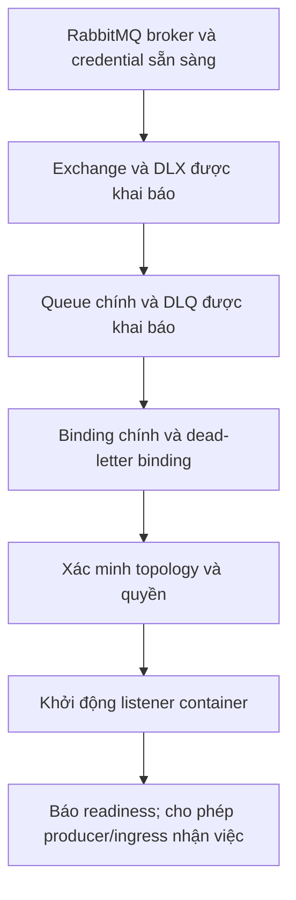
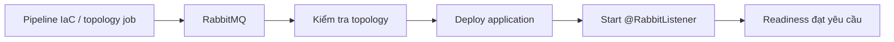
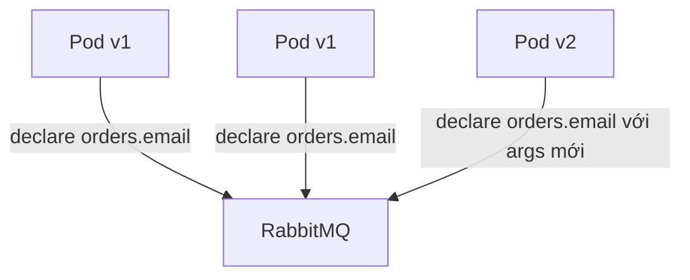

# Khởi động topology và listener đúng thứ tự trong Spring AMQP

Khi triển khai một ứng dụng Spring AMQP mới, câu hỏi không chỉ là **“ứng dụng đã start chưa?”** mà còn là **“exchange, queue và binding đã sẵn sàng trước khi producer gửi và consumer nhận message chưa?”**. Một tiến trình Java có thể khởi động thành công nhưng listener chưa đăng ký consumer, hoặc `RabbitTemplate` đã publish đến exchange tồn tại nhưng message không được định tuyến vì binding thiếu.

Trong chương **Triển khai và vận hành** của **SPRING_AMQP**, bài học này tập trung vào cách tổ chức thứ tự khởi động giữa:

1. Hạ tầng RabbitMQ và virtual host/tài khoản.
2. **Topology:** exchange, queue, binding, dead-letter exchange (DLX) và dead-letter queue (DLQ).
3. **Producer:** `RabbitTemplate` gửi message theo routing key.
4. **Consumer:** listener container mở connection, đăng ký consumer và gọi `@RabbitListener`.
5. **Readiness và vận hành:** chỉ cấp traffic khi các điều kiện cần thiết đã được xác minh.

Hai chiến lược thường dùng là **provision topology trước khi triển khai ứng dụng** hoặc **để Spring AMQP khai báo topology rồi chủ động khởi động listener**. Bài này giải thích thứ tự thực tế của `RabbitAdmin`, cách làm cả hai chiến lược, những lỗi startup phổ biến và các tình huống cần kiểm thử với RabbitMQ thật.

## 1. Topology không chỉ có queue

Ví dụ một service nhận sự kiện tạo đơn để gửi email:

```text
Producer RabbitTemplate
    |
    | exchange: orders.events
    | routing key: order.created
    v
Direct exchange (orders.events)
    |
    | binding: order.created
    v
Queue (orders.email)
    |
    v
@RabbitListener (email-worker)

Khi xử lý lỗi không requeue:
orders.email --DLX--> orders.dead --binding--> orders.email.dlq
```

Các thành phần có vai trò khác nhau:

| Thành phần | Vai trò | Nếu thiếu hoặc sai |
|---|---|---|
| **Virtual host + user** | Xác thực và phạm vi tài nguyên của connection | Kết nối thất bại hoặc `ACCESS_REFUSED` |
| **Exchange** | Nhận publish và quyết định định tuyến | Publish có thể bị lỗi do exchange không tồn tại |
| **Queue** | Chứa message cho consumer | Consumer không thể đăng ký vào queue chưa tồn tại |
| **Binding** | Liên kết exchange, routing key và queue | Publish có thể thành công nhưng không có message tới queue |
| **DLX + DLQ + binding** | Đường đi cho message bị dead-letter | Message lỗi có thể bị mất khỏi luồng xử lý chính mà không xuất hiện ở DLQ mong muốn |
| **Listener container** | Tạo consumer, nhận delivery và điều khiển acknowledgement | Queue vẫn có message nhưng không có ai xử lý |
| **Publisher confirm/returns** | Cho producer biết những kết quả publish nhất định | Không phân biệt được các kiểu publish không thành công hoặc không được route |

Không nên coi việc tạo queue thành công là đã hoàn thành toàn bộ topology: **binding thiếu vẫn có thể khiến queue luôn rỗng**. Ngược lại, tạo exchange và binding đúng nhưng listener dùng sai vhost cũng khiến ứng dụng không nhận message.



Sơ đồ này diễn tả **điều kiện phụ thuộc về mặt vận hành**; Spring không nhất thiết tạo từng bean theo đúng thứ tự từng mũi tên. Cơ chế khai báo thực tế được giải thích ở các mục tiếp theo.

## 2. Spring AMQP khởi động các thành phần như thế nào?

Những lớp quan trọng:

- `CachingConnectionFactory`: cung cấp connection/channel đến RabbitMQ, thường chỉ mở connection vật lý khi được sử dụng.
- `RabbitAdmin`: dùng connection factory để khai báo các bean `Exchange`, `Queue` và `Binding` được quản lý trong Spring context.
- `RabbitListenerEndpointRegistry`: giữ các listener container tạo bởi `@RabbitListener` và cho phép tìm/start/stop theo listener id.
- `SimpleMessageListenerContainer` hoặc `DirectMessageListenerContainer`: kết nối broker, mở consumer và nhận message.
- `RabbitTemplate`: publish hoặc nhận theo API, nhưng **không tự bảo đảm topology đã có** khi được gọi.

### `RabbitAdmin` và thời điểm khai báo

Với cấu hình thông thường, `RabbitAdmin` có thể tự khai báo topology khi connection phù hợp được mở lần đầu; nó cũng hỗ trợ thao tác khai báo chủ động. Đây là cơ chế dựa vào **lifecycle của connection**, không phải phép màu “cứ có `@Bean Queue` thì queue chắc chắn đã tồn tại trên broker ngay khi object Java được tạo”.

Spring tạo bean Java `Queue` trước không đồng nghĩa broker đã nhận lệnh `queue.declare`. Hãy phân biệt:

```text
new Queue("orders.email")       -> mới chỉ có object trong ApplicationContext
rabbitAdmin.initialize()        -> yêu cầu admin thực hiện khai báo đã cấu hình
RabbitMQ chấp nhận khai báo     -> resource mới thực sự tồn tại trên broker
consumer basic.consume          -> listener mới có thể nhận delivery
```

Trong chế độ mặc định, listener container cũng là thành phần lifecycle tự khởi động khi context refresh. Việc kết nối để mở consumer có thể kích hoạt `RabbitAdmin` auto-declare, nhưng **không nên dựa vào tình huống này để che giấu quyền, cấu hình hoặc thứ tự triển khai sai**.

### `@DependsOn` không phải giải pháp bảo đảm toàn bộ

`@DependsOn("rabbitAdmin")` chỉ yêu cầu Spring khởi tạo bean được phụ thuộc trước. Vì việc khai báo AMQP có thể xảy ra **sau đó khi có connection**, annotation này không tự chứng minh exchange/queue/binding đã hiện diện trên broker trước khi một `ApplicationRunner` khác publish.

Tương tự, chỉnh `SmartLifecycle` phase có thể hỗ trợ thứ tự start/stop các thành phần lifecycle, nhưng **không thay thế kiểm tra thực trạng topology** khi broker hoặc mạng chưa sẵn sàng.

## 3. Các lỗi thường gặp khi thứ tự không đúng

| Hiện tượng | Nguyên nhân có thể | Kiểm tra đầu tiên |
|---|---|---|
| Listener không start vì queue thiếu | Queue chưa được provision, sai vhost, RabbitAdmin không chạy | Tên queue và vhost, quyền `configure/read` |
| Publish đến exchange bị lỗi | Exchange chưa được tạo hoặc producer dùng nhầm vhost | Exchange, connection factory, `NOT_FOUND` |
| Publish trả về bình thường nhưng queue không nhận | Binding/routing key sai; message unroutable | Binding, `mandatory`/returns |
| `PRECONDITION_FAILED` khi declare queue | Thuộc tính queue khác với queue đã tồn tại, như durable, arguments, queue type | So sánh khai báo ứng dụng với topology thực |
| `ACCESS_REFUSED` | Account runtime thiếu quyền khai báo hoặc consume/publish | User, vhost, configure/write/read |
| App báo “UP” nhưng không có consumer | Container chưa start, recovery đang thử lại hoặc đã dừng | Container registry, broker consumer count |
| Message lỗi không vào DLQ | DLX/DLQ/binding thiếu hoặc không tương thích chính sách | Topology dead-letter thực |
| Nhiều instance khởi động đồng thời có lỗi ngẫu nhiên | Các bản deploy đang khai báo thuộc tính khác nhau hoặc cùng migrate topology | So khớp version cấu hình/topology |

**Lỗi startup không được “sửa” bằng cách tăng retry vô hạn một cách mù quáng.** Mất broker tạm thời là lỗi có thể tự hồi phục; queue type không khớp, thiếu quyền hoặc sai binding cần sửa cấu hình, permission hay quy trình migration.

## 4. Chiến lược A: provision topology trước khi ứng dụng chạy

Đây thường là lựa chọn rõ ràng cho production có yêu cầu kiểm soát quyền: một quy trình hạ tầng tạo exchange, queue, binding, DLX/DLQ **trước khi** triển khai runtime ứng dụng.



Trình tự khuyến nghị:

1. Tạo broker/vhost và user theo môi trường.
2. Chạy job quản lý topology bằng **credential provisioning** có quyền phù hợp để khai báo exchange, queue, binding và policy.
3. Xác minh loại exchange, kiểu queue, durability, arguments và routing bindings.
4. Triển khai application với **credential runtime** được giới hạn quyền publish/consume.
5. Listener kết nối, subscribe queue đã tồn tại.
6. Readiness chỉ cho phép traffic khi các điều kiện nghiệp vụ cần thiết thực sự đạt.

### Ưu điểm

- Consumer không cần quyền `configure` nếu topology đã được tạo từ trước và runtime không tự declare.
- Có chỗ rõ ràng để phê duyệt các thay đổi không tương thích, ví dụ đổi queue type.
- Có thể chạy topology migration trước khi rolling deployment.
- Ít phụ thuộc vào thời điểm container nào mở connection trước.

### Những điều vẫn cần kiểm tra

- Pipeline có thực sự tạo **binding**, không chỉ queue/exchange?
- Cấu hình runtime dùng đúng broker, vhost, queue và routing key?
- Producer có thể chạy trước khi listener start: queue phải đủ bền và có quy trình giữ/khôi phục message phù hợp.
- Nếu broker restart, resource durable và chính sách lưu message có thực sự đáp ứng độ bền mong muốn?
- Nếu một người xóa queue khi app đang chạy, service có cơ chế phát hiện và sửa an toàn hay không?

**Provisioning bên ngoài không làm mất nhu cầu kiểm thử với RabbitMQ thật.** Một job có thể thành công nhưng khai báo sai binding; runtime vẫn cần metric xác minh đường publish và consumer.

### Spring Boot khi topology được quản lý bên ngoài

Nếu không muốn Spring Boot tự tạo `RabbitAdmin`, có thể tắt cấu hình dynamic AMQP admin theo phiên bản hỗ trợ:

```yaml
spring:
  rabbitmq:
    host: rabbitmq.internal
    port: 5672
    virtual-host: /orders
    username: orders_runtime
    password: ${AMQP_ORDERS_PASSWORD}
    dynamic: false
```

`spring.rabbitmq.dynamic: false` điều khiển hành vi **auto-configure `AmqpAdmin`** của Spring Boot, không phải “đóng băng mọi thay đổi RabbitMQ” và không xóa các bean `RabbitAdmin` do ứng dụng tự khai báo. Nếu ứng dụng tự tạo admin, phải quản lý lifecycle và quyền của admin đó riêng.

Môi trường thật cần TLS và quản lý secret phù hợp. Credential `orders_runtime` nên được cấp đúng `write` cho exchange và/hoặc `read` cho queue cần sử dụng. Nếu producer và consumer là hai service độc lập, nên tách account theo nhiệm vụ.

## 5. Chiến lược B: để ứng dụng khai báo topology rồi mới start listener

Với dự án nhỏ, môi trường kiểm thử hoặc hệ thống mà ứng dụng **được phép quản lý topology**, Spring AMQP có thể khai báo các resource bằng `RabbitAdmin`.

Ta vẫn nên tách rõ ba pha:

1. **Đăng ký bean topology** trong `ApplicationContext`.
2. **Chủ động khai báo/xác minh** chúng bằng `RabbitAdmin` và kiểm tra broker.
3. **Start listener container** sau khi pha 2 thành công; sau đó hoàn tất readiness.

### Vì sao tắt listener auto-start trong ví dụ?

Nếu listener được tự start khi context refresh, nó có thể bắt đầu connect/consume trong lúc quy trình provisioning riêng của ứng dụng chưa chạy. Để trình bày **thứ tự có chủ đích**, ví dụ dùng `factory.setAutoStartup(false)`, sau đó gọi `start()` qua `RabbitListenerEndpointRegistry`.

**Cấu hình này không bắt buộc cho mọi ứng dụng.** Với `RabbitAdmin` mặc định và topology ổn định, cơ chế auto-declare kết hợp listener startup thường đã đủ. Chủ động điều phối có ích khi cần gate readiness, preflight permissions hoặc topology migration phức tạp.

## 6. Ví dụ hoàn chỉnh: topology gồm exchange, queue và DLQ

Các đoạn mã dưới đây dành cho **Spring Boot 3.x, Java 17+, Spring AMQP**. Đặt từng `public class` vào file Java cùng tên trong cùng package; các bean cấu hình sử dụng chung một `ConnectionFactory`.

Dependency Gradle:

```groovy
dependencies {
    implementation 'org.springframework.boot:spring-boot-starter-amqp'
    implementation 'org.springframework.boot:spring-boot-starter-actuator'
}
```

### 6.1. Khai báo toàn bộ topology

```java
import org.springframework.amqp.core.Binding;
import org.springframework.amqp.core.BindingBuilder;
import org.springframework.amqp.core.Declarable;
import org.springframework.amqp.core.Declarables;
import org.springframework.amqp.core.DirectExchange;
import org.springframework.amqp.core.Queue;
import org.springframework.amqp.core.QueueBuilder;
import org.springframework.context.annotation.Bean;
import org.springframework.context.annotation.Configuration;

@Configuration
public class OrdersTopology {
    public static final String EXCHANGE = "orders.events";
    public static final String QUEUE = "orders.email";
    public static final String ROUTING_KEY = "order.created";

    public static final String DEAD_EXCHANGE = "orders.dead";
    public static final String DEAD_QUEUE = "orders.email.dlq";
    public static final String DEAD_KEY = "order.failed";

    @Bean
    public Declarables ordersDeclarables() {
        DirectExchange exchange = new DirectExchange(EXCHANGE);
        DirectExchange deadExchange = new DirectExchange(DEAD_EXCHANGE);

        Queue queue = QueueBuilder.durable(QUEUE)
                .deadLetterExchange(DEAD_EXCHANGE)
                .deadLetterRoutingKey(DEAD_KEY)
                .build();
        Queue deadQueue = QueueBuilder.durable(DEAD_QUEUE).build();

        Binding incoming = BindingBuilder.bind(queue)
                .to(exchange).with(ROUTING_KEY);
        Binding deadLetter = BindingBuilder.bind(deadQueue)
                .to(deadExchange).with(DEAD_KEY);

        // Chỉ admin được chỉ định mới nên khai báo các resource này.
        Declarable[] resources = {
                exchange, deadExchange, queue, deadQueue,
                incoming, deadLetter
        };
        for (Declarable resource : resources) {
            resource.setAdminsThatShouldDeclare("ordersRabbitAdmin");
        }
        return new Declarables(resources);
    }
}
```

Ví dụ sử dụng queue durable và khai báo DLX/DLQ để message bị reject có đích xử lý lỗi. Đây là **topology minh họa**, không phải mặc định duy nhất cho production: với hệ thống cần quorum queue, thay đổi loại queue, policy dead-letter, retention hay delivery limits phải được thiết kế riêng.

**Điểm cốt lõi:** tạo đủ **exchange, queue, binding** và cả topology lỗi trước khi cho listener vận hành. Nếu thiếu `incoming`, producer có thể gửi đến exchange nhưng worker không nhận. Nếu thiếu `deadLetter`, message bị dead-letter có thể không xuất hiện trong DLQ mong muốn.

### 6.2. Một `RabbitAdmin` có quyền sở hữu topology

```java
import org.springframework.amqp.rabbit.connection.ConnectionFactory;
import org.springframework.amqp.rabbit.core.RabbitAdmin;
import org.springframework.context.annotation.Bean;
import org.springframework.context.annotation.Configuration;

@Configuration
public class OrdersAdminConfiguration {

    @Bean("ordersRabbitAdmin")
    public RabbitAdmin ordersRabbitAdmin(ConnectionFactory cf) {
        RabbitAdmin admin = new RabbitAdmin(cf);

        // Chỉ khai báo resource đánh dấu cho ordersRabbitAdmin.
        admin.setExplicitDeclarationsOnly(true);

        // Trong ví dụ này, chủ động initialize ở bước orchestration.
        admin.setAutoStartup(false);
        return admin;
    }
}
```

`setExplicitDeclarationsOnly(true)` ngăn admin mặc định khai báo các resource không chỉ định rõ admin này. `setAdminsThatShouldDeclare("ordersRabbitAdmin")` trên topology ở mục 6.1 khiến mỗi declarable thuộc đúng admin được dùng.

Ở ví dụ này, credential của `ConnectionFactory` phải có **quyền configure** cùng các quyền cần thiết để khai báo binding. Nếu runtime dùng account chỉ có quyền read/write, không thể đòi `RabbitAdmin.initialize()` tạo topology thành công bằng chính account đó. Khi muốn phân quyền mạnh, ưu tiên **chiến lược A** hoặc thiết kế một provisioning connection/identity riêng.

### 6.3. Listener không tự start trước khi topology hoàn tất

```java
import org.springframework.amqp.core.AcknowledgeMode;
import org.springframework.amqp.rabbit.annotation.EnableRabbit;
import org.springframework.amqp.rabbit.config.SimpleRabbitListenerContainerFactory;
import org.springframework.amqp.rabbit.connection.ConnectionFactory;
import org.springframework.boot.autoconfigure.amqp.SimpleRabbitListenerContainerFactoryConfigurer;
import org.springframework.context.annotation.Bean;
import org.springframework.context.annotation.Configuration;

@Configuration
@EnableRabbit
public class OrdersListenerConfiguration {

    @Bean("ordersListenerFactory")
    public SimpleRabbitListenerContainerFactory ordersListenerFactory(
            ConnectionFactory connectionFactory,
            SimpleRabbitListenerContainerFactoryConfigurer configurer) {

        SimpleRabbitListenerContainerFactory factory =
                new SimpleRabbitListenerContainerFactory();
        configurer.configure(factory, connectionFactory);

        factory.setAutoStartup(false);
        factory.setMissingQueuesFatal(true);
        factory.setAcknowledgeMode(AcknowledgeMode.AUTO);
        factory.setPrefetchCount(10);
        factory.setConcurrentConsumers(2);
        factory.setDefaultRequeueRejected(false);
        return factory;
    }
}
```

Trong `AUTO` acknowledgement mode, container xác nhận delivery sau khi listener hoàn tất thành công theo chính sách tương ứng. Nếu xử lý thất bại và `defaultRequeueRejected=false`, message có thể bị reject không requeue rồi dead-letter nếu DLX được thiết lập đúng.

`missingQueuesFatal=true` thể hiện mong muốn **thiếu queue lúc khởi động là lỗi nghiêm trọng**, nhưng cách container xử lý lỗi startup/recovery còn phụ thuộc phiên bản, loại container và các tham số liên quan. Không xem nó là phép kiểm tra toàn bộ binding, DLX hay business readiness.

### 6.4. Listener nghiệp vụ và producer

```java
import org.springframework.amqp.rabbit.annotation.RabbitListener;
import org.springframework.stereotype.Component;

@Component
public class OrdersEmailListener {

    @RabbitListener(
            id = "orders-email-consumer",
            queues = OrdersTopology.QUEUE,
            containerFactory = "ordersListenerFactory")
    public void onOrderCreated(String eventId) {
        if (eventId == null || eventId.isBlank()) {
            throw new IllegalArgumentException("eventId trống");
        }

        // Demo: thay bằng nghiệp vụ gửi email có deduplication theo eventId.
        System.out.println("OrderCreated event: " + eventId);
    }
}
```

```java
import org.springframework.amqp.rabbit.core.RabbitTemplate;
import org.springframework.stereotype.Service;

@Service
public class OrdersPublisher {
    private final RabbitTemplate rabbitTemplate;

    public OrdersPublisher(RabbitTemplate rabbitTemplate) {
        this.rabbitTemplate = rabbitTemplate;
    }

    public void publish(String eventId) {
        rabbitTemplate.convertAndSend(
                OrdersTopology.EXCHANGE,
                OrdersTopology.ROUTING_KEY,
                eventId);
    }
}
```

Lưu ý `RabbitTemplate` **không cần có listener đang chạy** để publish. Nhưng nếu exchange chưa tồn tại, publish có thể lỗi; nếu binding sai, broker có thể không route vào queue. Trong deployment, các luồng HTTP/scheduler phát message không nên bắt đầu gửi chỉ vì constructor của `OrdersPublisher` được tạo thành công.

## 7. Orchestration: declare, xác minh, rồi start listener

Với các bean trên, có thể dùng `ApplicationRunner` để điều phối sau khi Spring context đã tạo xong listener endpoints nhưng trước khi ứng dụng được coi là ready theo lifecycle thông thường của Spring Boot.

```java
import org.springframework.amqp.rabbit.core.RabbitAdmin;
import org.springframework.amqp.rabbit.core.RabbitTemplate;
import org.springframework.amqp.rabbit.listener.MessageListenerContainer;
import org.springframework.amqp.rabbit.listener.RabbitListenerEndpointRegistry;
import org.springframework.beans.factory.annotation.Qualifier;
import org.springframework.boot.ApplicationRunner;
import org.springframework.context.annotation.Bean;
import org.springframework.context.annotation.Configuration;

@Configuration
public class OrdersStartupCoordinator {

    @Bean
    ApplicationRunner prepareTopologyAndStartListener(
            @Qualifier("ordersRabbitAdmin") RabbitAdmin admin,
            RabbitTemplate rabbitTemplate,
            RabbitListenerEndpointRegistry registry) {

        return args -> {
            // Pha 1: yêu cầu admin khai báo những Declarables được gán.
            admin.initialize();

            // Pha 2: kiểm tra resource tối thiểu bằng AMQP passive declare.
            // Không tái khai báo/đổi thuộc tính ở pha kiểm tra.
            rabbitTemplate.execute(channel -> {
                channel.exchangeDeclarePassive(OrdersTopology.EXCHANGE);
                channel.exchangeDeclarePassive(OrdersTopology.DEAD_EXCHANGE);
                channel.queueDeclarePassive(OrdersTopology.QUEUE);
                channel.queueDeclarePassive(OrdersTopology.DEAD_QUEUE);
                return null;
            });

            // Pha 3: mới bắt đầu nhận delivery.
            MessageListenerContainer container =
                    registry.getListenerContainer("orders-email-consumer");
            if (container == null) {
                throw new IllegalStateException(
                        "Thiếu listener orders-email-consumer");
            }
            container.start();
        };
    }
}
```

Với ứng dụng thử nghiệm, có thể đặt:

```yaml
spring:
  rabbitmq:
    host: localhost
    port: 5672
    username: guest
    password: guest
```

Thông tin `guest/guest` chỉ dùng với RabbitMQ local theo cấu hình mặc định; production cần credential riêng, TLS và virtual host phù hợp. `ApplicationRunner` trong ví dụ **không có retry vô hạn**: nếu broker đang tắt, khai báo hoặc kiểm tra thất bại thì quá trình start báo lỗi. Đây là lựa chọn *fail-fast* có chủ đích; môi trường có outage tạm thời cần thêm cơ chế retry có giới hạn, cảnh báo hoặc orchestration bên ngoài.

### Những điều đoạn mã bảo đảm và không bảo đảm

- `RabbitAdmin.initialize()` yêu cầu khai báo các declarable mà admin quản lý.
- `exchangeDeclarePassive(...)` và `queueDeclarePassive(...)` xác minh broker nhìn thấy những exchange/queue tương ứng. Nếu thiếu resource, thao tác passive có thể gây channel exception; bài toán startup cần xử lý như một lỗi.
- **Passive declaration không kiểm chứng toàn bộ binding/routing key hay tham số mọi resource.** Muốn kiểm tra binding, dùng kiểm thử publish/returns/Management API hoặc công cụ kiểm tra topology có quyền phù hợp.
- `container.start()` yêu cầu listener container bắt đầu hoạt động; **không phải lời cam kết tại thời điểm return rằng broker chắc chắn đã đăng ký consumer và listener đã sẵn sàng xử lý**. Cần trạng thái broker/consumer, health/readiness và theo dõi khởi động.
- Một producer độc lập ở service khác có thể bắt đầu publish trước startup coordinator này. Ranh giới giữa các service phải do deployment pipeline và durable topology bảo đảm.

Không thêm `Thread.sleep(...)` để “chờ topology” theo một thời gian đoán trước. Một khoảng ngủ cố định không chứng minh broker đã chấp nhận các tài nguyên cần thiết.

## 8. Phân biệt bean lifecycle, container lifecycle và readiness

Ba điều kiện dưới đây **không đồng nghĩa**:

| Điều kiện | Có nghĩa | Chưa chứng minh |
|---|---|---|
| Spring `ApplicationContext` đã refresh | Bean Java được tạo và lifecycle được kích hoạt | RabbitMQ resource/binding tồn tại |
| `MessageListenerContainer.isRunning()` | Container ở trạng thái chạy theo lifecycle của framework | Broker đã có đúng số consumer hoặc message được xử lý |
| Broker báo `consumer_count` trên queue | Có consumer đăng ký tại thời điểm đo | Mọi downstream nghiệp vụ vẫn hoạt động và đang xử lý thành công |

Ví dụ, listener có thể đăng ký consumer thành công nhưng database của service bị mất kết nối. Khi đó RabbitMQ thấy consumer, còn các message liên tục thất bại, retry hoặc vào DLQ. Readiness phù hợp với nghiệp vụ cần cân nhắc cả các dependency bắt buộc.

### Spring Boot / Kubernetes readiness

Với Spring Boot Actuator, có thể sử dụng health/readiness probes và điều kiện bổ sung cho dependency AMQP:

```yaml
management:
  endpoint:
    health:
      probes:
        enabled: true
  endpoints:
    web:
      exposure:
        include: health,info,prometheus
```

Trong Kubernetes, cấu hình readiness probe gọi endpoint readiness phù hợp (thường là `/actuator/health/readiness` nếu base path Actuator mặc định). **Phải xác minh thực tế endpoint và security policy của ứng dụng**.

Điều kiện readiness có thể bao gồm:

- Đã hoàn tất provisioning/verification cần thiết.
- Listener quan trọng đã được start và broker cho thấy consumer đăng ký đúng vhost/queue.
- Những dependency bắt buộc (ví dụ database) sẵn sàng.
- Không đang ở tình trạng “ngừng nhận message” theo chủ đích.

Đừng đặt liveness dựa trực tiếp vào một broker outage ngắn rồi liên tục restart mọi pod. **Liveness** trả lời “tiến trình còn khả năng hoạt động không?”, còn **readiness** trả lời “có thể nhận công việc lúc này không?”. Broker tạm mất kết nối nên được xử lý bằng recovery/backoff phù hợp, không mặc định coi tiến trình Java hỏng hoàn toàn.

Lưu ý `ApplicationRunner` chạy trong giai đoạn startup trước sự kiện ứng dụng ready của Spring Boot, nhưng web server có thể đã mở socket. Trong hệ thống có ingress, cần bảo đảm **load balancer thật sự tôn trọng readiness probe**; đồng thời bảo vệ scheduler/background producer không gửi quá sớm.

## 9. Listener startup khi broker thiếu hoặc chưa sẵn sàng

Các container có cơ chế xử lý missing queue và khôi phục kết nối; lựa chọn cụ thể cần phù hợp với mục tiêu triển khai:

| Chính sách | Hệ quả | Dùng khi |
|---|---|---|
| **Fail fast** nếu thiếu queue/topology | Startup thất bại rõ ràng, phát hiện deployment sai | Queue phải được provision chính xác trước runtime |
| Retry connect với BackOff có trần | Giảm nhịp thử, tự hồi phục sau outage tạm thời | Broker có thể offline trong một khoảng ngắn |
| Retry lâu dài và alert | Ứng dụng không tự bỏ cuộc khi outage kéo dài | Yêu cầu tự phục hồi, có monitoring đầy đủ |
| Tạm tắt listener và start sau verify | Điều phối rõ topology → consumer | Có startup gate hoặc provisioning workflow |

Một số cấu hình liên quan trong `SimpleMessageListenerContainer` gồm:

- `missingQueuesFatal`: cách coi thiếu queue tại startup là lỗi nghiêm trọng.
- `autoDeclare`: cơ chế hỗ trợ khai báo lại khi có `AmqpAdmin` phù hợp.
- `recoveryInterval` hoặc `recoveryBackOff`: thời gian giữa các lần thử khôi phục consumer.
- `mismatchedQueuesFatal`: lựa chọn kiểm tra queue không khớp khai báo, nếu được hỗ trợ trong phiên bản/cấu hình đang dùng.
- Các thông số retry khi declare/consume queue và authentication failure: cần đọc thông báo lỗi và hiểu **giới hạn thực sự** của từng thuộc tính.

Không phải mọi lỗi đều được giải quyết bởi một vòng reconnect. Nếu tên queue hoặc queue type bị cấu hình sai, **cần sửa topology hoặc triển khai**.

### Ví dụ lỗi precondition không thể “retry cho qua”

Giả sử `orders.email` đang là quorum queue, nhưng code mới cố khai báo cùng tên là classic queue với khác `x-queue-type`. RabbitMQ có thể trả `PRECONDITION_FAILED` vì thuộc tính khai báo không tương thích. Bật thêm retry không biến một queue có sẵn thành loại khác.

Muốn đổi queue type, cần kế hoạch migration riêng: tạo queue mới, binding/cutover, xử lý dữ liệu đang tồn tại, kiểm tra DLX và rollback. Không xóa queue chứa dữ liệu để “sửa nhanh” nếu chưa có kế hoạch đảm bảo thông điệp.

## 10. Khởi động producer đúng thời điểm

Đối với producer, cần phân biệt ba mức:

1. **`RabbitTemplate` bean đã có:** mới cho biết code có API để gửi.
2. **Broker chấp nhận publish:** xác minh qua publisher confirms và xử lý lỗi kết nối.
3. **Message có đích nhận:** xác minh routing với binding, `mandatory`/returned message hoặc một probe thích hợp.

Ví dụ production publish sớm:

```text
T0  Pod producer start, tạo RabbitTemplate
T1  Producer publish orders.events / order.created
T2  Exchange chưa tồn tại -> lỗi publish, hoặc binding chưa tồn tại
T3  Topology job mới khai báo exchange, queue và binding
T4  Consumer bắt đầu chạy
```

Ở T3, việc tạo topology **không tự làm lại một publish đã lỗi trước đó**. Nếu yêu cầu bảo đảm không mất sự kiện khi producer crash hoặc broker unavailable, dùng **transactional outbox**, publisher confirmations và cơ chế retry có giới hạn/đối soát thích hợp; không dựa vào connection recovery của listener để gửi lại message ở producer.

### Readiness cho producer không giống consumer

Service producer có thể không chạy listener, nên readiness của nó không thể dựa trên `consumer_count` chính nó. Cần kiểm tra đích AMQP, khả năng kết nối, trạng thái outbox và các dependency phù hợp; không phát **message probe có tác động nghiệp vụ thật** vào production chỉ để kiểm tra sức khỏe.

Nếu dùng publish probe để xác minh binding, tạo exchange/queue kiểm thử hoặc event no-op được phân biệt rõ, có TTL/cleanup và không kích hoạt thanh toán, email hay hệ thống bên ngoài.

## 11. Nhiều replica và rolling deployment

Khi có 10 pod khởi động đồng thời, cả 10 có thể mở connection và một số instance cùng cố declare topology:



Khai báo cùng resource với thuộc tính **tương thích và giống nhau** thường là thao tác idempotent. Nhưng nếu pod v1 và v2 có arguments khác nhau, ví dụ đổi type, durable hoặc DLX arguments, có thể gây `PRECONDITION_FAILED`. Đây là lý do topology migration nên được thực hiện **có kiểm soát trước rollout**, không để nhiều revision tự sửa một queue dùng chung theo các giả định khác nhau.

### Trình tự rollout an toàn

1. Chuẩn bị version topology **tương thích ngược** với cả producer/consumer cũ và mới.
2. Triển khai thay đổi topology trước, kiểm tra exchange, queue, binding, permission.
3. Triển khai consumer mới sẵn sàng nhận format cũ và mới nếu có chuyển đổi schema.
4. Cập nhật producer để phát format/routing mới khi consumer đã sẵn sàng.
5. Theo dõi ready/unacked, DLQ, retry, confirms và độ trễ.
6. Chỉ bỏ topology cũ sau khi backlog đã được xử lý và có kế hoạch rollback/replay.

Đây là một mô hình **expand → migrate → contract**. Trong một số nghiệp vụ, thứ tự triển khai producer/consumer có thể khác, nhưng nguyên tắc là **các phiên bản đang cùng chạy phải tương thích**.

### Graceful shutdown cũng là một phần của thứ tự

Khi pod bị terminate, nên:

- Ngừng nhận traffic mới và dừng các producer/scheduler theo chính sách ứng dụng.
- Dừng listener container một cách có kiểm soát, chờ các công việc đang xử lý hoàn tất trong giới hạn shutdown.
- Để container ack những delivery đã xử lý thành công; những delivery chưa ack khi connection đóng có thể được broker giao lại.
- Dành `terminationGracePeriodSeconds` phù hợp với thời gian xử lý message và shutdown của ứng dụng; không giả định mọi task sẽ hoàn tất trước khi pod bị kill.
- Giữ logic **idempotent**, vì mất connection/kill đúng lúc giữa business commit và ack vẫn có thể tạo redelivery.

Đừng tự động `purgeQueue()` khi startup hoặc shutdown để “dọn backlog” trong production. Purge xóa các message ready đang chờ, không phải hành động chuẩn để đồng bộ topology.

## 12. Triển khai nhiều broker hoặc nhiều vhost

Một service có thể kết nối nhiều broker/vhost: tenant A dùng RabbitMQ A, tenant B dùng RabbitMQ B. Khi đó **mỗi `RabbitAdmin` phải gắn với đúng `ConnectionFactory`**, và listener factory cũng phải dùng đúng connection factory/vhost.

Ví dụ kiến trúc:

```text
alphaConnectionFactory -> alphaRabbitAdmin -> alphaTopology
                       -> alphaListenerFactory -> alphaListener

betaConnectionFactory  -> betaRabbitAdmin  -> betaTopology
                       -> betaListenerFactory  -> betaListener
```

Các điểm kiểm soát quan trọng:

- Dùng `@Qualifier` rõ ràng, tránh injection nhầm connection factory khi có nhiều bean cùng kiểu.
- Gắn `setAdminsThatShouldDeclare(...)` và `setExplicitDeclarationsOnly(true)` để tránh admin A declare các resource chỉ thuộc broker B.
- Xác minh topology và consumer **theo từng vhost**, vì cùng tên queue ở hai vhost là hai tài nguyên khác nhau.
- Không để broker B tạm lỗi khiến startup coordinator gọi nhầm `RabbitTemplate` của A để gửi message B.
- Nếu dùng một readiness duy nhất cho service multi-tenant, quyết định rõ mất một broker có làm service **không ready toàn bộ** hay chỉ ngừng nhận yêu cầu tenant tương ứng.

Quyết định readiness toàn bộ hay từng tenant phụ thuộc kiến trúc API và SLO. Không có một cách chung đúng cho mọi hệ thống.

## 13. Quan sát quá trình khởi động bằng metric và log

Để phân biệt lỗi khai báo topology với listener processing, nên quan sát từng giai đoạn:

| Tín hiệu | Ý nghĩa | Điều nên cảnh báo |
|---|---|---|
| Topology provisioning job status | Exchange/queue/binding đã khai báo theo kế hoạch hay chưa | Job failed, drift topology |
| Connection/permission errors | Không kết nối được hoặc thiếu quyền | `ACCESS_REFUSED`, TLS/authentication failure |
| Channel protocol exception | Resource thiếu/khác cấu hình | `NOT_FOUND`, `PRECONDITION_FAILED` |
| Listener container start/error events | Container có thể start/recover không | Listener dừng, restart lặp |
| RabbitMQ `consumer_count` | Broker có consumer thực sự đăng ký | 0 consumer trong khi ứng dụng phải xử lý |
| Queue `messages_ready` / `messages_unacknowledged` | Backlog/in-flight | Backlog tăng, không ack, consumer mất |
| Publish confirm `ack/nack` + returns | Kết quả publish và routing | Nack, không route, confirm quá chậm |
| DLQ depth/redelivery | Lỗi processing sau khi consumer start | Poison message, retry storm |
| JVM readiness và downstream health | Tiến trình có thể làm việc thực tế | DB/API ngoài không sẵn sàng |

Log nên ghi **tên broker (mang tính vận hành), vhost, exchange/queue, listener id và nguyên nhân lỗi**, nhưng **không** ghi password, token hoặc payload nhạy cảm. Khi có nhiều instance, nên gắn version deploy/instance ID để xác định revision nào đang declare topology sai.

### Không dùng “Application started” làm chỉ số duy nhất

Một Spring Boot app báo:

```text
Started OrdersApplication in 3.2 seconds
```

chưa chứng minh queue tồn tại hoặc consumer thật sự đang hoạt động. Muốn khẳng định vận hành, hãy kiểm tra readiness và RabbitMQ Management metrics; nếu một listener xử lý sai payload liên tục, consumer có thể vẫn đăng ký nhưng mọi delivery đều lỗi.

## 14. Runbook khi khởi động thất bại

Đi theo thứ tự phụ thuộc để không sửa nhầm chỗ:

1. **Kiểm tra broker endpoint:** RabbitMQ có sẵn sàng, DNS/TLS/port đúng và mạng cho phép kết nối chưa?
2. **Xác minh vhost/account:** tên vhost, user và các quyền `configure`/`write`/`read` đã đúng chưa?
3. **Đối chiếu exchange/queue:** resource tồn tại, durable/type/arguments có tương thích với version ứng dụng không?
4. **Xác minh binding:** routing key, exchange type, DLX/DLQ và binding lỗi đã khai báo đúng chưa?
5. **Kiểm tra `RabbitAdmin`:** auto startup hay manual initialize, admin có gắn đúng factory và resource được đánh dấu cho đúng admin không?
6. **Kiểm tra listener registry:** `@RabbitListener` có id/queue/factory đúng không, container có start và broker có thấy consumer không?
7. **Kiểm tra producer:** publish có xác nhận broker, có return vì unroutable, có cần outbox retry không?
8. **Kiểm tra error path:** listener exception có retry/requeue hợp lý, DLQ có nhận message lỗi và có cảnh báo không?
9. **Chỉ sau khi xác định nguyên nhân**, thử restart hoặc redeploy có kiểm soát; không xóa queue hay nới toàn quyền user để xử lý tạm bợ.

Ví dụ lệnh hỗ trợ kiểm tra từ host có quyền quản trị:

```bash
rabbitmqctl list_vhosts
rabbitmqctl list_permissions -p /orders
rabbitmqctl list_queues -p /orders \
    name durable messages_ready messages_unacknowledged consumers
```

Lệnh thực tế có thể khác theo phiên bản RabbitMQ và backend quản trị; kết quả cần đối chiếu với vhost và broker mà ứng dụng thật sự đang dùng.

## 15. Kiểm thử thứ tự khởi động với RabbitMQ thật

Unit test chỉ gọi `OrdersEmailListener.onOrderCreated(...)` không kiểm tra RabbitAdmin declare hay container startup. `TestRabbitTemplate` cũng không mô phỏng exchange/binding, quyền và network của broker. Với chủ đề **thứ tự khởi động**, cần integration test dùng RabbitMQ thật (ví dụ Testcontainers) và kiểm soát lifecycle.

| Kịch bản | Kết quả kỳ vọng |
|---|---|
| Broker sẵn, topology chưa có, admin có quyền | Initialize khai báo resource trước khi listener start |
| Broker tắt lúc startup trong chế độ fail-fast | Startup báo lỗi rõ và không báo readiness |
| Broker tắt trong chế độ retry có BackOff | Nhịp retry có giới hạn/phù hợp, cảnh báo, listener hồi phục khi broker trở lại |
| Exchange/queue có nhưng thiếu binding | Topology verification hoặc publish probe phát hiện message unroutable |
| User không có `configure` nhưng app tự initialize | Lỗi quyền rõ ràng; không bật listener và lờ đi lỗi |
| Runtime dùng provisioning bên ngoài | Không cần `configure`, chỉ dùng quyền consume/publish |
| Queue đã tồn tại nhưng type/arguments khác | Detect `PRECONDITION_FAILED` hoặc drift, không tự xóa dữ liệu |
| Hai replica khai báo cùng topology giống nhau | Hoạt động khi declarations tương thích |
| Hai revision có khai báo khác nhau | Phát hiện conflict trước rollout, thực hiện migration |
| Khởi động lại consumer khi queue có backlog | Consumer nhận lại message, throughput/lag được giám sát |
| Pod shutdown giữa processing và ack | Message có thể redeliver; idempotency giữ tác động một lần |
| Broker/vhost sai hoặc user thiếu read | Listener không đăng ký được; readiness và alert phát hiện |
| DLX/DLQ khai báo thiếu | Test failure-path phát hiện message lỗi không tới DLQ dự kiến |

### Ví dụ khung Testcontainers

Mẫu sau chỉ thiết lập broker cho integration test. Phải bổ sung assertion thực sự về exchange/queue/binding và container lifecycle trong một test chạy với Spring context.

```java
import org.junit.jupiter.api.Test;
import org.springframework.boot.test.context.SpringBootTest;
import org.springframework.test.context.DynamicPropertyRegistry;
import org.springframework.test.context.DynamicPropertySource;
import org.testcontainers.containers.RabbitMQContainer;
import org.testcontainers.junit.jupiter.Container;
import org.testcontainers.junit.jupiter.Testcontainers;

@Testcontainers
@SpringBootTest
class OrdersStartupIntegrationTest {

    @Container
    static RabbitMQContainer rabbit =
            new RabbitMQContainer("rabbitmq:3.13-management");

    @DynamicPropertySource
    static void rabbitProperties(DynamicPropertyRegistry registry) {
        registry.add("spring.rabbitmq.host", rabbit::getHost);
        registry.add("spring.rabbitmq.port", rabbit::getAmqpPort);
        registry.add("spring.rabbitmq.username", rabbit::getAdminUsername);
        registry.add("spring.rabbitmq.password", rabbit::getAdminPassword);
    }

    @Test
    void topologyAndListenerMustBeVerified() {
        // 1. Assert queue/exchange tồn tại sau startup coordinator.
        // 2. Publish qua exchange + routing key production.
        // 3. Chờ listener xử lý bằng latch/Awaitility có timeout.
        // 4. Kiểm tra tình huống lỗi và DLQ bằng broker thật.
    }
}
```

**Đây là bộ khung, chưa phải test assertion hoàn chỉnh.** Khi dùng `@SpringBootTest`, bảo đảm test context thực sự khởi tạo các configuration trên và không vô tình chạy một initializer của môi trường khác. Testcontainers cần môi trường chạy container; pin image version phù hợp với production và hỗ trợ từ nhà cung cấp, không mặc định mọi CI đều có Docker.

## 16. Checklist triển khai an toàn

Trước rollout:

- [ ] Vhost, account và quyền provisioning/runtime được tạo đúng.
- [ ] Exchange, queue, binding, DLX/DLQ khai báo đúng theo một version topology được kiểm soát.
- [ ] Các thay đổi không tương thích queue type/arguments có kế hoạch migration, không xóa queue ngẫu nhiên.
- [ ] `RabbitAdmin` gắn đúng connection factory và không declare chéo tài nguyên.
- [ ] Có chiến lược rõ: **provision trước** hoặc **app tự declare rồi start listener**.
- [ ] Listener có queue/factory/id đúng; startup/recovery behavior đã được thử với broker offline.
- [ ] Producer có publisher confirms/returns và outbox/retry khi mức độ tin cậy yêu cầu.
- [ ] Consumer có acknowledgement, retry, DLQ và idempotency phù hợp.
- [ ] Readiness/alerting dựa trên trạng thái thực, không chỉ dựa vào process “UP”.
- [ ] Rolling deploy, rollback và graceful shutdown đã kiểm tra trên RabbitMQ thật.

### Câu hỏi tự kiểm tra

1. Tại sao một `@Bean Queue` đã được tạo không chứng minh queue tồn tại trên broker?
2. `@DependsOn("rabbitAdmin")` có đảm bảo binding đã khai báo trước khi producer publish không? Vì sao?
3. Vai trò của `RabbitAdmin.initialize()` khác gì `RabbitListenerEndpointRegistry.getListenerContainer(...).start()`?
4. Vì sao passive declare queue/exchange vẫn chưa đủ để xác minh toàn bộ topology?
5. Khi nào nên provision topology bên ngoài thay vì cho mọi runtime có quyền `configure`?
6. Một pod chạy Spring Boot và có listener container `isRunning()` có chắc broker đang có consumer nhận message không?
7. Khi thay đổi loại queue hoặc arguments giữa hai version đang rollout, vì sao retry không xử lý được `PRECONDITION_FAILED`?
8. Tại sao publish trước khi binding được tạo có thể gây mất message dù sau đó listener khởi động thành công?
9. Khi pod chết sau khi xử lý DB nhưng trước ack, hệ thống phải có gì ngoài startup ordering?

**Ghi nhớ:** **topology và quyền phải đúng trước khi listener được coi là sẵn sàng**. Trong Spring AMQP, `RabbitAdmin` quản lý khai báo exchange/queue/binding, còn listener container quản lý đăng ký consumer và acknowledgement. Chọn một chiến lược deployment rõ ràng, xác minh resource và routing ở broker thật, điều phối startup/readiness có chủ đích, đồng thời giám sát publisher confirms, queue backlog, retry, DLQ và idempotency. Khởi động theo thứ tự đúng là điều kiện cần của hệ thống bất đồng bộ đáng tin cậy, nhưng không thay thế các bảo đảm giao nhận ở các giai đoạn sau đó.
