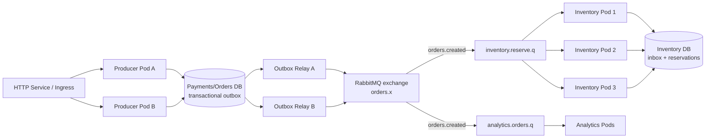
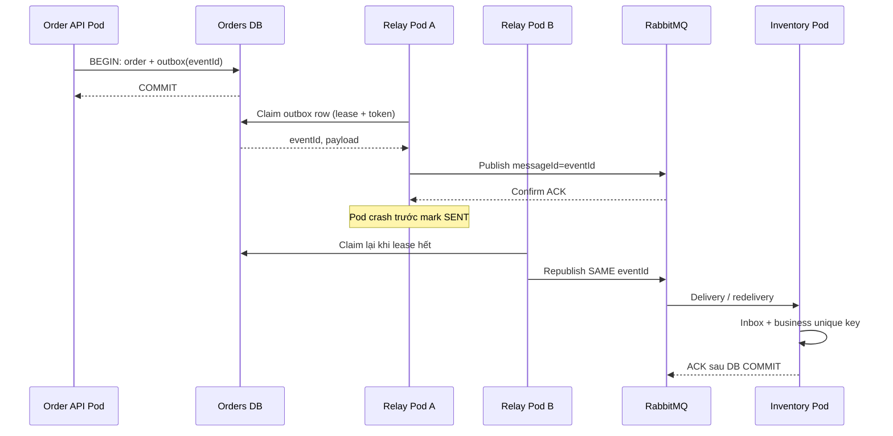

# Triển khai nhiều bản sao producer/consumer

## 1. Mục tiêu: mở rộng thông lượng nhưng giữ đúng nghiệp vụ

Trong chương **Triển khai và vận hành** của module **SPRING_AMQP**, ta đã có các thành phần quen thuộc: `RabbitTemplate` publish message, `@RabbitListener` consume, exchange/queue/binding định tuyến, publisher confirms, consumer acknowledgment, retry, dead-letter và theo dõi hệ thống. Khi chạy trên một máy, luồng này có vẻ đơn giản. Khi triển khai thành **nhiều bản sao (replica)** trên Kubernetes hoặc nhiều máy chủ, một số giả định không còn đúng:

- Hai producer có thể đồng thời publish cùng một sự kiện nghiệp vụ.
- Nhiều consumer cùng đăng ký một queue sẽ **cạnh tranh lấy message**, thay vì mỗi replica nhận một bản sao.
- Một consumer có thể commit database rồi bị kill trước khi ACK; RabbitMQ sẽ có thể giao lại message cho replica khác.
- Tổng số lời gọi DB/API đồng thời tăng theo **số replica × concurrency bên trong mỗi replica**.
- Rolling update đưa phiên bản producer/consumer cũ và mới chạy **song song**, đòi hỏi schema và message contract tương thích.
- HPA/KEDA có thể tăng pod vì queue backlog, nhưng tăng quá nhanh có thể làm DB/API quá tải và gây thêm retry.

**Mục tiêu của bài:** thiết kế triển khai nhiều bản sao publisher và consumer dựa trên đúng semantics RabbitMQ; chọn số replica, concurrency, prefetch và topology; bảo vệ sự kiện khỏi mất/nhân đôi hiệu ứng; thực hiện rolling update/graceful shutdown; đặt giới hạn autoscaling; quan sát và diễn tập khi node hoặc pod bị lỗi.

Ví dụ xuyên suốt: API đặt hàng ghi `OrderPlaced`, một nhóm producer phát vào exchange `orders.x` với routing key `orders.created`; nhóm consumer ghi bản ghi cấp phát kho tại queue `inventory.reserve.q`. Các Pod đều là **stateless process**: state quan trọng nằm ở database/RabbitMQ, không trong RAM của một Pod.

## 2. Trước tiên phân biệt ba kiểu nhân bản

| Thành phần | “Nhiều replica” nghĩa là gì? | Điều được chia sẻ | Điều không tự được bảo đảm |
| --- | --- | --- | --- |
| **Producer service** | Nhiều JVM/Pod cùng có quyền publish vào một exchange | RabbitMQ cluster/topology và database nghiệp vụ | Không tự chống việc hai Pod publish cùng business event |
| **Consumer service** | Nhiều JVM/Pod cùng subscribe **cùng tên queue** | Tập message đang chờ trong queue | Không phải mọi replica đều nhận mọi message, không bảo đảm xử lý đúng một lần |
| **RabbitMQ broker cluster** | Nhiều RabbitMQ node vận hành một broker cluster | Metadata topology; dữ liệu queue theo queue type/replication | Không tự tăng số service consumer và không bảo đảm mọi queue có nhiều bản sao |

Ví dụ ba consumer Pod cùng nghe `inventory.reserve.q`: RabbitMQ có thể giao message A cho Pod 1, B cho Pod 2, C cho Pod 3. Đây là mô hình **competing consumers** để chia tải. Nếu cần cả Inventory, Analytics và Notification đều nhận `OrderPlaced`, hãy khai báo **ba queue khác nhau** cùng bind vào exchange, chứ không tạo ba replica nghe cùng một queue và mong đó là broadcast.

### 2.1. Sơ đồ triển khai



**Hai queue khác nhau** nhận bản sao của một event khi exchange được bind phù hợp. **Ba inventory Pod** không tạo ba bản sao của một message; chúng cạnh tranh nhận từ queue inventory. RabbitMQ có thể redeliver message khi client mất connection hoặc không ACK, nên mỗi business action phải **lặp an toàn (idempotent)**.

## 3. Chọn topology cho nhiều replica

### 3.1. Một queue chia tải: cạnh tranh tiêu thụ

```text
exchange orders.x
  -- routing key orders.created -->
queue inventory.reserve.q
  |-- consumer replica inventory-1
  |-- consumer replica inventory-2
  |-- consumer replica inventory-3
```

Đây là mô hình phổ biến để tăng throughput xử lý độc lập:

- Mỗi delivery được broker phân phối cho **một consumer tại một thời điểm** theo cơ chế phát message/credit của queue; nếu chưa ACK và channel/connection mất, broker có thể phân phối lại cho consumer khác.
- RabbitMQ thường phân phối cho các consumer khả dụng, chịu ảnh hưởng của prefetch/credits, tốc độ xử lý và consumer priorities. **Không** hứa rằng số message sẽ được chia đều chính xác giữa các replica.
- Một queue không có nghĩa **thứ tự hoàn tất** của các tác vụ được giữ khi có nhiều consumer.
- Queue cần bền vững theo yêu cầu ứng dụng; tên và virtual host phải nhất quán giữa các Pod.

### 3.2. Nhiều queue để phát một event đến nhiều nhóm độc lập

```text
orders.x (direct / topic exchange)
    ├─ inventory.reserve.q   -> Inventory replicas (competing)
    ├─ analytics.orders.q    -> Analytics replicas (competing)
    └─ email.notifications.q -> Email replicas (competing)
```

Mỗi nhóm consumer có thể tự chọn retry, DLQ, concurrency và bảo lưu message. Nếu một nhóm xử lý chậm, queue của nó tăng backlog mà không nhất thiết chặn nhóm khác. Mỗi queue cần queue type/quorum/retention và SLA phù hợp.

**Không nên tạo queue riêng cho mỗi Pod** chỉ để nhân bản consumer cùng một nghiệp vụ: như vậy mỗi Pod sẽ có thể thực hiện **cùng tác động nghiệp vụ**, đồng thời tạo/loại queue phức tạp khi scale.

### 3.3. Quorum queue và Single Active Consumer

Nếu yêu cầu queue tiếp tục hoạt động khi broker node lỗi, cân nhắc **quorum queue** với cluster/quorum phù hợp. `durable=true` của classic queue không tự tạo replication.

Nếu cần xử lý tuần tự theo một queue, có thể cân nhắc cấu hình `x-single-active-consumer=true` ngay khi khai báo queue; nhiều Pod vẫn kết nối nhưng **chỉ một consumer được active** tại một thời điểm. Khi consumer active dừng, consumer khác có thể được chọn.

Vì vậy:

- **Muốn thông lượng cao với message độc lập:** nhiều competing consumers.
- **Muốn tuần tự ở mức queue:** Single Active Consumer (SAC) hoặc một consumer duy nhất, đánh đổi throughput.
- **Muốn tuần tự theo business key nhưng vẫn song song giữa key:** partition theo key sang nhiều queue/shard, mỗi shard xử lý tuần tự; bổ sung version/CAS nếu cần.
- `prefetch=1` với **nhiều consumer** vẫn không bảo đảm thứ tự nghiệp vụ toàn queue; đây chỉ là cửa sổ delivery chưa ACK của từng consumer.

## 4. Tính tổng concurrency khi scale theo replica

Ba tham số thường bị nhầm:

- `R`: số replica consumer.
- `C`: số consumer đồng thời **mỗi replica** của một `SimpleMessageListenerContainer`.
- `P`: `prefetchCount`, số delivery chưa ACK tối đa broker cho **mỗi consumer** theo QoS thông dụng.

Với listener **đồng bộ**, nhận một message rồi xử lý trước khi return, ước lượng khởi đầu:

\[
\text{Business invocations concurrently} \lesssim R \times C
\]

\[
\text{Unacked deliveries upper estimate} \approx R \times C \times P
\]

Công thức thứ hai là **giới hạn lý thuyết** theo prefetch/per-consumer trong điều kiện không có batching/QoS đặc biệt; nó không nói tất cả delivery đều đang chạy xử lý. Những delivery prefetched có thể đang chờ trong container.

Ví dụ:

| Replica `R` | Consumers/pod `C` | Prefetch `P` | Invocation đồng bộ tối đa gần đúng | Delivery unacked tối đa lý thuyết |
| ---: | ---: | ---: | ---: | ---: |
| 2 | 2 | 4 | 4 | 16 |
| 3 | 2 | 4 | 6 | 24 |
| 6 | 2 | 4 | 12 | 48 |
| 6 | 4 | 10 | 24 | 240 |

**Điểm nghẽn thật** là PostgreSQL, Redis, HTTP downstream, CPU hay disk IOPS. Nếu API phía sau chỉ chấp nhận 8 request đồng thời trên toàn hệ thống, cấu hình 6 Pod × 2 consumer có thể vượt mức cho phép. Cần áp dụng giới hạn trên toàn cụm hoặc ràng buộc `maxReplicas × consumersPerPod`.

### 4.1. Ngân sách DB và API

Đặt:

- `B_api`: ngân sách request HTTP đang chạy dành cho consumer **toàn cụm**.
- `B_db`: ngân sách connection DB dành cho nhóm job **toàn cụm**.
- `k_api`/`k_db`: số request/connection mà một job có thể dùng **đồng thời**.
- `C_max`: concurrency mỗi Pod trong thiết kế.
- `R_max`: giới hạn scale-out số Pod.

Một điều kiện bảo thủ là:

\[
R_{\max} C_{\max} k_{api} \le B_{api}
\quad\text{và}\quad
R_{\max} C_{\max} k_{db} \le B_{db}
\]

HikariCP `maximumPoolSize` là giới hạn **trên một process/DataSource**, không phải toàn cluster. Với 8 Pod có pool tối đa 10 connection, về lý thuyết có thể có **80 connection** từ service này, chưa kể các service khác. Đừng tăng replica mà quên `max_connections` của DB.

Tách tiếp hai yếu tố:

- **Concurrent requests (in-flight):** giới hạn bằng consumer concurrency/bulkhead/semaphore; với nhiều Pod, local semaphore không giới hạn toàn cluster.
- **Requests per second (QPS):** cần rate limiter riêng, có thể theo shared quota của API; ít in-flight không đồng nghĩa không vượt rate limit khi request rất nhanh.

**Không mở DB transaction xuyên qua HTTP call chậm** nếu có thể tránh, vì làm connection/lock bị giữ lâu. Nên có timeout, giới hạn retry và quan sát p95/p99 của downstream.

## 5. Một ứng dụng Spring Boot mẫu dùng cho nhiều consumer Pod

Ví dụ tương thích về mặt khái niệm với **Spring Boot 3.x + Spring AMQP 3.x + Java 17+** sử dụng đường **AMQP 0.9.1**. Khi dùng Spring AMQP 4.x, cần xác minh tương thích dependency và các API theo version thực tế. Các bean dưới đây là minh họa cấu trúc ứng dụng — thay host, tài khoản, database và các service nghiệp vụ theo môi trường triển khai.

### 5.1. Khai báo topology dùng chung

```java
import org.springframework.amqp.core.Binding;
import org.springframework.amqp.core.BindingBuilder;
import org.springframework.amqp.core.DirectExchange;
import org.springframework.amqp.core.Queue;
import org.springframework.amqp.core.QueueBuilder;
import org.springframework.context.annotation.Bean;
import org.springframework.context.annotation.Configuration;

@Configuration
class OrdersAmqpTopology {

    @Bean
    DirectExchange ordersExchange() {
        return new DirectExchange("orders.x", true, false);
    }

    @Bean
    Queue inventoryQueue() {
        return QueueBuilder.durable("inventory.reserve.q")
                .quorum()
                .deadLetterExchange("inventory.dlx")
                .deadLetterRoutingKey("inventory.failed")
                .build();
    }

    @Bean
    DirectExchange inventoryDlx() {
        return new DirectExchange("inventory.dlx", true, false);
    }

    @Bean
    Queue inventoryDlq() {
        return QueueBuilder.durable("inventory.reserve.dlq")
                .quorum()
                .build();
    }

    @Bean
    Binding inventoryBinding(Queue inventoryQueue,
                             DirectExchange ordersExchange) {
        return BindingBuilder.bind(inventoryQueue)
                .to(ordersExchange)
                .with("orders.created");
    }

    @Bean
    Binding inventoryDlqBinding(Queue inventoryDlq,
                                DirectExchange inventoryDlx) {
        return BindingBuilder.bind(inventoryDlq)
                .to(inventoryDlx)
                .with("inventory.failed");
    }
}
```

**Lưu ý vận hành:**

- Tất cả instance khai báo **cùng tên và cùng arguments**. Nếu một version đang khai báo classic và version mới khai báo quorum với cùng tên, broker có thể báo lỗi bất tương thích; **không nâng cấp loại queue tại chỗ** bằng cách đổi `QueueBuilder`.
- Khi mọi Pod cùng có `RabbitAdmin`, chúng có thể cùng yêu cầu khai báo. Với arguments đồng nhất, khai báo là idempotent về ý định, nhưng production thường quản lý topology **ngoài vòng đời app** (IaC, definition import, deploy job) để tránh phiên bản cũ/mới tranh chấp trong rolling update.
- Xem cấu hình dead-letter của quorum queue và quyền publisher nội bộ theo version RabbitMQ; giữ DLQ có dung lượng, retention và phân quyền phù hợp.
- Kích thước cụm và replication thực tế phải đạt yêu cầu quorum; chỉ gọi `.quorum()` không thay thế provisioning broker cluster.

### 5.2. Giới hạn consumer đồng thời mỗi Pod

```java
import org.springframework.amqp.core.AcknowledgeMode;
import org.springframework.amqp.rabbit.config.SimpleRabbitListenerContainerFactory;
import org.springframework.amqp.rabbit.connection.ConnectionFactory;
import org.springframework.context.annotation.Bean;
import org.springframework.context.annotation.Configuration;

@Configuration
class InventoryListenerConfiguration {

    @Bean("inventoryListenerFactory")
    SimpleRabbitListenerContainerFactory inventoryListenerFactory(
            ConnectionFactory connectionFactory) {
        var factory = new SimpleRabbitListenerContainerFactory();
        factory.setConnectionFactory(connectionFactory);

        // Giới hạn cố định: 2 consumer cho mỗi replica.
        factory.setConcurrentConsumers(2);
        factory.setMaxConcurrentConsumers(2);

        // Giảm số message giữ trước khi xử lý.
        factory.setPrefetchCount(4);

        // ACK sau khi listener đồng bộ hoàn tất thành công.
        factory.setAcknowledgeMode(AcknowledgeMode.AUTO);

        // Khi stop: đợi current message, đưa phần prefetched còn lại
        // về queue; hữu ích lúc scale-down/rolling update.
        factory.setForceStop(true);
        factory.setShutdownTimeout(30_000L);

        return factory;
    }
}
```

`setForceStop(true)` có trong các phiên bản Spring AMQP hỗ trợ tính năng này (được giới thiệu trong các nhánh 2.4.x/3.0.x). Khi stop, container cố hoàn tất công việc **đang xử lý**, còn các message đã prefetch nhưng chưa chạy có thể được requeue để Pod khác nhận. Nếu để mặc định `forceStop=false`, container có thể xử lý hết các prefetched deliveries trước khi dừng, làm thời gian drain dài hơn.

`setShutdownTimeout(30_000L)` là **thời gian đợi tối đa khi container dừng**; nếu quá hạn, với cấu hình mặc định thích hợp container có thể đóng channel khiến message chưa ACK được requeue. Không có cấu hình nào làm tác động DB/RabbitMQ trở thành transaction nguyên tử khi Pod bị kill.

**Tránh trộn container types:** `SimpleMessageListenerContainer` có `concurrentConsumers/maxConcurrentConsumers`; `DirectMessageListenerContainer` sử dụng `consumersPerQueue`. Nếu một factory quản lý nhiều queue, tính lại số consumer và channel cho đúng.

### 5.3. Consumer lặp an toàn với database unique constraint

Giả sử mỗi event `OrderPlaced` có `eventId` ổn định và business key `orderId`. Cần định nghĩa trước điều kiện nào là “cùng một tác động”:

- Một `orderId` được đặt chỗ kho **một lần**: unique theo `orderId` và operation.
- Nếu một đơn hàng được phép reserve nhiều lần (ví dụ sửa đơn), cần khóa khác như `orderId + version` hoặc `reservationId`; khóa `orderId` đơn lẻ sẽ làm mất thao tác hợp lệ.

Schema PostgreSQL cho ví dụ một reservation mỗi order:

```sql
CREATE TABLE inventory_inbox (
    consumer_name TEXT NOT NULL,
    business_key TEXT NOT NULL,
    first_event_id UUID NOT NULL,
    processed_at TIMESTAMPTZ NOT NULL DEFAULT now(),
    PRIMARY KEY (consumer_name, business_key)
);

CREATE TABLE inventory_reservations (
    order_id TEXT PRIMARY KEY,
    sku TEXT NOT NULL,
    quantity INT NOT NULL CHECK (quantity > 0),
    status TEXT NOT NULL DEFAULT 'RESERVED'
);
```

DTO:

```java
import java.util.UUID;

public record OrderPlaced(
        UUID eventId,
        String orderId,
        String sku,
        int quantity
) {}
```

Service bảo vệ *inbox marker* và *business effect* trong **một transaction**:

```java
import org.springframework.jdbc.core.JdbcTemplate;
import org.springframework.stereotype.Service;
import org.springframework.transaction.annotation.Transactional;

@Service
class InventoryReservationService {
    private final JdbcTemplate jdbc;

    InventoryReservationService(JdbcTemplate jdbc) {
        this.jdbc = jdbc;
    }

    @Transactional
    public void reserveOnce(OrderPlaced event) {
        int inserted = jdbc.update("""
                INSERT INTO inventory_inbox
                    (consumer_name, business_key, first_event_id)
                VALUES ('inventory-reserve', ?, ?)
                ON CONFLICT (consumer_name, business_key) DO NOTHING
                """, "reserve:" + event.orderId(), event.eventId());

        if (inserted == 0) {
            return; // Replica khác/attempt trước đã hoàn tất.
        }

        jdbc.update("""
                INSERT INTO inventory_reservations
                    (order_id, sku, quantity)
                VALUES (?, ?, ?)
                """, event.orderId(), event.sku(), event.quantity());
    }
}
```

**Không sử dụng `SELECT` trước rồi `INSERT` như hàng rào chống trùng duy nhất**: hai replica có thể cùng đọc “chưa tồn tại” rồi cùng xử lý. Unique constraint + transaction giải quyết race trong database.

Tình huống đặc biệt: event có cùng `orderId` nhưng `sku`/`quantity` khác. Mẫu trên bỏ qua như duplicate; production cần lưu payload fingerprint hoặc kiểm tra contract để **phát hiện conflicting duplicate**, không âm thầm bỏ message có nội dung mâu thuẫn.

Listener nhận raw message để không tin hoàn toàn type headers của publisher:

```java
import com.fasterxml.jackson.core.JsonProcessingException;
import com.fasterxml.jackson.databind.ObjectMapper;
import org.springframework.amqp.AmqpRejectAndDontRequeueException;
import org.springframework.amqp.core.Message;
import org.springframework.amqp.rabbit.annotation.RabbitListener;
import org.springframework.stereotype.Component;

@Component
class InventoryReservationListener {
    private final ObjectMapper json;
    private final InventoryReservationService service;

    InventoryReservationListener(
            ObjectMapper json, InventoryReservationService service) {
        this.json = json;
        this.service = service;
    }

    @RabbitListener(
            id = "inventoryReservations",
            queues = "inventory.reserve.q",
            containerFactory = "inventoryListenerFactory")
    public void handle(Message raw) {
        final OrderPlaced event;
        try {
            event = json.readValue(raw.getBody(), OrderPlaced.class);
        }
        catch (JsonProcessingException ex) {
            throw new AmqpRejectAndDontRequeueException(
                    "Invalid OrderPlaced JSON", ex);
        }

        if (event == null || event.eventId() == null
                || event.orderId() == null || event.orderId().isBlank()
                || event.sku() == null || event.sku().isBlank()
                || event.quantity() <= 0) {
            throw new AmqpRejectAndDontRequeueException(
                    "Invalid OrderPlaced contract");
        }

        // Transaction DB commit trước khi method return.
        service.reserveOnce(event);
        // AUTO mode: container ACK sau khi xử lý thành công.
    }
}
```

Với ba Pod chạy đoạn code này, chúng cùng cạnh tranh nhận từ `inventory.reserve.q`. Khi một Pod đã commit reservation nhưng chết **trước khi ACK**, broker có thể giao lại event cho Pod khác; lần sau sẽ gặp inbox conflict và không áp dụng nghiệp vụ lần hai.

**Ranh giới:** transaction trong `reserveOnce` chỉ bao phủ database. Nếu listener còn gọi một HTTP API gây side effect, phải có idempotency key tại API đích hoặc một workflow outbox/saga; không coi `@Transactional` là giao dịch phân tán RabbitMQ + DB + HTTP.

## 6. Nhiều producer: mở rộng ghi event an toàn

Producer replica không có khái niệm “consumer cạnh tranh”. Nếu HTTP load balancer đưa hai request retry tới hai Pod khác nhau, cả hai đều có thể cố ghi và publish cùng business event.

### 6.1. Mô hình không an toàn

```java
@Transactional
void placeOrder(CreateOrder cmd) {
    repository.save(new OrderEntity(cmd));
    rabbitTemplate.convertAndSend("orders.x", "orders.created", cmd);
}
```

Đoạn code rút gọn này **không tự bảo đảm atomicity** giữa database transaction và publish. Có thể DB rollback nhưng message đã vào broker; hoặc DB đã commit nhưng publish thất bại. Nhiều Pod càng làm retry/failover dễ xảy ra.

### 6.2. Transactional outbox làm nguồn sự kiện bền vững

Thiết kế:

1. Mỗi request có **idempotency key** hoặc business command ID do client cấp, tránh hai Pod tạo hai đơn hàng khác nhau khi client retry.
2. Trong **cùng DB transaction**, ghi order và một outbox record có `eventId` duy nhất.
3. Nhiều relay Pod claim outbox theo `FOR UPDATE SKIP LOCKED` hoặc cơ chế tương đương, có lease/claim token để xử lý worker chết.
4. Publish qua `RabbitTemplate` với **publisher confirms + mandatory returns**.
5. Chỉ đánh dấu outbox `SENT` khi broker xác nhận và message được định tuyến theo contract.
6. Khi confirm bị mất, DB mark SENT lỗi hoặc lease hết, relay có thể publish lại **cùng eventId**. Consumer đã có inbox/unique constraint nên chịu được duplicate.



### 6.3. Producer code minh họa stable event ID

```java
import java.util.UUID;
import org.springframework.amqp.core.MessageDeliveryMode;
import org.springframework.amqp.rabbit.connection.CorrelationData;
import org.springframework.amqp.rabbit.core.RabbitTemplate;
import org.springframework.stereotype.Component;

@Component
class OrderOutboxPublisher {
    private final RabbitTemplate template;

    OrderOutboxPublisher(RabbitTemplate template) {
        this.template = template;
    }

    CorrelationData publish(UUID eventId, byte[] serializedJson) {
        var correlation = new CorrelationData(eventId.toString());

        template.convertAndSend(
                "orders.x",
                "orders.created",
                serializedJson,
                message -> {
                    message.getMessageProperties()
                            .setContentType("application/json");
                    message.getMessageProperties()
                            .setMessageId(eventId.toString());
                    message.getMessageProperties()
                            .setDeliveryMode(MessageDeliveryMode.PERSISTENT);
                    return message;
                },
                correlation
        );
        return correlation;
    }
}
```

Mẫu trên **chỉ gửi và trả về `CorrelationData`**. Relay cần theo dõi `correlation.getFuture()` và kiểm tra `getReturned()` khi bật mandatory returns; không xem `convertAndSend` return là thành công lâu bền. Trong production nên có timeout, retry với backoff, outbox retention/monitoring và giới hạn số publish in-flight.

Cấu hình Spring Boot cho publisher:

```yaml
spring:
  rabbitmq:
    publisher-confirm-type: correlated
    publisher-returns: true
    template:
      mandatory: true
```

**Không nhầm:** publisher confirm ACK chứng minh broker xử lý publish theo cơ chế confirm, **không** chứng minh Inventory consumer đã reserve. Với mandatory, message không route được có thể được returned **trước** confirm ACK; không mark outbox SENT chỉ từ ACK.

### 6.4. Nhiều relay là competing claimers, không phải mỗi relay gửi toàn bộ outbox

Nên bảo đảm:

| Vấn đề | Biện pháp |
| --- | --- |
| Hai Pod claim cùng row | Atomic claim với row lock/`SKIP LOCKED` hoặc broker partitioning thích hợp |
| Relay chết sau claim | Lease có thời hạn; row trở lại retryable |
| Lease hết trong khi relay cũ còn publish | Có thể gửi lặp; consumer idempotent |
| Relay cũ cố mark SENT sau khi row bị claim lại | `WHERE event_id=? AND claim_token=?` ngăn stale update |
| Hai HTTP Pod nhận cùng command | Unique idempotency key/business key trong order DB |
| Broker không sẵn sàng | Không mất outbox intent; alert oldest unsent age |

**Outbox không phải queue thứ hai để tiêu thụ từng record exactly once.** Nó là dữ liệu bền vững bảo đảm intent; publish at-least-once đi kèm dedup ở consumer.

## 7. Cấu hình một replica so với nhiều replica

Một ví dụ cấu hình nền trong `application.yml`:

```yaml
spring:
  rabbitmq:
    addresses: "rabbit-1.messaging.svc:5672,rabbit-2.messaging.svc:5672,rabbit-3.messaging.svc:5672"
    username: "app_inventory"
    password: ${RABBITMQ_PASSWORD}
    virtual-host: "/orders"
    requested-heartbeat: 30s
    connection-timeout: 5s
  datasource:
    url: ${JDBC_URL}
    username: ${DB_USERNAME}
    password: ${DB_PASSWORD}
    hikari:
      maximum-pool-size: 8
      connection-timeout: 2s
  lifecycle:
    timeout-per-shutdown-phase: 40s

management:
  endpoint:
    health:
      probes:
        enabled: true
  endpoints:
    web:
      exposure:
        include: "health,info,prometheus"
```

Giải thích:

- `spring.rabbitmq.addresses` chứa **nhiều node thuộc cùng một RabbitMQ cluster**, không trộn hai cluster độc lập để giả lập replication.
- `RABBITMQ_PASSWORD`/`DB_PASSWORD` lấy qua secret mount/Env, không commit vào repository. Nếu dùng TLS, bật cấu hình SSL/certificate tương ứng và dùng cổng phù hợp; ví dụ là kết nối demo nội mạng.
- `maximum-pool-size: 8` áp dụng **trên mỗi process**; tính tổng qua replica.
- `timeout-per-shutdown-phase` là giới hạn Spring lifecycle theo phase; phải phối hợp với `shutdownTimeout` của listener và Kubernetes grace period.
- `health,liveness/readiness` phục vụ Kubernetes probe, còn `prometheus` phải có actuator + registry dependency. Không xuất toàn bộ endpoint Actuator công khai qua Internet.

**Cẩn trọng khi tự tạo custom listener factory:** các `spring.rabbitmq.listener.simple.*` properties chỉ được Boot áp dụng tự động vào factory mặc định hoặc factory được cấu hình qua Boot configurer. Factory riêng như phần 5.2 phải đặt concurrency/prefetch trên chính bean đó.

### 7.1. Phân tách vai trò producer-only / consumer-only

Một container image có thể được deploy thành hai workload:

- `orders-api`: chạy REST endpoint và ghi outbox, **không** chạy Inventory listener.
- `inventory-worker`: chạy `@RabbitListener` cho queue inventory, **không** mở REST public endpoint.
- `orders-outbox-relay`: chạy scheduler/worker claim outbox, **không** chạy request HTTP API cần tải thấp.

Nếu dùng cùng codebase, có thể điều khiển tạo bean theo profile/`@ConditionalOnProperty`:

```java
import org.springframework.boot.autoconfigure.condition.ConditionalOnProperty;
import org.springframework.stereotype.Component;

@Component
@ConditionalOnProperty(
        name = "app.role.inventory-consumer",
        havingValue = "true")
class InventoryWorkerMarker {
    // Ví dụ minh họa việc chọn bean theo role.
    // Với ứng dụng thật, áp dụng annotation trên @Component có @RabbitListener.
}
```

Ví dụ này chỉ diễn tả **cách chia role**; không phải class `InventoryWorkerMarker` là listener thật. Trong code thực tế, gắn condition trực tiếp vào `InventoryReservationListener` hoặc sử dụng `@Configuration` có condition. Mỗi workload nên có credentials tối thiểu riêng: producer chỉ cần write lên exchange, consumer cần read từ queue, một provisioning job được phép configure topology.

**Lợi ích:** scale API theo HTTP QPS, scale consumer theo backlog, scale relay theo outbox age/rate **độc lập**. Nếu kết hợp chung một Deployment, tăng replica vì HTTP traffic cũng làm tăng số RabbitMQ consumers; ngược lại backlog có thể tạo Pod API không cần thiết.

## 8. Ví dụ Kubernetes Deployment cho consumer

Manifest sau minh họa hai Pod consumer stateless. Nó **không tạo RabbitMQ broker**; RabbitMQ và PostgreSQL phải được triển khai/phân quyền trước. Image là placeholder cần thay bằng bản build thực của dự án.

```yaml
apiVersion: apps/v1
kind: Deployment
metadata:
  name: inventory-worker
spec:
  replicas: 2
  strategy:
    type: RollingUpdate
    rollingUpdate:
      maxSurge: 1
      maxUnavailable: 0
  selector:
    matchLabels:
      app: inventory-worker
  template:
    metadata:
      labels:
        app: inventory-worker
    spec:
      terminationGracePeriodSeconds: 75
      containers:
        - name: inventory-worker
          image: registry.example.com/inventory-worker:1.0.0
          imagePullPolicy: IfNotPresent
          ports:
            - name: http
              containerPort: 8080
          env:
            - name: APP_ROLE_INVENTORY_CONSUMER
              value: "true"
            - name: SPRING_RABBITMQ_ADDRESSES
              value: "rabbit-1.messaging.svc:5672,rabbit-2.messaging.svc:5672,rabbit-3.messaging.svc:5672"
            - name: SPRING_RABBITMQ_VIRTUAL_HOST
              value: "/orders"
            - name: SPRING_RABBITMQ_USERNAME
              value: "app_inventory"
            - name: RABBITMQ_PASSWORD
              valueFrom:
                secretKeyRef:
                  name: inventory-messaging-secret
                  key: password
            - name: JDBC_URL
              valueFrom:
                secretKeyRef:
                  name: inventory-db-secret
                  key: jdbc-url
            - name: DB_USERNAME
              valueFrom:
                secretKeyRef:
                  name: inventory-db-secret
                  key: username
            - name: DB_PASSWORD
              valueFrom:
                secretKeyRef:
                  name: inventory-db-secret
                  key: password
          resources:
            requests:
              cpu: "250m"
              memory: "512Mi"
            limits:
              memory: "1Gi"
          startupProbe:
            httpGet:
              path: /actuator/health/liveness
              port: http
            failureThreshold: 30
            periodSeconds: 2
          livenessProbe:
            httpGet:
              path: /actuator/health/liveness
              port: http
            periodSeconds: 10
            failureThreshold: 3
          readinessProbe:
            httpGet:
              path: /actuator/health/readiness
              port: http
            periodSeconds: 5
            failureThreshold: 2
```

**Đọc manifest đúng mục đích:**

- `replicas=2` nghĩa là **hai process Java**. Nếu mỗi process có 2 consumer, tổng là **4 consumer** trong trạng thái ổn định.
- `maxSurge=1` cho phép **tạm thời thêm một Pod** trong rolling update: tổng có thể là **3 Pod × 2 consumer = 6 consumer**. Khi tính ngân sách DB/API và hạn mức RabbitMQ, **phải tính cả surge**. `maxUnavailable=0` giảm nguy cơ mất toàn bộ worker nhưng không bảo đảm mọi message có đúng một execution.
- `terminationGracePeriodSeconds=75` dành thời gian cho JVM shutdown; đây là giá trị minh họa cần được xác nhận bằng p99 processing + timeouts + callback/phase. Kubernetes sẽ gửi SIGKILL nếu hết grace.
- `startupProbe` hữu ích khi app khởi động chậm; probe của Spring Boot cần Actuator endpoint hoạt động trên HTTP port mà Kubernetes có thể gọi.
- `readinessProbe` quyết định **HTTP traffic** thông qua Service, **không tự dừng `@RabbitListener`**. Consumer có thể vẫn nhận message khi readiness báo false. Phải kiểm tra trạng thái container/listener riêng.
- `livenessProbe` thường không nên phụ thuộc trực tiếp RabbitMQ/DB đang khỏe: một outage broker chung không nên làm Kubernetes liên tục kill toàn bộ consumer pods.

**Điều kiện:** manifest yêu cầu secret tồn tại; không tạo secret có mật khẩu cứng trong tài liệu. Spring Boot app phải có web/actuator server trên port 8080 để HTTP probes có thể dùng; worker thuần headless không có HTTP server cần giải pháp probe khác hoặc bật management HTTP endpoint nội bộ.

### 8.1. Producer Deployment thay đổi ở đâu?

Producer API dùng cùng nguyên lý Deployment nhưng nên có:

- `app.role.inventory-consumer=false` hoặc tách profile để **không tạo listener**.
- Số replica dựa trên HTTP traffic/CPU/latency của API, không dựa vào inventory queue length.
- Publisher confirms/returns, timeout và outbox; bảo đảm order DB unique idempotency key.
- Tách secrets producer/consumer; tránh user AMQP có cả quyền configure/read/write không cần thiết.
- Có Service và Ingress nếu API thực sự nhận HTTP. **Consumer-only Deployment không nhất thiết cần Kubernetes Service**, trừ khi dùng HTTP metrics/probes qua Service hoặc endpoint khác.

## 9. Rolling update và graceful shutdown

Đây là phần dễ gây phát lại message nhất trong môi trường nhiều replica.

### 9.1. Timeline khi Kubernetes thu hồi Pod

```mermaid
sequenceDiagram
    participant K as Kubernetes
    participant P as Inventory Pod 1
    participant MQ as RabbitMQ
    participant DB as Inventory DB
    participant P2 as Inventory Pod 2
    K->>P: Bắt đầu termination grace
    Note over P: PreStop nếu có, rồi SIGTERM
    P->>P: Spring context shutdown<br/>stop listener container
    P->>DB: Commit job đang xử lý
    DB-->>P: Commit OK
    P->>MQ: ACK nếu connection còn và kịp
    P->>P: Cancel consumer / close channel
    alt Có unacked hoặc bị kill trước ACK
      MQ->>P2: Redelivery sang Pod 2
      P2->>DB: INSERT inbox unique; skip duplicate
      P2->>MQ: ACK
    end
```

**Chính sách shutdown cần tính chung:**

1. Kubernetes bắt đầu countdown của `terminationGracePeriodSeconds`.
2. Nếu có `preStop`, hook chạy **trong grace period**, trước khi TERM được gửi. Một hook chờ quá lâu có thể “ăn hết” thời gian drain.
3. JVM phải nhận SIGTERM đúng: chạy `java -jar app.jar` làm PID 1 hoặc sử dụng init/entrypoint chuyển tiếp signal; tránh shell wrapper nuốt SIGTERM.
4. Spring đóng ApplicationContext, container ngừng nhận và cố hoàn tất các delivery đang xử lý trong `shutdownTimeout`.
5. Nếu timeout hết hoặc Pod bị kill, delivery chưa ACK có thể được broker đưa lại queue sau khi phát hiện connection/channel đóng.
6. Replica khác nhận lại và xử lý **idempotently**.

**Giá trị mẫu:** listener `shutdownTimeout=30s`, lifecycle shutdown phase `40s`, Kubernetes `terminationGracePeriodSeconds=75s`. Đây không phải công thức bảo đảm chắc chắn vì nhiều phase/callback, HTTP in-flight, scheduler, broker/network detection và thực tế JVM có thể làm thời gian thay đổi. Hãy đo **p99 processing** và thêm headroom.

### 9.2. Force stop và prefetched messages

Theo Spring AMQP, khi container stop mặc định nó có thể xử lý hết các message đã được prefetched trước khi dừng. Với `setForceStop(true)` (ở version hỗ trợ), container dừng sau message đang xử lý và có thể requeue các prefetched messages chưa xử lý.

Điểm đánh đổi:

| Chọn | Ưu điểm | Rủi ro/cần chú ý |
| --- | --- | --- |
| `forceStop=false` | Hạn chế requeue lượng prefetched trong đợt stop | Drain có thể kéo dài khi prefetch lớn hoặc job chậm |
| `forceStop=true` | Scale-down nhanh hơn; Pod khác nhận prefetched còn lại | Tăng redelivery; bắt buộc idempotency |
| `prefetch=1` | Ít delivery đang giữ và shutdown đơn giản hơn | Có thể giảm throughput khi RTT/processing nhanh |
| `prefetch` lớn | Có thể tăng throughput tốt với công việc nhẹ | Tích nhiều unacked, RAM; shutdown lâu hoặc requeue nhiều |

Nếu sử dụng **Single Active Consumer**, `forceStop=true` có thể hỗ trợ chuyển quyền xử lý nhanh hơn; song semantics ordering và message đã requeue vẫn cần kiểm thử với queue type cụ thể.

### 9.3. Readiness không đồng nghĩa consumer drain

Kubernetes readiness probe chủ yếu điều khiển việc **HTTP Service gửi traffic** tới Pod. RabbitMQ không nhìn Kubernetes Endpoints để quyết định consumer còn hoạt động hay không. Nếu muốn chủ động drain consumer trước thời điểm container dừng, cần **gọi stop trên listener container** hoặc cấu hình lifecycle phù hợp; không chỉ đổi readiness flag.

Có thể thao tác một container qua:

```java
import org.springframework.amqp.rabbit.listener.RabbitListenerEndpointRegistry;
import org.springframework.stereotype.Service;

@Service
class InventoryListenerControl {
    private final RabbitListenerEndpointRegistry registry;

    InventoryListenerControl(RabbitListenerEndpointRegistry registry) {
        this.registry = registry;
    }

    public void stopInventoryListener() {
        var container =
                registry.getListenerContainer("inventoryReservations");
        if (container != null) {
            container.stop();
        }
    }
}
```

Đây là API điều khiển nội bộ **không nên tự mở thành HTTP endpoint public**. Nếu cần `preStop` gọi drain endpoint, phải xác thực, chỉ cho phép nội mạng/control plane và tránh để hook block đến hết grace; đồng thời đừng quên **shutdown của Spring đã xử lý stop theo lifecycle**. Đa số ứng dụng nên bắt đầu bằng **SIGTERM đúng + Spring shutdown + listener timeout** trước khi viết hook riêng.

### 9.4. Tương thích version khi rolling update

Trong rollout, producer/consumer **version N và N+1** có thể cùng chạy:

- New producer chưa nên phát schema chỉ version N+1 đọc được cho tới khi các consumer N đã sẵn sàng (hoặc dùng **schema version** và backward compatibility).
- Đừng đổi tên queue/exchange hoặc arguments bất biến đột ngột; thay kiểu queue (classic → quorum) cần migration riêng.
- Dùng **expand → migrate → contract** cho schema DB; không xóa column đang được pod cũ dùng khi rollout chưa hoàn tất.
- Nếu đổi idempotency key từ `orderId` sang `eventId`, phải có kế hoạch chuyển đổi để không tạo trùng trong giai đoạn hai version cùng tiêu thụ.
- Lặp thử gửi event cùng `eventId` từ cả version cũ và mới để kiểm tra duplicate/contract.

**Nếu rollout thất bại và rollback app**, dữ liệu đã phát hoặc DB migration có thể không backward compatible. Đánh giá đường rollback trước khi deploy, không chỉ tin vào khả năng `kubectl rollout undo`.

## 10. Autoscaling consumer theo backlog: HPA/KEDA

### 10.1. Vì sao CPU-only HPA chưa đủ?

Consumer có thể chờ DB/API nhiều thời gian, CPU thấp nhưng queue backlog lớn. Ngược lại, chỉ tăng replica theo backlog có thể khiến 429/API timeout tăng mạnh. Có thể sử dụng **KEDA RabbitMQ scaler** hoặc external metrics với HPA để điều chỉnh số replica theo queue length, publish rate hoặc các metric khác.

KEDA hỗ trợ trigger `rabbitmq` với các chế độ như `QueueLength`, `MessageRate` và một số metric quan sát khác trong các phiên bản mới. **Tên field và phương thức kết nối phụ thuộc phiên bản KEDA**; ví dụ dưới đây minh họa cho **KEDA 2.21**.

### 10.2. Ví dụ KEDA ScaledObject

```yaml
apiVersion: keda.sh/v1alpha1
kind: ScaledObject
metadata:
  name: inventory-worker-scaler
spec:
  scaleTargetRef:
    name: inventory-worker
  pollingInterval: 15
  cooldownPeriod: 120
  minReplicaCount: 2
  maxReplicaCount: 4
  triggers:
    - type: rabbitmq
      metadata:
        protocol: http
        queueName: inventory.reserve.q
        vhostName: /orders
        mode: QueueLength
        value: "100"
        excludeUnacknowledged: "true"
      authenticationRef:
        name: inventory-rabbitmq-scaler-auth
```

**Không thể áp dụng manifest này nguyên vẹn nếu thiếu `TriggerAuthentication`** cung cấp RabbitMQ Management HTTP endpoint và credentials tương ứng. Tạo `TriggerAuthentication`/`ClusterTriggerAuthentication` theo chính sách secret/workload identity của tổ chức. Quyền truy vấn metrics cần tối thiểu; đừng nhúng mật khẩu trực tiếp vào `metadata.host`. Management API cũng cần được cho phép qua network policy.

Ý nghĩa:

- `minReplicaCount=2`: khi không có backlog vẫn giữ hai Pod để sẵn sàng, thuận lợi cho HA.
- `maxReplicaCount=4`: giữ tổng concurrency tối đa (ngoài `maxSurge` của rolling update) **4 Pod × 2 consumers/pod = 8**.
- `value="100"`: mục tiêu queue length **trên một replica** theo scaler, không phải “chỉ scale khi queue có đúng 100 message”.
- `excludeUnacknowledged="true"` trong HTTP mode: ưu tiên đo **ready messages** thay vì tính cả unacked; khi dùng setting khác, ý nghĩa backlog thay đổi. Với unacked lớn do consumer treo, cần alert riêng thay vì chỉ xem queue length.
- `cooldownPeriod` tác động quá trình scale-down theo KEDA/HPA behavior; không bảo đảm scale-down tức thì.

**Cảnh báo quan trọng:** Không cấu hình **một HPA thủ công khác cùng điều khiển replicas** của Deployment khi KEDA đang tạo/quản lý HPA cho ScaledObject. Hai controller có thể tranh nhau cập nhật desired replicas.

### 10.3. KEDA không biết ngân sách DB/API

Ví dụ API kiểm tra kho chỉ cho phép 8 request đồng thời trên toàn cụm, consumer mỗi Pod có 2 concurrent handlers. Giới hạn 4 Pod là mức tối đa lý thuyết **đúng bằng 8**, chưa có headroom cho rolling `maxSurge=1` (có thể lên 10), hoặc workload khác.

Giải pháp:

- Giảm `maxReplicaCount`, `consumersPerPod` hoặc `maxSurge` để không vượt ngân sách ở thời điểm nâng cấp.
- Thêm **bulkhead/rate limit toàn cụm** nếu downstream dùng chung quota với service khác.
- Nếu queue backlog rất lớn nhưng DB/API đã đầy tải, mở thêm Pod không giải quyết được; phải tăng capacity downstream, giảm chi phí xử lý hoặc thay đổi SLA.
- Đo **message completion rate, queue age p95/p99, retries, 429/503**, không chỉ số Pod và ready queue depth.
- Tránh scale-down quá nhanh khi job đang xử lý lâu; tính `shutdownTimeout`, message redelivery và những in-flight tasks của ứng dụng async.

### 10.4. Scale-to-zero của consumer có phù hợp không?

KEDA có thể scale về 0 trong cấu hình nhất định, nhưng:

- Có thời gian poll/wakeup khi message mới tới, ảnh hưởng latency khởi động.
- Nếu app **tự tạo topology** ở startup và đang 0 Pod, cần chắc chắn queue/exchange đã tồn tại **trước** khi event được publish.
- Không dùng ready queue length duy nhất để đánh giá sự cố khi nhiều message đang **unacked**.
- Có thể cần minReplicas ≥ 1 hoặc ≥ 2 cho consumer quan trọng với SLA thấp và yêu cầu HA.

## 11. Quan sát toàn cụm

### 11.1. Nên đo theo lớp

| Lớp | Chỉ số | Dấu hiệu bất thường |
| --- | --- | --- |
| Producer | Publish attempts/s, confirm ACK/NACK, returned, latency | Confirm timeout hoặc returns tăng |
| Outbox | Unsent rows, oldest unsent age, claim retries | DB còn intent mà broker chưa nhận |
| RabbitMQ | `messages_ready`, `messages_unacknowledged`, consumer count | Backlog tăng hoặc unacked không giảm |
| RabbitMQ | Publish/deliver/ack/redelivery rates | Redelivery storm sau rolling update |
| Consumer | Active consumers per Pod, success/failure, p95/p99 | Scale tăng nhưng hoàn tất không tăng |
| Database | Hikari active/pending/max, DB connections, lock waits | Quá tải do tổng replicas |
| Downstream API | In-flight, QPS, 429/503, timeout | Replica tăng quá mức API quota |
| Kubernetes | Ready/desired pods, restart count, OOMKilled, termination duration | Rollout/scale-down không an toàn |
| Business | Unique orders reserved, duplicated events skipped, DLQ count | Tác động nghiệp vụ không đạt SLA |

**Nguyên tắc giám sát:** dùng nhãn hữu hạn như `service`, `environment`, `queue`, `listener`, `version`, `pod`. Tránh đưa `eventId` hoặc `orderId` vào Prometheus metric label vì tạo cardinality rất cao. Dùng trace/log correlation để điều tra từng message.

### 11.2. Một số tình huống dashboard dễ đánh lừa

- **CPU thấp, queue tăng:** có thể consumer bị chặn ở DB/API; không kết luận thiếu CPU.
- **Ready giảm, unacked tăng:** broker đã chuyển delivery cho consumer, nhưng công việc có thể đang treo; không kết luận throughput cải thiện.
- **Consumer count tăng gấp đôi sau deployment:** có thể do `maxSurge` hoặc Pod cũ chưa drain; kiểm tra giới hạn downstream.
- **Outbox `SENT` tăng nhưng business completion không tăng:** publisher đã thành công ở broker, consumer có thể đang lỗi/DLQ.
- **Redelivery tăng sau scale-down:** có thể dự kiến khi requeue prefetched messages, nhưng phải chứng minh idempotency và thời gian phục hồi.
- **Một Pod readiness=false nhưng vẫn thấy consumer active:** Kubernetes HTTP readiness không điều khiển RabbitMQ listener; đây có thể là thiết kế bình thường.

### 11.3. Alert mẫu

Các ngưỡng chỉ minh họa, phải hiệu chỉnh theo SLO:

| Điều kiện | Hướng xử lý |
| --- | --- |
| `ready > 1000` và queue age tăng liên tục trong 10 phút | Xem completion rate, downstream capacity, autoscaling |
| `unacked` cao, successful processing gần 0 | Kiểm tra deadlocks/DB pool/API timeout |
| Confirm timeout tăng và outbox age vượt 5 phút | Xem broker connectivity, publishing, relay retries |
| `messages_ready > 0` nhưng consumer count = 0 | Kiểm tra listener startup, queue access, deployment |
| DLQ depth tăng nhanh | Phân loại poison messages, schema/version mismatch |
| Pod bị kill trước khi shutdown thành công | Tăng grace hợp lý, tối ưu job p99, giảm prefetch |
| Tổng pool DB connections tiến sát hạn mức | Giảm replica/concurrency, chỉnh pool/DB capacity |

## 12. Chiến lược an toàn khi nhiều Pod cùng thay đổi topology

### 12.1. RabbitAdmin có thể chạy ở nhiều Pod

Các Spring AMQP declarable beans thường được quản lý bởi `RabbitAdmin` khi AMQP connection được mở. Nếu một Deployment có 10 Pod, có thể có nhiều yêu cầu khai báo cùng exchange/queue/binding.

Việc khai báo lặp với **cấu hình tương đương** là bình thường về mặt ý định. Vấn đề nằm ở **cấu hình không tương đương** hoặc những thay đổi bất biến:

- Pod cũ khai báo `inventory.reserve.q` là classic, Pod mới muốn quorum.
- Pod mới thay DLX/TTL/arguments nhưng Pod cũ vẫn khai báo kiểu cũ.
- Pod nhiều version cùng thay binding/routing key vào thời điểm rollout.
- Một cluster thiếu permissions của app user để configure; startup có thể thất bại.
- Pod scale-to-zero nhưng topology chưa được provision trước khi producer gửi.

Giải pháp:

1. Quản lý topology qua pipeline/IaC riêng hoặc RabbitMQ definitions; app dùng quyền tối thiểu.
2. Nếu cho app tự khai báo, **giữ declarables tương thích** trong mọi version cùng sống.
3. Không đổi queue type tại chỗ; dùng tên/version mới và migration/cutover có kế hoạch.
4. Dùng idempotent deployment job hoặc RabbitAdmin được chỉ định rõ owner, không để các Pod tranh cấu hình.

### 12.2. Credentials và network

- Producer chỉ cần publish tới exchange hợp lệ; consumer cần consume queue hợp lệ. Không dùng một tài khoản admin RabbitMQ cho tất cả Pod.
- Chọn AMQPS/TLS và xác thực certificate khi kết nối qua vùng mạng không hoàn toàn tin cậy.
- Định nghĩa virtual host cho từng môi trường/tenant khi hợp lý.
- Không in password, connection URI đầy đủ chứa secret vào log hoặc metric.
- Luân chuyển secret có kế hoạch; connection đang mở có thể không tự nhận credential mới ngay.
- Thử mất một RabbitMQ node, nhưng bảo đảm các addresses cùng thuộc một cluster: **một list địa chỉ không phải replication giữa các broker độc lập**.

## 13. Kiểm thử triển khai và scale-up/scale-down

### 13.1. Ma trận thử nghiệm

| Test | Hành động | Kết quả mong đợi |
| --- | --- | --- |
| DEP-01 | 1 producer/1 consumer Pod, gửi N event unique | N business effects thành công, không DLQ |
| DEP-02 | 3 producer Pod cùng nhận retry command với cùng idempotency key | Một order, một outbox event logic |
| DEP-03 | 1 → 4 consumer Pod, cùng một queue | Completion rate có thể tăng tới khi downstream bão hòa, không tạo effect trùng |
| DEP-04 | Publish qua một exchange tới hai queue khác nhóm | Mỗi nhóm nhận event của mình; 4 Pod trong cùng nhóm vẫn cạnh tranh |
| DEP-05 | Consumer commit DB rồi kill Pod trước ACK | Pod khác redeliver, unique constraint chặn side effect lặp |
| DEP-06 | Đang xử lý job dài, rolling update | Pod cũ drain theo timeout; nếu kill, job có thể giao lại an toàn |
| DEP-07 | Scale 4 → 2 Pod, prefetch=4 | Không mất message; unacked trở về 0 sau khi drain/requeue |
| DEP-08 | Chặn RabbitMQ connectivity khi producer gửi | Outbox giữ intent, relay phục hồi và không mất event |
| DEP-09 | Broker publish confirm ACK nhưng relay chưa mark SENT | Retry cùng event ID, consumer chỉ một effect |
| DEP-10 | KEDA scale theo ready backlog trong giới hạn | Tăng/giảm replicas hợp lý, DB/API không vượt quota |
| DEP-11 | Đổi schema giữa hai version trong rolling update | Cũ/mới xử lý message hợp lệ; rollback không bị vỡ dữ liệu |
| DEP-12 | Worker không thể khởi động vì queue/vhost sai | Alert rõ; liveness/readiness và consumer count phản ánh vận hành |

### 13.2. Cách chứng minh “không có duplicate business effect”

Không chỉ kiểm tra rằng `@RabbitListener` được gọi một lần: khi fault xảy ra, listener **có thể chạy nhiều lần**; yêu cầu đúng là một reservation hợp lệ.

Kiểm tra:

```sql
-- Không có hai reservation cùng order:
SELECT order_id, count(*) AS n
FROM inventory_reservations
GROUP BY order_id
HAVING count(*) > 1;

-- Không có hai inbox marker cùng consumer/business key:
SELECT consumer_name, business_key, count(*) AS n
FROM inventory_inbox
GROUP BY consumer_name, business_key
HAVING count(*) > 1;

-- Đếm số reservation đã được commit:
SELECT count(*) FROM inventory_reservations;
```

Hai câu đầu trả 0 theo unique constraints; câu cuối **phải bằng số order hợp lệ đã gửi**. Hệ thống không lưu gì cũng không trùng, nên kiểm thử cần chứng minh vừa **không trùng vừa không mất hiệu ứng**.

Khi dùng Redis locks để tránh duplicate, không được bỏ unique key/DB transaction vì lock có thể hết TTL trong lúc Pod dừng, bị mất sau restart hoặc không bao phủ toàn bộ side effect. Database constraints là lớp bảo vệ bền vững hơn cho dữ liệu cục bộ.

### 13.3. Thử fault có kiểm soát

Mô phỏng tại các ranh giới:

- **Trước DB commit:** rollback, message phải retry và có thể xử lý sau đó.
- **Sau DB commit, trước ACK:** message có thể redeliver, chỉ một effect.
- **Sau broker nhận publish, trước confirm đến publisher:** outbox retry, same eventId.
- **Sau confirm, trước mark outbox SENT:** republish, consumer idempotent.
- **Trong rollout:** Pod cũ nhận SIGTERM, Pod mới đã ready; đo drain time và tổng concurrency bao gồm surge.
- **Khi DB/API quá tải:** completion rate có cải thiện sau scale-out hay chỉ tăng 429/timeout và retry?

Dùng RabbitMQ và PostgreSQL thật trong test integration/chaos khi muốn chứng minh ACK, confirm, transaction và unique constraint. Unit test hoặc `TestRabbitTemplate` không thay thế được broker delivery/redelivery semantics. Với kiểm thử không đồng bộ, dùng Awaitility đợi **state đã commit**, tránh phụ thuộc `Thread.sleep` và không gắn `@Transactional` lên toàn bộ test end-to-end rồi suy ra relay nhìn thấy dữ liệu chưa commit.

## 14. Runbook triển khai theo từng bước

### 14.1. Chuẩn bị trước rollout

1. Xác định queue per consumer group và topology exchange/binding; chọn queue type phù hợp.
2. Tính `maxReplicas × consumersPerPod`, **bao gồm maxSurge**, theo DB connections/API quota.
3. Kiểm tra producer outbox, publisher confirms/returns và stable eventId.
4. Kiểm tra consumer idempotency bằng unique constraint + DB transaction.
5. Đảm bảo message schema của version cũ và mới cùng xử lý được trong giai đoạn chạy song song.
6. Thiết lập secrets/TLS, vhost permissions, liveness/readiness và log/metrics.
7. Chọn `prefetch`, `shutdownTimeout`, lifecycle timeout, Kubernetes termination grace theo p99 job duration.
8. Chạy suite rollback/redelivery và diễn tập tắt Pod/broker ở môi trường thử nghiệm.

### 14.2. Trong rollout

1. Theo dõi số Pod ready/desired, surge và trạng thái `@RabbitListener` active.
2. Theo dõi queue ready/unacked, publish/ack rates, redelivery, DLQ và outbox age.
3. Nếu API/DB saturation tăng, tạm dừng scale-out hoặc giảm concurrency — **không** chỉ tăng Pod vì backlog.
4. Kiểm tra event errors do schema drift hoặc lỗi declaration khi hai version cùng tồn tại.
5. Chờ các Pod cũ drain thực sự; không force delete/kill không grace nếu chưa có phương án xử lý redelivery.

### 14.3. Sau rollout

1. Xác minh không còn Pod version cũ trừ khi chủ đích canary.
2. Đối chiếu business effects với số event unique/commands đã commit.
3. Kiểm tra outbox không có record `NEW/IN_FLIGHT` kẹt quá SLA; DLQ không tăng bất thường.
4. So sánh p95/p99 processing, queue age, CPU/memory, DB/API load và số consumer với baseline.
5. Diễn tập rollback đã chuẩn bị nếu có bất thường về contract/migration.
6. Cập nhật capacity planning khi thay `min/maxReplicaCount`, listener concurrency hoặc quota downstream.

## 15. Các sai lầm phổ biến

**“Thêm ba consumer Pod thì mỗi Pod nhận cùng một event.”** Sai nếu cả ba subscribe **cùng queue**; chúng là competing consumers. Cần queue riêng cho từng consumer group muốn nhận đầy đủ event.

**“Mỗi message sẽ chỉ được xử lý một lần.”** Sai dưới at-least-once delivery: Pod có thể chết trước ACK, publisher có thể phát lại khi mất confirm. Cần idempotency theo business key và DB transaction.

**“Đặt concurrency=2 nghĩa là toàn cluster có hai consumer.”** Sai: hai consumer **mỗi Pod**; scale lên 5 Pod là khoảng 10 consumer.

**“Prefetch=10 nghĩa 10 HTTP call song song.”** Không nhất thiết; với listener đồng bộ, có thể một callback đang chạy và các delivery khác đang chờ. Prefetch điều khiển unacked window.

**“RabbitMQ cluster nhiều node có nghĩa mọi queue đã được replicate.”** Sai: kiểm tra queue type/quorum và cấu hình replica thực tế.

**“Readiness=false thì RabbitMQ dừng giao message.”** Sai: Kubernetes readiness của HTTP Service không hủy subscription RabbitMQ; cần stop container nếu thật sự muốn drain.

**“SIGTERM luôn đảm bảo ACK thành công.”** Sai nếu thời gian xử lý dài hơn grace, process không nhận signal hoặc mất kết nối. Bất kỳ callback nào có side effect trước ACK cần chịu được redelivery.

**“Tăng replica khi queue dài sẽ luôn tăng throughput.”** Sai khi DB/API đã bão hòa. Capacity downstream, QPS, lock wait và retry mới là giới hạn thực.

**“Publisher confirm ACK chứng minh consumer đã làm xong.”** Sai: publish confirmation và consumer acknowledgment là hai ranh giới độc lập.

**“Cứ cho mọi Pod tự khai báo cùng queue, khác arguments cũng không sao.”** Sai: bất tương thích queue type/arguments có thể khiến khởi tạo consumer thất bại. Dùng topology owner/migration rõ ràng.

**“Rolling update không ảnh hưởng nghiệp vụ vì Kubernetes quản lý hết.”** Sai: Pod cũ và mới có thể cùng nhận message, đặc biệt lúc surge; schema, concurrency, graceful stop và idempotency vẫn là trách nhiệm ứng dụng.

**“Cần single active consumer cho mọi queue mới an toàn.”** Sai: SAC giới hạn throughput và không thay thế idempotency; các message độc lập phù hợp với competing consumers nếu nghiệp vụ được thiết kế lặp an toàn.

## 16. Checklist cuối cùng

- [ ] Đã phân biệt **nhiều producer**, **nhiều consumer**, **nhiều RabbitMQ broker node** và **nhiều queue nhận broadcast**?
- [ ] Mỗi consumer group có một queue phù hợp; các Pod trong cùng nhóm nghe **cùng tên queue**?
- [ ] Đã xác định order/business key, phiên bản event và chính sách xử lý trùng?
- [ ] Producer có idempotency ở command và outbox/confirm/return nếu event không được mất?
- [ ] Consumer commit **inbox marker + business effect** trong một transaction?
- [ ] Đã kiểm tra crash window sau DB commit trước ACK và sau publish trước outbox SENT?
- [ ] Đã tính concurrency/per-Pod, prefetch, DB pool, API quota theo **maxReplicas + rolling surge**?
- [ ] Đã thiết kế thứ tự theo business key: partition/version/CAS hoặc SAC nếu cần?
- [ ] Đã cấu hình graceful shutdown, `forceStop`/`shutdownTimeout` và Kubernetes grace đúng theo p99?
- [ ] Probe chỉ phục vụ đúng mục tiêu; liveness không tự gây cascade restart khi broker down?
- [ ] Autoscaler không tranh với HPA khác, có giới hạn downstream và chính sách scale-down?
- [ ] Đã lập kế hoạch topology/schema compatibility và rollback khi version cũ/mới chạy cùng?
- [ ] Có metrics ready/unacked/consumer count, outbox age, confirmations/returns, redelivery/DLQ và unique business outcomes?
- [ ] Đã diễn tập rolling update, scale-down, broker outage và concurrent consumers bằng môi trường kiểm thử có RabbitMQ/DB thật?

**Kết luận:** mở rộng producer/consumer trong Spring AMQP là **mở rộng số process tham gia cùng một giao thức giao nhận at-least-once**, không phải tăng hệ số bảo đảm exactly-once. Producer cần lưu ý định publish bền vững và xử lý confirm không chắc chắn; consumer cần transaction và idempotency; đội vận hành phải tính ngân sách downstream, topology, graceful shutdown và autoscaling. Làm đúng các bước đó giúp hệ thống tăng thông lượng mà vẫn giữ độ tin cậy trong khi rolling update, scale-out hoặc node gặp sự cố.

## Tài liệu tham khảo chính thức

- [Spring AMQP — Listener Concurrency](https://docs.spring.io/spring-amqp/reference/amqp/listener-concurrency.html): `concurrentConsumers`, `maxConcurrentConsumers`, `consumersPerQueue`.
- [Spring AMQP — Asynchronous Consumer](https://docs.spring.io/spring-amqp/reference/amqp/receiving-messages/async-consumer.html): prefetch, cân bằng giữa nhiều consumer, container lifecycle.
- [Spring AMQP — Container Management](https://docs.spring.io/spring-amqp/reference/amqp/receiving-messages/async-annotation-driven/container-management.html): `RabbitListenerEndpointRegistry`, `forceStop`, xử lý prefetched khi stop.
- [Spring AMQP — Listener Container Attributes](https://docs.spring.io/spring-amqp/reference/amqp/containerAttributes.html): `shutdownTimeout`, `forceCloseChannel`, recovery, `forceStop`.
- [Spring AMQP — Publisher Confirms and Returns](https://docs.spring.io/spring-amqp/reference/amqp/template.html): `CorrelationData`, `mandatory`, confirms/returns.
- [RabbitMQ — Consumer Acknowledgements and Publisher Confirms](https://www.rabbitmq.com/docs/confirms): unacked requeue, delivery/consumer ack, publish confirm.
- [RabbitMQ — Consumers](https://www.rabbitmq.com/docs/consumers): competing consumers, single active consumer, consumer priorities.
- [RabbitMQ — Queues and Message Ordering](https://www.rabbitmq.com/docs/queues): ordering, phân vùng theo key, quorum.
- [Spring Boot — Kubernetes Probes](https://docs.spring.io/spring-boot/reference/actuator/endpoints.html): liveness/readiness và nguyên tắc health checks với external dependencies.
- [Spring Boot — Graceful Shutdown](https://docs.spring.io/spring-boot/reference/web/graceful-shutdown.html): `spring.lifecycle.timeout-per-shutdown-phase`.
- [Kubernetes — Pod Termination](https://kubernetes.io/docs/concepts/workloads/pods/pod-termination/): TERM/KILL, grace period và lifecycle hooks.
- [KEDA 2.21 — RabbitMQ Scaler](https://keda.sh/docs/2.21/scalers/rabbitmq-queue/): `ScaledObject`, `QueueLength`, `excludeUnacknowledged` và scaling policy.
