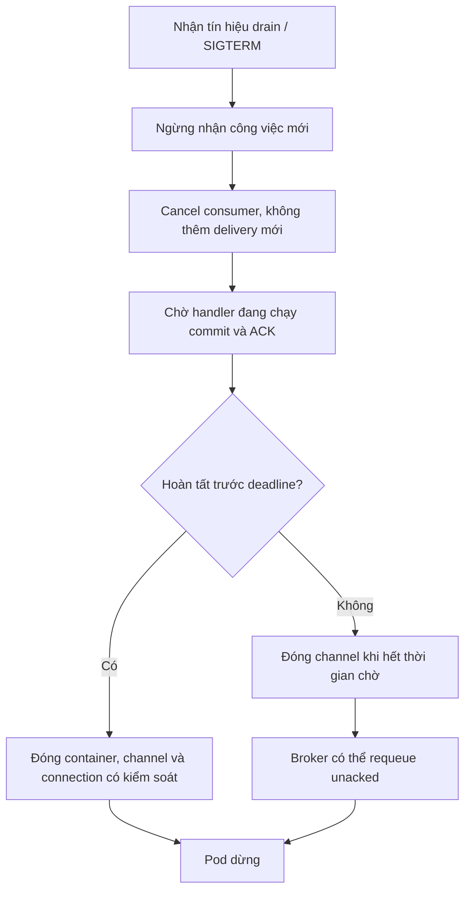
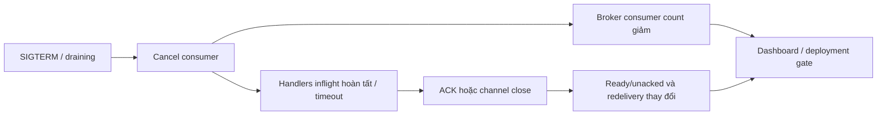

# Dừng an toàn, xử lý delivery đang chạy và rút consumer

> **Chương:** Triển khai và vận hành  
> **Công nghệ:** Spring AMQP, RabbitMQ, Spring Boot, Kubernetes  
> **Trọng tâm:** Khi triển khai phiên bản mới, scale-in hoặc bảo trì, dừng nhận message mới, cho delivery đang xử lý đủ thời gian hoàn tất, xử lý phần chưa acknowledgement và rút consumer khỏi RabbitMQ mà không hứa hẹn tính chất exactly-once không có thật.

## 1. Tình huống: pod bị dừng đúng lúc đang cập nhật đơn hàng

`OrderWorker` có listener `@RabbitListener(queues = "orders.work")`. Sau khi nhận `order.paid`, worker kiểm tra idempotency, cập nhật database rồi acknowledgement (ACK) cho RabbitMQ. Một đợt rolling deployment bắt đầu. Bộ điều phối gửi `SIGTERM` tới pod cũ trong khi một delivery đang chạy:

```text
RabbitMQ                                  Spring AMQP worker

Queue orders.work -- deliver M42 -------> @RabbitListener
                                           |
                                           +-- ghi dữ liệu vào DB
                                           |
                           SIGTERM --------+-- chưa kịp ACK
                                           |
                       channel đóng <------+ 
                                           |
Queue giữ/giao lại M42 <-------------------+ (unacked bị requeue)
```

Nếu thiết kế đúng, message `M42` có thể được worker khác xử lý lại, nhưng **tác động nghiệp vụ chỉ diễn ra một lần** nhờ idempotency. Nếu thiết kế sai, có thể xảy ra một trong hai kết quả: **mất công việc** (ACK quá sớm) hoặc **tác động nghiệp vụ lặp** (DB đã commit nhưng ACK chưa đến broker).

Một quy trình dừng an toàn cần trả lời bốn câu hỏi tách biệt:

1. Làm thế nào để **ngừng nhận delivery mới** từ RabbitMQ?
2. Các delivery **đã được broker giao nhưng chưa ACK** đang ở đâu? Có bao nhiêu phần tử đang thực sự chạy nghiệp vụ?
3. Khi hết thời gian chờ, có thể **đóng channel** và cho broker giao lại những delivery chưa được ACK mà không tạo hậu quả sai không?
4. Làm sao để Kubernetes, Spring lifecycle, health checks và queue metrics **cùng tuân theo một ngân sách thời gian**?

**Điểm mấu chốt:** graceful shutdown là cách **giảm số công việc bị gián đoạn**, không phải phép màu biến mạng, RabbitMQ và database thành một giao dịch nguyên tử. Vì vậy phải kết hợp drain với acknowledgement đúng lúc, retry/DLQ, idempotency và quan sát hệ thống.

### Mục tiêu học tập

Sau bài này, bạn có thể giải thích khác biệt giữa `basic.cancel`, `basic.ack`, `basic.nack` và đóng channel; cấu hình shutdown của `SimpleMessageListenerContainer`, quản lý listener qua `RabbitListenerEndpointRegistry`; thiết kế thời gian dừng trong Kubernetes; kiểm tra batch, manual ACK và xử lý bất đồng bộ; xây runbook cùng các test gây lỗi phù hợp.

## 2. Phân biệt bốn trạng thái của một message lúc shutdown

| Trạng thái quan sát | Điều đã xảy ra | Hệ quả khi worker dừng |
| --- | --- | --- |
| **Ready** trong queue | Message chưa được giao cho consumer hiện tại. | Giữ trong queue (theo độ bền, TTL và chính sách queue), consumer khác có thể lấy sau. |
| **Delivered, unacknowledged** | Broker đã gửi delivery qua channel nhưng chưa nhận ACK hợp lệ. | Nếu channel/connection đóng, RabbitMQ có thể requeue và redeliver; có thể xử lý trùng. |
| **Business committed, ACK chưa được broker ghi nhận** | Tác động dữ liệu đã xong, xác nhận giao nhận còn đang trên đường hoặc chưa phát. | Có cửa sổ **redelivery sau commit**: phải deduplicate theo `operationId`. |
| **ACK đã được broker chấp nhận** | Broker coi delivery đã được xử lý đối với queue thông thường. | Delivery đó không còn trong queue; nếu nghiệp vụ chưa bền vững thì có nguy cơ mất công việc. |

`messages_ready` và `messages_unacknowledged` trong RabbitMQ là hai trạng thái broker nhìn thấy. Chúng **không** phải các bộ đếm “đang chạy code” và “đã commit DB”: prefetch có thể khiến nhiều delivery ở trạng thái unacked dù chỉ một luồng đang thực thi business logic.

### 2.1. Prefetch quyết định lượng công việc có thể bị giữ ở consumer

Ví dụ một pod có **3 consumer** và `prefetch=20`: về nguyên tắc có thể có khoảng **60 delivery chưa ACK** đang được cấp cho pod, tùy queue, batch, ack mode và trạng thái thực tế. Chỉ một phần trong số đó đang ở giữa transaction; phần còn lại có thể đang chờ xử lý tại consumer/channel.

Nếu shutdown timeout mà channel buộc phải đóng, những delivery chưa ACK được broker giao lại; điều này làm tăng độ trễ, thay đổi thứ tự và số lần nhận. Prefetch quá lớn có thể khiến quá trình drain kém dự đoán hơn. Không vì muốn drain nhanh mà đặt `prefetch=1` cho mọi ứng dụng: phải cân đối throughput, số lượng consumer, thời gian xử lý p99 và lượng memory/message inflight.

### 2.2. `redelivered` không phải bằng chứng duy nhất của duplicate

RabbitMQ có cờ `redelivered` trong delivery, nhưng nó không phải cơ chế dedupe nghiệp vụ hoàn chỉnh: producer có thể publish cùng event hai lần với hai delivery mới, hoặc hệ thống có nhiều tuyến chuyển tiếp. Dùng **ID nghiệp vụ bền vững** như `operationId` và ràng buộc uniqueness ở database, không chỉ dựa vào `redelivered=true` để bỏ qua xử lý.

## 3. Dừng consumer có ba pha, không chỉ một lời gọi `stop()`



**Pha 1 — ngừng cấp việc:** Spring AMQP listener container được yêu cầu stop. Ở tầng AMQP 0-9-1, hủy consumer (`basic.cancel`) làm broker ngừng đẩy **delivery mới** đến consumer đó sau khi yêu cầu hủy có hiệu lực. Những delivery đã được gửi trước đó, kể cả đang truyền trên mạng hoặc nằm trong prefetch, **không tự biến mất** vì `basic.cancel`.

**Pha 2 — xử lý nốt:** handler có thể tiếp tục hoàn tất business transaction và ACK cho delivery đã nhận, trong giới hạn thời gian chờ của container. Nếu ứng dụng xử lý đồng bộ, lời gọi listener chỉ trở về sau khi logic đồng bộ hoàn tất; nếu đã giao việc ra thread khác và trả về ngay, container có thể nghĩ rằng listener đã xong mặc dù nghiệp vụ còn chạy.

**Pha 3 — đóng tài nguyên:** nếu tất cả handler kết thúc kịp, channel/connection được đóng bình thường. Nếu vượt deadline, một số container/cấu hình có thể buộc đóng channel; RabbitMQ sẽ xử lý các delivery chưa ACK theo semantics khi channel mất. Đóng channel **không có nghĩa bắt buộc phải xóa message**, và **cũng không rollback được DB transaction đã commit**.

### 3.1. Cancel, ACK và close là ba thao tác khác nhau

| Thao tác | Ảnh hưởng trực tiếp | Không bảo đảm |
| --- | --- | --- |
| `basic.cancel` | Ngừng đăng ký consumer để broker không tiếp tục gửi delivery mới theo consumer tag đó. | Không ACK/requeue ngay các delivery đã giao. |
| `basic.ack` | Xác nhận một hoặc nhiều delivery tag trên **channel hiện tại**. | Không chứng minh DB đã commit, trừ khi ứng dụng tự đặt thứ tự đúng. |
| `basic.nack` / `basic.reject` | Từ chối delivery; có thể yêu cầu requeue hoặc dead-letter theo cấu hình. | Không tự giới hạn số lần retry hoặc ngăn poison message. |
| Đóng channel/connection | Kết thúc kênh tiêu thụ; delivery còn unacked có thể được requeue. | Không ngăn duplicate business effect khi worker cũ đã commit. |

**Delivery tag chỉ có ý nghĩa trong channel đã nhận message.** Sau reconnect/channel replacement, không đem delivery tag cũ ACK trên channel mới; thao tác đó có thể gây lỗi protocol hoặc ACK sai. Trên batch/manual ACK, tuyệt đối không dùng ACK với `multiple=true` khi chưa chắc **mọi** delivery tag liên quan đã xử lý an toàn.

## 4. Cấu hình Spring AMQP để dừng có thời hạn

Ví dụ dùng Spring AMQP **AMQP 0-9-1**, `SimpleRabbitListenerContainerFactory` tạo `SimpleMessageListenerContainer` cho các phương thức `@RabbitListener`. Đây là lựa chọn quen thuộc cho queue worker; `DirectMessageListenerContainer`, RabbitMQ Stream và RabbitMQ AMQP 1.0 có cơ chế lifecycle tương ứng nhưng **không được giả định toàn bộ tùy chọn giống nhau**.

### 4.1. Cấu hình container minh họa

```java
import org.springframework.amqp.core.AcknowledgeMode;
import org.springframework.amqp.rabbit.config.SimpleRabbitListenerContainerFactory;
import org.springframework.amqp.rabbit.connection.ConnectionFactory;
import org.springframework.context.annotation.Bean;
import org.springframework.context.annotation.Configuration;

@Configuration(proxyBeanMethods = false)
public class DrainableOrdersContainerConfig {

    @Bean("drainableOrdersFactory")
    SimpleRabbitListenerContainerFactory drainableOrdersFactory(
            ConnectionFactory connectionFactory) {

        var factory = new SimpleRabbitListenerContainerFactory();
        factory.setConnectionFactory(connectionFactory);
        factory.setAcknowledgeMode(AcknowledgeMode.AUTO);
        factory.setConcurrentConsumers(2);
        factory.setMaxConcurrentConsumers(4);
        factory.setPrefetchCount(10);

        factory.setContainerCustomizer(container -> {
            // 30 giây là ví dụ; chọn theo p99 handler + thời gian commit/ACK.
            container.setShutdownTimeout(30_000L);
            // Chỉ dùng khi hiểu rủi ro redelivery nếu hết hạn shutdown.
            container.setForceCloseChannel(true);
        });
        return factory;
    }
}
```

Ví dụ này minh họa cấu hình **một** factory riêng, không tự động thay factory mặc định của toàn ứng dụng. Các thuộc tính quan trọng:

- `setShutdownTimeout(30_000L)`: ngân sách chờ consumer shutdown. Không chọn tùy tiện 30 giây cho handler có p99 chạy vài phút.
- `setForceCloseChannel(true)`: khi không thể dừng bình thường trong thời gian chờ, cho phép đóng channel để **giải phóng delivery chưa ACK** về broker theo semantics giao thức. Không dùng nếu bạn đang dựa vào giả định sai rằng tác vụ đang chạy sẽ luôn hoàn thành trước khi channel đóng.
- `setPrefetchCount(10)`: giới hạn số delivery chưa ACK mỗi consumer theo cấu hình QoS, ảnh hưởng lượng dữ liệu nằm ngoài `messages_ready` khi drain.
- `setConcurrentConsumers(2)` và `setMaxConcurrentConsumers(4)`: cho phép nhiều consumer trên cùng pod; cần tính tổng inflight và tác động khi pod bị dừng.
- `AcknowledgeMode.AUTO`: Spring ACK sau khi **listener hoàn tất thành công** (với xử lý đồng bộ); khác với RabbitMQ automatic acknowledgement ở chế độ `NONE`.

Nếu dùng Spring Boot với autoconfiguration, có thể tận dụng `SimpleRabbitListenerContainerFactoryConfigurer` của đúng phiên bản Boot để giữ message converter, retry và các property chung rồi mới tùy chỉnh shutdown. Đừng vô tình tạo factory mới làm mất cấu hình converter, observation hoặc advice chain đang dùng trong production. Một số tùy chọn container cũng có thể được đặt qua `spring.rabbitmq.listener.simple.*` tùy phiên bản, nhưng **kiểm tra property thật có được hỗ trợ** thay vì suy từ tên setter.

### 4.2. Listener đồng bộ: chỉ trả về sau khi dữ liệu bền vững

```java
import org.springframework.amqp.rabbit.annotation.RabbitListener;
import org.springframework.stereotype.Component;

@Component
public class OrdersWorkerListener {
    private final OrdersBusinessService ordersBusinessService;

    public OrdersWorkerListener(OrdersBusinessService ordersBusinessService) {
        this.ordersBusinessService = ordersBusinessService;
    }

    @RabbitListener(
            id = "orders-worker",
            queues = "orders.work",
            containerFactory = "drainableOrdersFactory")
    public void handle(String payload) {
        // Service thực thi transaction DB và dedupe theo operationId.
        // Khi return, transaction đã commit hoặc xử lý trùng đã được xác nhận.
        ordersBusinessService.commitOrSkipDuplicate(payload);
    }
}
```

`OrdersBusinessService` là service nghiệp vụ do ứng dụng cung cấp, giả định `commitOrSkipDuplicate` gọi một phương thức transactional mà transaction thực sự **đã kết thúc trước khi method return**. Với cấu hình ACK AUTO của container, trình tự mục tiêu là:

```text
Deliver M42 -> validate -> DB transaction commit -> handler returns -> container ACK
```

Nếu DB commit xong nhưng kết nối đứt trước ACK, RabbitMQ có thể redeliver M42. Lần nhận lại phải thấy `operationId` đã được xử lý và kết thúc an toàn **không tạo side effect thứ hai**. Không gọi `@Async void` từ listener rồi return ngay nếu công việc bất đồng bộ vẫn cần hoàn thành trước ACK: cách đó có thể khiến container ACK quá sớm.

## 5. AUTO, MANUAL và NONE: quyết định độ an toàn khi đang dừng

| Acknowledge mode Spring AMQP | Ai xác nhận? | Khi shutdown giữa chừng | Nguy cơ lớn nhất |
| --- | --- | --- | --- |
| `AUTO` | Container ACK sau khi listener hoàn tất thành công; lỗi được xử lý theo error/retry/requeue policy. | Handler đồng bộ đang chạy có thể tiếp tục tới deadline; chưa ACK sẽ được redeliver nếu channel đóng. | Listener trả về trước khi công việc thật hoàn tất; retry/DLQ không phù hợp. |
| `MANUAL` | Code ứng dụng gọi `basicAck`/`basicNack`/`basicReject`, hoặc adapter async phù hợp. | Phải ACK/NACK bằng **đúng channel** khi xử lý xong; channel có thể đóng khi hết deadline. | Quên ACK gây unacked kéo dài; ACK quá sớm gây mất việc; ACK trên channel cũ. |
| `NONE` | RabbitMQ tự coi message đã giao thành công khi deliver cho consumer (automatic acknowledgement). | Broker không còn delivery unacked để giao lại nếu process chết sau khi nhận. | **Mất việc âm thầm** khi worker crash trong lúc xử lý. |

### 5.1. Manual ACK minh họa thứ tự an toàn

```java
import com.rabbitmq.client.Channel;
import java.io.IOException;
import org.springframework.amqp.core.Message;
import org.springframework.amqp.rabbit.annotation.RabbitListener;
import org.springframework.stereotype.Component;

@Component
public class ManualAckOrdersListener {
    private final OrdersBusinessService business;

    public ManualAckOrdersListener(OrdersBusinessService business) {
        this.business = business;
    }

    @RabbitListener(id = "orders-worker-manual", queues = "orders.manual",
                    containerFactory = "drainableOrdersFactory", ackMode = "MANUAL")
    public void handle(Message message, Channel channel) throws IOException {
        long deliveryTag = message.getMessageProperties().getDeliveryTag();
        try {
            business.commitOrSkipDuplicate(message);
            // Chỉ ACK sau khi transaction nghiệp vụ thật sự commit.
            channel.basicAck(deliveryTag, false);
        }
        catch (NonRetryableBusinessException ex) {
            // requeue=false: DLX nếu được cấu hình, nếu không có thể bị loại bỏ.
            channel.basicNack(deliveryTag, false, false);
        }
        catch (TransientBusinessException ex) {
            // Demo: requeue; production phải có backoff, retry limit / DLQ.
            channel.basicNack(deliveryTag, false, true);
        }
    }
}
```

Đây là **mẫu minh họa**, không phải một handler có thể copy và chạy ngay: `OrdersBusinessService`, `NonRetryableBusinessException`, `TransientBusinessException`, queue và DLX do ứng dụng tự định nghĩa. Không đăng ký cả hai listener `AUTO` và `MANUAL` trên **cùng queue** nếu bạn muốn một test có kết quả xác định; ví dụ dùng hai queue khác nhau.

Điểm quan trọng không nằm ở chính xác dòng `basicAck`, mà ở **ranh giới commit**:

1. Nếu `commitOrSkipDuplicate()` lỗi trước DB commit, code chưa ACK; message cần được retry/DLQ theo chính sách.
2. Nếu DB đã commit nhưng `basicAck` thất bại vì channel đã đóng, lần redelivery phải được xem là duplicate hợp lệ.
3. Nếu `basicNack(requeue=true)` với một poison message không giới hạn, worker có thể tạo vòng lặp nóng. Cần retry có backoff, số lần tối đa và DLQ/quarantine.
4. Nếu `basicNack(requeue=false)` mà queue không có DLX hoặc cơ chế lưu lỗi khác, message có thể bị discard. Không giả định luôn có DLQ.

Nếu exception xảy ra **ngoài hai loại đã bắt**, hãy xác định rõ error handler/container sẽ xử lý delivery nào trong chế độ MANUAL. Ở chế độ này không thể luôn trông chờ container tự ACK/NACK thay bạn. Đảm bảo quy trình bắt lỗi không vô tình gửi ACK rồi lại NACK cho cùng delivery.

### 5.2. Listener bất đồng bộ và completion thực

Với các phiên bản Spring AMQP hỗ trợ `@RabbitListener` trả `CompletableFuture`, `Mono` hoặc kiểu kết quả async tương đương, container có thể xử lý acknowledgement theo **kết quả hoàn tất** của async operation; một số phiên bản tự chuyển sang manual acknowledgement khi phát hiện return type bất đồng bộ. Hãy kiểm tra version, factory và error/recovery semantics thực tế.

Điều **không** an toàn là:

```java
@RabbitListener(queues = "orders.work")
public void handle(String payload) {
    // Sai nếu công việc này chưa được durable mà method đã return.
    backgroundExecutor.submit(() -> business.handle(payload));
}
```

Handler trên trả về ngay, nên với ACK AUTO, container có thể ACK trong khi thread nền vẫn chưa commit. Nếu JVM bị dừng, RabbitMQ không còn message để redeliver. Để xử lý công việc lâu dài, hoặc giữ completion gắn với lifecycle listener đúng API/version, hoặc **ghi một công việc bền vững** (DB/outbox/work queue) rồi ACK sau khi bàn giao thành công. Không chỉ kéo dài shutdown timeout để che một async task không được theo dõi.

## 6. Quản lý listener runtime bằng `RabbitListenerEndpointRegistry`

Spring AMQP quản lý các endpoint `@RabbitListener` thông qua `RabbitListenerEndpointRegistry`. Với một listener có `id = "orders-worker"`, có thể tìm container tương ứng để dừng/cấp lại.

```java
import java.time.Duration;
import java.util.concurrent.CountDownLatch;
import java.util.concurrent.TimeUnit;
import org.springframework.amqp.rabbit.listener.MessageListenerContainer;
import org.springframework.amqp.rabbit.listener.RabbitListenerEndpointRegistry;
import org.springframework.boot.availability.AvailabilityChangeEvent;
import org.springframework.boot.availability.ReadinessState;
import org.springframework.context.ApplicationContext;
import org.springframework.stereotype.Component;

@Component
public class OrdersDrainCoordinator {
    private final RabbitListenerEndpointRegistry registry;
    private final ApplicationContext applicationContext;

    public OrdersDrainCoordinator(RabbitListenerEndpointRegistry registry,
                                   ApplicationContext applicationContext) {
        this.registry = registry;
        this.applicationContext = applicationContext;
    }

    public void drain(Duration timeout) throws InterruptedException {
        // Readiness là tín hiệu cho orchestration/HTTP, KHÔNG tự hủy AMQP consumer.
        AvailabilityChangeEvent.publish(
                applicationContext, ReadinessState.REFUSING_TRAFFIC);

        MessageListenerContainer container =
                registry.getListenerContainer("orders-worker");
        if (container == null) {
            throw new IllegalStateException("Missing listener orders-worker");
        }

        CountDownLatch stopped = new CountDownLatch(1);
        container.stop(stopped::countDown);
        if (!stopped.await(timeout.toMillis(), TimeUnit.MILLISECONDS)) {
            throw new IllegalStateException("Consumer drain exceeded deadline");
        }
    }
}
```

Code trên chỉ mô tả **một coordinator được gọi bằng quy trình vận hành có kiểm soát**; nó không tự đăng ký endpoint quản trị công khai, không được để bất cứ người nào gọi `drain()` từ Internet. Vì `stop(callback)` có thể liên quan tới việc chờ/đóng consumer, hãy điều phối từ một thread và ngân sách thời gian phù hợp. Nếu cùng context có **nhiều listener**, phải ngừng **tất cả listener liên quan** và tính drain theo nhiều container, không chỉ một ID.

Sau khi dừng có chủ đích, `container.start()` có thể được dùng để bật lại listener nếu application/context và broker vẫn khỏe. Nhưng với **pod chuẩn bị bị terminate**, không nên khởi động lại consumer chỉ vì readiness chuyển trạng thái, và không nên để auto-scaling/reconciler riêng gọi `start()` trong lúc drain. Cần có một state machine như `RUNNING → DRAINING → STOPPED` và quyền điều phối rõ ràng.

### 6.1. Registry không quản lý mọi container có thể tồn tại

`RabbitListenerEndpointRegistry` quản lý các container do annotation listener endpoints đăng ký. Một `SimpleMessageListenerContainer` được tự tạo như bean riêng hoặc một native RabbitMQ consumer ngoài Spring có thể có lifecycle khác; phải tìm đúng **đối tượng sở hữu consumer** rồi stop nó. Với multi-broker/routing connection factories, đừng nhầm ID listener giữa các context.

### 6.2. Thứ tự stop không đồng nghĩa thứ tự hoàn tất transaction

Spring `SmartLifecycle` và `DefaultLifecycleProcessor` hỗ trợ stop theo **phase**. Trong shutdown toàn `ApplicationContext`, các phase lớn thường dừng trước, với giới hạn thời gian cho mỗi phase; trong một phase, nhiều bean có thể dừng đồng thời. Nếu listener phụ thuộc bean DB/transaction, connection pool phải còn dùng được **cho tới khi handler kết thúc**. Đừng viết `@PreDestroy` tự đóng datasource trước khi Spring AMQP listener container hoàn tất drain.

Nếu có listener A nhận message rồi publish qua `RabbitTemplate` hoặc ghi outbox của service B, phải kiểm tra **phụ thuộc lifecycle**: đừng hủy connection factory hoặc database pool trong lúc listener A vẫn đang thực thi. Khi topology phức tạp, cấu hình thứ tự phase hoặc coordinator riêng thay vì suy đoán Spring luôn dừng bean đúng thứ tự nghiệp vụ mong muốn.

## 7. Kết nối Spring Boot graceful shutdown với thời gian chờ của RabbitMQ

Trong một ứng dụng Spring Boot, `SIGTERM` thường kích hoạt việc đóng `ApplicationContext`; các `SmartLifecycle` bean, bao gồm listener containers do Spring quản lý, được yêu cầu dừng. Tuy nhiên, **graceful shutdown HTTP** và **graceful shutdown AMQP** không phải cùng một việc.

```yaml
spring:
  lifecycle:
    timeout-per-shutdown-phase: 45s

server:
  shutdown: graceful

management:
  endpoint:
    health:
      probes:
        enabled: true
```

- `spring.lifecycle.timeout-per-shutdown-phase` giới hạn **thời gian Spring đợi mỗi nhóm lifecycle phase**. Đây không phải một “timeout tổng” cho toàn shutdown và không tự tăng `SimpleMessageListenerContainer.shutdownTimeout`.
- `server.shutdown: graceful` chỉ đạo **web server** xử lý HTTP requests đang chạy khi shutdown; nó **không thay** `RabbitListenerEndpointRegistry` hoặc `shutdownTimeout` của AMQP container.
- Health readiness probe giúp HTTP Service hoặc orchestration ngừng gửi **HTTP traffic mới** vào pod. RabbitMQ consumer vẫn có thể nhận message **cho đến khi listener container được stop/cancel**.
- Nếu container lifecycle phase timeout trước khi AMQP handler hoàn tất, không có bảo đảm graceful cho delivery đó; hãy chọn các deadline nhất quán.

**Không giả định mọi listener dừng tuần tự trong đúng 45 giây.** `45s` là tham số theo phase; Spring lifecycle có thể gồm nhiều phase hoặc bean đồng thời. Kiểm tra startup/shutdown logs với phiên bản Spring Boot/Spring AMQP đang dùng và đo thời gian drain thực tế.

### 7.1. Ví dụ phân bổ ngân sách thời gian

| Bước | Ngân sách minh họa | Lưu ý |
| --- | ---: | --- |
| Ngừng ingress/readiness, điều phối consumer stop | 5 giây | Chỉ là mục tiêu điều phối, không bảo đảm network propagation ngay. |
| Chờ AMQP handler đang chạy + commit + ACK | 30 giây | `setShutdownTimeout(30_000L)`, dựa trên p99 hoặc chính sách cố ý chuyển việc sang redelivery. |
| Spring lifecycle phase chờ dừng | 45 giây | Phải **lớn hơn** ngân sách container có thêm dư địa cho bean khác. |
| Kubernetes pod termination grace | 90 giây | Bao trùm preStop hooks, SIGTERM, Spring shutdown và phần đệm; không cộng mù các khoảng thời gian trùng nhau. |

Các số này chỉ phục vụ ví dụ, **không phải cấu hình mặc định**. Khi handler chạy lâu hơn 30 giây, chọn một trong ba hướng: tăng ngân sách (nếu hạ tầng cho phép), chia task thành bước ngắn có checkpoint bền vững, hoặc cho phép bị cắt và **tiếp tục an toàn bằng redelivery/idempotency**. Chỉ tăng Kubernetes grace mà không thay chiến lược ACK/timeout không giải quyết failure window.

## 8. Kubernetes: readiness khác việc rút consumer RabbitMQ

Kubernetes khi xóa pod thường thực hiện `preStop` nếu có, gửi tín hiệu kết thúc đến tiến trình chính và chờ tối đa `terminationGracePeriodSeconds` trước khi buộc kết thúc. Bộ đếm grace **có tính cả thời gian chạy preStop**, không phải bắt đầu sau preStop. Thời điểm endpoint HTTP được gỡ khỏi load balancer cũng không phải cam kết rằng tất cả yêu cầu đang chạy và mọi consumer đã drain xong.

Một cấu hình deployment tối thiểu minh họa ngân sách và readiness:

```yaml
apiVersion: apps/v1
kind: Deployment
metadata:
  name: orders-worker
spec:
  replicas: 3
  strategy:
    type: RollingUpdate
    rollingUpdate:
      maxSurge: 1
      maxUnavailable: 0
  selector:
    matchLabels:
      app: orders-worker
  template:
    metadata:
      labels:
        app: orders-worker
    spec:
      terminationGracePeriodSeconds: 90
      containers:
        - name: worker
          image: registry.example.internal/orders-worker:1.2.3
          ports:
            - containerPort: 8080
          readinessProbe:
            httpGet:
              path: /actuator/health/readiness
              port: 8080
            periodSeconds: 5
```

Image/registry/version là **placeholder**, không phải artifact đã được xây. Deployment giả định ứng dụng có HTTP Actuator trên 8080; với worker không mở HTTP listener, dùng readiness probe phù hợp khác. Kubernetes **không tự gửi `basic.cancel`** đến RabbitMQ khi readiness chuyển false: việc rút consumer phải do Spring listener lifecycle/coordinator thực hiện khi context đóng hoặc khi preStop drain riêng được gọi.

### 8.1. `preStop` nên điều phối drain, không chỉ sleep

Nếu cần ngừng tiêu thụ trước khi nhận SIGTERM, có thể thiết kế một **local admin drain endpoint có xác thực, chỉ truy cập trong pod** để `preStop` gọi `OrdersDrainCoordinator.drain(...)`. Endpoint đó cần được tạo/cấp quyền một cách có chủ đích; không mở qua public Ingress. Khi `preStop` gọi thành công, ứng dụng có thể đã dừng consumer trước khi tiến trình nhận SIGTERM. Nhưng nếu hook thất bại/timeout, **đường SIGTERM của ứng dụng vẫn phải tự dừng listener an toàn**.

Không dùng `preStop: sleep 30` như “giải pháp graceful shutdown” duy nhất: trong thời gian sleep, Spring có thể vẫn nhận delivery mới và Kubernetes đã trừ 30 giây khỏi ngân sách termination. Nếu chỉ cần một khoảng chờ endpoint propagation cho HTTP, sleep phải ngắn, có lý do riêng và **không thay** bước cancel consumer/đợi ACK.

### 8.2. Tín hiệu và PID 1 trong container

Nếu entrypoint là một shell wrapper không chuyển tiếp tín hiệu kết thúc tới JVM, Spring Boot có thể không nhận SIGTERM đúng lúc. Với Java image, dùng exec-form entrypoint hoặc wrapper có `exec java ...`, kiểm tra logs và termination behavior. Đừng suy rằng `kubectl delete pod` tự động gọi `@PreDestroy` trong mọi tình huống; `SIGKILL`, OOM kill hoặc node failure không chạy cleanup hooks như một shutdown có kiểm soát.

### 8.3. Rolling deployment và scale-in

Đợt rollout gồm hai mục tiêu đôi khi mâu thuẫn: **duy trì đủ consumer để xử lý backlog** và **rút pod cũ đúng lúc**. Có thể:

1. Cho pod mới sẵn sàng kết nối RabbitMQ và bắt đầu listener theo kế hoạch.
2. Khi pod cũ vào trạng thái drain, ngừng nhận message mới; xử lý in-flight và ACK những phần đã hoàn tất.
3. Pod còn lại nhận những delivery được requeue sau khi pod cũ đóng channel.
4. Theo dõi `messages_ready`, `messages_unacknowledged`, consumer count, redelivery rate, throughput và business duplicate rate.

`PodDisruptionBudget` giúp kiểm soát một số **voluntary disruptions**, nhưng không bảo vệ khỏi OOM/node failure và cũng không chặn RabbitMQ giao lại unacked. HPA scale-down, `kubectl rollout restart`, cập nhật image và node drain đều nên được kiểm thử bằng cùng quy trình shutdown. Tránh dừng đồng thời tất cả consumer của queue quan trọng nếu SLA backlog không cho phép.

## 9. Khi handler lâu hơn shutdown timeout

Giả sử listener thường chạy 2 giây nhưng đôi lúc xử lý file mất 5 phút. Chọn `shutdownTimeout=30s` nghĩa là **chủ động chấp nhận** một số delivery không thể kết thúc trong lượt xử lý hiện tại. Khi channel đóng, broker có thể requeue chúng; điều đó chỉ an toàn nếu công việc có thể tiếp tục hoặc chạy lại mà không gây side effect sai.

| Chiến lược | Phù hợp khi | Rủi ro cần kiểm soát |
| --- | --- | --- |
| Chờ tới khi hoàn tất | Hầu hết handler ngắn, giới hạn p99 rõ và hạ tầng cho phép grace dài. | SIGKILL vẫn có thể xảy ra; không thể hứa luôn chờ vô hạn. |
| Giảm prefetch và concurrency trong rollout | Muốn giới hạn lượng delivery unacked trên mỗi pod. | Throughput giảm, thay đổi tải lên các consumer còn lại; không làm task đang chạy nhanh hơn. |
| Chia công việc có checkpoint | Tác vụ nhiều phút/giờ, có state lưu bền vững. | Phải định nghĩa resume point/idempotency trên từng bước. |
| ACK sau khi ghi *durable handoff* | Listener chỉ làm enqueue công việc vào DB/outbox/hàng đợi nội bộ bền vững. | Handoff phải thực sự durable; queue in-memory không đủ. |
| Cho redelivery sau channel close | Công việc có thể lặp, `operationId` là duy nhất. | Duplicate và đổi thứ tự; cần DLQ/backoff và bảo vệ DB. |

### 9.1. Outbox và idempotency bảo vệ hai ranh giới khác nhau

- **Transactional outbox** hữu ích ở **producer**: khi business transaction commit, sự kiện cần phát được lưu cùng transaction; một relay có thể gửi lại nếu ngắt kết nối khi publish.
- **Inbox/deduplication** hữu ích ở **consumer**: nếu cùng event được RabbitMQ giao lại sau shutdown, consumer nhận ra đã xử lý và không nhân đôi side effect.

Ví dụ schema đánh dấu xử lý duy nhất:

```sql
CREATE TABLE processed_events (
    consumer_name VARCHAR(80) NOT NULL,
    operation_id VARCHAR(128) NOT NULL,
    PRIMARY KEY (consumer_name, operation_id)
);
```

Trong **cùng transaction** với business update, insert marker `(consumer_name, operation_id)` và xử lý dữ liệu. Nếu unique constraint báo trùng, bỏ qua business effect và ACK delivery như một lần nhận hợp lệ. Không dùng `SELECT exists()` rồi update/insert ở transaction tách biệt, vì hai consumer có thể chạy cùng lúc và đều vượt qua check.

Nếu handler gọi API ngoài DB (gửi email/thanh toán), DB inbox không rollback được side effect đã phát ra. Cần idempotency key tại API đích, hoặc một quy trình đối soát với trạng thái đã hoàn thành, tránh hứa “exactly once” chỉ nhờ ACK hay SQL constraint.

### 9.2. Đừng nhầm DB transaction với broker transaction

`@Transactional` cho database và `RabbitTemplate`/consumer ACK không mặc nhiên tạo ra một transaction nguyên tử giữa hai hệ thống. Nếu ACK xảy ra sau DB commit, vẫn có cửa sổ bị redeliver. Nếu ACK xảy ra trước DB commit và transaction lỗi, có thể mất event. Trừ khi có cơ chế phối hợp transaction chuyên biệt và hạn chế rõ ràng, hãy thiết kế **at-least-once delivery + idempotent business effect**.

## 10. Batch, request/reply và các consumer khác khi dừng

### 10.1. Consumer batch và producer batch

Với `consumerBatchEnabled`/`batchListener`, một lần gọi listener có thể bao gồm nhiều delivery vật lý. Với producer-created batch, một delivery vật lý có thể chứa nhiều phần tử logic. Nếu một phần tử thất bại khi shutdown:

- ACK/NACK ở broker áp dụng cho **delivery/tag** ở tầng giao thức; nó không tự hiểu rằng 7/10 dòng trong một batch đã commit DB.
- Nếu chấp nhận partial commits, phải deduplicate từng `operationId` khi toàn batch bị giao lại.
- Nếu dùng manual ACK với `multiple=true`, cần biết chính xác các tag nào đã hoàn tất; không ACK một dải tag khi còn phần tử chưa bền vững.
- `batchSize` không đồng nghĩa số tác vụ đang chạy hoặc lượng unacked cố định; prefetch, consumer count và de-batching đều ảnh hưởng.

Khi cần batch atomic business effect, cân nhắc transaction bao trùm toàn batch; khi cần xử lý từng phần, ghi checkpoint/idempotency theo item và có chiến lược retry/DLQ cho các item lỗi.

### 10.2. RPC/request-reply

Nếu worker dùng `@RabbitListener` trả kết quả cho `RabbitTemplate.convertSendAndReceive()`, shutdown có thể xảy ra sau khi server xử lý xong nhưng **reply chưa được gửi/route đến caller**. Caller có thể timeout, đặc biệt với Direct Reply-To là cơ chế không lưu replay như một reply queue bền vững. Rút consumer an toàn giảm tần suất lỗi nhưng không loại bỏ tình trạng **UNKNOWN**: caller phải đối soát theo `operationId` và retry idempotent.

Nếu API HTTP vừa nhận request RPC vừa làm listener, hãy cân nhắc thứ tự: ngừng **request mới** ở ingress, chờ request đang chạy trong phạm vi SLA, ngừng nhận **RabbitMQ request delivery mới**, rồi hoàn tất các reply còn khả năng gửi. Tất cả phải nằm trong cùng ngân sách shutdown; đừng đóng `RabbitTemplate`/connection trước khi RPC handler gửi reply.

### 10.3. RabbitMQ Stream và AMQP 1.0

Native RabbitMQ Stream consumer đọc log theo **offset**, khác queue AMQP 0-9-1 dùng `basicAck` cho delivery. Khi dừng stream consumer, cần ngừng nhận, lưu vị trí offset/consumer state đúng chiến lược và kiểm tra replay khi khởi động lại. Message không biến mất khỏi stream chỉ vì consumer đã xử lý xong. Nếu lưu DB trước khi checkpoint offset, replay vẫn có thể gây duplicate effect.

RabbitMQ AMQP 1.0 có **link và settlement** riêng; `RabbitAmqpTemplate`/listener container của client 1.0 không nên cấu hình bằng các setter thuộc `SimpleMessageListenerContainer` dành cho AMQP 0-9-1. Nguyên tắc vẫn là drain receiver, chờ nghiệp vụ bền vững, xử lý delivery chưa settle và xác minh reconnect/redelivery theo implementation đang dùng.

## 11. Quan sát: “consumer count giảm” chưa có nghĩa đã drain xong



Một số tín hiệu cần đo tại **cả broker và ứng dụng**:

| Tín hiệu | Nguồn | Cách diễn giải |
| --- | --- | --- |
| Consumer count theo queue | RabbitMQ Management/Prometheus | Biết consumer đang được đăng ký; không chứng minh handler đã commit/ACK. |
| `messages_ready` | RabbitMQ | Backlog chờ consumer; có thể tăng khi unacked được requeue sau close. |
| `messages_unacknowledged` | RabbitMQ | Delivery đã gửi và đang chờ ACK; có thể thuộc nhiều pod/channel. |
| Redelivery rate | RabbitMQ/metrics | Tăng trong rollout có thể do channel bị đóng trước ACK. |
| In-flight business handler count | Application Micrometer | Số handler thật sự chưa hoàn tất tại một pod; dùng gauge với nhãn low-cardinality. |
| Handler duration p95/p99 | Application | Giúp quyết định `shutdownTimeout` và termination grace. |
| DB commit + duplicate skip | Application/DB | Kiểm tra business effect không lặp dù redelivery. |
| Stop callback duration/timeout | Application logs/metrics | Đo thời gian rút consumer và xem drain có vượt deadline không. |
| DLQ depth và oldest message age | RabbitMQ | Biết lỗi poison/retry có tích lại sau rollout không. |

Đừng gắn `messageId`, `operationId` hoặc `customerId` làm **nhãn** mọi Micrometer metric: cardinality tăng rất nhanh. Ghi IDs ở trace/log có kiểm soát truy cập; metric chỉ nên gắn `service`, `listener_group`, `outcome`, `reason` đã được whitelist.

### 11.1. Một quy trình xác nhận drain đã xong

Sau khi lệnh stop được chấp nhận, kiểm tra **đồng thời**:

1. Listener container được đặt trạng thái stop/draining và không còn nhận delivery mới.
2. Trong trường hợp graceful hoàn toàn, số handler đang chạy của pod về **0** và các ACK tương ứng đã gửi thành công trước khi channel đóng.
3. Broker không còn consumer của pod cũ; nếu có unacked từ pod cũ bị đóng channel, chúng được requeue và **consumer còn lại xử lý thành công**.
4. Tổng số **business effect duy nhất** không tăng do duplicate khi so theo `operationId`.
5. Không xuất hiện spike bất thường của DLQ/retry hoặc backlog lâu không giảm.

`messages_unacknowledged=0` trên toàn queue **không phải điều kiện bắt buộc** nếu các pod khác vẫn đang xử lý. Cần phân biệt số liệu queue toàn cụm với dữ liệu connection/channel/pod, và tránh khẳng định “drain thành công” chỉ vì `consumers=0` trong một ảnh chụp màn hình.

## 12. Kiểm thử shutdown với broker thật, không chỉ mock lifecycle

Để kiểm thử hành vi requeue/ACK, dùng RabbitMQ thật (ví dụ Testcontainers), một database test và listener có thể điều khiển bằng `CountDownLatch` hoặc Awaitility. Một unit test gọi `registry.stop()` mà không có broker chỉ kiểm tra Spring wiring, **không** chứng minh delivery redelivery.

### 12.1. Case A — hoàn tất trước deadline

1. Test tạo queue riêng, consumer count và prefetch đã biết; listener xử lý message `M1` và **chặn tại failpoint trước DB commit**.
2. Publish `M1`, đợi latch xác nhận handler đã nhận message; đừng dùng `Thread.sleep()`.
3. Từ thread khác, gọi `container.stop(callback)`; listener không được nhận message mới sau khi quá trình cancel có hiệu lực.
4. Nhả latch cho listener commit DB và return; trong ACK AUTO, container gửi ACK sau đó.
5. Đợi stop callback, assert business effect của `M1` là 1, không còn delivery M1 cần redelivery và không có listener cũ tiếp tục nhận message.

Đây là **test cần điều phối nhiều thread**: không gọi stop blocking trên chính thread đang giữ latch rồi chờ handler tự giải phóng. Cấu hình callback/deadline chính xác phải phù hợp phiên bản container được dùng.

### 12.2. Case B — hết deadline, broker giao lại

1. Listener A nhận `M2`, ghi/commit business state và được giữ lại **trước ACK**, hoặc chạy lâu hơn shutdown timeout.
2. Stop listener/container A rồi mô phỏng channel/connection bị đóng trong môi trường test, không giết cả broker.
3. Listener B đang hoạt động nhận `M2` hoặc delivery được giao lại; assert bản ghi dedupe ngăn side effect thứ hai.
4. Kiểm tra `redelivered` (nếu khả dụng) cùng metric/dữ liệu nghiệp vụ, và xác định rõ broker đã requeue vì **unacked channel close**.

Nếu test A dùng `AcknowledgeMode.AUTO`, failpoint “sau commit trước ACK” khó cài bên trong container; có thể dựng một **manual ACK** test listener để điều khiển cửa sổ này một cách xác định. Không dựa vào việc gửi `SIGKILL` ngẫu nhiên rồi mong rơi đúng vài mili-giây giữa commit và ACK.

### 12.3. Case C — readiness false nhưng AMQP vẫn nhận delivery

1. Đặt `ReadinessState.REFUSING_TRAFFIC` khi listener còn chạy.
2. Publish một message test; có thể thấy listener vẫn nhận vì readiness HTTP không gửi `basic.cancel`.
3. Gọi stop thực sự bằng registry/container, đợi callback và chứng minh listener không nhận delivery mới.

Test này đặc biệt hữu ích cho các đội quen với HTTP graceful shutdown nhưng mới vận hành message workers.

### 12.4. Case D — rolling deployment và prefetch lớn

1. Chạy ít nhất hai consumer, một thuộc pod A và một thuộc pod B, với prefetch xác định.
2. Publish N message có `operationId` riêng và cố ý chặn một phần handler ở A.
3. Drain A; tiếp tục cho B nhận message và đếm kết quả business unique.
4. Kiểm tra tổng công việc hoàn tất, số redelivery, backlog age và khả năng A được rút đúng trước grace deadline.

Đừng assert thứ tự toàn cục tuyệt đối khi có prefetch, concurrency, requeue hoặc retry; RabbitMQ có thể thay đổi thứ tự giao lại. Hãy assert **tập ID được xử lý**, số business effect cuối cùng và các bất biến nghiệp vụ quan trọng.

### 12.5. Những test bổ sung khi có batch, RPC, transaction

| Tính năng | Cửa sổ lỗi cần thử | Assertion |
| --- | --- | --- |
| Consumer batch | Batch có 2/5 item đã commit, timeout rồi requeue phần delivery. | Idempotency theo từng item; DLQ/partial-failure policy rõ. |
| Manual ACK | Channel đóng trước `basicAck`; ACK với tag cũ sau reconnect. | Không ACK trên channel cũ; redelivery xử lý an toàn. |
| RPC reply | Server commit xong trước reply, pod bị terminate. | Caller timeout có trạng thái UNKNOWN, truy vấn đối soát hoạt động. |
| External API side effect | Gọi payment thành công trước ACK, redelivery. | Cùng idempotency key, không charge hai lần. |
| RabbitMQ unavailable lúc shutdown | ACK/close/reconnect lỗi. | Không đánh dấu job thành công nếu DB chưa commit; phục hồi khi broker trở lại. |

## 13. Runbook vận hành cho một đợt rollout

### Trước rollout

1. Kiểm tra rabbit queue type, DLQ, độ bền message, retry/backoff và idempotency. Đọc baseline `messages_ready`, `messages_unacknowledged`, consumer count, handler p99 và DLQ rate.
2. Xác nhận `shutdownTimeout`, lifecycle timeout và Kubernetes termination grace **đủ bao trùm** theo thiết kế.
3. Kiểm tra phiên bản code mới tương thích event schema, binding và queue hiện hữu. Không đổi queue declaration arguments bất tương thích trong cùng rollout không có kế hoạch migrate.
4. Đảm bảo số replica còn lại đủ năng lực khi một pod drain; với rolling update, chọn `maxUnavailable` và `maxSurge` theo SLA.

### Trong rollout

1. Dừng nhận HTTP traffic mới nếu ứng dụng có ingress; **stop listener container thực sự** để rút RabbitMQ consumer.
2. Cho in-flight handler commit và ACK trong thời gian chờ. Giữ database, connection factory và executor còn sống cho đến khi handler hoàn thành.
3. Nếu hết timeout, xem việc channel đóng/unacked redelivery là **đường lỗi được thiết kế**, không phải một bất ngờ. Quan sát duplicate rate, requeue, backlog và DLQ.
4. Chỉ coi pod mới sẵn sàng khi có kết nối RabbitMQ đúng và có consumer làm việc như kỳ vọng; readiness tùy thiết kế phải phản ánh khả năng nhận workload, không chỉ HTTP socket còn mở.

### Sau rollout

1. Kiểm tra số consumer đạt mục tiêu, không còn pod cũ hoạt động hoặc “zombie consumer” giữ unacked bất thường.
2. So sánh throughput, processing latency, queue age, DLQ và tỷ lệ dedupe với baseline.
3. Lấy mẫu `operationId` qua log/DB để chứng minh không thiếu side effect và không nhân đôi kết quả nghiệp vụ.
4. Nếu rollout gặp lỗi, rollback cần tính cả **event schema và idempotency compatibility**: consumer cũ có thể nhận message vừa được producer mới gửi.

### Bảng quyết định khi có lỗi

| Dấu hiệu | Khả năng cao | Hành động ưu tiên |
| --- | --- | --- |
| Pod rút lâu, backlog chưa giảm | Handler chạy quá p99, DB chậm, prefetch lớn hoặc retry kéo dài. | Đo in-flight/p99, chỉnh ngân sách; cân nhắc checkpoint hoặc requeue an toàn. |
| Consumer count giảm nhưng unacked tăng rồi nhảy sang ready | Channel đã đóng, broker giao lại những delivery chưa ACK. | Xem redelivery/dedupe, xác nhận worker còn lại nhận được. |
| DB có duplicate update sau deployment | Commit trước ACK nhưng consumer chưa idempotent. | Ưu tiên chặn duplicate business effect; triển khai inbox/unique key. |
| Mất event khi worker chết | Chế độ auto-ack (`NONE`) hoặc ACK trước durable commit. | Sửa ack boundary; tìm nguồn bù/replay, không chỉ tăng timeout. |
| Readiness false nhưng RabbitMQ vẫn cấp message | HTTP readiness không điều khiển AMQP consumer. | Stop registry/container; bổ sung drain choreography. |
| Lỗi `PRECONDITION_FAILED` hoặc channel closed | ACK trên channel sai/tag không hợp lệ, timeout broker hoặc topology conflict. | Kiểm tra delivery tags, reconnect, consumer timeout và broker logs. |
| HPA scale-in gây timeout RPC | Worker bị rút khi chưa gửi reply; direct reply-to không lưu hồi đáp. | Chỉnh drain sequence, timeout/compensation và idempotent RPC. |

## 14. Những hiểu lầm phải tránh

| Hiểu lầm | Thực tế |
| --- | --- |
| “Readiness false là RabbitMQ tự dừng gửi.” | Readiness thuộc orchestration/HTTP; AMQP consumer phải được cancel/stop. |
| “`container.stop()` ACK mọi message đang chờ.” | Stop điều phối consumer lifecycle; chỉ delivery thực sự được ACK mới được broker coi hoàn tất. |
| “`basic.cancel` lập tức đưa mọi unacked về ready.” | Cancel ngăn gửi mới; delivery đã giao có thể tiếp tục chờ ACK cho tới khi channel đóng. |
| “Channel đóng sau timeout là message đã được xử lý xong.” | Unacked có thể bị requeue; DB có thể đã commit hoặc chưa, cần idempotency. |
| “`NONE` là cách shutdown nhanh và an toàn nhất.” | RabbitMQ automatic ack có thể làm mất message nếu worker chết sau delivery. |
| “`@Transactional` đảm bảo DB commit và ACK nguyên tử.” | Hai hệ thống không mặc nhiên có một transaction chung; vẫn có cửa sổ duplicate/loss. |
| “Prefetch 100 nghĩa là 100 handler chạy song song.” | Prefetch giới hạn unacked delivery, không đồng nhất với số thread business đang chạy. |
| “Pod termination grace 90s nghĩa là mọi task 90s chắc chắn hoàn tất.” | SIGKILL/node failure, nhiều phase, preStop và lỗi kết nối vẫn có thể cắt công việc. |
| “Consumer count bằng 0 là dữ liệu đã an toàn.” | Còn cần kiểm tra DB commit, unacked/requeue, reply, DLQ và side effect. |
| “Chỉ cần retry là ngăn được mất/trùng.” | Retry có thể tạo duplicate; cần outbox/idempotency và ranh giới ACK rõ. |

## 15. Checklist quyết định và tổng kết

Trước khi kết luận một ứng dụng Spring AMQP sẵn sàng cho rolling deployment/scale-in, hãy trả lời:

1. **Listener ownership:** listener nào do `RabbitListenerEndpointRegistry` quản lý, listener nào được tạo thủ công hoặc dùng giao thức khác?
2. **Stop mechanics:** làm sao để ngừng nhận delivery mới, chờ in-flight và giới hạn thời gian đóng channel?
3. **ACK semantics:** đang dùng `AUTO`, `MANUAL` hay `NONE`? Trong trường hợp DB commit rồi ACK thất bại, handler có idempotent không?
4. **Prefetch/batch:** mỗi pod có thể giữ bao nhiêu unacked delivery? Có batch logic items, manual multiple ACK hoặc async thread không được theo dõi không?
5. **Time budget:** `shutdownTimeout`, lifecycle phase timeout, preStop và Kubernetes grace có tương thích với handler p99 không?
6. **Availability:** readiness false có thực sự đi kèm stop AMQP consumer, hay chỉ làm ngừng HTTP?
7. **Observability:** có đo drain duration, in-flight, unacked, redelivery, backlog, DLQ và business dedupe không?
8. **Resilience test:** đã gây lỗi trước/sau DB commit, trước ACK và khi pod bị SIGKILL để xác minh state cuối cùng chưa?

**Kết luận:** Dừng an toàn một Spring AMQP worker là **quy trình rút consumer có trạng thái**, không chỉ một lệnh tắt JVM. Hãy ngừng cấp delivery mới, cho handler đang chạy đủ thời gian commit và ACK, đóng tài nguyên theo lifecycle và chủ động chấp nhận redelivery của phần chưa ACK khi phải dừng gấp. Cấu hình `shutdownTimeout`, `forceCloseChannel`, `RabbitListenerEndpointRegistry`, Spring Boot lifecycle và Kubernetes termination grace cần khớp nhau. Với `RabbitTemplate`, `@RabbitListener`, exchange, queue, binding, retry và DLQ, **bảo đảm cuối cùng nằm ở trạng thái dữ liệu nghiệp vụ được xử lý idempotent**, không nằm ở giả định rằng shutdown luôn có thể hoàn tất mọi message đúng một lần.

### Tài liệu tham khảo

- [Spring AMQP — Message Listener Containers](https://docs.spring.io/spring-amqp/reference/amqp/receiving-messages/async-consumer.html): `SimpleMessageListenerContainer`, consumer lifecycle, ACK và shutdown.
- [Spring AMQP — Using Container Factories](https://docs.spring.io/spring-amqp/reference/amqp/receiving-messages/using-container-factories.html): cấu hình listener factory và container customizer.
- [Spring AMQP — Annotation-Driven Listener Endpoints](https://docs.spring.io/spring-amqp/reference/amqp/receiving-messages/async-annotation-driven.html): `@RabbitListener`, registry, container IDs và quản lý runtime.
- [Spring AMQP — Choosing a Container](https://docs.spring.io/spring-amqp/reference/amqp/receiving-messages/choose-container.html): khác biệt Simple và Direct listener containers.
- [RabbitMQ — Consumer Acknowledgements and Publisher Confirms](https://www.rabbitmq.com/docs/confirms): acknowledgement, channel close, redelivery và prefetch liên quan.
- [RabbitMQ — Consumer Guide](https://www.rabbitmq.com/docs/consumers): consumer cancellation, consumer timeout và tính chất phân phối lại.
- [Spring Boot — Graceful Shutdown](https://docs.spring.io/spring-boot/reference/web/graceful-shutdown.html): `server.shutdown`, lifecycle timeout và thời gian shutdown.
- [Kubernetes — Pod Lifecycle](https://kubernetes.io/docs/concepts/workloads/pods/pod-lifecycle/): SIGTERM, preStop, termination grace và trạng thái terminating.
- [Kubernetes — Deployments](https://kubernetes.io/docs/concepts/workloads/controllers/deployment/): rolling update, `maxSurge` và `maxUnavailable`.
