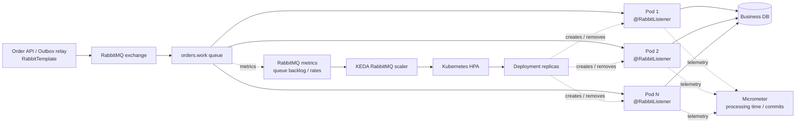
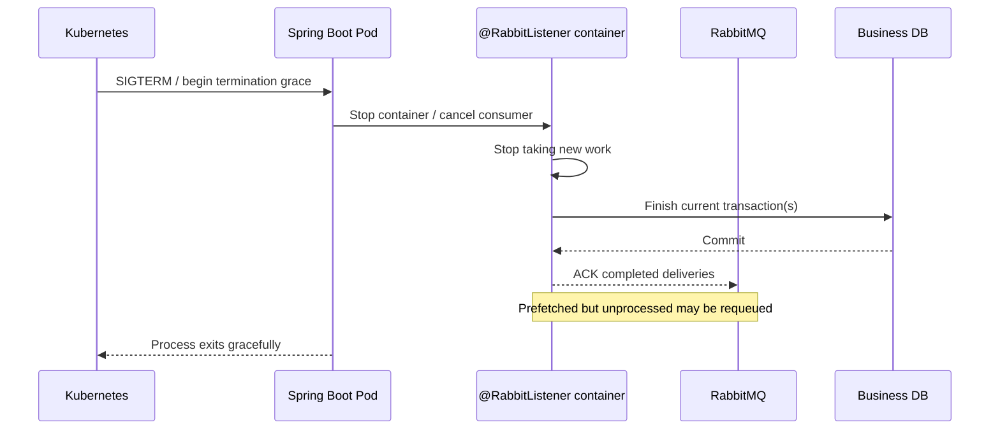

# Tự động mở rộng theo queue backlog và thời gian xử lý

## 1. Tại sao RabbitMQ consumer cần autoscaling theo công việc thật?

Trong hệ thống **Spring AMQP**, producer phát message bằng `RabbitTemplate` vào exchange, RabbitMQ định tuyến qua binding tới queue, rồi `@RabbitListener` nhận và thực thi nghiệp vụ. Khi lưu lượng tăng, một cách phổ biến để giữ thời gian xử lý là tăng số **consumer pod**. Tuy nhiên, autoscaling theo CPU đơn thuần hoặc theo số message chờ trong queue đơn thuần thường không cho kết quả như mong đợi.

Ví dụ dịch vụ xử lý đơn hàng có các đặc điểm:

- Ban ngày mỗi giây có 60 lệnh mới; giờ cao điểm có thể lên tới 180 lệnh/s.
- Mỗi lệnh cần validation, cập nhật PostgreSQL và gọi một dịch vụ phụ trợ, trung bình mất 200 ms.
- Một pod Spring Boot chạy 4 consumer threads nhưng hiệu suất thực tế chỉ đạt khoảng 60% lý thuyết vì I/O và cạnh tranh tài nguyên.
- SLO yêu cầu các lệnh đã vào queue phải được xử lý trong một khoảng trễ hợp lý; backlog tăng lâu sẽ gây quá hạn.
- Kubernetes phải tăng/giảm pod mà không làm mất message, nhân đôi side effect hoặc phá thứ tự theo aggregate.

Chính vì vậy, quyết định tăng số replica nên dựa vào cả **nhu cầu còn chờ** và **năng lực xử lý đo được**. Queue depth là tín hiệu về số lượng công việc; thời gian xử lý giúp ước lượng mỗi pod phục vụ được bao nhiêu công việc/giây. Từ hai dữ liệu đó, ta có thể tính số replica cần thiết, giới hạn theo tài nguyên database và chọn chính sách scale-in an toàn.

Bài học thuộc chương **Triển khai và vận hành** của module **SPRING_AMQP**, kết nối kiến thức RabbitTemplate, @RabbitListener, exchange/queue/binding với publisher confirms, consumer ACK, retry, dead-letter, transaction và quan sát để vận hành hệ thống bất đồng bộ đáng tin cậy.

### Sau bài học, bạn có thể

1. Phân biệt `messages_ready`, `messages_unacknowledged`, publish/deliver/ack rate và **business completion rate**.
2. Đo **processing time** ở Spring AMQP listener, tránh nhầm publisher confirm latency với thời gian hoàn tất nghiệp vụ.
3. Ước tính số consumer pod từ backlog, tốc độ đến, thời gian xử lý và mục tiêu drain time.
4. Dùng **KEDA RabbitMQ scaler** để mở rộng Deployment theo backlog hoặc arrival rate, với authentication và giới hạn an toàn.
5. Hiểu giới hạn của KEDA `QueueLength` và `ExpectedQueueConsumptionTime` khi cần SLO dựa trên DB commit thật.
6. Cấu hình prefetch, concurrency, resource limits, shutdown và ACK để scale-in không làm mất xử lý.
7. Chẩn đoán tình huống autoscaling không giúp tăng throughput vì DB, broker, hot key hoặc điều kiện ordering.
8. Thiết kế thử tải, dashboard, cảnh báo và quy trình rollout/rollback autoscaling.

## 2. Kiến trúc autoscaling: thay đổi consumer pod, không tự động mở rộng broker



Một **consumer Deployment** là nhóm pod cùng dùng Spring AMQP connection factory và đăng ký consumer trên một queue. RabbitMQ phân phối delivery cho các consumer có credit/prefetch và quyền nhận tương ứng.

Cần phân biệt ba chiều mở rộng:

| Chiều | Thay đổi cái gì? | Khi phù hợp | Giới hạn |
|---|---|---|---|
| **Tăng consumer trong một pod** | `concurrency` của Spring listener container | CPU/memory pod còn dư, DB chịu được | Một pod vẫn là failure domain; tăng thread không luôn tăng throughput |
| **Tăng pod** | `replicas` của Kubernetes Deployment qua KEDA/HPA | Muốn phân tán xử lý trên nhiều node, queue có thể chia việc | Nhiều connection/channel, DB/API có thể bão hòa |
| **Mở rộng RabbitMQ cluster/broker** | Thêm node, cân bằng queue leader/replica, thay storage | Bottleneck nằm tại broker, disk hoặc network | Tăng consumer pod không sửa được broker thiếu quorum hay IOPS |

**KEDA scale Deployment, không tự sinh thêm RabbitMQ broker node.** Khi consumer/DB nhanh hơn nhờ thêm pod, queue backlog có thể giảm. Nhưng nếu giới hạn thực nằm ở database, broker memory alarm hoặc API đối tác, thêm pod đôi khi chỉ làm hệ thống lỗi nhiều hơn.

## 3. Đọc đúng số liệu RabbitMQ

### 3.1. Ready, unacknowledged và tổng message

Với một queue AMQP 0-9-1:

- **`messages_ready`:** message đang chờ broker giao cho consumer.
- **`messages_unacknowledged`:** message đã được giao nhưng chưa được broker ghi nhận ACK/NACK kết thúc theo semantics hiện tại.
- **`messages` (total):** thường là tổng hai nhóm trên theo metric RabbitMQ tương ứng.

Ví dụ:

| Trạng thái | Ready | Unacked | Tổng | Diễn giải |
|---|---:|---:|---:|---|
| A | 1.800 | 100 | 1.900 | Backlog chờ lớn; có thể cần thêm năng lực |
| B | 0 | 800 | 800 | Nhiều delivery đã được phát, có thể đang chờ DB/ACK |
| C | 0 | 0 | 0 | Queue hiện rỗng; chưa chứng minh outbox/DLQ hoặc downstream đều xong |
| D | 20 | 0 | 20 | Ít message chờ, có thể là trạng thái bình thường |

**Không chỉ nhìn tổng `messages`:** trạng thái B có thể là một consumer giữ prefetch lớn và xử lý chậm. Nếu scale theo total mà phần lớn là unacked, thêm pod chưa chắc được giao đủ việc để cải thiện throughput, cho đến khi những delivery cũ được ACK hoặc requeue.

### 3.2. Tốc độ gửi, giao và xử lý

| Chỉ số | Ý nghĩa | Rủi ro diễn giải sai |
|---|---|---|
| `publish rate` vào queue | Message được route vào queue theo thời gian | Một event fanout sang nhiều queue có thể được đếm nhiều lần |
| `deliver/get rate` | Broker giao delivery hoặc có `basic.get` | Bao gồm redelivery; **không phải số business commit** |
| `ack rate` | Broker ghi nhận consumer ACK | Consumer có thể ACK duplicate; không luôn bằng số event unique |
| `redelivery rate` | Số delivery bị giao lại | Có thể tăng do crash, retry, shutdown hoặc mất connection |
| `business commit rate` | Số transaction xử lý event mới thành công | Cần instrument ở ứng dụng/DB, không suy từ deliver rate |
| `dead-letter / retry rate` | Lưu lượng bị tách vào đường lỗi | Queue nguồn giảm không đồng nghĩa nghiệp vụ hoàn thành |

Một lần `RabbitTemplate.convertAndSend(...)` thành công ở phía Java **không** chứng minh consumer đã xử lý xong. Ngay cả publisher confirm ACK cũng xác nhận một ranh giới publish, không phải database commit.

### 3.3. Queue backlog và “tuổi” message

Số lượng message chờ là một đại lượng **không có đơn vị thời gian**. Queue có 1.000 message chờ:

- Nếu hệ thống xử lý 1.000 message/s, backlog có thể hết rất nhanh.
- Nếu chỉ xử lý 5 message/s, việc chờ có thể kéo dài nhiều phút.
- Nếu message chứa payload lớn hoặc workload phụ thuộc API chậm, cùng số lượng vẫn có chi phí khác nhau.

Vì vậy nên đo thêm **oldest ready message age** hoặc **event-to-commit latency** theo hợp đồng. Không phải RabbitMQ queue/Prometheus exporter nào cũng cung cấp trực tiếp tuổi message cũ nhất; ứng dụng có thể theo dõi timestamp trên event, trace hoặc một telemetry service, đồng thời chú ý clock skew. Không suy tuổi message từ queue length mà không biết service rate.

## 4. Công thức ước lượng replica từ năng lực xử lý

### 4.1. Các đại lượng cần định nghĩa

Gọi:

- `Q`: số message **ready** cần xử lý tại thời điểm đo.
- `λ` (lambda): số message **mới tới queue mỗi giây** trong giai đoạn dự đoán.
- `s`: **thời gian xử lý trung bình** của một delivery đã hoàn thành tại consumer, đơn vị giây/message.
- `c`: số consumer có thể hoạt động đồng thời trong **một pod**.
- `η` (eta): hệ số hiệu quả từ 0 đến 1, phản ánh I/O, DB lock, overhead, GC và các giới hạn thực tế.
- `T`: thời gian mong muốn để **xử lý hết backlog hiện có** trong khi các message mới vẫn tới, đơn vị giây.
- `r`: năng lực xử lý **event/s trên một pod**, phải đo từ trạng thái thực tế chứ không chỉ lấy lý thuyết.

Ước lượng đầu tiên:

\[
r_{\mathrm{theory}} = \frac{c}{s},
\qquad
r_{\mathrm{effective}} = \eta \frac{c}{s}
\]

Năng lực hiệu quả này chỉ đáng tin nếu thời gian xử lý, tỉ lệ duplicate, workload mix và giới hạn downstream còn tương tự lúc đo. Với handler chờ một API hoặc DB, hiệu quả có thể thay đổi mạnh theo mức tải.

Nếu muốn backlog `Q` giảm về 0 trong `T` giây, cần:

\[
N_{\mathrm{target}}
\approx
\left\lceil
\frac{\lambda + Q/T}{r_{\mathrm{effective}}}
\right\rceil
\]

Trong đó `N` là **tổng số pod mong muốn**, không phải số pod cần tăng thêm. Phải giới hạn bằng `minReplicas`, `maxReplicas`, capacity DB, quota cluster và chính sách SLO.

### 4.2. Ví dụ tính chi tiết

Giả sử từ monitoring:

| Biến | Giá trị |
|---|---:|
| Ready backlog `Q` | 1.800 message |
| Arrival rate `λ` | 60 message/s |
| Mean business processing `s` | 0,20 giây/message |
| Consumer/pod `c` | 4 |
| Hiệu quả thực nghiệm `η` | 0,60 |
| Mục tiêu drain `T` | 120 giây |

Ta có:

\[
r_{\mathrm{effective}}
= 0.60 \times \frac{4}{0.20}
= 12\ \text{message/s/pod}
\]

Cần xử lý message mới và giảm backlog:

\[
\lambda + \frac{Q}{T}
= 60 + \frac{1800}{120}
= 75\ \text{message/s}
\]

Số pod:

\[
N_{\mathrm{target}}
= \left\lceil \frac{75}{12} \right\rceil
= 7\ \text{pod}
\]

Ở **7 pod**, năng lực ước tính `84/s`, lớn hơn arrival rate `60/s` khoảng `24/s`, nên backlog hiện có có thể drain trong khoảng `1800/24 = 75s` **sau khi đủ 7 pod đã sẵn sàng**. Sai số đến từ thời gian scale-up, workload mix và throughput không tuyến tính. Ở **6 pod**, năng lực khoảng `72/s`, chênh `12/s`, drain mất khoảng `150s` — vượt mục tiêu 120s.

**Điểm quan trọng:** công thức cho kết quả sizing tham khảo, không phải một thuật toán autoscaler có thể áp dụng thẳng mà không kiểm thử. Cần dùng **processing time trung bình** hoặc năng lực đã đo cho ước lượng throughput; `p95/p99 processing time` giúp kiểm tra SLO/tail behavior, không nên thế trực tiếp vào công thức năng lực nếu không nêu rõ mức bảo thủ mong muốn.

### 4.3. Giới hạn do DB quyết định trần

Nếu database chỉ xử lý ổn định **100 commit/s**, thì `N=10` theo công thức pod sẽ gợi ý `120/s`, nhưng downstream vẫn có trần khoảng `100/s`. Các pod thêm vào chỉ làm DB pool wait, lock contention và retry tăng.

Tối đa đáng cân nhắc theo năng lực DB là khoảng:

\[
N_{\mathrm{DB}} \lesssim \left\lfloor
\frac{\mu_{\mathrm{DB\,safe}}}{r_{\mathrm{effective}}}
\right\rfloor
\]

Ví dụ năng lực commit an toàn `96/s` và pod `12/s` cho khoảng `8` pod. Đây không phải quy tắc phải luôn floor: có overhead và độ biến thiên, nên cần đo thực nghiệm.

**Không dùng `maxReplicaCount` bằng mức CPU cluster cho phép nếu DB/API không chịu được tải tương ứng.**

### 4.4. Dự đoán backlog khi chưa đủ capacity

Trong điều kiện đơn giản, chưa có lỗi/retry/drop đáng kể:

\[
\frac{\Delta Q}{\Delta t}
\approx \lambda - N r_{\mathrm{effective}}
\]

Nếu `λ > N × r`, backlog tăng và **scale-to-zero hoặc scale-down không thể giải quyết**. Khi `λ < N × r`, backlog có khả năng giảm. Công thức này giả định rate tương đối ổn định; khi nhiều queue, TTL, retry, DLX, redelivery hoặc prefetch lớn, cần giải thích thêm thay đổi trong `ready` và `unacked`.

### 4.5. Little’s Law không phải bộ điều khiển autoscaling

Trong hệ thống ổn định:

\[
L = \lambda W
\]

`L` là số công việc trung bình trong phạm vi đo, `λ` là throughput trung bình và `W` là thời gian trung bình ở trong phạm vi đó. Nó giúp kiểm tra tính hợp lý của số liệu (chẳng hạn event-to-commit latency và số in-flight), **không trực tiếp xác định replica** trong lúc backlog đang tăng mạnh. Với tail latency hoặc traffic burst, cần đo thêm percentile và thời gian phục hồi.

## 5. Mở rộng theo backlog đơn thuần: dễ triển khai nhưng có giới hạn

Cách đơn giản là chọn số message `ready` mục tiêu **trên mỗi pod**. Nếu một pod có thể xử lý khoảng 80 message đang chờ trong một cửa sổ chấp nhận được, đặt mục tiêu `80` message/pod.

Ví dụ:

| Ready messages | Target/pod | Replica theo heuristic |
|---:|---:|---:|
| 0 | 80 | Phụ thuộc min/activation |
| 70 | 80 | 1 |
| 240 | 80 | 3 |
| 740 | 80 | 10 |
| 1.800 | 80 | 23, trước khi cap `maxReplicaCount` |

Đây là **cách giải thích gần đúng** scaling theo metric AverageValue của HPA/KEDA, **không** phải công thức luôn trùng với kết quả thực khi HPA có tolerance, stabilization window, activation threshold, missing metrics hay replica readiness.

### 5.1. “80 message/pod” lấy từ đâu?

Nếu mỗi pod xử lý bền vững khoảng `r=12/s` và mong muốn một lượng việc tương đương `W=6s` trên mỗi pod, phép ước lượng là:

\[
\text{backlog target per pod} \approx r \times W
= 12 \times 6 = 72
\]

Có thể bắt đầu thử `value: "70"` hoặc `"80"`, sau đó quan sát time-to-drain, tail latency, DB pool và mức dao động replica. Mục tiêu backlog/pod không được chọn tuỳ tiện từ tài liệu ví dụ.

Nếu queue có **nhiều loại message rất khác thời gian xử lý**, một count-based scaler có thể scale quá ít cho message nặng và quá nhiều cho message nhẹ. Khi đó cân nhắc tách queue theo workload hoặc dùng **weighted work units**/custom metrics.

### 5.2. Vì sao chỉ đếm ready đôi khi scale thiếu?

Giả sử broker `ready=0`, `unacked=600`, nhưng 600 delivery đang mắc ở những consumer cực chậm. KEDA đếm **ready only** có thể không scale thêm pod vì không còn message chờ broker giao; đó không hẳn là lỗi vì thêm pod **không lấy được** delivery đang giữ ở consumer khác. Giải pháp đúng có thể là:

- Giảm prefetch và số in-flight trên mỗi pod.
- Kiểm tra DB/API bottleneck và consumer liveness.
- Thêm timeout cho handler và xử lý stuck delivery theo chính sách.
- Tăng capacity downstream nếu nó mới là giới hạn.

Nếu dùng `total=ready+unacked` làm scale trigger, có thể tạo **scale-out không hiệu quả** khi message đã bị các consumer cũ giữ hết. Cần hiểu semantics metric KEDA theo protocol và cấu hình.

## 6. KEDA RabbitMQ Scaler: cách triển khai thực tế

**KEDA (Kubernetes Event-driven Autoscaling)** có RabbitMQ scaler, cung cấp external metrics cho Kubernetes HPA và quản lý scale dựa trên tín hiệu queue. Những ví dụ dưới đây tham chiếu KEDA **2.21** và Kubernetes hỗ trợ `autoscaling/v2`. Hãy kiểm tra schema khi dùng phiên bản khác.

KEDA RabbitMQ scaler có các mode được tài liệu hiện hành liệt kê:

| Mode | Tín hiệu | Trường hợp |
|---|---|---|
| `QueueLength` | Số message trên queue, theo protocol/config | Scale theo backlog |
| `MessageRate` | Publish rate của queue | Chủ động scale theo arrival rate, cần HTTP |
| `DeliverGetRate` | Delivery/get rate của broker | Phân tích consumer rate, không phải business commits |
| `PublishedToDeliveredRatio` | Tỷ số publish/deliver | Nhận biết producer tăng nhanh so với broker giao |
| `ExpectedQueueConsumptionTime` | **Ước lượng** thời gian để đọc hết queue từ queue length và broker rates | Gợi ý khi muốn theo drain time, nhưng không thay bằng business completion SLA |

**Đừng đánh đồng `ExpectedQueueConsumptionTime` với p95 thời gian xử lý trong `@RabbitListener`.** Mode này dựa trên số liệu broker và việc deliver/get; nó không hiểu một transaction DB đã commit hay chưa. Việc tính từ rate và backlog còn nhạy với polling window, mất metrics và tình trạng không có consumer.

### 6.1. Triển khai worker Deployment

Ví dụ một worker riêng, không expose HTTP nghiệp vụ. Dùng Actuator health probes để Kubernetes theo dõi startup/readiness, và đặt resource requests/limits để autoscaler có ngân sách rõ:

```yaml
apiVersion: apps/v1
kind: Deployment
metadata:
  name: orders-worker
  namespace: orders
spec:
  replicas: 2
  selector:
    matchLabels:
      app: orders-worker
  template:
    metadata:
      labels:
        app: orders-worker
    spec:
      terminationGracePeriodSeconds: 120
      containers:
        - name: worker
          image: registry.example.internal/orders-worker:1.0.0
          ports:
            - name: management
              containerPort: 8080
          resources:
            requests:
              cpu: "250m"
              memory: "512Mi"
            limits:
              cpu: "1000m"
              memory: "1Gi"
          env:
            - name: SPRING_RABBITMQ_ADDRESSES
              value: "rabbitmq.messaging.svc.cluster.local:5672"
            - name: SPRING_RABBITMQ_USERNAME
              valueFrom:
                secretKeyRef:
                  name: orders-rabbitmq-app
                  key: username
            - name: SPRING_RABBITMQ_PASSWORD
              valueFrom:
                secretKeyRef:
                  name: orders-rabbitmq-app
                  key: password
          startupProbe:
            httpGet:
              path: /actuator/health/liveness
              port: management
            periodSeconds: 5
            failureThreshold: 30
          readinessProbe:
            httpGet:
              path: /actuator/health/readiness
              port: management
            periodSeconds: 5
            failureThreshold: 3
```

Đây là **manifest học tập**, yêu cầu cluster đã có namespace, RabbitMQ, Secret ứng dụng và Actuator endpoint. Để các probe trên hoạt động, cần Spring Boot Actuator và các health probes đã được enable đúng phiên bản; không giả định `/actuator/health/readiness` kiểm tra RabbitMQ subscription hay DB dependencies theo ý bạn.

**Lưu ý với worker không nhận HTTP traffic:** readinessProbe ảnh hưởng trạng thái Pod Ready nhưng **không tự dừng @RabbitListener** khi readiness=false. Nếu app chưa sẵn sàng nhận message, hãy điều khiển listener lifecycle (`autoStartup`/`RabbitListenerEndpointRegistry`) và logic dependency readiness một cách riêng biệt. Tránh biến DB/ broker outage thoáng qua thành liveness failure gây restart hàng loạt.

### 6.2. Cấu hình Spring AMQP cho một pod

```yaml
spring:
  rabbitmq:
    listener:
      simple:
        concurrency: 4
        max-concurrency: 4
        prefetch: 10
        acknowledge-mode: auto
management:
  endpoint:
    health:
      probes:
        enabled: true
  endpoints:
    web:
      exposure:
        include: health,info,prometheus
```

Mỗi pod có **4 consumer threads** theo mô hình `SimpleMessageListenerContainer`, tổng số consumer tăng khi KEDA tăng pod. Prefetch 10 cho mỗi consumer tạo cửa sổ khoảng `4 × 10 = 40` delivery chưa ACK/pod (phụ thuộc QoS/container thực tế).

- Cố định `concurrency=max-concurrency` trong ví dụ để dễ đo **pod capacity**. Nếu bật **dynamic concurrency trong từng pod** và đồng thời scale số pod, tổng năng lực biến động theo hai vòng điều khiển, khó suy ra r/pod.
- `AcknowledgeMode.AUTO` ở Spring nghĩa là container ACK sau khi listener hoàn thành thành công; **không phải** RabbitMQ auto-ack (`NONE`).
- Prefetch cao có thể khiến một pod giữ quá nhiều message; scale-out thêm pod không thể lấy message đã `unacked` khỏi pod cũ cho tới khi ACK/requeue.
- Nếu message lớn, handler chậm hoặc cần strict ordering, hãy thử prefetch thấp hơn và đo hiệu quả.

### 6.3. Secret và TriggerAuthentication

Không đặt password trực tiếp trong `ScaledObject` hoặc commit AMQP URI có username/password vào Git. Giả sử secret `orders-keda-rabbitmq` đã được External Secrets/Sealed Secrets hoặc cơ chế quản trị bí mật tạo trong namespace `orders` với ba key:

```yaml
# Hình dạng dữ liệu yêu cầu; KHÔNG dùng literal secret production trong Git.
# Namespace: orders
# Secret name: orders-keda-rabbitmq
# Keys:
#   host: http://rabbitmq-management.messaging.svc.cluster.local:15672/
#   username: <read-only monitoring user>
#   password: <secret manager value>
```

Với KEDA RabbitMQ HTTP scaler, URI `host` dùng HTTP Management API. User dùng bởi KEDA chỉ cần quyền **đọc metric queue và vhost phù hợp**, không nên dùng superuser hoặc guest. Tùy RabbitMQ permission/tag/model auth, cần bảo đảm Management API cho phép truy cập queue cần quan sát.

```yaml
apiVersion: keda.sh/v1alpha1
kind: TriggerAuthentication
metadata:
  name: orders-rabbitmq-auth
  namespace: orders
spec:
  secretTargetRef:
    - parameter: host
      name: orders-keda-rabbitmq
      key: host
    - parameter: username
      name: orders-keda-rabbitmq
      key: username
    - parameter: password
      name: orders-keda-rabbitmq
      key: password
```

Đây là **credential của autoscaler**, tách khỏi Secret mà Spring application dùng publish/consume. Không cấp quyền publish hoặc consume cho KEDA chỉ vì nó cần đọc metric. Với TLS, dùng HTTPS và CA trust đúng; không chọn `unsafeSsl: "true"` để bỏ xác minh certificate trong production.

### 6.4. ScaledObject với QueueLength

```yaml
apiVersion: keda.sh/v1alpha1
kind: ScaledObject
metadata:
  name: orders-worker-autoscale
  namespace: orders
spec:
  scaleTargetRef:
    name: orders-worker
  minReplicaCount: 2
  maxReplicaCount: 12
  pollingInterval: 15
  cooldownPeriod: 300
  advanced:
    horizontalPodAutoscalerConfig:
      behavior:
        scaleUp:
          stabilizationWindowSeconds: 0
          policies:
            - type: Pods
              value: 4
              periodSeconds: 60
            - type: Percent
              value: 100
              periodSeconds: 60
          selectPolicy: Max
        scaleDown:
          stabilizationWindowSeconds: 300
          policies:
            - type: Pods
              value: 1
              periodSeconds: 60
  triggers:
    - type: rabbitmq
      metadata:
        protocol: http
        queueName: orders.work
        mode: QueueLength
        value: "80"
        activationValue: "5"
        excludeUnacknowledged: "true"
      authenticationRef:
        name: orders-rabbitmq-auth
```

**Diễn giải:**

- `minReplicaCount: 2` giữ ít nhất hai pod; tránh cold start/scale-to-zero với workload cần latency ổn định. KEDA có thể hỗ trợ `minReplicaCount: 0`, nhưng cần chấp nhận thời gian wake-up và điều kiện scale-up đáng tin cậy.
- `maxReplicaCount: 12` giới hạn số consumer pod. Giá trị phải được chứng minh bằng capacity của DB, broker, API, cluster quota.
- `pollingInterval: 15` là khoảng KEDA kiểm tra scaler khi áp dụng trong cơ chế của nó; khi HPA điều hành số replica trên 0, **HPA metrics polling cadence cũng có vai trò riêng**. Đừng coi 15 giây là thời gian phản ứng cố định từ message đến Pod Ready.
- `cooldownPeriod: 300` ảnh hưởng giai đoạn KEDA giảm về số replica tối thiểu; không đồng nghĩa tất cả quyết định scale-down của HPA đều đợi 300 giây. `advanced.horizontalPodAutoscalerConfig.behavior` quản lý hành vi HPA ở các mức replica tương ứng.
- `QueueLength` với `value: "80"` đặt mục tiêu backlog bình quân mỗi pod ở mức xấp xỉ 80 theo cơ chế external metric/HPA.
- `activationValue: "5"` là ngưỡng kích hoạt; với minReplicaCount=2, nó không thể tự đưa replica xuống dưới 2.
- `excludeUnacknowledged: "true"` khi dùng **HTTP mode** khiến QueueLength dựa trên **ready** thay vì total ready+unacked. Mặc định HTTP QueueLength có thể bao gồm unacked; AMQP mode có cách lấy số liệu khác và không hỗ trợ tham số này như HTTP.

**Quan trọng:** `excludeUnacknowledged` chỉ là lựa chọn metric, **không làm broker requeue các delivery đã unacked** và không tự sửa consumer bị stuck. Hãy kiểm tra queue state và việc phân bố message thực tế khi scale.

### 6.5. HPA là một phần vòng điều khiển

KEDA tạo và quản lý đối tượng HPA tương ứng với ScaledObject (trừ các cấu hình nâng cao đặc biệt). **Không tạo thêm một HPA độc lập cùng điều khiển `orders-worker`** mà không có thiết kế rõ; hai autoscaler tranh cập nhật `replicas` có thể khiến số pod dao động.

Ví dụ `value=80`, `ready≈740`, KEDA/HPA có thể đề xuất tăng gần **10 replica**, nhưng kết quả thực còn bị ảnh hưởng bởi `maxReplicaCount`, HPA scale behavior, sample polling, pending pod, startup time, metric state và resource quota.

## 7. Kết hợp backlog với arrival rate

Một scaler `QueueLength` phản ứng khi **backlog đã hình thành**. Nếu business cần phản ứng sớm hơn với traffic spike, có thể kết hợp tín hiệu publish rate.

KEDA RabbitMQ scaler hỗ trợ `MessageRate` bằng **HTTP protocol**. Ví dụ bổ sung trigger vào chính ScaledObject ở mục 6:

```yaml
  triggers:
    - type: rabbitmq
      metadata:
        protocol: http
        queueName: orders.work
        mode: QueueLength
        value: "80"
        activationValue: "5"
        excludeUnacknowledged: "true"
      authenticationRef:
        name: orders-rabbitmq-auth
    - type: rabbitmq
      metadata:
        protocol: http
        queueName: orders.work
        mode: MessageRate
        value: "35"
      authenticationRef:
        name: orders-rabbitmq-auth
```

`MessageRate` giá trị 35 ở đây là **mục tiêu minh họa theo publish rate trên mỗi instance**, không phải target mặc định của KEDA. HPA có thể tính mong muốn số replica cho từng metric và thường chọn đề xuất cao hơn, theo logic autoscaling nhiều metric; vì thế hai trigger là một cách xử lý cả **spike mới** và **backlog đã tích tụ**.

**Lưu ý quan trọng:**

- Hai trigger cùng Deployment có thể làm scale mạnh hơn dự kiến; đo ảnh hưởng lên DB và broker trước khi áp dụng production.
- `MessageRate` dựa trên **broker publish rate**, không phải số DB commits/s. Với retry/redelivery hoặc fanout, rate có thể không phản ánh lượng business event duy nhất.
- Broker rate metrics có độ trễ và smoothing; load spike dưới khoảng polling có thể không được quan sát đầy đủ.
- Nếu queue không có ready backlog nhưng arrival rate đã gần cap, rate trigger giúp scale dự phòng; nhưng không có gì bảo đảm đủ nhanh cho một spike diễn ra rất ngắn.

Đây là **một cấu hình thay thế cho `triggers` của ScaledObject ban đầu**, không phải một ScaledObject thứ hai cùng điều khiển một Deployment.

## 8. Thêm thời gian xử lý vào autoscaling bằng cách nào?

Câu hỏi quan trọng: **KEDA QueueLength không tự đọc timer `@RabbitListener`.** Nếu cùng backlog nhưng mỗi event mất 50 ms hoặc 2 giây, target count/pod cố định sẽ sai lệch về thời gian hoàn tất.

Có ba mức triển khai tăng dần.

### 8.1. Mức 1 — Chọn QueueLength target từ processing time đo được

Dùng dữ liệu Micrometer:

- Mean `processing_seconds`, p95/p99 theo loại event.
- Business commit rate `events/s` thật sự trên mỗi pod.
- Tỉ lệ lỗi, retry và duplicate.
- Số consumer active, DB wait, prefetch và memory.

Từ đó tính `r_effective` và chọn target `B_target ≈ r_effective × W_target`. Ví dụ pod xử lý bền vững 12/s, muốn backlog tương đương 6 giây làm việc/pod, chọn khoảng 72 message/pod.

Cách này **không tự điều chỉnh target theo processing time thay đổi từng phút**. Nhưng nó đơn giản, dễ kiểm chứng và thường đủ nếu payload/workload tương đối ổn định.

### 8.2. Mức 2 — Dùng mode ExpectedQueueConsumptionTime khi phù hợp

KEDA 2.21 có `ExpectedQueueConsumptionTime`, sử dụng queue length, publish rate và deliver/get rate để **ước lượng thời gian cạn queue**. Với các mode dựa trên broker rates như `DeliverGetRate`, `PublishedToDeliveredRatio` và `ExpectedQueueConsumptionTime`, tài liệu KEDA khuyên dùng `metricType: Value` ở những trường hợp phù hợp để so metric absolute thay vì bình quân theo số replica.

**Giới hạn cần hiểu:**

- `DeliverGetRate` là tốc độ **broker giao message**, không phải tốc độ business transaction commit.
- Với prefetch lớn, broker có thể giao nhanh nhiều message vào `unacked` trong khi consumer xử lý chậm; ETA dựa trên deliver rate có thể lạc quan.
- `ExpectedQueueConsumptionTime` nhạy với `pollingInterval`; KEDA 2.21 nêu cần **polling 1 giây** cho mô hình dự đoán trực tiếp, nên phải đánh giá chi phí Management API.
- Không dùng ETA KEDA làm SLO end-to-end nếu chưa đối chiếu với event-to-DB-commit latency của ứng dụng.

Một `ScaledObject` thử nghiệm (không chạy đồng thời với manifest mục 6 trên cùng Deployment):

```yaml
apiVersion: keda.sh/v1alpha1
kind: ScaledObject
metadata:
  name: orders-worker-eta-experiment
  namespace: orders
spec:
  scaleTargetRef:
    name: orders-worker
  minReplicaCount: 2
  maxReplicaCount: 12
  pollingInterval: 1
  triggers:
    - type: rabbitmq
      metricType: Value
      metadata:
        protocol: http
        queueName: orders.work
        mode: ExpectedQueueConsumptionTime
        value: "120"
      authenticationRef:
        name: orders-rabbitmq-auth
```

**Đây là một thí nghiệm, không phải lựa chọn mặc định khuyến nghị**. Cần kiểm tra cách tính metric và ý nghĩa HPA `Value` trên phiên bản KEDA đang dùng, tài nguyên API và khả năng phù hợp SLO; nếu không phù hợp, ưu tiên QueueLength kết hợp custom metric business.

### 8.3. Mức 3 — Custom metric dựa trên thời gian xử lý thực

Nếu SLA quan trọng và workload biến động mạnh, hãy đo:

1. `Q_ready` thực tế tại queue.
2. `λ_in`: arrival rate vào queue, đã làm mượt trong cửa sổ phù hợp.
3. `μ_pod`: unique business completion rate/pod hoặc processing time thực tế đã hiệu chỉnh.
4. `T_budget`: thời gian còn lại để xử lý backlog, trừ startup delay nếu cần.

Controller/custom scaler có thể tính:

```text
effectivePodRate = clamp(
    measuredUniqueCommitsPerPod,
    measuredRateLowerBound,
    configuredSafeMaximum
)

desired = ceil((arrivalRate + readyBacklog / drainBudgetSeconds)
               / effectivePodRate)

desired = clamp(desired, minReplicas,
                min(maxReplicas, downstreamCapacityReplicaLimit))
```

**Đây là pseudocode thuật toán**, không phải manifest native của KEDA RabbitMQ scaler. Khi triển khai thực, cần đưa kết quả thành **external metric** cho HPA/KEDA hoặc xây controller có rate limit/hysteresis và cơ chế fail-safe. Không được ghi đè `Deployment.spec.replicas` bằng một cron script cạnh tranh với KEDA/HPA.

### 8.4. Nếu muốn dùng Prometheus KEDA scaler

KEDA có Prometheus scaler và HPA có thể nhận external metric phát sinh từ PromQL. Một biểu thức doanh nghiệp kiểu `backlog × meanProcessingSeconds / effectiveConcurrency` có thể ước lượng **work seconds đang chờ**, nhưng:

- Công việc không đồng đều, sample ít hoặc không có consumer sẽ làm mean không đáng tin.
- Counter reset, scrape gap, mất target hoặc stale metrics phải được xử lý.
- Khi replica=0, không có processing timer; cần fallback dựa trên baseline/last known service time hoặc giữ minReplicaCount lớn hơn 0.
- Metric là **duration/estimated demand**, không mặc nhiên cùng ý nghĩa với AverageValue của HPA. Phải chỉ rõ `metricType`, normalization và thresholds.

Hướng ổn định hơn thường là **công bố custom metric đã chuẩn hóa** (ví dụ work-units backlog hoặc số replica mong muốn theo ranh giới hợp đồng) thay vì đưa một PromQL phức tạp chưa kiểm thử trực tiếp vào production.

## 9. Đo processing time trong Spring AMQP

### 9.1. Vì sao phải đo sau xử lý nghiệp vụ?

`@RabbitListener` được gọi không chứng minh message đã xử lý thành công. Thời gian cần đo gồm phần việc thực sự tiêu tốn capacity: parse/validate, DB transaction, API call và thao tác idempotency.

Ví dụ:

```java
public record OrderCommand(
        String eventId,
        String orderId,
        String action) {
}
```

Business service xử lý **một event ID đúng một lần ở mức side effect**:

```java
import org.springframework.jdbc.core.JdbcTemplate;
import org.springframework.stereotype.Service;
import org.springframework.transaction.annotation.Transactional;

@Service
public class OrderCommandService {
    private final JdbcTemplate jdbc;

    public OrderCommandService(JdbcTemplate jdbc) {
        this.jdbc = jdbc;
    }

    @Transactional
    public boolean applyOnceAndCommit(OrderCommand command) {
        int inserted = jdbc.update("""
            INSERT INTO applied_order_commands(event_id)
            VALUES (?)
            ON CONFLICT (event_id) DO NOTHING
            """, command.eventId());

        if (inserted == 0) {
            return false; // Delivery trùng: không áp dụng side effect lần 2.
        }

        jdbc.update("""
            INSERT INTO order_projection(order_id, last_action)
            VALUES (?, ?)
            ON CONFLICT (order_id)
            DO UPDATE SET last_action = EXCLUDED.last_action
            """, command.orderId(), command.action());

        return true;
    }
}
```

Schema PostgreSQL tối giản cho ví dụ:

```sql
CREATE TABLE applied_order_commands (
    event_id VARCHAR(120) PRIMARY KEY
);

CREATE TABLE order_projection (
    order_id VARCHAR(120) PRIMARY KEY,
    last_action VARCHAR(120) NOT NULL
);
```

Bảng và service là **minh họa**, chưa giải quyết aggregate version, authorization, payment side effects hoặc thứ tự event. Dùng transaction DB đảm bảo row idempotency và business update atomic với nhau. Khi cần ordering theo version, thêm checkpoint/version và optimistic/serializable controls phù hợp.

### 9.2. Listener với Micrometer Timer

```java
import com.fasterxml.jackson.databind.ObjectMapper;
import io.micrometer.core.instrument.MeterRegistry;
import io.micrometer.core.instrument.Timer;
import org.springframework.amqp.core.Message;
import org.springframework.amqp.rabbit.annotation.RabbitListener;
import org.springframework.stereotype.Component;

@Component
public class MeasuredOrderWorker {
    private final ObjectMapper mapper;
    private final OrderCommandService service;
    private final MeterRegistry metrics;

    public MeasuredOrderWorker(
            ObjectMapper mapper,
            OrderCommandService service,
            MeterRegistry metrics) {
        this.mapper = mapper;
        this.service = service;
        this.metrics = metrics;
    }

    @RabbitListener(id = "ordersWorker",
            queues = "orders.work")
    public void onOrder(Message message) throws Exception {
        Timer.Sample sample = Timer.start(metrics);
        String outcome = "failure";

        try {
            OrderCommand command = mapper.readValue(
                    message.getBody(), OrderCommand.class);

            boolean applied = service.applyOnceAndCommit(command);

            outcome = applied ? "applied" : "duplicate";
            metrics.counter("app.consumer.business.events",
                    "outcome", outcome).increment();
        } finally {
            sample.stop(Timer.builder("app.consumer.processing")
                    .tag("queue", "orders.work")
                    .tag("outcome", outcome)
                    .publishPercentileHistogram()
                    .register(metrics));
        }
    }
}
```

Đoạn code có các đặc điểm:

- Timer ghi cả đường xử lý thành công, trùng và thất bại; `outcome` là nhãn **cardinality thấp**.
- Counter `applied` chỉ tăng sau khi `applyOnceAndCommit` trả về thành công (Spring transaction proxy đã commit).
- Nếu parsing/DB lỗi, callback throw và Spring container thực hiện retry/reject theo cấu hình; **không tự ACK** khi listener thất bại.
- Không gắn `eventId` hoặc `orderId` làm metric labels; số series có thể tăng không giới hạn.
- Timer ở đây đo **độ dài từ vào listener đến khi service trả về**, chưa gồm queue waiting, thời gian nhận delivery ở network hoặc consumer ACK thực sự được broker ghi nhận.

Để đo throughput chính xác khi process crash **sau DB commit nhưng trước khi counter increment**, phải đối soát với DB hoặc event inbox. Metric application là tín hiệu vận hành, không tự là nguồn sự thật tuyệt đối.

### 9.3. Đo queue waiting và end-to-end latency

Producer có thể lưu `createdAtEpochMs` cùng event để consumer tính:

```text
event-to-receive = consumerReceiveEpochMs - eventCreatedEpochMs
event-to-commit  = consumerCommitEpochMs  - eventCreatedEpochMs
```

Đây là **ước lượng giữa hai JVM**, cần đồng bộ NTP và xử lý clock skew; timestamp từ producer không nhất thiết đáng tin nếu nguồn gửi từ bên ngoài.

Ngoài ra, `event creation` có thể trước `RabbitTemplate` nhiều giây nếu dùng outbox relay; việc đo e2e phải xác định rõ có tính thời gian nằm trong outbox hay không. Nếu muốn queue-only age, ghi timestamp lúc broker-queue ingress theo cơ chế có thể kiểm chứng, không gọi timestamp business là chính xác thời điểm vào queue.

### 9.4. Nên dùng mean hay p95?

- **Mean processing time** và **unique commits/s** giúp sizing trung bình/năng lực throughput.
- **p95/p99 processing time** cho biết phân bố đuôi, có thể cảnh báo DB/API bị chậm.
- **p95/p99 event-to-commit** liên quan trực tiếp tới SLA.
- Nếu có 5% event rất nặng, một mean chung có thể sai lệch capacity cho queue chứa toàn event nặng. Cân nhắc phân luồng theo loại event hoặc đo **weighted work units**.

Không lấy `p99=2s` rồi khẳng định tất cả message mất 2s, cũng không lấy mean=0,2s mà bỏ qua trường hợp hầu hết message nhanh nhưng 1% bị treo 30s.

## 10. Prefetch, concurrency và giới hạn in-flight

Spring AMQP có hai cơ chế chính điều khiển capacity của listener:

- **Concurrency:** số consumer cùng chạy; trong `SimpleMessageListenerContainer` có `concurrentConsumers`, `maxConcurrentConsumers` hoặc thuộc tính `concurrency`.
- **Prefetch:** giới hạn số delivery chưa ACK có thể được broker đẩy tới consumer tương ứng. Prefetch được áp dụng theo semantics của consumer/channel và cấu hình RabbitMQ.

Giả sử `N=7` pod, mỗi pod `c=4` consumer, prefetch `p=10`:

\[
\text{approx max in-flight} = N c p = 7 \times 4 \times 10 = 280
\]

Đây là **giới hạn cửa sổ gần đúng**, không phải 280 thread chạy song song. Nếu handler DB chỉ có 28 transaction slots trên toàn hệ thống, đẩy 280 message vào `unacked` chưa chắc giúp tăng throughput.

### 10.1. Prefetch quá cao khiến scale-out phản ứng chậm

Tình huống:

```text
1 pod, 4 consumers, prefetch=250
Broker ready=0, unacked=1000
CPU pod thấp, DB chậm
KEDA ready-only: 0 -> không đòi tăng replica
```

Thêm 5 pod không khiến broker tự lấy 1.000 unacked delivery về để phân phối lại. Các delivery ấy đang thuộc consumer cũ cho đến khi được ACK/requeue hoặc link/channel đóng. Hãy giảm prefetch theo năng lực xử lý thực và xác định bottleneck DB.

### 10.2. Chọn initial settings cho autoscaling

| Loại message | Gợi ý điểm thử ban đầu | Vì sao |
|---|---|---|
| Message nhỏ, xử lý nhanh | Prefetch 10–100, concurrency theo CPU | Giảm round trip, tăng throughput |
| Message lớn | Prefetch thấp hơn | Giảm memory do nhiều payload in-flight |
| Xử lý DB/API chậm | Prefetch 1–10 và concurrency có giới hạn | Tránh giữ hàng trăm delivery trong khi downstream bão hòa |
| Yêu cầu strict ordering | Thường một consumer/partition, prefetch 1 để dễ suy luận | Nhiều consumer có thể đảo thứ tự hoàn tất |
| Quorum queue quan trọng | Thử với durability/replication thật | Cost broker khác classic queue |

Bảng chỉ gợi ý **test sweep**, không có một giá trị tối ưu áp dụng cho mọi workload. Nếu dùng `AcknowledgeMode.NONE` (RabbitMQ auto-ack), prefetch không còn ý nghĩa chờ ACK giống chế độ AUTO/MANUAL và mô hình reliability cũng khác; không chọn NONE để tăng throughput khi ứng dụng yêu cầu xử lý đáng tin cậy.

### 10.3. Không tạo hai vòng autoscaling cạnh tranh

Nếu KEDA tăng pod theo QueueLength, còn Spring `SimpleMessageListenerContainer` đồng thời tăng `maxConcurrentConsumers` từ 1 lên 16 theo hoạt động, một pod có capacity thay đổi theo thời gian. Hậu quả:

- KEDA dựa trên capacity/pod cũ có thể scale quá nhiều hoặc quá ít.
- Số DB connections và RabbitMQ channels có thể tăng rất nhanh.
- Khó giải thích “mỗi pod xử lý được bao nhiêu message/s”.

Giai đoạn đầu nên dùng **concurrency cố định/pod** để calibrate. Sau khi hiểu rõ, có thể phối hợp hai vòng với giới hạn chặt, metrics đủ tốt và kiểm chứng load test.

## 11. Scale-in an toàn: shutdown và xử lý delivery đang dở

Khi KEDA/HPA giảm replicas, Kubernetes gửi tín hiệu chấm dứt tới các pod bị chọn. Một pod có thể đang có:

- Message trong handler đã bắt đầu transaction.
- Message đã được prefetch nhưng chưa gọi callback.
- Message vừa commit DB nhưng ACK chưa đến RabbitMQ.
- Publisher/outbox relay bất đồng bộ ở cùng tiến trình.

**Scale-in không đồng nghĩa “đợi tự động cho tất cả message hoàn tất”.** Cần đặt termination grace period, lifecycle và idempotency đúng.

### 11.1. Một shutdown timeline đúng



**Điểm kiểm chứng:** nếu JVM kết thúc trước khi ACK tới broker, delivery chưa ACK có thể được giao lại cho pod khác. Đây là lý do **idempotency là bắt buộc** khi scale-in, ngay cả khi bạn cấu hình shutdown timeout lớn.

### 11.2. Cấu hình factory để giới hạn thời gian dừng

Với Spring AMQP `SimpleMessageListenerContainer`, ví dụ tạo factory riêng cho worker:

```java
import org.springframework.amqp.core.AcknowledgeMode;
import org.springframework.amqp.rabbit.config.SimpleRabbitListenerContainerFactory;
import org.springframework.amqp.rabbit.connection.ConnectionFactory;
import org.springframework.context.annotation.Bean;
import org.springframework.context.annotation.Configuration;

@Configuration
public class OrdersWorkerListenerConfig {

    @Bean("ordersWorkerListenerFactory")
    SimpleRabbitListenerContainerFactory ordersWorkerListenerFactory(
            ConnectionFactory connectionFactory) {

        SimpleRabbitListenerContainerFactory factory =
                new SimpleRabbitListenerContainerFactory();

        factory.setConnectionFactory(connectionFactory);
        factory.setConcurrentConsumers(4);
        factory.setMaxConcurrentConsumers(4);
        factory.setPrefetchCount(10);
        factory.setAcknowledgeMode(AcknowledgeMode.AUTO);

        // shutdownTimeout thuộc listener container, không phải setter
        // trực tiếp của SimpleRabbitListenerContainerFactory.
        factory.setContainerCustomizer(container ->
                container.setShutdownTimeout(90_000L));
        factory.setForceStop(true);

        return factory;
    }
}
```

Khi sử dụng factory này, listener cần ghi rõ:

```java
@RabbitListener(
        id = "ordersWorker",
        queues = "orders.work",
        containerFactory = "ordersWorkerListenerFactory")
public void onOrder(Message raw) throws Exception {
    // Parse, validate, commit business state trước khi callback kết thúc.
}
```

Trong **cách cấu hình factory riêng này**, các property `spring.rabbitmq.listener.simple.*` ở mục 6 không tự động áp dụng lên custom factory nếu không dùng Spring Boot `SimpleRabbitListenerContainerFactoryConfigurer`; đừng giả định cả hai được trộn tự động. Chọn một cách cấu hình rõ ràng để tránh drift.

- `setShutdownTimeout(90_000L)`: chờ container dừng tối đa khoảng 90 giây theo semantics của container. Kubernetes `terminationGracePeriodSeconds=120` để có dư cho stop và các bước dừng khác.
- `setForceStop(true)`: sau khi message đang xử lý hiện tại hoàn tất, container cố dừng nhanh hơn; **các message đã prefetch nhưng chưa xử lý có thể được requeue** để pod còn sống xử lý tiếp. Tính năng này hữu ích khi scale pod, nhưng cần test theo phiên bản Spring AMQP.
- Không đặt **business handler timeout** chỉ dựa vào shutdown timeout. Nếu một API call treo vô hạn, JVM vẫn có thể bị kill sau grace period; dùng timeout/cancellation ở HTTP/DB client.

**Lưu ý:** `setForceStop(true)` không bảo đảm mọi message được xử lý đúng một lần hoặc ACK chắc chắn đến broker. Nó thay cách dừng consumer/prefetch, không thay idempotency.

### 11.3. preStop, readiness và consumer lifecycle

`readinessProbe` chỉ quyết định Kubernetes có coi pod là Ready để nhận traffic qua Service hay không; nó **không tự gỡ một RabbitMQ consumer**. Worker cần tự tạm ngừng nhận message thông qua listener container khi shutdown hoặc draining.

Một số dự án dùng lifecycle hook `preStop` để báo ứng dụng chuyển trạng thái draining, rồi chờ hoàn thành một bước. Nhưng:

- `preStop` tính **trong cùng termination grace period**.
- Một lệnh `sleep 30` chỉ trì hoãn, không bảo đảm transaction đã hoàn tất.
- Nếu app vẫn tiếp tục consume trong lúc preStop sleep, nó có thể nhận thêm việc thay vì drain.
- Nên dựa vào Spring container lifecycle và shutdown timeout được kiểm thử, không chỉ một lệnh sleep.

### 11.4. Manual ACK và async handler

Với `AcknowledgeMode.MANUAL`, application có trách nhiệm ACK/NACK đúng delivery/channel. Nếu handler chuyển việc sang `CompletableFuture` nhưng listener trả về sớm, phải kiểm tra API async consumption và hợp đồng ACK của Spring AMQP phiên bản dùng; không giữ deliveryTag qua connection khác.

Trong cả AUTO và MANUAL:

- Không ACK trước DB commit khi nghiệp vụ quan trọng.
- Không coi việc callback được gọi là xử lý thành công.
- Trong khoảng crash giữa DB commit và ACK, consumer mới phải chịu duplicate.
- Dùng message ID / business event ID ổn định và unique constraint/inbox.
- Retry phải có giới hạn, DLQ/error store cần được kiểm tra khi recover.

## 12. Autoscaling và yêu cầu thứ tự message

Không phải queue nào cũng phù hợp scale lên nhiều consumer một cách tự do.

### 12.1. Một queue, nhiều consumer không giữ global processing order

RabbitMQ có thể giao message theo thứ tự queue nhất định, nhưng nếu hai consumer cùng xử lý, message thứ 2 có thể hoàn thành trước message thứ 1 do DB/API latency khác nhau.

Ví dụ:

```text
order O-7 v1 -> Consumer A (gọi API 3 giây)
order O-7 v2 -> Consumer B (commit sau 50 ms)
```

Nếu cả hai cùng cập nhật projection mà không kiểm tra version, kết quả cuối có thể sai. Tăng KEDA replicas làm xác suất **xử lý song song** tăng, cần đảm bảo ordering theo hợp đồng.

### 12.2. Các lựa chọn an toàn

| Nhu cầu | Hướng thiết kế | Giới hạn scale |
|---|---|---|
| Message độc lập | Nhiều competing consumers | Có thể scale tới khi DB/broker bottleneck |
| Per-order/per-customer ordering | Route consistent key sang shard queue; một consumer active/shard hoặc version checks | Scale theo **số shard/key** có thể xử lý độc lập |
| Strict global ordering | Một consumer active cho luồng cần thứ tự | Thêm pod không làm luồng đó nhanh hơn |
| Quorum queue có Single Active Consumer | Một active consumer, standby consumers dự phòng | KEDA tăng pod không tăng tốc một queue có một active consumer |
| Hot customer/aggregate | Cô lập key nóng, version và rebalancing có kế hoạch | Một key không thể song song vô hạn mà vẫn giữ thứ tự |

Nếu queue được cấu hình `x-single-active-consumer=true` và chỉ có **một active consumer**, scale từ 2 lên 20 pod có thể tạo thêm standby connection mà throughput vẫn không tăng. Autoscaler cần cap theo **parallelism thật** và queue topology, không theo backlog count đơn thuần.

## 13. Khi nào không nên scale thêm pod?

### 13.1. DB/API downstream đã chạm trần

Dấu hiệu:

- RabbitMQ ready tăng.
- HPA/KEDA tăng replica.
- Business commits/s không tăng đáng kể.
- DB connection pool wait, query latency, lock contention hoặc HTTP 429 tăng.
- Redelivery/DLQ tăng.

Thay vì tiếp tục tăng maxReplicaCount, cần:

1. Giảm concurrency/prefetch hoặc giới hạn tối đa replica để bảo vệ DB.
2. Kiểm tra index/transaction duration, API rate limit và connection pool.
3. Tách queue theo loại workload có thời gian xử lý khác nhau.
4. Thêm circuit breaker/backoff cho downstream.
5. Chỉ tăng replica sau khi xác nhận throughput/pod tăng được trong budget tài nguyên.

### 13.2. Message quá lớn hoặc heap gần giới hạn

Nhiều pod và prefetch cao có thể nhân tổng số payload giữ trong memory. Với message 256 KiB, 40 in-flight/pod có thể cần ít nhất 10 MiB **chỉ cho raw body bytes**, chưa tính converter, String, DTO, trace/log và TCP buffers. Thực tế có thể lớn hơn nhiều.

Chọn prefetch và container memory request/limit dựa trên **payload size p95/p99**, không chỉ average.

### 13.3. Quorum queue thiếu quorum hoặc broker alarm

KEDA có thể tăng consumer pod nhưng broker không thể phục vụ queue nếu quorum queue thiếu majority, bị memory/disk alarm hoặc network partition. Khi đó cần runbook phục hồi broker, không phải scale application. Theo dõi:

- Quorum leader/member availability.
- RabbitMQ connections, channels, memory/disk alarms.
- Queue publish/deliver/ACK rates.
- Error logs của Spring connection factory và listener.

### 13.4. Retry/poison message tạo backlog ảo

Một message lỗi cố định bị requeue vô hạn có thể chiếm phần lớn deliveries. Autoscaler nhìn thấy queue backlog hoặc message rate lớn rồi tăng pod, nhưng unique business commits vẫn thấp. Cần **bounded retry**, backoff, dead-letter/quarantine và alert theo poison key thay vì thêm consumer mãi.

## 14. Theo dõi HPA, KEDA và Spring AMQP

### 14.1. Dashboard tối thiểu

| Lớp | Metric nên hiển thị |
|---|---|
| RabbitMQ queue | Ready, unacked, total, publish rate, deliver/get rate, ACK rate, redeliver |
| RabbitMQ broker | CPU, memory/disk alarm, quorum state, channels/connections |
| Spring listener | Handler processing time mean/p95/p99, attempts, applied/duplicate/failed |
| Business DB | Commit rate, transaction latency, pool wait, deadlocks, lock contention |
| Autoscaler | Current/desired replicas, scaling events, trigger metric, KEDA ScaledObject conditions |
| Kubernetes | Pod Pending/Ready/Terminating, startup seconds, restarts, CPU throttling, OOMKilled |
| SLO | Oldest pending age, event-to-commit p95/p99, backlog drain time, retry/DLQ |

Metrics theo queue phải **gắn đúng virtual host**, đặc biệt khi nhiều queue trùng tên ở các vhost hoặc broker khác nhau.

### 14.2. Prometheus và Micrometer

RabbitMQ hỗ trợ plugin `rabbitmq_prometheus`. Spring Boot Actuator/Micrometer có thể xuất các bộ đếm và timer của ứng dụng. Ví dụ metric names dạng Prometheus cho ứng dụng ở mục 9 thường là:

```text
app_consumer_processing_seconds_count
app_consumer_processing_seconds_sum
app_consumer_business_events_total{outcome="applied"}
```

Tên/labels chính xác phụ thuộc `MeterRegistry`, naming convention và cấu hình, nên **kiểm tra endpoint `/actuator/prometheus` đang chạy** trước khi viết PromQL dashboard.

Ví dụ PromQL minh họa xử lý:

```promql
sum(rate(app_consumer_business_events_total{
  outcome="applied"
}[2m]))
```

Mean processing time trên chuỗi timer:

```promql
sum(rate(app_consumer_processing_seconds_sum[2m]))
/
clamp_min(sum(rate(app_consumer_processing_seconds_count[2m])), 0.001)
```

Những biểu thức trên phải lọc theo `service`, `queue`, `namespace`, `outcome` nếu cần; đừng cộng thời gian xử lý từ một workload khác vào mục tiêu scale. Để đo business service capacity/pod, chia kết quả theo label `pod` rồi xem percentile/trung bình qua các pod, không lấy rate của toàn Deployment để suy rate **của một pod** mà không normalization.

### 14.3. Queue metrics theo Prometheus

RabbitMQ Prometheus có thể cung cấp nhiều mức metrics, từ tổng quan node đến per-object/per-queue tùy endpoint, phiên bản và cấu hình. Ví dụ minh họa:

```promql
rabbitmq_queue_messages_ready{
  queue="orders.work",
  vhost="/"
}
```

Để sử dụng, cần **xác nhận metric này thực sự tồn tại ở endpoint đang scrape và labels đúng**. Một số cấu hình chỉ scrape aggregated metrics; để quan sát từng queue có thể phải chọn endpoint hoặc cấu hình per-object phù hợp. Không dùng PromQL trả về empty vector để mặc định “queue có 0 message”.

### 14.4. Cảnh báo không chỉ dựa vào replica

Một tập alert thực tiễn:

- `ready` tăng liên tục trên 5–10 phút, trong khi `business applied/s` thấp.
- `event-to-commit p99` vượt SLO nhiều cửa sổ liên tiếp.
- `oldest pending age` cao hoặc backlog drain estimate tăng.
- `desiredReplicas=maxReplicaCount` trong thời gian kéo dài, nhưng backlog không giảm.
- HPA/KEDA không lấy được external metric hoặc ScaledObject không Active/Ready như kỳ vọng.
- Pod Pending/NotReady kéo dài, startup chậm hơn ngân sách scale.
- `unacked` cao, redelivery/retry/DLQ tăng bất thường.
- Database pool saturation hoặc RabbitMQ quorum/disk alarm.

**Không mặc định scale “thành công” chỉ vì replicas tăng.** Kiểm tra business SLO và khả năng xử lý thêm công việc mới.

## 15. Bảo mật cho autoscaler và đường điều khiển

KEDA cần quyền đọc queue metrics nhưng không cần thực hiện side effect nghiệp vụ.

- Dùng **TriggerAuthentication** tham chiếu Kubernetes Secret được quản lý bởi secret manager; hạn chế quyền đọc Secret qua RBAC.
- Tách credential quản trị metrics khỏi credential consumer; RabbitMQ Management API chỉ cấp quyền cần thiết.
- Sử dụng TLS và certificate validation; không bỏ xác thực TLS vì dễ kết nối hơn.
- NetworkPolicy giới hạn pod và KEDA operator truy cập đúng RabbitMQ/Management API; không mở cổng 15672 ra Internet.
- Không gắn host URI chứa password trong log hoặc ConfigMap; tránh ghi nó vào câu lệnh shell history.
- Bảo đảm KEDA operator có quyền thao tác HPA/ScaledObject đúng namespace và chỉ các nhóm được phép có quyền thay đổi `maxReplicaCount`.
- Ghi audit thay đổi ScaledObject, config listener và DB pool vì đó là thay đổi **năng lực thực thi nghiệp vụ**.
- Kiểm thử khi RabbitMQ Management API lỗi: metric scaler không sẵn, HPA có thể giữ replica hiện tại hoặc áp dụng logic failure cụ thể; cần runbook và fallback theo version KEDA/HPA.

**Không coi quyền publish RabbitMQ của một ứng dụng là quyền thay đổi autoscaling.** Đây là hai trust boundary tách biệt.

## 16. Chọn minReplicas, maxReplicas, cooldown và scale-up rate

| Tham số | Chọn theo | Nếu sai dễ xảy ra |
|---|---|---|
| `minReplicaCount` | SLO latency, cần warm pool, availability | Đặt 0 gây cold start hoặc mất khả năng phản ứng nhanh |
| `maxReplicaCount` | DB/API quota, RabbitMQ connection budget, cost | Quá cao gây connection storm và DB saturation |
| `pollingInterval` | Độ trễ metric, API load, burst duration | Quá ngắn gây tải metrics; quá dài bỏ lỡ spike |
| `cooldownPeriod` | Hành vi giảm về min/zero theo KEDA | Nhầm lẫn với HPA scale-down stabilization |
| HPA `scaleUp.policies` | Pod startup time và tốc độ cần thiết | Quá mạnh gây DB connection storm, quá chậm gây backlog |
| HPA `scaleDown.policies` | Thời gian xử lý, drain, duplicate risk | Quá nhanh làm nhiều pod bị terminate cùng lúc |
| HPA stabilization | Chống dao động replica do metric nhiễu | Dễ thrashing hoặc giảm quá chậm |
| `value` của QueueLength | Pod effective throughput × target work time | Đặt quá cao làm lag lớn, quá thấp over-provision |
| Consumer `concurrency` | Thread count, DB/API capacity per pod | Tăng in-flight mà không tăng commits |
| Consumer `prefetch` | Payload size, handler time, ordering | Prefetch cao giữ nhiều unacked, scale-out kém hiệu quả |

### 16.1. Scale-to-zero: khi nào dùng?

Scale-to-zero phù hợp workload ít và chấp nhận warm-up delay. Nhưng cần:

- Queue vẫn bền vững/khả dụng khi không có consumer.
- KEDA có metric và credential hợp lệ để thấy backlog.
- Pod có thể startup, connect, declare topology và chạy listener trước deadline.
- Không có state chỉ nằm trong RAM của consumer.
- Retry/delayed message không bị bỏ quên do activation hoặc scaler đọc sai queue.
- Đánh giá cold-start p99, image pull và cluster autoscaler node provisioning.

Với hệ thống giao dịch cần phản hồi trong vài giây, **minReplicaCount≥1–2** thường thực tế hơn. Không có một giá trị tối ưu chung; thử tải cold-start trước khi quyết định.

## 17. Quy trình rollout và thay đổi cấu hình an toàn

Một lần đổi `value=80` sang `value=10` có thể khiến desiredReplicas tăng gấp nhiều lần. Cần triển khai như một thay đổi capacity có kiểm soát.

### 17.1. Pre-deployment checklist

1. Xác minh queue, vhost và RabbitMQ Management endpoint/credentials của KEDA.
2. Kiểm chứng metric ready/unacked và publish/ACK với dashboard.
3. Đo `r_effective`, mean/p95 processing time, DB/API capacity và pod startup time.
4. Chọn `minReplicaCount`/`maxReplicaCount` và scale rate theo ngân sách tài nguyên.
5. Cố định/hiểu cấu hình concurrency, prefetch, ACK, retry, DLQ và shutdown timeout của consumer.
6. Kiểm tra transaction idempotency, xử lý redelivery và outbox nếu có.
7. Kiểm thử termination grace period và forceStop theo đúng Spring AMQP version.
8. Xác nhận không có **HPA thứ hai** cùng điều khiển Deployment.
9. Chạy thử ở staging với workload đại diện, có lệnh rollback rõ.
10. Bảo đảm cảnh báo cho KEDA metric unavailable, HPA maxed out, backlog age và DB saturation.

### 17.2. Cách rollout

```text
Baseline
  -> KEDA với min=max=replicas hiện tại (quan sát trước)
  -> Bật autoscale range nhỏ (ví dụ 2-4)
  -> Load test burst và đo time-to-drain
  -> Mở range 2-8 nếu DB chịu được
  -> Mở tối đa theo capacity plan và SLO
  -> Theo dõi nhiều chu kỳ cao/thấp điểm trước khi xem hoàn tất
```

Khi dùng `min=max` để quan sát, hãy cân nhắc HPA/KEDA semantics trên phiên bản thực; phương pháp chính là **giới hạn biến động replica** ban đầu và xác thực metrics/conditions, không ép một manifest chỉ vì ví dụ.

### 17.3. Rollback

Nếu việc scale gây lỗi/DB quá tải:

- **Không xóa ScaledObject bừa bãi** khi workload có thể đang còn Pod/queue backlog; chuẩn bị kế hoạch chuyển quyền điều khiển replicas.
- Giảm `maxReplicaCount` hoặc cấu hình tạm theo runbook có kiểm tra state.
- Đặt một chủ sở hữu HPA/Deployment rõ ràng, tránh race giữa `kubectl scale` và autoscaler.
- Theo dõi unacked/requeued khi pod terminate, kiểm tra idempotency.
- Ghi lại giá trị cấu hình cũ, thời điểm thay đổi, số replica và ảnh hưởng SLO.

Không coi việc rollback manifest là hoàn tất nếu queue vẫn còn backlog hoặc consumer/DLQ còn message cần đối soát.

## 18. Kiểm thử tải và failure injection

Một autoscaler chưa được chứng minh nếu chỉ tạo ScaledObject rồi thấy Pod tăng khi queue có message. Cần thử **cả đường tăng, giữ, giảm và phục hồi lỗi**.

### 18.1. Ma trận test

| Kịch bản | Producer / queue | Consumer/downstream | Kỳ vọng |
|---|---|---|---|
| Idle | Ready≈0 | DB khỏe | Duy trì min replicas theo policy |
| Load ổn định | Arrival ≈ commits | DB khỏe | Replicas ổn định, backlog nhỏ |
| Traffic burst | Arrival tăng gấp 3 | DB còn capacity | Scale-out kịp, backlog drain trong budget |
| Chậm DB | Arrival giữ nguyên | Processing time tăng 5 lần | Phát hiện bottleneck; không scale vô hạn |
| Prefetch quá cao | Ready thấp, unacked cao | Một số handler chậm | Cảnh báo, giảm prefetch, không suy ready-only là hết việc |
| Poison message | Retry liên tục | Payload lỗi vĩnh viễn | Bounded retry → DLQ, tránh scale vô ích |
| Scale-in lúc đang xử lý | Backlog giảm | Pod SIGTERM | ACK sau commit, unacked có thể redeliver, không double side effect |
| Broker node failover | Quorum queue đủ member | Connection phục hồi | Consumer reconnect, backlog hồi phục |
| KEDA Management API mất | Queue có tải | Scaler lỗi metric | Alert; biết failure mode/fallback của version |
| Cold start | min=0, queue có 1 event | Image pull/startup | Đo event-to-commit p99 và thời gian wake |
| Strict-order queue | Ready lớn | Single Active Consumer | Không mong scale pods làm throughput tăng vô hạn |
| DB pool cap | Arrival tăng | DB đạt trần | Chặn maxReplicas phù hợp, giảm retry/error rate |

### 18.2. Open-loop load generator

Khi đo autoscaling, producer nên phát theo lịch **không tự giảm tốc chỉ vì consumer chậm**. Nếu dùng một vòng “gửi rồi đợi hoàn tất mới gửi”, tải tự giảm khi queue chậm, autoscaler có thể trông đẹp hơn thực tế (**coordinated omission**).

Mỗi run phải ghi:

- Intended arrival rate và actual publish rate.
- Message ID/timestamp, body size distribution, routing topology.
- Ready/unacked, unique commits/s, processing mean/p95/p99.
- Current/desired replicas và Pod Ready thời gian khởi động.
- Event-to-commit p95/p99, oldest pending age, drain time.
- Redelivery, duplicate, retry, DLQ và resource alarms.

### 18.3. Timeline quan sát có ý nghĩa

```text
T+0s    Bắt đầu burst 180 msg/s; r hiện có 2 pods × 12/s
T+15s   KEDA có thể quan sát QueueLength tăng (tùy polling)
T+20s   HPA desired replicas tăng
T+35s   Pod mới đang pull image / start Spring
T+50s   Pod mới Ready và RabbitMQ consumer đăng ký
T+70s   Business commit rate bắt đầu tăng rõ rệt
T+180s  Dừng burst; backlog vẫn cần drain
T+480s  HPA/KEDA có thể giảm replica theo stabilization/cooldown
```

Timeline này **chỉ là ví dụ giả định**, không phải SLA hoặc thời điểm được Kubernetes/KEDA bảo đảm. Một Pod Ready có thể chưa có listener kết nối/subscribe, nên phải đo thời điểm **consumer thực sự bắt đầu xử lý**.

## 19. Chẩn đoán sự cố thường gặp

| Triệu chứng | Giả thuyết | Hành động kiểm tra |
|---|---|---|
| Queue tăng mà replicas không tăng | Scaler sai queue/vhost, auth lỗi, trigger inactive, HPA lỗi metric | `ScaledObject` condition, HPA events, KEDA logs |
| HPA desired tăng nhưng pods không Ready | Thiếu node/quota, image pull, readiness hoặc crash | Kubernetes events, resources, startup |
| Pods tăng nhưng commits/s không tăng | DB/API/quorum/lock bottleneck hoặc Single Active Consumer | DB pool, RabbitMQ consumer capacity, topology |
| Ready=0 nhưng unacked lớn | Prefetch cao, handler stuck, ACK chưa hoàn tất | `messages_unacknowledged`, handler time, prefetch |
| Scale-in tạo nhiều redeliveries | Pod terminate khi còn in-flight | Grace period, shutdownTimeout, forceStop, idempotency |
| CPU thấp nhưng queue ready tăng | Worker chờ API/DB I/O | Processing time breakdown, thread dump, DB pool |
| CPU cao nhưng queue không giảm | JSON/deserialization, GC, retry loops | JVM/GC, poison messages, DLQ |
| Replicas lên xuống liên tục | Trigger threshold quá nhạy, thiếu stabilization | HPA behavior, cooldown, activationValue |
| KEDA không kết nối được Management API | Host, vhost, Secret, TLS, NetworkPolicy hoặc quyền | Logs KEDA, endpoint port 15672 |
| Scale-to-zero nhưng không wake | KEDA không thấy queue, secret hết hạn, queue sai | Trigger, ScaledObject conditions, metric |
| p99 event-to-commit cao dù ready thấp | Outbox delay, unacked, downstream processing chậm | E2E tracing, handler p99, outbox queue |
| Message bị xử lý trùng sau rollout | Crash sau commit trước ACK hoặc retry | Event ID, DB unique constraint, ACK flow |
| Quorum queue unavailable | Không đủ member/leader hoặc broker alarm | RabbitMQ quorum/replica/health |
| Một key nóng làm tăng lag | Partition/shard key không đều | Per-shard backlog, routing, key distribution |

**Không chỉ nhìn số replica để kết luận autoscaler tốt.** Mục tiêu là backlog age và **business processing SLO** được đáp ứng mà không đánh đổi an toàn dữ liệu.

## 20. Bài thực hành

### Bài 1 — Đo backlog đúng

Tạo queue `orders.work` riêng trong môi trường thử nghiệm. Gửi message để có các trạng thái:

- `ready=200, unacked=0`;
- `ready=0, unacked=200` với prefetch lớn/handler chậm;
- `ready=50, unacked=30`.

Ghi sự khác biệt khi KEDA HTTP QueueLength bật/tắt `excludeUnacknowledged`. **Kết quả:** giải thích vì sao hai trạng thái có tổng 200 có thể yêu cầu hành động khác nhau.

### Bài 2 — Tính số pod từ mean processing

Dùng các tham số `Q=1.800`, `λ=60/s`, `s=0,20s`, `c=4`, `η=0,60`, `T=120s`. Tính `r_effective`, số pod mục tiêu và drain time với `N=6` và `N=7`.

**Kết quả:** ước lượng dựa trên capacity và trình bày lý do `p95` không trực tiếp thay mean trong công thức throughput.

### Bài 3 — Instrument Spring listener

Thêm `Timer` và counter vào `@RabbitListener`, đo applied/duplicate/failure. Gây một lỗi DB tạm thời và redelivery. **Kết quả:** deliveries/s khác unique business commits/s; metric có nhãn low-cardinality.

### Bài 4 — Triển khai KEDA cơ bản

Tạo Secret, TriggerAuthentication và ScaledObject trong namespace thử nghiệm. Dùng `QueueLength`, `value=80`, min=2, max=12. Ghi lại current/desired replicas và queue depth qua thời gian khi phát burst.

**Kết quả:** minh họa quá trình KEDA → HPA → Deployment → consumer, không nhầm KEDA tự scale RabbitMQ cluster.

### Bài 5 — So sánh QueueLength và MessageRate

Giữ cùng workload, lần lượt dùng QueueLength-only và hai trigger QueueLength+MessageRate. Đo thời điểm bắt đầu scale-out, số pod lớn nhất, DB pool và lag.

**Kết quả:** nhận diện trade-off scale sớm với nguy cơ over-provision, không coi two triggers đồng nghĩa hai HPA.

### Bài 6 — Xem tác động prefetch

Đặt prefetch 1, 10, 100 và concurrency=4. Dùng handler có delay 500ms. So sánh `ready`, `unacked`, throughput và hiệu quả tăng pod.

**Kết quả:** nhận diện message bị giữ trong consumer cũ làm scale-out ít hiệu quả khi prefetch cao.

### Bài 7 — Scale-in khi đang xử lý

Đặt handler tốn 5–10 giây, forceStop=true, shutdownTimeout phù hợp, termination grace 120s. Khi backlog giảm, chủ động thực hiện scale-in trong môi trường lab. **Kết quả:** không mất event và không double side effect sau redelivery.

### Bài 8 — DB là bottleneck

Đặt DB connection pool thấp hoặc giới hạn transaction throughput. Tăng arrival rate và quan sát replica, commits/s, p99 và lỗi. **Kết quả:** chứng minh vì sao tăng maxReplicaCount không sửa DB saturation.

### Bài 9 — Single Active Consumer

Dùng queue có Single Active Consumer, tạo nhiều pod. Quan sát số consumer active, throughput và backlog. **Kết quả:** giải thích vì sao thêm standby pod không tăng parallelism của một queue cần strict ordering.

### Bài 10 — So sánh ETA KEDA với E2E latency thật

Trong môi trường thử nghiệm cho phép KEDA HTTP Management API load, thử `ExpectedQueueConsumptionTime` và ghi lại broker publish/deliver rates, queue depth. Đồng thời đo event-to-DB-commit p95/p99.

**Kết quả:** đánh giá ETA dựa trên broker delivery có tương quan ra sao với business completion, đặc biệt khi DB chậm.

### Bài 11 — KEDA metrics unavailable

Tạm chặn Management API hoặc giả lập secret sai trong lab. Quan sát ScaledObject conditions/HPA events và replica thực. **Kết quả:** viết runbook khi scaler không lấy được số liệu và kiểm tra alert.

### Bài 12 — Tối ưu threshold không dao động

Cho traffic lên xuống liên tục quanh activation/backlog threshold. Đo tần suất scale, thời gian Pod Pending và overhead DB connections. Thử thay `activationValue`, cooldown và HPA stabilization.

**Kết quả:** chọn chính sách tránh thrashing mà vẫn đáp ứng SLO.

### Bài 13 — Kế hoạch tối đa replica theo downstream

Giả sử mỗi pod xử lý `12/s` và DB an toàn tối đa `96 commits/s`. Lập bảng số pod 2, 4, 6, 8, 10 và 12, tính lý thuyết throughput, nhận xét điểm throughput không nên tăng thêm.

**Kết quả:** lựa chọn `maxReplicaCount` có cơ sở, không dựa riêng vào CPU cluster.

### Bài 14 — E2E test tổng hợp

Dựng workload mixed, traffic burst, retry 1%, và một lần crash sau DB commit trước ACK. Thu thập dashboard, đo drain time và event-to-commit p99. **Kết quả:** trình bày autoscaler đã đáp ứng SLO và giữ idempotency chưa, cùng bằng chứng cụ thể.

## 21. Câu hỏi tự kiểm tra

1. `messages_ready` khác `messages_unacknowledged` như thế nào?
2. Tại sao `deliver/get rate` không chắc bằng số business transaction commit?
3. Một queue có ready=0 và unacked=1.000 có thể khiến autoscaling dựa trên ready ra quyết định nào? Có phải quyết định đó luôn sai?
4. Vì sao cần đo mean processing time và unique commits/s trước khi đặt KEDA `value`?
5. Nêu công thức ước tính `r_effective` từ concurrency, mean service time và hiệu quả.
6. Nêu công thức tính số pod cần thiết để drain backlog trong thời gian `T` khi arrival rate `λ` vẫn tiếp tục.
7. Nếu DB giới hạn 100 commits/s, tại sao 20 pod có năng lực lý thuyết 12/s mỗi pod chưa chắc giúp hệ thống nhanh hơn?
8. KEDA RabbitMQ `QueueLength` có tự đọc Micrometer timer `app.consumer.processing` không?
9. Tham số `excludeUnacknowledged` của KEDA áp dụng cho protocol nào và có tác dụng gì?
10. `MessageRate` có chứng minh unique business completion rate không?
11. `ExpectedQueueConsumptionTime` có đồng nghĩa thời gian DB commit p99 không?
12. `cooldownPeriod` khác HPA scale-down stabilization window ra sao?
13. Tại sao không tạo hai HPA độc lập cùng điều khiển một Deployment?
14. Một pod Ready có đồng nghĩa Spring `@RabbitListener` đã subscribe queue thành công không?
15. Concurrency và prefetch tăng cùng replicas tác động thế nào tới tổng số in-flight?
16. Vì sao scale-in phải được kiểm thử với message đã commit DB nhưng chưa ACK broker?
17. `forceStop=true` thay đổi điều gì trong quá trình dừng listener container?
18. Khi queue dùng Single Active Consumer, tăng số pod có làm throughput tăng tuyến tính không?
19. Vì sao scale-to-zero có thể phá latency SLO dù message vẫn nằm an toàn trong durable queue?
20. Các metric nào giúp chứng minh bottleneck nằm ở DB, chứ không phải consumer replicas?
21. Vì sao retry vô hạn làm KEDA scale sai hướng?
22. Khi KEDA không truy cập được RabbitMQ Management API, bạn cần quan sát và xử lý những gì?

## Ghi nhớ

- **Autoscaling RabbitMQ consumer phải dựa trên năng lực xử lý**, không chỉ CPU hay số message trong queue: cân nhắc `ready`, `unacked`, arrival rate, mean processing time, unique commit rate và SLO về thời gian.
- Công thức tham khảo: `r ≈ η × concurrency / meanProcessingSeconds` và `desiredPods ≈ ceil((arrivalRate + readyBacklog / drainTimeBudget) / r)`. **Giới hạn** kết quả theo DB, broker, quota và độ song song nghiệp vụ.
- **KEDA RabbitMQ scaler** có `QueueLength` và `MessageRate`; dùng `TriggerAuthentication`, `ScaledObject`, HPA behavior và cấu hình bảo mật để điều khiển Kubernetes Deployment. Nó không tự scale broker.
- **`ExpectedQueueConsumptionTime` là ước lượng từ broker delivery metrics**, không thay thế event-to-DB-commit latency. Muốn tính theo thời gian xử lý thật, đo Micrometer và dùng calibrated threshold hoặc custom metric/controller.
- **Scale-in phải an toàn**: listener ngừng nhận, message đang xử lý hoàn tất hoặc redeliver, ACK sau transaction, idempotency bảo vệ duplicate; cân đối `terminationGracePeriodSeconds`, `shutdownTimeout` và `forceStop`.
- **Không scale vô hạn khi downstream bão hòa**, queue Single Active Consumer giới hạn parallelism hoặc retry/DLQ gây backlog giả. Quyết định tốt được chứng minh bằng backlog drain, p95/p99 SLO và business completion rate.

## Tài liệu tham khảo

- [KEDA 2.21 — RabbitMQ Queue Scaler](https://keda.sh/docs/2.21/scalers/rabbitmq-queue/)
- [KEDA — ScaledObject Specification](https://keda.sh/docs/2.21/reference/scaledobject-spec/)
- [KEDA — Authentication](https://keda.sh/docs/2.21/concepts/authentication/)
- [Kubernetes — Horizontal Pod Autoscaling](https://kubernetes.io/docs/tasks/run-application/horizontal-pod-autoscale/)
- [Kubernetes — Pod Lifecycle and Termination](https://kubernetes.io/docs/concepts/workloads/pods/pod-lifecycle/)
- [Spring AMQP — Listener Concurrency](https://docs.spring.io/spring-amqp/reference/amqp/listener-concurrency.html)
- [Spring AMQP — Message Listener Container Configuration](https://docs.spring.io/spring-amqp/reference/amqp/containerAttributes.html)
- [Spring AMQP — Container Management](https://docs.spring.io/spring-amqp/reference/amqp/receiving-messages/async-annotation-driven/container-management.html)
- [Spring AMQP — Micrometer Observation](https://docs.spring.io/spring-amqp/reference/amqp/receiving-messages/micrometer.html)
- [RabbitMQ — Monitoring](https://www.rabbitmq.com/docs/monitoring)
- [RabbitMQ — Prometheus and Grafana](https://www.rabbitmq.com/docs/prometheus)
- [RabbitMQ — Consumer Prefetch](https://www.rabbitmq.com/docs/consumer-prefetch)
- [RabbitMQ — Quorum Queues](https://www.rabbitmq.com/docs/quorum-queues)
- [Micrometer — Timers](https://docs.micrometer.io/micrometer/reference/concepts/timers.html)
