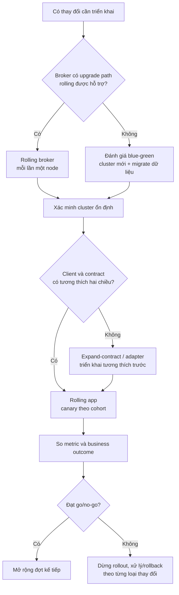
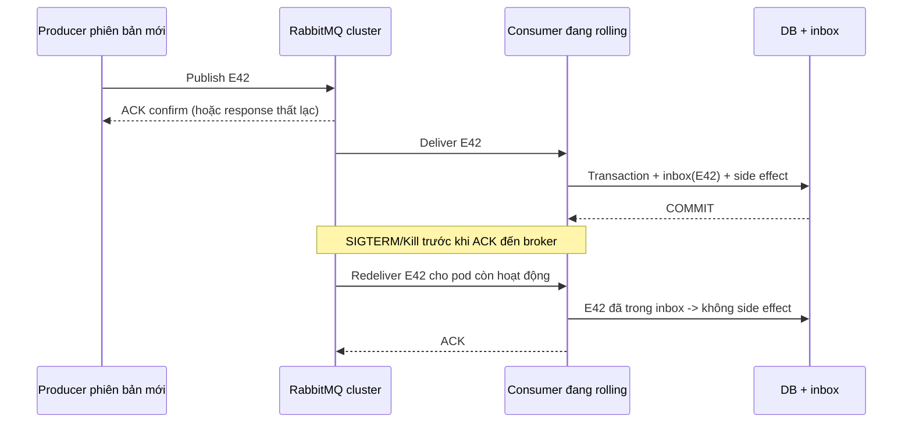

# Nâng cấp broker/ứng dụng theo từng đợt và kiểm tra tương thích

## 1. Nâng cấp không chỉ là thay image hoặc phiên bản dependency

Giả sử hệ thống đặt hàng có hai dịch vụ:

- **Orders** ghi database rồi phát `OrderCreated` qua `RabbitTemplate` tới direct exchange `orders.events.x`, routing key `orders.created`.
- **Fulfillment** dùng `@RabbitListener` đọc queue `orders.created.q`, lưu yêu cầu giao hàng, ACK sau khi transaction nghiệp vụ commit; message lỗi vĩnh viễn được chuyển tới dead-letter queue.

Đội vận hành muốn nâng RabbitMQ trên cluster ba node và nâng phiên bản ứng dụng Spring Boot/Spring AMQP. Trong thời gian triển khai, có thể cùng tồn tại **broker node cũ và mới**, **publisher cũ và mới**, **consumer cũ và mới**. Một bản phát hành tốt phải chứng minh được:

1. Message vẫn được định tuyến tới **đúng exchange, binding, queue**.
2. Consumer mới hiểu message producer cũ, và consumer cũ hiểu message producer mới trong thời gian triển khai chung.
3. Khi node RabbitMQ hoặc pod ứng dụng bị dừng, kết nối/consumer phục hồi, message chưa ACK được xử lý lại **không tạo side effect trùng**.
4. Publisher confirm, returned message, retry, DLQ và transaction vẫn hoạt động theo hợp đồng nghiệp vụ đã đặt ra.
5. Có điểm **go/no-go** sau mỗi đợt và kế hoạch xử lý khi không thể quay về phiên bản broker cũ.

Bài thuộc chương **Triển khai và vận hành** của module `SPRING_AMQP`, tập trung vào cách **nâng cấp broker và ứng dụng theo từng đợt**, đánh giá **tương thích ở các lớp giao thức, client, topology và nghiệp vụ**, thiết kế canary, runbook, rollback và kiểm thử lỗi.

> **Điều cần nhớ:** Rolling deployment giảm phạm vi tác động của mỗi lần thay đổi, **không tự biến hệ thống thành exactly-once hoặc zero-downtime**. Mức sẵn sàng thực tế phụ thuộc topology, số replica, consumer design, client reconnect và nguồn dữ liệu có thể phục hồi.

## 2. Bản đồ các lớp tương thích trước khi nâng cấp

Không tồn tại một cặp “phiên bản RabbitMQ ↔ phiên bản Spring AMQP” đủ mô tả toàn bộ hệ thống. Một đợt nâng cấp có thể chịu tác động bởi nhiều yếu tố:

| Lớp | Thông tin cần chốt | Lỗi có thể xuất hiện |
| --- | --- | --- |
| RabbitMQ server | Phiên bản của **từng node**, upgrade path giữa release series, release notes | Node mới không thể rejoin cluster; thay đổi behavior |
| Erlang/OTP và runtime | Erlang được target RabbitMQ hỗ trợ, OS/container base image | Broker không khởi động hoặc lỗi TLS/runtime |
| Feature flags | Cờ ổn định đã bật trong cluster và cờ mới của target | Node không rejoin, tính năng chưa được hỗ trợ ở mixed-version cluster |
| Plugin | Plugin bundled và third-party plugin, phiên bản/ABI/config | Plugin không load sau upgrade |
| AMQP client | RabbitMQ Java Client, AMQP 0-9-1 hay AMQP 1.0, TLS/SASL | Handshake/connection errors, semantics gửi/nhận khác |
| Spring Boot/Spring AMQP | BOM, JDK tối thiểu, `RabbitTemplate`, container factory, converter | API hoặc property thay đổi, listener không deserialize được |
| Topology | Exchange type, queue type, durability, arguments, bindings, vhost | `PRECONDITION_FAILED`, `NOT_FOUND`, unroutable |
| Wire contract | JSON/Avro/Protobuf, schema version, AMQP properties/headers | Consumer cũ không hiểu event mới |
| Nghiệp vụ | Idempotency key, ACK sau commit, thứ tự event, retry/DLQ | Duplicate charge, mất event, xử lý sai thứ tự |
| Vận hành | Readiness, graceful shutdown, observability, storage/replica health | Rollout treo hoặc dừng quá nhiều node/pod cùng lúc |

### Những điều phải tra cứu theo **phiên bản thực tế**

RabbitMQ có bảng **version upgradability** và ma trận **RabbitMQ–Erlang/OTP** chính thức. Trong một số release series, nâng trực tiếp qua nhiều phiên bản trung gian **không được hỗ trợ**; việc “container image mới chạy được ở staging” không chứng minh **rolling upgrade cluster hiện hữu** được phép.

- Kiểm tra đường đi từ **phiên bản hiện tại** tới **đích**, bao gồm các bước trung gian.
- Đọc release notes/deprecations của **mọi release trung gian**.
- Xác nhận phiên bản **Erlang/OTP** được hỗ trợ ở từng bước, không chỉ target cuối.
- Kiểm tra **plugins**, quorum/stream membership, metadata store và các chế độ queue cũ.
- Với Spring Boot, kiểm tra BOM, JDK, phiên bản Spring AMQP và RabbitMQ Java Client đúng sản phẩm đang deploy. Không trộn tùy ý các major versions.

Ví dụ một thay đổi lớn: RabbitMQ **4.0 đã loại bỏ classic queue mirroring**. Nếu hệ thống còn dùng mirrored classic queues từ 3.x, đó là **migration topology**, không phải chỉ đổi số version broker. Một số tổ hợp **non-durable, non-exclusive queue** cũng đã bị RabbitMQ 4.3 chặn mặc định. Cần kiểm tra các tính năng bị loại bỏ theo đúng target; không giả định hệ thống nào cũng chịu ảnh hưởng.

**Không đưa một bảng version cố định vào runbook vĩnh viễn:** Dữ liệu hỗ trợ thay đổi theo bản vá. Hãy lưu `source version`, `target version`, `Erlang version`, `upgrade path source URL`, ngày xác minh và người phê duyệt trong **phiếu triển khai**.

## 3. Chọn chiến lược: rolling broker, rolling app hay blue-green?



| Chiến lược | Phù hợp khi | Điều kiện đặc biệt |
| --- | --- | --- |
| **Rolling broker in-place** | Cluster khỏe và bảng upgrade cho phép các phiên bản tạm tồn tại cùng nhau | Có quorum trong lúc một node offline, đủ capacity, stable feature flags |
| **Rolling application** | App cũ và mới dùng được cùng topology/contract, broker đáp ứng cả hai | Idempotency; consumer cạnh tranh trên cùng queue; có graceful drain |
| **Blue-green broker** | Upgrade path in-place không được hỗ trợ hoặc cần tách hạ tầng | Migrate backlog, kiểm soát cutover, xử lý duplicate/mất thứ tự, kiểm thử chuyển ngược |
| **Blue-green app** | Thay đổi phức tạp, cần cô lập nhóm traffic/canary | Không dual-publish vào queue thật một cách vô thức |
| **Dừng toàn phần** | Single-node broker, migration bất tương thích không có dual-run an toàn | Công bố downtime, backup, đối soát và khôi phục |

Với **broker một node**, restart đồng nghĩa ngắt dịch vụ RabbitMQ trong khoảng thời gian đó; không thể gọi là “không gián đoạn” chỉ vì app tự reconnect. Với **quorum queue ba members**, chỉ có thể dừng một node nếu **các member còn lại thực sự đạt đa số**, không chỉ vì cluster có tổng cộng ba node.

## 4. Preflight: chụp baseline và đóng băng những thay đổi nguy hiểm

### 4.1. Inventory bắt buộc

| Hạng mục | Bằng chứng cần lưu | Mục đích |
| --- | --- | --- |
| Broker cluster | Danh sách node, server version, Erlang, alarms/partitions | Xác định tình trạng trước rollout |
| Queue/exchange/binding | Tên, vhost, durable, type, arguments, binding keys | Chặn thay đổi topology ngoài ý muốn |
| Quorum và stream | Queue membership, leader, follower health, replication catch-up | Không dừng node làm mất quorum |
| Feature flags | Cờ nào enabled/disabled, yêu cầu của target | Tránh node không rejoin |
| Broker plugins | Bundled, custom plugin, TLS/LDAP/management | Tránh mất chức năng lúc nâng |
| Publishers | Số kết nối, confirms, returns, in-flight, outbox | Nhận biết publish chưa xác định kết quả |
| Consumers | Listener ID, concurrency, prefetch, ACK, retry, DLX/DLQ | Lập kế hoạch drain và xử lý redelivery |
| Wire contract | Golden message ở cả version cũ/mới, properties/headers | Kiểm thử producer/consumer chéo |
| Performance | Publish rate, confirm p95/p99, backlog, consumer latency | Phát hiện suy giảm sau mỗi node/pod |
| Business state | Event ID đã publish/processed, order state, duplicate prevented | Đối soát tính đúng sau triển khai |

**Tài liệu hoá nguồn topology:** nếu ứng dụng dùng `RabbitAdmin` tự khai báo nhưng IaC cũng quản lý queue arguments, hai nguồn có thể xung đột. Một `QueueBuilder.durable(...).quorum()` mới không thể **ghi đè** queue classic cùng tên đang tồn tại. RabbitMQ kiểm tra sự tương đương thuộc tính; lỗi `PRECONDITION_FAILED` cần migration, không phải retry không giới hạn.

### 4.2. Các lệnh kiểm tra chỉ đọc

Ví dụ dưới đây chạy trên RabbitMQ node **được phép quản trị**, không phải trong Spring application container:

```bash
# Phiên bản, node đang chạy, partitions, alarms.
rabbitmqctl status
rabbitmqctl cluster_status

# Danh sách feature flags (đừng bật trong bước khảo sát).
rabbitmqctl list_feature_flags

# Topology và backlog trên vhost /, thay vhost cho môi trường thực.
rabbitmqctl list_exchanges -p / name type durable
rabbitmqctl list_queues -p / name durable arguments messages consumers
rabbitmqctl list_bindings -p / source_name destination_name routing_key
```

Các câu lệnh liệt kê **không thay thế health check** của queue quorum/stream. Kiểm tra thêm disk/memory alarms, cluster partitions, queue leader/member status, queue/stream replica đang sync và **sức chứa khi một node bị rút khỏi cluster**.

Đối với definitions:

```bash
# Chỉ là schema/topology; đường dẫn output phải được bảo vệ.
rabbitmqctl export_definitions /secure-backup/rabbit-definitions.json
```

**Definitions không chứa message còn chờ trong queue.** File definitions còn có thông tin người dùng/quyền và password hashes; không commit lên Git hay phát tán. Kế hoạch backup/restore dữ liệu message cần dựa trên quy trình snapshot/storage riêng được RabbitMQ khuyến nghị, đã **thử khôi phục**, và phương án đối soát từ outbox/nguồn nghiệp vụ. Snapshot một node sống tùy tiện không mặc nhiên là backup nhất quán của cluster.

### 4.3. Đặt điều kiện không được bắt đầu

**No-go trước khi nâng broker** nếu xuất hiện một trong các tình huống:

- Chưa xác nhận **đường upgrade được hỗ trợ** hoặc Erlang runtime không phù hợp.
- Có disk/memory alarm bất thường, partitions, queue trong trạng thái lỗi, replica đang mất đồng bộ nghiêm trọng.
- Dừng node kế tiếp làm quorum queue hoặc stream **mất đa số**.
- Stable feature flags còn thiếu mà target yêu cầu; third-party plugin chưa có phiên bản tương thích.
- Chưa thử backup/restore hoặc không có giải pháp phục hồi phù hợp RPO/RTO đã cam kết.
- Consumer/publisher hiện có đang lỗi, backlog tăng nhanh và không có capacity phục vụ tải khi bớt một node.

## 5. Feature flags: hai thời điểm bật, một chiều không thể đảo

RabbitMQ feature flags giúp các node ở **hai phiên bản được hỗ trợ** tạm cùng tồn tại trong rolling upgrade. Tuy nhiên, chúng **không phải feature toggle nghiệp vụ**:

1. **Trước upgrade:** xác minh/enable mọi **stable feature flag của release hiện tại** mà target yêu cầu, trong lúc các node hiện tại đều hỗ trợ.
2. **Trong rolling upgrade:** giữ các feature flags mới của target ở trạng thái chưa bật khi vẫn còn node cũ không hỗ trợ.
3. **Sau khi tất cả node chạy target và khỏe:** enable những stable feature flags mới, xác minh lại toàn cluster.

```bash
# READ-ONLY: xem trạng thái.
rabbitmqctl list_feature_flags

# CHỈ sau khi đủ điều kiện và được phê duyệt:
rabbitmqctl enable_feature_flag all
```

**Một feature flag đã bật không thể tắt lại theo cách thông thường.** Nếu cờ mới không được node cũ hỗ trợ, node cũ có thể **không rejoin**. Vì vậy sau khi bật cờ mới, việc “rollback bằng cách đổi image về broker version cũ” thường không khả thi.

Không thực thi `enable_feature_flag all` **giữa chừng khi cluster còn mixed-version**. Nếu có rào cản từ release notes, dừng và điều tra, không thử ép node cũ join.

## 6. Runbook rolling upgrade broker: mỗi lần đúng một node

Giả sử cluster **ba node A, B, C**, có quorum queues đủ members để chịu mất một node. Các bước dưới đây minh họa cách ra quyết định; lệnh stop/start phụ thuộc systemd, Kubernetes Operator hay nền tảng quản trị của tổ chức.

### 6.1. Chu trình an toàn cho node C

```mermaid
sequenceDiagram
    participant O as Operator
    participant C as Broker node C
    participant AB as Nodes A+B
    participant APP as Spring clients
    O->>AB: Kiểm tra cluster, alarms, quorum
    O->>C: Check node có critical quorum không
    O->>C: Drain / maintenance mode
    C-->>APP: Đóng connection; client reconnect
    APP->>AB: Tái lập connection, consumer
    O->>C: Stop, backup phù hợp, upgrade RabbitMQ/Erlang
    O->>C: Start node C
    C->>AB: Rejoin + sync queue/stream replicas
    O->>AB: Verify node C, backlog, confirms, health
    Note over O,APP: Chỉ chuyển sang node B khi gate C đạt
```

Kiểm tra trước khi dừng **node mục tiêu**:

```bash
# Chạy trên node mục tiêu hoặc chỉ định -n đúng node.
rabbitmq-diagnostics check_if_node_is_quorum_critical

# Dành cho automation: chờ cho tới khi có online quorum
# ngay cả khi node mục tiêu rời cluster.
rabbitmq-upgrade await_online_quorum_plus_one

# Vào maintenance: chuyển bớt queue leaders,
# đóng client connections để các ứng dụng reconnect.
rabbitmq-upgrade drain
```

`rabbitmq-upgrade drain` **gây thay đổi vận hành**, không phải lệnh chỉ đọc; chỉ chạy theo lịch nâng cấp đã duyệt. Nếu hủy kế hoạch khi **node chưa restart**, dùng:

```bash
rabbitmq-upgrade revive
```

Theo hướng dẫn RabbitMQ, **restart node tự đưa nó ra khỏi maintenance mode**; thường không cần gọi `revive` sau khi nâng và khởi động lại thành công. Trường hợp Kubernetes Cluster Operator đã chạy health/quorum check trong lifecycle hook thì không nên tự thêm lệnh hoặc hook trùng mà chưa hiểu luồng operator.

### 6.2. Stop → upgrade → start → verify

Sau `drain`, dừng RabbitMQ node C theo công cụ được hỗ trợ, sao lưu theo phương án đã chuẩn bị, thay **broker và Erlang/OTP** tương thích rồi khởi động lại. Không dùng `reset`, `force_reset`, `forget_cluster_node` hay xóa data directory như bước nâng cấp bình thường: đó là các thao tác thay đổi trạng thái cluster có thể gây mất dữ liệu nếu lạm dụng.

Sau node C quay lại, kiểm tra:

```bash
rabbitmqctl cluster_status
rabbitmqctl list_feature_flags
rabbitmqctl list_queues -p / name messages consumers
```

Ngoài CLI, xác minh **C đã rejoin**, không có partitions/alarms mới, quorum/stream replica đã bắt kịp, client reconnect thành công, leader ổn định, publisher confirm và consumer ACK tiếp tục được ghi nhận. Đừng chỉ nhìn pod trạng thái `Running` hay `Ready`.

### 6.3. Gate trước khi chuyển sang B, rồi A

| Tiêu chí sau mỗi node | Chấp nhận chuyển tiếp khi |
| --- | --- |
| Node C/B/A rejoin | Node ở trạng thái chạy, version đúng, cluster không partition |
| Quorum/stream health | Members đáp ứng đa số, không có replica đang lỗi/catch-up nghiêm trọng |
| Traffic | Publish/consume rate khôi phục, throughput không suy giảm bất thường |
| Latency | Confirm p95/p99 và xử lý consumer không vượt SLO |
| Kết quả nghiệp vụ | Không thiếu eventId được xác nhận; duplicate không gây tác động trùng |
| DLQ/retry | Không tăng đột biến do converter, routing, network |
| Resource headroom | CPU, RAM, disk, file descriptors, network còn đủ cho node tiếp theo |

Chỉ khi gate của C **PASS** mới áp dụng chu trình cho B rồi A. Khi tất cả node đã được nâng:

```bash
# CHỈ khi toàn cluster đã dùng phiên bản target:
rabbitmqctl enable_feature_flag all

# Sau đó, nếu cần và được lên lịch riêng, rebalance queue/stream leaders:
rabbitmq-queues rebalance all
```

Rebalance leader có thể tạo một đợt dịch chuyển tải/độ trễ bổ sung; kiểm tra tình trạng thực tế và tránh chạy ngay lúc hệ thống còn phục hồi. Ghi lại phiên bản từng node, feature flags và baseline so sánh **sau mỗi bước**, không chỉ vào cuối ngày.

### 6.4. Có thể rollback broker bằng downgrade không?

**Không nên dựa vào downgrade**. RabbitMQ không chính thức hỗ trợ hoặc kiểm thử hạ phiên bản; cấu trúc dữ liệu, feature flags và queue metadata có thể đã đổi. Trong thời điểm cluster **đang mixed-version**, nếu node mới lỗi cần áp dụng **quy trình được release notes hỗ trợ**, không tự thay image ngược lại bằng suy đoán.

Nếu không có in-place upgrade path, cân nhắc **blue-green cluster**:

1. Tạo cluster Green theo target RabbitMQ/Erlang, topology/vhost/permissions đã kiểm thử.
2. Thiết kế di chuyển **backlog** và luồng publish mới bằng Shovel/Federation/bridge hoặc replay từ nguồn nghiệp vụ.
3. Kiểm thử thứ tự, duplicate, publisher confirms, DLX và khả năng đối soát.
4. Chuyển cohort client có kiểm soát; xác nhận không còn dữ liệu bỏ quên trên Blue.
5. Chỉ decommission Blue sau thời gian quan sát/đối soát đã định.

**Blue-green không tự động an toàn** khi còn hai cluster độc lập nhận traffic. Cần quyết định **nguồn ghi chính**, tránh cùng một event vào hai hệ thống rồi ghi side effect trùng, và biết việc đưa backlog theo Shovel có thể làm thay đổi thứ tự nhận.

## 7. Kế hoạch nâng cấp ứng dụng: expand → canary → contract

Nâng Spring Boot/Spring AMQP thường kéo theo thay đổi converter, Java runtime, actuator, listener properties hoặc behavior retry. Mẫu **expand-contract** giúp phiên bản cũ và mới chạy đồng thời:

1. **Expand:** đưa vào schema/handler mới mà **không** xóa hoặc đổi field cũ; hỗ trợ cả message format cũ và mới.
2. **Canary:** triển khai một nhóm publisher/consumer mới trên topology tương thích; kiểm tra business outcome.
3. **Mở rộng:** tăng số instance mới, giữ cơ chế rollback app (image/deployment) trong suốt observation window.
4. **Contract:** chỉ loại bỏ field/topic/queue cũ sau khi chắc chắn không còn producer cũ, backlog, retry, DLQ hoặc event phải replay ở format cũ.

### 7.1. Hợp đồng dữ liệu không phụ thuộc class Java

Ví dụ phiên bản cũ:

```json
{
  "eventId": "evt-001",
  "eventType": "OrderCreated",
  "schemaVersion": 1,
  "orderId": "ORD-42",
  "occurredAt": "2026-11-26T03:00:00Z"
}
```

Producer mới chỉ **bổ sung field tùy chọn**, giữ các field/kiểu dữ liệu cũ:

```json
{
  "eventId": "evt-001",
  "eventType": "OrderCreated",
  "schemaVersion": 1,
  "orderId": "ORD-42",
  "occurredAt": "2026-11-26T03:00:00Z",
  "sourceRegion": "ap-southeast-1"
}
```

Ví dụ vẫn dùng `schemaVersion=1` khi chính sách schema của dự án cho phép **mở rộng tương thích** bằng field optional. Nếu hợp đồng bắt buộc tăng version cho bất kỳ thay đổi nào, dùng quy tắc đó nhưng cần bảo đảm consumer cũ được nâng trước khi publisher phát version mới. Với **breaking change** như đổi `orderId` từ string thành object, hãy dùng schema/adapter song song hoặc route v2 riêng thay vì gửi vào queue cũ ngay.

Spring Boot 3.x với Jackson 2 có thể dùng DTO:

```java
import com.fasterxml.jackson.annotation.JsonIgnoreProperties;

@JsonIgnoreProperties(ignoreUnknown = true)
public record OrderCreatedV1(
        String eventId,
        String eventType,
        int schemaVersion,
        String orderId,
        String occurredAt) {}
```

`ignoreUnknown` chỉ giúp bỏ qua field lạ, **không bảo đảm kiểu field cũ hoặc semantic của event không đổi**. Vẫn cần kiểm thử JSON Schema, null/missing field, enum, timestamp, tiền tệ và ID nghiệp vụ. Nếu hệ thống dùng Spring AMQP 4.x/Jackson 3, phải kiểm tra class converter và các API Jackson tương ứng trước khi lấy nguyên snippet.

### 7.2. Đừng để Java type headers là public wire contract

`Jackson2JsonMessageConverter` của Spring AMQP 3.x có thể đặt các header như `__TypeId__` chứa tên class Java; consumer khác version/ngôn ngữ không nên phụ thuộc vào tên package/class cũ. Một contract tốt xác định **body encoding, content-type, schemaVersion và business IDs**, không yêu cầu producer Java mới giữ nguyên package name cũ chỉ để Python đọc được JSON.

| Thay đổi | Tương thích khi chạy xen kẽ? | Phải test |
| --- | --- | --- |
| Thêm field JSON tùy chọn và consumer cũ bỏ qua unknown field | Thường có thể | New → old, old → new |
| Xóa field consumer cũ còn dùng | Không | Contract migration trước |
| Đổi số nguyên sang chuỗi hoặc đổi timezone | Không mặc nhiên | Schema + business invariant |
| Đổi tên class Java dùng trong `__TypeId__` | Có thể phá deserialization dựa vào class | Converter/type mapper, trusted packages |
| Đổi `AcknowledgeMode` từ AUTO sang NONE | **Thay đổi reliability** | Crash trước commit và redelivery |
| Đổi DLX/TTL arguments cùng tên queue | Có thể bị broker từ chối | `PRECONDITION_FAILED`, migration/policy |
| Đổi classic queue sang quorum cùng tên | Không thể redeclare đổi type | Queue mới và kế hoạch chuyển backlog |
| Chuyển producer từ AMQP 0-9-1 sang AMQP 1.0 | Cần test protocol riêng | Addressing, headers/body, settlement, routing |

### 7.3. Thứ tự cập nhật consumer và publisher

Nếu **producer mới thêm field optional**, có thể update producer trước chỉ khi consumer cũ đã có khả năng bỏ qua field lạ. Nếu **producer mới gửi schema v2 mà consumer cũ không hiểu**, phải **nâng consumer hỗ trợ v1+v2 trước**, rồi mới bật format v2 ở producer.

Tương tự, không bắt đầu bằng việc đổi queue binding/routing key nếu còn producer cũ gửi key cũ. Có thể giữ **hai bindings song song** trong thời gian chuyển tiếp, nhưng cần kiểm tra có tạo **duplicate routing** vào cùng/different queue hay không; không xóa binding cũ trước khi mọi producer và backlog tương ứng đã được xử lý.

## 8. Ví dụ Spring Boot: cấu hình client đủ an toàn để rolling deployment

Ví dụ cấu hình cho **Spring Boot 3.x, Spring AMQP 3.x, AMQP 0-9-1**. Tên property phải được đối chiếu theo phiên bản app đang dùng. Những giá trị dưới đây là **điểm xuất phát để kiểm thử**, không phải tuning universal.

```yaml
spring:
  rabbitmq:
    addresses: ${RABBITMQ_ADDRESSES}
    username: ${RABBITMQ_USERNAME}
    password: ${RABBITMQ_PASSWORD}
    virtual-host: ${RABBITMQ_VHOST:/}
    requested-heartbeat: 30s
    publisher-confirm-type: correlated
    publisher-returns: true
    template:
      mandatory: true
    listener:
      simple:
        concurrency: 2
        max-concurrency: 4
        prefetch: 20
        acknowledge-mode: auto
        force-stop: false
  lifecycle:
    timeout-per-shutdown-phase: 60s

management:
  endpoint:
    health:
      probes:
        enabled: true
```

`RABBITMQ_ADDRESSES` cần có danh sách endpoint hợp lệ và reachable; việc dùng nhiều broker node addresses không phải **multi-cluster transparent failover** hay load balancing transaction. Đảm bảo DNS/LB/TLS certificates, vhost và credentials nhất quán cho mỗi endpoint thuộc cùng cluster.

`publisher-confirm-type=correlated` giúp ứng dụng theo dõi publisher ACK/NACK; `mandatory=true` cùng returns phát hiện unroutable khi exchange tồn tại nhưng không có queue phù hợp. **`RabbitTemplate.send()` trả về không đồng nghĩa event đã được broker xác nhận** nếu publish được xác nhận bất đồng bộ.

`acknowledge-mode=auto` nghĩa là **Spring listener container ACK sau khi method hoàn tất thành công**; nó khác với RabbitMQ `autoAck=true`/`AcknowledgeMode.NONE` (broker coi delivery đã xử lý khi giao đi). Khi method trả về trước database commit hoặc chỉ submit async job rồi return, ACK có thể đến quá sớm.

### 8.1. Listener container có thời gian drain rõ ràng

Khi cần kiểm soát thời gian đợi lúc dừng consumer, có thể cấu hình factory riêng:

```java
import org.springframework.amqp.core.AcknowledgeMode;
import org.springframework.amqp.rabbit.config.SimpleRabbitListenerContainerFactory;
import org.springframework.amqp.rabbit.connection.ConnectionFactory;
import org.springframework.context.annotation.Bean;
import org.springframework.context.annotation.Configuration;

@Configuration
public class RollingConsumerConfiguration {

    @Bean("rollingListenerFactory")
    public SimpleRabbitListenerContainerFactory rollingListenerFactory(
            ConnectionFactory connectionFactory) {
        SimpleRabbitListenerContainerFactory factory =
                new SimpleRabbitListenerContainerFactory();
        factory.setConnectionFactory(connectionFactory);
        factory.setAcknowledgeMode(AcknowledgeMode.AUTO);
        factory.setConcurrentConsumers(2);
        factory.setMaxConcurrentConsumers(4);
        factory.setPrefetchCount(20);
        factory.setContainerCustomizer(container -> {
            // Chờ delivery đang xử lý có thời gian hoàn tất.
            container.setShutdownTimeout(60_000L);
            // Mặc định: dừng consumer và xử lý các prefetched
            // deliveries còn lại nếu có đủ thời gian.
            container.setForceStop(false);
        });
        return factory;
    }
}
```

`shutdownTimeout` là thời gian container chờ các delivery in-flight khi shutdown; nếu quá thời gian, `forceCloseChannel=true` (mặc định) có thể làm những delivery chưa ACK được **requeue**. `forceStop=true` là lựa chọn khác: dừng sau message hiện tại và requeue prefetched message thay vì xử lý hết, phù hợp một số kịch bản exclusive hoặc single-active consumer.

Tùy workload, việc để `prefetch=20` và nhiều consumer có thể tạo nhiều delivery chưa ACK tại thời điểm pod dừng. Vì vậy **cần kiểm thử giới hạn thời gian**, không chỉ khai báo `terminationGracePeriodSeconds=90` rồi tin rằng mọi delivery sẽ luôn hoàn tất.

### 8.2. Listener luôn idempotent khi rolling

```java
import org.springframework.amqp.core.Message;
import org.springframework.amqp.rabbit.annotation.RabbitListener;
import org.springframework.stereotype.Component;

@Component
public class OrderCreatedConsumer {
    private final IdempotentOrderService service;

    public OrderCreatedConsumer(IdempotentOrderService service) {
        this.service = service;
    }

    @RabbitListener(
            id = "ordersCreatedListener",
            queues = "orders.created.q",
            containerFactory = "rollingListenerFactory")
    public void handle(Message message) {
        String eventId = message.getMessageProperties().getMessageId();
        if (eventId == null || eventId.isBlank()) {
            throw new IllegalArgumentException("Missing eventId");
        }

        // Trong implementation, transaction phải ghi inbox(eventId)
        // cùng side effect, commit trước khi method return.
        service.applyOnce(eventId, message.getBody());
    }
}

interface IdempotentOrderService {
    void applyOnce(String eventId, byte[] jsonBody);
}
```

Ở production, quyết định **thiếu eventId** là lỗi vĩnh viễn hay lỗi có thể khắc phục và đưa vào DLQ thích hợp; không dùng exception lặp vô hạn làm chính sách xử lý poison message. Khi dùng AUTO ACK, service cần hoàn tất transaction trước khi listener return. Lần delivery cũ và mới có thể **trùng sự kiện**, nên khóa duy nhất trong database (`event_id`) phải chặn side effect thứ hai.

### 8.3. Dừng/mở một listener có chủ đích

Spring AMQP cung cấp `RabbitListenerEndpointRegistry` để quản lý container tạo từ `@RabbitListener`. Trong một thao tác vận hành có kiểm soát:

```java
import org.springframework.amqp.rabbit.listener.MessageListenerContainer;
import org.springframework.amqp.rabbit.listener.RabbitListenerEndpointRegistry;
import org.springframework.stereotype.Service;

@Service
public class ListenerLifecycleControl {
    private final RabbitListenerEndpointRegistry registry;

    public ListenerLifecycleControl(
            RabbitListenerEndpointRegistry registry) {
        this.registry = registry;
    }

    public void stopOrdersConsumer() {
        MessageListenerContainer container =
                registry.getListenerContainer("ordersCreatedListener");
        if (container != null) {
            container.stop();
        }
    }

    public void startOrdersConsumer() {
        MessageListenerContainer container =
                registry.getListenerContainer("ordersCreatedListener");
        if (container != null) {
            container.start();
        }
    }
}
```

Đây là **API nội bộ cho runbook/điều phối**, không mở một HTTP endpoint công khai cho bất kỳ người dùng nào được tắt consumer. Việc stop container **không xóa queue**; các message vẫn chờ nếu queue còn tồn tại, nhưng backlog có thể tăng. Nếu application pod bị SIGKILL trước khi drain hoàn tất, broker sẽ requeue unacked deliveries khi connection/channel đóng.

## 9. Rolling deployment ứng dụng trên Kubernetes

Với consumer chạy dưới dạng Kubernetes `Deployment` (không phải RabbitMQ StatefulSet), có thể cấu hình rollout từng pod:

```yaml
apiVersion: apps/v1
kind: Deployment
metadata:
  name: fulfillment
spec:
  replicas: 3
  strategy:
    type: RollingUpdate
    rollingUpdate:
      maxSurge: 1
      maxUnavailable: 0
  selector:
    matchLabels:
      app: fulfillment
  template:
    metadata:
      labels:
        app: fulfillment
    spec:
      terminationGracePeriodSeconds: 90
      containers:
        - name: fulfillment
          image: registry.example.com/fulfillment:VERSION_PINNED
          ports:
            - containerPort: 8080
          readinessProbe:
            httpGet:
              path: /actuator/health/readiness
              port: 8080
            initialDelaySeconds: 5
            periodSeconds: 5
          livenessProbe:
            httpGet:
              path: /actuator/health/liveness
              port: 8080
            periodSeconds: 15
```

Đây chỉ là **snippet ứng dụng HTTP dùng Actuator** với probe endpoints đã bật. Consumer worker **không cung cấp HTTP** cần probe riêng phù hợp; không sao chép YAML này cho mọi service. Liveness không nên kiểm tra broker theo cách khiến pod bị restart liên tục khi RabbitMQ đang bảo trì; readiness cần được định nghĩa theo khả năng phục vụ thực sự.

`maxUnavailable=0` có thể tăng số replica tạm thời trong rollout; điều đó **tăng số consumer cạnh tranh** trên cùng queue. Hệ thống có thể hoàn tất message **khác thứ tự** và có thêm in-flight deliveries. Nếu nghiệp vụ đòi thứ tự theo `orderId`, cần routing partition, version guard hoặc Single Active Consumer theo thiết kế riêng — rolling update không bảo đảm FIFO ở tầng xử lý.

`terminationGracePeriodSeconds` phải đủ cho thời gian **SIGTERM → dừng nhận mới → drain → commit DB → ACK → shutdown** và thêm headroom. Không đánh dấu pod “khỏe” chỉ vì cổng HTTP mở trong khi consumer connection hoặc schema contract đang lỗi.

### 9.1. Bốn bước cho mỗi nhóm pod

1. **Canary 1 pod:** deploy version mới, chỉ định cohort nếu có cơ chế route theo cohort. Kiểm tra listener startup, topology và business fixtures.
2. **Observation window:** so message conversion errors, `ready/unacked`, redelivery, DLQ, publisher returns/NACK, business state và p95/p99.
3. **Mở rộng từng nấc:** tăng số pod mới theo gate, tránh đồng thời tăng `prefetch`, concurrency hoặc đổi queue type.
4. **Thay pod cũ:** SIGTERM đúng hạn, drain, verify backlog và in-flight, không xóa queue trước khi traffic kết thúc.

**Không trộn “broker upgrade” và “app breaking-change upgrade” trong cùng cửa sổ** trừ khi có lý do bắt buộc và kế hoạch đủ kiểm soát. Khi xảy ra lỗi sẽ khó quy trách nhiệm giữa broker, client, schema, topology và database.

## 10. Thứ tự triển khai producer/consumer và kịch bản coexist

Một **broker RabbitMQ** có thể vừa phục vụ producer/consumer cũ và mới trên cùng vhost. Điều kiện quyết định là cả hai hiểu **cùng wire contract** và topology tương đương.

| Producer | Consumer | Mục tiêu kiểm thử |
| --- | --- | --- |
| Cũ | Cũ | Baseline |
| Mới | Cũ | Publisher mới không phá consumer đang chạy |
| Cũ | Mới | Consumer mới vẫn hiểu backlog và producer cũ |
| Mới | Mới | Luồng tương lai hoạt động |

Nếu hai consumer cùng subscribe một queue, chúng là **competing consumers**: một message thường chỉ đến **một** consumer. Muốn chạy **shadow test** và so hai kết quả cùng message, hãy tạo **queue shadow riêng** có binding phù hợp và không thực hiện side effect thật.

Nếu cần kiểm thử cả Java và Python/Node, contract phải dựa trên JSON/Protobuf/Avro và AMQP properties độc lập ngôn ngữ, không phụ thuộc `__TypeId__` hay tên Java class. Thực hiện test consumer cũ đọc message mới có Unicode, timestamp, số tiền, `messageId`, `correlationId`, headers và retry metadata.

### Một định tuyến mở rộng nhưng không mất consumer cũ

Giả sử `orders.events.x` đang route `orders.created` đến `orders.created.q`. Producer mới muốn chuyển sang `orders.created.v2`.

**Không làm ngay:**

```text
Producer mới → routing key orders.created.v2
Exchange không có binding mới → unroutable
```

**Làm theo bước:**

1. Tạo queue/binding v2 hoặc adapter **có kiểm soát**; kiểm tra DLX, retention, ownership.
2. Mở rộng consumer để hiểu v1/v2 hoặc chạy consumer v2 **đọc queue riêng**, kiểm tra duplicate.
3. Khi mọi đường nhận đã sẵn sàng, cho producer mới dùng routing key v2 qua feature flag.
4. Quan sát cả backlog và DLQ của v1/v2.
5. Chỉ xóa đường v1 sau khi không còn producer cũ, retry/replay và dữ liệu cần đối soát.

Nếu v1 và v2 đều đi vào **cùng work queue**, phải bảo đảm consumer cũ không bao giờ nhận payload không thể parse. Có thể dùng một consumer adapter chung hoặc tách queue thay vì trông chờ “pod mới sẽ xử lý đúng phần message của nó”.

## 11. Đo kết quả sau mỗi đợt: gate kỹ thuật và nghiệp vụ

Một rollout không nên chờ tới khi khách hàng báo lỗi mới dừng. Trước triển khai phải chụp baseline và chọn ngưỡng cụ thể theo SLO thực tế.

| Nhóm | Chỉ số / câu hỏi |
| --- | --- |
| Broker availability | Node đang chạy, cluster partitions, disk/memory alarms, file descriptors |
| Quorum/streams | Leader/member status, replica sync, quorum critical node, leader elections |
| Publish reliability | Confirms ACK/NACK, returned unroutable, confirm timeout, outbox chưa publish |
| Queue backlog | `messages_ready`, `messages_unacknowledged`, tuổi message lâu nhất, delivery rate |
| Consumer health | Active consumers theo queue, reconnect count, container startup errors |
| Retry và DLQ | Retry rate, số poison message, DLQ size và dead-letter routing |
| Performance | Publish confirm p95/p99, listener latency p95/p99, DB latency, CPU/memory |
| Business correctness | Event IDs missing, duplicates prevented, order status mismatch, version gaps |
| Security | TLS/SASL/permissions, expired cert, plugin authentication errors |

**Ví dụ ngưỡng do nhóm đặt** (chỉ minh họa, không dùng làm SLO mặc định):

- Không có sự kiện thanh toán được xác nhận nhưng mất dấu trong đối soát.
- `business_outcome_mismatch = 0` trên bộ golden messages.
- Không có phát sinh `PRECONDITION_FAILED`, `ACCESS_REFUSED`, lỗi converter mới.
- DLQ/retry không vượt baseline đã được duyệt; confirm p99 và queue lag không vượt ngưỡng tương ứng.
- Mọi quorum queue còn đa số online; không có disk/memory alarm hoặc partition mới.

Các chỉ số thông lượng có thể giảm ngắn lúc leader election hoặc consumer reconnect; tiêu chí go/no-go cần quy định **mức giảm, thời gian phục hồi** và loại lỗi được chấp nhận. Đừng coi “có spike ngắn” là tự động fail hoặc tự động pass mà không so SLO.

## 12. Kế hoạch kiểm thử tương thích phải có bốn chiều và lỗi thật

### 12.1. Test matrix trước khi nâng broker và trước khi canary app

| Mã | Phép thử | Điều kiện pass |
| --- | --- | --- |
| CT-01 | Broker version hiện tại → target theo documented path | Đường rolling hợp lệ, Erlang/plugin tương thích |
| CT-02 | Broker mixed-version trong lab | Node mới rejoin; feature flags không làm node cũ bị loại |
| CT-03 | Producer cũ → consumer mới | JSON và AMQP metadata parse đúng, side effect đúng |
| CT-04 | Producer mới → consumer cũ | Bỏ qua optional fields, không lỗi schema |
| CT-05 | Producer mới → consumer mới | Luồng mới hoạt động với đúng topology |
| CT-06 | Exchange/queue/binding trên broker sau upgrade | Names, arguments, routing key, DLX đúng |
| CT-07 | Đổi queue arguments bất tương đương | Bắt `PRECONDITION_FAILED` có chủ đích, không xóa dữ liệu |
| CT-08 | Publish vào key không có binding | `mandatory`/returns phát hiện unroutable |
| CT-09 | Publish và mất connection trước confirm | Outcome chưa chắc chắn; retry cùng eventId |
| CT-10 | Consumer commit DB rồi mất ACK | Redelivery → inbox chặn side effect trùng |
| CT-11 | Consumer lỗi tạm thời | Backoff/retry đúng, không requeue nóng vô hạn |
| CT-12 | Consumer lỗi vĩnh viễn | DLQ/parking route đúng, không làm mất dấu event |
| CT-13 | Rolling stop/start một broker node | Cluster còn quorum, client reconnect và queue hồi phục |
| CT-14 | Rolling stop/start một app pod | In-flight delivery được ACK hoặc requeue; không mất nghiệp vụ |
| CT-15 | Consumer cũ/mới cùng nhận cùng work queue | Không giả định mỗi consumer đều được copy message; version guard đúng |
| CT-16 | Request/reply | `correlationId`, `replyTo`, timeout và late reply đúng |
| CT-17 | TLS/permissions và vhost | Client mới xác thực đúng, không tạo tài nguyên sai vhost |
| CT-18 | Rollback app qua feature flag | App cũ vẫn hiểu backlog/new messages theo contract |
| CT-19 | Blue-green broker rehearsal (nếu cần) | Backlog được chuyển/đối soát; duplicate có chiến lược |
| CT-20 | Observation đủ cửa sổ retry chậm | Không có missing event hoặc DLQ tăng muộn sau rollout |

### 12.2. Bài thực hành fault injection



Thử nghiệm cụ thể:

1. Tạo RabbitMQ cluster **lab** đủ thành viên; xác nhận quorum queue có đúng member count.
2. Gửi N events có `eventId` và thứ tự nghiệp vụ; đợi publisher confirms.
3. Dừng **một** RabbitMQ node khi còn traffic, quan sát reconnect, re-election và confirm latency.
4. Dừng **một** consumer pod ngay sau DB commit nhưng trước ACK (cần hook test hoặc fault injector, không suy ra từ `sleep`).
5. Khởi động consumer mới và đối soát event IDs: **không thiếu event đã confirm**, không tạo side effect trùng.
6. Publish cố tình vào routing key sai, kiểm tra returns; tạo payload schema sai và kiểm tra DLQ.
7. Diễn tập **app rollback**, kiểm tra việc drain, idempotency và consumer cũ đọc được event mới trong phạm vi hợp đồng.

Không thực hiện fault injection kiểu kill broker/node, purge queue, đổi policy gây xóa dữ liệu hoặc chặn mạng trên môi trường production khi chưa có kế hoạch an toàn, phạm vi quyền và window được duyệt.

## 13. Rollback khác nhau cho từng lớp thay đổi

| Thay đổi thất bại | Điều có thể làm | Điều **không** được giả định |
| --- | --- | --- |
| App image/consumer code | Chuyển deployment hoặc flag về phiên bản cũ **nếu vẫn hiểu dữ liệu trên queue** | App cũ luôn parse được schema mới |
| Producer format v2 | Tắt phát v2, giữ consumer hỗ trợ v2 cho backlog còn lại | Tắt flag sẽ biến v2 đã publish thành v1 |
| Routing/binding additive | Dừng route mới sau đối soát, giữ queue cũ/chờ drain | Xóa queue v2 ngay không mất message |
| RabbitAdmin mismatch | Khôi phục định nghĩa tương đương hoặc migration có kế hoạch | Xóa queue rồi tạo mới là rollback an toàn |
| Broker node version | Dừng rollout, điều tra; dùng hướng dẫn chính thức/blue-green recovery | Downgrade RabbitMQ là thao tác được hỗ trợ |
| Feature flags mới | Phải giữ target tương thích hoặc khôi phục theo phương án DR đã thử | Có thể tắt flag mới để node cũ join |
| DB schema | Expand-contract và migration forward/compatible | Đổi app image sẽ đảo ngược dữ liệu đã commit |
| Duplicate event | Idempotent inbox/outbox và đối soát | Đổi protocol sẽ tự loại duplicate |

**Phân biệt rõ rollback với restore**: rollback ứng dụng là chuyển code/traffic; restore message/database là quy trình khôi phục dữ liệu theo RPO/RTO và backup đã diễn tập. Không gọi “rollback thành công” khi hệ thống chạy nhưng còn backlog/DLQ chưa được đối soát.

### Runbook dừng rollout khi gate FAIL

1. **Freeze** thao tác nâng tiếp theo; không dừng thêm broker node/pod.
2. Ghi lại version, feature flags, timestamps, queue/vhost và correlation IDs của lỗi.
3. Phân loại failure: broker quorum/connection, publisher routing/confirm, converter/schema, consumer ACK/DB hay plugin/TLS.
4. Với app canary: tắt traffic mới theo feature flag, drain/stop listener mới, giữ queue/backlog, khởi động phiên bản cũ **chỉ khi contract cho phép**.
5. Với broker: ưu tiên **ổn định cluster target hiện tại** và phục hồi quorum, không tự downgrade.
6. Đối soát outbox ↔ publish outcome ↔ inbox/DB ↔ retry/DLQ; replay những event có bằng chứng thiếu.
7. Lập root-cause, test bổ sung và chỉ mở lại khi người phụ trách ký **go**.

## 14. Kịch bản cụ thể: từ RabbitMQ 3.x lên 4.x và nâng Spring app

Đây là **ví dụ cách suy nghĩ**, không phải lời khuyên chọn một cặp version cụ thể. Giả sử một hệ thống đang có RabbitMQ 3.x, Spring Boot 3.x và muốn tới RabbitMQ 4.x.

### Pha 0 — Thẩm định

- Xác định chính xác patch releases và tra **version upgradability matrix**; một số đường 3.x → 4.x cần qua release trung gian.
- Chụp queues: nếu còn **mirrored classic queue**, cần lập kế hoạch chuyển khỏi cơ chế bị loại trong RabbitMQ 4.0.
- Kiểm tra queue classic/quorum/stream, `x-queue-type`, DLX, TTL, quorum membership, Khepri (nếu dùng), deprecated features.
- So sánh **JDK/Spring Boot/Spring AMQP** với client AMQP và broker target; không mặc định bắt buộc nâng tất cả cùng một thời điểm nếu client cũ vẫn được hỗ trợ.

### Pha 1 — Khóa hợp đồng và chuẩn bị code

- Thêm JSON fixtures kiểm thử producer cũ/mới và consumer cũ/mới.
- Đảm bảo `messageId`/business `eventId` bền vững, consumer inbox idempotent.
- Bật publisher confirms/returns, DLQ monitoring, Spring listener graceful shutdown.
- Nếu cần đổi queue type/classic → quorum, tạo **queue mới** và kế hoạch di chuyển, không redeclare cùng tên.

### Pha 2 — Broker staging rehearsal

- Clone **topology và profile tải phù hợp**, không dùng dữ liệu khách hàng nhạy cảm.
- Diễn tập từng bước trong supported upgrade path, kiểm tra quorum trước mỗi node.
- Verify mixed-version window, feature flags, replica sync và khả năng phục hồi sau node restart.
- Lưu thời gian mỗi bước và cách xử lý lỗi; rollback/drill ưu tiên blue-green/restore nếu downgrade không hỗ trợ.

### Pha 3 — Broker production rolling

- Đóng băng thay đổi topology không liên quan.
- Nâng một node rồi verify, chuyển node tiếp theo.
- Sau toàn cluster và health PASS, enable stable feature flags mới; rebalance nếu cần.
- Đối soát số queue/exchange/binding, pending/outbox, consumer rate, các event đã confirm.

### Pha 4 — Application rolling và canary

- Deploy một pod canary; kiểm thử cả old publisher → new listener và ngược lại.
- Giữ consumer cũ có thể hiểu format mới, không cập nhật publisher format trước khi consumer hỗ trợ.
- Mở rộng theo từng cohort, kiểm tra p99, duplicates, DLQ, readiness và shutdown drain.
- Chỉ loại API/header/queue cũ sau khi hết dữ liệu cần replay ở version cũ.

### Pha 5 — Post-deploy observation

- Giữ dashboard và log đủ dài để nhìn retry/backoff/DLQ muộn.
- Xác minh không còn consumer cũ vô tình kết nối, không có queue orphan, no alarming quorum gaps.
- Ghi lại kết quả, version matrix đã thử và bài học vào runbook; chỉ đóng change request sau đối soát nghiệp vụ.

## 15. Checklist quyết định go/no-go

| Câu hỏi | Đã đạt? |
| --- | --- |
| Đường nâng broker, Erlang và plugin được tài liệu chính thức hỗ trợ? | [ ] |
| Cluster khỏe, không có alarms/partitions bất thường? | [ ] |
| Khi dừng node tiếp theo, quorum/streams vẫn có đủ đa số? | [ ] |
| Đã kiểm tra stable feature flags trước/giữa/sau nâng? | [ ] |
| Có bản definitions và phương án backup/restore message đã diễn tập? | [ ] |
| Không còn tính năng bị loại ở target (ví dụ classic queue mirroring)? | [ ] |
| Exchange/queue/binding và ownership RabbitAdmin rõ ràng? | [ ] |
| Consumer cũ ↔ producer mới và consumer mới ↔ producer cũ đều pass? | [ ] |
| Message IDs, schema, headers, retry/DLQ đã được kiểm thử? | [ ] |
| Publisher confirms/returns và ACK sau commit đúng? | [ ] |
| Consumer idempotent khi SIGTERM hoặc connection bị ngắt? | [ ] |
| Readiness/graceful shutdown/termination grace đủ theo workload? | [ ] |
| SLO, metric, người duyệt gate và runbook dừng rollout đã định nghĩa? | [ ] |
| Rollback app có tương thích với message đã publish từ app mới? | [ ] |
| Phương án broker khi không thể downgrade đã được chuẩn bị? | [ ] |
| Có kế hoạch đối soát outbox, inbox, backlog và DLQ sau mỗi đợt? | [ ] |

## 16. Những hiểu nhầm thường gặp

1. **“Các phiên bản RabbitMQ mới/cũ đều có thể chạy chung khi rolling.”** Chỉ có các **đường được bảng upgrade hỗ trợ** mới được phép.
2. **“Đã có ba node thì cứ dừng một node là an toàn.”** Quorum cần xem **member thực tế của từng queue/stream**, không chỉ tổng số broker node.
3. **“Kubernetes báo pod Ready là quorum đã khỏe.”** Pod readiness không chứng minh Raft members, disk headroom và leader sync.
4. **“Bật tất cả feature flags khi cluster còn mixed-version để bật tính năng mới sớm.”** Cờ mới có thể chặn node cũ rejoin; bật sau khi toàn cluster tương thích.
5. **“Thay image broker ngược lại là rollback.”** RabbitMQ không hỗ trợ downgrade như một thao tác đáng tin cậy.
6. **“Export definitions là đã backup cả message.”** Definitions lưu topology/config, **không** lưu backlog message.
7. **“`RabbitAdmin` redeclare queue cùng tên sẽ tự thay classic thành quorum.”** Queue type là thuộc tính lúc tạo, cần migration.
8. **“Triển khai producer mới trước luôn an toàn.”** Consumer cũ có thể không hiểu payload/headers mới; phải làm contract tests.
9. **“Dừng pod graceful là không bao giờ có redelivery.”** Timeout/crash/connection loss vẫn có thể requeue những delivery chưa ACK.
10. **“Bật hai consumer cũ/mới vào cùng queue để shadow test.”** Chúng là competing consumers, không nhận hai bản copy.
11. **“Publisher confirm ACK là consumer đã commit DB.”** Publish và ACK là hai xác nhận độc lập; cần business inbox/outbox.
12. **“Đổi Java type headers không ảnh hưởng đến các consumer khác.”** Consumer dựa vào class/type mapping có thể lỗi dù JSON body giống nhau.
13. **“Đổi `prefetch` và số pod cùng lúc không ảnh hưởng kết quả.”** In-flight, thứ tự hoàn tất và tải DB thay đổi; cần benchmark/so SLO.
14. **“Rollback app sẽ tự hoàn tác database và message đã publish.”** Rollback code/traffic không xóa side effect đã commit.
15. **“Hết rollout là xong.”** Cần observation window cho retry, DLQ, consumer lag và đối soát những event chậm.

## 17. Câu hỏi tự kiểm tra

1. Kể tên **bốn lớp** tương thích ngoài phiên bản broker cần kiểm tra trước khi rolling upgrade Spring AMQP.
2. Vì sao không thể suy ra một đường rolling upgrade hợp lệ chỉ vì target RabbitMQ có image Docker mới?
3. Feature flags cần được kiểm tra/bật ở những thời điểm nào? Vì sao không bật cờ mới khi node cũ vẫn tồn tại?
4. Cluster có ba node nhưng một quorum queue chỉ có một member. Dừng node chứa member có an toàn không? Vì sao?
5. Vai trò của `rabbitmq-diagnostics check_if_node_is_quorum_critical`, `rabbitmq-upgrade await_online_quorum_plus_one` và `rabbitmq-upgrade drain` khác nhau thế nào?
6. Khi `rabbitmq-upgrade drain` đã chạy nhưng quyết định dừng nâng cấp trước restart, dùng thao tác nào để phục hồi traffic?
7. RabbitMQ 4.0 loại bỏ tính năng nào của classic queue khiến một số hệ thống 3.x cần migration topology trước?
8. Vì sao export definitions và backup dữ liệu message là hai bài toán khác nhau?
9. Khi producer mới thêm một field JSON tùy chọn, cần test những kết hợp old/new producer và consumer nào?
10. Vì sao đặt `maxUnavailable=0` không bảo đảm consumer hoàn tất message theo đúng thứ tự?
11. Lần ACK consumer bị mất sau khi DB commit: hệ thống dùng gì để tránh side effect thứ hai khi redelivery?
12. Nếu thấy `PRECONDITION_FAILED - inequivalent arg` sau canary, có nên xóa queue cũ để RabbitAdmin tạo lại không? Vì sao?
13. Khi nào nên chọn blue-green cluster thay vì rolling broker? Những rủi ro của Shovel/bridge cần kiểm tra?
14. Kế hoạch rollback app cần xử lý message do producer mới đã gửi trong thời gian canary thế nào?
15. Hãy lập runbook gồm preflight, nâng từng node C → B → A, canary consumer và các metric go/no-go cho một hệ thống đặt hàng.

**Ghi nhớ:** Nâng cấp RabbitMQ và Spring AMQP theo từng đợt chỉ an toàn khi kiểm tra **đường phiên bản hợp lệ, quorum, Erlang, plugins, feature flags và storage** trước mỗi thay đổi; đồng thời bảo đảm **producer cũ/mới và consumer cũ/mới cùng hiểu wire contract**. Hãy triển khai theo **expand → rolling broker có gate → rolling app/canary → contract**, dùng publisher confirms, ACK sau commit, outbox/inbox và DLQ để bảo vệ dữ liệu. Khi gate FAIL, **dừng mở rộng trước**, điều tra và khôi phục theo đúng phạm vi thay đổi; đặc biệt **không xem downgrade broker là rollback mặc định**.

### Tài liệu tham khảo chính thức

- [RabbitMQ — Upgrading RabbitMQ](https://www.rabbitmq.com/docs/upgrade): các chiến lược, bảng version upgradability, Erlang/OTP, backup, downgrade và kiểm tra quorum.
- [RabbitMQ — Rolling (in-place) Upgrade](https://www.rabbitmq.com/docs/rolling-upgrade): chu trình từng node, mixed-version, feature flags và ví dụ Kubernetes.
- [RabbitMQ — Erlang Version Requirements](https://www.rabbitmq.com/docs/which-erlang): ma trận RabbitMQ/Erlang cần đối chiếu theo patch release.
- [RabbitMQ — Feature Flags](https://www.rabbitmq.com/docs/feature-flags): quy tắc bật cờ, hỗ trợ node rejoin và tính một chiều.
- [RabbitMQ — rabbitmq-upgrade CLI](https://www.rabbitmq.com/docs/man/rabbitmq-upgrade.8): `drain`, `revive`, `await_online_quorum_plus_one`.
- [RabbitMQ — Schema Definition Export and Import](https://www.rabbitmq.com/docs/definitions): definitions chứa topology/permissions, không phải message data.
- [RabbitMQ — Blue-Green Upgrade](https://www.rabbitmq.com/docs/blue-green-upgrade): migrate cluster, cutover, đối soát và chiến lược hạn chế downtime.
- [RabbitMQ — Quorum Queues](https://www.rabbitmq.com/docs/quorum-queues): quorum membership và kiểu queue bất biến.
- [RabbitMQ — Deprecated Features](https://www.rabbitmq.com/release-information/deprecated-features-list): classic queue mirroring và các tính năng bị loại bỏ/hạn chế.
- [Spring AMQP — Container Management](https://docs.spring.io/spring-amqp/reference/amqp/receiving-messages/async-annotation-driven/container-management.html): quản lý `RabbitListenerEndpointRegistry`, stop/start container.
- [Spring AMQP — Listener Container Configuration](https://docs.spring.io/spring-amqp/reference/amqp/containerAttributes.html): `shutdownTimeout`, `forceStop`, `forceCloseChannel`, prefetch.
- [Spring AMQP — Resilience and Broker Failures](https://docs.spring.io/spring-amqp/reference/amqp/resilience-recovering-from-errors-and-broker-failures.html): reconnect, RabbitAdmin, retry, recovery.
- [Spring Boot — Graceful Shutdown](https://docs.spring.io/spring-boot/reference/web/graceful-shutdown.html): lifecycle timeout và shutdown của HTTP server.
- [Spring Boot — Configuration Properties](https://docs.spring.io/spring-boot/appendix/application-properties/): các thuộc tính RabbitMQ, listener, publisher confirms và lifecycle.
