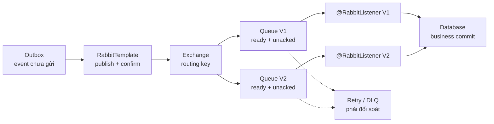
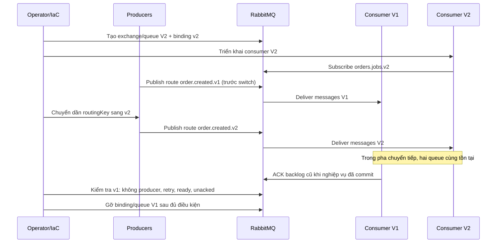
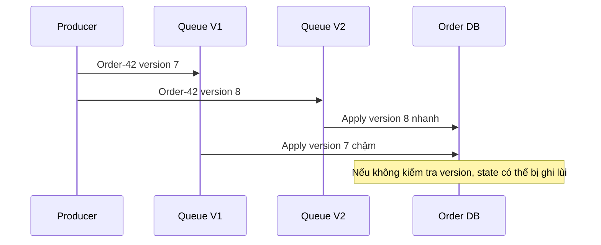
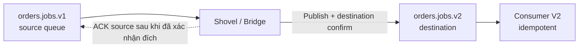

# Thay đổi topology không phá hủy thông điệp còn chờ

Trong hệ thống Spring AMQP, topology RabbitMQ không chỉ là tập hợp vài dòng khai báo `exchange`, `queue` và `binding`. Topology còn quyết định **message sẽ đi đâu, đang chờ ở đâu, consumer nào có thể đọc chúng và liệu các message đã được giao nhưng chưa ACK có được xử lý tiếp hay không**. Vì vậy, thay đổi topology khi hệ thống đang hoạt động là một **bài toán di chuyển dữ liệu và chuyển đổi lưu lượng**, không đơn thuần là sửa cấu hình.

Ví dụ, ứng dụng đang nhận lệnh qua queue `orders.jobs.v1` (classic queue) và muốn chuyển sang `orders.jobs.v2` (quorum queue). Nếu operator xóa queue v1 rồi tạo queue v2 cùng tên, những message **ready** và **unacked** thuộc queue v1 không được tự động chuyển sang queue mới. Nếu Spring `RabbitAdmin` khai báo lại queue cũ với `x-queue-type` khác, broker thường từ chối với lỗi **`406 PRECONDITION_FAILED`**, chứ không thực hiện một migration an toàn. Nếu bỏ binding cũ trước khi producer đổi route, message mới có thể không đến queue nào.

Bài thuộc chương **Triển khai và vận hành** của module **SPRING_AMQP**. Chúng ta sẽ xây dựng một quy trình thay đổi topology cho hệ thống sử dụng `RabbitTemplate`, `@RabbitListener`, exchange, queue, binding, publisher confirm/return, consumer acknowledgement, retry và dead-letter. Đích đến không chỉ là “deployment không lỗi”, mà là **message đang chờ vẫn có đường xử lý, message mới không bị mất route và dữ liệu nghiệp vụ không bị bỏ sót hoặc thực thi trùng**.

**Sau bài học, bạn có thể:**

- Phân biệt thao tác sửa binding/policy với thay đổi **queue type hoặc thuộc tính khai báo không thể sửa tại chỗ**.
- Lập bảng kiểm kê ready/unacked, retry queue, DLQ, producer route, consumer và outbox trước khi triển khai.
- Thực hiện migration kiểu **expand → route switch → drain → contract** bằng queue/version mới.
- Dùng `RabbitAdmin` đúng phạm vi, tránh `406 PRECONDITION_FAILED` và không xóa queue còn message.
- Xử lý hai rủi ro đối nghịch khi đổi binding: **khoảng trống không có route** và **giai đoạn fan-out tạo bản sao**.
- Bảo vệ producer bằng publisher confirms/returns, `mandatory` và outbox; bảo vệ consumer bằng commit-before-ack/idempotency.
- Thiết kế rollback, diễn tập sự cố và tiêu chí dỡ bỏ topology cũ bằng **bằng chứng đo được**.

## 1. Nguyên tắc đầu tiên: topology và dữ liệu không đồng nhất

RabbitMQ có thể lưu queue bền vững, nhưng tính bền vững không bảo đảm message sống sót sau **lệnh xóa queue có chủ đích**.

| Đối tượng | Khi bị thay đổi/xóa | Rủi ro chính |
| --- | --- | --- |
| **Exchange** | Thay binding hoặc xóa exchange ảnh hưởng route của lần publish kế tiếp | Producer gửi tới exchange không tồn tại có thể gặp lỗi channel; message không đến đích dự định |
| **Binding** | Thêm/xóa liên kết exchange → queue | Message mới có thể được route đến 0, 1 hoặc nhiều queue tùy topology và thời điểm |
| **Queue** | Xóa queue làm mất nơi chứa message | **Ready/unacked ở queue bị xóa không tự chuyển sang queue khác** |
| **Queue type** | Classic, quorum hoặc stream có semantics lưu trữ khác nhau | Không có thao tác redeclare tại chỗ để chuyển dữ liệu/queue type |
| **Queue arguments** | Các thuộc tính khai báo như durable, exclusive, một số `x-arguments` | Có thể bị lỗi `PRECONDITION_FAILED` khi khai báo không tương đương |
| **Policy** | Điều chỉnh các thuộc tính được RabbitMQ cho phép quản trị bằng policy | Linh hoạt hơn hardcoded arguments, nhưng vẫn có tác động đến message/retry/retention |
| **Consumer subscription** | Dừng, chuyển queue hoặc thay concurrency | Delivery chưa ACK có thể redeliver khi channel đóng nếu **queue còn tồn tại** |
| **Outbox / retry / DLQ** | Nằm ngoài queue chính nhưng vẫn thuộc luồng nghiệp vụ | Dễ bị bỏ quên khi kết luận “queue cũ đã rỗng” |

**Durable queue không phải snapshot hoặc backup.** Queue `durable=true` giúp định nghĩa queue tồn tại qua các tình huống restart broker thông thường, không biến `queue.delete` thành hành động có thể hoàn tác. `deliveryMode=PERSISTENT` cũng không khôi phục message của một queue đã bị xóa.

### 1.1. Nhận diện năm trạng thái của một event

Với event `OrderCreated(E-42)`, cần phân biệt:

1. Event nằm trong **transactional outbox** của producer, chưa publish.
2. Publisher đã gửi nhưng **publisher confirm chưa rõ kết quả**.
3. Broker đã nhận và **route tới queue**, message đang `ready`.
4. Message đã giao cho consumer, hiện `unacked`; database có thể đã commit hoặc chưa.
5. Consumer đã ACK; hệ thống nghiệp vụ có kết quả cuối tương ứng.

Sửa topology an toàn cần bảo vệ **các event ở cả năm trạng thái**. Chỉ nhìn `messages_ready` trên queue chính sẽ bỏ sót producer in-flight, unacked, retry queue và event đã ACK nhưng chưa đạt kết quả đầu cuối.



Trong sơ đồ, **không chủ trương** để một event được route đồng thời vào hai queue chỉ vì có hai binding: cần chủ đích quyết định một lần publish thuộc **route v1 hoặc route v2**. Nếu thiết kế chọn fan-out có chủ đích, consumer phải xử lý được bản sao và sự thay đổi thứ tự.

## 2. Phân loại thay đổi trước khi chọn phương án migration

Không phải mọi thay đổi topology đều cần queue mới.

| Thay đổi mong muốn | Có thể làm trực tiếp? | Chiến lược an toàn thường dùng |
| --- | --- | --- |
| Thêm consumer đọc cùng queue | Thường có | Scale listener, đo concurrency/DB load, idempotency |
| Thêm binding để nhận **route mới** | Có, nhưng thay đổi đường giao của message mới | Tạo binding trước khi producer dùng routing key mới; test publish thật |
| Bỏ binding không còn dùng | Có | Chỉ bỏ sau khi xác nhận producer cũ đã dừng và retry/delayed route không dùng nữa |
| Điều chỉnh DLX/TTL/max-length được RabbitMQ hỗ trợ qua **policy** | Có điều kiện theo queue type/property | Thay policy có kế hoạch; kiểm tra ảnh hưởng lên message đang chờ |
| Đổi queue từ classic → quorum | **Không tại chỗ** | Queue mới, route switch, drain/replay và xóa cũ sau đối soát |
| Đổi queue từ classic/quorum → stream | **Không tại chỗ** và semantics khác | Thiết kế luồng log/offset riêng, migration và xác minh mới |
| Đổi durable/exclusive/queue type của queue hiện hữu | Không dùng redeclare như migration | Tạo queue khác tên và chuyển traffic hoặc cửa sổ chuyển đổi có kiểm soát |
| Đổi số mức `x-max-priority` của classic queue | Thường không sửa tại chỗ bằng redeclare | Tạo queue mới với cấu hình đúng, rồi drain |
| Đổi loại exchange direct → topic | Không chuyển loại của exchange cũ bằng redeclare | Exchange version mới, route/producer switch có kiểm soát |
| Đổi tên queue hoặc định tuyến shard | Không có rename queue bảo toàn mọi message như thao tác metadata | Queue mới, chuyển route, xử lý thứ tự và state đang chờ |

**Policy không phải phép màu:** chỉ những thuộc tính được RabbitMQ hỗ trợ mới có thể thay qua policy; không thể dùng policy để thay đổi queue type. Một số `x-arguments` khai báo trực tiếp có precedence khác policy, còn operator policy có thể đặt giới hạn riêng. Phải kiểm tra **effective arguments** trên broker và tài liệu của đúng phiên bản.

### 2.1. Vì sao redeclare sai thường gây hỏng deployment?

Giả sử queue đã tồn tại:

```text
orders.jobs.v1:
  durable=true
  x-queue-type=classic
```

Deployment mới sửa bean:

```java
@Bean
Queue ordersJobs() {
    return QueueBuilder.durable("orders.jobs.v1")
            .quorum()
            .build();
}
```

Khi ứng dụng `RabbitAdmin` hoặc producer thực hiện `queue.declare` với định nghĩa không tương thích queue đang có, RabbitMQ có thể đóng **channel liên quan** với lỗi `406 PRECONDITION_FAILED`. **Broker không chuyển classic queue sang quorum queue, không tự sao chép backlog và không bảo toàn thứ tự nghiệp vụ cho bạn.**

**Không xóa `orders.jobs.v1` để “sửa 406” khi còn message.** Cần rollback khai báo sai, giữ lại queue hiện hữu và thực hiện migration bằng resource mới.

## 3. Xác định những bất biến cần giữ trước khi triển khai

Một đợt migration tốt bắt đầu từ **tiêu chí kiểm chứng**, không bắt đầu từ script tạo queue.

| Bất biến | Cách kiểm chứng |
| --- | --- |
| Event đã được ứng dụng chấp nhận không biến mất chỉ vì đổi route | Event ID/outbox, publisher confirm/return, trạng thái nghiệp vụ và đối soát |
| Không thực hiện side effect hai lần khi retry hoặc nhận hai bản sao | Unique key/idempotency theo `consumerPurpose + eventId` hoặc khóa nghiệp vụ |
| Message v1 còn chờ có thể được xử lý tiếp | Queue v1, consumer v1, retry/DLQ và quyền truy cập tiếp tục hoạt động trong pha drain |
| Producer mới chỉ gửi vào đích có topology hợp lệ | Tạo v2 trước, test binding, confirms và returns |
| Không vi phạm thứ tự bắt buộc theo `aggregateId` | Version/sequence, per-key serialization, barrier/drain nếu cần |
| Có thể rollback mà không mất sự kiện chưa xử lý | Giữ resource v1 và code/consumer v1; có outbox và quy trình route switch ngược |
| Không tạo thêm lỗi vận hành nghiêm trọng | Theo dõi backlog, error, DLQ, resource pressure, SLA và alert |

**Định nghĩa “không phá hủy” cần chính xác:** không mất event đã chấp nhận, không xóa message đang chờ, và không tạo ra trạng thái nghiệp vụ sai. Khó có thể hứa “exactly-once delivery” khi mạng, publisher confirm và consumer ACK không chung một giao dịch. Mục tiêu thực tế thường là **at-least-once delivery + idempotent processing + reconciliation**.

## 4. Kiểm kê topology và message trước ngày chuyển đổi

Trước deploy, trả lời các câu hỏi sau:

1. Exchange/vhost nào? Kiểu `direct`, `topic`, `fanout` hay `headers`, và producer publish tới **routing key** nào?
2. Queue cũ thuộc loại nào, có durable/exclusive/auto-delete không; queue arguments/policies/DLX/TTL/priority thế nào?
3. Ai quản lý topology: `RabbitAdmin` tự khai báo, IaC/operator hay service khác?
4. Có những **producer đang chạy ở nhiều phiên bản** nào? Có publisher retry, delayed publish, scheduled job hoặc outbox đang gửi lại route cũ không?
5. Có bao nhiêu consumer instances? `prefetch`, `ackMode`, concurrency, transaction, error handler và retry strategy?
6. `messages_ready` và `messages_unacknowledged` hiện bao nhiêu? Có message nằm trên retry queue, DLQ, delay plugin, outbox hoặc nơi trung gian?
7. Có điều kiện thứ tự theo `orderId`, `accountId`, stream partition hay version nghiệp vụ không?
8. Ai quyết định **đã đủ an toàn để dỡ resource v1** và ai có quyền rollback?

Ví dụ lệnh **chỉ đọc** ở môi trường RabbitMQ được phép:

```bash
# Các lệnh này chỉ liệt kê trạng thái, không xóa hay purge queue.
rabbitmqctl list_queues -p orders-prod \
  name type durable consumers messages_ready messages_unacknowledged

rabbitmqctl list_bindings -p orders-prod \
  source_name destination_name routing_key

rabbitmqctl list_consumers -p orders-prod
```

Tên field có thể khác chút theo phiên bản CLI; đối chiếu `rabbitmqctl help` khi cần. Không dùng `rabbitmqctl delete_queue`, `purge_queue` hoặc nút Delete trên Management UI như một bước khôi phục mặc định.

### 4.1. Chụp baseline thay vì đo một lần

Trong 15–30 phút trước deploy (hoặc cửa sổ phù hợp workload), ghi:

| Chỉ số | Vì sao cần |
| --- | --- |
| `ready/unacked` của v1, retry, DLQ | Đánh giá phạm vi dữ liệu đang tồn tại |
| Publish rate theo routing key cũ | Biết producer cũ có dừng thật hay không |
| Publisher confirms/returns/unknown | Phát hiện route mất hoặc kết quả gửi bất định |
| Consumer count, ack rate, redelivery, restart | Biết v1 có drain được không |
| Outbox pending count và tuổi event lâu nhất | Phát hiện message chưa tới broker |
| Business success count, pending age, unique event IDs | Chứng minh không mất/không trùng nghiệp vụ |
| Message schema version, event type và key distribution | Biết consumer v2 có hiểu payload cũ và thứ tự domain không |

Một queue có `ready=0` trong **một thời điểm** có thể nhận message mới ngay sau đó. Không dùng snapshot đó làm bằng chứng xóa queue cũ.

## 5. Chiến lược khuyến nghị: expand → switch → drain → contract

Đây là quy trình tương thích với **rolling deployment**, khi yêu cầu xử lý liên tục và **không bắt buộc giữ thứ tự commit tuyệt đối trên cả v1 và v2**:



Từng pha có mục tiêu khác nhau:

**Expand:** thêm queue/binding v2 **trước** khi producer gửi v2. Giữ nguyên v1. Đảm bảo v2 có quyền, consumer, DLX và monitoring đúng.

**Switch:** producer bắt đầu dùng **routing key v2 riêng**. Trong rollout có thể có producer cũ vẫn gửi v1; do vậy giữ cả hai route hoạt động. Ghi nhận producer version và các event còn pending.

**Drain:** ngừng phát event *mới* vào v1 theo kế hoạch, nhưng **không tắt consumer v1**. Tiếp tục đọc message đã chờ, xử lý retry và đối soát các event chưa được confirm.

**Contract:** khi không còn đường phát v1, backlog v1 và các luồng phụ đã được giải quyết, mới gỡ binding, listener và queue cũ theo change request.

### 5.1. Vì sao dùng hai routing key thay vì thêm hai binding cùng key?

Giả sử exchange `orders.commands` kiểu direct:

```text
TRƯỚC:
  order.created.v1 -> orders.jobs.v1

TRONG MIGRATION:
  order.created.v1 -> orders.jobs.v1
  order.created.v2 -> orders.jobs.v2

SAU KHI DRAIN:
  order.created.v2 -> orders.jobs.v2
```

Mỗi lần publish vào **một routing key** ở một thời điểm sẽ đi vào **queue tương ứng**, nếu topology đúng.

Nếu thay vào đó gắn **cả hai queue** vào cùng routing key `order.created` trên exchange direct, mỗi publish matching key có thể được route vào **cả v1 lẫn v2**. Đây là **fan-out bản sao**, không phải load balancing/move. Nếu cả hai listener cùng cập nhật đơn hàng, duplicate side effect là rủi ro hiển nhiên.

Ngược lại, nếu xóa binding cũ **trước** khi tạo binding mới và producer vẫn publish, có thể xuất hiện **khoảng không có route**. Với `mandatory=false` và không có alternate exchange thích hợp, message unroutable có thể bị loại; **publisher confirm ACK vẫn có thể đến**, vì exchange đã tiếp nhận publish.

Vì vậy, **routing key theo version** là một cách giảm rủi ro giữa giai đoạn chuyển đổi. Nếu bắt buộc giữ nguyên routing key, phải có **barrier chuyển đổi có kiểm soát**, outbox hoặc một cơ chế phân phối trung gian; không được coi hai lệnh bind/unbind là thao tác atomic.

## 6. Ví dụ Spring AMQP: giữ v1, thêm queue v2

Giả sử hiện đã có:

- Exchange durable: `orders.commands` (direct).
- Classic queue durable: `orders.jobs.v1`.
- Binding cũ: `order.created.v1 → orders.jobs.v1`.
- Consumer v1 đang dùng `@RabbitListener(queues="orders.jobs.v1")`.
- Producer cũ gửi `RabbitTemplate.convertAndSend("orders.commands", "order.created.v1", ...)`.

Yêu cầu mới: dùng **quorum queue** `orders.jobs.v2`, vẫn xử lý sự kiện `OrderCreated` và không mất backlog v1.

### 6.1. Chỉ khai báo resource mới

```java
import org.springframework.amqp.core.Binding;
import org.springframework.amqp.core.BindingBuilder;
import org.springframework.amqp.core.DirectExchange;
import org.springframework.amqp.core.Queue;
import org.springframework.amqp.core.QueueBuilder;
import org.springframework.beans.factory.annotation.Qualifier;
import org.springframework.context.annotation.Bean;
import org.springframework.context.annotation.Configuration;

@Configuration
public class OrdersTopologyV2 {

    @Bean("ordersCommandsExchange")
    DirectExchange ordersCommandsExchange() {
        // Phải tương thích định nghĩa exchange orders.commands hiện có.
        return new DirectExchange("orders.commands", true, false);
    }

    @Bean("ordersJobsV2")
    Queue ordersJobsV2() {
        // Queue mới: không khai báo lại orders.jobs.v1 với type mới!
        return QueueBuilder.durable("orders.jobs.v2")
                .quorum()
                .build();
    }

    @Bean
    Binding ordersJobsV2Binding(
            @Qualifier("ordersJobsV2") Queue queue,
            @Qualifier("ordersCommandsExchange") DirectExchange exchange) {
        return BindingBuilder.bind(queue)
                .to(exchange)
                .with("order.created.v2");
    }
}
```

Trong ứng dụng có `RabbitAdmin` tự khai báo beans, cấu hình trên chỉ tạo **v2** và khai báo exchange hiện có bằng thông số phù hợp. **Không thêm Bean queue v1 với định nghĩa mới**. Nếu IaC/operator quản lý topology, dùng cấu hình ở trên làm **mô tả thiết kế**, còn provisioning phải thực hiện bằng chính owner của topology (không bật hai hệ thống tự sửa tài nguyên của nhau).

**Quorum queue yêu cầu môi trường broker phù hợp** (queue type và chính sách replica/quorum, disk, node availability); nó không có mọi đặc tính của classic queue. Kiểm tra TTL/DLX, retry, priority, max-length và cách scale theo RabbitMQ version đang vận hành **trước** khi thay thế. Thay queue type là **thay ngữ nghĩa vận hành** chứ không chỉ đổi cấu hình một dòng.

### 6.2. Hai listener hoạt động trong thời gian chuyển đổi

```java
import org.springframework.amqp.rabbit.annotation.RabbitListener;
import org.springframework.stereotype.Component;

@Component
public class OrdersMigrationConsumers {
    private final OrderEventService service;

    public OrdersMigrationConsumers(OrderEventService service) {
        this.service = service;
    }

    @RabbitListener(
        id = "orders-v1-drain",
        queues = "orders.jobs.v1")
    public void handleV1(String payload) {
        service.applyOnce(payload);
    }

    @RabbitListener(
        id = "orders-v2-active",
        queues = "orders.jobs.v2")
    public void handleV2(String payload) {
        service.applyOnce(payload);
    }
}
```

`OrderEventService.applyOnce` là service **do ứng dụng triển khai**, phải parse event, xác minh `eventId`/`aggregateVersion` và commit idempotency marker **trong cùng transaction** với cập nhật nghiệp vụ. Ví dụ dùng `AcknowledgeMode.AUTO` của listener container: container ACK sau khi method trả về thành công; khi service lỗi, cơ chế reject/retry phụ thuộc error handler.

Với **manual acknowledgement**, phải gọi `basicAck` đúng channel/delivery tag **sau commit**, tránh ACK trước khi transaction thành công. Không dùng `basicAck(tag, true)` nếu không chắc chắn mọi delivery có tag thấp hơn trên **cùng channel** đều đã hoàn tất.

### 6.3. Đừng vô tình cạnh tranh message giữa các phiên bản

Hai listener trong ví dụ **đọc hai queue khác nhau**. Nếu thay vì queue v2, bạn chỉ deploy hai phiên bản app đều nghe `orders.jobs.v1`, chúng là **competing consumers của cùng queue**. Việc chạy app v1 và v2 song song khi schema/behavior không tương thích có thể làm một message bị xử lý bởi phiên bản không phù hợp.

Trong rolling release:

- **Backward-compatible contract:** listener mới phải đọc được message v1 còn tồn tại.
- **Forward-compatible release:** nếu v1 còn chạy, producer không được phát schema chỉ v2 hiểu vào queue v1.
- **Compatibility window:** nếu cần đổi bất tương thích, dùng route/queue version riêng và duy trì v1 consumer tới khi drain.

## 7. Producer: route có phiên bản và publish được xác nhận

Một producer có thể **thay routing key** mà không đổi exchange:

```java
public final class OrdersRoutes {
    public static final String EXCHANGE = "orders.commands";
    public static final String V1 = "order.created.v1";
    public static final String V2 = "order.created.v2";

    private OrdersRoutes() {}
}
```

**Điểm khó không nằm ở lệnh `convertAndSend`** mà ở **khi nào event được quyết định đi v1/v2**. Với transactional outbox, nên lưu **eventId**, **payload/schemaVersion**, **exchange**, **routingKey được chọn**, **trạng thái publish** trong outbox. Mỗi lần retry một event chưa có kết quả xác nhận chắc chắn nên dùng **cùng route đã lưu**, trừ khi có quy trình reroute có kiểm toán và dedup.

Nếu một lần publish v1 bị mất confirm và worker retry event đó với route v2, broker có thể đã nhận **cả hai bản**. Dùng event ID ổn định/idempotency để hạn chế side effect; không dựa vào “new route chắc chắn thay old”.

### 7.1. Cấu hình publisher confirms và returns

```yaml
spring:
  rabbitmq:
    publisher-confirm-type: correlated
    publisher-returns: true
```

Nếu tạo một `RabbitTemplate` cho producer migration, bật `mandatory`:

```java
import org.springframework.amqp.rabbit.connection.ConnectionFactory;
import org.springframework.amqp.rabbit.core.RabbitTemplate;
import org.springframework.context.annotation.Bean;
import org.springframework.context.annotation.Configuration;

@Configuration
public class OrdersPublishConfig {
    @Bean("ordersMigrationTemplate")
    RabbitTemplate ordersMigrationTemplate(
            ConnectionFactory connectionFactory) {
        RabbitTemplate template = new RabbitTemplate(connectionFactory);
        template.setMandatory(true);
        return template;
    }
}
```

`publisher-confirm-type=correlated` và `publisher-returns=true` chỉ hoạt động khi connection factory được cấu hình phù hợp và RabbitMQ hỗ trợ. `mandatory=true` cho phép broker trả `basic.return` nếu message không route vào queue thích hợp **theo quy tắc routing**, trong khi publisher confirm xác nhận kết quả xử lý publish ở broker. Confirm **ACK không đủ** nếu message bị trả về vì không có route.

### 7.2. Minh họa một lần publish với CorrelationData

```java
import java.util.concurrent.TimeUnit;
import org.springframework.amqp.core.MessageDeliveryMode;
import org.springframework.amqp.rabbit.connection.CorrelationData;
import org.springframework.amqp.rabbit.core.RabbitTemplate;

public class OrdersConfirmedPublisher {
    private final RabbitTemplate template;

    public OrdersConfirmedPublisher(RabbitTemplate template) {
        this.template = template;
    }

    public void publishOnce(OutboxEvent event) throws Exception {
        // OutboxEvent do ứng dụng định nghĩa: id(), routingKey(), payload().
        // Route được chọn và lưu cùng event; không đổi route khi retry mù.
        CorrelationData correlation = new CorrelationData(event.id());

        template.convertAndSend(
                OrdersRoutes.EXCHANGE,
                event.routingKey(),
                event.payload(),
                message -> {
                    message.getMessageProperties()
                            .setMessageId(event.id());
                    message.getMessageProperties()
                            .setDeliveryMode(MessageDeliveryMode.PERSISTENT);
                    return message;
                },
                correlation);

        CorrelationData.Confirm confirm =
                correlation.getFuture().get(10, TimeUnit.SECONDS);
        if (!confirm.isAck() || correlation.getReturned() != null) {
            throw new IllegalStateException(
                    "Publish failed or unroutable: " + event.id());
        }

        // Caller đánh dấu outbox đã gửi bằng transaction riêng
        // SAU khi xác nhận không có return và confirm ACK.
    }
}
```

Đây là mẫu **minh họa đồng bộ** để giải thích ranh giới confirm/return, không phải thiết kế throughput cao: trong production nên dùng publisher outbox bất đồng bộ, batch phù hợp và callback/future có xử lý timeout.

**Với timeout, kết quả có thể là UNKNOWN**: message có thể đã vào broker nhưng confirm không đến client. Không xóa outbox event chỉ vì đã gọi `convertAndSend`. Có thể retry tạo duplicate; consumer phải idempotent. Khi broker có **alternate exchange**, message không route tới queue đích có thể đi tới đường khác mà không bị return; test topology/queue đích vẫn cần thiết.

## 8. Kế hoạch triển khai từng pha có thể rollback

### Pha 0 — Khóa phạm vi và xác nhận hợp đồng nghiệp vụ

Ghi rõ:

- Resource **v1**: exchange, routing key, queue, DLX, retry, consumer, schema.
- Resource **v2**: queue type, durability, arguments, policies, binding, access rights.
- **Tiêu chí không mất**: event nào được coi là “đã chấp nhận”, lưu ở outbox/DB ra sao.
- **Yêu cầu thứ tự**: có được phép xử lý v1 và v2 song song theo cùng `orderId` không?
- **Tiêu chí rollback**: health, p95/p99, errors, DLQ, outbox age và owner quyết định.

Nếu bắt buộc strict ordering cho cùng aggregate, chuyển sang phương án **barrier/drain** ở mục 10 thay vì mặc nhiên chạy v1/v2 đồng thời.

### Pha 1 — Expand: thêm v2 mà không chạm v1

1. Provision `orders.jobs.v2` với type, durable, policy và permissions đúng.
2. Khai báo binding `order.created.v2 → orders.jobs.v2`; giữ `order.created.v1 → orders.jobs.v1`.
3. Bật consumer v2 nhưng chưa chuyển publisher đại trà.
4. Gửi một **synthetic event** riêng đã được phép test, kiểm tra route, consume, DB/idempotency, confirms/returns.
5. Kiểm tra consumer v1 vẫn xử lý bình thường; không xóa hay purge queue v1.

**Gate:** chỉ được sang pha switch khi v2 đã được quan sát hoạt động end-to-end và không xung đột tài nguyên/quyền.

### Pha 2 — Switch publisher có kiểm soát

1. Bật feature flag/routing configuration để **event mới** chọn `order.created.v2`.
2. Trong rolling deployment, giữ route v1 vì các instance cũ vẫn có thể gửi v1.
3. Persist route theo event trong outbox; xác nhận mọi event gửi có publisher confirm/return phù hợp.
4. Theo dõi `messages_ready/unacked`, consumer count, DLQ và business success trên **cả hai queue**.
5. Nếu v2 lỗi, ngừng tăng tỷ lệ v2, đưa event **mới** trở lại v1 nếu hợp đồng cho phép; không tự động chuyển các event v2 đã phát/đang pending về v1 mà thiếu đối soát.

**Gate:** service mới ổn định, old producers không còn phát event mới vào v1, và sự kiện chưa confirm/outbox của route v1 đã được kiểm kê.

### Pha 3 — Drain message ở v1

1. Giữ listener v1 chạy với cấu hình đủ năng lực và retry có giới hạn.
2. Chờ nguồn phát route v1 ngừng hoàn toàn, gồm delayed jobs, scheduled jobs, publisher retries và outbox.
3. Chờ `ready=0` và `unacked=0` **qua một khoảng quan sát hợp lý**, không chỉ một snapshot.
4. Đối soát các retry queue, DLQ, delayed messages, publisher unknown và event chưa có kết quả nghiệp vụ.
5. Nếu v1 còn poison message, đưa sang **quarantine có thể kiểm toán**, không purge để làm “queue rỗng”.
6. Xác nhận số lượng event đã chấp nhận tương ứng với business outcomes (success, rejected có lý do, pending xử lý tiếp), tránh kết luận chỉ từ số ACK.

**Gate:** không còn message cần được v1 xử lý hoặc route lại, các ngoại lệ đã có owner và kế hoạch xử lý, không còn nguồn phát v1 nào.

### Pha 4 — Contract sau cửa sổ an toàn

Chỉ khi đạt đầy đủ gates:

1. Dừng v1 listener có kiểm soát sau khi message đang xử lý hoàn tất hoặc được đưa về queue còn tồn tại.
2. Xác minh lần cuối v1 không có consumer đang xử lý/unacked, không còn producer/retry nhắm vào v1.
3. Bỏ binding v1, rồi mới quyết định **xóa queue v1 theo change request**.
4. Giữ kế hoạch rollback bằng **provision lại topology + replay từ nguồn bền vững** nếu sau đó phát hiện thiếu dữ liệu; lưu ý queue đã xóa **không thể tự khôi phục backlog**.
5. Thu hồi quyền/tài nguyên v1 đã không còn dùng; cập nhật cảnh báo, dashboard và tài liệu vận hành.

**Không ép ngày dỡ bỏ topology cũ bằng đúng ngày phát hành code.** Cửa sổ drain phụ thuộc backlog, retries và quy tắc dữ liệu; có thể dài hơn một deployment.

## 9. Hai thay đổi binding dễ gây mất hoặc nhân đôi message

### 9.1. Xóa cũ rồi thêm mới: khoảng trống không route

```text
T0: key order.created -> orders.jobs.v1
T1: operator xóa binding cũ
T2: producer vẫn publish order.created
T3: operator thêm binding mới -> orders.jobs.v2

Message publish tại T2 có thể KHÔNG đến queue nào.
```

Nếu exchange tồn tại và routing không match queue, publisher confirm có thể ACK dù không có route. Bật `mandatory`/returns để phát hiện nhiều trường hợp unroutable và dùng outbox để phát lại có kiểm soát. Với topic/fanout/alternate exchange, kết quả routing phải được kiểm chứng theo thực tế.

### 9.2. Thêm mới rồi xóa cũ: khoảng thời gian nhân bản

```text
T0: order.created -> orders.jobs.v1
T1: thêm binding cùng key -> orders.jobs.v2
T2: producer publish một event
T3: xóa binding v1

Message tại T2 có thể vào CẢ HAI queue.
```

**Không có “di chuyển một queue” tự động** khi thêm binding. Binding tác động tới **message được publish sau thời điểm binding có hiệu lực**, không dời các message đã nằm trong queue.

Trong cả hai ví dụ, các thao tác triển khai độc lập **không tạo một giao dịch routing switch nguyên tử**. Lựa chọn là:

- Route keys versioned + rollout đồng tồn tại có kiểm soát;
- Tạm đóng van publish tại nguồn **nhưng vẫn tiếp nhận event qua outbox bền vững**, thay route rồi phát lại;
- Hoặc chấp nhận duplicate có kiểm chứng khi domain cho phép và dùng idempotency mạnh.

## 10. Nếu bắt buộc giữ thứ tự theo aggregate: cần barrier/drain

Hai queue v1/v2 chạy song song giúp rollout ít gián đoạn, nhưng **không giữ thứ tự commit giữa chúng**:



Để tránh:

**Cách A — Khoảng chuyển đổi có barrier (strict serial order):**

1. Cho ingress tiếp tục ghi event vào **outbox bền vững**, nhưng **tạm dừng dispatcher** route v1/v2 theo kế hoạch.
2. Chờ publisher v1 in-flight confirm, queue v1, unacked, retry và các xử lý cũ liên quan **drain hoặc được giải quyết**.
3. Xác nhận các version đã commit theo aggregate; lưu trạng thái watermark/barrier.
4. Đổi routing sang v2; phát outbox event đang giữ theo sequence đúng, rồi tiếp tục bình thường.

Đây là giải pháp có **chi phí tạm ngừng dispatch** nhưng có thể giữ API tiếp nhận request nếu outbox đủ bền và có capacity. Phải kiểm thử kỹ các tác vụ đang retry/chờ DLQ và việc đảm bảo sequence từ upstream.

**Cách B — Version-aware consumers:** V1 và V2 có thể chạy song song nhưng transaction chỉ cập nhật business state khi version hợp lệ. Nếu xử lý **snapshot cuối cùng**, có thể bỏ version cũ một cách an toàn khi domain cho phép. Nếu xử lý **delta bắt buộc đủ** (trừ tiền, cộng số dư, cập nhật tồn kho), không được bỏ qua version có gap; cần pending-event store/serialization và cơ chế phục hồi gap.

**Không suy rằng “mỗi queue có một consumer” là bảo đảm thứ tự toàn cục.** Nó chỉ giới hạn một phần thứ tự trong **một queue**; khi tách route, vẫn có hai pipeline độc lập.

## 11. Có nên copy message bằng Shovel hoặc consumer bridge?

Đôi khi yêu cầu là **chuyển cả backlog** từ queue cũ sang queue mới trước khi cắt consumer, thay vì để v1 consumer drain tại chỗ.

RabbitMQ **Shovel** hoặc một **bridge consumer** có thể consume source v1 và publish destination v2. Tuy nhiên, đây là **copy-and-ack ở cấp message**, không phải một thao tác `rename queue` nguyên tử và không tự bảo đảm exactly-once.



**Thứ tự an toàn cho bridge:**

1. Đọc message từ source ở manual ack.
2. Publish tới destination với routing/binding hợp lệ, theo dõi publisher confirm **và return** nếu cần.
3. Chỉ ACK source khi đã có bằng chứng publish tới đích đạt yêu cầu.
4. Nếu kết quả publish chưa rõ, **không ACK source như thể đã thành công**; retry có thể tạo duplicate ở destination.
5. Dùng event ID và idempotent consumer tại destination, theo dõi source/destination counts và reconciliation.

**Không chạy bridge tranh chấp với consumer v1** nếu kế hoạch yêu cầu move toàn bộ backlog: cả bridge lẫn v1 consumer có thể cùng nhận delivery từ source. Phải quyết định rõ loại message nào xử lý tại v1, loại nào được chuyển sang v2 và ai giữ ownership.

### 11.1. Những trường hợp bridge không phải lựa chọn tốt

- Message cần giữ thứ tự toàn cục nhưng copy chạy song song nhiều consumer.
- Header, TTL, priority hoặc delivery mode cần chuyển đổi theo contract mới mà bridge chưa kiểm chứng.
- Retry/DLQ cũng phải move, trong khi nguồn đang có nhiều delayed messages trỏ về queue cũ.
- Queue source có message cực lớn/nhiều, bridge gây tải broker/disk/network vượt ngân sách.
- Consumer v2 không tương thích schema v1, nhưng bridge chỉ copy bytes mà không chuyển đổi dữ liệu.

Trong những trường hợp đó, có thể đơn giản hơn và an toàn hơn khi **giữ v1 consumer để drain**, sau đó chuyển đường nhận message mới sang v2.

## 12. Policy: sửa cấu hình có thể thay tại chỗ nhưng vẫn cần đánh giá tác động

Không phải mọi thay đổi đều là migration queue type. RabbitMQ hỗ trợ policies cho một số thuộc tính như dead-lettering, TTL, giới hạn queue; đây là lựa chọn quản trị linh hoạt hơn hard-code những `x-arguments` có thể thay đổi.

| Thuộc tính | Câu hỏi trước khi sửa policy |
| --- | --- |
| **DLX / routing key** | Message đang retry/dead-letter sẽ đi đâu sau thay đổi? Exchange/binding đích có tồn tại không? |
| **Message TTL** | Thay đổi tuổi sống có thể làm message cũ hết hạn hoặc được dead-letter sớm hơn không? |
| **Queue length limit / overflow** | Khi queue đầy, message bị reject/drop hay chuyển cơ chế khác theo type/policy? |
| **Delivery limit của quorum queue** | Poison messages có thể bị dead-letter/drop sau số lần delivery nào? Có consumer mới xử lý được không? |
| **Retention của stream** | Segment cũ có thể bị loại trước khi consumer chậm kịp đọc không? |
| **Permissions / vhost** | App cũ và mới có quyền declare/publish/consume trong giai đoạn chuyển đổi không? |

**Không đặt hard-coded `x-arguments` và policy mâu thuẫn rồi cho rằng policy chắc chắn thắng.** Đọc effective definition/arguments và quan hệ ưu tiên giữa client-provided arguments, user policy và operator policy theo version RabbitMQ.

Ví dụ muốn thay tuyến DLQ của `orders.jobs.v1`, cần:

1. Provision **DLX, DLQ và binding đích** trước.
2. Bảo đảm monitoring/DLQ consumer/replay có thể xử lý message mới.
3. Điều chỉnh policy qua IaC/change request.
4. Gửi message lỗi **test có event ID riêng**, kiểm chứng nó tới đúng DLQ.
5. Kiểm tra message cũ và các retry trong flight không bất ngờ bị mất.

Chỉ đổi tên DLX trong config mà quên binding có thể khiến message dead-letter không có route mong đợi. **Dead-lettering không tự là giao dịch end-to-end**; độ tin cậy phụ thuộc queue type, môi trường và cấu hình. Khi thay policy ảnh hưởng dữ liệu, phải có nguồn đối soát và phương án rollback.

## 13. Spring RabbitAdmin và auto-declaration: kiểm soát người sở hữu

`RabbitAdmin` có thể khai báo exchange, queue, binding từ Spring beans. Đây là tính năng tốt cho môi trường học tập và service thực sự sở hữu topology, nhưng khi migration có nhiều phiên bản ứng dụng, **auto-declaration không thay thế kế hoạch thay đổi**.

### Rủi ro thường gặp

- Bản v1 và v2 cùng khai báo **queue cùng tên nhưng khác arguments**, gây `406 PRECONDITION_FAILED` khi reconnect.
- Một phiên bản vẫn khai báo **binding cũ**, vô tình tái tạo nó sau khi operator vừa tháo.
- Một consumer set `autoDeclare`/admin được cấu hình để tự tạo lại queue bị xóa, che giấu thao tác retirement có chủ đích.
- App runtime có quyền `configure` rộng chỉ để tự declare topology, dù thực tế production đã có IaC owner.
- Deployment v2 bắt đầu consume trước khi queue/binding/DLX mới được provision, dẫn tới retry hoặc fail startup.

### Quy ước ownership nên áp dụng

| Mô hình | Cách triển khai |
| --- | --- |
| **App-owned topology** | Spring beans được version rõ; `RabbitAdmin` có quyền đúng phạm vi; migration giữ v1 cho đến gate dỡ bỏ |
| **Platform/IaC-owned topology** | Provision trước ứng dụng; runtime có quyền `write/read` tối thiểu, thường không tự cấu hình queue |
| **Dùng chung exchange nhiều service** | Có owner phụ trách exchange và contract của routing key, mỗi service sở hữu queue/binding theo phân quyền rõ |
| **Môi trường hỗn hợp nhiều phiên bản** | Không để cấu hình auto-declare của một bản cũ chống lại thao tác migration của bản mới |

Thứ tự tốt là **provision topology → kiểm tra routing/quyền → rollout consumers → switch producers → drain → deprovision**, chứ không phải “deploy code mới trước rồi hy vọng admin tự sửa broker”.

## 14. Rollback: không đảo route một cách mù quáng

Giả sử sau khi chuyển 30% traffic sang v2, latency tăng và timeout DB xuất hiện. Cách rollback phụ thuộc trạng thái dữ liệu:

**Rollback an toàn về mức điều khiển luồng:**

1. Ngừng tăng traffic v2; nếu cho phép, **event mới** trở lại route v1 bằng flag/routing config.
2. **Giữ v2 queue, binding và consumer** cho những message đã gửi v2; không xóa queue v2.
3. Ghi nhận event ID/route của các publisher request chưa rõ confirm và outbox pending.
4. Nếu business consumer v2 lỗi, dừng side effect nguy hiểm, giữ message ở queue còn tồn tại hoặc chuyển sang quarantine/retry phù hợp.
5. Khôi phục v2 listener/bridge có kiểm soát hoặc dùng kế hoạch phát lại từ outbox/nguồn bền vững.
6. Đối soát hai đường, tránh vừa retry v2 vừa phát lại cùng event sang v1 mà không có idempotency.

```text
Rollback code/config ≠ rollback dữ liệu.

Mọi event đã publish vào orders.jobs.v2
  vẫn ở V2 hoặc đã được V2 xử lý;
  không tự xuất hiện lại ở V1 sau khi đổi feature flag.
```

Nếu v1/v2 sử dụng **schema database khác nhau**, rollback có thể còn cần cơ chế tương thích schema và migrations kiểu expand/contract ở database. Không cho old code xử lý payload/state mới mà nó không hiểu; queue chưa bị xóa nhưng consumer sai contract vẫn có thể làm hỏng dữ liệu.

### 14.1. Khi nào chưa được xóa queue v1?

Nếu một trong các điều sau đúng, **chưa qua gate dỡ bỏ**:

- Còn producer/scheduled job/instance cũ publish route v1.
- Còn `ready > 0` hoặc `unacked > 0`.
- Còn retry/delayed message hoặc DLX route nhắm vào v1.
- Còn outbox event mang routing key v1 chưa có kết quả publish chắc chắn.
- Còn event v1 chưa có business outcome hợp lệ, cần reconciliation.
- Chưa xác nhận idempotency/thứ tự khi chuyển schema hoặc shard.
- Chưa có cửa sổ đo ổn định hoặc không có owner phê duyệt.

Đừng dùng **thời hạn deploy** thay cho bằng chứng dữ liệu; nếu backlog thực tế lâu hơn dự kiến, phải kéo dài thời gian duy trì v1 hoặc chọn bridge/replay theo kế hoạch.

## 15. Giám sát migration bằng metrics và SLO

### 15.1. Bộ tín hiệu dashboard

| Nhóm | Đo theo v1 và v2 | Kết luận hữu ích |
| --- | --- | --- |
| Broker queue | `messages_ready`, `messages_unacknowledged`, `consumers` | Queue nào đang có backlog/thiếu consumer |
| Routing | Publish vào routing key v1/v2, returned `NO_ROUTE` | Producer đã chuyển route và topology có đích không |
| Producer | Confirm ACK/NACK/unknown, outbox pending age | Publish đã có kết quả đáng tin cậy chưa |
| Consumer | Ack/error/redelivery, handler p95/p99, consumer restarts | Có drain được và có retry storm không |
| Retry/DLQ | Depth, oldest message, retry attempts, replay outcome | Có message bị “ẩn” ngoài queue chính không |
| Database | Unique event IDs processed, idempotency hits, aggregate version | Có side effect trùng hoặc xử lý đảo thứ tự không |
| End-to-end | Pending business events, age, SLA breaches | Có message chưa đạt kết quả nghiệp vụ không |
| Capacity | Broker CPU/disk, node health/quorum, DB pool, executor | Migration có tạo tải quá giới hạn không |

Ví dụ khi dùng RabbitMQ Prometheus exporter với detailed queue metrics, tên metric thường gặp gồm `rabbitmq_detailed_queue_messages_ready`, `rabbitmq_detailed_queue_messages_unacked` và `rabbitmq_detailed_queue_consumers`. Sự tồn tại/label của metric phụ thuộc cấu hình scrape family và version; kiểm tra tại endpoint thực tế trước khi tạo alert.

**Không lấy `ready + unacked == 0` làm điều kiện cuối duy nhất.** Một snapshot có thể xảy ra đúng lúc queue rỗng trước khi producer cũ retry; hàng đợi DLQ/retry có thể còn dữ liệu; đôi khi client đã nhận ACK nhưng việc commit business vẫn chưa đúng như thiết kế.

### 15.2. Phân biệt không có queue với queue rỗng

Nếu queue v1 bị xóa, metric per-queue có thể **biến mất** thay vì giảm về 0. Với Prometheus, chỉ dùng điều kiện `metric == 0` sẽ bỏ sót loại sự cố này. Kết hợp kiểm tra `absent()`, exporter `up` và topology inventory; tránh alert sai khi scrape target bị lỗi.

### 15.3. Thước đo kết thúc migration

Một báo cáo completion tối thiểu có thể ghi:

```text
Migration ID: orders-v1-to-v2
Cutover window: [mốc bắt đầu, mốc kết thúc]
Producer route v1 traffic: 0 sau [mốc đã xác nhận]
Queue v1 ready/unacked: 0 / 0 qua cửa sổ quan sát
Outbox v1 pending/unknown: 0 / 0 (hoặc đã có owner)
Retry/DLQ v1 pending: 0 (hoặc đã quarantine có kiểm toán)
Unique events accepted vs terminal outcomes: đã đối soát
V2 consumer, confirm/return, error, p95/p99: đạt ngưỡng
Rollback plan: đã diễn tập hoặc xác nhận khả thi
Approval: owner của topology + owner nghiệp vụ
```

Không điền số “0” bằng giả định. Nếu có ngoại lệ, phải mô tả event ID và nơi lưu giữ (outbox, quarantine, DLQ) cùng owner/đường xử lý.

## 16. Thực hành: đổi classic queue sang quorum queue không mất message

Thực hiện **trên RabbitMQ development/Testcontainers với message giả**, không chạy lệnh phá hủy trên production. Chuẩn bị Spring Boot có `spring-boot-starter-amqp`, `RabbitTemplate`, hai listener v1/v2 và persistence test theo event ID.

### Kịch bản A — Migration bình thường

1. Tạo v1 classic queue, exchange/binding `order.created.v1` và consumer v1.
2. Gửi 100 message có event ID duy nhất; cố tình làm consumer v1 xử lý chậm để backlog còn **ready/unacked**.
3. Tạo v2 quorum queue và binding `order.created.v2`, giữ nguyên v1.
4. Kiểm tra v2 ready bằng một event thử, xác nhận transaction nghiệp vụ và publisher confirms/returns.
5. Chuyển producer **event mới** sang route v2, đồng thời giữ consumer v1 để drain.
6. Chờ v1 không còn nguồn phát, ready/unacked/retry/outbox đã được đối soát.
7. Kiểm tra toàn bộ 100 event đầu và event phát sau cutover có terminal outcome đúng, không side effect trùng.
8. Chỉ trong **test** mới gỡ v1 sau khi đủ điều kiện, kiểm chứng v2 tiếp tục hoạt động.

**Kỳ vọng:** v1 và v2 đồng tồn tại, không xóa message còn pending. Các event trong cả hai queue được áp dụng theo hợp đồng; nếu cần strict per-key order, dùng barrier hoặc version enforcement.

### Kịch bản B — Thêm hai binding trùng routing key

1. Tạo hai queue, cùng bind vào `order.created`.
2. Publish **một** event có `eventId=E1`.
3. Quan sát event có thể xuất hiện ở **hai queue**; hai consumer đều có thể nhận.
4. Xác nhận DB với unique event ID ngăn side effect lặp.
5. Thay bằng routing key `order.created.v1`/`order.created.v2` để thấy mỗi event thuộc một route.

**Kỳ vọng:** thêm binding là thay đổi **fan-out định tuyến**, không phải chuyển các message đang nằm trong queue cũ.

### Kịch bản C — Publisher bị mất confirm khi đổi route

1. Gửi event với outbox có route v1 đã lưu.
2. Ngắt connection thử nghiệm giữa publish và confirm để tạo kết quả UNKNOWN.
3. Không đánh dấu outbox đã hoàn tất; retry event ID ổn định theo route v1.
4. Cho v1/v2 consumers chạy, xác minh idempotency khi event được nhận lại.
5. Đối soát destination/DB trước khi sửa trạng thái outbox và tuyên bố migration hoàn tất.

**Kỳ vọng:** không khẳng định “unknown = gửi thất bại” và không xóa event khỏi outbox; duplicate được phát hiện chứ không tạo thêm tác vụ nghiệp vụ.

### Kịch bản D — Retry trỏ về queue cũ sau cutover

1. Tạo retry queue với TTL/DLX trỏ lại route v1 trong môi trường test.
2. Cho một event đi vào retry trước khi đổi producer sang v2.
3. Kiểm tra event **vẫn quay về v1** sau TTL nếu topology cũ còn tồn tại.
4. Nếu xóa v1 sớm, quan sát message có thể trở nên unroutable hoặc bị xử lý khác chính sách.
5. Sửa retry/DLX theo kế hoạch, phát lại event có kiểm soát và ghi lại outcome.

**Kỳ vọng:** queue v1 ready bằng 0 ngay sau cutover **chưa đủ để xóa v1**; có thể còn delayed/retry work đang chờ quay lại.

### Kịch bản E — Strict ordering theo aggregate

1. Phát `OrderUpdated(orderId=O-1, version=7)` vào v1 và `version=8` vào v2.
2. Làm v1 xử lý chậm để v2 có thể commit trước v1.
3. Xem consumer v2/DB version check phát hiện gap hoặc bỏ update cũ an toàn khi event là snapshot.
4. Tập dượt **pause dispatcher → drain v1 → switch v2 → resume**, hoặc thiết kế pending gap store với version-aware apply.

**Kỳ vọng:** migration chỉ đạt nếu **business state đúng**, không chỉ nếu cả hai queue đều ACK hết.

## 17. Những sai lầm phổ biến

| Sai lầm | Hậu quả | Cách tránh |
| --- | --- | --- |
| “Đổi `x-queue-type` trong bean rồi deploy là xong” | `406 PRECONDITION_FAILED`; queue không được migrate | Dùng queue mới với type đúng, route switch/drain |
| “Queue durable nên xóa đi tạo lại không mất message” | Xóa dữ liệu ready/unacked của queue cũ | Không delete/purge trước khi đủ drain/reconcile gate |
| “Thêm binding mới sẽ chuyển backlog cũ” | Binding chỉ ảnh hưởng publish mới | Giữ consumer cũ hoặc bridge có confirm/ack |
| “Bind cùng routing key vào hai queue là load balancing” | Một publish có thể tạo hai bản sao | Versioned routing key hoặc fan-out có idempotency rõ |
| “Xóa binding cũ trước rồi mới tạo binding mới” | Khoảng trống không route | Expand trước, route switch có kiểm soát |
| “Publisher confirm ACK là message đã vào đúng queue” | Unroutable publish vẫn có thể confirm ACK | `mandatory`/returns + test routing + outbox |
| “Tắt listener v1 ngay khi producer switch” | Ready/unacked/retry v1 tồn đọng | Giữ v1 consumer drain |
| “Ready bằng 0 là xóa được queue” | Unacked, retry, scheduled jobs, outbox còn work | Cửa sổ quan sát và end-to-end reconciliation |
| “Rollback routing key sẽ đưa message v2 trở lại v1” | Message v2 không tự chuyển | Giữ v2 queue/consumer, xử lý riêng v2 backlog |
| “Copy source→destination là exactly once” | Bridge có crash gap, có thể duplicate | Publish confirm trước source ACK, idempotency |
| “Hai queue giúp giữ thứ tự event toàn cục” | Completion order v1/v2 có thể đảo | Barrier/drain, version-aware DB, pending gap |
| “Policy luôn thắng mọi x-argument” | Effective value có thể khác dự kiến | Kiểm tra rules và effective config trên broker |
| “Cứ tăng consumer để drain nhanh” | DB/API quá tải, retry storm tăng | Benchmark, capacity planning và backpressure |

## 18. Checklist trước, trong và sau rollout

| Giai đoạn | Câu hỏi bắt buộc |
| --- | --- |
| **Trước** | Queue type/arguments/policy nào thật sự thay đổi? Có phải tạo resource mới không? |
| **Trước** | Owner topology là ai? Bản app cũ có tự tái khai báo binding/queue không? |
| **Trước** | Có inventory của producers, consumers, retry, DLQ, outbox, schema version không? |
| **Trước** | Có idempotency theo event ID và chiến lược version/ordering không? |
| **Expand** | V2 đã tồn tại, bound đúng, quyền đúng, test event chạy end-to-end không? |
| **Switch** | Mỗi event chọn route v1/v2 ổn định? Confirm/return/unknown được xử lý không? |
| **Switch** | Có tránh gap không route và fan-out ngoài ý muốn không? |
| **Drain** | V1 không còn producer, ready/unacked/retry/outbox chưa giải quyết không? |
| **Drain** | Business outcomes đã được đối soát, không có duplicate/ordering violation không? |
| **Rollback** | Có thể đưa event mới về v1 mà **giữ** backlog v2 đang chờ không? |
| **Contract** | Đã qua cửa sổ quan sát, có approval và bằng chứng đủ để deprovision chưa? |
| **Sau** | Đã cập nhật dashboards, alerting, ACL, topology docs và kế hoạch replay chưa? |

**Tóm tắt:** muốn thay đổi topology RabbitMQ mà không phá hủy message còn chờ, hãy **khai báo đích mới trước, chuyển route có chủ đích, tiếp tục xử lý dữ liệu cũ, đối soát mọi luồng phụ và chỉ dỡ đích cũ khi có bằng chứng**. Với Spring AMQP, `RabbitAdmin` và `@RabbitListener` hỗ trợ vận hành nhưng không tự biến một thay đổi queue type/binding thành giao dịch migration an toàn. Sự an toàn đến từ **outbox, publisher confirmation, idempotent consumer, runbook, quan sát và kiểm soát thứ tự nghiệp vụ**.

## 19. Câu hỏi tự kiểm tra

1. Vì sao đổi `x-queue-type=classic` thành `quorum` trên queue hiện hữu có thể gây `406 PRECONDITION_FAILED` thay vì tự chuyển dữ liệu?
2. Queue `durable=true` có bảo toàn message khi operator gọi queue delete không? Vì sao?
3. Bổ sung binding cùng routing key đến v2 trong lúc v1 vẫn bind có thể tạo loại rủi ro nào?
4. Xóa binding v1 trước khi thiết lập đích mới có thể gây điều gì, ngay cả khi publisher confirm ACK?
5. Trong quy trình expand–switch–drain–contract, vì sao phải giữ listener v1 sau khi producer đổi sang v2?
6. Vì sao phải tính retry queue, DLQ, delayed messages và outbox vào tiêu chí “không còn backlog v1”?
7. Tại sao nên lưu routing key đã chọn trong mỗi outbox event khi deploy nhiều producer versions?
8. Khi publisher bị mất confirm đúng lúc cutover, cách xử lý nào tránh vừa mất event vừa thực thi nghiệp vụ trùng?
9. Khi nào có thể dùng Shovel/bridge để move backlog? Vì sao publish confirm trước source ACK vẫn không tạo exactly-once?
10. Nếu v1 và v2 cùng xử lý event của `orderId=O-1`, trường hợp nào làm version 8 commit trước version 7? Có những cách nào bảo vệ thứ tự?
11. Một chính sách DLX/TTL thay trực tiếp có thể ảnh hưởng message đang tồn đọng thế nào? Vì sao cần test route đích trước?
12. Rollback feature flag về v1 có tự chuyển các message đang ở v2 không? Nên làm gì với v2 backlog?
13. Ngoài `messages_ready=0`, cần những bằng chứng gì trước khi operator xóa queue v1?
14. Vì sao “ACK rate cao” chưa đủ chứng minh migration không làm mất hoặc nhân đôi business outcomes?

## Tài liệu tham khảo

- [RabbitMQ — Queues](https://www.rabbitmq.com/docs/queues): khai báo queue, durability, type, queue arguments và quy tắc tương đương khi redeclare.
- [RabbitMQ — Exchanges](https://www.rabbitmq.com/docs/exchanges): exchange, binding, routing key và hành vi định tuyến.
- [RabbitMQ — Policies](https://www.rabbitmq.com/docs/parameters): quản lý policies, operator policies và những thuộc tính có thể thay đổi có kiểm soát.
- [RabbitMQ — Quorum Queues](https://www.rabbitmq.com/docs/quorum-queues): quorum queue, replica, tính bền vững và đặc tính khác classic queue.
- [RabbitMQ — Consumer Acknowledgements and Publisher Confirms](https://www.rabbitmq.com/docs/confirms): consumer ack, publisher confirm, returned/unroutable và khoảng bất định.
- [RabbitMQ — Dead Letter Exchanges](https://www.rabbitmq.com/docs/dlx): dead-letter routing và những giới hạn độ tin cậy.
- [RabbitMQ — Shovel](https://www.rabbitmq.com/docs/shovel): tiêu thụ và chuyển tiếp message giữa nguồn/đích, các lựa chọn acknowledgment.
- [RabbitMQ — Monitoring with Prometheus](https://www.rabbitmq.com/docs/prometheus): giám sát queue/consumer, metric chi tiết và backlog.
- [Spring AMQP — Configuring the Broker](https://docs.spring.io/spring-amqp/reference/amqp/broker-configuration.html): `RabbitAdmin`, `QueueBuilder`, exchange/queue/binding và declaration.
- [Spring AMQP — Annotation-driven Listener Endpoints](https://docs.spring.io/spring-amqp/reference/amqp/receiving-messages/async-annotation-driven.html): cấu hình `@RabbitListener`, endpoint và listener container trong giai đoạn chuyển tiếp.
- [Spring AMQP — Correlated Publisher Confirms](https://docs.spring.io/spring-amqp/reference/amqp/publisher-confirms-returns.html): `CorrelationData`, confirms/returns và xử lý publish bất định.
- [Spring AMQP — Message Listener Containers](https://docs.spring.io/spring-amqp/reference/amqp/containerAttributes.html): acknowledgement mode, concurrency, recovery và hành vi khi queue thiếu.
