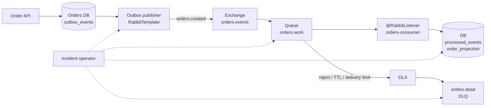
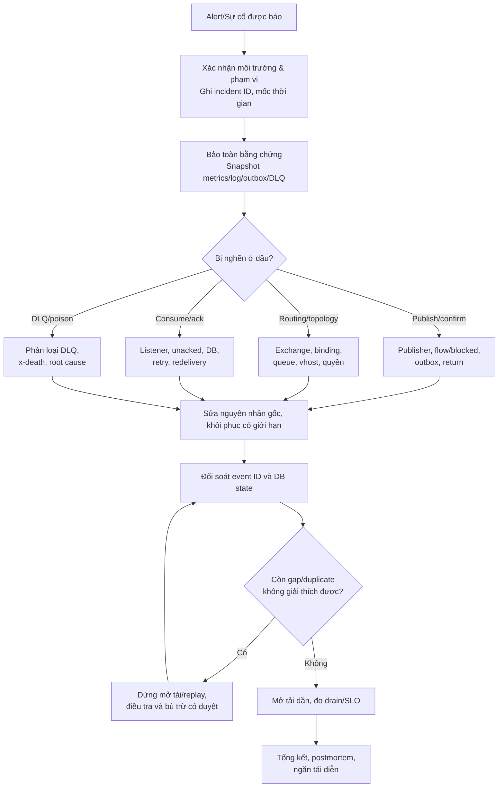
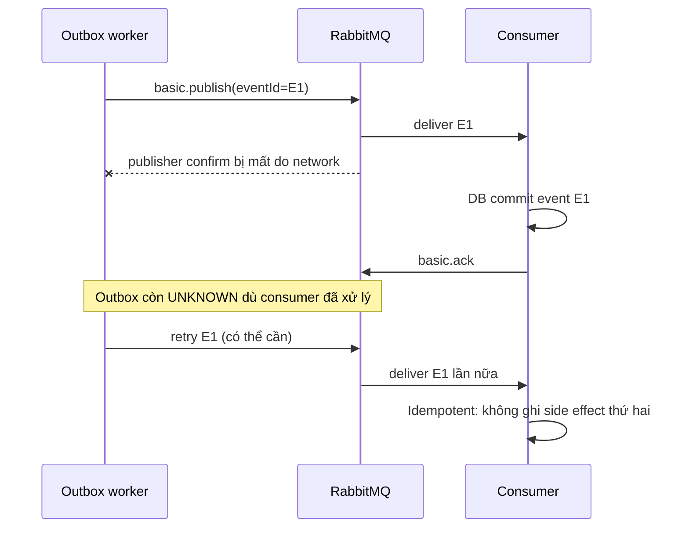

# Runbook phục hồi và đối soát sau sự cố với RabbitMQ và Spring AMQP

## 1. Mục tiêu của runbook

Trong module **SPRING_AMQP**, ứng dụng phát message qua `RabbitTemplate`, exchange, routing key và binding; tiêu thụ qua `@RabbitListener`; đồng thời sử dụng publisher confirms, acknowledgements, retry, dead-letter queue (DLQ), transaction và hệ thống quan sát. Khi xảy ra sự cố, việc **kết nối lại RabbitMQ** mới chỉ là một phần của công việc. Người trực vận hành còn phải chứng minh:

- Những yêu cầu nghiệp vụ **đã được chấp nhận** không bị bỏ sót.
- Message có thể đã publish nhưng mất confirm **không bị gửi lại một cách mù quáng** dẫn tới side effect lặp.
- Message đã được consumer xử lý và commit DB nhưng chưa ack **không làm ghi nhận nghiệp vụ hai lần** sau redelivery.
- Retry/DLQ không tạo vòng lặp vô hạn và không che giấu message lỗi.
- Queue, exchange, binding, vhost, quyền truy cập và consumer sau khi khôi phục đều đúng cấu hình.
- Sau khi mở lại lưu lượng, backlog giảm, độ trễ trở về SLO và các bản ghi đối soát có thể giải thích được.

**Runbook** là quy trình có thể thực thi trong một sự cố, với người chịu trách nhiệm, tín hiệu quan sát, hành động an toàn, điều kiện dừng và bằng chứng. Khác với một tài liệu chỉ giải thích khái niệm, mỗi bước phải trả lời: *phát hiện gì, làm gì, xác minh bằng cách nào, khi nào không được tiếp tục?*

> **Nguyên tắc số một:** Không xóa queue, purge message, reset offset/trạng thái nghiệp vụ, đổi DLX hoặc replay toàn bộ DLQ chỉ để làm dashboard “xanh”. Mọi thao tác có khả năng làm mất hoặc nhân đôi công việc cần có phạm vi, chủ sở hữu, phương án rollback và bằng chứng đối soát.

### Tình huống xuyên suốt

Giả sử nền tảng đơn hàng có:



Mỗi business event có một `eventId` bền vững. Producer ghi **Transactional Outbox** khi tạo đơn; worker publish với **correlated publisher confirm**; consumer ghi marker `processed_events` và cập nhật projection trong **cùng DB transaction**, rồi container ack sau khi service thành công. Đây là kiến trúc mẫu để minh họa đối soát, không phải mọi hệ thống đều đã có đủ thành phần; nếu thiếu outbox hoặc marker idempotency, mức độ chắc chắn sau sự cố giảm đáng kể.

## 2. Xác định mức độ nghiêm trọng, trách nhiệm và tiêu chí dừng

### 2.1. Phân loại tình huống

| Mức | Ví dụ | Ưu tiên |
| --- | --- | --- |
| **SEV-1 / nghi mất hoặc sai dữ liệu** | Đã xác nhận yêu cầu với khách nhưng không thể tìm event, xử lý trùng tạo giao dịch lặp, queue/DLX bị xóa, nghi message bị drop. | Kích hoạt chỉ huy sự cố, **ngừng replay và thay đổi topology không được duyệt**, giữ bằng chứng. |
| **SEV-2 / dừng hoặc suy giảm mạnh** | Consumer không chạy, publisher bị blocked, backlog tăng nhanh, DB mất kết nối, retry storm. | Khoanh vùng, ngăn lan rộng, khôi phục đường xử lý có kiểm soát. |
| **SEV-3 / chậm dưới ngưỡng sự cố lớn** | Backlog tăng ngắn hạn nhưng vẫn trong retention/SLO, DLQ có một số poison message đơn lẻ. | Điều tra và xử lý theo cửa sổ vận hành, theo dõi xu hướng. |

Ranh giới mức độ phải dựa vào SLO/RTO/RPO nội bộ. Bảng này là ví dụ vận hành, **không phải quy định bắt buộc** cho mọi tổ chức.

### 2.2. Vai trò

- **Incident commander (IC):** quyết định mức độ, phạm vi, thứ tự ưu tiên, quyền bắt đầu replay/mở lại lưu lượng và thời điểm kết thúc.
- **RabbitMQ operator/SRE:** kiểm tra node, cluster, queue leader, memory/disk alarms, connections, permissions, topology và cơ chế khôi phục.
- **Application owner:** kiểm tra `RabbitTemplate`, publisher confirms, `@RabbitListener`, retry, outbox, DLQ và phiên bản release.
- **Database/business owner:** đối soát event ID, transaction và hiệu ứng nghiệp vụ thực tế; quyết định các bản ghi cần bù trừ.
- **Communications owner:** thông báo tình trạng theo kênh và chu kỳ phù hợp, không tuyên bố “không mất dữ liệu” khi chưa đối soát.

Tối thiểu cần một người chịu trách nhiệm **phê duyệt thao tác thay đổi trạng thái** và một người ghi lại **timeline/bằng chứng**.

### 2.3. Điều kiện phải dừng thao tác

Không tiếp tục replay, tăng consumer hoặc thay topology nếu:

1. Chưa xác định đúng **broker/cluster/vhost/queue** hoặc đang dùng nhầm môi trường.
2. Chưa biết event nào đã commit DB, event nào chưa, hoặc chưa có khóa idempotency.
3. DLQ chứa payload/schema lỗi chưa được sửa.
4. Publisher confirm/return chưa được quan sát, routing key/binding có thể sai.
5. Broker đang chịu memory/disk alarm và hành động đề xuất chỉ làm tăng tải.
6. Người trực định xóa hoặc purge tài nguyên mà chưa có bằng chứng/lệnh rollback và phê duyệt.

## 3. Quy trình tổng thể: phát hiện → khoanh vùng → phục hồi → đối soát



Đây là quy trình **lặp có checkpoint**. “RabbitMQ đã lên lại” không tự kết thúc incident nếu outbox vẫn ùn tắc, DLQ vẫn tăng hoặc business DB còn thiếu event.

## 4. Mười phút đầu: giữ bằng chứng trước khi thay đổi

Trình tự cho người trực:

1. Tạo **incident ID**, ghi `UTC timestamp` phát hiện, môi trường, cluster/vhost, service version, thay đổi/deploy gần nhất và triệu chứng người dùng.
2. Kiểm tra dashboard cùng khung thời gian: ingress, publisher confirms/returns, queue ready/unacked, consumer count, ack, redelivery, retry, DLQ, DB/HTTP errors.
3. Xác định có **rủi ro mất dữ liệu hoặc duplicate side effect** không; nếu có, đánh dấu SEV-1 và hạn chế thay đổi.
4. Chụp trạng thái RabbitMQ và logs **trước khi restart**. Restart có thể xóa dấu vết lỗi connection, chuyển message unacked về ready và thay đổi consumer assignment.
5. Xem outbox PENDING/UNKNOWN, độ tuổi bản ghi cũ nhất, danh sách event ID bị ảnh hưởng theo thời gian.
6. Xác minh topology hiện tại bằng tên exchange/queue/binding và arguments (TTL, DLX, quorum policy, delivery limit).
7. Khoanh vùng thao tác bằng một **time window đóng/mở rõ ràng** và các `eventId` đã ghi nhận, không lấy tất cả message của hệ thống làm phạm vi điều tra.
8. Nếu phải hãm tải, dùng cơ chế admission control/rate limit/pausing publisher phù hợp; **không đóng ứng dụng một cách mù quáng** khi chưa biết pending messages/DB commit.

### 4.1. Bộ lệnh kiểm tra RabbitMQ chỉ-đọc

Các lệnh giả định người vận hành có quyền shell/CLI trên broker, vhost `/orders` và queue mẫu `orders.work`. Chúng **không sửa queue**:

```bash
rabbitmq-diagnostics status
rabbitmq-diagnostics alarms

rabbitmqctl list_queues -p /orders \
  name type durable messages messages_ready \
  messages_unacknowledged consumers

rabbitmqctl list_connections \
  name user vhost state channels

rabbitmqctl list_bindings -p /orders
rabbitmqctl list_permissions -p /orders
```

Nếu gặp lệnh/field không hỗ trợ ở phiên bản RabbitMQ đang chạy, kiểm tra `--help` hoặc tài liệu version đó; không tự suy rằng broker hỏng. Với môi trường cloud managed, có thể phải dùng Management API/console thay cho shell CLI.

**Đừng trộn các vhost:** tên `orders.work` có thể tồn tại đồng thời trong nhiều vhost; đường kết nối của ứng dụng phải cùng target.

### 4.2. HTTP Management API

Khi Management plugin đã bật và truy cập được qua mạng quản trị:

```text
GET /api/overview
GET /api/queues/%2Forders/orders.work
GET /api/queues/%2Forders/orders.dead
GET /api/connections
GET /api/consumers/%2Forders
```

`/orders` được URL-encode thành `%2Forders`. Ví dụ:

```bash
# Observer credential không được hard-code password vào command history.
curl -sS -u observer \
  'https://rabbitmq-management.internal/api/queues/%2Forders/orders.work' |
  jq '{
    name, vhost, type, messages, messages_ready,
    messages_unacknowledged, consumers,
    publish_rate: (.message_stats.publish_details.rate // null),
    ack_rate: (.message_stats.ack_details.rate // null),
    redeliver_rate: (.message_stats.redeliver_details.rate // null)
  }'
```

Các field `message_stats` có thể không xuất hiện; khác biệt giữa **no data** và số `0` phải được giữ lại. Không sử dụng HTTP API “get messages” để xem payload mà không biết **ackmode**: đọc bằng Management UI/API có thể trở thành hành động consume làm thay đổi trạng thái message.

### 4.3. Bằng chứng ứng dụng và dữ liệu

Lưu các thông tin:

| Nguồn | Bằng chứng |
| --- | --- |
| Producer | Số event đã được API chấp nhận bền vững, outbox trạng thái `PENDING/SENDING/CONFIRMED/UNKNOWN`, correlation ID, publisher confirm ACK/NACK/timeout, returns. |
| Broker | Queue depth/ready/unacked, consumer count, alarms, connection `flow/blocked`, DLQ, bindings/TTL/DLX, queue leader/quorum health. |
| Consumer | Listener instance/consumer tag, exception class, latency, retry count, redelivery, last processed event ID, service version. |
| Database | Marker idempotency `processed_events`, business rows, transaction logs/audit, rollback/commit và số liệu đối soát. |
| Release | Deployment time, config changes, secret rotation, queue policy migration, feature flags. |

Không xuất payload nhạy cảm, mật khẩu hoặc token vào incident channel; đặt bằng chứng tại nơi được kiểm soát quyền truy cập và thời gian lưu giữ.

## 5. Đọc đúng các tín hiệu trước khi khôi phục

### 5.1. Queue depth không phải số công việc đang chạy thành công

Đối với classic/quorum queue:

\[
\text{Depth}=\text{messages_ready}+\text{messages_unacknowledged}
\]

| Tín hiệu | Có thể là | Hướng điều tra |
| --- | --- | --- |
| Ready tăng, consumers = 0 | Listener không đăng ký, sai queue/vhost, auth lỗi. | Connection, `@RabbitListener`, container startup, permissions. |
| Ready tăng, unacked gần `concurrency × prefetch` | Handler/DB chậm, consumer đầy credit. | DB pool, latency, thread dump, ack rate. |
| Ready ≈ 0, unacked cao, ack = 0 kéo dài | Listener treo hoặc quên manual ack. | Channel, timeout, transaction, delivery tag. |
| Publish vào exchange tăng, queue không nhận | Routing key/binding sai, publish unroutable hoặc route queue khác. | Returns, mandatory, topology. |
| Redelivery cao, ack thấp | Requeue hot loop, restart hoặc poison message. | Retry policy, `x-death`, exceptions, DLQ. |
| DLQ tăng liên tục | Lỗi schema/business, retry budget hết, TTL/length/delivery limit. | Phân loại theo reason/event ID, không replay vô điều kiện. |
| Publisher connection `blocked` | Resource alarm (memory/disk). | Xem alarms và tài nguyên; hãm producer. |
| Publisher connection `flow` | Broker điều tiết tải tạm thời. | Queue/storage/replication throughput, confirm latency. |

`AcknowledgeMode.AUTO` của Spring AMQP nghĩa là **container gửi consumer ack sau khi listener thành công**, không phải RabbitMQ no-ack. Nếu listener dùng `AcknowledgeMode.MANUAL`, application phải gọi `basicAck`/`basicNack` đúng delivery tag và channel.

### 5.2. Phân biệt các loại “message biến mất”

- **Ack:** broker loại message khỏi queue sau consumer ack.
- **Nack/reject requeue=true:** message trở lại trạng thái có thể giao; dễ tạo lặp.
- **Nack/reject requeue=false:** message có thể bị dead-letter nếu DLX hợp lệ; nếu không, có thể bị discard.
- **TTL/queue length limit/quorum delivery limit:** broker có thể dead-letter hoặc loại message theo cấu hình.
- **Unroutable publish:** message có thể không vào bất kỳ queue nào nếu binding không khớp.
- **DLX chuyển tiếp không an toàn:** dead-letter là một thao tác publish; một số cấu hình **không** đảm bảo không mất message trên đường tới DLQ.

Do đó **“queue work về 0” không chứng minh 100% business event đã được xử lý**. Đối soát phải dựa vào event ID/outbox/DB state, không chỉ số queue.

## 6. Kịch bản A — Broker mất kết nối hoặc node khởi động lại

### Triệu chứng

- Producer thấy `AmqpConnectException`, timeout, channel/connection closed hoặc publisher confirms không về.
- `@RabbitListener` không còn consumer, có log connection recovery.
- Queue ready có thể tăng; unacked có thể chuyển về ready sau khi broker phát hiện connection cũ bị đóng.

### Hành động an toàn

1. **Xác định nguyên nhân gốc**: node down, DNS/TLS/auth, network partition, disk full, memory alarm hay deploy sai URI/vhost.
2. Kiểm tra cluster/node và quorum health **trước khi restart hàng loạt**. Với quorum queue, ưu tiên khôi phục quorum/leader; restart nhiều node đồng thời có thể làm giảm khả năng phục vụ.
3. Kiểm tra broker/vhost và topology còn nguyên; đừng tự động xóa queue khi app báo `PRECONDITION_FAILED`.
4. Cho broker/cluster ổn định, sau đó kiểm tra các connection Spring AMQP tạo lại và listener container đăng ký consumer mới.
5. Nếu topology quản lý qua `RabbitAdmin`, xác nhận các exchange/queue/binding được khai báo lại **khi phù hợp**; không mặc định mọi queue/arguments đều tự hồi sinh nếu chúng không được quản lý bởi bean/IaC.
6. Kiểm tra lại `publisher confirms` và `mandatory returns` bằng message thử có event ID riêng; không phát lại toàn bộ outbox/DLQ ngay lập tức.
7. Resume worker outbox với rate có giới hạn, giám sát backlog/unknown outcomes và redelivery; không coi “connected” là “reconciled”.

**Spring AMQP vs RabbitMQ Java Client:** `CachingConnectionFactory` và listener container của Spring có cơ chế phục hồi kết nối/channel; `RabbitAdmin` có thể redeclare các `Declarable` bean sau reconnect. Spring **không dựa vào automatic recovery của raw RabbitMQ Java Client**; mặc định cơ chế auto-recovery phía Java Client được Spring vô hiệu hóa để tránh xung đột. Không bật hai cơ chế để “khôi phục nhanh gấp đôi”.

### Tiêu chí kiểm chứng

- Broker alarms/leader/quorum ở trạng thái hợp lệ; kết nối mới ổn định.
- Số consumer thực tế đúng dự kiến, theo broker/vhost/queue.
- Publish test vào đúng exchange được confirm và **route tới queue phù hợp**.
- Ack/business completed rate trở lại >0, backlog có xu hướng giảm khi hãm ingress.
- Outbox `UNKNOWN/PENDING` được xử lý theo quy tắc đối soát; DB không có duplicate side effect.

**Không làm:** restart cả cluster, xóa queue rồi để `RabbitAdmin` tạo lại, hoặc tự chuyển mọi message sang broker khác khi chưa có replication/migration plan.

## 7. Kịch bản B — Publisher bị `blocked` do memory/disk alarm

RabbitMQ bảo vệ node khi memory vượt watermark hoặc disk free dưới ngưỡng bằng cách **chặn publishing connections**. Trong cluster, alarm của một node có thể tác động tới publishers ở các node khác. **Consumer-only connections** thường vẫn tiếp tục nhận/ack để giải phóng backlog.

### Triệu chứng

```text
Publisher: timeout / confirm chậm hoặc không về
Broker: memory alarm hoặc disk alarm
Connections: "blocked" / "blocking"
Queue: ready và disk/memory usage có thể tăng
Consumer: vẫn có thể tiếp tục drain
```

### Runbook

1. Dùng `rabbitmq-diagnostics alarms`, node metrics, free disk, memory breakdown và queue stats để xác nhận **alarm thật**, không chỉ latency ứng dụng.
2. **Hãm hoặc tạm ngừng ingress** vào publisher; bảo đảm yêu cầu được lưu bền vững trong outbox hoặc trả về trạng thái từ chối rõ ràng.
3. Giữ consumer đang hoạt động nếu an toàn; tìm queue gây backlog, lỗi DB, retry storm hoặc storage/replication bottleneck.
4. Giải phóng tài nguyên theo biện pháp được phê duyệt: khôi phục DB, tăng tài nguyên disk có kiểm soát, giảm traffic, sửa retry loop. **Không purge queue** để “giải phóng nhanh” khi chưa đối soát.
5. Chờ alarm clear và connection publish hoạt động; giám sát confirms/returns và số outstanding.
6. Khởi động lại outbox dispatcher từ từ; đo tốc độ drain và giữ deadline/outbox age trong SLO.

**Lưu ý:** Khi broker chặn publisher, timeout không chứng minh message bị mất; có thể broker đã nhận một publish nhưng confirm bị mất/đến muộn. Outbox records chưa confirm là **UNKNOWN** cho đến khi có đủ bằng chứng. Retry phải giữ nguyên `eventId` và xử lý idempotent tại consumer.

## 8. Kịch bản C — Consumer dừng, treo hoặc DB không đáp ứng

### Phân biệt ba trạng thái

| Trạng thái | Dấu hiệu | Can thiệp |
| --- | --- | --- |
| **Consumer vắng mặt** | `consumers=0`, ready tăng. | Kiểm tra app startup, listener bean, queue/vhost, credentials và container recovery. |
| **Consumer đang giữ delivery nhưng không ack** | Unacked cao, ack≈0, thread/DB latency cao. | Kiểm tra thread dump, DB pool, transaction lock, timeout, manual ack. |
| **Consumer xử lý lỗi liên tục** | Redeliver/reject/DLQ tăng, exception lặp. | Ngăn requeue hot loop, sửa root cause, phân loại retry và poison. |

### Runbook cho `@RabbitListener`

1. Xác nhận đúng queue và **containerFactory** của `@RabbitListener`, nhất là ứng dụng đa broker.
2. Xác định ack mode: `AUTO`, `MANUAL` hoặc `NONE`. Với `MANUAL`, tìm delivery tag/channel và các đường code bỏ sót `basicAck`/`basicNack`.
3. Kiểm tra downstream: database connection pool, slow queries, locks, HTTP timeout, CPU/GC/thread pool. **Đừng scale consumer mù quáng** nếu DB đã quá tải.
4. Nếu poison message, dùng retry budget + DLQ theo policy; nếu lỗi tạm thời, dùng backoff/delayed retry, tránh vòng `requeue=true` tức thời.
5. Khi cần rolling restart consumer, xác minh **unacked được broker requeue** sau khi channel/connection đóng và consumer mới nhận; lưu event ID để kiểm chứng idempotency.
6. Chỉ nâng concurrency/prefetch sau khi hệ thống gốc khỏe; theo dõi DB load, unacked, redeliver, business throughput và ordering.

**Điểm then chốt:** Consumer ack không đồng bộ atomically với DB transaction. Một message có thể **đã commit DB rồi mất ack**, do đó broker redeliver. Đây là kỳ vọng của at-least-once delivery; xử lý duplicate bằng unique `eventId`/idempotency, không bằng cách tắt ack hoặc purge message.

### Rolling restart có kiểm soát

```text
1. Chọn một instance/consumer để drain
2. Ngừng nhận delivery mới theo cơ chế graceful shutdown
3. Chờ in-flight xử lý/ack trong timeout hợp lý
4. Ghi lại mọi message chưa ack khi timeout
5. Cho broker phân phối lại delivery nếu connection đóng
6. Đo redelivery, DB duplicate detection, queue ready/unacked
7. Chuyển sang instance tiếp theo chỉ khi ổn định
```

Không kill toàn bộ consumer cùng lúc trừ khi việc cô lập sự cố yêu cầu; sẽ tạo redelivery storm và tăng thời gian phục hồi.

## 9. Kịch bản D — Sai topology, permission, message không route

Các triệu chứng dễ nhầm với broker down:

- `ACCESS_REFUSED`: application user không có quyền tương ứng; producer cần **write trên exchange**, consumer cần **read trên queue**, `RabbitAdmin` cần configure/write/read tùy operation.
- `NOT_FOUND` khi declare/consume/passive declare queue: queue không tồn tại hoặc sai vhost.
- `PRECONDITION_FAILED - inequivalent arg`: queue đã tồn tại với type/DLX/TTL/durability không tương thích.
- Publisher confirm ACK nhưng consumer không thấy message: exchange publish đã được broker xử lý, nhưng routing key/binding có thể không đưa vào queue mong muốn; cần xem publisher returns/mandatory.

### Runbook

1. So sánh **manifest topology đã phê duyệt** với exchange/queue/binding/arguments và user permissions trên broker.
2. Kiểm tra release/config thay đổi gần nhất; không áp dụng queue arguments mới trực tiếp lên queue cũ mà không có migration plan.
3. Nếu tài nguyên thiếu, sử dụng IaC/`RabbitAdmin` của **topology provisioner** có quyền phù hợp; không cấp `.*` cho ứng dụng chỉ để khắc phục.
4. Khi có queue cùng tên ở nhiều vhost/broker, xác định target chính xác của `ConnectionFactory`; routing factory không đồng bộ topology giữa broker.
5. Publish một **canary event** có ID riêng, quan sát confirm/return, queue ingress, consumer commit và ack.
6. Đối soát các publish trong khoảng thời gian trước canary: những request đã được chấp nhận nhưng không route phải được khôi phục từ **nguồn bền vững**, không “tưởng tượng” message tồn tại trong broker.

**Không làm:** tự đổi type queue hoặc DLX của production bằng xóa/tạo lại; việc này có thể làm mất message và ảnh hưởng các consumer khác.

## 10. Kịch bản E — DLQ tăng, poison message và retry storm

DLQ thường là **triệu chứng** của một lỗi khác: schema không tương thích, dữ liệu thiếu, DB constraint, quyền truy cập hoặc retry budget hết. Dead-lettering có thể xảy ra do reject/nack `requeue=false`, message TTL, queue length limit hoặc quorum delivery limit tùy queue.

### 10.1. Quy trình triage DLQ

1. **Đo** số message DLQ, tốc độ tăng, tuổi message cũ nhất, các mã lỗi listener tương ứng.
2. **Phân nhóm** theo `eventType`, `schemaVersion`, exception category, nguồn queue và `x-death.reason`; không lấy mẫu ngẫu nhiên rồi kết luận tất cả cùng nguyên nhân.
3. **Kiểm tra nguồn**: listener version đang chạy, DLX/binding, retry policy, TTL, queue type (classic/quorum).
4. **Xác định xử lý đã commit chưa** bằng `eventId` đối chiếu `processed_events`/business state; không replay message đã có side effect đúng.
5. Sửa nguyên nhân gốc (code/config/data migration), kiểm thử trên staging với payload được khử dữ liệu nhạy cảm.
6. Chỉ sau phê duyệt, **re-drive theo lô nhỏ**, đo confirm/return, ack, error/DLQ và duplicate.
7. Dừng ngay nếu DLQ tăng trở lại hoặc một lớp message fail nhiều lần; quay về bước phân loại.

### 10.2. Hiểu header `x-death` đúng cách

RabbitMQ ghi lịch sử dead-letter theo `queue` và `reason` vào header `x-death` (với AMQP 0-9-1); có thể có `rejected`, `expired`, `maxlen`, `delivery_limit`. Header này giúp điều tra nhưng:

- Một message có thể đi qua **nhiều queue**, các lần dead-letter được nén theo cặp `{queue, reason}`.
- `redelivered` không đếm được số lần retry theo business event.
- `x-death` không phải nguồn quyết định duy nhất về **số lần được phép replay**; phải có retry budget/ledger của ứng dụng.
- Message có thể đã đi qua một retry queue khác trước khi tới terminal DLQ.

### 10.3. DLX không phải bảo đảm tuyệt đối

Dead-letter là một dạng broker republish. Với cấu hình at-most-once dead-lettering truyền thống, message có thể không đến queue đích nếu target không sẵn sàng và không có confirm nội bộ. **Quorum queue** hỗ trợ chiến lược **at-least-once dead-lettering** khi đáp ứng điều kiện policy/topology, nhưng có các chi phí, giới hạn và khả năng duplicate ở target. **Không mặc định mọi DLQ đều lossless** chỉ vì queue durable.

Nếu nguồn DLQ được tạo bằng policy và operator sắp đổi `dead-letter-strategy`, cần đánh giá hậu quả với message chưa được xác nhận trong quá trình chuyển; một số thay đổi policy có thể khiến message chưa hoàn tất bị loại. Giữ cấu hình nguyên trạng trong sự cố cho tới khi đánh giá.

### 10.4. Không dùng `purge` để “khắc phục” DLQ

`purge` xóa message ready trong queue và có thể làm mất bằng chứng về sự cố; nó không giải quyết poison payload. Một dashboard DLQ về 0 sau purge **không** chứng minh dữ liệu đã được xử lý.

## 11. Đối soát: xác định event nào thực sự cần phục hồi

### 11.1. Ba nguồn sự thật khác nhau

Không dựa vào duy nhất queue depth:

1. **Nguồn chấp nhận nghiệp vụ:** đơn hàng hoặc outbox event đã commit (ứng dụng đã trả accepted/success theo hợp đồng).
2. **Nguồn xử lý:** marker `processed_events` và business state đã commit tại consumer.
3. **Nguồn vận chuyển:** publisher confirm/return, broker queues/DLQ, log retry và trạng thái outbox dispatcher.

Hãy định nghĩa rõ **điểm bắt đầu cam kết**. Nếu API trả thành công trước khi ghi outbox bền vững, ngay cả outbox cũng không đủ để khôi phục mọi request; phải tra thêm HTTP gateway logs/upstream records hoặc yêu cầu client gửi lại theo idempotency key.

### 11.2. Sổ cái event ID tối thiểu

Ví dụ PostgreSQL:

```sql
CREATE TABLE outbox_events (
    event_id UUID PRIMARY KEY,
    aggregate_id VARCHAR(80) NOT NULL,
    event_type VARCHAR(80) NOT NULL,
    exchange_name VARCHAR(128) NOT NULL,
    routing_key VARCHAR(128) NOT NULL,
    payload JSONB NOT NULL,
    state VARCHAR(20) NOT NULL
       CHECK (state IN ('PENDING', 'SENDING', 'CONFIRMED', 'UNKNOWN')),
    created_at TIMESTAMPTZ NOT NULL DEFAULT now(),
    confirmed_at TIMESTAMPTZ,
    last_error TEXT
);

CREATE TABLE processed_events (
    consumer_name VARCHAR(80) NOT NULL,
    event_id UUID NOT NULL,
    processed_at TIMESTAMPTZ NOT NULL DEFAULT now(),
    PRIMARY KEY (consumer_name, event_id)
);
```

`outbox_events` phải được tạo trong **cùng DB transaction** với yêu cầu kinh doanh mà nó đại diện. `processed_events` phải được ghi trong **cùng transaction** với cập nhật nghiệp vụ của consumer. Trạng thái `CONFIRMED` chỉ nói broker đã xác nhận lần publish theo hợp đồng; không thay thế `processed_events`. Tập `UNKNOWN` là trường hợp chưa biết chắc broker có nhận hay không.

Trong thực tế sẽ cần thêm `attempt_count`, `next_attempt_at`, `lease_owner`, `lease_until`, `broker_key` (nếu nhiều broker), `payload_hash`, `schema_version`, `trace_id` và audit trail. Chúng giúp chống dispatcher chạy trùng, điều phối lại và chứng minh dữ liệu đã được phục hồi.

### 11.3. Đối soát bằng SQL — từ tập outbox đã commit

Giả sử nhóm consumer có tên logic `orders-projection-v1`, sự cố xảy ra trong khoảng UTC rõ ràng:

```sql
-- Tham số ví dụ: đóng khoảng [start, end) để tránh đếm trùng biên.
-- Sửa mốc UTC theo incident thực tế, không copy nguyên xuống production.
WITH accepted AS (
    SELECT event_id, created_at, state
    FROM outbox_events
    WHERE created_at >= TIMESTAMPTZ '2026-11-25 10:00:00+00'
      AND created_at <  TIMESTAMPTZ '2026-11-25 11:00:00+00'
)
SELECT a.event_id, a.created_at, a.state,
       CASE WHEN p.event_id IS NULL
            THEN 'NOT_MARKED_PROCESSED'
            ELSE 'PROCESSED'
       END AS processing_status
FROM accepted a
LEFT JOIN processed_events p
       ON p.event_id = a.event_id
      AND p.consumer_name = 'orders-projection-v1'
ORDER BY a.created_at, a.event_id;
```

Đọc kết quả với sự thận trọng:

- `CONFIRMED + PROCESSED`: có dấu vết publish được broker confirm và consumer đã commit, nhưng vẫn nên kiểm tra business state khi có nghi vấn.
- `CONFIRMED + NOT_MARKED_PROCESSED`: **chưa** thể kết luận mất; message có thể đang ready, unacked, retry queue, DLQ hoặc consumer đang xử lý.
- `PENDING/UNKNOWN + PROCESSED`: consumer có thể đã commit dù producer không thấy confirm; **đừng replay tạo side effect**.
- `PENDING/UNKNOWN + NOT_MARKED_PROCESSED`: ứng viên cần điều tra và retry có kiểm soát, **không** mặc định bị mất.

Mốc thời gian `created_at` chọn theo **thời điểm accepted**, nhưng message có thể được publish/trễ sang giai đoạn sau, và consumer cũng có thể xử lý muộn. Khi kiểm kê incident, thêm **grace period** cho in-flight/retry và phân biệt `event_id` với thời điểm xử lý.

### 11.4. Thống kê quy mô gap

```sql
WITH scoped AS (
    SELECT o.event_id, o.state
    FROM outbox_events o
    WHERE o.created_at >= TIMESTAMPTZ '2026-11-25 10:00:00+00'
      AND o.created_at <  TIMESTAMPTZ '2026-11-25 11:00:00+00'
)
SELECT s.state,
       COUNT(*) AS accepted_events,
       COUNT(p.event_id) AS processed_events,
       COUNT(*) - COUNT(p.event_id) AS not_marked_processed
FROM scoped s
LEFT JOIN processed_events p
       ON p.consumer_name = 'orders-projection-v1'
      AND p.event_id = s.event_id
GROUP BY s.state
ORDER BY s.state;
```

Đây là **tập candidates**, không phải số “lost messages”. Cần kết hợp nguồn broker/queues, retry/DLQ, trạng thái task và nghiệp vụ before/after để xác nhận lỗi. Nếu một event cần nhiều consumer group (billing, analytics, notification...), phải đối soát **riêng từng group**.

### 11.5. Đối soát business state thay vì chỉ marker

Marker cho thấy consumer đã ghi nhận xử lý, nhưng có thể code cũ lỗi logic. Với event `OrderCreated`, so thêm:

- `orders` có bản ghi đúng `orderId`, status, amount, currency không?
- Projection đích có dữ liệu đúng version không?
- Side effect bên ngoài như thanh toán/email có idempotency key hoặc ledger của provider không?
- Nếu event out-of-order, version/sequence đã xử lý đúng chưa?

**Exactly-once end-to-end** không được bảo đảm chỉ nhờ RabbitMQ ack, publisher confirms hoặc DB transaction riêng. Phục hồi dựa trên **at-least-once + idempotency + reconciliation**, và có thể cần bù trừ cho side effect đã phát sai.

## 12. Trạng thái publisher và “unknown outcome”

### 12.1. Vì sao mất confirm không đồng nghĩa publish thất bại?

Kịch bản:



Trong RabbitMQ, publisher confirms và consumer acknowledgements **độc lập**. Broker có thể đã nhận và route message nhưng producer không thấy confirm; khi reconnect/retry, duplicate delivery là bình thường.

### 12.2. Quy tắc xử lý state trong outbox

| State | Hành động an toàn | Điều không được suy diễn |
| --- | --- | --- |
| `PENDING` | Có thể gửi theo worker/lease/retry budget. | Không bảo đảm chưa từng publish nếu trạng thái được ghi chậm. |
| `SENDING` | Khi hết lease, xác định kết quả cũ; chuyển thành `UNKNOWN` nếu không biết chắc. | Không cho hai dispatcher publish cùng event đồng thời vô kiểm soát. |
| `CONFIRMED` | Không tự publish lại chỉ vì consumer chưa có marker; tìm queue/DLQ/retry trước. | Không đồng nghĩa đã xử lý business. |
| `UNKNOWN` | Đối chiếu marker/queue/log; nếu cần retry, **giữ nguyên eventId** và idempotent downstream. | Không xem timeout là NACK chắc chắn. |

**Publisher return + mandatory:** Confirm ACK không chứng minh routing tới queue khi message không có binding phù hợp. Nếu hợp đồng yêu cầu được route, phải bật `mandatory` và xử lý `ReturnedMessage`; event bị return không được đánh dấu thành công chỉ vì confirm ACK.

### 12.3. Pseudocode dispatcher có giới hạn

```text
foreach outbox candidate from database with durable lease:
    if eventId already COMPLETED by intended consumer:
        mark reconciliation record, do not emit side effect again
        continue

    resolve immutable target broker/exchange/routingKey from event record
    publish with correlated confirm + mandatory returns

    if returned or confirm NACK:
        record failure, backoff, investigate topology
    else if confirm ACK and no return:
        mark CONFIRMED (broker stage only)
    else if timeout/connection lost:
        mark UNKNOWN, keep payload and eventId for replay

    always bound in-flight and retry rate
```

Không sử dụng message header do client tự đặt để cho phép chuyển broker/tenant. Nếu nhiều broker, lưu broker key đã xác thực trong outbox và retry về **đúng đích gốc**; chỉ đổi đích khi có migration/failover plan chính thức.

## 13. Re-drive DLQ an toàn: không tạo vòng lặp lần thứ hai

**Re-drive** là đọc message lỗi có kiểm soát rồi **publish lại** tới đường xử lý hợp lệ. Nó **không** đồng nghĩa xóa DLQ, và cũng không phải chỉ “copy queue sang queue”.

### 13.1. Điều kiện tiên quyết

Trước khi replay:

1. **Root cause đã được sửa** (schema migration, DB, permission, service bug), có test tương ứng.
2. Có **danh sách eventId** thuộc phạm vi cần re-drive, không replay mọi message chỉ vì chúng cùng queue.
3. Đã biết message nào **được xử lý thành công** để lọc duplicate; có idempotency/unique constraint.
4. Exchange/routing key đích được kiểm tra bằng canary và publisher confirms/returns.
5. DLQ message được bảo quản cho tới khi đích nhận có bằng chứng; không thao tác ack sớm.
6. Có giới hạn **batch size, rate, retry budget**, cửa sổ thực hiện, owner và kill switch.
7. Có dashboard quan sát `DLQ depth, work ready/unacked, error rate, business completed`.

### 13.2. Thuật toán re-drive theo lô nhỏ

```text
Re-drive job mặc định DISABLED, chỉ start khi IC approve

For each selected DLQ message (manual acknowledgement):
  extract trusted eventId; verify payload/schema and target tenant
  query processed_events + business state
  if already processed:
      record DUPLICATE_SKIPPED in audit
      handle source DLQ message according to approved policy
  else:
      build new publish with original immutable eventId
      publish to approved exchange/routing key
      await publisher confirm AND verify no mandatory return
      if confirmed+routed:
          ack ORIGINAL DLQ delivery on its own channel
          write reconciliation audit row
      else:
          keep source DLQ message for later investigation
          STOP/PAUSE job; do not hot-requeue forever

After every batch:
  verify new DLQ/retry rate, consumer business success, duplicate counts
  only continue if all guardrails still pass
```

**Cửa sổ không nguyên tử:** Publish lại có thể thành công, nhưng process chết **trước khi ack source DLQ**. Sau restart, source message vẫn được giao lại. Do đó replay có **at-least-once semantics**, phải giữ nguyên event ID và idempotency. Không tuyên bố “exactly once” chỉ vì đã đợi publisher confirm.

### 13.3. Không tự tạo vòng retry khi sai schema

Đừng để một listener trên DLQ tự động consume → publish về work queue ngay mỗi lần message xuất hiện. Một poison message có thể chạy vô hạn qua work → DLQ → work mà không có sửa chữa. Cách triển khai an toàn hơn:

- Re-drive worker **tắt mặc định** và được bật theo incident/job ID.
- Cho phép chọn **tập event ID**, không chọn “ALL”.
- Giới hạn số lượt re-drive **trên event ID**, không chỉ đếm `redelivered`.
- Có **parking/terminal queue** hoặc trạng thái `UNRECOVERABLE` sau khi vượt budget.
- Không tự động xóa DLQ source khi xác minh destination còn không rõ.

**Phân biệt replay và bù trừ:** Nếu event đã gây side effect sai (thanh toán trùng, email gửi trùng), re-drive không đảo ngược side effect. Cần quy trình compensating action được business owner phê duyệt, có audit.

## 14. Spring AMQP: cấu hình phục hồi có thể quan sát

### 14.1. Producer: confirms và returns

```yaml
# Ví dụ Spring Boot; giá trị môi trường phải quản lý bằng secret manager.
spring:
  rabbitmq:
    host: rabbitmq.internal
    port: 5672
    virtual-host: /orders
    username: orders-publisher
    password: ${RABBITMQ_PUBLISHER_PASSWORD}
    publisher-confirm-type: correlated
    publisher-returns: true
    template:
      mandatory: true
```

`publisher-confirm-type=correlated` cho phép gắn correlation ID và quan sát future/callback theo message; `publisher-returns=true` + `mandatory=true` giúp phát hiện unroutable publishes. **Không ghi payload nhạy cảm vào log callback**.

Ví dụ gắn `CorrelationData`:

```java
import java.util.concurrent.TimeUnit;
import org.springframework.amqp.rabbit.connection.CorrelationData;
import org.springframework.amqp.rabbit.core.RabbitTemplate;

// template đã inject; eventId được lưu bền vững trong outbox.
CorrelationData correlation = new CorrelationData(eventId);
template.convertAndSend(
        "orders.events", "orders.created", payload, correlation);

// Đơn giản hóa cho ví dụ; production dùng dispatcher async, timeout,
// durable state machine và không block request thread dài.
CorrelationData.Confirm confirm =
        correlation.getFuture().get(10, TimeUnit.SECONDS);

if (!confirm.isAck() || correlation.getReturned() != null) {
    // Đánh dấu thất bại hoặc kết quả cần điều tra; KHÔNG coi là processed.
} else {
    // Publish confirmed+routed theo cấu hình, KHÔNG đồng nghĩa DB consumer commit.
}
```

Nếu `get(...)` timeout hoặc mất kết nối, xử lý là **UNKNOWN**, không phải `definitely not published`. Với queue chưa tồn tại, exchange sai hoặc policy bị thay, publisher confirm phải được đối chiếu với returns/routing. Khi dùng `RabbitTemplate` trong transaction/scope có tài nguyên channel bound, cần hiểu thời điểm confirm và lifecycle của transaction; tránh copy ví dụ blocking vào thread của một listener đang đợi ack.

### 14.2. Consumer: ack sau DB commit, idempotency

```java
import org.springframework.amqp.rabbit.annotation.RabbitListener;
import org.springframework.stereotype.Component;

@Component
public class OrdersConsumer {
    private final OrderProjectionService service;

    public OrdersConsumer(OrderProjectionService service) {
        this.service = service;
    }

    @RabbitListener(queues = "orders.work")
    public void handle(OrderCreatedEvent event) {
        service.applyIdempotently(event); // transaction đã commit khi trả về
        // AUTO acknowledgement do listener container thực hiện sau khi thành công.
    }
}
```

`OrderCreatedEvent` là payload type giả định, cần message converter và schema tương ứng. `OrderProjectionService` phải dùng `@Transactional` ở Spring bean/proxy được gọi từ listener, đồng thời ghi marker `processed_events` và business state **trong cùng DB transaction**.

Không gọi API downstream fire-and-forget rồi trả về listener thành công; container có thể ack trước khi downstream hoàn tất. Với `MANUAL`, gọi `basicAck` trên **đúng channel và delivery tag** chỉ sau khi transaction/side effect cần bảo vệ hoàn tất.

### 14.3. Listener container và queue recovery

Một cấu hình tham khảo:

```java
import org.springframework.amqp.rabbit.config.SimpleRabbitListenerContainerFactory;
import org.springframework.amqp.rabbit.connection.ConnectionFactory;
import org.springframework.context.annotation.Bean;
import org.springframework.context.annotation.Configuration;

@Configuration
public class RecoveryListenerConfig {
    @Bean("ordersListenerFactory")
    SimpleRabbitListenerContainerFactory ordersListenerFactory(
            ConnectionFactory connectionFactory) {
        SimpleRabbitListenerContainerFactory factory =
                new SimpleRabbitListenerContainerFactory();
        factory.setConnectionFactory(connectionFactory);
        factory.setConcurrentConsumers(2);
        factory.setMaxConcurrentConsumers(6);
        factory.setPrefetchCount(20);
        factory.setMissingQueuesFatal(true);
        return factory;
    }
}
```

Với `@RabbitListener(containerFactory="ordersListenerFactory")`, listener dùng cấu hình trên. `missingQueuesFatal=true` (mặc định ở nhiều cấu hình container) giúp fail rõ ràng khi queue bắt buộc thiếu, nhưng có thể làm startup/consumer container dừng khi queue không tồn tại. `false` cho phép recovery loop thử lại theo backoff khi queue tạm thời thiếu; **không nên dùng nó để giấu topology lỗi kéo dài**. Chọn policy theo điều kiện môi trường và alert; kiểm tra semantics cụ thể của loại listener container và version Spring AMQP.

Nếu topology do **IaC/provisioner** quản lý và ứng dụng runtime không có quyền configure, không kỳ vọng `RabbitAdmin` runtime tự tạo queue sau sự cố. Khi một queue thực sự bị mất, cần xử lý **mất dữ liệu và migration** trước khi tạo lại.

## 15. Đánh giá recovery: đối soát theo tập hợp thay vì chỉ tổng số

### 15.1. Ma trận kết quả cho từng event

| Bằng chứng | Có thể kết luận | Cần hành động |
| --- | --- | --- |
| Outbox committed + consumer marker + business state đúng | Event đã xử lý nghiệp vụ. | Không replay; giữ audit và quan sát consistency. |
| Outbox confirmed + chưa có marker + work ready | Event đang chờ; chưa phải mất. | Khôi phục consumer rồi chờ trong SLA. |
| Outbox confirmed + chưa có marker + work unacked | Event có thể đang xử lý hoặc kẹt. | Đo latency/channel, không ack/purge thủ công. |
| Outbox confirmed + chưa có marker + DLQ | Event chưa xử lý thành công, có lý do fail. | Phân loại DLQ, sửa root cause, re-drive có duyệt. |
| Outbox UNKNOWN + đã có marker/business state | Lần publish cũ có thể đã tới và được xử lý. | Ghi nhận, không tạo side effect lần nữa. |
| Outbox UNKNOWN + không có marker/broker evidence | Không đủ bằng chứng đã xử lý. | Retry idempotent theo target, theo dõi confirm. |
| API đã báo accepted nhưng **không có outbox** | Có thể đã vi phạm hợp đồng nhận yêu cầu. | Điều tra upstream/audit, khôi phục bằng nguồn gốc hoặc bù trừ. |
| Duplicate marker/business state xung đột | Có thể có bug idempotency hoặc processing race. | Dừng replay, điều tra transaction/unique constraint. |

**Lưu ý:** Một message đã được xử lý và ack sẽ **không còn ở queue**. Không thể lấy trạng thái queue hiện tại để chứng minh message đó chưa từng tồn tại. Cần logs, outbox, DB marker và audit.

### 15.2. Công thức đối soát theo cohort

Với một logical consumer group và cửa sổ event đã được chấp nhận, định nghĩa các tập:

- `A`: event ID **đã được chấp nhận bền vững**.
- `P`: event ID đã commit side effect nghiệp vụ hợp lệ ở consumer.
- `I`: event ID **đang hợp lệ trong pipeline** (ready/unacked/retry, có deadline/SLA tương ứng).
- `F`: event ID thất bại có ghi nhận (DLQ/parking/UNRECOVERABLE) **và** có phương án xử lý.
- `E`: event ID được xử lý bằng bù trừ hoặc loại trừ **có phê duyệt**, audit rõ.

Đối soát mong muốn:

\[
A \subseteq P \cup I \cup F \cup E
\]

Đây là cách mô hình hóa **accountability**, không phải phương trình broker cung cấp sẵn. Khi sự cố đã kết thúc và đã hết cửa sổ chờ cho mọi event trong cohort, mục tiêu là **mỗi event trong A có một trạng thái terminal được giải thích**: hoàn tất đúng, thất bại có quyết định xử lý/bồi hoàn, hoặc loại trừ có phê duyệt. Không để tồn tại nhóm `UNKNOWN` không có owner/next action.

**Không so chỉ các số tổng:** `1.000 accepted` và `1.000 processed` vẫn có thể chứa **một event bị mất + một event bị xử lý hai lần** nếu không dùng event IDs; cần phép đối soát theo khóa.

### 15.3. Thống kê trạng thái trước khi đóng incident

```sql
SELECT state, COUNT(*) AS events,
       MIN(created_at) AS oldest_created_at
FROM outbox_events
GROUP BY state
ORDER BY state;

SELECT consumer_name,
       COUNT(*) AS unique_committed_events,
       MAX(processed_at) AS last_processed_at
FROM processed_events
GROUP BY consumer_name
ORDER BY consumer_name;
```

Các truy vấn này giúp theo dõi xu hướng, **không đủ** để khẳng định mọi event đã đối soát; vẫn cần truy vấn ghép theo `event_id` và xem cohort/broker/DLQ.

## 16. Khôi phục lưu lượng theo từng pha

### Pha 0 — Freeze và bảo vệ dữ liệu

- Hạn chế các thao tác thay đổi topology/policy và replay không có phê duyệt.
- Bảo toàn snapshots/log/outbox state, xác định nguồn dữ liệu authoritative.
- Nếu phải tạm dừng producer, chỉ tạm dừng **đẩy tới broker** khi request vẫn có thể được lưu bền vững; không để API trả thành công khi message chỉ nằm RAM.

### Pha 1 — Khôi phục hạ tầng

- Broker/cluster không còn alarm nghiêm trọng; quorum/leader và network/TLS/auth hoạt động.
- Topology và permissions hợp lệ; không còn lỗi declare/consume.
- Producer canary được confirm và route; listener canary commit DB và ack.

### Pha 2 — Mở consumer và drain

- Mở từng nhóm consumer theo mức concurrency dự kiến.
- Đo `messages_ready`, `messages_unacknowledged`, ack rate, redelivery, DB pool, DLQ.
- Hãm ingress nếu cần để queue có thể drain; giữ retry/DLQ budget ổn định.

### Pha 3 — Mở producer/outbox từng mức

Ví dụ:

```text
10% traffic / 5 phút
  -> health + confirms + consumer commit + backlog check
25% traffic / 5 phút
  -> health + DLQ + DB + duplicate check
50% traffic / 5 phút
  -> p95/p99 latency, alarm, outbox age
100% traffic khi IC đồng ý và SLO ổn định
```

Các tỷ lệ/thời lượng chỉ là **ví dụ**, phải phù hợp công suất thực tế và blast radius. Nếu queue đang có backlog lớn, mở lại producer ngay 100% có thể kéo dài recovery nhiều giờ.

### Pha 4 — Đối soát và đóng incident

Chỉ đóng khi:

1. Không còn alarm/connection instability gây ngưng dịch vụ.
2. Không có nhóm event `UNKNOWN` hoặc missing business state **chưa được phân loại/đặt owner**.
3. Outbox lag/queue backlog đã nằm trong ngưỡng recovery SLO hoặc có kế hoạch theo dõi được phê duyệt.
4. DLQ/retry loop không tăng bất thường; poison messages được cách ly và có kế hoạch xử lý.
5. Canaries và một mẫu sự kiện thật được đối soát end-to-end.
6. Timeline, bằng chứng, thay đổi config và phê duyệt đã được lưu.

**Không đóng chỉ vì `queue depth=0`.** Nếu message bị route sai, TTL drop hoặc DLQ bị purge, depth vẫn có thể bằng 0.

## 17. Checklist thao tác: điều nên và không nên làm

| Tình huống | Nên làm | Tránh làm |
| --- | --- | --- |
| Broker down | Kiểm tra alarms, quorum, network và restore có thứ tự. | Restart hàng loạt mọi node mà không xác định quorum. |
| Publisher timeout | Ghi `UNKNOWN`, giữ `eventId`, retry idempotent có giới hạn. | Đánh dấu “chắc chắn chưa gửi” rồi tạo event ID mới. |
| Unacked cao | Kiểm tra thread/DB/ack, graceful drain. | `purge` vì tưởng tất cả đang chờ trong queue. |
| Ready tăng | Tìm bottleneck; hãm ingress hoặc mở consumer có kiểm soát. | Tăng consumer khi DB đã saturated. |
| DLQ nhiều | Phân nhóm nguyên nhân, sửa lỗi, re-drive theo lô nhỏ. | Replay toàn bộ DLQ không kiểm tra side effect. |
| Binding sai | Provision qua IaC/admin có quyền đúng và chạy canary. | Cho producer toàn quyền configure/write/read để “sửa nhanh”. |
| Confirm ACK nhưng queue không nhận | Xem mandatory returns, topology, vhost, routing key. | Tuyên bố “đã xử lý” dựa trên confirm. |
| Dữ liệu DB thiếu sau incident | Đối soát `eventId` và nguồn accepted bền vững. | Dựa duy nhất vào tổng publish/ack counts. |
| Event đã commit nhưng redeliver | Kiểm tra idempotency marker, không lặp side effect. | Xóa message không audit hoặc tắt ack. |
| DLX target không available | Xác minh dead-letter strategy và target. | Mặc định DLX không thể mất message. |

## 18. Diễn tập phục hồi trước khi production

Runbook phải được **kiểm chứng trên staging/test với broker thật**. Một bài diễn tập tối thiểu:

### 18.1. Mất kết nối khi publisher đang chờ confirm

1. Gửi event từ outbox với `eventId` đã biết, ghi lại trạng thái.
2. Gây đứt kết nối có kiểm soát tại khoảng publish/confirm.
3. Quan sát một số event vào `UNKNOWN`.
4. Khôi phục broker; retry với **cùng `eventId`**.
5. Xác minh consumer idempotency: business side effect đúng một lần, kể cả có nhiều delivery.

### 18.2. Consumer commit DB rồi mất ack

1. Cho listener commit DB trong transaction.
2. Làm gián đoạn channel trước khi broker xác nhận consumer ack.
3. Cho broker giao lại message.
4. Xác minh marker `processed_events` chặn side effect lần hai.

### 18.3. Poison message vào DLQ và re-drive

1. Gửi message sai schema để đi DLQ.
2. Chụp `x-death`, nguyên nhân và event ID; sửa parser/schema ở staging.
3. Re-drive 1–5 event thuộc scope có phê duyệt, giữ original event ID.
4. Xác minh publish confirm+route, source DLQ ack đúng thời điểm và business state sau xử lý.
5. Cố tình mất kết nối giữa “publish đã confirm” và “ack source DLQ”: kiểm tra duplicate vẫn an toàn.

### 18.4. Broker resource alarm/backlog

1. Chỉ trong staging cô lập, mô phỏng downstream chậm hoặc giới hạn tài nguyên có kế hoạch rollback.
2. Quan sát connection `flow`/`blocked` và publisher in-flight/unknown.
3. Hãm producer, cho consumer drain.
4. Khôi phục và mở traffic theo từng pha, đo thời gian trở lại SLO.

**Tiêu chí PASS cho diễn tập:** không có accepted event mất không giải thích được, không có duplicate side effect, canary end-to-end PASS, backlog/DLQ có owner và recovery đúng ngưỡng đã đặt. Đừng chỉ kiểm tra service process tự khởi động lại.

## 19. Mẫu biên bản và hậu kiểm sự cố

```text
INCIDENT ID: INC-YYYYMMDD-NNN
SEVERITY: ...
SYSTEM / ENVIRONMENT / CLUSTER / VHOST: ...
START (UTC): ...
DETECTION (UTC): ...
MITIGATED (UTC): ...
RECOVERED (UTC): ...

USER IMPACT:
  Số yêu cầu bị chậm/lỗi:
  SLO/RTO/RPO bị ảnh hưởng:

EVIDENCE:
  RabbitMQ alarms, queue ready/unacked, DLQ:
  Publisher confirm/return, outbox oldest age:
  Consumer ack/redelivery, DB errors:
  Logs/metrics/traces đã lưu ở:

ROOT CAUSE / CONTRIBUTING FACTORS:
  ...

ACTIONS / OWNERS / APPROVALS:
  ...

RECONCILIATION:
  Accepted events (cohort): ...
  Processed unique IDs: ...
  Pending/in-flight: ...
  DLQ/parking/compensated: ...
  Unknown/unexplained IDs: ...
  Final business state validated by: ...

GO/NO-GO:
  Canary confirmed+routed+committed+acked: PASS/FAIL
  No unexplained loss/duplicate: PASS/FAIL
  Backlog and latency within SLO: PASS/FAIL
  DLQ/retry stable: PASS/FAIL

FOLLOW-UP:
  Fix owner / deadline / regression test / runbook update:
```

### Hậu kiểm (postmortem) cần trả lời

- Vì sao alert không phát hiện sớm hơn? Có đang chỉ nhìn queue depth mà bỏ outbox/DB không?
- Tại sao publisher không phân biệt `CONFIRMED` và `UNKNOWN`? Có thiếu correlation data/returns không?
- Consumer đã ack trước DB commit hay bị duplicate side effect vì thiếu idempotency?
- Ai có quyền đổi topology, DLX policy và replay DLQ; có audit trail không?
- Có thao tác thủ công nào làm mất bằng chứng hoặc gây downtime thêm không?
- Cần bổ sung test gì: reconnect, missing queue, blocked publisher, poison DLQ, replay fail-after-confirm?
- Có thể giảm **MTTD** (time to detect), **MTTR** (time to recover) và **time to reconcile** bằng alert/runbook/automation có kiểm soát không?

## 20. Câu hỏi tự kiểm tra

1. Tại sao RabbitMQ broker đã khởi động lại không đồng nghĩa sự cố đã được xử lý xong?
2. Publisher confirm timeout có chứng minh message chắc chắn chưa tới broker không?
3. Một consumer đã commit DB nhưng chưa ack bị mất kết nối. Message có thể được giao lại không và cách ngăn side effect lặp?
4. Vì sao `messages_ready=0` không chứng minh tất cả event đã thành công?
5. Cần quyền và bằng chứng gì trước khi replay DLQ?
6. Với `CONFIRMED` nhưng không có marker `processed_events`, vì sao không nên publish lại ngay?
7. Tại sao phép đối soát phải dựa vào tập `eventId`, không chỉ số tổng `accepted=processed`?
8. Tại sao retry một event từ outbox phải giữ nguyên `eventId` và broker target?
9. Nếu RabbitMQ memory/disk alarm chặn publisher, có nên tăng watermark hoặc purge queue ngay không?
10. Sự khác biệt giữa `flow` tạm thời và publisher `blocked` do resource alarm?
11. Để chuyển DLQ message về work queue an toàn, phải ack nguồn DLQ lúc nào?
12. Sau incident, điều kiện nào xác nhận một cohort được đóng mà không còn event bị bỏ quên?

**Gợi ý đáp án:** (1) còn outbox/ready/unacked/DLQ và business DB; (2) không, outcome có thể unknown; (3) có, dùng idempotent consumer và transaction; (4) message có thể unacked/DLQ/unroutable/TTL/drop; (5) root cause đã sửa, scope event ID, idempotency, confirm/return, approval và guardrails; (6) message có thể đang ready/unacked/retry/DLQ, cần đối soát; (7) tổng giống nhau vẫn có thể mất một event và xử lý trùng event khác; (8) bảo toàn danh tính, phân vùng/quyền và chống trùng; (9) không, điều tra nguyên nhân và hãm tải; (10) flow là điều tiết tạm thời, blocked là cơ chế bảo vệ khi vượt watermark; (11) sau publish lại có xác nhận và không bị return, vẫn cần idempotency nếu ack nguồn thất bại; (12) mọi accepted event có kết quả terminal hoặc trạng thái chờ/failure có owner, bằng chứng và quyết định rõ ràng.

## 21. Tổng kết

**Runbook phục hồi và đối soát sau sự cố** trong Spring AMQP không dừng ở việc restart RabbitMQ hay ứng dụng. Quy trình đúng phải:

1. **Giữ bằng chứng và khoanh vùng** theo producer, broker, topology, consumer, retry/DLQ và database.
2. **Khôi phục an toàn** connection, quorum, listener, producer, backpressure và routing, không làm mất queue hoặc tạo retry storm.
3. **Đối soát theo event ID** giữa nguồn accepted bền vững, publisher confirm/return, queue/retry/DLQ và DB transaction.
4. **Replay có kiểm soát** với event ID cố định, publisher confirms, idempotent consumer và audit trail.
5. **Mở lại lưu lượng từng pha** dựa trên canary, backlog, latency, DLQ và sự chấp thuận vận hành.
6. **Hậu kiểm** để cải thiện cảnh báo, fault-injection test và runbook trước sự cố tiếp theo.

Trong hệ thống bất đồng bộ đáng tin cậy, “không còn lỗi kết nối” là **tín hiệu khôi phục kỹ thuật**, còn “mọi yêu cầu đã được chấp nhận đều có kết quả nghiệp vụ rõ ràng” mới là **mục tiêu phục hồi đầy đủ**.

## Tài liệu tham khảo

- [RabbitMQ — Reliability Guide](https://www.rabbitmq.com/docs/reliability): cơ chế đảm bảo delivery, publisher confirms, retry sau connection failure và khả năng duplicate.
- [RabbitMQ — Consumer Acknowledgements and Publisher Confirms](https://www.rabbitmq.com/docs/confirms): `basic.ack`/`basic.nack`, consumer redelivery, publisher confirms và unknown outcomes.
- [RabbitMQ — Memory and Disk Alarms](https://www.rabbitmq.com/docs/alarms): `blocked`/`blocking`, hoạt động consumer trong resource alarms và cách bảo vệ publisher.
- [RabbitMQ — Flow Control](https://www.rabbitmq.com/docs/flow-control): transient flow control và ý nghĩa connection state `flow`.
- [RabbitMQ — Dead Letter Exchanges](https://www.rabbitmq.com/docs/dlx): DLX, `x-death`, các nguyên nhân dead-letter, giới hạn an toàn khi republish.
- [RabbitMQ — Quorum Queues](https://www.rabbitmq.com/docs/quorum-queues): leader/quorum, delivery limit và at-least-once dead-lettering với các điều kiện.
- [RabbitMQ — Monitoring](https://www.rabbitmq.com/docs/monitoring): queue ready/unacked, publish/deliver/ack rates, broker node/connection metrics.
- [RabbitMQ — rabbitmqctl Manual](https://www.rabbitmq.com/docs/man/rabbitmqctl.8): `list_queues`, `list_connections`, `list_bindings` và quyền truy cập.
- [Spring AMQP — Connection and Resource Management](https://docs.spring.io/spring-amqp/reference/amqp/connections.html): `CachingConnectionFactory`, recovery và `RabbitAdmin` redeclaration.
- [Spring AMQP — Listener Container Attributes](https://docs.spring.io/spring-amqp/reference/amqp/containerAttributes.html): `missingQueuesFatal`, recovery backoff, acknowledgements và consumer lifecycle.
- [Spring AMQP — Publisher Confirms and Returns](https://docs.spring.io/spring-amqp/reference/amqp/template.html): `RabbitTemplate`, `CorrelationData`, `mandatory` và returns.
