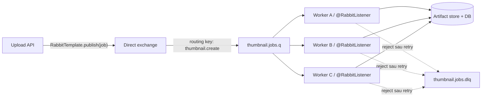
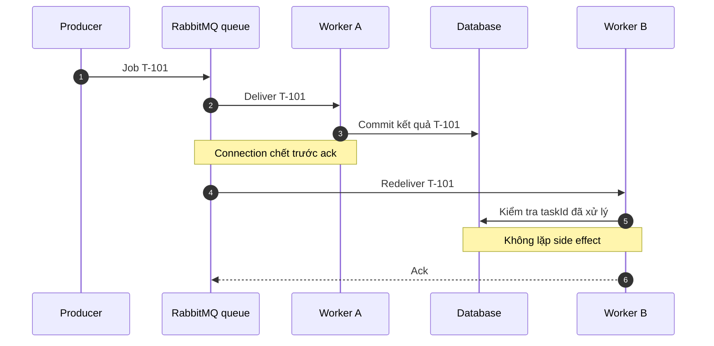
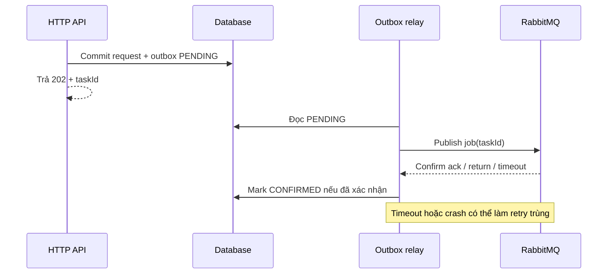
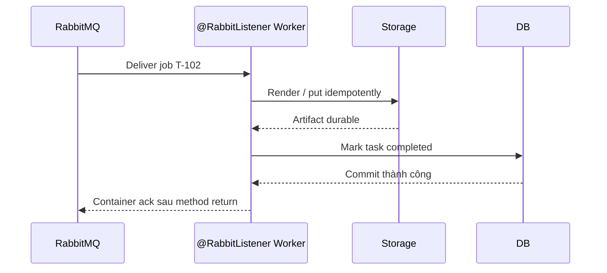
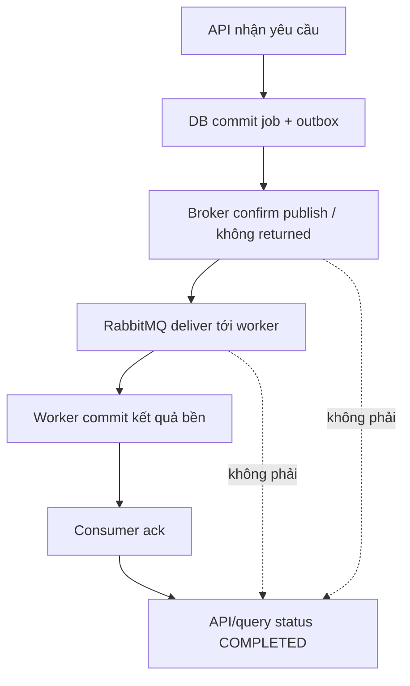

# Work queue cho tác vụ nền và phân phối việc giữa consumer

## 1. Bài toán: không bắt người dùng chờ tác vụ nặng

Trong chương **Mẫu tích hợp** của **SPRING_AMQP**, một nhu cầu phổ biến là đưa việc xử lý tốn thời gian ra khỏi đường đi của HTTP request. Ví dụ, sau khi người dùng tải ảnh lên, hệ thống cần tạo thumbnail, quét metadata, ghi trạng thái hoàn thành và thông báo kết quả. Việc xử lý ảnh có thể kéo dài nhiều giây; nếu HTTP API làm tất cả một cách đồng bộ, thời gian phản hồi tăng và các request khác dễ bị nghẽn.

**Work queue** (*task queue*) giải quyết vấn đề bằng cách biểu diễn một công việc thành message, đưa vào **một queue dùng chung**, rồi để **nhiều consumer cạnh tranh** nhận việc. Mỗi message tại một thời điểm được broker giao cho một consumer, nhưng khi consumer chết hoặc không ack, cùng message có thể được giao lại cho consumer khác. Đây là mô hình **competing consumers**, không phải broadcast.



**Mục tiêu học tập:** sau bài này, bạn có thể thiết kế exchange/queue/binding cho một work queue, tạo producer bằng `RabbitTemplate`, triển khai nhiều `@RabbitListener` workers, chọn prefetch/concurrency/ack, phân loại retry–dead-letter, bảo vệ tác vụ khỏi xử lý trùng và kiểm chứng mức phân phối công việc trong môi trường thật.

## 2. Work queue khác publish–subscribe và request–reply ở đâu?

| Tiêu chí | Work queue / competing consumers | Publish–subscribe | Request–reply |
|---|---|---|---|
| Mục tiêu | Chia một **tập công việc** cho nhiều worker | Phát cùng event tới nhiều nhóm xử lý độc lập | Gửi request và lấy response tương ứng |
| Topology điển hình | **Một queue**, nhiều consumer | Một exchange, **mỗi nhóm một queue**, có thể mỗi queue nhiều consumer | Request queue + cơ chế reply/correlation |
| Một message được xử lý bởi | Một worker tại một thời điểm; có thể redeliver | Mỗi nhóm subscriber nhận bản sao trong queue riêng | Một responder xử lý request và gửi reply |
| Scale | Thêm consumer vào **queue chung** | Scale từng nhóm subscriber độc lập | Scale responder, quản lý reply timeout |
| Kết quả tới caller | Thường trạng thái `PENDING` và tra cứu sau | Không yêu cầu phản hồi trực tiếp | Caller chờ reply trong deadline |
| Ví dụ | Resize ảnh, gửi báo cáo, xuất CSV | `OrderPaid` tới billing + analytics | Hỏi trạng thái tồn kho rồi chờ kết quả |

Giả sử có ba worker cùng lắng nghe `thumbnail.jobs.q`. Một message `T-101` **không được nhân ba** để giao cho cả ba worker. Nếu muốn cùng event kích hoạt ba tác vụ khác nhau — lưu phân tích, gửi email, cập nhật tìm kiếm — cần **ba queue khác nhau**, mỗi queue có nhóm consumer riêng.

### 2.1. “Một worker nhận” không đồng nghĩa “chỉ chạy đúng một lần”

RabbitMQ phân phối **delivery** giữa các consumer. Một job có thể chạy **nhiều lần theo thời gian**:



Work queue trong thực tế thường hướng tới **at-least-once delivery** với manual/automatic acknowledgement ở broker và consumer idempotent. **Không hứa exactly-once execution**: hệ thống có thể phát lại khi mất ack, crash hoặc producer retry sau confirm timeout.

## 3. Hợp đồng của một background job

Thông điệp công việc nên chứa **mô tả việc cần làm**, không chứa toàn bộ object lớn hoặc trạng thái mutable của request:

```json
{
  "taskId": "3b753f6b-9963-4975-a831-a8a9773693a7",
  "imageId": "img-2048",
  "sourceVersion": "v7",
  "width": 320,
  "height": 180,
  "requestedAt": "2026-11-26T03:00:00Z"
}
```

| Trường | Mục đích | Quy tắc |
|---|---|---|
| `taskId` | Idempotency key và truy vết retry/redelivery | Duy nhất theo **tác vụ nghiệp vụ**, không đổi khi gửi lại |
| `imageId` | Tham chiếu dữ liệu đầu vào | ID nội bộ, không lấy URL tùy ý từ user |
| `sourceVersion` | Chốt phiên bản dữ liệu được xử lý | Bảo vệ kết quả khỏi dữ liệu nguồn bị thay đổi |
| `width, height` | Tham số xử lý | Validate giới hạn trước khi đưa vào queue và ở consumer |
| `requestedAt` | Đo độ tuổi tác vụ | Không dùng làm ID duy nhất; đồng bộ timezone UTC |

**Tránh đưa** ảnh nhị phân nhiều MB, access token, mật khẩu hoặc thông tin cá nhân vào message nếu chỉ cần `imageId`. Blob lớn nên nằm ở object storage có phân quyền; message chỉ chứa reference được validate. Token của người dùng có thể hết hạn trước khi worker xử lý, và DLQ có thể lưu bản message lỗi lâu hơn dự tính.

### 3.1. Phân biệt trạng thái nhận việc và trạng thái hoàn tất

HTTP API có thể trả `202 Accepted` cùng `taskId` **sau khi đã lưu công việc bền** theo hợp đồng (ví dụ commit DB và outbox). Khách hàng truy vấn:

```text
POST /images/img-2048/thumbnails
202 Accepted
{ "taskId": "3b753f6b-9963-4975-a831-a8a9773693a7", "status": "PENDING" }

GET /tasks/3b753f6b-9963-4975-a831-a8a9773693a7
{ "status": "COMPLETED", "artifactKey": "thumbnails/<taskId>.webp" }
```

Response này là **minh họa API contract**, không phải kết quả lệnh đã được chạy. `RabbitTemplate.convertAndSend` trả về bình thường **chưa đủ** để tuyên bố job đã lưu bền hoặc hoàn tất: cần xem publisher confirm và trạng thái DB/outbox.

## 4. Topology: một queue chính, nhiều consumer, một DLQ

Spring AMQP cho phép khai báo topology bằng các bean `Queue`, `DirectExchange` và `Binding`. Một direct exchange phù hợp khi mỗi loại job có routing key cụ thể; về bản chất nhiều worker phải subscribe **cùng tên queue**.

```java
import org.springframework.amqp.core.Binding;
import org.springframework.amqp.core.BindingBuilder;
import org.springframework.amqp.core.DirectExchange;
import org.springframework.amqp.core.Queue;
import org.springframework.amqp.core.QueueBuilder;
import org.springframework.beans.factory.annotation.Qualifier;
import org.springframework.context.annotation.Bean;
import org.springframework.context.annotation.Configuration;

@Configuration
public class ThumbnailTopology {
    public static final String EXCHANGE = "thumbnail.jobs.exchange";
    public static final String ROUTING_KEY = "thumbnail.create";
    public static final String QUEUE = "thumbnail.jobs.q";
    public static final String DLX = "thumbnail.jobs.dlx";
    public static final String DLQ = "thumbnail.jobs.dlq";
    public static final String DEAD_KEY = "thumbnail.failed";

    @Bean DirectExchange thumbnailExchange() {
        return new DirectExchange(EXCHANGE, true, false);
    }

    @Bean DirectExchange thumbnailDlx() {
        return new DirectExchange(DLX, true, false);
    }

    @Bean Queue thumbnailQueue() {
        return QueueBuilder.durable(QUEUE)
                .deadLetterExchange(DLX)
                .deadLetterRoutingKey(DEAD_KEY)
                .build();
    }

    @Bean Queue thumbnailDlq() {
        return QueueBuilder.durable(DLQ).build();
    }

    @Bean Binding thumbnailBinding(
            @Qualifier("thumbnailQueue") Queue queue,
            @Qualifier("thumbnailExchange") DirectExchange exchange) {
        return BindingBuilder.bind(queue)
                .to(exchange).with(ROUTING_KEY);
    }

    @Bean Binding thumbnailDeadBinding(
            @Qualifier("thumbnailDlq") Queue queue,
            @Qualifier("thumbnailDlx") DirectExchange exchange) {
        return BindingBuilder.bind(queue)
                .to(exchange).with(DEAD_KEY);
    }
}
```

`RabbitAdmin` có thể auto-declare các bean này khi ứng dụng mở kết nối, nếu được cấu hình và đủ quyền. Trong production, nên xem topology là **hợp đồng hạ tầng**: phân quyền khai báo và thay đổi arguments bằng quy trình được quản lý. Nếu queue đã tồn tại với properties khác, RabbitMQ có thể từ chối redeclare bằng `PRECONDITION_FAILED`; restart pod không sửa được sự không tương thích.

### 4.1. Durable, persistent và quorum

- **Queue durable**: định nghĩa queue tồn tại sau broker restart. Không đồng nghĩa mọi message đều tự được lưu bền.
- **Message persistent**: yêu cầu broker lưu message theo chính sách bền của queue. Spring AMQP gửi message persistent theo mặc định cho nhiều đường dùng `RabbitTemplate`; ví dụ sau sẽ đặt tường minh.
- **Publisher confirms**: cần khi producer phải biết broker đã xác nhận publish; durable + persistent riêng lẻ không loại bỏ mọi cửa sổ lỗi.
- **Quorum queue**: cân nhắc khi công việc quan trọng cần khả năng chống mất node; nó có tính năng/giới hạn khác classic queue, bao gồm delivery limit của quorum queue theo phiên bản RabbitMQ. Không chuyển loại queue hiện hữu bằng cách redeclare sai arguments.
- **DLQ**: lưu message cuối cùng bị reject/dead-letter theo policy; không phải bản sao log đã được làm sạch. Phải có retention, quyền truy cập và runbook replay.

Để tạo quorum queue mới, Spring AMQP có `QueueBuilder.durable(QUEUE).quorum().build()` ở các phiên bản hỗ trợ. Đây là **phương án thay thế** cho queue classic ở trên, không dùng cả hai declaration cho cùng một tên. Quorum queue yêu cầu thiết kế cluster, đĩa, leader/replica và delivery-limit policy phù hợp; cần đọc tài liệu RabbitMQ cho phiên bản broker đang triển khai.

## 5. Cấu hình Spring Boot và giới hạn consumer

Với dự án Spring Boot sử dụng AMQP 0.9.1:

```xml
<dependency>
    <groupId>org.springframework.boot</groupId>
    <artifactId>spring-boot-starter-amqp</artifactId>
</dependency>
```

Ví dụ `application.yml` cho một worker service (giá trị chỉ để thử nghiệm/staging):

```yaml
spring:
  rabbitmq:
    host: localhost
    port: 5672
    username: guest
    password: guest
    publisher-confirm-type: correlated
    publisher-returns: true
    template:
      mandatory: true
    listener:
      simple:
        acknowledge-mode: auto
        concurrency: 2
        max-concurrency: 6
        prefetch: 1
        default-requeue-rejected: false
  lifecycle:
    timeout-per-shutdown-phase: 30s

server:
  shutdown: graceful
```

**Lưu ý về scope:** Nếu bạn khai báo `SimpleRabbitListenerContainerFactory` riêng rồi gắn vào `@RabbitListener(containerFactory="...")`, một số cấu hình `spring.rabbitmq.listener.simple.*` của Boot **không tự áp dụng** vào factory tự tạo. Khi đó phải cấu hình chính xác factory hoặc dùng `SimpleRabbitListenerContainerFactoryConfigurer` tương thích phiên bản Boot.

Giải thích những thuộc tính quan trọng:

| Cấu hình | Tác dụng | Lựa chọn ban đầu |
|---|---|---|
| `acknowledge-mode: auto` | Container **ack sau khi method listener trả thành công**; ném exception sẽ đi vào error/retry handling | Phù hợp đa số worker đồng bộ |
| `concurrency: 2` | Hai consumer khởi đầu trên mỗi replica (simple container) | Dựa trên CPU/DB và thời gian job |
| `max-concurrency: 6` | Cho phép scale consumer trong **một** replica khi tải tăng | Không thay thế horizontal scaling |
| `prefetch: 1` | Mỗi consumer tối đa một delivery chưa ack theo cấu hình | Dễ quan sát cho job chậm/không đều; có thể làm giảm throughput |
| `default-requeue-rejected: false` | Lỗi bị reject sau khi container xử lý sẽ **không requeue** mặc định | Chỉ dùng khi có retry/recoverer/DLQ rõ ràng |
| `publisher-confirm-type: correlated` | Cho phép theo dõi ack/nack của broker theo `CorrelationData` | Cần cho job quan trọng |
| `publisher-returns: true` + `mandatory: true` | Phát hiện message đã vào exchange nhưng không route vào queue | Cần cho tuyến publish cần bảo đảm |

Trong Spring AMQP, `AcknowledgeMode.AUTO` **không có nghĩa RabbitMQ auto-ack ngay khi deliver**. Chế độ `NONE` mới tương ứng việc broker không đòi ứng dụng ack; nếu worker chết giữa chừng ở chế độ này, message có thể bị mất khỏi hàng chờ. Với job quan trọng, tránh `NONE`.

**Production:** Không hardcode credentials. Sử dụng secret manager, TLS, vhost phân quyền theo service, hạn chế quyền quản trị của worker, đặt publisher/consumer connection timeout và chính sách retry phù hợp.

## 6. Producer: gửi một job với taskId ổn định

Một task nên được **lưu trạng thái** để API có thể tra cứu, retry và đối soát. Để minh họa giao thức, ví dụ sau gửi JSON `String` qua `RabbitTemplate` và theo dõi publisher confirm. Các import `com.fasterxml.jackson.*` ở đây dùng **Jackson 2** (phổ biến với Spring Boot 3.x); Spring Boot 4 ưu tiên **Jackson 3** với package `tools.jackson.*`, nên phải chỉnh import/bean mapper theo BOM phiên bản đang sử dụng hoặc cấu hình tương thích Jackson 2 có chủ đích.

```java
import java.time.Instant;
import java.util.UUID;

public record ThumbnailJob(
        String taskId,
        String imageId,
        String sourceVersion,
        int width,
        int height,
        Instant requestedAt) {

    public ThumbnailJob {
        UUID.fromString(taskId); // ID ngẫu nhiên ổn định cho tác vụ.
        if (imageId == null || imageId.isBlank()
                || sourceVersion == null || sourceVersion.isBlank()
                || width < 1 || width > 4096
                || height < 1 || height > 4096
                || requestedAt == null) {
            throw new IllegalArgumentException("INVALID_THUMBNAIL_JOB");
        }
    }
}
```

```java
import java.util.concurrent.CompletableFuture;
import com.fasterxml.jackson.core.JsonProcessingException;
import com.fasterxml.jackson.databind.ObjectMapper;
import org.springframework.amqp.core.MessageDeliveryMode;
import org.springframework.amqp.rabbit.connection.CorrelationData;
import org.springframework.amqp.rabbit.core.RabbitTemplate;
import org.springframework.stereotype.Service;

@Service
public class ThumbnailPublisher {
    private final RabbitTemplate template;
    private final ObjectMapper mapper;

    public ThumbnailPublisher(RabbitTemplate template, ObjectMapper mapper) {
        this.template = template;
        this.mapper = mapper;
    }

    public CompletableFuture<Boolean> publish(ThumbnailJob job)
            throws JsonProcessingException {
        String json = mapper.writeValueAsString(job);
        CorrelationData correlation = new CorrelationData(job.taskId());

        template.convertAndSend(
                ThumbnailTopology.EXCHANGE,
                ThumbnailTopology.ROUTING_KEY,
                json,
                message -> {
                    var props = message.getMessageProperties();
                    // Gửi JSON dưới dạng String với SimpleMessageConverter:
                    // text/plain để consumer nhận String rồi tự parse JSON.
                    props.setContentType("text/plain");
                    props.setDeliveryMode(MessageDeliveryMode.PERSISTENT);
                    props.setMessageId(job.taskId());
                    props.setHeader("jobType", "THUMBNAIL_CREATE");
                    return message;
                },
                correlation);

        return correlation.getFuture().thenApply(confirm ->
                confirm.isAck() && correlation.getReturned() == null);
    }
}
```

Với `publisher-confirm-type=correlated`, `getFuture()` cung cấp kết quả confirm của broker. Nếu cấu hình `publisher-returns` và `mandatory` đúng, `getReturned()` cho biết message bị return do không route được, dù confirm ack. **`true` ở ví dụ chỉ có nghĩa broker nhận publish và không có return quan sát được — không có nghĩa worker đã hoàn tất job.**

Sử dụng:

```java
ThumbnailJob job = new ThumbnailJob(
        "3b753f6b-9963-4975-a831-a8a9773693a7",
        "img-2048", "v7", 320, 180, Instant.now());

thumbnailPublisher.publish(job).whenComplete((confirmed, failure) -> {
    if (failure != null) {
        // Ghi eventId + mã lỗi an toàn; outbox cần retry/đối soát.
    } else if (!Boolean.TRUE.equals(confirmed)) {
        // Broker nack hoặc returned: không đánh dấu đã enqueue thành công.
    } else {
        // Có thể đánh dấu OUTBOX_CONFIRMED, không phải JOB_COMPLETED.
    }
});
```

Đây là ví dụ nằm trong một method của ứng dụng; cần inject `thumbnailPublisher` và quản lý exception serialize ở caller. Nếu `convertAndSend` ném exception **trước khi trả future** (ví dụ connection unavailable), caller phải bắt và xử lý; không có future để đăng ký. Nếu future timeout, kết quả có thể là **UNKNOWN** vì broker có thể đã lưu message nhưng confirm chưa về tới client.

### 6.1. Vì sao nên có transactional outbox?

Nếu API **commit database** trước rồi mới publish, nó có thể crash ngay sau DB commit và **trước** khi gửi job: không có task trong RabbitMQ. Ngược lại, nếu publish trước rồi DB rollback, worker có thể xử lý một job không có dữ liệu nền.

**Transactional outbox** khắc phục cửa sổ bị bỏ quên:

1. Trong cùng transaction với yêu cầu tạo thumbnail, lưu `thumbnail_request` và `outbox_event(taskId,payload,status=PENDING)`.
2. Relay đọc bản ghi `PENDING`, dùng `ThumbnailPublisher.publish(...)`.
3. Future confirm thành công và không returned: đánh dấu outbox `CONFIRMED`.
4. Khi `false`/exception/timeout: giữ trạng thái `PENDING/UNKNOWN` và retry có backoff **với cùng `taskId`**.
5. Nếu relay crash sau broker confirm nhưng trước cập nhật DB, job có thể bị publish lại; consumer phải **idempotent**.



Outbox không khiến broker và database commit nguyên tử: nó giúp **không bỏ quên việc cần gửi** sau khi transaction nghiệp vụ commit; duplicate vẫn phải được chấp nhận theo thiết kế.

## 7. Consumer: nhiều @RabbitListener cùng tranh một queue

Mỗi replica worker triển khai **cùng listener**:

```java
import com.fasterxml.jackson.core.JsonProcessingException;
import com.fasterxml.jackson.databind.ObjectMapper;
import org.springframework.amqp.AmqpRejectAndDontRequeueException;
import org.springframework.amqp.rabbit.annotation.RabbitListener;
import org.springframework.stereotype.Component;

@Component
public class ThumbnailJobListener {
    private final ObjectMapper mapper;
    private final ThumbnailProcessor processor;

    public ThumbnailJobListener(
            ObjectMapper mapper, ThumbnailProcessor processor) {
        this.mapper = mapper;
        this.processor = processor;
    }

    @RabbitListener(
            id = "thumbnailJobConsumer",
            queues = ThumbnailTopology.QUEUE)
    public void onMessage(String json) {
        ThumbnailJob job;
        try {
            job = mapper.readValue(json, ThumbnailJob.class);
        } catch (JsonProcessingException | IllegalArgumentException invalid) {
            throw new AmqpRejectAndDontRequeueException(
                    "INVALID_THUMBNAIL_JOB");
        }

        // Đồng bộ: chỉ return bình thường sau khi nghiệp vụ hoàn tất.
        processor.processOnce(job);
    }
}
```

Code này dùng `SimpleMessageConverter` với `String` và content type `text/plain` mặc dù **nội dung chuỗi là JSON**, rồi gọi `ObjectMapper` tường minh để người học thấy bước deserialize. Nếu đặt content type `application/json` mà vẫn dùng `SimpleMessageConverter` mặc định, phía nhận thường thu được `byte[]`, không phải `String`. Trong ứng dụng dùng hợp đồng JSON chuẩn, hãy cấu hình `JacksonJsonMessageConverter` theo version Spring AMQP trên cả đường gửi/nhận để dùng `application/json` và DTO đúng cách; khi đó **lỗi conversion có thể xảy ra trước khi method listener được gọi**, cần kiểm error handler và DLQ riêng.

Nếu `processor.processOnce` ném exception, `AcknowledgeMode.AUTO` không ack như thể job đã thành công. Container/retry advice/error handler sẽ quyết định reject/requeue. **Không tạo `CompletableFuture` bên trong listener rồi return ngay** nếu công việc quan trọng vẫn đang chạy: consumer có thể ack trước khi future hoàn tất. Với xử lý bất đồng bộ thực sự ở listener phải cấu hình semantics acknowledgement theo API đang dùng.

### 7.1. Một queue chung, không phải mỗi worker một queue

Giả sử có hai replica worker, mỗi replica cấu hình `concurrency: 2`. Broker thấy **bốn consumer** cạnh tranh cùng `thumbnail.jobs.q`; đây là một nhóm work queue.

Nếu mỗi replica tự tạo queue `thumbnail.jobs.q.node-1`, `thumbnail.jobs.q.node-2` và cả hai cùng bind vào exchange, một publish có thể được **sao chép tới hai queue**. Đó là mô hình phát bản sao giữa queue, **không phải** chia cùng tập job cho các worker.

## 8. Idempotency của tác vụ nền có side effect ngoài database

Đặt `taskId` vào message **không tự làm xử lý idempotent**. Với thumbnail, worker có thể ghi object storage rồi crash trước khi đánh dấu `COMPLETED` trong database. Sau redelivery, việc xử lý lại phải không tạo tác dụng phụ sai.

Một thiết kế an toàn hơn:

1. Đầu vào bất biến theo `imageId + sourceVersion + width + height`.
2. Object output có tên xác định theo `taskId` (hoặc hash của input/version), ví dụ `thumbnails/<taskId>.webp`.
3. Ghi object bằng thao tác **idempotent/atomic** do storage adapter đảm bảo (ghi tạm rồi publish/rename, hoặc put-if-absent kèm checksum).
4. Lưu `COMPLETED` với unique constraint `task_id` và `artifact_key` trong DB; nếu job trùng, đối chiếu cùng kết quả rồi bỏ qua.
5. Ack chỉ sau khi phần công việc mà listener chịu trách nhiệm đã hoàn tất; nếu mất ack, worker khác đọc lại và đi qua nhánh idempotency.

```java
public interface ThumbnailProcessor {
    void processOnce(ThumbnailJob job);
}

public interface ThumbnailObjectStore {
    // Triển khai thật phải an toàn khi gọi lại cùng outputKey.
    void renderAndPutIdempotently(
            String imageId, String sourceVersion,
            int width, int height, String outputKey);
}

public interface ThumbnailJobRepository {
    boolean isCompleted(String taskId, String expectedArtifactKey);
    void markCompletedOnce(String taskId, String artifactKey);
}
```

```java
import org.springframework.stereotype.Service;

@Service
public class DefaultThumbnailProcessor implements ThumbnailProcessor {
    private final ThumbnailObjectStore storage;
    private final ThumbnailJobRepository repository;

    public DefaultThumbnailProcessor(
            ThumbnailObjectStore storage, ThumbnailJobRepository repository) {
        this.storage = storage;
        this.repository = repository;
    }

    @Override
    public void processOnce(ThumbnailJob job) {
        String artifactKey = "thumbnails/" + job.taskId() + ".webp";
        if (repository.isCompleted(job.taskId(), artifactKey)) {
            return;
        }

        storage.renderAndPutIdempotently(
                job.imageId(), job.sourceVersion(),
                job.width(), job.height(), artifactKey);

        repository.markCompletedOnce(job.taskId(), artifactKey);
    }
}
```

**Giới hạn quan trọng của code minh họa:** `isCompleted` là một tối ưu kiểm tra nhanh, **không phải khóa chống race**. Hai bản sao cùng `taskId` có thể chạy đồng thời trên hai consumer. `markCompletedOnce` cần triển khai **atomic** bằng unique constraint/transaction và kiểm tra payload conflict; `renderAndPutIdempotently` phải an toàn khi hai lời gọi tranh nhau trên cùng output key. Nếu side effect là gửi email hoặc thu tiền, cần idempotency key của hệ thống đích, không thể chỉ dựa vào database local.

### 8.1. Một schema lưu trạng thái gợi ý

```sql
CREATE TABLE thumbnail_jobs (
    task_id       UUID PRIMARY KEY,
    image_id      VARCHAR(120) NOT NULL,
    source_version VARCHAR(80) NOT NULL,
    artifact_key  VARCHAR(300),
    status        VARCHAR(20) NOT NULL,
    updated_at    TIMESTAMPTZ NOT NULL DEFAULT NOW()
);

CREATE TABLE processed_job_events (
    task_id       UUID PRIMARY KEY,
    artifact_key  VARCHAR(300) NOT NULL,
    completed_at  TIMESTAMPTZ NOT NULL DEFAULT NOW()
);
```

SQL minh họa PostgreSQL. Mọi thay đổi DB nhằm đánh dấu hoàn tất nên được commit nhất quán, kiểm xung đột khi cùng ID nhưng tham số khác, không chỉ `ON CONFLICT DO NOTHING` rồi coi là đúng. Với object storage, không có transaction phân tán tự động với database hay RabbitMQ; quy trình retry/reconcile phải bù vào cửa sổ lỗi này.

## 9. Acknowledgement: thời điểm nào công việc được xem là xong?

Với `@RabbitListener` đồng bộ và `acknowledge-mode: auto`:

| Tình huống | Điều container/broker có thể làm | Điều worker phải bảo đảm |
|---|---|---|
| Method hoàn tất thành công | Container ack message | DB/storage đã commit kết quả chịu trách nhiệm |
| Method ném lỗi | Container xử lý lỗi theo retry/requeue policy | Không báo hoàn tất giả; phân loại lỗi |
| Worker chết trước khi ack | Broker có thể requeue delivery sau khi connection đóng | Cùng `taskId` chạy lại phải an toàn |
| Worker commit DB rồi mất ack | Broker có thể redeliver | Idempotency ngăn tác dụng phụ lặp |
| Acknowledge mode `NONE` | Broker coi delivery đã xong sớm | **Không phù hợp** nếu cần redelivery khi worker chết |
| Prefetch nhiều | Một consumer giữ nhiều unacked messages | Tính thêm memory và độ lệch phân phối |



**Không ack ngay khi bắt đầu xử lý**. Nếu job xử lý 10 giây và worker chết ở giây thứ 3, việc ack sớm có thể khiến queue mất job dù không có kết quả. Nếu cần ack thủ công, sử dụng `AcknowledgeMode.MANUAL`, `Channel.basicAck/basicNack` và xử lý delivery tag trên **đúng channel**; không trộn manual ack vào container AUTO một cách tùy tiện.

## 10. Concurrency, prefetch và phân phối việc có công bằng không?

RabbitMQ phân phối delivery giữa các consumer đang có credit/prefetch. Không bảo đảm chia chính xác `N / số worker`, nhất là khi job có độ dài khác nhau hoặc worker có tốc độ khác nhau.

### 10.1. Tác động của prefetch

Giả sử Worker A đang xử lý một job 20 giây, Worker B xử lý mỗi job 200 ms. Nếu prefetch rất lớn, A có thể giữ một lượng lớn delivery chưa ack; B rảnh trong khi A vẫn giữ backlog. Với `prefetch=1`, broker không đẩy job thứ hai cho consumer A trước khi A ack job đang làm, nên B có cơ hội nhận nhiều việc hơn.

Tuy nhiên `prefetch=1` **không luôn tối ưu**. Spring AMQP từ 2.0 có default prefetch tương đối cao (250) để tránh underutilization cho message xử lý nhanh. Chọn prefetch dựa trên dữ liệu đo:

| Kiểu tác vụ | Prefetch khởi đầu | Lý do |
|---|---|---|
| Tác vụ nặng, độ dài biến thiên, payload lớn | 1–5 | Tránh giữ nhiều delivery tại worker chậm, giảm memory |
| Tác vụ xử lý nhanh, I/O nhỏ, ổn định | 10–100 hoặc đo theo default | Tăng throughput, giảm round-trip cấp phát |
| Job cần thứ tự chặt | Cân nhắc 1 **và một consumer cho key/queue** | Prefetch 1 **không tự bảo đảm thứ tự** nếu nhiều consumer |
| DB/storage downstream giới hạn connection | Prefetch/concurrency thấp theo budget | Tránh làm downstream quá tải |

Đây là các khoảng **để thử nghiệm**, không phải cấu hình tối ưu phổ quát. Monitor `messages_unacknowledged`, throughput, CPU, connection pool và độ trễ p95/p99 trước khi tăng concurrency.

### 10.2. Số consumer thực tế

Ví dụ chạy ba replica, mỗi replica có `concurrency=2` và `max-concurrency=6`:

```text
Ban đầu: 3 replica x 2 consumer = 6 consumer
Giới hạn lý thuyết nếu cả ba scale nội bộ: 3 x 6 = 18 consumer
```

Nhưng **số consumer lớn hơn không luôn xử lý nhanh hơn**: mỗi job có thể dùng CPU, DB connection, object storage bandwidth và memory. Nếu database pool chỉ có 10 connection hữu dụng, tăng tới 18 consumer xử lý DB cùng lúc có thể làm hàng đợi chuyển từ RabbitMQ sang pool DB, thậm chí tăng retry.

Với queue chỉ có vài job mỗi phút, giữ quá nhiều consumer cũng lãng phí tài nguyên. Chọn autoscaling dựa trên **backlog age + processing rate**, không chỉ queue length.

### 10.3. Ordering và affinity

Khi nhiều consumer xử lý cùng queue, job hoàn tất **không theo thứ tự enqueue**. Nếu `ImageUpdated(v7)` và `ImageUpdated(v8)` cùng thay đổi artifact “current thumbnail”, v7 có thể xong sau v8 và ghi đè kết quả mới.

Giải pháp:

- Job mang `sourceVersion`; khi commit kiểm version hiện hành, tránh bản cũ overwrite bản mới.
- Sử dụng **partition theo business key** nếu cần tuần tự theo `imageId`, mỗi partition/queue có quy tắc một consumer active phù hợp.
- Cân nhắc single active consumer (SAC) nếu yêu cầu tuần tự toàn queue, nhưng chấp nhận throughput thấp; prefetch và redelivery vẫn cần xử lý cẩn thận.
- Thiết kế thao tác **commutative/idempotent** nếu có thể, thay vì phụ thuộc giả định thứ tự broker.

**Một queue với nhiều consumer không đảm bảo ordering theo key**. Muốn bảo đảm mạnh cần hợp đồng routing, versioning và commit rõ ràng, không chỉ chỉnh `prefetch`.

## 11. Retry, poison message và dead-letter

Một worker có thể gặp lỗi vì ảnh đầu vào không tồn tại, dữ liệu sai schema, object storage tạm unavailable hoặc DB timeout. Nếu mọi lỗi đều requeue ngay, một poison message có thể chạy lặp vô hạn, chiếm CPU và chặn các job lành.

| Loại lỗi | Ví dụ | Hành động |
|---|---|---|
| **Permanent validation** | Width âm, payload không parse được, sourceVersion sai contract | Không retry vô hạn; reject/DLQ và cập nhật trạng thái lỗi |
| **Business terminal** | Người dùng đã hủy tác vụ, ảnh đã bị xóa theo policy | Ghi `CANCELLED`/`REJECTED`, thường ack như một kết quả hợp lệ |
| **Transient infrastructure** | DB timeout, object storage 503 | Retry với ngân sách hữu hạn, backoff + jitter |
| **Resource overload** | Worker quá tải hoặc storage throttling | Giảm concurrency; retry có trì hoãn, tránh hot loop |
| **Unknown outcome** | Upload object thành công nhưng connection chết trước response | Đối soát key/checksum; retry idempotent |

### 11.1. Cấu hình retry có DLQ khi hết lượt

Ví dụ sau minh họa một **listener container factory riêng** sử dụng stateless retry cho job đồng bộ. Có thể gắn bằng `@RabbitListener(containerFactory="thumbnailListenerFactory")` thay cho default factory:

```java
import org.springframework.amqp.rabbit.config.RetryInterceptorBuilder;
import org.springframework.amqp.rabbit.config.SimpleRabbitListenerContainerFactory;
import org.springframework.amqp.rabbit.connection.ConnectionFactory;
import org.springframework.amqp.rabbit.retry.RejectAndDontRequeueRecoverer;
import org.springframework.context.annotation.Bean;
import org.springframework.context.annotation.Configuration;

@Configuration
public class ThumbnailRetryConfig {
    @Bean("thumbnailListenerFactory")
    SimpleRabbitListenerContainerFactory thumbnailListenerFactory(
            ConnectionFactory factory) {
        var listenerFactory = new SimpleRabbitListenerContainerFactory();
        listenerFactory.setConnectionFactory(factory);
        listenerFactory.setConcurrentConsumers(2);
        listenerFactory.setMaxConcurrentConsumers(6);
        listenerFactory.setPrefetchCount(1);
        listenerFactory.setDefaultRequeueRejected(false);
        listenerFactory.setAdviceChain(
                RetryInterceptorBuilder.stateless()
                        .maxAttempts(3)
                        .backOffOptions(1000, 2.0, 4000)
                        .recoverer(new RejectAndDontRequeueRecoverer())
                        .build());
        return listenerFactory;
    }
}
```

Trong listener tương ứng, thêm thuộc tính:

```java
@RabbitListener(
        id = "thumbnailJobConsumer",
        queues = ThumbnailTopology.QUEUE,
        containerFactory = "thumbnailListenerFactory")
public void onMessage(String json) {
    // Decode và processor.processOnce như phần trước.
}
```

Đây là **phương án cấu hình thay thế** cho listener mặc định ở phần 7, không khai báo thêm một listener thứ hai cùng ID. `RetryInterceptorBuilder.stateless().maxAttempts(...)` là API của Spring AMQP các dòng 3.x; ở phiên bản mới hãy kiểm Javadoc vì API có thể dùng tên `maxRetries(...)` và ý nghĩa số lần retry có thể được diễn đạt khác. Test phải xác nhận **tổng số invocation thực tế**. Stateless retry phù hợp khi mỗi attempt tự quản lý transaction; nếu listener tham gia transaction bao ngoài mà bắt buộc rollback toàn bộ, hãy nghiên cứu **stateful retry** và message ID ổn định.

Điểm không thể bỏ qua: `RejectAndDontRequeueRecoverer` ném `AmqpRejectAndDontRequeueException` khi retry hết. Container từ chối message **không requeue**, broker dead-letter nó **nếu** queue đã có DLX/DLQ đúng. Ngược lại, một recoverer chỉ log rồi **nuốt exception** có thể làm message được ack và không vào DLQ. Với lỗi validation vĩnh viễn, nên phân loại bằng retry policy để **không tốn đủ ba attempt**; default Spring Retry có thể retry cả exception vĩnh viễn nếu chưa cấu hình classifier.

### 11.2. Không để retry “đốt nóng” queue

Hai cách chính:

- **Retry trong listener** với thời gian chờ/backoff ngắn: đơn giản, nhưng giữ delivery/consumer và tài nguyên đang chiếm.
- **Retry trì hoãn** bằng retry queue có TTL + DLX hoặc scheduler/outbox: release consumer để xử lý job khác, nhưng cần kiểm số lần thử, việc quay vòng và thứ tự message.

Không đặt một queue TTL rồi cho message tự quay về queue chính **vô hạn**. Lưu attempts/age trong metadata hoặc kho trạng thái, giới hạn thời gian xử lý, và đưa message hết ngân sách vào DLQ/quarantine. Với quorum queue, broker có cơ chế delivery-limit tùy cấu hình/phiên bản, nhưng không thể xem nó là thay thế hoàn toàn cho phân loại lỗi nghiệp vụ.

### 11.3. DLQ không phải nơi “đã xử lý xong”

Message vào DLQ nghĩa là việc bình thường **chưa hoàn tất**. Cần runbook:

1. Phân loại lỗi và kiểm xem payload có PII/secret không; **không dump nguyên body vào log**.
2. Sửa nguyên nhân (schema, quyền, source version, kết nối).
3. Quyết định **replay, cancel hoặc sửa trạng thái**; replay phải giữ `taskId` hoặc có quan hệ `retryOfTaskId` rõ.
4. Đối soát DB/artifact store; xác minh không tạo duplicate.
5. Theo dõi DLQ depth/age và cảnh báo nếu có tác vụ chờ lâu hơn SLO.

## 12. Độ tin cậy cuối–cuối: phân biệt bốn thời điểm



| Mốc | Có thể kết luận | Chưa thể kết luận |
|---|---|---|
| `DB outbox committed` | Ý định xử lý đã được lưu bền ở DB | RabbitMQ đã nhận job |
| `Publisher confirm ack` và không return | Broker đã xác nhận publish của tuyến được theo dõi | Job đã chạy xong |
| `Delivery tới worker` | Consumer có message để xử lý | Side effect đã commit |
| `DB/artifact commit + ack` | Kết quả bền, delivery được settlement | Không bao giờ có duplicate trong mọi hệ thống |

### 12.1. Failure matrix

| Điểm lỗi | Hệ quả | Phòng vệ |
|---|---|---|
| API chết sau DB commit, trước publish | Job nằm trong outbox, chưa vào queue | Relay đọc lại `PENDING` |
| Broker lưu job nhưng confirm thất lạc | Producer có thể gửi lại | Giữ `taskId`, consumer idempotent |
| Worker chết trước ghi output | Delivery chưa ack có thể được giao lại | Retry và deadline hữu hạn |
| Worker ghi object nhưng chết trước DB commit | Lần sau có thể ghi lại | Output key cố định, put idempotent, đối soát |
| Worker DB commit rồi mất ack | Broker có thể redeliver | Unique task ID, no-op khi duplicate |
| Message sai format | Poison message/loop | Validation, phân loại và DLQ |
| Backlog tăng nhanh hơn throughput | SLO trễ, disk tăng | Backpressure, autoscaling có kiểm soát |
| Worker mới dùng schema không tương thích | Job cũ fail sau rollout | Version schema và consumer backward compatibility |

At-least-once delivery + idempotent processing thường là mục tiêu thực tế. **Exactly-once business effect** chỉ có thể được khẳng định trong một phạm vi side effect được bảo vệ cụ thể, không thể suy ra chỉ từ RabbitMQ queue hay Spring `@RabbitListener`.

## 13. Vận hành: đo hiệu suất và điều khiển tải

Mục tiêu của work queue là **hoàn thành job đúng hạn** chứ không phải “queue luôn có 0 message”. Khi lượng job tới lớn hơn khả năng xử lý, queue dài thêm.

Ví dụ producer tạo **120 jobs/s** nhưng workers chỉ hoàn tất **90 jobs/s**. Backlog tăng xấp xỉ **30 jobs/s** (bỏ qua retry/TTL). Thêm consumer chỉ có ích nếu bottleneck còn CPU/băng thông/DB có thể mở rộng. Nếu downstream đang throttling, tăng worker có thể khiến nhiều lỗi hơn.

| Metric | Ý nghĩa | Cảnh báo khi |
|---|---|---|
| `messages_ready` | Job chưa được giao | Tăng liên tục ngoài budget |
| `messages_unacknowledged` | Delivery đã giao nhưng worker chưa ack | Giữ lâu, tăng khi xử lý kẹt |
| Consumer count | Số consumer trên queue | Bằng 0 không như mong đợi |
| Queue oldest message age | Job lâu nhất chưa xử lý | Vượt SLO, kể cả queue depth thấp |
| Job duration p50/p95/p99 | Thời gian hoàn tất tác vụ | Tăng khi DB/storage nghẽn |
| Publish confirm nack/timeout/returned | Đường enqueue có vấn đề | Bất kỳ mức bất thường |
| Retry attempts + DLQ depth | Job lỗi/poison | Tăng liên tục hoặc requeue loop |
| Idempotency duplicate count | Số lần delivery/publish lại đã được chặn | Tăng đột ngột sau reconnect |
| Outbox pending/oldest age | Ý định chưa được broker xác nhận | Vượt ngưỡng phục hồi |
| Business completion lag | Khoảng từ accept đến `COMPLETED` | Vi phạm SLO người dùng |

### 13.1. Scaling và backpressure

- Chọn **concurrency** theo CPU, DB connection pool, network và artifact storage, không chỉ queue depth.
- Dùng **prefetch thấp** cho job dài/không đều; tăng có đo lường cho job nhỏ, throughput cao.
- Khi queue đầy, API phải có chính sách quota, từ chối/giảm tốc (`429/503` nếu phù hợp) hoặc buffer bền; không đưa hàng triệu future vào memory.
- Với Kubernetes, có thể cân nhắc autoscaler dựa trên queue depth/age (ví dụ hệ thống có tích hợp metrics), nhưng phải có giới hạn số worker và tránh bùng nổ kết nối tới broker.
- Khi rolling deploy, dừng nhận việc mới, chờ tác vụ đang xử lý trong grace period, ack sau commit; delivery chưa ack có thể được broker giao lại.
- **Readiness Kubernetes không tự pause `@RabbitListener`**. Với consumer-only worker, health/readiness và listener lifecycle cần được quản lý riêng.

### 13.2. Các điểm bảo mật

Không log `getBody()`, headers tùy ý, token hoặc ảnh/PII. Event log nên dùng **taskId ngẫu nhiên đã validate, queue alias, job type, error code và elapsedMs**. Các message trong DLQ, payload trong broker management UI và trace exports cần phân quyền/retention. Worker nên dùng credential chỉ có quyền tối thiểu để consume queue cần thiết và publish kết quả theo contract.

## 14. Kiểm thử Work queue: đừng chỉ gọi thẳng listener

### 14.1. Unit test

Với JUnit + Mockito, kiểm:

- `ThumbnailJob` từ chối width/height ngoài giới hạn và ID sai.
- Producer chọn đúng exchange, routing key, message ID và content type.
- Listener parse JSON và gọi `ThumbnailProcessor.processOnce` đúng một lần trên **một invocation**.
- Processor gọi storage/repository đúng; cùng `taskId` đã completed là no-op; conflict cùng ID khác payload bị phát hiện.
- Permanent failure và transient failure được phân loại đúng.

Unit test gọi `listener.onMessage(json)` **không đi qua broker**, nên không chứng minh routing, consumer competition, retry advice hoặc DLQ.

### 14.2. Integration test với RabbitMQ thật

Sử dụng Testcontainers RabbitMQ cùng Spring Boot `@ServiceConnection` hoặc `@DynamicPropertySource` (theo version) và queue/exchange riêng cho test. Những tình huống quan trọng:

| Test | Hành động | Bằng chứng pass |
|---|---|---|
| Routing | Publish `ThumbnailJob` tới exchange/key | Job được một worker nhận qua đúng queue |
| Cạnh tranh consumer | Khởi động ít nhất 2 consumer tới **cùng queue** và publish nhiều job | Mỗi `taskId` chỉ có một trạng thái hoàn tất; không đòi chia đều 50/50 |
| Prefetch | Worker A xử lý chậm, worker B xử lý nhanh | Đo distribution/unacked, thay prefetch và so sánh |
| Consumer crash | Kill worker trước ack | Job có thể redeliver và sau cùng hoàn tất idempotently |
| DB commit rồi mất ack | Chặn acknowledgement sau commit | Redelivery không tạo artifact/bản ghi nghiệp vụ trùng |
| Poison message | Publish JSON sai schema | Sau retry budget, đúng message vào DLQ, không kẹt main queue |
| Publisher return | Dùng routing key không có binding | Publisher không báo nhầm đã enqueue dù broker confirm |
| Outbox | Crash relay sau broker confirm trước DB mark | Resend cùng `taskId` không lặp side effect |
| Rolling deploy | Dừng một worker lúc còn job | Hệ thống xử lý lại an toàn, backlog được drain |

**Không viết assertion** “Worker A nhận chính xác 5, Worker B nhận chính xác 5” khi gửi 10 jobs; RabbitMQ không cam kết phân phối đều theo số lượng, nhất là prefetch và thời gian job khác nhau.

### 14.3. Chờ điều kiện bền với Awaitility

```java
import static org.awaitility.Awaitility.await;
import static org.junit.jupiter.api.Assertions.assertEquals;
import java.time.Duration;

// Giả định integration test có repository thật, publisher và broker riêng.
String taskId = "3b753f6b-9963-4975-a831-a8a9773693a7";
publisher.publish(job);

await().atMost(Duration.ofSeconds(20))
        .pollInterval(Duration.ofMillis(200))
        .untilAsserted(() ->
                assertEquals("COMPLETED", repository.findStatus(taskId)));
```

Đây là đoạn assertion **minh họa** trong test có fixtures `job`, `publisher` và `repository`; không phải mã JUnit độc lập. Phải bảo đảm broker được tạo riêng, queue/DLQ không chứa message cũ và listener đã subscribe trước khi publish. `Thread.sleep(2000)` rồi assert là dễ flaky; chờ kết quả nghiệp vụ thật có timeout thì tốt hơn.

## 15. Những sai lầm hay gặp

| Sai lầm | Hậu quả | Hướng xử lý |
|---|---|---|
| Mỗi worker tạo một queue rồi bind cùng key | Một job có thể **bị nhân bản** tới nhiều queue | Một queue chung cho nhóm competing consumers |
| Coi “một delivery tới một consumer” là exactly-once | Duplicate side effect sau mất ack/retry | `taskId` ổn định, idempotency ở DB/đích |
| Dùng `acknowledge-mode: none` cho job quan trọng | Broker coi đã giao là xong trước khi xử lý | `AUTO` hoặc manual ack sau commit |
| Ack trước khi hoàn tất external side effect | Worker chết làm mất job | Kết quả bền rồi mới ack |
| Bỏ qua confirm và returns | Producer báo thành công dù broker không lưu/không route | `CorrelationData` confirm + mandatory returns |
| Retry lỗi validation vô hạn | Poison message hot loop và nghẽn workers | Retry classifier, budget và DLQ |
| Recoverer chỉ log rồi nuốt lỗi | Message có thể bị ack, không tới DLQ | Chọn recoverer phù hợp, test với broker |
| Prefetch quá cao cho job dài | Worker giữ nhiều unacked, chia tải lệch | Bắt đầu thấp, tăng dựa trên đo đạc |
| Thêm nhiều worker hơn DB connections | Chuyển bottleneck xuống DB, tăng timeout | Giới hạn concurrency và downstream pool |
| Giả định work queue bảo đảm thứ tự theo key | Version cũ có thể ghi đè mới | Version/partition/SAC theo yêu cầu |
| Tạo `taskId` mới cho mỗi retry | Cơ chế dedup không còn tác dụng | ID sinh khi tạo job, giữ nguyên qua retry |
| Dùng kết quả publisher confirm làm job `COMPLETED` | Báo thành công nghiệp vụ quá sớm | Tách `ENQUEUED`/`RUNNING`/`COMPLETED` |
| Không dọn DLQ/backlog và chỉ nhìn pod Ready | Job thất bại âm thầm kéo dài | Metrics queue age, DLQ, outbox và business status |

## 16. Checklist triển khai

1. Đã xác định work queue thật sự là **một queue cho nhiều consumer**, không phải broadcast?
2. Task có `taskId` duy nhất, schema version, validation và reference tới dữ liệu nguồn bất biến?
3. Exchange/queue/binding/DLX/DLQ được provision nhất quán, có version/migration policy?
4. Queue durability/persistence và yêu cầu quorum đã được chọn theo SLA dữ liệu?
5. Publisher có confirm/returns và outbox nếu phải đồng bộ với DB?
6. Worker có ACK sau commit và không trả success trước khi việc quan trọng kết thúc?
7. Idempotency chống cả redelivery **và** duplicate publish, kể cả side effect ở hệ thống ngoài?
8. Retry có giới hạn, phân biệt permanent/transient, không requeue vòng lặp; DLQ có quyền/retention?
9. Prefetch, concurrency, số replica và connection pool đã được đo bằng workload thực?
10. Có chính sách ordering hoặc versioning nếu cùng business key có nhiều job?
11. Quan sát queue age/ready/unacked, consumer count, confirm/return, retry/DLQ và business completion lag?
12. Đã kiểm thử broker down, worker crash trước ack, commit rồi mất ack, publisher timeout và rolling deployment?
13. HTTP API trả `202` chỉ khi đã giữ được ý định xử lý theo hợp đồng và cho phép tra cứu `taskId`?
14. Khi ngừng worker, các task chưa ack có đường redelivery/đối soát, không mất im lặng?

## 17. Bài tập và câu hỏi ôn tập

1. Một exchange có ba queue, mỗi queue có một consumer. Đây có phải work queue với ba competing consumers không? Vì sao?
2. Nếu ba worker subscribe cùng queue, có bảo đảm mỗi worker nhận đúng 1/3 số job không? Prefetch ảnh hưởng thế nào?
3. Khi nào `AcknowledgeMode.AUTO` ack message? Vì sao nó khác `NONE`?
4. Producer nhận publisher confirm ack, nhưng routing key không có binding. Làm sao biết job **không đến queue**?
5. Vì sao durable queue và persistent message chưa đủ để ngăn mất job khi API vừa commit database?
6. Worker A đã upload thumbnail rồi crash trước DB update. Hãy đề xuất output key/idempotency để worker B retry an toàn.
7. Một worker xử lý 2 giây/job và một worker xử lý 200 ms/job. Với prefetch 1, mức chia việc có thể khác round-robin như thế nào?
8. Nếu có hai job `ImageUpdated(v7)` và `ImageUpdated(v8)`, có thể khẳng định v8 hoàn tất sau v7 khi có nhiều consumer không? Làm gì để v7 không ghi đè v8?
9. Khi stateless retry hết ngân sách, khác biệt giữa recoverer **nuốt exception** và `RejectAndDontRequeueRecoverer` là gì?
10. Viết một integration test với RabbitMQ thật để chứng minh reject không requeue đưa đúng message tới DLQ, thay vì chỉ verify listener ném exception.
11. Nếu broker unavailable trong 10 phút, queue backlog được chuyển sang outbox nhưng HTTP vẫn trả `202`, điều kiện nào cho phép điều này là trung thực?
12. Đề xuất dashboard với năm metric đủ phân biệt broker đã recover và **tác vụ nền đã hoàn tất**.

## 18. Tài liệu tham khảo chính thức

- [RabbitMQ — Work Queues với Spring AMQP](https://www.rabbitmq.com/tutorials/tutorial-two-spring-amqp): competing consumers, acknowledgement, prefetch/fair dispatch, durability và persistence.
- [Spring AMQP — Asynchronous Consumer](https://docs.spring.io/spring-amqp/reference/amqp/receiving-messages/async-consumer.html): `@RabbitListener` và ý nghĩa của prefetch.
- [Spring AMQP — Message Listener Container Configuration](https://docs.spring.io/spring-amqp/reference/amqp/containerAttributes.html): `concurrency`, `prefetchCount`, ack, requeue và container properties.
- [Spring AMQP — Recovering from Errors and Broker Failures](https://docs.spring.io/spring-amqp/reference/amqp/resilience-recovering-from-errors-and-broker-failures.html): stateless/stateful retry, recoverer, `RejectAndDontRequeueRecoverer`.
- [Spring AMQP — Publisher Confirms and Returns](https://docs.spring.io/spring-amqp/reference/amqp/publisher-confirms-returns.html): `CorrelationData`, `mandatory` và returned messages.
- [RabbitMQ — Consumer Acknowledgements and Publisher Confirms](https://www.rabbitmq.com/docs/confirms): cơ chế ack/nack/redelivery và xác nhận publish.
- [RabbitMQ — Dead Letter Exchanges](https://www.rabbitmq.com/docs/dlx): DLX và tình huống dead-letter.
- [RabbitMQ — Quorum Queues](https://www.rabbitmq.com/docs/quorum-queues): data replication và delivery limit theo cấu hình.
- [Spring Boot 4 — JSON](https://docs.spring.io/spring-boot/4.0/reference/features/json.html): thay đổi Jackson 3/Jackson 2 và `JsonMapper` khi chuyển version.

**Ghi nhớ:** **Work queue** dùng **một queue chung cho nhiều consumer** để phân phối các tác vụ nền, giúp API phản hồi sớm và workers scale độc lập. RabbitMQ phân phối delivery chứ không bảo đảm công việc chỉ thực thi một lần: phải dùng **publisher confirm/returns, acknowledgement sau commit, retry hữu hạn, DLQ, taskId ổn định và idempotency**. Đánh giá hệ thống theo **thời gian hoàn tất nghiệp vụ**, tuổi backlog và khả năng phục hồi sau lỗi — không chỉ theo số consumer hay số message đã publish.
