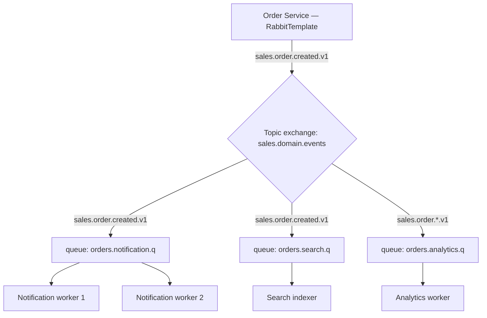
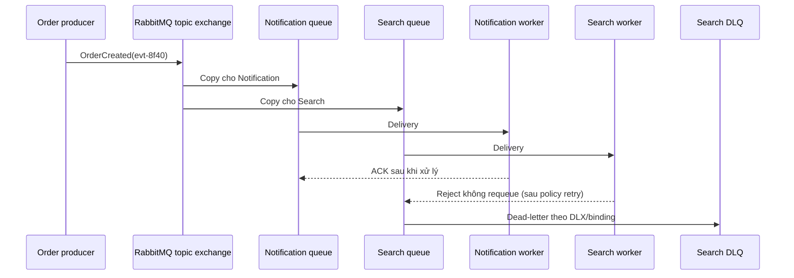
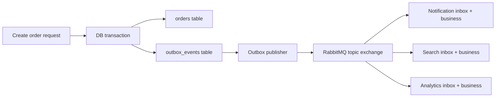

# Pub/sub cho sự kiện miền với queue riêng từng nhóm sử dụng trong Spring AMQP

Khi một đơn hàng được tạo, nhiều thành phần có thể cần biết về cùng sự kiện: dịch vụ email gửi thông báo, dịch vụ tìm kiếm cập nhật chỉ mục và dịch vụ phân tích ghi nhận số liệu. Nếu service đơn hàng gọi trực tiếp cả ba service qua HTTP, nó phải biết những bên sử dụng này, chịu phụ thuộc vào trạng thái của họ và khó mở rộng khi thêm nhu cầu mới.

Mẫu **publish/subscribe (pub/sub)** giúp giải quyết bài toán bằng cách cho **producer phát một sự kiện miền (domain event) lên exchange**, còn **mỗi nhóm sử dụng có queue riêng** được bind vào exchange. RabbitMQ sao chép đường phân phối tới những queue phù hợp; sau đó các consumer trong từng nhóm tự xử lý, ack, retry và giám sát tiến độ của nhóm mình.

Trong chương **Mẫu tích hợp** của **SPRING_AMQP**, bài học xây một ví dụ có `RabbitTemplate`, `@RabbitListener`, `TopicExchange`, queue và binding cho nhiều nhóm. Bài cũng chỉ rõ giới hạn của bảo đảm giao nhận, cách tránh xử lý trùng, thiết kế retry/dead-letter độc lập và cách triển khai an toàn khi thêm hoặc nâng cấp subscriber.

## 1. Domain event và pub/sub giải quyết vấn đề gì?

**Domain event** biểu thị một sự kiện *đã xảy ra* trong nghiệp vụ, chẳng hạn `OrderCreated`, `PaymentCaptured` hoặc `ShipmentDispatched`. Producer phát sự kiện để thông báo cho các thành phần quan tâm, không ra lệnh trực tiếp cho một consumer cụ thể.

Ví dụ:

```json
{
  "eventId": "evt-8f40",
  "eventType": "OrderCreated",
  "schemaVersion": 1,
  "orderId": "ORD-2048",
  "customerId": "CUS-009",
  "occurredAt": "2026-11-26T08:00:00Z"
}
```

Đây là một **sự kiện bất biến** mang ID ổn định để hỗ trợ truy vết và xử lý lặp. Event chỉ chứa dữ liệu cần cho hợp đồng tích hợp; không mặc nhiên chứa toàn bộ entity hoặc thông tin nhạy cảm của khách hàng.

### Event khác command

| Tiêu chí | Domain event | Command |
|---|---|---|
| Diễn đạt | “Đơn hàng **đã được tạo**” | “Hãy **gửi email** cho đơn hàng” |
| Bên phát | Biết sự kiện nghiệp vụ, không cần liệt kê các subscriber | Có mục tiêu hành động và thường biết nơi thực thi |
| Số bên nhận | Có thể nhiều nhóm độc lập | Thường một nhóm chịu trách nhiệm chính |
| Kết quả | Mỗi subscriber tự thực hiện phần việc của mình | Có thể cần kết quả hoặc trạng thái thực thi cụ thể |
| Định tuyến | Exchange với nhiều queue được bind | Thường một queue đích hoặc RPC có chủ đích |

Không phải mọi sự kiện đều nên phát cho toàn hệ thống. Chỉ phát khi có **ngữ nghĩa nghiệp vụ rõ ràng**, người nhận có hợp đồng dữ liệu phù hợp và hệ thống đã kiểm soát quyền truy cập.

## 2. Mỗi nhóm sử dụng có **một queue riêng**

Giả sử có ba nhóm: `notification`, `search-index` và `analytics`. Cả ba quan tâm `OrderCreated`; `analytics` còn muốn nhận `OrderPaid`.



RabbitMQ sẽ định tuyến một message tới **mỗi queue có binding phù hợp**, không “chia ba” một message để chỉ một nhóm nhận. Với `OrderCreated`, ba queue là ba bản phân phối độc lập. Bên trong `orders.notification.q`, hai worker thông thường là **competing consumers**: broker phân phối từng delivery cho một trong hai worker.

### Quy tắc dễ nhớ

- **Khác nhóm chức năng → khác queue.** Notification và Search không nên tranh nhau cùng một queue.
- **Nhiều replica của cùng nhóm → dùng chung queue.** Hai notification workers xử lý phân phối công việc từ `orders.notification.q`.
- **Mỗi queue có backlog riêng.** Notification chậm không buộc Search phải đợi nó ack.
- **Mỗi queue có chính sách lỗi riêng.** Một nhóm có thể retry rồi chuyển vào DLQ mà không quyết định hộ nhóm khác.
- **Một queue không phải một consumer Java duy nhất.** Có thể có nhiều connection/container/replica cùng consume queue ấy.

Thuật ngữ **consumer group** trong bài là **nhóm ứng dụng cùng chia sẻ một queue**, không phải một primitive “consumer group” của RabbitMQ AMQP 0-9-1 giống cơ chế phân nhóm và offset của Kafka. Với classic/quorum queue, RabbitMQ quản lý delivery/ack chứ không cung cấp một offset replay cho mỗi nhóm như một event log.

### Sai lầm phổ biến: một queue cho tất cả service

```text
Exchange -> queue orders.events
                |--> Email service
                |--> Search service
                |--> Analytics service
```

Trong mô hình này, ba service thường trở thành **competing consumers** của cùng queue. Một event có thể chỉ đến Email mà Search không nhận, trái với mục tiêu pub/sub. Cách sửa là tạo **ba queue khác nhau** và bind từng queue vào exchange.

## 3. Chọn exchange và routing key

RabbitMQ hỗ trợ nhiều loại exchange. Với domain events, **topic exchange** thường hữu ích vì subscriber có thể chọn theo tên sự kiện hoặc nhóm sự kiện.

| Loại exchange | Định tuyến | Khi phù hợp |
|---|---|---|
| `fanout` | Bỏ qua routing key; gửi tới tất cả queue được bind | Mọi nhóm luôn cần mọi event của exchange |
| `direct` | So khớp routing key chính xác | Tập sự kiện nhỏ, định tuyến theo từng key cụ thể |
| **`topic`** | So khớp routing key với pattern có `*` và `#` | Nhiều loại domain event, nhóm cần subscribe có chọn lọc |
| `headers` | So khớp theo header và binding arguments | Quy tắc dựa trên thuộc tính, cần kiểm soát độ phức tạp |

Ví dụ đặt tên routing key:

```text
sales.order.created.v1
sales.order.paid.v1
sales.order.cancelled.v1
```

Trong topic exchange:

- `sales.order.created.v1` chỉ khớp sự kiện tạo đơn phiên bản 1.
- `sales.order.*.v1` khớp các event có **một token** ở vị trí loại sự kiện, như `created` và `paid`.
- `sales.order.#` khớp từ không đến nhiều token còn lại theo quy tắc topic của RabbitMQ.

Các token phân tách bằng dấu chấm. Không tự xem `*` như wildcard regex tùy ý hoặc dùng cả payload JSON làm routing key. Routing key là **hợp đồng định tuyến**, không phải bằng chứng xác thực tenant.

### Topology đề xuất

| Nhóm | Queue chính | Binding | Mục đích |
|---|---|---|---|
| Notification | `orders.notification.q` | `sales.order.created.v1` | Gửi thông báo cho đơn mới |
| Search | `orders.search.q` | `sales.order.created.v1` | Tạo document tìm kiếm |
| Analytics | `orders.analytics.q` | `sales.order.*.v1` | Tổng hợp sự kiện order V1 |

Mỗi nhóm sẽ có DLQ tương ứng trong ví dụ. **Binding phải tồn tại trước khi producer phát sự kiện** nếu muốn tất cả subscriber dự kiến đều nhận từ thời điểm đó. Tạo queue mới vào ngày mai không tự làm queue ấy nhận lại các sự kiện đã được publish hôm nay.

## 4. Ví dụ topology Spring AMQP: ba queue, ba nhóm độc lập

Ví dụ dùng **Spring Boot 3.x, Java 17+, RabbitMQ và Spring AMQP**. Với Gradle:

```groovy
dependencies {
    implementation 'org.springframework.boot:spring-boot-starter-amqp'
    implementation 'org.springframework.boot:spring-boot-starter-actuator'
}
```

Để minh họa rõ ràng, một cấu hình `@Configuration` khai báo toàn bộ topology. **Trong production đa service**, nên đưa việc tạo topology vào một job/IaC được quản lý tập trung hoặc cấp quyền khai báo cho đúng owner; không bắt mọi producer/service tự khai báo toàn bộ queue của các nhóm khác.

```java
import org.springframework.amqp.core.Binding;
import org.springframework.amqp.core.BindingBuilder;
import org.springframework.amqp.core.Declarables;
import org.springframework.amqp.core.DirectExchange;
import org.springframework.amqp.core.Queue;
import org.springframework.amqp.core.QueueBuilder;
import org.springframework.amqp.core.TopicExchange;
import org.springframework.context.annotation.Bean;
import org.springframework.context.annotation.Configuration;

@Configuration
public class DomainEventTopology {
    public static final String EXCHANGE = "sales.domain.events";
    public static final String CREATED = "sales.order.created.v1";
    public static final String ORDER_EVENTS_V1 = "sales.order.*.v1";

    public static final String NOTIFICATION_Q = "orders.notification.q";
    public static final String SEARCH_Q = "orders.search.q";
    public static final String ANALYTICS_Q = "orders.analytics.q";

    public static final String DLX = "sales.domain.events.dead";
    public static final String NOTIFICATION_DLQ = "orders.notification.dlq";
    public static final String SEARCH_DLQ = "orders.search.dlq";
    public static final String ANALYTICS_DLQ = "orders.analytics.dlq";

    @Bean
    public Declarables domainEventDeclarables() {
        TopicExchange events = new TopicExchange(EXCHANGE, true, false);
        DirectExchange deadExchange = new DirectExchange(DLX, true, false);

        Queue notification = QueueBuilder.durable(NOTIFICATION_Q)
                .deadLetterExchange(DLX)
                .deadLetterRoutingKey("notification.failed")
                .build();
        Queue search = QueueBuilder.durable(SEARCH_Q)
                .deadLetterExchange(DLX)
                .deadLetterRoutingKey("search.failed")
                .build();
        Queue analytics = QueueBuilder.durable(ANALYTICS_Q)
                .deadLetterExchange(DLX)
                .deadLetterRoutingKey("analytics.failed")
                .build();

        Queue notificationDlq = QueueBuilder.durable(NOTIFICATION_DLQ)
                .build();
        Queue searchDlq = QueueBuilder.durable(SEARCH_DLQ).build();
        Queue analyticsDlq = QueueBuilder.durable(ANALYTICS_DLQ).build();

        Binding notificationBinding = BindingBuilder.bind(notification)
                .to(events).with(CREATED);
        Binding searchBinding = BindingBuilder.bind(search)
                .to(events).with(CREATED);
        Binding analyticsBinding = BindingBuilder.bind(analytics)
                .to(events).with(ORDER_EVENTS_V1);

        Binding notificationDead = BindingBuilder.bind(notificationDlq)
                .to(deadExchange).with("notification.failed");
        Binding searchDead = BindingBuilder.bind(searchDlq)
                .to(deadExchange).with("search.failed");
        Binding analyticsDead = BindingBuilder.bind(analyticsDlq)
                .to(deadExchange).with("analytics.failed");

        return new Declarables(
                events, deadExchange,
                notification, search, analytics,
                notificationDlq, searchDlq, analyticsDlq,
                notificationBinding, searchBinding, analyticsBinding,
                notificationDead, searchDead, analyticsDead);
    }
}
```

Trong ví dụ, ba queue chính **durable**, hai exchange cũng **durable**. Hệ thống khai báo DLX và DLQ riêng từng nhóm để một message lỗi ở Search không bị trộn với message lỗi của Notification. Chính sách retention, quorum queue, TTL, delivery-limit và cơ chế dead-letter chính xác cần lựa chọn theo yêu cầu thật.

**Lưu ý triển khai:** cấu hình dead-letter bằng queue arguments trong demo dễ hiểu, nhưng khi muốn thay đổi DLX mà không phá queue đang tồn tại, có thể ưu tiên RabbitMQ policy khi phù hợp. Thay arguments bất tương thích trên queue đã khai báo có thể gây `PRECONDITION_FAILED`; đây là bài toán migration topology, không phải lỗi cần retry vô hạn.

## 5. Hợp đồng sự kiện và chuyển đổi JSON

Producer và các subscriber có thể được triển khai, nâng cấp và thậm chí viết bằng ngôn ngữ khác nhau. Vì thế message nên dùng **contract công khai, ổn định và có version**, không serialize nguyên một JPA entity phụ thuộc vào Hibernate hoặc cấu trúc database nội bộ.

Ví dụ event type trong thư viện contract dùng chung hoặc được mô tả bằng schema:

```java
import java.time.Instant;

public record OrderCreatedV1(
        String eventId,
        String orderId,
        String customerId,
        Instant occurredAt,
        int schemaVersion) {}
```

Ví dụ một payload:

```json
{
  "eventId": "evt-8f40",
  "orderId": "ORD-2048",
  "customerId": "CUS-009",
  "occurredAt": "2026-11-26T08:00:00Z",
  "schemaVersion": 1
}
```

`eventId` xác định một lần phát sinh sự kiện logic, dùng cho idempotency và truy vết; `orderId` chỉ định aggregate nghiệp vụ. Một đơn hàng có thể phát nhiều sự kiện khác nhau và vì vậy nhiều `eventId`.

### Message converter

Spring AMQP có `Jackson2JsonMessageConverter` (ví dụ API Spring AMQP 3.x) để chuyển giữa object Java và JSON. Các service cần thống nhất:

- Content type và định dạng JSON.
- Tên field, kiểu dữ liệu, timezone và version của event.
- Chính sách field mới, field thiếu và các version tương thích.
- Các type metadata header; không tin header loại Java từ một nguồn không đáng tin cậy để deserialize tùy ý.

```java
import com.fasterxml.jackson.databind.ObjectMapper;
import org.springframework.amqp.support.converter.Jackson2JsonMessageConverter;
import org.springframework.amqp.support.converter.MessageConverter;
import org.springframework.context.annotation.Bean;
import org.springframework.context.annotation.Configuration;

@Configuration
public class DomainEventJsonConfig {
    @Bean
    public MessageConverter domainEventMessageConverter(ObjectMapper mapper) {
        return new Jackson2JsonMessageConverter(mapper);
    }
}
```

Spring Boot thông thường đã có `ObjectMapper` cấu hình Java Time Module, nhưng vẫn phải kiểm thử serialization/deserialization `Instant` trong môi trường thật. Với các service khác Java, chỉ sử dụng JSON schema hoặc message contract tương thích; không phụ thuộc vào tên class Java trong header để định tuyến nghiệp vụ.

## 6. Producer: phát một lần tới exchange, không gửi cho từng queue

Producer chỉ cần biết **exchange và event routing key**, không cần biết queue của Notification hay Search. Đây là điểm tạo ra *loose coupling* giữa service phát sự kiện và các nhóm sử dụng.

### Cấu hình connection và publisher confirmations

Ví dụ cấu hình học tập:

```yaml
spring:
  rabbitmq:
    host: localhost
    port: 5672
    virtual-host: /
    username: guest
    password: guest
    publisher-confirm-type: correlated
    publisher-returns: true
    template:
      mandatory: true
```

`guest/guest` chỉ dành cho RabbitMQ local theo mặc định; môi trường thật dùng secret, user/vhost riêng, TLS và quyền `write` phù hợp. `publisher-confirm-type: correlated` bật cơ chế nhận confirm theo từng publish khi connection factory và template dùng đúng cấu hình. `mandatory: true` cho phép broker trả lại message không route tới **bất kỳ queue nào** thay vì chỉ im lặng bỏ qua trong điều kiện phù hợp.

### Cấu hình `RabbitTemplate`

```java
import org.springframework.amqp.rabbit.connection.ConnectionFactory;
import org.springframework.amqp.rabbit.core.RabbitTemplate;
import org.springframework.amqp.support.converter.MessageConverter;
import org.springframework.context.annotation.Bean;
import org.springframework.context.annotation.Configuration;

@Configuration
public class DomainEventPublisherConfig {

    @Bean("domainEventTemplate")
    public RabbitTemplate domainEventTemplate(
            ConnectionFactory connectionFactory,
            MessageConverter domainEventMessageConverter) {

        RabbitTemplate template = new RabbitTemplate(connectionFactory);
        template.setMessageConverter(domainEventMessageConverter);
        template.setMandatory(true);

        template.setConfirmCallback((correlation, ack, cause) -> {
            // Demo: thay bằng metric, đối soát outbox và xử lý lỗi có giới hạn.
            if (!ack) {
                System.err.println("Publish NACK: " + cause);
            }
        });
        template.setReturnsCallback(returned -> {
            // Đừng log body chứa PII; ghi eventId/correlation khi có.
            System.err.println(
                    "Unroutable publish: " + returned.getReplyText());
        });
        return template;
    }
}
```

Trong dự án có nhiều `MessageConverter`, hãy dùng `@Qualifier` hoặc tên bean rõ ràng ở điểm injection để tránh converter không đúng hợp đồng. Hai callback ở đây mới thể hiện *chỗ nhận tín hiệu*, chưa phải cơ chế retry/outbox đầy đủ.

### Gửi `OrderCreatedV1`

```java
import org.springframework.amqp.core.MessageDeliveryMode;
import org.springframework.amqp.rabbit.connection.CorrelationData;
import org.springframework.amqp.rabbit.core.RabbitTemplate;
import org.springframework.beans.factory.annotation.Qualifier;
import org.springframework.stereotype.Service;

@Service
public class OrderDomainEventPublisher {
    private final RabbitTemplate template;

    public OrderDomainEventPublisher(
            @Qualifier("domainEventTemplate") RabbitTemplate template) {
        this.template = template;
    }

    public void publishCreated(OrderCreatedV1 event) {
        if (event == null
                || event.eventId() == null || event.eventId().isBlank()
                || event.orderId() == null || event.orderId().isBlank()
                || event.schemaVersion() != 1) {
            throw new IllegalArgumentException("Event không hợp lệ");
        }

        CorrelationData correlation = new CorrelationData(event.eventId());
        template.convertAndSend(
                DomainEventTopology.EXCHANGE,
                DomainEventTopology.CREATED,
                event,
                message -> {
                    message.getMessageProperties().setMessageId(
                            event.eventId());
                    message.getMessageProperties().setDeliveryMode(
                            MessageDeliveryMode.PERSISTENT);
                    message.getMessageProperties().setHeader(
                            "eventType", "OrderCreated");
                    return message;
                },
                correlation);
    }
}
```

Lệnh trên phát **một publish** vào `sales.domain.events`. Nếu ba binding phù hợp và queue đã tồn tại, RabbitMQ phân phối message tới cả ba queue. Producer không lặp ba lần để gửi trực tiếp vào `orders.notification.q`, `orders.search.q` và `orders.analytics.q`.

**Quan trọng về độ bền:** exchange/queue durable và message persistent giúp hỗ trợ độ bền, nhưng không đồng nghĩa không thể mất message trong mọi tình huống. Cần publisher confirms, broker topology/queue type phù hợp, hạ tầng lưu trữ và quy trình khôi phục được kiểm chứng.

## 7. Consumer: mỗi nhóm đọc queue của mình

Mỗi nhóm triển khai service riêng, hoặc trong một demo có thể đăng ký những listener khác nhau. Tất cả đều dùng hợp đồng `OrderCreatedV1` nhưng tự quyết định side effect nghiệp vụ.

### Listener factory sử dụng JSON

```java
import org.springframework.amqp.core.AcknowledgeMode;
import org.springframework.amqp.rabbit.annotation.EnableRabbit;
import org.springframework.amqp.rabbit.config.SimpleRabbitListenerContainerFactory;
import org.springframework.amqp.rabbit.connection.ConnectionFactory;
import org.springframework.amqp.support.converter.MessageConverter;
import org.springframework.boot.autoconfigure.amqp.SimpleRabbitListenerContainerFactoryConfigurer;
import org.springframework.context.annotation.Bean;
import org.springframework.context.annotation.Configuration;

@Configuration
@EnableRabbit
public class DomainEventListenerConfig {

    @Bean("domainEventListenerFactory")
    public SimpleRabbitListenerContainerFactory domainEventListenerFactory(
            ConnectionFactory connectionFactory,
            SimpleRabbitListenerContainerFactoryConfigurer configurer,
            MessageConverter domainEventMessageConverter) {

        SimpleRabbitListenerContainerFactory factory =
                new SimpleRabbitListenerContainerFactory();
        configurer.configure(factory, connectionFactory);
        factory.setMessageConverter(domainEventMessageConverter);
        factory.setConcurrentConsumers(2);
        factory.setPrefetchCount(10);
        factory.setAcknowledgeMode(AcknowledgeMode.AUTO);
        factory.setDefaultRequeueRejected(false);
        return factory;
    }
}
```

`AcknowledgeMode.AUTO` có nghĩa container xử lý acknowledgement dựa trên kết quả listener. `setDefaultRequeueRejected(false)` trong demo làm các message bị reject vì listener lỗi không requeue theo mặc định và có thể được dead-letter qua DLX đã cấu hình. **Nó không cấu hình ba lần retry**, không chứng minh DLQ luôn nhận được message và không thay thế error policy phù hợp cho production.

### Notification consumer

```java
import org.springframework.amqp.rabbit.annotation.RabbitListener;
import org.springframework.stereotype.Component;

@Component
public class NotificationEventListener {

    @RabbitListener(
            id = "notification-orders-v1",
            queues = DomainEventTopology.NOTIFICATION_Q,
            containerFactory = "domainEventListenerFactory")
    public void onOrderCreated(OrderCreatedV1 event) {
        // Production: idempotency + email outbox/provider idempotency key.
        System.out.println("Send email for " + event.orderId());
    }
}
```

### Search consumer

```java
import org.springframework.amqp.rabbit.annotation.RabbitListener;
import org.springframework.stereotype.Component;

@Component
public class SearchEventListener {

    @RabbitListener(
            id = "search-orders-v1",
            queues = DomainEventTopology.SEARCH_Q,
            containerFactory = "domainEventListenerFactory")
    public void onOrderCreated(OrderCreatedV1 event) {
        // Production: upsert document idempotent theo orderId/version.
        System.out.println("Index order " + event.orderId());
    }
}
```

Hai class trên là **hai file Java riêng**. Nếu triển khai thành hai microservice, Notification service chỉ cần listener và queue của Notification, còn Search service chỉ cần listener và queue của Search. Demo có thể đưa cả hai vào một ứng dụng để thấy hai queue nhận event độc lập.

### Analytics nhận nhiều loại event

Queue `orders.analytics.q` trong topology match `sales.order.*.v1`, nên có thể nhận `OrderCreatedV1`, `OrderPaidV1` và các event khác cùng pattern. **Không dùng một method chỉ nhận `OrderCreatedV1` để đọc queue Analytics nếu nó có thể nhận nhiều loại event.**

Có thể chọn một trong hai cách:

1. Dùng `@RabbitListener` trên một queue và phương thức phân loại payload theo `eventType`/schema/version với converter phù hợp; sau đó dispatch tới handler đúng.
2. Tạo **queue riêng cho từng loại event** nếu hợp đồng xử lý khác nhau đáng kể hoặc cần error policy, throughput và schema isolation riêng.

Nếu dùng multi-method `@RabbitHandler`, phải cấu hình type mapping và method dispatch phù hợp; tránh giả định RabbitMQ tự hiểu class Java từ routing key. **Topic binding chọn queue, còn chuyển JSON thành DTO vẫn là trách nhiệm của ứng dụng**.

## 8. Mỗi nhóm được retry, ack và dead-letter độc lập

Giả sử `OrderCreated` đến cả Notification và Search. Notification gửi email thành công rồi ack; Search gặp lỗi Elasticsearch và không thể xử lý.



**Ack của Notification không xóa bản phân phối trong queue của Search.** Search tự chịu trách nhiệm đối với queue, retry, checkpoint nghiệp vụ và DLQ của nhóm mình. Đây là đặc điểm chính làm pub/sub phù hợp với nhiều nhóm sử dụng độc lập.

### Không nhầm “nhiều queue” với “một transaction toàn hệ thống”

Một publish có thể được broker chấp nhận và định tuyến cho nhiều queue, nhưng:

- Notification có thể xử lý xong trong vài mili giây.
- Search có thể chậm nhiều phút do downstream lỗi.
- Analytics có thể đang offline và giữ backlog.

Không có **một consumer ack duy nhất** đại diện cho “mọi subscriber đều thành công”. Nếu một workflow cần tất cả bước hoàn tất trước khi trả kết quả, cần một **process manager/saga/tracking state** hoặc mô hình phối hợp khác; không nên dùng pub/sub thuần rồi coi publish thành công là toàn bộ nghiệp vụ hoàn tất.

### Retry theo từng nhóm

Một chính sách đơn giản:

| Nhóm | Lỗi tạm thời | Lỗi không thể phục hồi | Tín hiệu quan sát |
|---|---|---|---|
| Notification | Retry API email có giới hạn; tránh gửi trùng | DLQ/công việc cần hỗ trợ | attempts, provider response, DLQ |
| Search | Retry timeout/index unavailable | Cách ly event sai schema; replay sau sửa | indexing lag, retry, DLQ |
| Analytics | Backoff khi data warehouse bận | Quarantine event không hợp lệ | queue lag, poison records |

Không dùng `basicNack(requeue=true)` vô hạn cho mọi lỗi. Một poison message có thể tạo vòng lặp liên tục, chiếm tài nguyên và đẩy backlog. Có thể dùng Spring Retry interceptor và recoverer, delayed retry topology hoặc chính sách phù hợp với loại queue/broker. Kết quả cuối khi hết retry phải được định nghĩa rõ.

## 9. Publisher confirms và returns: biết điều gì, chưa biết điều gì?

Pub/sub một-to-nhiều rất dễ gây hiểu lầm về xác nhận publish:

| Tín hiệu | Cho biết | Không cho biết |
|---|---|---|
| `RabbitTemplate.convertAndSend()` return | Lời gọi Java gửi đã hoàn tất ở mức API | Broker đã lưu bền vững/consumer đã xử lý |
| Publisher confirm `ack` | Broker đã xác nhận xử lý publish theo cơ chế confirm | Từng subscriber đã xử lý xong |
| Publisher confirm `nack` | Broker không xác nhận publish thành công | Việc retry có thể an toàn tuyệt đối không |
| Mandatory returned message | Message không route được tới **bất kỳ queue nào** trong tình huống áp dụng | Một nhóm cụ thể đã/không nhận khi các nhóm khác vẫn nhận |
| Consumer ack của queue A | Delivery trên queue A được xác nhận | Queue B đã ack hoặc chưa |

**Bẫy quan trọng:** nếu Notification và Search đã bind đúng, nhưng binding Analytics bị thiếu, publish `OrderCreated` vẫn có thể route tới **hai queue đầu**. Khi đó `mandatory` thường **không trả lại message**, bởi ít nhất một queue đã khớp. Publisher confirm `ack` cũng không báo rằng “Analytics đã bị thiếu”.

Vì vậy, khi một event có **tập subscriber bắt buộc**, producer confirm và returned message **không thay thế việc kiểm tra topology, queue/binding health và kết quả xử lý từng nhóm**.

### Mất confirm có nghĩa gì?

Nếu broker đã nhận publish nhưng connection bị ngắt trước khi producer thấy confirm, producer có thể không biết publish có thực sự thành công hay không. Retry có thể tạo bản sao; cả Notification, Search và Analytics đều phải chịu được delivery lặp. **Không bao giờ dùng “confirm timeout thì chắc chắn broker chưa nhận” làm cơ sở để bỏ idempotency.**

## 10. Kết hợp transactional outbox và inbox để tránh mất/lặp sự kiện

Có một khoảng lỗi phổ biến:

```text
1. OrderService commit DB: đã tạo ORD-2048.
2. OrderService chuẩn bị publish OrderCreated.
3. Process crash trước khi RabbitTemplate gửi message.
=> DB có đơn hàng nhưng subscriber không biết về đơn.
```

Nếu đảo thứ tự, gửi event trước khi commit DB cũng nguy hiểm:

```text
1. RabbitMQ nhận OrderCreated.
2. DB transaction tạo đơn bị rollback.
=> Subscriber nhận event về một đơn chưa tồn tại.
```

**Transactional outbox** giải quyết bằng cách ghi đơn hàng và record event vào **cùng một transaction database**. Một tiến trình khác đọc outbox, publish và đánh dấu trạng thái dựa trên confirm/đối soát.



Outbox đảm bảo **không bỏ quên ý định phát sự kiện khi transaction DB đã commit** nếu relay được vận hành và phục hồi đúng. Tuy vậy relay có thể phát **lặp** khi confirm không rõ hoặc crash sau publish trước khi đánh dấu outbox đã xong. Do đó cần **idempotent consumers**.

### Inbox/dedup theo từng nhóm

Mỗi nhóm lưu một dấu vết xử lý theo cặp **`(consumer_group, event_id)`**. Ví dụ DDL PostgreSQL:

```sql
CREATE TABLE consumer_inbox (
    consumer_group VARCHAR(80) NOT NULL,
    event_id VARCHAR(120) NOT NULL,
    processed_at TIMESTAMPTZ NOT NULL DEFAULT now(),
    PRIMARY KEY (consumer_group, event_id)
);
```

Nguyên tắc xử lý:

1. Bắt đầu transaction dữ liệu của subscriber.
2. Thử ghi dấu `(notification, evt-8f40)`; nếu đã tồn tại, bỏ qua tác động đã thực hiện trước đó.
3. Nếu chưa xử lý, cập nhật trạng thái nghiệp vụ và ghi inbox **trong cùng transaction**.
4. Commit transaction; sau đó listener cho phép container ack delivery.

Nếu gửi email hoặc gọi API bên ngoài, không thể gộp giao dịch database với hệ thống ngoài một cách tự nhiên. Khi đó có thể dùng **outbox nội bộ cho side effect**, idempotency key ở provider hoặc reconciliation để tránh gửi lại tác động khi nhận message trùng. **Inbox đơn thuần không bảo đảm exactly-once đối với API ngoài.**

Không ghi marker inbox trong transaction riêng rồi thực hiện nghiệp vụ sau một cách không được bảo vệ: nếu crash giữa hai bước, lần replay có thể bị bỏ qua dù business change chưa hoàn tất.

### `eventId` và `orderId` phục vụ khác mục đích

- `eventId` dùng dedup một sự kiện logic.
- `orderId` xác định entity/aggregate. Một đơn có `OrderCreated`, `OrderPaid`, `OrderCancelled` khác nhau.
- `correlationId`/`traceId` phục vụ quan sát luồng nghiệp vụ; không dùng thay cho event ID để dedup nếu một trace chứa nhiều sự kiện.

## 11. Schema evolution và khả năng tương thích giữa subscriber

Pub/sub giúp thêm subscriber không cần sửa producer nhưng cũng tạo ra nhiều bên phụ thuộc vào **event contract**. Nếu producer đổi field hoặc đổi ngữ nghĩa mà không thông báo, một nhóm có thể thất bại dù các nhóm khác vẫn chạy.

### Một số nguyên tắc

- **Version schema rõ ràng** ở payload và/hoặc routing key, như `sales.order.created.v1`.
- **Thêm field theo hướng tương thích** khi consumer cũ chấp nhận field lạ; kiểm tra thực tế cấu hình converter.
- **Không đổi nghĩa một field cũ** mà chỉ giữ nguyên tên.
- **Không xóa/đổi kiểu field bắt buộc** khi vẫn có consumer cũ.
- **Không gửi domain entity nội bộ** với lazy relationships hoặc dữ liệu bí mật vào event công khai.
- **Có contract test** cho producer và từng consumer: payload chuẩn, field mới, version không hỗ trợ và tình huống dữ liệu lỗi.

Nếu cần breaking change, một cách làm rõ:

```text
sales.order.created.v1 -> queue của subscriber còn chạy V1
sales.order.created.v2 -> queue của subscriber mới nhận V2
```

Trong giai đoạn chuyển đổi, producer có thể dual-publish có kiểm soát hoặc dùng adapter chuyển đổi, nhưng **mỗi cách có nguy cơ gửi trùng event logic**. Subscriber cần xác định rõ nó nhận version nào và dùng `eventId`/version sao cho không áp dụng một nghiệp vụ hai lần.

### Ordering giữa các event

RabbitMQ không tự bảo đảm thứ tự **xử lý nghiệp vụ cuối cùng** giữa các nhóm. Thậm chí trong một nhóm, nhiều competing consumers, requeue hoặc retry có thể làm thời điểm hoàn tất khác thứ tự publish.

Nếu Search cần `OrderCreated` trước `OrderPaid` để xây chỉ mục, cần xét:

- Thứ tự producer phát message và broker route chúng tới **cùng queue**.
- Concurrency/prefetch của consumer.
- Version/sequence của aggregate, xử lý event đến muộn và idempotent upsert.
- Chiến lược phân vùng hoặc serialize theo `orderId` nếu ordering nghiêm ngặt là yêu cầu.

Không xem “một queue của nhóm” là bảo đảm mọi side effect hoàn thành đúng thứ tự trong tất cả trạng thái lỗi.

## 12. Thêm một subscriber mới: chuẩn bị queue trước khi phát sự kiện

Đặc điểm quan trọng của RabbitMQ queue-based pub/sub: **nhóm mới chỉ nhận các message được publish và route sau khi queue/binding của nó tồn tại**. Một durable queue không thể “đi ngược thời gian” lấy message đã phát trước lúc nó được tạo.

### Trình tự thêm nhóm Fraud Detection

1. Xác định event/routing keys cần xử lý, schema version và quyền truy cập dữ liệu.
2. Provision `orders.fraud.q` với binding tương ứng và cấu hình DLQ/error policy.
3. Kiểm thử publish một event mẫu **không gây side effect** để chứng minh binding hoạt động.
4. Triển khai fraud consumer với account chỉ có `read` trên queue và quyền khác cần thiết.
5. Quan sát consumer count, ready/unacked, retry và DLQ.
6. Nếu cần lịch sử trước thời điểm subscribe, thiết kế **backfill riêng** từ database, event store hoặc RabbitMQ Streams; không kỳ vọng classic/quorum queue tự replay.

Nếu producer bắt đầu gửi event **trước khi queue mới được bind**, những event đó không tự được xếp hàng cho Fraud. Với consumer tạm offline nhưng queue đã tồn tại và được cấu hình bền vững phù hợp, broker có thể giữ message đến khi consumer quay lại, **trừ khi** TTL, max-length, retention/limit hoặc sự cố khác làm chúng không còn.

### Rolling deployment và xóa subscription

Khi thay đổi tên queue hoặc routing pattern, tránh xóa queue cũ trước khi đã drain backlog và xác nhận subscriber mới hoạt động. Xóa một queue còn message ready/unacked có thể làm mất dữ liệu cần xử lý. Có thể dùng chiến lược **expand → migrate → contract** để hỗ trợ đồng thời version cũ và mới.

Nếu một nhóm không muốn nhận event nữa, cần quyết định backlog của queue ấy sẽ xử lý, lưu trữ, chuyển qua nơi khác hay xóa có chủ đích; **không chỉ bỏ bean `@RabbitListener` rồi xem như hệ thống đã ngừng lưu message**.

## 13. Phân quyền và bảo vệ dữ liệu giữa các nhóm

Pub/sub nhân bản khả năng tiếp cận event đến nhiều queue. Vì thế, việc thiết kế quyền và dữ liệu phải đi cùng kiến trúc:

| Thành phần | Quyền tối thiểu điển hình | Lưu ý |
|---|---|---|
| Order producer | `write` lên `sales.domain.events` | Không cần `read` các queue subscriber |
| Notification | `read` trên `orders.notification.q` | Không được đọc queue Search nếu không cần |
| Search | `read` trên `orders.search.q` | Credential riêng; không chia secret cho mọi nhóm |
| Analytics | `read` trên `orders.analytics.q` | Chỉ nhận dữ liệu thực sự được phép lưu/truy cập |
| Topology provisioner | `configure` và quyền binding cần thiết | Quản lý qua IaC/pipeline, tách runtime |

Trong RabbitMQ, quyền `configure`/`write`/`read` được cấp **theo vhost và tên resource**, không dựa trên nội dung `customerId` trong JSON. Một message gửi tới topic exchange có thể đến bất kỳ queue nào được bind phù hợp, miễn topology/quyền cho phép.

Nếu event có PII, cần tối thiểu hóa payload, giới hạn nhóm nhận và xem xét event riêng dành cho đối tượng được phép. Vhost/user tách quyền truy cập logic, nhưng **không tự tạo cô lập CPU/đĩa** nếu nhiều nhóm dùng chung broker/cluster.

### Không sử dụng queue name như cơ chế bảo mật duy nhất

Một user được cấp regex `.*` trên vhost có thể được quyền thao tác với nhiều queue hơn dự kiến. Không giả định một listener chỉ *tự nguyện* đăng ký queue của nó là đủ bảo vệ. Dùng credential riêng, permission hẹp và kiểm tra cả trường hợp truy cập bị từ chối.

## 14. Hiệu năng và tác động của một subscriber chậm

Tách queue giúp cô lập tiến độ xử lý, nhưng các queue vẫn có thể dùng chung tài nguyên broker. Nếu Analytics dừng nhiều ngày:

- `orders.analytics.q` tích lũy backlog (nếu không bị giới hạn/expire).
- Notification và Search vẫn có thể tiếp tục ack queue của họ.
- Tuy nhiên bộ nhớ, disk, network và I/O của RabbitMQ chung vẫn có thể chịu áp lực bởi backlog Analytics.

Với từng nhóm, cần cấu hình phù hợp:

- **Consumer concurrency:** nhiều replica cùng share queue để tăng năng lực xử lý nếu downstream còn dư tải.
- **Prefetch:** giới hạn delivery chưa ack; không biến một listener đồng bộ thành nhiều task chạy song song.
- **Retry/backoff:** tránh lỗi downstream gây busy loop/requeue storm.
- **Queue limits, TTL, DLQ:** chọn theo chính sách mất dữ liệu và yêu cầu lưu giữ rõ ràng.
- **Quorum queue / classic queue:** chọn theo yêu cầu availability, durability và throughput đã kiểm chứng.

Ví dụ Notification xử lý chậm 200 ms/message với bốn consumer đồng bộ, thông lượng lý tưởng khoảng:

\[
\frac{4}{0.2\;\text{giây}} \approx 20\;\text{message/giây}
\]

Nếu producer phát 100 `OrderCreated`/giây, backlog Notification sẽ tăng dù Search rất nhanh. **Tăng prefetch** không tự nâng năng lực business logic từ 20 lên 100 message/giây; cần tăng năng lực xử lý, tối ưu downstream hoặc áp dụng rate limiting theo mục tiêu.

Khi event lớn, một publish fanout/topic tới nhiều queue còn tăng lượng dữ liệu broker phải lưu/chuyển. Chỉ bind những nhóm có nhu cầu thật và tránh đính kèm file lớn trong event nếu chỉ cần URL/reference có quyền truy cập.

## 15. Quan sát hệ thống ở **cấp từng nhóm**

Một biểu đồ tổng số message trên broker có thể che giấu việc Notification đang khỏe nhưng Analytics đã ngừng tiêu thụ.

| Tín hiệu | Cần theo dõi theo nhóm/queue | Dấu hiệu lỗi |
|---|---|---|
| `messages_ready` | Mỗi queue subscription | Backlog tăng liên tục |
| `messages_unacknowledged` | Mỗi queue/consumer | Processing chậm, manual ack quên hoặc prefetch quá lớn |
| Consumer count | Mỗi queue | Bằng 0 khi service phải hoạt động |
| Publish confirms | Exchange / producer | Nack, timeout, connection lỗi |
| Mandatory returns | Producer | Không có queue route được, **không** phát hiện mọi nhóm bị thiếu |
| Listener success/failure | Listener/consumer group | Lỗi schema hoặc downstream tăng |
| DLQ depth | DLQ riêng từng nhóm | Có poison event cần điều tra |
| Processing latency | `@RabbitListener` hoặc business Timer | Hệ thống bên ngoài chậm |
| Business outcome | Email gửi, index được cập nhật, analytics được ghi | Message ack nhưng tác động nghiệp vụ không đạt |

Để correlation, ghi log có cấu trúc với `eventId`, `eventType`, `schemaVersion`, `consumerGroup`, `queue` và `correlationId`/trace context khi phù hợp. Không đưa `eventId` hoặc `orderId` vào **nhãn metric** vì có thể tạo cardinality rất lớn; dùng chúng trong log/tracing có kiểm soát truy cập và che thông tin nhạy cảm.

### Runbook: “Search không thấy đơn hàng mới”

1. Xác minh producer đã publish đúng exchange `sales.domain.events` và key `sales.order.created.v1`.
2. Kiểm tra exchange, queue `orders.search.q` và binding tương ứng ở **đúng vhost**.
3. Xem publisher confirms/returns, nhưng nhớ rằng confirm `ack` **không chứng minh Search đã nhận**.
4. Kiểm tra `messages_ready`, `unacked`, consumer count và status listener Search.
5. Xem exception, retry, DLQ `orders.search.dlq` và lỗi schema/JSON converter.
6. Nếu message đã ack nhưng chỉ mục thiếu, kiểm tra logic idempotency, transaction và downstream Elasticsearch.
7. Khi cần replay, xác định nguồn có dữ liệu lịch sử còn lại; không phát lại hàng loạt vào production mà chưa đánh giá tác động lặp.

## 16. Kiểm thử pub/sub: phải xác minh **cả ba queue**

Unit test producer có thể kiểm tra tham số `convertAndSend`; `TestRabbitTemplate` có thể gọi trực tiếp listener theo queue name. Nhưng **cả hai không chứng minh** broker thật định tuyến một publish tới nhiều queue thông qua exchange và binding.

Để kiểm tra pub/sub, cần **integration test với RabbitMQ thật**, ví dụ Testcontainers hoặc môi trường test broker cô lập:

| Kịch bản | Kết quả kỳ vọng |
|---|---|
| Publish một `OrderCreatedV1` | Notification, Search, Analytics đều có bản phân phối từ queue riêng |
| Publish một `OrderPaidV1` | Chỉ nhóm có binding phù hợp, như Analytics, nhận |
| Chạy hai replica Notification | Hai replica cùng **chia** công việc trên `orders.notification.q`; không phải mỗi replica một bản sao |
| Dừng Search listener | Notification vẫn xử lý; Search queue giữ backlog theo chính sách |
| Search ném lỗi và reject không requeue | Search DLQ nhận message theo DLX; Notification không bị dead-letter bởi lỗi của Search |
| Sai binding của Analytics | Test phát hiện Analytics không có message, dù confirm/mandatory có thể không báo lỗi |
| Retry sau mất confirm | Consumer idempotent nên cùng `eventId` không tạo tác động nghiệp vụ lặp |
| Crash sau DB commit nhưng trước consumer ack | Redelivery được xử lý an toàn bằng inbox/transaction |
| Producer DB commit nhưng crash trước publish | Outbox relay khôi phục việc phát event |
| Event V2 chưa hỗ trợ | Subscriber từ chối/cách ly theo policy, không deserialize thành V1 sai nghĩa |
| Dùng credential Notification đọc queue Search | Broker từ chối khi phân quyền đúng |
| Thêm một queue subscription mới | Chỉ nhận event được route sau khi queue/binding tồn tại; không tự replay |

### Ví dụ JUnit/Testcontainers: nguyên tắc assertion

Test tích hợp phải bảo đảm **topology đã khai báo trước lúc publish**. Một kế hoạch:

```text
Given:
  RabbitMQ test container chạy
  topic exchange sales.domain.events tồn tại
  3 queue và 3 binding theo topology ví dụ
  các listener test hoặc test-consumer đọc mỗi queue riêng

When:
  RabbitTemplate publish OrderCreatedV1(eventId="evt-test-1")

Then:
  Notification nhận evt-test-1
  Search nhận evt-test-1
  Analytics nhận evt-test-1
  Không yêu cầu ba service nhận vào cùng một thời điểm

And:
  Khi Search lỗi, kết quả Notification không bị rollback
```

Nếu dùng `RabbitTemplate.receive(...)` để tự lấy message khỏi queue trong test, **không đồng thời để listener thật consume chính queue đó** hoặc các phần sẽ cạnh tranh nhau gây flaky test. Với listener thật, ghi kết quả vào test recorder/latch riêng và chờ bằng Awaitility hoặc countdown latch có timeout.

Không chỉ assert “producer không ném exception”: bài test phải kiểm tra từng nhóm nhận đúng event và **nhóm không subscribe không nhận**.

## 17. Lựa chọn kiến trúc và checklist triển khai

| Nhu cầu | Mẫu đề xuất | Điều cần lưu ý |
|---|---|---|
| Một event, nhiều nhóm xử lý độc lập | **Topic/fanout exchange + queue riêng mỗi nhóm** | Bảo đảm queue/binding có trước publish |
| Nhiều replica cùng một chức năng | **Một queue chung, nhiều competing consumers** | Không có bản sao riêng cho từng replica |
| Một tác vụ chỉ một worker cần xử lý | Work queue / command queue | Đừng fanout nếu không muốn nhiều nhóm nhận |
| Nhóm mới cần đọc lại sự kiện từ nhiều tháng trước | Event store/RabbitMQ Streams + consumer offset hoặc backfill | Classic/quorum queue mới không có lịch sử cũ |
| Nhiều bước phải hoàn tất theo workflow có trạng thái | Saga/process manager, tracking/idempotency | Pub/sub thuần không cung cấp transaction xuyên các nhóm |
| DB commit và event phải gắn với nhau | Transactional outbox + confirms | Relay có thể gửi trùng; subscriber phải dedup |
| Độ trễ rất thấp và nhiều subscriber | Đo throughput, queue type, broker capacity | Fanout tăng khối lượng lưu trữ/chuyển message |

### Checklist trước production

- [ ] Event mô tả một sự kiện đã xảy ra, có `eventId`, contract version và dữ liệu tối thiểu cần thiết.
- [ ] Exchange/routing key được định nghĩa ổn định; group subscription có binding rõ ràng.
- [ ] **Mỗi nhóm nghiệp vụ có queue riêng**; replicas cùng nhóm dùng chung queue.
- [ ] Queue, binding và DLQ đã provision trước khi producer bắt đầu phát event cần giao.
- [ ] Publisher confirms và returns được cấu hình, có xử lý kết quả không xác định khi connection mất.
- [ ] Mỗi listener có retry/backoff có giới hạn, chính sách dead-letter và idempotency phù hợp.
- [ ] Có outbox hoặc cơ chế tương đương nếu DB commit và ý định phát event không được phép tách rời.
- [ ] Quyền vhost/resource, TLS và giới hạn dữ liệu nhạy cảm được áp dụng cho từng service.
- [ ] Có metric queue backlog, unacked, consumer count, lỗi, DLQ và business outcomes theo từng nhóm.
- [ ] Đã kiểm thử bằng RabbitMQ thật các trường hợp nhiều binding, subscriber offline, duplicate và rollback.

### Câu hỏi tự kiểm tra

1. Tại sao ba service cùng consume một queue **không** tạo thành pub/sub cho ba nhóm?
2. Điều gì xảy ra khi có hai replica Notification cùng subscribe `orders.notification.q`?
3. Với topic exchange, binding `sales.order.*.v1` nhận những sự kiện nào và khi nào nên dùng `fanout`?
4. Publisher confirm `ack` hoặc `mandatory` có phát hiện một nhóm bị thiếu binding khi nhóm khác vẫn nhận không?
5. Nếu Search thất bại và reject message vào DLQ, bản phân phối của Notification có bị ảnh hưởng không?
6. Vì sao một subscriber được tạo hôm nay không tự nhận sự kiện đã publish hôm qua?
7. Khi producer lưu DB thành công rồi crash trước publish, mẫu nào giúp giữ ý định phát event? Tại sao consumer vẫn phải idempotent?
8. Inbox theo `eventId` có đủ ngăn email bị gửi trùng nếu gửi qua hệ thống bên ngoài không?
9. Khi cần ordering chặt giữa `OrderCreated` và `OrderPaid`, cần xem xét những gì ngoài một queue riêng?

**Ghi nhớ:** **Một event phát một lần tới exchange, mỗi nhóm có queue riêng, nhiều replica của nhóm dùng chung queue.** Exchange/binding quyết định nhóm nào nhận event; ack/retry/DLQ là trách nhiệm riêng của từng queue; publisher confirms không đồng nghĩa mọi subscriber đã xử lý xong. Trong Spring AMQP, hãy thiết kế `RabbitTemplate`, `@RabbitListener`, queue/binding, event contract, outbox, idempotency và quan sát theo đúng ranh giới đó để mở rộng hệ thống bất đồng bộ an toàn, linh hoạt và đáng tin cậy.
