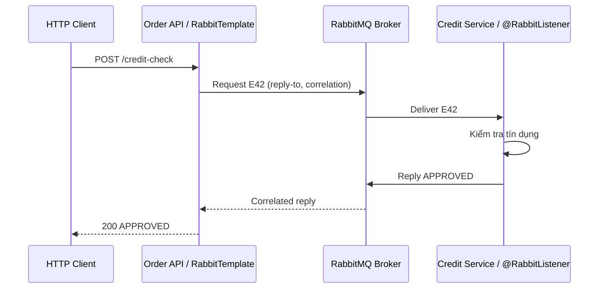
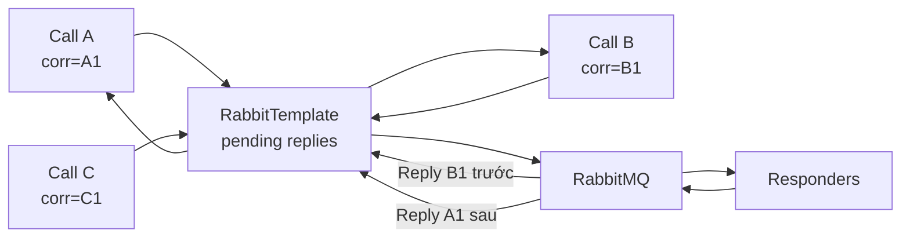
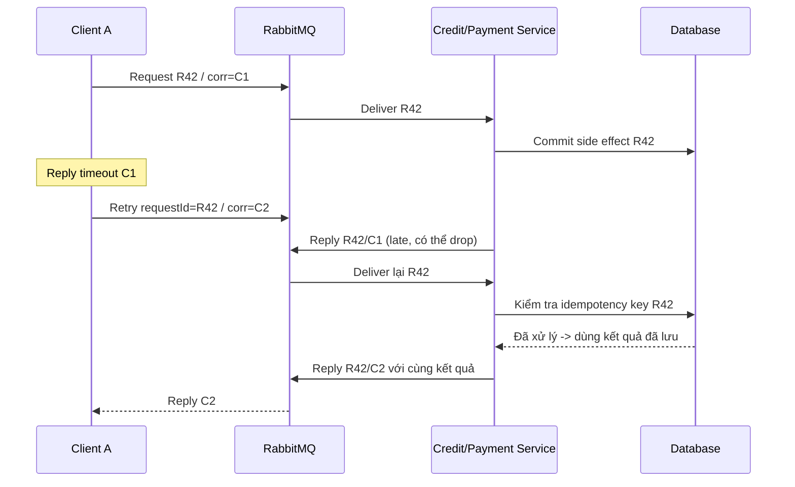

# Request–reply cho yêu cầu cần phản hồi có thời hạn

> **Chương:** Mẫu tích hợp. **Phạm vi:** Spring AMQP với RabbitMQ AMQP 0-9-1, `RabbitTemplate`, `@RabbitListener`, exchange, queue, binding, publisher confirms, retry, dead-letter và quan sát hệ thống. Bài này giải thích cách thiết kế **request–reply có deadline**: người gọi gửi yêu cầu qua RabbitMQ, chờ phản hồi trong một khoảng hữu hạn, rồi xử lý rõ ràng trường hợp thành công, lỗi, timeout, phản hồi muộn và xử lý trùng. Ví dụ theo API Spring AMQP 3.x/4.x; các property Spring Boot được ghi chú theo phiên bản.

## 1. Request–reply là gì, và vì sao cần giới hạn thời gian?

Giả sử API bán hàng nhận một yêu cầu kiểm tra hạn mức tín dụng. Thành phần `Order API` cần nhận quyết định **APPROVED / DECLINED** từ `Credit Service` trước khi trả kết quả cho HTTP client. Nhưng `Credit Service` đang được kết nối qua RabbitMQ thay vì HTTP đồng bộ.

**Request–reply** (RPC trên message broker) được dùng khi một dịch vụ gửi **request message** và chờ **reply message** tương ứng. Việc trao đổi qua broker vẫn là **bất đồng bộ ở tầng vận chuyển**, nhưng đoạn code gọi `RabbitTemplate.convertSendAndReceive(...)` có thể **chặn thread** cho đến khi có reply hoặc timeout.



Vấn đề bắt đầu khi `Credit Service` chậm, queue có backlog, broker gặp sự cố hoặc reply bị mất. Một HTTP request **không thể chờ vô hạn**, còn chính sách retry thiếu giới hạn có thể tạo nhiều giao dịch giống nhau.

**Thời hạn phản hồi** cần được nêu thành một **deadline end-to-end**, không chỉ mỗi cài đặt timeout của `RabbitTemplate`. Ví dụ client HTTP chỉ cho phép 2.000 ms, thì tổng thời gian kiểm tra dữ liệu, publish, đợi queue, thực thi nghiệp vụ, gửi reply và trả HTTP **phải nằm trong ngân sách đó**.

### Khi nào nên, và không nên, dùng request–reply qua RabbitMQ?

| Tình huống | Request–reply hợp lý? | Cân nhắc |
| --- | --- | --- |
| Hệ thống đã có messaging và cần một câu trả lời ngắn từ consumer | Có thể | Cần deadline, correlation, giới hạn concurrency |
| Cần quyết định nghiệp vụ trước khi trả HTTP response | Có thể | End-to-end p95/p99 phải thấp hơn SLA HTTP |
| Chỉ phát sự kiện “đơn hàng đã tạo” | **Không cần** | Publish một chiều + subscriber phù hợp hơn |
| Xử lý dài vài phút/giờ, có thể khởi động lại | Thường **không** | Trả `202 Accepted` + job ID, lưu trạng thái và polling/webhook/event |
| Cần exactly-once execution | **Không thể chỉ nhờ RPC** | Transaction, idempotency, outbox/inbox và reconciliation |
| Có thể gọi dịch vụ trực tiếp qua HTTP/gRPC | Cân nhắc lựa chọn khác | Broker RPC thêm hop, queue wait và overhead vận hành |
| Dịch vụ đích có thể quá tải thường xuyên | Chỉ khi có admission | Bounded requests, backpressure, circuit breaker |

> **Nguyên tắc:** “Đã hết hạn chờ” nghĩa là **caller không còn biết kết quả**. Nó **không** đồng nghĩa consumer chưa nhận, chưa xử lý, đã rollback hay broker sẽ hủy request.

## 2. Bốn thông tin nền tảng: exchange, routing key, reply-to, correlation

Một request–reply AMQP 0-9-1 gồm hai luồng message:

1. **Request path:** producer publish đến exchange/routing key; binding chuyển tới **request queue**.
2. **Reply path:** listener xử lý và publish reply về địa chỉ mà người gọi khai báo trong thuộc tính **`replyTo`**.

**`correlationId`** (hoặc cơ chế tương quan qua channel của Spring AMQP) giúp ghép đúng reply với request khi nhiều lời gọi đang chờ đồng thời.

| Thuộc tính / thực thể | Ý nghĩa | Ai sở hữu? |
| --- | --- | --- |
| `orders.rpc` (direct exchange) | Điểm gửi request | Hạ tầng hoặc `RabbitAdmin` |
| `credit.check.request` (durable queue) | Queue nhận request | Hạ tầng hoặc `RabbitAdmin` |
| Routing key `credit.check` | Quy tắc định tuyến request | Contract giữa producer/consumer |
| `replyTo` | Địa chỉ gửi phản hồi, do requester cung cấp | `RabbitTemplate` cấu hình khi RPC |
| `correlationId` | Ghép reply với một request đang chờ | `RabbitTemplate` quản lý mặc định |
| `messageId` | Có thể dùng ID phục vụ trace/dedup | Ứng dụng quản lý |
| `requestId` (custom header/payload) | ID nghiệp vụ bất biến qua retry | Ứng dụng quản lý |
| `deadlineEpochMs` (custom header/payload) | Mốc hết hạn xử lý | Ứng dụng thiết kế contract |

**Không trộn ba loại ID:**

- **`requestId`**: cùng một yêu cầu nghiệp vụ, nên **giữ nguyên khi retry**.
- **AMQP `correlationId`**: phục vụ một lần đợi reply; template thường **tạo và quản lý tự động**.
- **`CorrelationData`**: dùng để tương quan **publisher confirm** cho lời publish, **không thay thế** RPC reply correlation.

Đối với yêu cầu lặp do client timeout, có thể có **một requestId nhưng nhiều RPC attempts/correlation IDs**. Điều này không phải lỗi nếu responder idempotent và reply của mỗi attempt được gửi đúng `replyTo`.

### Một lần gọi theo ba thời điểm

```text
T0    Caller publish request, bắt đầu đợi.
T1    RabbitMQ route request vào queue và có thể confirm publish.
T2    CreditService trả reply, RabbitTemplate correlate và kết thúc đợi.

T1 không đảm bảo T2.
Nếu T2 xảy ra sau caller deadline: reply có thể đến muộn hoặc bị mất.
```

## 3. Topology đúng cho request–reply

Với Spring AMQP thông thường, **chỉ cần provision request exchange, queue và binding**. Spring `RabbitTemplate` sử dụng **Direct Reply-To** mặc định khi RabbitMQ hỗ trợ, nên **không phải tạo thêm reply queue thủ công** cho ví dụ cơ bản.

```java
import org.springframework.amqp.core.Binding;
import org.springframework.amqp.core.BindingBuilder;
import org.springframework.amqp.core.DirectExchange;
import org.springframework.amqp.core.Queue;
import org.springframework.amqp.core.QueueBuilder;
import org.springframework.context.annotation.Bean;
import org.springframework.context.annotation.Configuration;

@Configuration(proxyBeanMethods = false)
public class CreditRpcTopology {
    @Bean
    DirectExchange creditRpcExchange() {
        return new DirectExchange("orders.rpc");
    }

    @Bean
    Queue creditCheckQueue() {
        return QueueBuilder.durable("credit.check.request").build();
    }

    @Bean
    Binding creditCheckBinding(Queue creditCheckQueue,
                               DirectExchange creditRpcExchange) {
        return BindingBuilder.bind(creditCheckQueue)
            .to(creditRpcExchange)
            .with("credit.check");
    }
}
```

Spring Boot có thể tự đăng ký `RabbitAdmin` để khai báo các bean `Queue`/`Exchange`/`Binding` khi kết nối phù hợp được thiết lập. Nếu tổ chức quản lý topology bằng Terraform/Helm/operator, hãy provision bên ngoài và giữ cấu hình tương thích; đừng để các ứng dụng đồng thời khai báo cùng tên với arguments khác nhau.

**Tính bền vững của request:** `durable queue` và message `persistent` giúp tăng mức an toàn khi broker khởi động lại, tùy queue type và broker confirms. Chúng **không** biến Direct Reply-To reply thành durable, và cũng **không** bảo đảm client vẫn còn chờ khi request được xử lý.

### Giới hạn backlog của RPC queue

Queue bền vững có thể tích tụ rất nhiều request khi responder down. Nhưng với RPC có deadline 2 giây, request chờ 30 phút thường vô giá trị; phải đặt **thời hạn queue wait, backlog limit, policy reject/TTL và fail-fast** phù hợp.

Queue length/TTL chỉ là **bảo vệ broker**. Một message đã được consumer giao đi thì queue TTL **không tự hủy công việc đang chạy**; responder vẫn phải tự kiểm tra `deadlineEpochMs`.

## 4. Cấu hình requester bằng `RabbitTemplate`

### 4.1. Dùng Direct Reply-To mặc định

Spring AMQP hỗ trợ `amq.rabbitmq.reply-to` mặc định khi RabbitMQ có tính năng này. Với `RabbitTemplate`, không khai báo `replyAddress`, `replyQueue` hoặc một reply listener riêng:

```java
import org.springframework.amqp.rabbit.connection.ConnectionFactory;
import org.springframework.amqp.rabbit.core.RabbitTemplate;
import org.springframework.context.annotation.Bean;
import org.springframework.context.annotation.Configuration;

@Configuration(proxyBeanMethods = false)
class CreditRpcClientConfiguration {

    @Bean("creditRpcTemplate")
    RabbitTemplate creditRpcTemplate(ConnectionFactory factory) {
        RabbitTemplate template = new RabbitTemplate(factory);
        template.setReplyTimeout(1_500L); // milliseconds: 1.5 seconds
        template.setMandatory(true);
        // Nếu RabbitMQ hỗ trợ, Spring dùng direct reply-to tự động.
        return template;
    }
}
```

Với `Spring Boot 3.x`, cách tương đương qua properties là:

```yaml
spring:
  rabbitmq:
    host: localhost
    port: 5672
    publisher-confirm-type: correlated
    publisher-returns: true
    template:
      reply-timeout: 1500ms
      mandatory: true
```

**Hai cấu hình trên là ví dụ thay thế:** nếu dùng Boot auto-configuration thì không cần tạo bean `RabbitTemplate` trùng chức năng chỉ để đổi `replyTimeout`. Với Spring Boot **4.x**, xác định lại starter/namespace của stack RabbitMQ AMQP 0-9-1 trước khi dùng YAML; ví dụ `spring.rabbitmq.*` ở đây dành cho Boot 3.x.

**Giá trị mặc định chính thức:** các overload `sendAndReceive`/`convertSendAndReceive` của `RabbitTemplate` mặc định **đợi 5 giây rồi trả `null`** nếu không có reply. `setReplyTimeout(...)` nhận **milliseconds**, không phải seconds.

### 4.2. Method client có mapping timeout rõ ràng

Ví dụ đơn giản dùng payload dạng String để không cần cấu hình thêm JSON converter. Client gửi `"REQ-42:customer-7:1000000"`; listener cũng trả chuỗi `"APPROVED"`/`"DECLINED"`.

```java
import org.springframework.amqp.rabbit.core.RabbitTemplate;
import org.springframework.beans.factory.annotation.Qualifier;
import org.springframework.stereotype.Service;

@Service
class CreditRpcClient {
    private final RabbitTemplate template;

    CreditRpcClient(@Qualifier("creditRpcTemplate") RabbitTemplate template) {
        this.template = template;
    }

    String checkCredit(String requestText) {
        Object reply = template.convertSendAndReceive(
            "orders.rpc", "credit.check", requestText);

        if (reply == null) {
            throw new CreditReplyTimeoutException(
                "No reply within configured RPC timeout");
        }
        if (!(reply instanceof String text)) {
            throw new IllegalStateException(
                "Unexpected reply type: " + reply.getClass().getName());
        }
        return text;
    }
}

class CreditReplyTimeoutException extends RuntimeException {
    CreditReplyTimeoutException(String message) {
        super(message);
    }
}
```

Ở đây `convertSendAndReceive(...)` là **blocking call**; nó không trả tương lai. Spring AMQP có thể ném `AmqpException` do lỗi kết nối/định tuyến, ví dụ `AmqpMessageReturnedException` khi `mandatory` và publisher returns được bật đúng cách. **Đừng gom mọi exception vào “timeout”:** một request không route được cần kiểm tra exchange/binding ngay, chứ không nên đợi và retry nóng.

**Chú ý:** `mandatory=true` để nhận `basic.return` khi request không route được chỉ hoạt động đầy đủ khi `publisherReturns` được bật trên `CachingConnectionFactory` và không có cấu hình ReturnCallback xung đột với đường RPC. Producer confirms riêng cũng có thể được lấy qua các overload nhận `CorrelationData`, nhưng xác nhận **request đã đến broker** không đồng nghĩa **đã có reply nghiệp vụ**.

### 4.3. Responder với `@RabbitListener` trả về giá trị

`@RabbitListener` có return value không phải `void` được Spring adapter đóng thành reply message, gửi tới `replyTo` do requester cung cấp:

```java
import org.springframework.amqp.rabbit.annotation.RabbitListener;
import org.springframework.stereotype.Component;

@Component
class CreditRpcResponder {
    private final CreditDecisionService decisionService;

    CreditRpcResponder(CreditDecisionService decisionService) {
        this.decisionService = decisionService;
    }

    @RabbitListener(
        id = "creditCheckResponder",
        queues = "credit.check.request")
    public String check(String requestText) {
        return decisionService.check(requestText);
    }
}
```

`CreditDecisionService` là service nghiệp vụ do ứng dụng cung cấp; ví dụ trả `"APPROVED"` hoặc `"DECLINED"`. Responder tự động lấy `replyTo` từ request và trả reply tương ứng, không cần gọi lại `RabbitTemplate.convertAndSend(...)` bằng tay trong method.

**Đối với request có `replyTo`, `@SendTo` không được dùng để ghi đè địa chỉ reply ấy.** `@SendTo` chỉ cung cấp **đích mặc định khi inbound message không có reply-to**, vì thế không cần trong RPC cơ bản. Spring adapter cũng xử lý việc đặt correlation phù hợp để requester nhận đúng reply.

## 5. Deadline end-to-end: timeout của client chưa đủ

Một yêu cầu có SLA 2 giây **không thể** dành cả 2 giây cho mỗi bước. Cần xác định ngân sách tổng:

```text
HTTP deadline:                         2.000 ms
  - xác thực/đọc dữ liệu đầu vào:        100 ms
  - RPC request publish + queue wait:   250 ms (mục tiêu)
  - kiểm tra tín dụng:                 1.000 ms (mục tiêu)
  - reply và response serialization:    150 ms
  - headroom cho dao động:              500 ms
                                        --------
  Tổng:                               2.000 ms
```

Đây là **ngân sách minh họa**, không phải RabbitMQ bảo đảm mỗi chặng đều tuân thủ. `RabbitTemplate.replyTimeout` đặt giới hạn **đợi reply phía caller**; nó không biết HTTP deadline bên ngoài, không hủy công việc đang xử lý và không đảm bảo thread ở responder bị interrupt.

### 5.1. Đặt deadline tuyệt đối vào request

Một cách phối hợp giữa các service là đưa **mốc deadline** vào application header, chẳng hạn `x-rpc-deadline-epoch-ms`, và cùng một `requestId` dùng để dedup:

```java
import java.time.Clock;
import org.springframework.beans.factory.annotation.Qualifier;
import org.springframework.amqp.rabbit.core.RabbitTemplate;
import org.springframework.stereotype.Service;

@Service
class DeadlineAwareCreditRpcClient {
    private static final String EXCHANGE = "orders.rpc";
    private static final String ROUTING_KEY = "credit.check";

    private final RabbitTemplate template;
    private final Clock clock;

    DeadlineAwareCreditRpcClient(
            @Qualifier("creditRpcTemplate") RabbitTemplate template,
            Clock clock) {
        this.template = template;
        this.clock = clock;
    }

    String request(String customerId, String stableRequestId) {
        long requestTtlMs = 1_500L;
        long deadlineEpochMs =
            clock.millis() + requestTtlMs;

        Object reply = template.convertSendAndReceive(
            EXCHANGE,
            ROUTING_KEY,
            customerId,
            message -> {
                var p = message.getMessageProperties();
                p.setHeader("x-rpc-request-id", stableRequestId);
                p.setHeader("x-rpc-deadline-epoch-ms", deadlineEpochMs);
                // Chỉ là TTL cho message còn đang chờ trong queue.
                p.setExpiration(Long.toString(requestTtlMs));
                return message;
            });

        if (reply == null) {
            throw new CreditReplyTimeoutException(
                "RPC timed out, requestId=" + stableRequestId);
        }
        return (String) reply;
    }
}
```

**Điều kiện sử dụng ví dụ:** constructor `Clock` phải có Spring bean thích hợp, ví dụ:

```java
@Bean
Clock rpcClock() {
    return Clock.systemUTC();
}
```

Phương thức `@Bean` này cần nằm trong một lớp `@Configuration` và có import `java.time.Clock` cùng `org.springframework.context.annotation.Bean`. `stableRequestId` do upstream cấp hoặc được tạo **một lần** ở ranh giới nghiệp vụ rồi giữ nguyên cho các lần thử lại; không tạo UUID mới trong mỗi RPC retry.

**Phân biệt hai deadline:**

- `p.setExpiration("1500")` là **per-message TTL (ms) ở RabbitMQ**. Nó giúp hạn chế request quá cũ đang chờ trong queue, nhưng không đảm bảo message được xóa/đưa DLX ngay đúng 1.500 ms ở mọi queue type; broker có semantics TTL khác nhau và message **đã giao cho consumer** không bị TTL hủy giữa chừng.
- `x-rpc-deadline-epoch-ms` là **contract ứng dụng tự định nghĩa**. Responder kiểm tra trước khi bắt đầu, rồi kiểm tra lại ở ranh giới commit/side effect nếu phù hợp.

`Clock.millis()` dựa trên wall clock. Hai máy cần đồng bộ NTP và chấp nhận một mức clock skew; deadline tuyệt đối trong header không thể chính xác nếu đồng hồ hệ thống lệch lớn. Trong một JVM, nên dùng monotonic time cho **thời gian còn lại**; qua network cần một giao thức rõ cho absolute deadline, skew và budget.

### 5.2. Responder từ chối xử lý request đã hết hạn

```java
import java.time.Clock;
import org.springframework.amqp.rabbit.annotation.RabbitListener;
import org.springframework.messaging.handler.annotation.Header;
import org.springframework.stereotype.Component;

@Component
class DeadlineAwareCreditResponder {
    private final Clock clock;
    private final CreditDecisionService decisions;

    DeadlineAwareCreditResponder(
            Clock clock, CreditDecisionService decisions) {
        this.clock = clock;
        this.decisions = decisions;
    }

    @RabbitListener(queues = "credit.check.request")
    public String check(
            String customerId,
            @Header("x-rpc-request-id") String requestId,
            @Header(name = "x-rpc-deadline-epoch-ms", required = false)
            Long deadlineEpochMs) {
        if (deadlineEpochMs == null || clock.millis() >= deadlineEpochMs) {
            return "EXPIRED:" + requestId;
        }

        // Trong service thật, đọc dữ liệu/ghi DB có timeout riêng.
        return decisions.checkIdempotently(customerId, requestId);
    }
}
```

Code này thể hiện **rào chắn trước khi xử lý**. Nếu check xong rồi một database query chạy 10 giây, request vẫn có thể vượt deadline. Responder nên cấp timeout riêng cho JDBC/HTTP downstream, kiểm tra trạng thái trước side effect quan trọng và cung cấp một phương án **xem lại kết quả theo requestId**.

**Lưu ý nghiệp vụ:** một request kiểm tra hạn mức có thể chỉ đọc; một request **thực hiện thanh toán** có side effect. Với thanh toán, không được lấy việc hết hạn để khẳng định “chưa bị trừ tiền”. Cần lưu kết quả theo idempotency key và đối soát, ngay cả khi client đã nhận 504.

### 5.3. Đừng nhân timeout theo từng retry

Ví dụ client HTTP còn 2.000 ms nhưng retry RPC ba lần, mỗi lần `replyTimeout=1500ms`, có thể giữ thread **4.500 ms**, chưa kể delay và xử lý trước/sau. Tổng thời gian vượt SLA ngay cả khi code gọi mỗi RPC có timeout.

Khi bắt buộc retry trong một request đồng bộ:

```text
remaining = absoluteDeadline - now
if remaining <= minimumUsefulWorkBudget: return timeout

attemptBudget = min(remaining - reservedResponseBudget, configuredMaxWait)
publish / wait with attemptBudget
if transient failure AND remaining đủ AND retryBudget còn:
    backoff + jitter trong giới hạn remaining
else:
    trả kết quả hoặc trạng thái chưa rõ
```

Để thay đổi `replyTimeout` theo từng request, **không sửa một bean `RabbitTemplate` singleton dùng chung trong nhiều thread** bằng cách gọi `setReplyTimeout(...)` trước mỗi lần gửi: các request song song sẽ đè cài đặt lẫn nhau. Có thể chia template theo class SLO, sử dụng overload deadline phù hợp khi framework cung cấp, hoặc chuyển sang `AsyncRabbitTemplate` và đặt timeout/deadline ở orchestration layer trong khi giữ cấu hình template bất biến.

## 6. Correlation ID: tránh nhầm reply của request A với request B

Giả sử có 100 yêu cầu đồng thời, tất cả cùng nhận reply trên Direct Reply-To. Spring `RabbitTemplate` duy trì một bảng các request đang chờ, tự đặt thông tin tương quan và ghép reply tương ứng.



**Không được giả định reply đến cùng thứ tự request.** Consumer có thể xử lý song song, một request đọc cache trong 5 ms còn request khác gọi database trong 500 ms.

### 6.1. Mặc định template tự quản lý correlation

Với `convertSendAndReceive(...)`, Spring thường tạo `correlationId` riêng và khôi phục correlation trước đó khi thích hợp. **Không đặt tay** `correlationId` cho mọi message bằng cùng một giá trị như `"credit-check"`. Nếu cần bảo toàn một correlation tùy chỉnh, cấu hình `setUserCorrelationId(true)` và **tự bảo đảm ID duy nhất cho từng request attempt**.

Từ Spring AMQP 2.3.7, `RabbitTemplate` có tùy chọn `setUseChannelForCorrelation(true)` dành cho Direct Reply-To. Khi bật, Spring có thể dựa vào channel đã gửi request để correlate, giảm yêu cầu broker sao chép correlation ID sang reply. **Đây là tối ưu nội bộ**, không thay thế việc duy trì `requestId` nghiệp vụ.

### 6.2. Correlation của publisher confirms là việc khác

Các API `sendAndReceive` có overload nhận `CorrelationData` để quan sát **confirm của publish request**:

```java
// Minh họa vai trò hai cơ chế, không phải đầy đủ một service:
var confirmCorrelation =
    new org.springframework.amqp.rabbit.connection.CorrelationData("pub-42");

Object reply = rabbitTemplate.convertSendAndReceive(
    "orders.rpc", "credit.check", "customer-7", confirmCorrelation);

// reply dùng RPC correlation/reply-to nội bộ của RabbitTemplate.
// confirmCorrelation.getFuture() theo dõi publisher confirm cho request.
```

Publisher confirm cho biết broker đã nhận trách nhiệm publish, **không** cho biết service đích đã xử lý, đã gửi reply hoặc caller vẫn còn chờ. Nếu `mandatory` và publisher returns được bật, request không route được có thể phát sinh `AmqpMessageReturnedException`; đó là tình huống **khác** với request đã route nhưng consumer xử lý quá deadline.

### 6.3. Định nghĩa request ID và correlation ID theo scope

| Trường | Thay đổi khi retry? | Dùng cho |
| --- | --- | --- |
| `requestId` | **Không** | Idempotency, tra cứu trạng thái nghiệp vụ, audit |
| RPC correlation ID | Thường **có**, mỗi attempt riêng | Khớp một reply với đúng caller đang chờ |
| `CorrelationData.id` | **Có**, mỗi publish attempt | Publisher confirms |
| Trace ID | Có thể giữ trong một distributed trace hoặc tạo span liên kết | Observability, không dùng làm khóa idempotency mặc định |

Không dùng queue name làm correlation ID. Khi caller timeout rồi gửi lại request với correlation mới, responder vẫn phải nhìn `requestId` cũ để tránh thực hiện nghiệp vụ hai lần.

## 7. Direct Reply-To, temporary reply queue và fixed reply queue

Spring AMQP có ba mô hình nhận reply. Việc chọn cơ chế cần dựa vào **khối lượng RPC và mức độ chấp nhận mất reply**, không chỉ theo số queue hiện trên Management UI.

| Phương án | Broker giữ reply như thế nào? | Ưu điểm | Đánh đổi |
| --- | --- | --- | --- |
| **Direct Reply-To** (mặc định) | Không có queue lưu bền; reply được gửi qua pseudo-queue volatile, **at-most-once** | Ít overhead tạo/xóa queue; phù hợp RPC thời hạn ngắn | Reply có thể mất khi caller disconnect, quá tải, không còn đang chờ |
| Temporary exclusive auto-delete reply queue | Queue tạm được tạo cho lần request (theo cấu hình) | Cách truyền thống, có queue tạm để nhận | Overhead tạo/xóa queue, không nhằm giữ reply qua crash |
| Fixed reply queue (mỗi requester) | Queue có tên quản lý riêng, có thể được cấu hình durable/TTL/DLX | Có thể buffer/quan sát reply và điều chỉnh consumer | Phải tự khai báo reply listener, quản lý queue riêng cho từng instance và dọn late replies |

### 7.1. Direct Reply-To là gì?

Với RabbitMQ AMQP 0-9-1, `amq.rabbitmq.reply-to` là **pseudo-queue**, không phải classic queue bình thường. Requester tiêu thụ qua no-ack, broker dùng tên đích tạm kèm opaque suffix để chuyển reply tới đúng requester; nó **không xuất hiện trong danh sách queue thông thường**.

RabbitMQ xác định reply Direct Reply-To là **non-durable, zero-buffer, at-most-once**. Nếu requester disconnect, không đọc kịp hoặc đường truyền lỗi, reply có thể bị **drop**. Đây là hành vi thiết kế, không phải bằng chứng service chưa trả lời.

Spring `RabbitTemplate` mặc định dùng Direct Reply-To trên broker hỗ trợ; kể từ Spring AMQP 2.0, nó quản lý `DirectReplyToMessageListenerContainer` dùng lại consumer. **Không phải tự tạo listener `@RabbitListener(queues = "amq.rabbitmq.reply-to")`.**

### 7.2. Một reply đến muộn sẽ đi đâu?

```mermaid
sequenceDiagram
    participant A as Requester
    participant MQ as Broker
    participant S as Responder
    A->>MQ: Request E42; replyTimeout=1.5s
    MQ->>S: Deliver E42
    Note over S: DB query 3s
    Note over A: 1.5s: RPC trả null (timeout)
    S->>MQ: Reply(E42, APPROVED)
    MQ--xA: Direct reply-to: có thể không còn requester
    Note over A,S: Side effect/câu trả lời có thể đã tồn tại
```

**Không được kết luận “timeout nghĩa là không có kết quả”**. Nếu responder đã cập nhật database, kết quả có thể vẫn tồn tại. Nên cung cấp `GET /requests/{requestId}` hoặc event xác nhận trạng thái để đối soát sau khi timeout.

Với fixed reply queue, Spring có xử lý reply quá hạn và có thể reject/dlq theo cấu hình; cần giám sát late reply để tránh queue rác. Với Direct Reply-To, không thể giả định một DLQ thường đang lưu tất cả reply mất.

### 7.3. Khi nào chọn fixed reply queue?

Một hệ thống thực hiện RPC kéo dài hơn, cần buffer reply có kiểm soát hoặc điều tra message muộn có thể chọn reply queue riêng. Ví dụ mỗi instance requester có tên khác nhau:

```text
orders-api-pod-a -> rpc.replies.orders-a
orders-api-pod-b -> rpc.replies.orders-b
orders-api-pod-c -> rpc.replies.orders-c
```

**Tối quan trọng:** nếu nhiều requester instances cùng dùng **một** fixed reply queue, RabbitMQ phân phối reply theo competing-consumer semantics, nên instance B có thể lấy reply dành cho instance A và không có pending correlation để xử lý. Mỗi `RabbitTemplate` / requester instance cần **reply queue riêng** (hoặc chiến lược định tuyến đặc thù được chứng minh đúng), không chỉ dựa vào correlation header để broker định tuyến.

### 7.4. Wiring fixed reply queue (lựa chọn thay thế)

Ví dụ chỉ minh họa **một requester instance** có queue `rpc.replies.orders.instance-a`. Trong triển khai nhiều replica phải tạo tên queue **riêng cho mỗi instance**, provision và dọn lifecycle đúng:

```java
import org.springframework.amqp.core.Queue;
import org.springframework.amqp.core.QueueBuilder;
import org.springframework.amqp.rabbit.connection.ConnectionFactory;
import org.springframework.amqp.rabbit.core.RabbitTemplate;
import org.springframework.amqp.rabbit.listener.SimpleMessageListenerContainer;
import org.springframework.beans.factory.annotation.Qualifier;
import org.springframework.context.annotation.Bean;
import org.springframework.context.annotation.Configuration;

@Configuration(proxyBeanMethods = false)
class FixedReplyQueueConfiguration {

    @Bean("fixedReplyQueue")
    Queue fixedReplyQueue() {
        return QueueBuilder
            .nonDurable("rpc.replies.orders.instance-a")
            .autoDelete()
            .build();
    }

    @Bean("fixedReplyTemplate")
    RabbitTemplate fixedReplyTemplate(
            ConnectionFactory connectionFactory,
            @Qualifier("fixedReplyQueue") Queue replyQueue) {
        RabbitTemplate template = new RabbitTemplate(connectionFactory);
        template.setReplyAddress(replyQueue.getName());
        template.setReplyTimeout(1_500L);
        // Không dùng Direct Reply-To khi đã chỉ định fixed reply queue.
        return template;
    }

    @Bean
    SimpleMessageListenerContainer fixedReplyListenerContainer(
            ConnectionFactory connectionFactory,
            @Qualifier("fixedReplyTemplate") RabbitTemplate template,
            @Qualifier("fixedReplyQueue") Queue queue) {
        SimpleMessageListenerContainer container =
            new SimpleMessageListenerContainer(connectionFactory);
        container.setQueues(queue);
        container.setMessageListener(template);
        return container;
    }
}
```

**Chỉ chọn một cách nhận reply cho mỗi template.** Khi `setReplyAddress(...)` được dùng, phải cấu hình listener container nhận **đúng queue** và đặt `RabbitTemplate` làm message listener; nếu không, các lời gọi RPC có thể timeout hoặc Spring phát hiện cấu hình thiếu. Mẫu Direct Reply-To ở mục 4 **không** cần container này.

**Không lầm tính bền vững:** kể cả nếu đổi fixed reply queue thành durable, việc requester process crash sẽ làm **mất bảng pending futures/correlation trong RAM**. Durable queue có thể giữ reply nhưng không tự tái tạo lời gọi RPC hoặc HTTP request trước đó. Nếu cần bảo đảm theo dõi kết quả **qua restart**, hãy lưu request/result trong database và cho phép tra cứu theo `requestId`; mô hình **202 + job/status** thường đơn giản, rõ ràng hơn RPC giữ kết nối chờ lâu.

## 8. `AsyncRabbitTemplate`: chờ reply không giữ HTTP thread

Synchronous `RabbitTemplate.convertSendAndReceive(...)` dễ dùng nhưng **giữ thread trong lúc đợi**. Khi số request tăng, ngay cả khi broker hoạt động bình thường, số thread bị giữ xấp xỉ:

```text
Concurrent waiting threads ≈ requests_per_second × average_wait_seconds

Ví dụ 200 request/giây × 0,5 giây = ~100 thread đang đợi.
```

Đây là ước lượng theo Little's law ở trạng thái ổn định; nếu p99 latency tăng, số thread và bộ nhớ có thể tăng mạnh. Vì thế với nhiều RPC, nên cân nhắc **`AsyncRabbitTemplate`** hoặc chuyển toàn bộ luồng thành asynchronous job.

### 8.1. Tạo `AsyncRabbitTemplate`

```java
import org.springframework.amqp.rabbit.AsyncRabbitTemplate;
import org.springframework.amqp.rabbit.core.RabbitTemplate;
import org.springframework.beans.factory.annotation.Qualifier;
import org.springframework.context.annotation.Bean;
import org.springframework.context.annotation.Configuration;

@Configuration(proxyBeanMethods = false)
class AsyncCreditRpcConfiguration {
    @Bean
    AsyncRabbitTemplate asyncCreditRpcTemplate(
            @Qualifier("creditRpcTemplate") RabbitTemplate template) {
        AsyncRabbitTemplate async = new AsyncRabbitTemplate(template);
        async.setReceiveTimeout(1_500L);
        return async;
    }
}
```

`AsyncRabbitTemplate` là **một bean có lifecycle**; Spring có thể khởi động/dừng nó cùng context. Khi dừng với pending replies, futures có thể bị hủy. Nó sử dụng reply listener/container phù hợp (bao gồm Direct Reply-To nếu cấu hình như trên).

**Khác biệt timeout quan trọng:** `AsyncRabbitTemplate` có `receiveTimeout` mặc định **30 giây**, **khác** `RabbitTemplate.replyTimeout` mặc định 5 giây. Khi async reply timeout, future hoàn tất **exceptionally** với `AmqpReplyTimeoutException`, thay vì phương thức blocking trả `null`.

### 8.2. Nhận `CompletableFuture`, không chặn callback

```java
import java.util.concurrent.CompletableFuture;
import org.springframework.amqp.rabbit.AsyncRabbitTemplate;
import org.springframework.stereotype.Service;

@Service
class AsyncCreditClient {
    private final AsyncRabbitTemplate asyncTemplate;

    AsyncCreditClient(AsyncRabbitTemplate asyncTemplate) {
        this.asyncTemplate = asyncTemplate;
    }

    CompletableFuture<?> send(String customerId) {
        return asyncTemplate.convertSendAndReceive(
            "orders.rpc", "credit.check", customerId);
    }
}
```

Ví dụ controller WebFlux/MVC async có thể trả `CompletableFuture` hoặc ánh xạ sang response bất đồng bộ theo stack HTTP đang dùng; **không** gọi `future.get()` ngay trong controller nếu mục tiêu là giải phóng HTTP thread.

```java
// Minh họa orchestration, không phải controller hoàn chỉnh:
CompletableFuture<?> future = asyncCreditClient.send("customer-7");
future.whenComplete((reply, error) -> {
    if (error != null) {
        // Timeout, connection failure, unroutable... cần phân loại.
        recordRpcFailure(error);
    } else {
        recordRpcSuccess(reply);
    }
});
```

`recordRpcFailure`/`recordRpcSuccess` là hàm do ứng dụng tự viết. Callback có thể chạy trên thread xử lý message/reply của framework, nên **không làm JDBC/HTTP blocking kéo dài trong `whenComplete`**; nếu cần, chuyển sang executor **có queue giới hạn** và xử lý tình huống executor từ chối.

**Async không đồng nghĩa không có giới hạn:** một HTTP server có thể không bị kẹt thread nhưng vẫn tạo 50.000 pending futures/correlation map nếu không có admission limit. Cần semaphore/bulkhead, timeout, giới hạn outstanding count/bytes và cơ chế 429/503 hoặc outbox.

### 8.3. Publish confirms của `AsyncRabbitTemplate`

`RabbitMessageFuture`/`RabbitConverterFuture` của `AsyncRabbitTemplate` cho phép theo dõi reply; khi bật confirms theo đúng cấu hình, còn có thể quan sát confirm tương ứng. **Đây là hai mốc khác nhau.** Một reply thành công đồng nghĩa có đường xử lý request tới responder, nhưng broker ACK một publish không chứng minh có reply.

Tránh thiết kế theo kiểu cứ thấy confirm ACK là hoàn tất RPC. Cần **reply hợp lệ** và **kết quả nghiệp vụ đúng contract**; khi confirm không rõ, dùng event ID/idempotency để không lặp side effect.

## 9. Phản hồi lỗi: trả envelope nghiệp vụ, không mặc định ném exception

Nếu responder gặp lỗi dữ liệu kiểu `INVALID_CUSTOMER` hoặc `CREDIT_DECLINED`, đó là **kết quả nghiệp vụ**, không nhất thiết là lỗi broker. Đừng để listener ném exception cho mọi tình huống rồi buộc requester chờ đến timeout: ứng dụng sẽ mất khả năng phân biệt “bị từ chối hợp lệ” với “không nhận được reply”.

### 9.1. Response contract nên có trạng thái rõ ràng

Với ví dụ String đơn giản:

```text
Request:
  requestId=REQ-42
  customerId=customer-7
  deadlineEpochMs=...

Reply:
  requestId=REQ-42
  status=APPROVED | DECLINED | INVALID_INPUT | EXPIRED | TEMPORARY_FAILURE
  reasonCode=... (không lộ dữ liệu nhạy cảm)
  processedAt=...
```

Trong hệ thống thật, dùng schema JSON/Avro/Protobuf có phiên bản, ví dụ `CreditDecisionReply(requestId, status, reasonCode, processedAt)` và `JacksonJsonMessageConverter` (tùy Spring version). **Cấu hình converter ở cả requester và responder**; không mặc định một record Java sẽ tự trở thành JSON nếu đang dùng `SimpleMessageConverter`.

Ví dụ responder trả String envelope khi gặp lỗi **đã phân loại**:

```java
@RabbitListener(queues = "credit.check.request")
public String handle(String body) {
    try {
        String businessResult = creditService.evaluate(body);
        return "OK|" + businessResult;
    } catch (InvalidCreditRequestException ex) {
        return "INVALID_INPUT|" + ex.code();
    } catch (KnownTemporaryDependencyException ex) {
        return "TEMPORARY_FAILURE|DEPENDENCY_UNAVAILABLE";
    }
}
```

`creditService` và các exception ở trên là **thành phần giả định do ứng dụng định nghĩa**. Để dùng production, tránh catch mọi `RuntimeException` rồi trả `OK`; lỗi programming/DB không rõ trạng thái cần được ghi log và xử lý theo chính sách retry/recovery thực tế.

### 9.2. Một exception chưa được xử lý thường không tự tạo error reply

Khi `@RabbitListener` ném lỗi, container có thể reject/requeue hoặc đưa tới DLX tùy retry interceptor, `defaultRequeueRejected` và loại queue. Requester thường **không nhận được reply nghiệp vụ**, nên có thể timeout. Điều này không có nghĩa “RPC lỗi = message bị xóa”; thậm chí consumer có thể xử lý cùng request nhiều lần do redelivery.

Spring AMQP có các cơ chế gửi exception của listener về client trong một số cấu hình, nhưng **không nên deserialize một remote Java exception tùy ý từ nguồn không tin cậy**. Với service-to-service contract, ưu tiên **response envelope có code ổn định** và xử lý lỗi ngoài dự kiến bằng logs, tracing, DLQ, reconciliation.

### 9.3. Mapping HTTP hợp lý sau RPC

| Tín hiệu RPC | HTTP minh họa | Giải thích |
| --- | --- | --- |
| `APPROVED`/`DECLINED` | `200` với decision hoặc mã nghiệp vụ tương ứng | Có kết quả chắc chắn |
| `INVALID_INPUT` | `400`/`422` | Input bị từ chối rõ ràng |
| Reply đến trong deadline nhưng service báo `TEMPORARY_FAILURE` | `503` hoặc response có trạng thái tạm thời | Có phản hồi lỗi đã phân loại |
| Mandatory return / request không route được | `503` | Lỗi routing/config, có thể fail fast |
| Caller hết deadline, kết quả không rõ | `504 Gateway Timeout` hoặc `202` với requestId theo contract | **Không tuyên bố transaction đã rollback** |
| Hết admission capacity trước khi publish | `429` hoặc `503` | Không nên block vô hạn |

Mapping trên chỉ là lựa chọn theo API contract, không có HTTP code nào được Spring AMQP tự áp đặt. Với thao tác có side effect, trả `requestId` để caller có thể tra cứu kết quả sau một timeout hoặc retry bằng **idempotency key tương tự**.

## 10. Retry sau timeout phải đi cùng idempotency

Đây là rủi ro lớn nhất của request–reply với side effect:



Nếu mỗi lần timeout tạo request mới với ID khác, responder không thể biết đó là cùng thao tác nghiệp vụ. Với thanh toán, đặt hàng hoặc thay đổi hạn mức, hậu quả có thể là **side effect bị thực hiện hai lần**.

### 10.1. Thiết kế inbox/idempotency store

Một database table đơn giản:

```sql
CREATE TABLE rpc_request_results (
    request_id       VARCHAR(120) PRIMARY KEY,
    operation        VARCHAR(80)  NOT NULL,
    result_status    VARCHAR(40)  NOT NULL,
    result_payload   TEXT,
    completed_at     TIMESTAMPTZ,
    created_at       TIMESTAMPTZ NOT NULL DEFAULT now()
);

CREATE INDEX rpc_request_results_created_idx
    ON rpc_request_results(created_at);
```

Một transaction DB có thể thực hiện:

1. Claim `requestId` bằng `INSERT ... ON CONFLICT DO NOTHING` hoặc cơ chế unique key/row locking phù hợp.
2. Nếu đã có kết quả `COMPLETED`, **trả lại kết quả cũ** mà không làm side effect lần hai.
3. Nếu request chưa có, thực hiện nghiệp vụ và lưu **kết quả cuối** trong **cùng transaction** với side effect DB.
4. Commit thành công, sau đó trả reply; nếu network làm mất reply, lần retry vẫn nhận kết quả cũ.
5. Nếu request bị giữ `PROCESSING` bởi một transaction đang chạy hoặc một workflow dài, phải có quy tắc wait/lease/timeout/recovery riêng, không coi `PROCESSING` là thành công.

```text
BEGIN TRANSACTION
  INSERT rpc_request_results(request_id, operation, result_status)
  VALUES (:requestId, 'CREDIT_CHECK', 'PROCESSING')
  ON CONFLICT DO NOTHING

  Nếu row mới:
    Thực hiện side effect DB
    UPDATE rpc_request_results
      SET result_status='COMPLETED', result_payload=:reply
    WHERE request_id=:requestId
  Nếu row đã có:
    Đọc kết quả đã được commit / chờ hoặc báo IN_PROGRESS
COMMIT

Gửi reply cho attempt hiện tại qua reply-to/correlation của attempt đó.
```

**Đảm bảo quan trọng:** unique key trong DB ngăn claim trùng; nhưng cần thiết kế transaction isolation/locking đúng khi hai retry **đến đồng thời**. Ví dụ PostgreSQL `ON CONFLICT` của hai transaction trên cùng key có thể đợi nhau. Không dùng check-then-insert không atomic.

Nếu side effect là gọi HTTP/payment gateway bên ngoài, transaction database **không tự đảm bảo exactly-once với hệ thống ngoài**. Phải truyền **idempotency key** xuống gateway, sử dụng outbox/saga và reconciliation, hoặc thiết kế trạng thái có thể bù trừ.

### 10.2. Timeout không cho phép retry vô hạn

Retry có thể làm tăng áp lực chính lúc responder quá tải:

```text
100 requests/s đến ban đầu
  x 3 attempts không backoff
  = tối đa 300 requests/s được đẩy vào broker
```

Một chính sách hợp lý:

- **Không retry** với kết quả nghiệp vụ `DECLINED`/`INVALID_INPUT`.
- Với **unroutable** do sai binding, fail fast và alert thay vì retry 100 lần.
- Với lỗi tạm thời, chỉ retry khi **deadline còn đủ**, số attempts còn hạn mức và downstream có headroom.
- Dùng **exponential backoff + jitter** khi retry ngoài HTTP request; trong request có deadline rất ngắn, đôi khi **không retry** là quyết định tốt hơn.
- Luôn giữ nguyên `requestId` qua các attempts và trả nó cho caller để truy vấn trạng thái.

**Không nhầm retry của listener với retry của caller:** consumer có thể tự được RabbitMQ redeliver cùng request do lỗi ACK; đồng thời HTTP caller cũng có thể gửi lại RPC do timeout. Idempotency phải xử lý **cả hai nguồn duplicate**.

## 11. Backpressure: không tạo hàng nghìn RPC chờ song song

Request–reply blocking có nguy cơ cạn HTTP request threads; phiên bản async vẫn có nguy cơ tạo quá nhiều pending futures và direct reply-to channels. Cần **giới hạn số RPC đang chờ**, thông thường bằng bulkhead/semaphore ở requester.

### 11.1. Một bulkhead đơn giản cho caller đồng bộ

```java
import java.util.concurrent.Semaphore;
import org.springframework.beans.factory.annotation.Qualifier;
import org.springframework.amqp.rabbit.core.RabbitTemplate;
import org.springframework.stereotype.Service;

@Service
class BoundedCreditRpcClient {
    private final RabbitTemplate template;
    private final Semaphore inflight = new Semaphore(64);

    BoundedCreditRpcClient(
            @Qualifier("creditRpcTemplate") RabbitTemplate template) {
        this.template = template;
    }

    String check(String request) {
        if (!inflight.tryAcquire()) {
            throw new RpcOverloadedException(
                "Too many pending credit checks");
        }
        try {
            Object reply = template.convertSendAndReceive(
                "orders.rpc", "credit.check", request);
            if (reply == null) {
                throw new CreditReplyTimeoutException(
                    "No RPC reply within deadline");
            }
            return (String) reply;
        } finally {
            inflight.release();
        }
    }
}

class RpcOverloadedException extends RuntimeException {
    RpcOverloadedException(String message) {
        super(message);
    }
}
```

**Cách hoạt động:** cùng lúc chỉ có tối đa 64 lời gọi trong đoạn `convertSendAndReceive`. Khi đã hết slot, request mới bị từ chối **trước khi publish**, vì vậy có thể thông báo rõ đó là `NOT_ATTEMPTED` và HTTP `429`/`503` theo contract.

**Giới hạn của ví dụ:** semaphore là **per process**. Mười replica, mỗi replica 64 slot, vẫn có thể tạo 640 RPC đồng thời. Nếu cần cap cluster, phải chia ngân sách theo replicas hoặc có admission control phân tán. Đồng thời, một RPC timeout sẽ giải phóng slot caller nhưng **responder có thể vẫn đang xử lý**, nên bulkhead không phải cơ chế hủy công việc ở broker.

### 11.2. Chọn capacity dựa vào SLO

Theo Little's law:

```text
Concurrent RPC ≈ requests_per_second × average_rpc_latency_seconds

Ví dụ:
  200 RPC/s × 0,4 s ≈ 80 RPC đang chờ trung bình
  200 RPC/s × 1,5 s ≈ 300 RPC đang chờ trung bình
```

Khi latency tăng, số request in-flight sẽ tăng dù ingress không đổi. **Không tăng số permit vô hạn** chỉ để che p99 đang xấu; kiểm tra queue wait, credit service CPU/DB, broker connection/channel limits và rate của upstream.

Với message lớn, cần thêm **byte budget**, không chỉ count. Với `AsyncRabbitTemplate`, giải phóng permit trong `whenComplete` (cả success và exceptional completion) và giám sát futures đã quá hạn. Callback không nên block.

### 11.3. Circuit breaker, rate limiter, bulkhead, timeout khác nhau

| Cơ chế | Trả lời câu hỏi | Không giải quyết |
| --- | --- | --- |
| **Timeout/deadline** | Đợi một request tối đa bao lâu? | Không hủy side effect đã bắt đầu |
| **Bulkhead/semaphore** | Tối đa bao nhiêu RPC đang chờ? | Không tự giới hạn tổng toàn cluster |
| **Rate limiter** | Cho phép bao nhiêu RPC/s, burst cỡ nào? | Không giới hạn concurrency khi latency tăng |
| **Circuit breaker** | Khi downstream lỗi liên tục, có nên fail fast? | Không giúp quyết định request cũ đã commit chưa |
| **Retry budget** | Thử lại bao nhiêu lần và khi nào? | Không thay thế idempotency |
| **Idempotency + status store** | Cùng requestId có gây side effect lần hai không? | Không khiến reply network trở nên durable |

Một pipeline tốt thường có **admission → publish → bounded wait → response validation → retry/reconciliation**. Không đặt một queue vô hạn trong JVM trước broker để “chống mất yêu cầu”; nếu cần nhận việc bền vững, dùng outbox/DB rồi thiết kế worker riêng.

## 12. Consumer concurrency, prefetch và head-of-line blocking

Responder có thể có một queue bền vững và nhiều listener instances. `@RabbitListener` xử lý message theo concurrency/prefetch của container; nếu mỗi request làm JDBC query 800 ms mà chỉ có một consumer, hàng đợi sẽ nhanh chóng tăng.

```java
import org.springframework.amqp.core.AcknowledgeMode;
import org.springframework.amqp.rabbit.config.SimpleRabbitListenerContainerFactory;
import org.springframework.amqp.rabbit.connection.ConnectionFactory;
import org.springframework.context.annotation.Bean;
import org.springframework.context.annotation.Configuration;

@Configuration(proxyBeanMethods = false)
class CreditRpcListenerConfiguration {

    @Bean("creditRpcListenerFactory")
    SimpleRabbitListenerContainerFactory creditRpcListenerFactory(
            ConnectionFactory connectionFactory) {
        SimpleRabbitListenerContainerFactory factory =
            new SimpleRabbitListenerContainerFactory();
        factory.setConnectionFactory(connectionFactory);
        factory.setConcurrentConsumers(2);
        factory.setMaxConcurrentConsumers(4);
        factory.setPrefetchCount(4);
        factory.setAcknowledgeMode(AcknowledgeMode.AUTO);
        return factory;
    }
}
```

Gắn factory vào responder:

```java
@RabbitListener(
    id = "creditCheckResponder",
    queues = "credit.check.request",
    containerFactory = "creditRpcListenerFactory")
public String check(String requestText) {
    return creditDecisionService.check(requestText);
}
```

**Lưu ý:** method minh họa ở trên **thay thế**, không đứng cùng lúc với `@RabbitListener(id="creditCheckResponder")` đã định nghĩa ở mục 4.3 trong cùng ứng dụng; nếu giữ cả hai sẽ có hai endpoint trùng ID hoặc cạnh tranh queue.

Điều chỉnh concurrency và prefetch theo **tổng số instances** và năng lực database:

```text
5 replica × 4 consumer/replica × prefetch 4
≈ 80 deliveries có thể đang unacked trên toàn deployment.
```

Nếu database pool chỉ có 10 connections và mỗi job giữ 800 ms, tăng listener concurrency lên 40 có thể làm database nghẽn và **RPC p99 tệ hơn**. Prefetch quá cao còn khiến một consumer giữ nhiều request đã hết deadline trong khi consumer khác rảnh (head-of-line blocking/fairness).

**Không xem `prefetch` là rate limit của producer**: nó giới hạn delivery chưa ACK ở consumer, không chặn client gửi request mới. Cần đồng thời admission ở requester, queue length/TTL bảo vệ broker và capacity planning ở responder.

### 12.1. Reply publishing có thể thất bại sau khi nghiệp vụ đã thành công

Một responder có thể commit transaction trước khi Spring adapter publish reply. Nếu broker đang blocked, requester đã disconnect hoặc Direct Reply-To bị mất, reply không đến được. Với message quan trọng, phải coi **business result store** là nguồn sự thật, còn reply chỉ là **thông báo tạm thời**.

Nếu listener trả `CompletableFuture`/`Mono` để xử lý async, cần cấu hình acknowledgement phù hợp để container không ACK request sớm. Đừng chỉ submit task vào executor rồi return `void`: broker có thể nhận consumer ACK trước khi task nghiệp vụ thực sự hoàn thành.

### 12.2. Không dùng reply để xác nhận một giao dịch phân tán exactly-once

Request + reply đi qua broker ở **hai hướng riêng**, thậm chí dùng channel/transaction khác nhau. Việc nhận reply chỉ cho thấy responder đã gửi một kết quả theo contract; nó không tự tạo **atomic commit giữa DB của caller và DB của responder**.

Với workflow nhiều bước cần bù trừ và kiểm soát trạng thái, một **saga/process manager** hoặc **async command + result event** thường rõ ràng hơn việc lồng nhiều RPC qua broker (A gọi B, B gọi C, C gọi D) trong một deadline ngắn.

## 13. Quan sát hệ thống: đo deadline và kết quả, không chỉ queue depth

Khi RPC bị timeout, cần phân biệt **request không đến queue**, **đang đợi consumer**, **consumer xử lý chậm**, **reply gửi trễ hoặc mất**, và **caller đã tự hết deadline**.

| Vị trí | Chỉ số cần quan sát | Dùng để chẩn đoán |
| --- | --- | --- |
| Requester | `rpc_calls_total{outcome}` | Thành công, timeout, unroutable, refused, error |
| Requester | `rpc_reply_latency_seconds` | p50/p95/p99 thời gian chờ reply thực |
| Requester | `rpc_inflight`, `rpc_admission_rejected_total` | Đang dùng bao nhiêu slot và có bị overload không |
| Requester | `rpc_unroutable_total` | Exchange/binding/queue có định tuyến được request không |
| Responder | `rpc_handler_duration_seconds` | Xử lý tín dụng/DB có chậm không |
| Responder | `rpc_deadline_expired_total` | Có bao nhiêu request đến sau deadline |
| Responder | `rpc_deduplicated_total` | Retry/redelivery bị chặn side effect trùng |
| Broker | `messages_ready`, `messages_unacknowledged`, `consumers` của request queue | Có backlog hoặc consumer chết không |
| Broker | Publish/deliver/ACK/redelivery rates, resource alarms | Broker có đầy/blocked/requeue loop không |
| Reply path | Late reply, missing correlation và Direct Reply-To drop (nếu có số liệu) | Có reply không đến requester dù responder chạy xong không |

Những tên bắt đầu bằng `rpc_*` ở bảng trên là **metric ứng dụng cần tự định nghĩa**, không mặc nhiên được Spring AMQP sinh. Với Micrometer, một số observation `RabbitTemplate`/listener có sẵn khi bật; kiểm tra tên metric thực tế sau khi export sang Prometheus.

### 13.1. Ví dụ metric và logs có tương quan

```text
INFO  rpc.request.accepted
      requestId=REQ-42 correlationId=... target=credit.check
      remainingDeadlineMs=1450

INFO  rpc.responder.complete
      requestId=REQ-42 result=APPROVED durationMs=580

WARN  rpc.reply.timeout
      requestId=REQ-99 elapsedMs=1500
      outcome=UNKNOWN

INFO  rpc.responder.duplicate
      requestId=REQ-99 action=REUSE_STORED_RESULT
```

Ghi `requestId` và `traceId` vào **log/tracing** có cấu trúc, nhưng không đưa chúng thành label của Prometheus (cardinality không giới hạn). Log cũng không nên chứa đầy đủ payload tín dụng, số thẻ, mật khẩu hoặc dữ liệu nhạy cảm.

### 13.2. Direct Reply-To không có queue thông thường để nhìn

Direct Reply-To sử dụng pseudo-queue `amq.rabbitmq.reply-to` và broker không lưu reply vào classic queue. Vì vậy **không thấy reply queue trên Management UI không phải lỗi topology**. Với một số phiên bản RabbitMQ, plugin Prometheus có metrics cho `rabbit_volatile_queue`/direct replies delivered hoặc dropped. Cần kiểm tra tên metric và labels `protocol`/`queue_type` thực tế trong phiên bản broker trước khi đưa vào dashboard.

Nếu requester `replyTimeout` tăng nhưng `credit.check.request` ready/unacked thấp, hãy xem **handler duration**, DB pool, external HTTP calls, reply routing, Direct Reply-To connection churn và late-reply logs. Chỉ tăng số consumer sẽ không sửa lỗi reply bị mất khi requester disconnect.

### 13.3. Tracing qua hai message directions

Một RPC có ít nhất hai chiều:

```text
HTTP SERVER span
  └── AMQP request PUBLISH span
         └── AMQP request CONSUME/PROCESS span
                └── AMQP reply PUBLISH span
                       └── AMQP reply RECEIVE/completion span
```

Khi Spring AMQP/Micrometer Observation và trace propagation được cấu hình phù hợp, có thể liên kết spans qua message headers. Tuy nhiên, **AMQP correlation ID không đồng nghĩa trace ID**; dùng context propagation đúng chuẩn thay vì tự gán một UUID chung cho mọi mục đích.

Đối với application response code, ghi outcome `SUCCESS`, `TIMED_OUT`, `UNROUTABLE`, `UNKNOWN` theo định nghĩa chung. Một HTTP `504` có thể đồng thời đi kèm log responder `COMPLETED` xảy ra muộn; dashboard cần cho phép đối chiếu hai sự kiện theo `requestId`.

## 14. Kiểm thử request–reply có deadline

Để kiểm thử mạng, reply-to, exchange, binding và correlation thực sự, nên dùng **RabbitMQ thật trong môi trường test** (ví dụ Testcontainers) với JUnit 5/Spring Boot. `TestRabbitTemplate` có thể gọi listener đồng bộ để test logic, nhưng **không chứng minh** timeout, Direct Reply-To, broker routing, publisher confirms và reply loss thực.

### 14.1. Ma trận kiểm thử bắt buộc

| Trường hợp | Setup | Kết quả kỳ vọng |
| --- | --- | --- |
| **T1. Success** | Request gửi tới queue đúng, handler trả trong 100 ms | Caller nhận đúng reply và event ID |
| **T2. Request không route** | Routing key không có binding, bật mandatory returns | Fail nhanh/exception định tuyến; không nhầm reply timeout |
| **T3. Handler quá chậm** | Handler mất 2 giây, caller replyTimeout 300 ms | Caller trả timeout; handler vẫn có thể hoàn tất sau đó |
| **T4. Direct reply-to mất** | Disconnect requester trước khi reply | Không có reply bền vững; caller coi outcome là UNKNOWN |
| **T5. Reply đảo thứ tự** | Request A chậm 600 ms, B nhanh 50 ms | A/B đều nhận reply đúng correlation |
| **T6. Concurrent requests** | 50–100 calls đồng thời | Không ghép nhầm reply, in-flight không vượt cap |
| **T7. Retry cùng requestId** | Timeout, client gửi lại RPC với correlation mới | Side effect chỉ xảy ra một lần |
| **T8. Redelivery** | Responder commit DB nhưng ACK mất | Duplicate delivery không nhân đôi side effect |
| **T9. Deadline expired in queue** | Consumer tạm dừng, request TTL/deadline hết | Responder không thực hiện side effect của request quá hạn |
| **T10. Responder exception** | Lỗi validation và lỗi transient riêng | Validation có reply lỗi rõ; transient theo retry/DLQ không tạo vòng nóng |
| **T11. Blocked broker** | Memory/disk alarm trong lab cô lập | Admission/retry budget bảo vệ thread và pending queue |
| **T12. Requester restart** | Crash requester khi đang chờ, responder trả sau | Reply có thể mất; có thể tra cứu kết quả theo requestId |

### 14.2. Test thành công có broker

Ví dụ dự án đã có `CreditRpcTopology`, `CreditRpcResponder` và `CreditDecisionService` test fixture trả `"APPROVED"`:

```java
import org.junit.jupiter.api.Test;
import org.springframework.amqp.rabbit.core.RabbitTemplate;
import org.springframework.beans.factory.annotation.Autowired;
import org.springframework.beans.factory.annotation.Qualifier;
import org.springframework.boot.test.context.SpringBootTest;

import static org.assertj.core.api.Assertions.assertThat;

@SpringBootTest
class CreditRpcIntegrationTest {
    @Autowired
    @Qualifier("creditRpcTemplate")
    RabbitTemplate template;

    @Test
    void receivesReplyWithinDeadline() {
        Object result = template.convertSendAndReceive(
            "orders.rpc",
            "credit.check",
            "REQ-42:customer-7:1000000");

        assertThat(result).isEqualTo("APPROVED");
    }
}
```

Đây là ví dụ **phụ thuộc fixture**: broker phải chạy, queue/exchange/binding đã được khai báo và `CreditDecisionService` test trả kết quả trên. Để tách test khỏi môi trường dev, dùng Testcontainers RabbitMQ với dynamic connection properties. Không chạy test trên queue/credential của production.

### 14.3. Test timeout có thể lặp lại

Một test timeout nên **cố định thời gian một cách có kiểm soát** thay vì dựa vào mạng chậm ngẫu nhiên. Có thể tạo queue riêng `rpc.tests.slow` và listener test ngủ 400 ms khi deadline caller là 100 ms:

```java
import org.springframework.amqp.rabbit.annotation.RabbitListener;
import org.springframework.stereotype.Component;

@Component
class SlowRpcTestResponder {
    @RabbitListener(queues = "rpc.tests.slow")
    public String respond(String request) throws InterruptedException {
        Thread.sleep(400); // CHỈ DÙNG TRONG TEST
        return "LATE:" + request;
    }
}
```

```java
import org.junit.jupiter.api.Test;
import org.springframework.amqp.rabbit.connection.ConnectionFactory;
import org.springframework.amqp.rabbit.core.RabbitTemplate;
import org.springframework.beans.factory.annotation.Autowired;
import org.springframework.boot.test.context.SpringBootTest;

import static org.assertj.core.api.Assertions.assertThat;

@SpringBootTest
class SlowCreditRpcIntegrationTest {
    @Autowired ConnectionFactory connectionFactory;

    @Test
    void returnsNullWhenReplyTimeout() {
        RabbitTemplate testTemplate =
            new RabbitTemplate(connectionFactory);
        testTemplate.setReplyTimeout(100L);

        Object reply = testTemplate.convertSendAndReceive(
            "", "rpc.tests.slow", "REQ-SLOW");
        assertThat(reply).isNull();
    }
}
```

Test timeout phía trên cần Spring context chứa bean `SlowRpcTestResponder`, queue `rpc.tests.slow` được khai báo đúng bởi `RabbitAdmin` hoặc test setup, và broker RabbitMQ test đã sẵn sàng. Nếu queue hoặc listener không tồn tại, test cũng có thể timeout nhưng **không chứng minh tình huống reply đến muộn**; phải xác minh listener thực sự nhận request và chỉ bị trì hoãn trước khi trả.

Nếu muốn test trễ một cách ổn định hơn, sử dụng `CountDownLatch` ở responder để chặn trước khi trả reply, chờ caller đã timeout rồi mới thả latch. Sau đó xác minh **late reply không thể hoàn tất request cũ**, và kết quả business có thể vẫn tồn tại.

### 14.4. Test duplicate phải kiểm tra side effect, không chỉ reply

Trong test payment/đặt hàng:

```text
Gửi requestId=REQ-99, correlation=C1.
Cho caller timeout trước khi responder gửi reply.
Gửi lại requestId=REQ-99, correlation=C2.

Assert:
  - DB chỉ ghi một side effect theo REQ-99;
  - result của C2 giống result gốc;
  - không có hai debit/đơn hàng;
  - không cần assume C1 reply được nhận;
  - retry không vượt tổng deadline/budget.
```

**Không đếm số lần `@RabbitListener` chạy làm thước đo exactly-once.** Listener có thể được gọi hai lần nhưng side effect vẫn đúng một lần nhờ idempotency. Điều cần assert là **trạng thái nghiệp vụ**.

### 14.5. Cô lập test và dọn tài nguyên

- Mỗi integration test nên có queue/exchange tên riêng hoặc vhost riêng; không để consumer test tranh message với ứng dụng thật.
- Nếu dùng fixed reply queue, từng test process cần reply queue riêng; queue cần được xóa khi test kết thúc.
- Kiểm tra broker readiness trước khi publish; test flaky có thể do RabbitMQ chưa sẵn sàng hoặc `RabbitAdmin` chưa declare topology.
- Luôn có deadline ở client và test thread. Dùng Awaitility/latch để chờ điều kiện có giới hạn thay vì `Thread.sleep` cố định ngoài test fixture.
- Sau khi test timeout, không khẳng định broker/consumer đã dừng xử lý; cần dọn các request đã để lại hoặc dùng idempotency fixture.
- Với `AsyncRabbitTemplate`, cần assert future hoàn thành **exceptionally** khi timeout, không chờ kết quả `null` như synchronous template.

## 15. Runbook: một yêu cầu RPC không nhận được reply

Khi production có nhiều request `TIMED_OUT`, không nên tăng `replyTimeout` ngay lập tức. Hãy xác định **mốc nào không xảy ra**.

| Triệu chứng | Cần kiểm tra | Hướng xử lý |
| --- | --- | --- |
| Request trả `AmqpMessageReturnedException` | Exchange, binding, routing key, vhost, request queue | Sửa topology hoặc route; không retry nóng |
| Request queue `messages_ready` tăng, `consumers=0` | `@RabbitListener` có chạy? Credentials/permissions? | Phục hồi consumer và admission control ở requester |
| `ready` tăng, `consumers>0`, ACK/s thấp | Handler CPU, DB pool, downstream timeout, concurrency | Tìm bottleneck, tăng capacity có đo lường |
| `unacked` tăng, reply timeout tăng | Listener đã nhận nhưng xử lý/ACK/reply bị kẹt | Kiểm tra thread dumps, transactions, publish reply |
| Responder log `COMPLETED` nhưng caller timeout | Reply path, Direct Reply-To, connection churn, deadline budget | Tra cứu theo requestId, không làm lại side effect ngay |
| Caller reply sai request | Correlation ID trùng hoặc custom reply queue dùng chung | Khôi phục correlation duy nhất, tách reply queues |
| Retry tạo nhiều side effects | RequestId thay đổi, thiếu unique key/idempotency | Thiết lập result store và dedup trong transaction |
| RPC p99 tăng khi tải tăng | Bulkhead cạn, nhiều pending futures, broker flow control | Giảm admission, đo queue wait, tăng capacity hợp lý |
| Direct Reply-To pseudo-queue không thấy trên UI | Hành vi thiết kế | Không tạo queue bằng tay; kiểm tra replies/metrics |
| Fixed reply queue nhận nhiều late replies | Caller đã timeout, reply listener reject, DLX chưa cấu hình | TTL/DLQ, giám sát correlation và dọn queue có kiểm soát |
| Request hết hạn nhưng vẫn được xử lý | Chỉ cài `replyTimeout`, thiếu application deadline | Kiểm tra deadline ở responder, hạn chế side effects quá hạn |

### Trình tự điều tra thực tế

1. **Requester:** đếm `success`/`timeout`/`unroutable`, xem p95/p99 và số RPC in-flight.
2. **RabbitMQ:** kiểm tra exchange/binding, `credit.check.request` ready/unacked/consumer count, redelivery và resource alarms.
3. **Responder:** kiểm tra thời gian chờ DB/HTTP, message expiry header, transaction completion, retry/DLQ.
4. **Reply:** kiểm tra `replyTo`, correlation, direct reply-to connection còn sống, replyErrorHandler/late-reply logs.
5. **Business:** tra kết quả bằng `requestId`; **không** suy luận side effect thất bại chỉ vì HTTP trả 504.
6. **Thay đổi có kiểm soát:** giảm load hoặc mở rộng capacity theo bottleneck; không tăng toàn bộ timeout cùng lúc để che sự cố.

## 16. Anti-patterns thường gặp

| Anti-pattern | Rủi ro | Cách thay thế |
| --- | --- | --- |
| `RabbitTemplate.convertSendAndReceive` không có timeout phù hợp | Giữ HTTP threads quá lâu, request queueing cascade | Deadline end-to-end và replyTimeout nhỏ hơn HTTP budget |
| Retry RPC ba lần với cùng timeout đầy đủ | Vượt SLA tổng và nhân tải khi service chậm | Retry budget còn lại, backoff, hoặc không retry |
| Retry bằng `requestId` mới | Side effect bị thực hiện hai lần | Idempotency key ổn định qua các attempts |
| Coi `null` là “broker chắc chắn chưa nhận request” | Retry gây duplicate | Trạng thái UNKNOWN và status lookup |
| Tự `@RabbitListener` trên `amq.rabbitmq.reply-to` | Sai cơ chế Direct Reply-To | Để `RabbitTemplate` quản lý reply container |
| Tạo fixed reply queue **chung** cho tất cả requesters | Replies bị competing consumers lấy nhầm | Queue riêng mỗi requester hoặc thiết kế reply routing chặt chẽ |
| Đặt `correlationId` trùng cho mọi request | Reply bị ghép sai | Để template quản lý hoặc dùng ID duy nhất |
| Coi publisher confirm là business reply | Báo thành công quá sớm | Đợi reply hợp lệ / dùng business status store |
| Đặt TTL request và nghĩ đã hủy consumer work | Side effect chạy sau khi caller bỏ cuộc | Application deadline check trước side effects |
| Listener ném exception cho mọi outcome nghiệp vụ | Client chỉ thấy timeout, khó phân loại lỗi | Response envelope có trạng thái/error code |
| Chỉ return `void` sau `executor.submit` | Request bị ACK dù business work còn chạy | Trả completion async phù hợp hoặc xử lý đồng bộ |
| Tăng `concurrency` khi DB pool đã cạn | Làm service chậm hơn, tăng timeouts | Đo downstream bottleneck và kiểm soát concurrency |
| AsyncRabbitTemplate nhưng không giới hạn futures | Memory/correlation pending bùng nổ | Bounded in-flight, timeout, circuit breaker |
| Dùng Direct Reply-To cho response bắt buộc được lưu bền | Reply mất khi disconnect | Fixed reply queue/status store hoặc async job |
| Dùng RPC nối tiếp nhiều hop trong một deadline 2 giây | Timeout chồng nhau, cascading failure | Thiết kế async workflow/process manager |

## 17. Checklist triển khai request–reply có deadline

| Câu hỏi | Yêu cầu cần đạt |
| --- | --- |
| **SLA** | Có ngân sách end-to-end, replyTimeout < HTTP deadline? |
| **Topology** | Request exchange/queue/binding đúng, có `RabbitAdmin` hoặc provisioning ngoài? |
| **Response transport** | Chọn Direct Reply-To hay fixed reply queue có lý do rõ ràng? |
| **Correlation** | Template ghép reply đúng; không dùng chung correlation ID cho mọi attempt? |
| **Business identity** | `requestId` ổn định qua retry và cả redelivery? |
| **Idempotency** | Responder ngăn side effect trùng bằng DB unique key/transaction? |
| **Message lifetime** | TTL queue wait phù hợp; responder kiểm tra deadline ứng dụng? |
| **Error contract** | Có response envelope phân biệt APPROVED, DECLINED, INVALID, EXPIRED, TEMPORARY_FAILURE? |
| **Publishing** | Publisher returns/confirms được bật nếu cần; không coi confirm là reply? |
| **Timeout handling** | `RabbitTemplate` null vs `AsyncRabbitTemplate` exceptional timeout được xử lý đúng? |
| **Admission** | Có rate limit/bulkhead, giới hạn tổng RPC đồng thời? |
| **Consumer** | Concurrency/prefetch/DB pool cân bằng, retry hữu hạn và DLQ cho lỗi độc? |
| **Security** | TLS/vhost/permissions, không log dữ liệu nhạy cảm, không deserialize exception tùy ý? |
| **Observability** | Có metrics RPC outcomes, p99 reply latency, queue ready/unacked, handler duration, duplicate? |
| **Recovery** | Có status lookup/reconciliation cho request đã timeout nhưng side effect hoàn tất? |
| **Testing** | Đã test success, timeout, late reply, unroutable, redelivery, concurrency và restart? |

## 18. Câu hỏi ôn tập

1. Tại sao RabbitMQ RPC có thể dùng giao thức message bất đồng bộ nhưng `RabbitTemplate.convertSendAndReceive(...)` vẫn là lời gọi blocking?
2. `replyTo`, `correlationId`, `requestId` và `CorrelationData.id` khác nhau về mục đích và vòng đời như thế nào?
3. `RabbitTemplate.setReplyTimeout(1500)` tính bằng đơn vị gì? Timeout trả gì theo mặc định?
4. Tại sao publisher confirm ACK không chứng minh đã nhận kết quả nghiệp vụ?
5. Direct Reply-To có tạo một durable queue tên `amq.rabbitmq.reply-to` hay không? Reply có thể bị mất trong trường hợp nào?
6. Khi nào dùng fixed reply queue, và vì sao không được dùng một reply queue chung cho nhiều requester độc lập?
7. Đặt per-message TTL 1.500 ms có tự dừng một listener đã nhận message và đang chạy 5 giây không?
8. Nếu HTTP client nhận 504 nhưng responder đã commit giao dịch, phương án nào giúp client biết kết quả thực tế?
9. Vì sao retry cùng `requestId` nhưng correlation ID mới lại là thiết kế bình thường?
10. Với 200 RPC/s và average latency 0,5 s, số lời gọi đang chờ trung bình khoảng bao nhiêu? Cần lưu ý gì khi p99 tăng?
11. `RabbitTemplate` và `AsyncRabbitTemplate` khác nhau thế nào khi hết hạn đợi reply?
12. Làm sao kiểm thử một reply muộn mà không dựa vào độ chậm ngẫu nhiên của CI?
13. Tại sao cache kết quả theo `requestId` cần được commit trong transaction với side effect DB?
14. Những dấu hiệu nào cho thấy nên chuyển từ RPC sang `202 Accepted` + job ID và status polling?

## 19. Tài liệu tham khảo chính thức

- [Spring AMQP — Request/Reply Messaging](https://docs.spring.io/spring-amqp/reference/amqp/request-reply.html): `convertSendAndReceive`, `replyTimeout`, direct reply-to, correlation, fixed reply queue, `AsyncRabbitTemplate` và late replies.
- [Spring AMQP — Reply Management](https://docs.spring.io/spring-amqp/reference/amqp/receiving-messages/async-annotation-driven/reply.html): `@RabbitListener` trả reply, `@SendTo` và reply post-processors.
- [Spring AMQP — Asynchronous @RabbitListener Return Types](https://docs.spring.io/spring-amqp/reference/amqp/receiving-messages/async-returns.html): `CompletableFuture`/`Mono` và acknowledgment phù hợp.
- [Spring AMQP — Annotation-driven Listener Endpoints](https://docs.spring.io/spring-amqp/reference/amqp/receiving-messages/async-annotation-driven.html): cơ chế listener container và routing từ queue.
- [Spring AMQP — Publisher Confirms and Returns](https://docs.spring.io/spring-amqp/reference/amqp/publisher-confirms.html): ACK/NACK của publish request và mandatory returns.
- [RabbitMQ — Direct Reply-To](https://www.rabbitmq.com/docs/direct-reply-to): tính chất zero-buffer, at-most-once của pseudo-queue và lựa chọn khi cần giữ reply bền hơn.
- [RabbitMQ — RPC Tutorial (Java)](https://www.rabbitmq.com/tutorials/tutorial-six-java): `replyTo`, `correlationId`, callback queue và bài toán duplicate.
- [RabbitMQ — Message TTL](https://www.rabbitmq.com/docs/ttl): per-message TTL trong queue và giới hạn theo queue type.
- [RabbitMQ — Reliability](https://www.rabbitmq.com/docs/reliability): confirm, consumer ACK, redelivery và lỗi kết nối.
- [RabbitMQ — Dead Letter Exchanges](https://www.rabbitmq.com/docs/dlx): xử lý request/response không thể phục hồi theo chính sách queue.
- [Spring Boot — AMQP](https://docs.spring.io/spring-boot/reference/messaging/amqp.html): cấu hình Spring Boot theo phiên bản, RabbitMQ connection factory và `RabbitTemplate`.

**Ghi nhớ:** Request–reply qua Spring AMQP phù hợp khi **phản hồi ngắn có deadline rõ**. `RabbitTemplate`/`AsyncRabbitTemplate` tự quản lý `replyTo` và correlation; `@RabbitListener` trả response qua địa chỉ yêu cầu. **Timeout không phải cancellation và không chứng minh giao dịch thất bại.** Vì vậy cần **deadline truyền suốt các hop, idempotency theo requestId, bounded in-flight, retry có ngân sách, error envelope và status lookup**. Khi công việc dài hoặc cần kết quả bền vững qua restart, cân nhắc **async command + job ID** thay vì giữ lời gọi RPC chờ.
