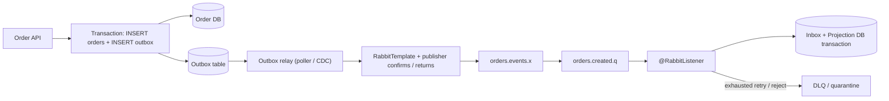
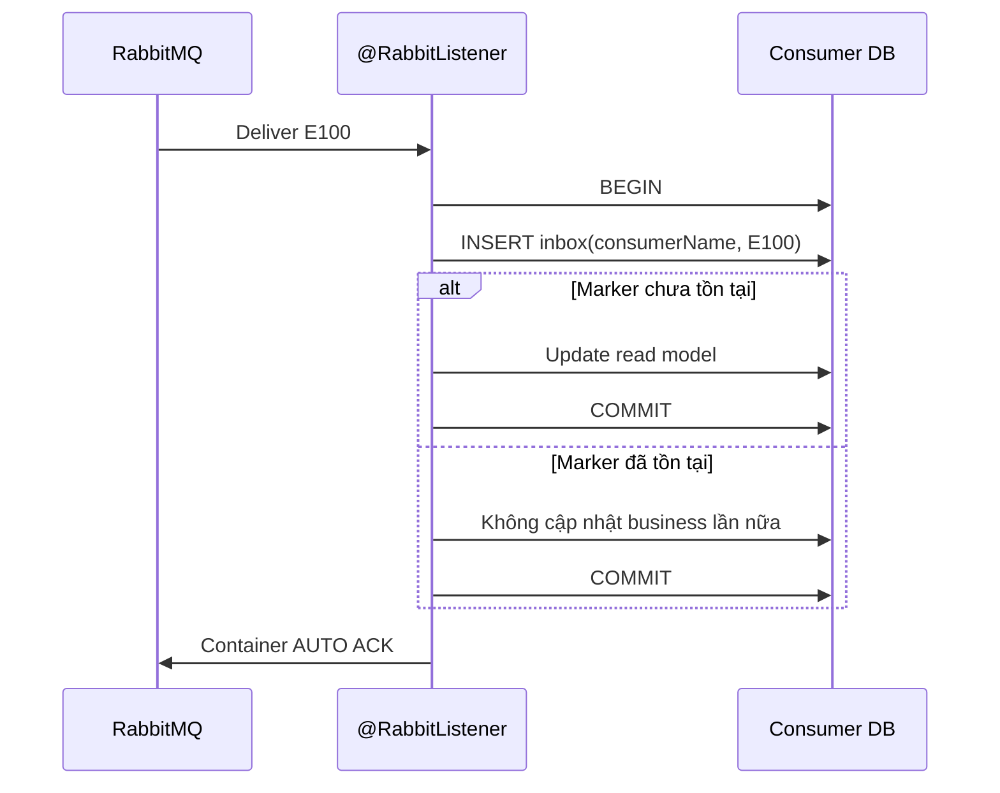
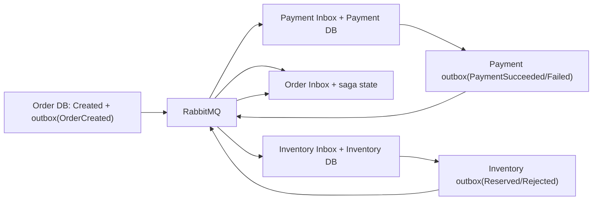

# Outbox/inbox trong kiến trúc giao dịch phân tán

> **Chương:** Mẫu tích hợp  
> **Module:** SPRING_AMQP — tích hợp RabbitMQ với Spring AMQP bằng `RabbitTemplate`, `@RabbitListener`, exchange, queue và binding; vận dụng xác nhận giao nhận, retry, dead-letter, giao dịch và quan sát hệ thống để triển khai xử lý bất đồng bộ đáng tin cậy.
>
> **Trọng tâm:** Transactional **outbox** ở phía phát sự kiện và transactional **inbox** ở phía nhận; phối hợp JDBC transaction, publisher confirms/returns, idempotent consumer, polling relay hoặc CDC để đối phó với lỗi mạng, retry, crash và hệ thống chạy nhiều replica. Ví dụ dùng **Spring Boot 3.x, Spring AMQP 3.x, Java 21, PostgreSQL, RabbitMQ AMQP 0-9-1**.

## 1. Mục tiêu học tập

Sau bài này, bạn có thể:

1. Giải thích vì sao việc vừa `COMMIT` database vừa publish RabbitMQ trực tiếp tạo ra **dual-write problem**.
2. Thiết kế schema **outbox** và **inbox**, định nghĩa event envelope, `eventId`, `aggregateId`, schema version và trạng thái xử lý.
3. Ghi business state và outbox row **trong cùng một local database transaction**; tránh phát sự kiện trước khi transaction commit.
4. Viết polling relay nhiều replica an toàn bằng `FOR UPDATE SKIP LOCKED`, lease/token, bounded retry và publisher confirm **ACK + không có return**.
5. Xây dựng `@RabbitListener` sử dụng inbox uniqueness + DB transaction để loại duplicate, rồi mới để container ACK.
6. Phân tích các cửa sổ lỗi: producer crash, relay crash sau confirm, confirm timeout, publisher return, consumer crash sau DB commit nhưng trước ACK.
7. So sánh polling relay với CDC/Debezium; biết khi nào nên thêm saga, outbox ở downstream và idempotency ở API ngoài DB.
8. Thiết kế retry, parking/quarantine, DLQ, metric/audit, retention, fault-injection tests và runbook triển khai.

## 2. Bài toán: DB và broker không nằm trong một transaction

Một dịch vụ đặt hàng thực hiện:

1. Ghi `orders.status = 'CREATED'` vào PostgreSQL.
2. Gửi `OrderCreated` tới RabbitMQ exchange `orders.events.x`.

Nếu viết như sau:

```java
// PHẢN VÍ DỤ: không có tính nguyên tử giữa database và RabbitMQ.
@Transactional
public void createOrder(CreateOrder command) {
    orderRepository.save(new Order(command.orderId(), "CREATED"));
    rabbitTemplate.convertAndSend(
        "orders.events.x", "order.created", command
    );
}
```

thì `@Transactional` chỉ quản lý **local DB transaction** nếu dùng transaction manager cho database. Lời gọi `RabbitTemplate.convertAndSend()` không tự nằm trong cùng giao dịch nguyên tử với PostgreSQL.

### 2.1. Những thứ có thể sai

| Thứ tự hoạt động | Cửa sổ lỗi | Kết quả có thể xảy ra |
|---|---|---|
| **DB commit rồi publish** | App crash sau DB commit, trước publish | Đơn đã tạo nhưng **không có sự kiện** |
| DB commit rồi publish | Broker unavailable; retry bị bỏ qua | Đơn đã tạo, downstream không biết |
| **Publish rồi DB commit** | DB rollback nhưng broker đã nhận event | Consumer xử lý **sự kiện về một đơn không tồn tại** |
| Publish rồi DB commit | Publisher confirm timeout | Không rõ broker đã nhận chưa; gửi lại có thể tạo duplicate |
| Dùng Spring transaction synchronization / best-efforts one-phase commit | Một resource commit thành công, resource còn lại thất bại | Không có atomic commit qua hai hệ thống |
| Consumer xử lý DB rồi ACK | Consumer crash sau DB commit trước ACK | Broker redeliver; side effect có thể lặp |

**Không giải quyết triệt để bằng `@Transactional`, `channelTransacted=true` hoặc publisher confirms đơn lẻ.** Publisher confirms xác nhận broker đã xử lý publish, không biến nó thành PostgreSQL commit và cũng không xác nhận consumer nghiệp vụ đã hoàn tất.

### 2.2. Mục tiêu thật sự của mô hình

Mục tiêu là:

- **Không mất ý định phát event** khi transaction nghiệp vụ đã commit.
- **Có thể retry publish** nếu broker unavailable hoặc outcome chưa rõ.
- **Chấp nhận message bị publish/giao nhiều lần**, nhưng bảo vệ side effect bằng inbox/idempotency.
- Có trạng thái bền vững để **đối soát, cảnh báo và phát lại** khi có sự cố.

Đây là thiết kế thiên về **at-least-once publication/delivery + effectively-once business effect trong phạm vi được kiểm soát**, không phải exactly-once delivery từ RabbitMQ tới mọi hệ thống.

## 3. Kiến trúc tổng thể



**Outbox:** Ứng dụng ghi một record sự kiện cùng business state **trong một database local transaction**. Relay độc lập phát các record đã commit sang RabbitMQ, theo dõi kết quả và cập nhật trạng thái.

**Inbox:** Consumer nhận message và trong **một transaction của database đích**, ghi dấu `(consumerName, eventId)` cùng với side effect. Nếu event đến lần hai, unique constraint ngăn tạo thêm effect.

**Hai database có thể khác nhau hoàn toàn.** Transaction outbox chỉ bao trùm DB của producer; transaction inbox chỉ bao trùm DB của consumer. Không có một transaction chung xuyên RabbitMQ, producer DB và consumer DB.

### 3.1. Ai giữ bằng chứng gì?

| Thành phần | Bằng chứng bền vững | Không thể bảo đảm một mình |
|---|---|---|
| Producer DB | Đơn đã commit, outbox row tồn tại | Broker đã nhận message |
| Relay/outbox state | Attempt, confirm, return, lần thử tiếp theo | Consumer đã xử lý nghiệp vụ |
| RabbitMQ | Exchange route/queue nhận publish; confirm và consumer delivery | Transaction ở DB của consumer đã commit |
| Consumer DB/inbox | EventId đã commit và side effect tương ứng | Producer sẽ không bao giờ publish lại |
| Observability/audit | Timeline giữa các lớp, retry và lag | Tạo ra tính nguyên tử hoặc idempotency nếu code sai |

## 4. Hợp đồng event: định danh, version và route

Ví dụ `OrderCreated`:

```json
{
  "eventId": "93ccde89-b24d-42b8-83ea-dd3647bd1ba0",
  "eventType": "OrderCreated",
  "eventVersion": 1,
  "aggregateType": "Order",
  "aggregateId": "b573b015-cd2f-4bac-877c-e368f784e945",
  "aggregateVersion": 7,
  "occurredAt": "2026-11-26T03:00:00Z",
  "payload": {
    "orderId": "b573b015-cd2f-4bac-877c-e368f784e945",
    "amount": "219.50",
    "currency": "USD"
  }
}
```

| Trường | Vai trò | Quy tắc |
|---|---|---|
| `eventId` | **Idempotency key** của một sự kiện logic | Sinh **một lần** trong transaction nguồn, không thay khi republish |
| `eventType`/`eventVersion` | Phân loại và giải mã schema | Có contract, compatibility policy và version khi thay đổi không tương thích |
| `aggregateId` | ID đối tượng nghiệp vụ | Dùng phân tích ordering/correlation, **không** thay thế eventId |
| `aggregateVersion` | Số phiên bản/sequence của aggregate | Hữu ích khi xử lý out-of-order và chống cập nhật lùi |
| `occurredAt` | Thời điểm sự kiện được tạo | Không đồng nhất với thời gian broker giao hoặc consumer xử lý |
| `payload` | Dữ liệu mà consumer được phép sử dụng | Không phát tán bí mật/PII không cần thiết |
| `correlationId`/`traceparent` | Nối luồng request và trace | Khác `eventId` và publisher confirm ID |

**Sự kiện được phát lại vẫn dùng cùng `eventId`.** Mỗi lần relay gửi nên tạo `publishAttemptId` mới để đo publisher confirm riêng, còn eventId bất biến để consumer nhận diện duplicate. Nếu một nghiệp vụ chủ ý phát sự kiện mới (`OrderChanged` mới), phải có eventId mới, dù aggregateId không đổi.

### 4.1. Đặt danh tính ở cả body và message properties

Trong RabbitMQ AMQP 0-9-1, có thể đặt:

- `MessageProperties.messageId = eventId`.
- Header `event-id`, `event-type`, `event-version`, `aggregate-id`.
- Content type `application/json`, delivery mode `PERSISTENT`.
- Exchange/routing key là **cấu hình được kiểm soát** (ví dụ `orders.events.x` + `order.created.v1`), không lấy tùy ý từ một request bên ngoài.

Consumer nên kiểm tra `event-id` trong header/property có khớp với body. **Không tin header bên ngoài chưa xác thực** để cấp quyền tenant hoặc chọn cách cập nhật DB của tenant khác.

## 5. PostgreSQL schema: outbox, inbox và business tables

Đây là schema minh họa cho **hai database logic**. Trong kiến trúc microservice, `orders` + `outbox_events` nằm cùng DB của Order Service; `consumer_inbox` + `order_projection` nằm cùng DB của Projection Service. Để học trên một PostgreSQL instance, có thể đặt các bảng trong schema khác nhau và dùng datasource tương ứng.

```sql
-- Order Service database
CREATE TABLE orders (
    id UUID PRIMARY KEY,
    status VARCHAR(32) NOT NULL,
    total_amount NUMERIC(19, 2) NOT NULL,
    created_at TIMESTAMPTZ NOT NULL DEFAULT now()
);

CREATE TABLE outbox_events (
    id UUID PRIMARY KEY,                        -- eventId
    aggregate_type VARCHAR(80) NOT NULL,
    aggregate_id UUID NOT NULL,
    aggregate_version BIGINT NOT NULL,
    event_type VARCHAR(100) NOT NULL,
    event_version INTEGER NOT NULL,
    exchange_name VARCHAR(120) NOT NULL,
    routing_key VARCHAR(120) NOT NULL,
    payload JSONB NOT NULL,
    status VARCHAR(16) NOT NULL DEFAULT 'PENDING',
    attempts INTEGER NOT NULL DEFAULT 0,
    claim_token UUID,
    lease_until TIMESTAMPTZ,
    next_attempt_at TIMESTAMPTZ NOT NULL DEFAULT now(),
    created_at TIMESTAMPTZ NOT NULL DEFAULT now(),
    updated_at TIMESTAMPTZ NOT NULL DEFAULT now(),
    published_at TIMESTAMPTZ,
    last_error VARCHAR(500),
    CONSTRAINT outbox_status_check CHECK (
        status IN ('PENDING', 'IN_FLIGHT', 'PUBLISHED', 'PARKED')
    )
);

CREATE INDEX outbox_pending_idx
    ON outbox_events(next_attempt_at, created_at, id)
    WHERE status = 'PENDING';

CREATE INDEX outbox_lease_idx
    ON outbox_events(lease_until)
    WHERE status = 'IN_FLIGHT';

-- Projection Service database (không đòi chung transaction với Order DB)
CREATE TABLE consumer_inbox (
    consumer_name VARCHAR(100) NOT NULL,
    event_id UUID NOT NULL,
    processed_at TIMESTAMPTZ NOT NULL DEFAULT now(),
    PRIMARY KEY (consumer_name, event_id)
);

CREATE TABLE order_projection (
    order_id UUID PRIMARY KEY,
    applied_events BIGINT NOT NULL DEFAULT 0,
    last_event_id UUID NOT NULL,
    updated_at TIMESTAMPTZ NOT NULL DEFAULT now()
);
```

### 5.1. Trạng thái outbox có ý nghĩa gì?

| Trạng thái | Ý nghĩa | Ai cập nhật? |
|---|---|---|
| `PENDING` | Event đã commit vào DB, có thể được relay claim khi tới `next_attempt_at` | Producer transaction hoặc relay retry |
| `IN_FLIGHT` | Một relay đã nhận quyền xử lý trong **lease có thời hạn** | Relay claim transaction |
| `PUBLISHED` | Relay ghi nhận broker confirm ACK **và không có mandatory return** | Relay sau publish outcome hợp lệ |
| `PARKED` | Hết retry budget hoặc lỗi cấu hình cần can thiệp | Relay/error policy hoặc người vận hành |

`PUBLISHED` **không đồng nghĩa consumer đã commit DB**. Nếu cần giám sát consumer fulfillment, phải theo dõi inbox/business metrics hoặc một business acknowledgment event khác.

`IN_FLIGHT` với lease hết hạn **có thể** được relay khác claim lại; vì thế ngay cả cơ chế claim an toàn cũng không loại trừ duplicate publish. Ngày giờ trong DB dùng `TIMESTAMPTZ`/`now()` để tránh lệch đồng hồ giữa pod, nhưng cần quản lý timezone và clock của broker/DB.

### 5.2. Độ bền và dọn dữ liệu

- Lưu payload JSONB nếu cần query/debug; có thể chọn TEXT/BYTEA hoặc payload pointer nếu payload lớn. Không tải khối dữ liệu nhạy cảm không cần thiết vào outbox.
- `PUBLISHED` rows cần retention đủ dài để audit/reconciliation, sau đó archive/delete theo chính sách; không xóa `PENDING/IN_FLIGHT/PARKED` chỉ vì đã quá vài ngày.
- Inbox marker cần tồn tại **ít nhất lâu bằng cửa sổ duplicate/replay thực tế**. Nếu xóa marker quá sớm rồi replay event cũ, side effect có thể bị thực hiện lại.
- Thay đổi schema/tên field/routing phải có migration và backward compatibility; đừng tái sử dụng eventId của hai business events khác nhau.

## 6. Producer: ghi thay đổi nghiệp vụ và outbox trong một DB transaction

Trong Spring Boot 3.x, dùng JDBC transaction manager của Order Service. Ví dụ class này được gọi qua Spring proxy từ HTTP controller/use case khác.

```java
import com.fasterxml.jackson.databind.ObjectMapper;
import java.math.BigDecimal;
import java.time.Instant;
import java.util.Map;
import java.util.UUID;
import org.springframework.jdbc.core.JdbcTemplate;
import org.springframework.stereotype.Service;
import org.springframework.transaction.annotation.Transactional;

@Service
public class OrderCommandService {
    private final JdbcTemplate jdbc;
    private final ObjectMapper objectMapper;

    public OrderCommandService(
        JdbcTemplate jdbc,
        ObjectMapper objectMapper
    ) {
        this.jdbc = jdbc;
        this.objectMapper = objectMapper;
    }

    @Transactional
    public UUID createOrder(UUID orderId, BigDecimal amount) {
        UUID eventId = UUID.randomUUID();
        jdbc.update(
            "INSERT INTO orders(id, status, total_amount) VALUES (?, ?, ?)",
            orderId, "CREATED", amount
        );

        String body;
        try {
            body = objectMapper.writeValueAsString(Map.of(
                "eventId", eventId.toString(),
                "eventType", "OrderCreated",
                "eventVersion", 1,
                "aggregateId", orderId.toString(),
                "aggregateVersion", 1,
                "occurredAt", Instant.now().toString(),
                "payload", Map.of(
                    "orderId", orderId.toString(),
                    "amount", amount.toPlainString()
                )
            ));
        } catch (Exception serializationError) {
            // Runtime exception => toàn bộ DB transaction rollback.
            throw new IllegalStateException(
                "Cannot serialize OrderCreated", serializationError
            );
        }

        jdbc.update(
            """
            INSERT INTO outbox_events (
                id, aggregate_type, aggregate_id, aggregate_version,
                event_type, event_version, exchange_name, routing_key, payload
            ) VALUES (?, ?, ?, ?, ?, ?, ?, ?, ?::jsonb)
            """,
            eventId, "Order", orderId, 1L,
            "OrderCreated", 1, "orders.events.x",
            "order.created.v1", body
        );
        return eventId;
    }
}
```

Trong **cùng local transaction**, nếu `orders` insert hoặc `outbox_events` insert lỗi, **cả hai đều rollback**. Nếu commit thành công, dù JVM chết trước khi kết nối RabbitMQ, outbox row còn đó để relay gửi sau.

**Điều cố ý không có trong phương thức:** lời gọi `rabbitTemplate.send()`. Để gửi sau commit, relay sẽ đọc row ở DB. Không dùng `TransactionSynchronization.afterCommit()` làm **nguồn bảo đảm duy nhất**: nếu process crash ngay sau DB commit nhưng trước callback, event vẫn có nguy cơ không bao giờ được phát nếu không có outbox row bền vững.

### 6.1. Idempotency của HTTP/API command cũng cần bảo vệ

Nếu HTTP client retry `createOrder` do timeout, ứng dụng có thể cố tạo đơn/sự kiện thứ hai. `orders.id` là primary key giúp chặn trùng cùng `orderId`, nhưng muốn trả lại kết quả của request cũ có thể cần `clientRequestId`/idempotency key riêng.

Phân biệt:

1. **Command idempotency:** cùng một yêu cầu tạo đơn không tạo hai đơn.
2. **Outbox event identity:** một business event đã commit giữ `eventId` qua nhiều publish attempts.
3. **Consumer inbox identity:** cùng `eventId` không được áp cùng side effect hai lần cho một logical consumer.

Không tái tạo eventId trong relay; nếu relay sinh UUID mới mỗi lần gửi, inbox sẽ **không** chặn được bản phát lại.

## 7. Relay polling: nhận quyền xử lý an toàn khi nhiều replica

Polling relay đọc outbox row đã commit và publish sang RabbitMQ. Ví dụ thực hành dùng **PostgreSQL `FOR UPDATE SKIP LOCKED`** để nhiều replica cùng làm mà không cùng claim một row tại một thời điểm, kết hợp lease và fencing token để ngăn worker cũ sửa trạng thái worker mới.

### 7.1. Vì sao phải có claim/lease?

Không nên làm:

```text
SELECT * FROM outbox_events WHERE status = 'PENDING';
// Cả pod A và B cùng đọc dòng E1, cùng publish E1.
// Sau đó cả hai cùng UPDATE status = 'PUBLISHED'.
```

Thay vào đó:

- Chọn một row bằng lock trong **transaction ngắn**.
- Đổi `PENDING → IN_FLIGHT`, ghi một `claim_token` và `lease_until`.
- **Commit claim transaction trước khi gọi RabbitMQ**. Không giữ database row lock trong lúc chờ publisher confirm.
- Gửi với eventId **không đổi**; nhận confirm/return.
- Cập nhật thành `PUBLISHED` nếu row vẫn có **đúng claim_token của worker hiện tại**.
- Nếu worker chết, lease hết hạn giúp worker khác claim lại row.

### 7.2. Claim một row bằng SQL transaction

```java
import java.util.List;
import java.util.Optional;
import java.util.UUID;
import org.springframework.jdbc.core.JdbcTemplate;
import org.springframework.stereotype.Repository;
import org.springframework.transaction.annotation.Transactional;

record ClaimedOutbox(
    UUID eventId,
    UUID claimToken,
    String exchange,
    String routingKey,
    String eventType,
    String payloadJson,
    int attempts
) {}

@Repository
public class OutboxStore {
    private final JdbcTemplate jdbc;

    public OutboxStore(JdbcTemplate jdbc) {
        this.jdbc = jdbc;
    }

    @Transactional
    public Optional<ClaimedOutbox> claimOne() {
        UUID claimToken = UUID.randomUUID();
        List<ClaimedOutbox> rows = jdbc.query(
            """
            WITH chosen AS (
                SELECT id FROM outbox_events
                WHERE
                    (status = 'PENDING' AND next_attempt_at <= now())
                    OR
                    (status = 'IN_FLIGHT' AND lease_until < now())
                ORDER BY created_at, id
                FOR UPDATE SKIP LOCKED
                LIMIT 1
            )
            UPDATE outbox_events AS o
               SET status = 'IN_FLIGHT',
                   claim_token = ?::uuid,
                   lease_until = now() + INTERVAL '60 seconds',
                   attempts = attempts + 1,
                   updated_at = now()
              FROM chosen
             WHERE o.id = chosen.id
            RETURNING o.id, o.claim_token, o.exchange_name,
                      o.routing_key, o.event_type,
                      o.payload::text AS body, o.attempts
            """,
            (rs, rowNum) -> new ClaimedOutbox(
                rs.getObject("id", UUID.class),
                rs.getObject("claim_token", UUID.class),
                rs.getString("exchange_name"),
                rs.getString("routing_key"),
                rs.getString("event_type"),
                rs.getString("body"),
                rs.getInt("attempts")
            ),
            claimToken
        );
        return rows.stream().findFirst();
    }

    public int markPublished(ClaimedOutbox row) {
        return jdbc.update(
            """
            UPDATE outbox_events
               SET status = 'PUBLISHED',
                   published_at = now(),
                   lease_until = NULL,
                   claim_token = NULL,
                   last_error = NULL,
                   updated_at = now()
             WHERE id = ? AND claim_token = ?
               AND status = 'IN_FLIGHT'
            """,
            row.eventId(), row.claimToken()
        );
    }

    public int retryOrPark(
        ClaimedOutbox row, int nextDelaySeconds, String reason
    ) {
        return jdbc.update(
            """
            UPDATE outbox_events
               SET status = CASE WHEN attempts >= 12
                                 THEN 'PARKED' ELSE 'PENDING' END,
                   next_attempt_at = now()
                       + (CAST(? AS INTEGER) * INTERVAL '1 second'),
                   lease_until = NULL,
                   claim_token = NULL,
                   last_error = LEFT(?, 500),
                   updated_at = now()
             WHERE id = ? AND claim_token = ?
               AND status = 'IN_FLIGHT'
            """,
            nextDelaySeconds, reason, row.eventId(), row.claimToken()
        );
    }
}
```

**Đọc đoạn code đúng phạm vi:** Một relay có thể sở hữu nhiều event lần lượt, nhưng ví dụ `claimOne` giúp tránh giữ quá nhiều lease khi chưa publish. Trong production, cân nhắc batch claim, async confirms, bounded in-flight và lease renewal. Với lease 60 giây, thời gian chờ confirm trong ví dụ phía dưới tối đa 10 giây, nhưng broker/network bị treo hoặc process pause vẫn có thể làm lease hết hạn; điều này **chấp nhận duplicate publish** và yêu cầu inbox idempotency.

**Fencing token:** Nếu worker A claim rồi bị treo, lease hết hạn, worker B claim cùng row với token mới. Khi A thức dậy, `markPublished`/`retryOrPark` của A sẽ cập nhật **0 row** nhờ `WHERE claim_token = ?`; worker A không được ghi đè trạng thái do B đang quản lý. Tuy nhiên A **vẫn có thể đã publish** trước đó. Fencing bảo vệ **database state**, không tạo exactly-once RabbitMQ publish.

### 7.3. Cấu hình publisher confirms và mandatory returns

```yaml
spring:
  rabbitmq:
    host: localhost
    port: 5672
    username: order_service
    password: "${RABBITMQ_PASSWORD}"
    publisher-confirm-type: correlated
    publisher-returns: true
    template:
      mandatory: true
    listener:
      simple:
        prefetch: 10
        default-requeue-rejected: false
```

Để xác định publish **được broker nhận và có route**, cần kiểm tra **cả**:

1. `CorrelationData.getFuture()` hoàn tất với confirm **ACK**.
2. `CorrelationData.getReturned() == null` khi `mandatory=true` và returns được bật.

**Rất quan trọng:** Broker có thể gửi `basic.return(NO_ROUTE)` **trước** publisher confirm ACK cho message không route được. Chỉ kiểm tra `confirm.isAck()` rồi cập nhật `PUBLISHED` sẽ **âm thầm mất sự kiện ở downstream**.

Một publisher confirm không phải consumer ACK; nó cũng không cung cấp transaction chung giữa PostgreSQL và RabbitMQ.

### 7.4. Relay phát message và cập nhật trạng thái

```java
import java.nio.charset.StandardCharsets;
import java.util.UUID;
import java.util.concurrent.TimeUnit;
import org.slf4j.Logger;
import org.slf4j.LoggerFactory;
import org.springframework.amqp.core.Message;
import org.springframework.amqp.core.MessageDeliveryMode;
import org.springframework.amqp.core.MessageProperties;
import org.springframework.amqp.rabbit.connection.CorrelationData;
import org.springframework.amqp.rabbit.core.RabbitTemplate;
import org.springframework.scheduling.annotation.Scheduled;
import org.springframework.stereotype.Component;

@Component
public class OutboxRelay {
    private static final Logger log =
        LoggerFactory.getLogger(OutboxRelay.class);
    private final OutboxStore store;
    private final RabbitTemplate rabbit;

    public OutboxRelay(OutboxStore store, RabbitTemplate rabbit) {
        this.store = store;
        this.rabbit = rabbit;
    }

    @Scheduled(fixedDelayString = "${outbox.relay.delay-ms:1000}")
    public void runOnce() {
        store.claimOne().ifPresent(this::publishClaimed);
    }

    private void publishClaimed(ClaimedOutbox row) {
        MessageProperties props = new MessageProperties();
        props.setContentType(MessageProperties.CONTENT_TYPE_JSON);
        props.setDeliveryMode(MessageDeliveryMode.PERSISTENT);
        props.setMessageId(row.eventId().toString());
        props.setHeader("event-id", row.eventId().toString());
        props.setHeader("event-type", row.eventType());

        Message message = new Message(
            row.payloadJson().getBytes(StandardCharsets.UTF_8),
            props
        );
        // Mỗi attempt có correlation ID riêng; eventId không đổi.
        CorrelationData correlation =
            new CorrelationData(UUID.randomUUID().toString());

        try {
            rabbit.send(
                row.exchange(), row.routingKey(), message, correlation
            );
            CorrelationData.Confirm confirm =
                correlation.getFuture().get(10, TimeUnit.SECONDS);

            if (!confirm.isAck()) {
                fail(row, "publisher-nack");
            } else if (correlation.getReturned() != null) {
                fail(row, "unroutable-" +
                    correlation.getReturned().getReplyCode());
            } else {
                int changed = store.markPublished(row);
                if (changed != 1) {
                    // Lease/token không còn hợp lệ, worker khác đã claim.
                    log.warn("stale outbox claim eventId={}", row.eventId());
                }
            }
        } catch (InterruptedException interrupted) {
            Thread.currentThread().interrupt();
            fail(row, "relay-interrupted");
        } catch (Exception uncertain) {
            // Bao gồm timeout/mất kết nối: broker CÓ THỂ đã nhận.
            fail(row, "publish-outcome-unknown");
            log.warn(
                "Outbox publish outcome unknown eventId={}",
                row.eventId(), uncertain
            );
        }
    }

    private void fail(ClaimedOutbox row, String reason) {
        int seconds = Math.min(300, 1 << Math.min(row.attempts(), 8));
        store.retryOrPark(row, seconds, reason);
    }
}
```

Trong Spring Boot application, bật scheduling:

```java
import org.springframework.boot.autoconfigure.SpringBootApplication;
import org.springframework.scheduling.annotation.EnableScheduling;

@SpringBootApplication
@EnableScheduling
public class OrderServiceApplication {
}
```

**Đây là relay dạy học**, chủ đích xử lý **một row mỗi lần scheduled tick**, không nhằm tối ưu throughput. Bản production thường dùng bounded batch, async confirm, thread pool, metrics pending count/age, và cảnh báo row `PARKED`. Các thao tác update trạng thái có thể gặp lỗi DB; khi đó lease sẽ hết hạn và message có thể được gửi lại — inbox phải chịu được.

**Không block quá lâu trong một DB transaction:** `claimOne()` hoàn tất transaction trước khi `rabbit.send()`. Không bao `publishClaimed` bằng `@Transactional` của datasource; giữ row lock trong lúc chờ network làm giảm throughput, tăng lock contention và không tạo atomic commit giữa DB với broker.

### 7.5. Tại sao `PUBLISHED` không bảo đảm không còn duplicate?

```mermaid
sequenceDiagram
    participant DB as Order DB / outbox
    participant R as Outbox Relay
    participant MQ as RabbitMQ
    DB-->>R: Claim E100 (IN_FLIGHT)
    R->>MQ: Publish E100
    MQ-->>R: Publisher confirm ACK
    Note over R,DB: Relay crash trước UPDATE PUBLISHED
    R--xDB: Không ghi nhận trạng thái
    DB-->>R: Lease expired; relay mới claim E100
    R->>MQ: Publish E100 lần nữa, cùng eventId
    MQ-->>R: Publisher confirm ACK
    R->>DB: UPDATE PUBLISHED
    Note over MQ: Có thể có 2 physical messages chứa E100
```

**Đây không phải bug riêng của poller:** Bất kỳ thiết kế nào không có atomic transaction chung giữa broker và DB đều phải giải quyết trạng thái confirm/commit không chắc chắn. Outbox ưu tiên **không bỏ sót event đã commit**, đồng thời cho phép duplicate và yêu cầu inbox.

### 7.6. Khi nào nên PARK thay vì thử mãi?

Phân loại:

- **Transient:** timeout/network reset, broker tạm unavailable, resource alarm — retry với exponential backoff + jitter và tổng retry budget.
- **Configuration/permanent:** exchange không tồn tại, `NO_ROUTE` do binding sai, quyền `ACCESS_REFUSED`, schema không hỗ trợ — báo động và **PARK/đưa vào quy trình sửa cấu hình**, không retry mỗi giây.
- **Ambiguous outcome:** timeout trước confirm — đánh dấu UNKNOWN, retry có thể tạo duplicate; cần giữ eventId và audit attempts.

Trong ví dụ, `fail` sẽ PARK sau 12 attempts bất kể loại lỗi; production nên có exception classifier để PARK sớm lỗi vĩnh viễn, giữ lại nguyên nhân/kết quả return và cơ chế re-drive sau khi sửa.

## 8. Inbox: chống xử lý trùng ở transaction của consumer

Khi RabbitMQ giao event tới `@RabbitListener`:

1. Deserialize và validate event envelope.
2. Trong **một DB transaction**, ghi inbox marker bằng khóa `(consumer_name, event_id)`.
3. Nếu marker đã có: **không chạy side effect lần nữa**; trả về thành công để ACK bản duplicate.
4. Nếu marker mới: cập nhật read model/business state và commit.
5. Sau khi transaction commit thành công và method trả về, listener container (ở `AcknowledgeMode.AUTO`) có thể ACK delivery.



### 8.1. Consumer phải có khóa idempotency đúng

`PRIMARY KEY (consumer_name, event_id)` quan trọng vì:

- Một event có thể cần được xử lý **một lần cho mỗi logical consumer** (ví dụ `inventory-projection` và `audit-projection` độc lập).
- Mỗi consumer có inbox marker riêng, nhưng một consumer không xử lý lại event của chính nó.
- Nếu nhiều replicas của cùng logical consumer chia work queue, cùng DB unique constraint giúp chống race giữa replicas.

**Không dùng `deliveryTag` làm idempotency key:** tag chỉ có ý nghĩa trên channel hiện tại và thay đổi khi reconnect/redelivery. `MessageProperties.messageId` chỉ đáng tin khi producer đã có contract giữ eventId ổn định.

### 8.2. Service inbox và side effect trong một transaction

```java
import java.util.UUID;
import org.springframework.jdbc.core.JdbcTemplate;
import org.springframework.stereotype.Service;
import org.springframework.transaction.annotation.Transactional;

@Service
public class OrderProjectionService {
    private final JdbcTemplate jdbc;

    public OrderProjectionService(JdbcTemplate jdbc) {
        this.jdbc = jdbc;
    }

    @Transactional
    public void applyOnce(UUID eventId, UUID orderId) {
        int inserted = jdbc.update(
            """
            INSERT INTO consumer_inbox(consumer_name, event_id)
            VALUES (?, ?)
            ON CONFLICT DO NOTHING
            """,
            "order-projection-v1", eventId
        );
        if (inserted == 0) {
            return; // duplicate đã commit trước đó
        }

        jdbc.update(
            """
            INSERT INTO order_projection (
                order_id, applied_events, last_event_id
            ) VALUES (?, 1, ?)
            ON CONFLICT (order_id) DO UPDATE
               SET applied_events =
                   order_projection.applied_events + 1,
                   last_event_id = EXCLUDED.last_event_id,
                   updated_at = now()
            """,
            orderId, eventId
        );
    }
}
```

**Nguyên tắc cốt lõi:** Inbox marker và `order_projection` phải nằm trong **cùng local transaction của cùng database**. Nếu update projection ném exception, insert inbox **rollback theo**, để broker redelivery có thể xử lý lại; không để marker đã commit trong khi business effect bị mất.

Đoạn code trên minh họa **một eventId làm tăng một effect**. Trong domain thực tế, cần xử lý `aggregateVersion` và business invariants, ví dụ không cho `OrderPaid(version=9)` bị ghi đè bởi `OrderCreated(version=7)` đến muộn. Inbox **ngăn duplicate**, không tự bảo đảm **ordering** hoặc consistency giữa các event khác nhau.

### 8.3. Listener decode rồi gọi transactional service

```java
import com.fasterxml.jackson.databind.JsonNode;
import com.fasterxml.jackson.databind.ObjectMapper;
import java.io.IOException;
import java.util.UUID;
import org.springframework.amqp.core.Message;
import org.springframework.amqp.rabbit.annotation.RabbitListener;
import org.springframework.amqp.rabbit.support.AmqpRejectAndDontRequeueException;
import org.springframework.stereotype.Component;

@Component
public class OrderCreatedListener {
    private final ObjectMapper mapper;
    private final OrderProjectionService projection;

    public OrderCreatedListener(
        ObjectMapper mapper,
        OrderProjectionService projection
    ) {
        this.mapper = mapper;
        this.projection = projection;
    }

    @RabbitListener(
        id = "order-projection-v1",
        queues = "orders.created.q",
        containerFactory = "orderListenerFactory"
    )
    public void onMessage(Message raw) {
        try {
            JsonNode event = mapper.readTree(raw.getBody());
            UUID eventId = UUID.fromString(
                event.path("eventId").asText()
            );
            UUID orderId = UUID.fromString(
                event.path("aggregateId").asText()
            );
            if (!eventId.toString().equals(
                raw.getMessageProperties().getMessageId()
            )) {
                throw new IllegalArgumentException("eventId mismatch");
            }
            if (!"OrderCreated".equals(
                event.path("eventType").asText()
            )) {
                throw new IllegalArgumentException("Unexpected eventType");
            }
            if (event.path("eventVersion").asInt(-1) != 1) {
                throw new IllegalArgumentException("Unsupported schema");
            }

            // Local DB transaction commit trước khi method return.
            projection.applyOnce(eventId, orderId);
        } catch (IllegalArgumentException | IOException bad) {
            throw new AmqpRejectAndDontRequeueException(
                "Invalid OrderCreated event", bad
            );
        }
    }
}
```

Với `AcknowledgeMode.AUTO`, listener container ACK khi method hoàn tất thành công; nếu `applyOnce` lỗi DB, exception thoát ra để retry/error handling quyết định requeue/reject. Mẫu trên chủ đích **không** gọi `Channel.basicAck()` thủ công, tránh ACK trước DB commit hoặc ACK hai lần.

**Kiểm tra transaction boundary:** `OrderProjectionService` là bean độc lập có `@Transactional` nên Spring proxy áp dụng transaction. Nếu chỉ có annotation trên phương thức được tự gọi trong cùng bean, `self-invocation` có thể bỏ qua proxy. Với workload bất đồng bộ (CompletableFuture/Kotlin suspend), ack lifecycle có quy tắc riêng; không áp dụng ví dụ sync mà không kiểm thử.

### 8.4. Retry/DLX/DLQ cho consumer

Ví dụ factory xử lý lỗi tạm thời **tối đa ba lần callback** rồi reject không requeue để broker có thể dead-letter:

```java
import org.springframework.amqp.rabbit.config.RetryInterceptorBuilder;
import org.springframework.amqp.rabbit.config.SimpleRabbitListenerContainerFactory;
import org.springframework.amqp.rabbit.connection.ConnectionFactory;
import org.springframework.amqp.rabbit.support.AmqpRejectAndDontRequeueException;
import org.springframework.context.annotation.Bean;
import org.springframework.context.annotation.Configuration;

@Configuration
class OrderListenerConfig {
    @Bean("orderListenerFactory")
    SimpleRabbitListenerContainerFactory orderListenerFactory(
        ConnectionFactory connectionFactory
    ) {
        var factory = new SimpleRabbitListenerContainerFactory();
        factory.setConnectionFactory(connectionFactory);
        factory.setConcurrentConsumers(2);
        factory.setPrefetchCount(10);
        factory.setDefaultRequeueRejected(false);
        factory.setAdviceChain(
            RetryInterceptorBuilder.stateless()
                .maxRetries(2)
                .backOffOptions(200, 2.0, 2_000)
                .recoverer((message, cause) -> {
                    throw new AmqpRejectAndDontRequeueException(
                        "Listener retry exhausted", cause
                    );
                })
                .build()
        );
        return factory;
    }
}
```

`maxRetries(2)` biểu thị hai lần retry sau lần gọi đầu. Trong production, **phân loại lỗi rõ**: schema không hợp lệ có thể reject/quarantine ngay, còn DB timeout có thể retry. Nếu không có DLX/binding, reject không requeue sẽ không tự tạo một nơi lưu giữ message lỗi. Tạo/kiểm thử topology theo vhost và queue type.

Không coi `x-death.count` trong DLQ là tổng lần Spring Retry trong method: retry interceptor có thể chạy nhiều lần **trên một broker delivery**. `defaultRequeueRejected=false` cũng không ngăn RabbitMQ redeliver **unacked** messages khi connection đột ngột mất.

## 9. Failure matrix: những cửa sổ phải kiểm thử

| Điểm lỗi | Outbox/Inbox còn gì? | Khả năng phát/giao trùng | Cơ chế phục hồi |
|---|---|---|---|
| DB transaction nguồn rollback | Không có order/outbox row mới | Không có event đã commit cần gửi | Caller retry command với idempotency key |
| Commit nguồn thành công, producer crash trước relay | Outbox `PENDING` tồn tại | Chưa gửi; relay sẽ gửi sau | Polling/CDC đọc row đã commit |
| Relay claim xong nhưng crash trước publish | `IN_FLIGHT` và lease | Có thể chưa gửi; sau lease retry | Lease expiry + reclaim |
| Relay publish xong, **confirm ACK**, crash trước `markPublished` | Outbox chưa `PUBLISHED` | **Có:** relay sau có thể publish lại | Same eventId + consumer inbox |
| Publish bắt buộc nhưng `basic.return` | Event chưa route vào queue mong đợi | Retry sau sửa route | Không mark `PUBLISHED` chỉ dựa ACK |
| Publish confirm timeout/connection mất | Outcome **UNKNOWN** | **Có:** broker có thể đã nhận | Retry/đối soát, inbox dedupe |
| Mark `PUBLISHED` thành công, consumer chưa xử lý | Outbox `PUBLISHED`; inbox chưa có | Consumer có thể chưa được giao | Queue durable + consumer/lag monitoring |
| Consumer DB rollback | Inbox marker cũng rollback | Broker có thể giao lại | Bounded retry, DLQ khi cần |
| Consumer DB commit xong, crash **trước ACK** | Inbox + business effect đã commit | **Có:** broker redeliver | Duplicate thấy inbox marker, ACK an toàn |
| Consumer ACK xong nhưng producer republish cùng event | Inbox marker tồn tại | **Có:** hai physical messages | Inbox ngăn side effect trùng |
| Inbox marker bị xóa quá sớm, event cũ replay | Không còn bằng chứng | Side effect **có thể lặp** | Retention phù hợp, business uniqueness |
| DLX/binding lỗi hoặc DLQ unavailable | Message lỗi có thể không tới DLQ | Tùy queue/broker settings | Test end-to-end DLX, cảnh báo |

### 9.1. Vì sao chỉ có outbox là chưa đủ?

Outbox giúp event đã commit **không bị bỏ quên khi broker tạm unavailable**. Nhưng relay không thể atomically commit “publish đã được broker nhận” và “đánh dấu outbox đã xong”. Sự cố ở giữa hai bước tạo duplicate. Không có inbox (hoặc một cơ chế downstream idempotency khác), một `OrderCreated` lặp có thể làm projection cộng 2, cấp hàng hai lần, trừ tiền hai lần.

### 9.2. Vì sao chỉ có inbox là chưa đủ?

Inbox ngăn xử lý trùng **khi event đã đến**. Nếu producer commit DB nhưng crash trước khi publish và **không có outbox**, consumer sẽ không bao giờ thấy event; inbox không thể phát hiện hay tự khôi phục một sự kiện chưa từng có trên broker.

### 9.3. Không đồng bộ “điểm hoàn thành”

`Outbox PUBLISHED` chỉ là mốc **broker accepted** theo chính sách confirm/routing. `Inbox processed` chỉ là mốc **DB đích committed**. Nếu quy trình nghiệp vụ cần phản hồi “đơn đã thanh toán hoàn toàn”, nên dùng **business state machine/saga** và event phản hồi (`PaymentSucceeded`/`PaymentFailed`), chứ không coi outbox `PUBLISHED` là câu trả lời.

## 10. Polling relay hay CDC (Change Data Capture)?

| Tiêu chí | Polling relay | CDC từ transaction log |
|---|---|---|
| Nguồn | Query outbox table theo trạng thái/thời gian | Database change stream/WAL/binlog |
| Độ phức tạp ban đầu | Đơn giản hơn, có thể viết trong Spring app | Cần connector, offset/checkpoint, schema và hạ tầng bổ sung |
| Thời gian trễ | Phụ thuộc polling interval, batch và tải DB | Thường gần thời gian thực, nhưng phụ thuộc log/connector/transport |
| Tải DB | Lặp SELECT/UPDATE, index, row lock | Tải log/WAL và connector, vẫn cần giám sát DB |
| Scale | `SKIP LOCKED`/lease và bounded pool | Scale connector theo khả năng DB/source/destination |
| Điểm lỗi | Crash giữa confirm và mark PUBLISHED | Crash/replay giữa đọc log và publish destination; vẫn có duplicate |
| Quản trị | `PENDING/PARKED`, retry budget do app kiểm soát | Connector health, log retention, offset và dead-letter policy của connector |
| RabbitMQ integration | Relay trực tiếp `RabbitTemplate` | **Cần tích hợp CDC → RabbitMQ phù hợp**; không mặc định Debezium outbox SMT tự publish RabbitMQ |

### 10.1. Debezium Outbox Event Router là gì?

Debezium hỗ trợ **Outbox Event Router SMT** để biến thay đổi trên bảng outbox thành event cho hệ thống đích, thường trên pipeline **Kafka Connect → Kafka topic**. Schema mẫu mặc định của Debezium có `id`, `aggregatetype`, `aggregateid`, `type`, `payload`. `id` có thể đặt trong header và `aggregateid` dùng làm key để giữ thứ tự theo partition Kafka.

**Quan trọng với SPRING_AMQP:** Kafka connector + outbox SMT **không mặc định đẩy trực tiếp vào RabbitMQ**. Nếu hệ thống đích là RabbitMQ, phải chọn một connector/bridge được hỗ trợ hoặc tự viết relay RabbitTemplate có confirm/return; kiến trúc `PostgreSQL → Debezium → Kafka → RabbitMQ bridge` thêm một hop và thêm failure semantics. Không quảng bá nó như khả năng có sẵn trong `spring-rabbit`.

### 10.2. CDC không loại bỏ inbox

Dù CDC đọc log database thay vì polling, connector có thể phát lại event khi restart hoặc resume từ offset cũ. Vì vậy consumer vẫn phải dựa trên `eventId` và uniqueness. **Outbox/CDC không tự tạo exactly-once business effects ở PostgreSQL, HTTP, email, thanh toán hoặc các hệ thống đích khác**.

### 10.3. Ordering cần thiết kế độc lập

Một row outbox có `created_at` trước không đồng nghĩa transaction đó commit trước, và một poller dùng nhiều workers/`SKIP LOCKED` không đảm bảo các sự kiện cùng aggregate được publish/confirm theo thứ tự. RabbitMQ queue cũng có thể đổi thứ tự xử lý do consumer concurrency, retry/requeue, priority và nhiều publishers.

Nếu `OrderCreated(version=1)` phải được xử lý trước `OrderPaid(version=2)`, cân nhắc:

- Serialize processing theo `aggregateId`, hoặc dùng partition/ordering lane phù hợp.
- Gắn `aggregateVersion` tăng đơn điệu trong DB transaction và kiểm tra expected version tại consumer.
- Khi version tiếp theo đến sớm, **không ghi inbox marker hoàn thành** trước khi đủ điều kiện áp dụng; retry/quarantine/gap handling rõ ràng.
- Benchmark throughput và độ trễ; đừng khẳng định global order giữa mọi event khi có nhiều partitions/queues.

## 11. Outbox/inbox khác BE1PC, XA/2PC và saga

| Cách tiếp cận | Điều nó giải quyết | Chi phí và giới hạn |
|---|---|---|
| **DB transaction + direct RabbitTemplate** | Dễ viết | Dual-write window, không khôi phục được event bị bỏ qua |
| **Spring transaction synchronization / BE1PC** | Phối hợp best-effort giữa DB và RabbitMQ transaction | Không phải atomic XA; một resource có thể commit trước resource khác |
| **XA / two-phase commit** | Mục tiêu atomic commit qua nhiều resources hỗ trợ XA | Phức tạp và ảnh hưởng availability/performance; RabbitMQ AMQP 0-9-1 không được biến thành XA resource chỉ bằng `channelTransacted` |
| **Transactional outbox** | Atomic business change + ý định phát event **trong một DB** | Relay có thể phát trùng, cần monitoring/cleanup |
| **Transactional inbox** | Atomic dedupe marker + business effect **trong DB đích** | Chỉ bảo vệ side effects nằm trong transaction/có idempotency tương ứng |
| **Saga / workflow state machine** | Điều phối nhiều local transactions và compensation | Phải thiết kế business states, timeout và xử lý lỗi; thường **dùng cùng** outbox/inbox |

**Không đặt bài toán sai cấp độ:** Outbox/inbox là **reliability patterns**, không phải distributed transaction atomicity giữa tất cả service. Trong workflow đặt hàng → thanh toán → tồn kho, mỗi service commit local transaction + outbox, dùng inbox cho event nhận được, và saga cập nhật trạng thái/thực hiện compensation khi một bước thất bại.

### 11.1. Một kịch bản saga áp dụng outbox/inbox



Luồng này có thể là choreography hoặc orchestration theo quyết định của hệ thống. Khi payment failed, Order Service có thể chuyển order sang `CANCELLED` và phát `OrderCancelled` qua outbox. Nếu một bước đã commit thì phải có compensation/idempotency; rollback một transaction ở service A **không rollback được** transaction đã commit ở service B.

## 12. Tác dụng phụ ngoài DB và giới hạn inbox

Giả sử handler:

```java
// PHẢN VÍ DỤ:
@Transactional
public void handle(EmailRequested event) {
    insertInbox(event.id());
    emailClient.send(event.recipient(), event.content()); // External API
}
```

Vấn đề: email có thể đã được nhà cung cấp gửi xong, nhưng DB transaction rollback hoặc process crash. Khi RabbitMQ redeliver, inbox marker chưa commit nên email có thể được gửi lại. Ở hướng ngược lại, nếu commit marker trước rồi API email fail mà exception bị nuốt, message không được xử lý tiếp.

**Giải pháp phổ biến:**

1. Trong **cùng transaction DB**, ghi inbox marker + business state + một **outgoing outbox row** cho side effect cần làm.
2. Worker riêng gửi email/HTTP với **idempotency key được hệ thống đích hỗ trợ**; đánh dấu trạng thái sau khi nhận outcome phù hợp.
3. Nếu bên đích không hỗ trợ idempotency, thiết kế reconciliation, duplicate-tolerant workflow hoặc compensation; không hứa exactly-once.
4. Với thanh toán, không dùng `eventId` ngẫu nhiên mới mỗi retry làm idempotency key khi gọi payment provider.

### 12.1. Bảng phạm vi bảo đảm

| Hiệu ứng | Inbox unique + cùng DB transaction đủ chưa? |
|---|---|
| Ghi một projection row trong cùng PostgreSQL | **Có thể**, nếu cập nhật/marker đồng transaction và uniqueness đúng |
| Publish event tiếp sang RabbitMQ từ listener | **Chưa**; cần outbox mới hoặc đảm bảo tương đương |
| Gửi email qua API | **Chưa**; cần outbox + idempotent downstream/reconciliation |
| Gọi REST sang service khác | **Chưa**; phụ thuộc idempotency và transaction của service đó |
| Update database khác | **Chưa**; local transaction không bao trùm database khác |
| Đưa message vào DLQ do lỗi | Không tự động; cần listener error policy và broker DLX route hợp lệ |

## 13. Retry, backoff, DLQ và replay: tách hai hướng

**Producer/relay** và **consumer** có hai failure pipelines khác nhau.

### 13.1. Relay retry không phải consumer retry

| Pipeline | Dấu hiệu thất bại | Nơi giữ bằng chứng | Xử lý |
|---|---|---|---|
| Outbox relay | Publish NACK, mandatory return, confirm timeout, broker unavailable | `outbox_events` `PENDING/PARKED`, attempts, last_error | Backoff + retry/repair route + alert |
| Consumer listener | Deserialize error, DB unavailable, invariant failed | Delivery/queue, retry/DLQ/quarantine/inbox | Retry hữu hạn, reject/DLX hoặc chờ sửa |
| DLQ replay | Poison event đã cách ly | DLQ, audit record, `x-death` | Sửa nguyên nhân, republish có rate limit + eventId bất biến |

**Không đánh dấu `PUBLISHED` vì `rabbit.send()` trả về bình thường** nếu cần confirmed delivery. **Không đánh dấu inbox “processed” chỉ vì listener đã nhận message**, mà phải commit business effect cùng marker.

### 13.2. Khả năng dead-letter không tuyệt đối

RabbitMQ DLX có thể không chuyển được message nếu target exchange/binding không tồn tại hoặc queue đích unavailable. Với một số mô hình quorum queue, broker hỗ trợ at-least-once dead-lettering khi bật đủ điều kiện; không phải mọi queue/cluster đều có đảm bảo đó.

**Bài toán cuối cùng:** Retry hữu hạn giúp tránh hot requeue; DLQ giúp cô lập lỗi; outbox PARK giúp giữ event không publish được; **runbook** phải có người quyết định sửa route/schema/permission và replay. Không tự chạy “replay all” khi downstream còn lỗi.

### 13.3. Re-drive đúng ID và kiểm soát tốc độ

- Giữ `eventId` và event schema version của message gốc.
- Gắn `replayBatchId`/operator/ticket vào audit riêng; không tạo business eventId mới chỉ để né dedupe.
- Dùng publisher confirms/mandatory returns cho replay.
- Điều tiết tốc độ theo queue/backlog, consumer latency và DB pool.
- Nếu event đã có trong inbox, replay nên được ACK mà **không áp lại side effect**.
- Nếu cần **chủ động chạy lại** business effect đã commit, đó là một **reprocessing command/migration có version** và quy tắc riêng, không lạm dụng “xóa inbox marker rồi replay” trong production.

## 14. Quan sát hệ thống và các chỉ số cần alert

### 14.1. Metrics ở relay

| Tín hiệu | Ý nghĩa | Gợi ý xử lý |
|---|---|---|
| `outbox.pending.count` | Số row đang đợi publish | Alert nếu backlog tăng liên tục |
| `outbox.oldest_pending.age` | Độ tuổi row chưa publish lâu nhất | Quan trọng hơn count khi lưu lượng thấp |
| `outbox.in_flight.leases_expired` | Relay chết/chậm, lease bị reclaim | Điều tra consumer/publisher/network/DB pauses |
| `outbox.claim.latency` | Thời gian DB claim transaction | Query/index/lock contention |
| `outbox.publish.confirm.ack/nack` | Kết quả broker confirm | Phân biệt broker accepted với lỗi |
| `outbox.publish.return` | Unroutable mandatory publish | Kiểm tra exchange/binding/routing |
| `outbox.publish.unknown` | Confirm timeout/network failure | Có thể tạo duplicate, giữ eventId để đối soát |
| `outbox.parked.count` | Event cần operator can thiệp | Không được để PARKED tồn tại âm thầm |
| `outbox.attempts.distribution` | Churn/retry storm | Điều chỉnh backoff, xử lý nguyên nhân |

### 14.2. Metrics ở consumer

- Listener delivery và `redelivered`; handler attempts tách khỏi broker deliveries.
- Inbox duplicate suppression rate và business commit latency.
- DB transaction rollback, unique constraint conflicts bất thường, lock contention.
- Retry exhausted, DLQ ingress/ready/unacked/oldest age, `x-death.reason`.
- Projection version gaps/out-of-order events, event schema validation failures.
- End-to-end lag: `event.occurredAt → outbox PUBLISHED → inbox processedAt`; phân biệt clock skew và thiếu dữ liệu audit.

**Giới hạn metric labels:** Không đưa `eventId`, `aggregateId`, customer ID hoặc trace ID vào Prometheus label. Ghi chúng vào structured logs/traces với quyền truy cập phù hợp; metrics chỉ dùng labels hữu hạn (`service`, `event_type`, `outcome`, `queue`).

### 14.3. Ví dụ audit event theo vòng đời

```text
eventId=E100  order DB transaction committed
eventId=E100  outbox PENDING
eventId=E100  relay attemptId=A1 IN_FLIGHT
eventId=E100  publisher confirm UNKNOWN (connection lost)
eventId=E100  relay attemptId=A2 IN_FLIGHT
eventId=E100  publisher confirm ACK, no return
eventId=E100  outbox PUBLISHED
eventId=E100  inbox order-projection-v1 COMMITTED
eventId=E100  later duplicate delivery => inbox conflict => ACK/no effect
```

Audit không nên suy luận rằng A1 chắc chắn thất bại. Outcome UNKNOWN nghĩa là RabbitMQ **có thể** đã nhận message ở A1, và A2 có thể là duplicate vật lý. Kết quả nghiệp vụ vẫn được bảo vệ bởi inbox.

## 15. Kiểm thử tích hợp và fault injection

Sử dụng **JUnit 5 + Spring Boot Test + PostgreSQL/RabbitMQ Testcontainers + Awaitility** để chạy các bài kiểm chứng thực; không chỉ mock `RabbitTemplate` và tuyên bố đã kiểm thử delivery guarantees.

### 15.1. Các assertion quan trọng

| Test | Cách thử | PASS khi |
|---|---|---|
| **T1 — DB rollback** | Làm insert business thất bại trong `@Transactional` | Không có order commit và **không có outbox row** |
| **T2 — DB commit, broker down** | Commit order/outbox khi RabbitMQ unavailable | Outbox vẫn `PENDING/PARKED`; không mất event |
| **T3 — Broker recover** | Cho relay tiếp tục sau khi broker sẵn sàng | Confirm ACK/no return, outbox `PUBLISHED`, consumer xử lý |
| **T4 — Confirm ACK + return** | Publish mandatory với routing key không có binding | Relay **không** mark PUBLISHED dù confirm ACK |
| **T5 — Confirm UNKNOWN** | Cắt connection sau publish trước confirm | Retry giữ eventId, duplicate business effect không xảy ra |
| **T6 — Relay crash sau ACK** | Mô phỏng broker ACK rồi kill relay trước markPublished | Lease hết hạn, event được gửi lại; inbox chặn effect trùng |
| **T7 — Hai relay replicas** | Nhiều worker cùng `SKIP LOCKED` | Một worker claim một row tại một thời điểm; không update chéo token |
| **T8 — Lease expiry** | Worker A quá lease, B reclaim | Update cũ của A tác động 0 row; duplicate publish vẫn có thể |
| **T9 — Duplicate physical publish** | Gửi cùng eventId hai lần | Listener có thể chạy ≥2 lần, DB effect đúng **một** |
| **T10 — Consumer DB rollback** | Ném lỗi sau inbox insert, trước business commit | Inbox insert rollback; event có thể xử lý lại |
| **T11 — DB commit, ACK lost** | Cắt channel/connection sau DB commit, trước container ACK | Broker redelivery, inbox skip duplicate, effect một lần |
| **T12 — Poison event** | Body schema sai/unsupported version | Retry phân loại, reject/DLQ theo policy; không hot-loop |
| **T13 — DLQ replay** | Republish cùng eventId từ DLQ | Không lặp side effect nếu inbox đã commit |
| **T14 — Consumer concurrency** | Hai replicas nhận cùng eventId | DB unique constraint là hàng rào chống race |
| **T15 — Outbox cleanup** | Archive/xóa các row đủ hạn theo policy | PENDING/PARKED không bị xóa; audit vẫn có thể đối soát |
| **T16 — Ordering gap** | Giao event version 2 trước version 1 | Consumer không áp state sai hoặc commit inbox “done” quá sớm |

### 15.2. Test duplicate inbox với dữ liệu thật

Đoạn JUnit ví dụ dưới đây là **test-method fragment** trong class `@SpringBootTest` đã có RabbitMQ/DB Testcontainers và đã khai báo queue/exchange, listener. Nó sử dụng helper `await`/`JdbcTemplate`/`RabbitTemplate` được inject:

```java
@Test
void sameEventIdTwiceHasOneBusinessEffect() {
    UUID eventId = UUID.randomUUID();
    UUID orderId = UUID.randomUUID();
    String body = orderCreatedJson(eventId, orderId);

    rabbitTemplate.convertAndSend(
        "orders.events.x", "order.created.v1", body,
        message -> {
            message.getMessageProperties()
                .setMessageId(eventId.toString());
            return message;
        }
    );
    rabbitTemplate.convertAndSend(
        "orders.events.x", "order.created.v1", body,
        message -> {
            message.getMessageProperties()
                .setMessageId(eventId.toString());
            return message;
        }
    );

    await().atMost(Duration.ofSeconds(20)).untilAsserted(() -> {
        Integer effects = jdbc.queryForObject(
            "SELECT applied_events FROM order_projection WHERE order_id=?",
            Integer.class, orderId
        );
        assertThat(effects).isEqualTo(1);
    });
}
```

**Cần thêm một assertion để tránh test pass sớm:** Test phải chứng minh **cả hai deliveries đã được consumer xử lý/ACK** (bằng listener test spy/DeliveryRecorder hoặc broker counters phù hợp) **trước khi** kết luận DB vẫn có một effect. Nếu chỉ assert `effects==1` ngay sau publish, message thứ hai có thể chưa tới và test cho kết quả dương tính giả. Có thể dùng `Awaitility` chờ `completedAttempts(eventId) >= 2` rồi assert DB count.

### 15.3. Test outbox claim/lease

Trong môi trường DB test, mở hai transaction/worker khác nhau đồng thời:

1. Tạo `outbox_events(E500)` `PENDING`.
2. Worker A gọi `claimOne()`, lấy `claimToken=A`, commit.
3. Worker B gọi `claimOne()` ngay: không được nhận **cùng E500** khi lease A còn hạn.
4. Chỉnh lease của E500 sang quá hạn bằng clock/test fixture (không cần ngủ 60 giây).
5. Worker B claim E500, lấy token B khác A.
6. Assert `markPublished(E500, token=A)` trả **0**; `markPublished(E500, token=B)` trả **1**.

Khi xây integration test nhiều replica, không giả định `SKIP LOCKED` là “lock row vĩnh viễn” sau commit. Lease là trạng thái **persistent** thay thế lock dài hạn.

### 15.4. Test outage và ACK-window

Với consumer:

- Trong một test profile, đặt fault hook **sau khi transactional inbox service return thành công, trước khi listener container AUTO-ACK**.
- Cắt AMQP channel/connection của delivery, đợi listener recover.
- Assert `redelivered` có thể true, eventId được nhận lại, inbox marker chỉ có một, business effect một lần.

Với relay:

- Mock/fault-inject **đúng điểm sau khi nhận publisher ACK nhưng trước update PUBLISHED**, không đơn giản ném exception trước `send()`.
- Sau lease expiry, relay mới phát lại cùng eventId.
- Assert inbox chặn duplicate side effect.

**Không nhầm:** `listener.stop()/start()` khi queue còn ready chỉ chứng minh lifecycle, chưa chắc tạo redelivery; `CachingConnectionFactory.resetConnection()` mô phỏng mất connection ở client, không phải broker crash hoặc network partition dài.

## 16. Vận hành: capacity, bảo mật và lifecycle

### 16.1. Sizing outbox relay

Nếu producer tạo trung bình 1.000 events/giây, relay xử lý 1 row/giây do scheduling và chờ confirm đồng bộ, backlog sẽ tăng rất nhanh. Để scale:

- Claim batch có giới hạn; parallel publish với **bounded in-flight confirms**.
- Điều chỉnh lease/renewal theo thời gian chờ thực tế; cân đối batch size và thời gian xử lý tệ nhất.
- Dùng index cho `status, next_attempt_at` và `lease_until`; tránh full table scan.
- Áp rate limit khi broker báo memory/disk alarm hoặc downstream consumer overload.
- Theo dõi oldest pending age và tỉ lệ rows đến `PARKED`.
- Partition theo aggregate hoặc có lane riêng nếu cần ordering, nhưng tính cả recovery/poison events.

### 16.2. Bảo mật dữ liệu và quản trị secrets

- Outbox payload thường chứa dữ liệu nghiệp vụ; áp least privilege, encryption at rest khi cần, audit và retention.
- Không log raw payload chứa PII, thẻ thanh toán, access token, mật khẩu hoặc dữ liệu nhạy cảm.
- RabbitMQ kết nối qua TLS có CA/hostname verification; mỗi service có user/vhost permissions tối thiểu.
- Consumer xác thực schema và danh tính tenant dựa trên security context/contract được kiểm soát, không tin một header `tenantId` chưa xác thực.
- Chỉ operator/automation có quyền mới được re-drive PARKED rows hoặc DLQ messages; audit người, thời gian, nguyên nhân.
- Nếu nhiều tenant, tránh dùng một inbox key chỉ là eventId khi producer khác nhau có thể tái sử dụng ID; chọn namespace/producer identity theo contract.

### 16.3. Chính sách dọn outbox và inbox

Ví dụ một job cleanup:

```sql
-- Chỉ là ví dụ; phải kiểm tra retention SLA và legal hold.
DELETE FROM outbox_events
 WHERE status = 'PUBLISHED'
   AND published_at < now() - INTERVAL '30 days';

-- KHÔNG xóa inbox khi còn khả năng replay event cũ trong cửa sổ nghiệp vụ.
-- Khi cần, partition/archival theo ngày, consumerName hoặc event family.
```

Nếu DLQ cho phép replay 90 ngày nhưng inbox chỉ giữ 7 ngày, một event 30 ngày tuổi có thể bị **xử lý trùng**. Retention phải gắn với replay horizon, business effect semantics và khả năng khôi phục từ backup. Inbox phát triển vô hạn thì cần partition/archive nhưng không được giảm an toàn idempotency.

## 17. Runbook khi xảy ra sự cố

| Dấu hiệu | Điều tra | Hành động và bằng chứng thành công |
|---|---|---|
| Outbox pending age tăng | Relay còn chạy? DB claim locks? Broker connection? | Sửa nguyên nhân, backlog giảm và publish ACK/no return |
| `PARKED` nhiều với `NO_ROUTE` | Exchange, binding, routing key, vhost | Sửa topology, re-drive theo batch, kiểm tra consumer audit |
| Confirm timeout tăng | Broker resource alarm, network, channel churn | Không tự cho là mất; giữ eventId, retry/đối soát |
| Lease reclaim liên tục | Relay crash, pod rollout, slow confirms, lease quá ngắn | Điều chỉnh concurrency/lease, kiểm tra duplicate ở inbox |
| Inbox duplicate tăng sau deploy | Producer retry, relay crash hoặc lost consumer ACK | Chứng minh business effect không tăng đôi; kiểm tra trace |
| Inbox marker có nhưng business state thiếu | Marker/side effect không cùng transaction hoặc lỗi khác nguồn dữ liệu | Đối soát DB, sửa transaction boundary, bổ sung tests |
| DLQ backlog tăng | Poison schema, DB outage, version mismatch | Phân loại, sửa source code/schema, replay có rate limit |
| Consumer out-of-order | Nhiều publishers/consumers, requeue, version gap | Bảo vệ aggregateVersion, partition/serialize processing |
| Staging tốt nhưng production lỗi | Config/permission/queue arguments/secret/TLS khác | Kiểm tra effective configs và nguồn chân lý topology |

**Không đánh dấu incident resolved chỉ vì outbox `PENDING=0`.** Cần đo consumer inbox processed, business effects, DLQ backlog và các event `UNKNOWN` còn phải đối soát.

## 18. Bài tập thiết kế

### Tình huống A — OrderCreated được publish hai lần

Producer đã commit `orders + outbox(E100)`. Relay nhận publisher confirm ACK nhưng crash trước khi cập nhật `PUBLISHED`. Một relay mới claim lại và publish E100 lần nữa.

Hãy trả lời:

1. Có mấy **physical RabbitMQ messages** có thể tồn tại?
2. `CorrelationData.id` của lần publish thứ hai nên giống hay khác lần đầu? `eventId` thì sao?
3. Inbox dùng khóa nào để đảm bảo projection chỉ cập nhật một lần?
4. Nếu side effect là email/REST call bên ngoài DB, inbox transaction có đủ không?
5. Vì sao chỉ thêm `synchronized` vào relay không giải quyết được trên nhiều pods/crash?

### Tình huống B — DB đích commit nhưng mất ACK

Projection nhận E200, ghi inbox marker và cập nhật số dư trong một transaction. Khi DB commit xong, consumer connection đứt trước AMQP ACK. RabbitMQ redeliver E200.

Yêu cầu: vẽ lại timeline, xác định điểm at-least-once, và viết kiểm thử chứng minh `consumer_inbox(E200)` chỉ có một row, số dư thay đổi đúng một lần, consumer vẫn tiếp tục nhận E201 sau recovery.

### Tình huống C — Event version đến sai thứ tự

`OrderCreated(v1)` đến chậm, trong khi `OrderPaid(v2)` được consumer nhận trước. Nếu chỉ dùng inbox eventId và áp tất cả vào projection, kết quả có thể sai.

Hãy đề xuất `aggregateVersion`/expected version, chiến lược xử lý gap và chính sách retry/quarantine. Phân biệt “event là duplicate” với “event hợp lệ nhưng đến sai thứ tự”.

### Tình huống D — Outbox dùng CDC

Đội dự án chuyển từ polling sang Debezium. Hãy liệt kê những gì **vẫn cần giữ nguyên**: DB transaction ghi outbox, eventId, consumer inbox, idempotency, retry/DLQ, monitoring và test outage. Đánh giá thêm hạ tầng/bridge cần có nếu consumer cuối vẫn dùng RabbitMQ qua Spring AMQP.

### Câu hỏi tự kiểm tra

1. Outbox giúp tránh mất ý định phát sự kiện ở cửa sổ lỗi nào?
2. Tại sao `@Transactional` quanh DB + `RabbitTemplate` không tạo atomic distributed transaction?
3. Khi nào relay được phép đánh dấu `PUBLISHED`?
4. Có thể vừa nhận publisher ACK vừa nhận `basic.return` không?
5. Tại sao phải giữ `eventId`, nhưng thay `publishAttemptId` khi republish?
6. `FOR UPDATE SKIP LOCKED` và `lease_until` có công dụng khác nhau thế nào?
7. Fencing token ngăn được việc gì, không ngăn được việc gì?
8. Nếu inbox marker insert commit trước side effect thì xảy ra lỗi gì?
9. Duplicate publish khác consumer redelivery ở đâu?
10. Vì sao `x-death.count` không đếm mọi lần Spring Retry?
11. Tại sao CDC không tự giải quyết exactly-once processing?
12. Inbox retention nên quan hệ thế nào với cửa sổ replay từ outbox/DLQ?
13. Vì sao outbox/inbox không đủ để bảo đảm gửi email đúng một lần?
14. Khi nào cần saga thay vì chỉ outbox + inbox?

## 19. Tổng kết và tài liệu tham khảo

Trong kiến trúc giao dịch phân tán dùng Spring AMQP, **outbox** biến “cần phát event” thành một thay đổi **bền vững trong cùng transaction với business state**. Relay có thể retry khi RabbitMQ gặp lỗi và cập nhật trạng thái theo **publisher confirms + mandatory returns**, nhưng vẫn có thể phát trùng khi crash/timeout ở ranh giới broker/DB. **Inbox** đặt unique marker và side effect trong **cùng transaction ở consumer DB**, nhờ đó duplicate deliveries hoặc republish cùng eventId không làm lặp business effect.

Thiết kế mạnh gồm **eventId ổn định, lease/claim token, bounded retry, DLQ/quarantine, aggregate ordering policy, cleanup theo replay horizon và observability end-to-end**. Outbox/inbox **không phải** XA/2PC và không xóa bỏ nhu cầu saga hoặc idempotency tại hệ thống ngoài DB. Hãy kiểm thử có chủ đích những cửa sổ crash **sau confirm trước markPublished** và **sau DB commit trước consumer ACK**; chính hai cửa sổ đó cho thấy vì sao cần kết hợp cả hai mẫu.

**Nguồn chính thức để tra cứu và kiểm tra theo phiên bản:**

- Spring AMQP — RabbitTemplate, Correlated Publisher Confirms and Returns: https://docs.spring.io/spring-amqp/reference/amqp/template.html
- Spring AMQP — Transaction Management and Best Efforts One Phase Commit: https://docs.spring.io/spring-amqp/reference/amqp/transactions.html
- Spring AMQP — Error Handling and Retry: https://docs.spring.io/spring-amqp/reference/amqp/resilience-recovering-from-errors-and-broker-failures.html
- Spring AMQP — Listener Container Configuration: https://docs.spring.io/spring-amqp/reference/amqp/containerAttributes.html
- Spring Boot 3.5 — RabbitMQ Application Properties: https://docs.spring.io/spring-boot/3.5/appendix/application-properties/
- RabbitMQ — Consumer Acknowledgements and Publisher Confirms: https://www.rabbitmq.com/docs/confirms
- RabbitMQ — Publishers, Mandatory Returns, Routing Failures: https://www.rabbitmq.com/docs/publishers
- RabbitMQ — Dead Letter Exchanges and Safety: https://www.rabbitmq.com/docs/dlx
- Debezium — Outbox Event Router (chủ yếu Kafka Connect, không mặc định RabbitMQ relay): https://debezium.io/documentation/reference/stable/transformations/outbox-event-router.html
- PostgreSQL — `SELECT` and `FOR UPDATE SKIP LOCKED`: https://www.postgresql.org/docs/current/sql-select.html
- PostgreSQL — Transaction Isolation: https://www.postgresql.org/docs/current/transaction-iso.html
- Testcontainers — RabbitMQ Module: https://java.testcontainers.org/modules/rabbitmq/
