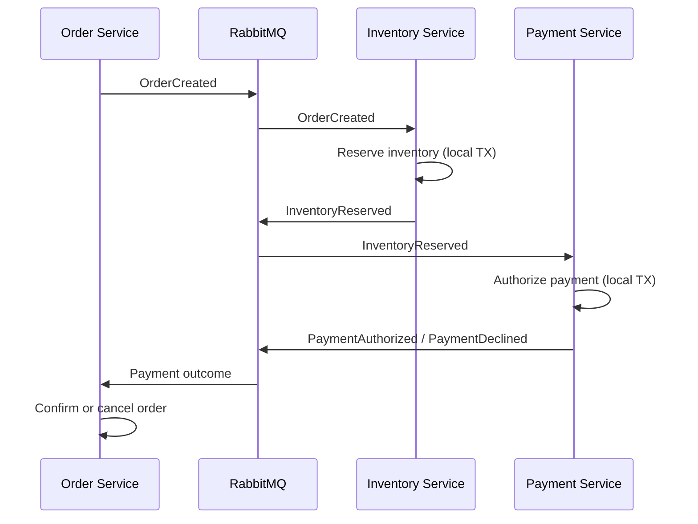
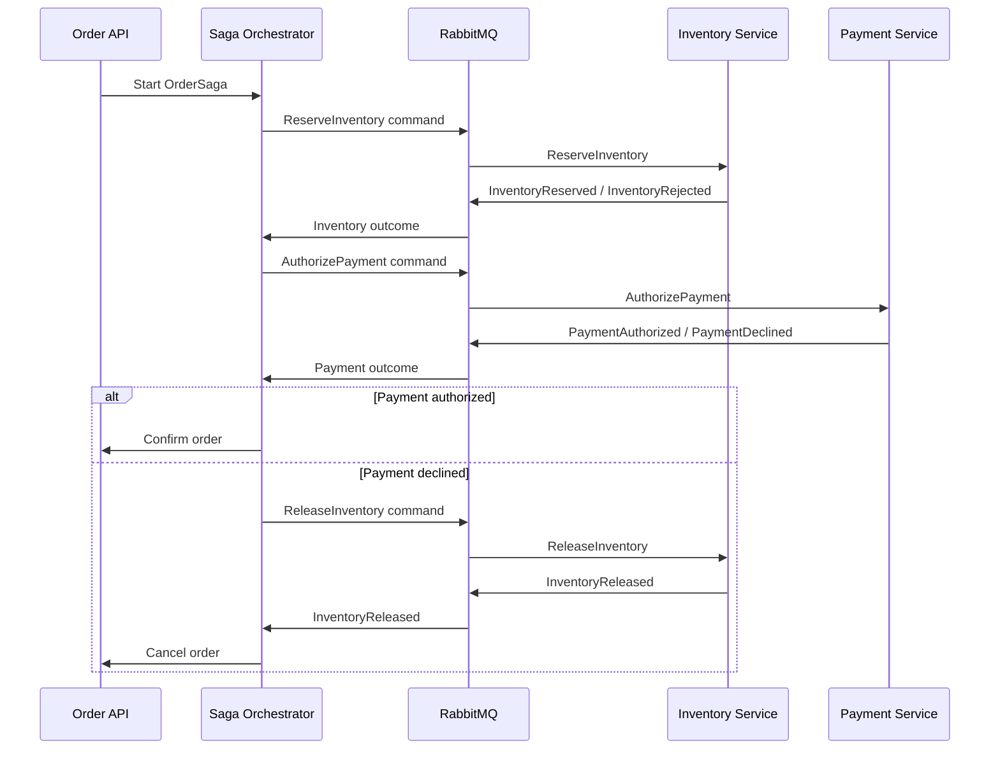
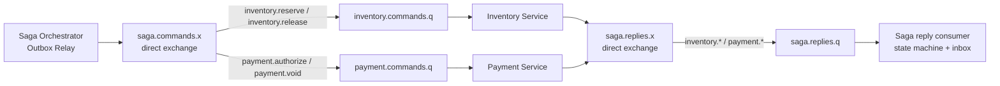
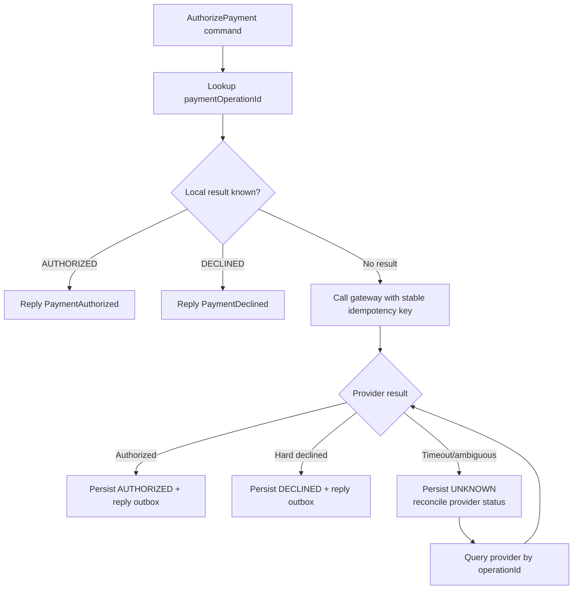

# Saga và ranh giới điều phối nghiệp vụ qua thông điệp

## 1. Vì sao cần Saga khi đã có RabbitMQ và Spring AMQP?

Trong chương **Mẫu tích hợp** của module **SPRING_AMQP**, chúng ta dùng `RabbitTemplate` để phát message, `@RabbitListener` để nhận, và exchange–queue–binding của RabbitMQ để định tuyến. Publisher confirms, consumer acknowledgments, retry, dead-letter và observability làm đường truyền **đáng tin cậy hơn**, nhưng **không** biến các database của nhiều service thành một transaction ACID.

Xét quy trình tạo đơn hàng:

1. **Order Service** tạo đơn ở trạng thái `PENDING`.
2. **Inventory Service** giữ hàng.
3. **Payment Service** ủy quyền thanh toán (authorize).
4. Order Service chuyển đơn sang `CONFIRMED`.

Nếu bước giữ hàng thành công nhưng payment bị từ chối, ta cần **giải phóng phần hàng đã giữ**. Nếu payment đã được authorize mà hệ thống quyết định hủy đơn, cần **void authorization** hoặc **refund** nếu giao dịch đã capture. Nếu message phản hồi thất lạc, trạng thái thật của payment có thể **chưa biết**: không nên giả định thanh toán đã thất bại để tự động bù trừ.

**Saga** là mẫu điều phối một chuỗi **local transactions** thuộc nhiều service, phối hợp qua message hoặc API. Mỗi service tự commit dữ liệu của mình; nếu một bước nghiệp vụ không thể hoàn tất, Saga tiến hành một hoặc nhiều **compensating actions** để đưa hệ thống về một **trạng thái nghiệp vụ chấp nhận được**. Bù trừ không phải rollback vật lý của những transaction đã commit trước đó.

> **Quy tắc cốt lõi:** RabbitMQ truyền **ý định và kết quả**; Saga quản lý **tiến trình, timeout, quyết định tiếp tục hay bù trừ**; mỗi service sở hữu **database và bất biến nghiệp vụ của chính mình**.

Bài này trình bày cả **choreography** và **orchestration**, tập trung vào ranh giới điều phối; thiết kế command/event, saga state machine, outbox/inbox, idempotency, compensation, retry/DLQ, deadline, observability và kiểm thử bằng Spring AMQP.

## 2. Saga khác transaction, workflow và request–reply ở điểm nào?

| Khái niệm | Ranh giới | Đảm bảo chính | Điều không nên giả định |
| --- | --- | --- | --- |
| **Local DB transaction** | Một database/transaction manager | ACID cho các bảng cùng transaction | Commit đồng thời RabbitMQ + DB khác |
| **AMQP publisher confirms** | Producer → broker | Broker xác nhận publish theo cơ chế confirm | Consumer đã xử lý xong nghiệp vụ |
| **Consumer ACK** | Consumer → broker | Delivery được consumer xác nhận | Tất cả service trong workflow đã commit |
| **Request–reply** | Một request, một reply | Tương quan request/response trong một tương tác | Nhiều bước nghiệp vụ được commit nguyên tử |
| **Saga** | Nhiều local transactions và bước bù trừ | Điều phối tiến trình về kết quả cuối theo chính sách | Exactly-once delivery, rollback vật lý toàn hệ thống |
| **2-phase commit/XA** | Transaction manager chung trên nhiều resource hỗ trợ XA | Atomic commit theo protocol 2PC nếu hỗ trợ đúng | Spring AMQP `RabbitTransactionManager` tự cung cấp XA cho DB + RabbitMQ |

Trong Spring AMQP, `channelTransacted` và đồng bộ transaction ngoài là mô hình **Best Efforts 1 Phase Commit**, không bảo đảm atomicity tuyệt đối xuyên RabbitMQ và database. `RabbitTransactionManager` không cung cấp XA transaction cho JDBC. <https://docs.spring.io/spring-amqp/reference/amqp/transactions.html>

Vì vậy, không nên viết:

```java
@Transactional
public void createOrder(CreateOrderRequest request) {
    orderRepository.save(...);
    rabbitTemplate.convertAndSend("saga.commands.x", "inventory.reserve", ...);
    // Gửi message tại đây không làm RabbitMQ và DB cùng commit nguyên tử.
}
```

Nếu DB rollback sau publish, consumer khác vẫn có thể nhận lệnh; nếu DB commit nhưng JVM chết trước publish, lệnh không bao giờ được gửi. **Transactional outbox** giải quyết khoảng cách **ghi trạng thái + ghi ý định phát** trong cùng DB transaction; relay gửi sau và có thể gửi lặp, do đó consumer phải idempotent.

## 3. Choreography hay orchestration?

Hai cách thường dùng để phối hợp Saga:

### 3.1. Choreography: service phản ứng với domain event



Không có một service trung tâm gửi mọi command. Mỗi participant đăng ký các **domain events** phù hợp và có thể phát event mới.

**Ưu điểm:** ít một bộ điều phối trung tâm, coupling trực tiếp với event contract; có thể hợp lý với luồng ngắn, ít nhánh. **Đổi lại:** logic tiến trình bị trải ra ở nhiều service, khó tìm ai sở hữu timeout, nhánh bù trừ và điều kiện kết thúc; dễ tạo vòng lặp sự kiện hoặc dependency ẩn.

Ví dụ khi `PaymentDeclined`, ai phát `ReleaseInventory`? Nếu Inventory Service phải “biết” nhiều nghiệp vụ riêng của Order, choreography dần biến thành orchestration phân tán nhưng không có state machine rõ ràng.

### 3.2. Orchestration: một bộ điều phối nắm state và ra quyết định



Bộ điều phối (**orchestrator**) lưu `sagaId`, `state`, version, deadlines, các command đã phát và phản hồi đã áp dụng. Nó quyết định **bước kế tiếp**, nhưng **không** ghi trực tiếp vào database của Inventory/Payment.

**Ưu điểm:** policy tiến trình, timeout, compensation và trạng thái điều tra nằm ở một chỗ; phù hợp luồng dài, nhiều nhánh. **Đổi lại:** cần xây state machine có persistence, scale-out, dedup, phát command bền vững và tránh biến orchestrator thành “god service” chứa logic nghiệp vụ nội bộ của mọi participant.

### 3.3. Bảng quyết định

| Câu hỏi | Nghiêng về choreography | Nghiêng về orchestration |
| --- | --- | --- |
| Quy trình ít bước, ít điều kiện | Có | Có thể nhưng dễ dư |
| Có nhiều nhánh lỗi, timeout, bù trừ | Khó quan sát hơn | Thường phù hợp hơn |
| Cần một API hỏi tiến độ `sagaId` | Phải tổng hợp từ nhiều nơi | Có state trung tâm |
| Các service cùng sở hữu một quy trình nghiệp vụ | Event contract rõ có thể phù hợp | Có thể làm orchestrator phụ thuộc nhiều team |
| Nhiều dịch vụ/phiên bản thay đổi độc lập | Cần quản lý event contract nghiêm | Cần quản lý command/reply contract nghiêm |
| Cần xử lý sự kiện đến muộn và đối soát | Cần policy phân tán | Dễ có trạng thái `UNKNOWN/RECONCILING` |
| Yêu cầu đồng bộ tuyệt đối như transaction ACID | Không đáp ứng | Cũng không đáp ứng |

**Bài thực hành chọn orchestration** để nêu rõ *ranh giới điều phối*. Các nguyên tắc outbox, idempotency, bù trừ và timeout cũng áp dụng cho choreography.

## 4. Ranh giới trách nhiệm: ai sở hữu cái gì?

| Thành phần | Sở hữu | Không nên làm |
| --- | --- | --- |
| **Order Service/Orchestrator** | Order status, Saga state, transition policy, correlation, deadlines, command outbox, reply inbox | Cập nhật trực tiếp bảng stock/payment của service khác |
| **Inventory Service** | Stock, reservation, idempotent command handling, reply outbox | Tự quyết định capture/void thanh toán |
| **Payment Service** | Authorization/capture/refund, mapping external payment IDs, idempotency với gateway | Tự cập nhật Order DB |
| **RabbitMQ** | Exchange/queue/binding, delivery/confirm/ACK, retry/DLX theo cấu hình | Lưu Saga state machine có transaction chung với các DB |
| **Operator/Support** | Xử lý ngoại lệ, đối soát, replay có kiểm soát | Requeue vô hạn hoặc “ép SUCCESS” khi trạng thái thực tế chưa rõ |

**“Coordinator ra quyết định” không có nghĩa coordinator làm thay local transaction.** Ví dụ command `ReserveInventory` mang `reservationId`, `sku` và `quantity`; Inventory Service tự kiểm tra hàng còn, khóa/unique constraints và commit rồi phát **kết quả đã commit**. Coordinator dựa trên kết quả đó để chọn bước kế tiếp.

Một thiết kế yếu là coordinator tự gọi hai repository ở hai DB khác nhau, giữ transaction mở chờ RabbitMQ và giả định `@Transactional` tự bao phủ mọi thứ. Một thiết kế tốt có **transaction boundaries được diễn đạt trong code và kiểm thử riêng**.

## 5. Quy trình nghiệp vụ mẫu: đặt hàng → giữ kho → thanh toán

### 5.1. Thành công

1. API nhận `PlaceOrder` với **idempotency key**; tạo Order `PENDING` + Saga `WAIT_INVENTORY` + command outbox `ReserveInventory` trong **một DB transaction**.
2. Outbox relay publish command và chờ publisher confirm/return; message có thể phát lại với **cùng commandId**.
3. Inventory xử lý command **idempotently**; giữ hàng trong DB transaction và ghi reply outbox `InventoryReserved`.
4. Orchestrator nhận reply; inbox dedup và chuyển `WAIT_INVENTORY → WAIT_PAYMENT`, ghi command `AuthorizePayment` vào outbox trong cùng transaction.
5. Payment authorize một lần theo `paymentOperationId` tại gateway, ghi kết quả bền vững và phát reply `PaymentAuthorized`.
6. Orchestrator chuyển Order `PENDING → CONFIRMED` cùng Saga `COMPLETED`.

### 5.2. Thất bại nghiệp vụ

Nếu inventory trả `InventoryRejected` (thiếu hàng), Saga chuyển `REJECTED`, Order chuyển `CANCELLED`; **không cần release** vì chưa giữ hàng.

Nếu inventory đã giữ hàng nhưng payment trả `PaymentDeclined` **rõ ràng**:

1. Orchestrator chuyển `WAIT_PAYMENT → WAIT_RELEASE`, phát `ReleaseInventory`.
2. Inventory giải phóng reservation, ghi `InventoryReleased`.
3. Orchestrator chuyển `CANCELLED`; Order được đánh dấu hủy.

**Chỉ “payment từ chối rõ ràng” mới cho phép nhánh release ngay trong ví dụ này.** Nếu Payment Service timeout, có thể gateway đã authorize nhưng reply bị mất. Khi đó Saga phải đánh dấu **`PAYMENT_UNKNOWN` hoặc `RECONCILING_PAYMENT`**, tra cứu kết quả theo idempotency key/provider transaction ID. Nếu sau đối soát thấy payment đã authorize mà muốn hủy, cần **void authorization trước khi release**; nếu đã capture, cần một flow refund theo policy.

### 5.3. Trạng thái chính và chuyển trạng thái

| State hiện tại | Sự kiện/điều kiện | State mới | Tác động trong local TX của Orchestrator |
| --- | --- | --- | --- |
| `NEW` | Start được chấp nhận | `WAIT_INVENTORY` | Lưu order PENDING + Saga + outbox `ReserveInventory` |
| `WAIT_INVENTORY` | `InventoryReserved` | `WAIT_PAYMENT` | Lưu reservation ID + outbox `AuthorizePayment` |
| `WAIT_INVENTORY` | `InventoryRejected` | `REJECTED` | Order CANCELLED, lưu lý do |
| `WAIT_PAYMENT` | `PaymentAuthorized` | `COMPLETED` | Order CONFIRMED, lưu authorization ID |
| `WAIT_PAYMENT` | `PaymentDeclined` chắc chắn | `WAIT_RELEASE` | Outbox `ReleaseInventory` |
| `WAIT_PAYMENT` | Timeout không xác định | `PAYMENT_UNKNOWN` | Outbox `QueryPaymentStatus`/scheduler đối soát |
| `PAYMENT_UNKNOWN` | Xác minh đã authorized, tiếp tục giao hàng | `COMPLETED` | Order CONFIRMED theo chính sách |
| `PAYMENT_UNKNOWN` | Xác minh đã authorized nhưng phải hủy | `WAIT_VOID` | Outbox `VoidPayment` |
| `WAIT_VOID` | `PaymentVoided` | `WAIT_RELEASE` | Outbox `ReleaseInventory` |
| `WAIT_RELEASE` | `InventoryReleased` | `CANCELLED` | Order CANCELLED |
| Bất kỳ state bù trừ | Lỗi không thể phục hồi sau ngưỡng | `MANUAL_REVIEW` | Ghi tác vụ xử lý thủ công và audit |

Một triển khai thực có thể cần nhiều state hơn (partial reservation, payment capture, shipping, refunds). Mẫu trên là **state machine tối giản** có nhánh đối soát quan trọng; không thiết kế thêm step vô nghĩa.

**Trạng thái Saga và trạng thái Order phải phân biệt:** `WAIT_RELEASE` là trạng thái điều phối; Order có thể hiển thị “Đang hủy” cho tới khi compensation hoàn tất. Không trả `CANCELLED` như một kết quả cuối khi reservation vẫn chưa được giải phóng.

## 6. Chuẩn hóa message contract: command, event và correlation

### 6.1. Đặc tính không thể thiếu

Ví dụ command:

```json
{
  "messageId": "efb98ae2-a74a-4d3b-b782-7867249fc52b",
  "sagaId": "2d291eef-8e0a-4577-aee7-0d8f1a66b58c",
  "orderId": "ORD-2026-1007",
  "commandId": "efb98ae2-a74a-4d3b-b782-7867249fc52b",
  "kind": "ReserveInventory",
  "schemaVersion": 1,
  "reservationId": "RES-ORD-2026-1007",
  "sku": "SKU-100",
  "quantity": 2,
  "occurredAt": "2026-11-26T03:00:00Z"
}
```

Reply:

```json
{
  "eventId": "4a635fd3-b771-4488-a0b8-0c8c2b2ba828",
  "sagaId": "2d291eef-8e0a-4577-aee7-0d8f1a66b58c",
  "commandId": "efb98ae2-a74a-4d3b-b782-7867249fc52b",
  "orderId": "ORD-2026-1007",
  "kind": "InventoryReserved",
  "schemaVersion": 1,
  "reservationId": "RES-ORD-2026-1007",
  "occurredAt": "2026-11-26T03:00:02Z"
}
```

Các ID có vai trò khác nhau:

| Trường | Ý nghĩa | Bắt buộc ổn định khi retry? |
| --- | --- | --- |
| `sagaId` | Tương quan toàn quy trình | **Có** |
| `orderId` | Khóa nghiệp vụ mà Saga đang phục vụ | **Có** |
| `commandId` | Định danh **một lệnh logic**; publisher relay có thể phát lại | **Có**, cho cùng lệnh |
| `eventId` | Định danh **một reply/event logic** được participant lưu trong outbox | **Có**, khi relay retry reply |
| `reservationId` | Khóa idempotency tại Inventory | **Có**, qua mọi retry/resume |
| `paymentOperationId` | Khóa idempotency tại Payment/gateway | **Có** |
| `schemaVersion` | Version contract cho chuyển đổi/validate | Không thay đổi tùy tiện trong cùng event |
| `attemptNo` | Số lần thử vận chuyển (optional) | Có thể đổi; **không** là key dedup chính |

**Không sinh commandId mới mỗi lần relay thấy confirm timeout.** Nếu Saga quyết định phát **một bước mới thực sự khác** sau khi đã đối soát, bước mới cần commandId riêng. Không dùng timestamp hoặc delivery tag RabbitMQ làm định danh nghiệp vụ ổn định.

### 6.2. Command vs event

- **Command** là yêu cầu thực hiện một hành động cụ thể, có **đích nhận được chỉ định**: `ReserveInventory` → Inventory Service; `AuthorizePayment` → Payment Service.
- **Event** là một sự thật đã xảy ra hoặc kết quả của một bước: `InventoryReserved`, `PaymentDeclined`; thông thường do participant phát **sau local DB commit**.
- **Reply** trong orchestration có thể là một event chứa `commandId` để liên kết với command được xử lý.
- **Compensation command** là một lệnh nghiệp vụ riêng, không phải đảo thứ tự RabbitMQ ACK/NACK; ví dụ `ReleaseInventory` phải có hiệu lực kể cả khi tiến trình trước đã commit lâu rồi.

Nếu dùng AMQP headers như `correlationId` hoặc `type`, hãy giữ **các ID/contract quan trọng trong payload bền vững**, tránh phụ thuộc vào type headers Java `__TypeId__` từ publisher không tin cậy. Consumer nên deserialize vào DTO đã biết theo queue và kiểm tra `schemaVersion`, `kind` theo allow-list.

### 6.3. Java DTO phù hợp với một wire contract đơn giản

Ví dụ sử dụng Java 17+ và JSON qua Jackson 2 (Spring Boot 3.x / Spring AMQP 3.x):

```java
import java.time.Instant;
import java.util.UUID;

public record SagaCommand(
        UUID commandId,
        UUID sagaId,
        String orderId,
        String kind,
        int schemaVersion,
        String resourceId,
        String sku,
        int quantity,
        Instant occurredAt
) {}

public record SagaReply(
        UUID eventId,
        UUID sagaId,
        UUID commandId,
        String orderId,
        String kind,
        int schemaVersion,
        String resourceId,
        String reason,
        Instant occurredAt
) {}
```

Trong hệ thống lớn, **DTO riêng cho từng command/event** sẽ type-safe hơn DTO chung với nhiều trường null. Mẫu record ở đây giúp tập trung vào correlation, idempotency và state machine; trong production phải validate tổ hợp `kind`/các trường bắt buộc của từng lệnh.

## 7. Thiết kế RabbitMQ topology cho Saga

### 7.1. Một exchange cho command và một exchange cho reply/event



Với orchestration có **một Saga coordinator logic được triển khai nhiều replica**, các replica cùng cạnh tranh nhận từ **một queue `saga.replies.q`**. Đó không phải một queue riêng mỗi Saga: trạng thái Saga được lưu trong DB, vì vậy bất kỳ replica nào cũng có thể xử lý reply theo `sagaId` với khóa/transaction phù hợp.

Nếu có nhiều consumer group độc lập cần biết kết quả, bind những queue **khác nhau** vào exchange events. Không để Analytics consumer và Saga coordinator cạnh tranh chung một queue nếu cả hai đều cần nhận mọi reply.

### 7.2. Cấu hình topology bằng Spring AMQP

```java
import org.springframework.amqp.core.Binding;
import org.springframework.amqp.core.BindingBuilder;
import org.springframework.amqp.core.DirectExchange;
import org.springframework.amqp.core.Queue;
import org.springframework.amqp.core.QueueBuilder;
import org.springframework.context.annotation.Bean;
import org.springframework.context.annotation.Configuration;

@Configuration
class SagaRabbitTopology {

    @Bean DirectExchange sagaCommandsExchange() {
        return new DirectExchange("saga.commands.x", true, false);
    }

    @Bean DirectExchange sagaRepliesExchange() {
        return new DirectExchange("saga.replies.x", true, false);
    }

    @Bean DirectExchange sagaDlx() {
        return new DirectExchange("saga.dlx", true, false);
    }

    @Bean Queue inventoryCommandsQueue() {
        return QueueBuilder.durable("inventory.commands.q")
                .deadLetterExchange("saga.dlx")
                .deadLetterRoutingKey("inventory.invalid")
                .build();
    }

    @Bean Queue paymentCommandsQueue() {
        return QueueBuilder.durable("payment.commands.q")
                .deadLetterExchange("saga.dlx")
                .deadLetterRoutingKey("payment.invalid")
                .build();
    }

    @Bean Queue sagaRepliesQueue() {
        return QueueBuilder.durable("saga.replies.q")
                .deadLetterExchange("saga.dlx")
                .deadLetterRoutingKey("reply.invalid")
                .build();
    }

    @Bean Queue sagaDlq() {
        return QueueBuilder.durable("saga.invalid.dlq").build();
    }

    @Bean Binding reserveRoute(Queue inventoryCommandsQueue,
                               DirectExchange sagaCommandsExchange) {
        return BindingBuilder.bind(inventoryCommandsQueue)
                .to(sagaCommandsExchange).with("inventory.reserve");
    }

    @Bean Binding releaseRoute(Queue inventoryCommandsQueue,
                               DirectExchange sagaCommandsExchange) {
        return BindingBuilder.bind(inventoryCommandsQueue)
                .to(sagaCommandsExchange).with("inventory.release");
    }

    @Bean Binding authorizeRoute(Queue paymentCommandsQueue,
                                 DirectExchange sagaCommandsExchange) {
        return BindingBuilder.bind(paymentCommandsQueue)
                .to(sagaCommandsExchange).with("payment.authorize");
    }

    @Bean Binding voidRoute(Queue paymentCommandsQueue,
                            DirectExchange sagaCommandsExchange) {
        return BindingBuilder.bind(paymentCommandsQueue)
                .to(sagaCommandsExchange).with("payment.void");
    }

    @Bean Binding inventoryReplyRoute(Queue sagaRepliesQueue,
                                     DirectExchange sagaRepliesExchange) {
        return BindingBuilder.bind(sagaRepliesQueue)
                .to(sagaRepliesExchange).with("inventory.result");
    }

    @Bean Binding paymentReplyRoute(Queue sagaRepliesQueue,
                                   DirectExchange sagaRepliesExchange) {
        return BindingBuilder.bind(sagaRepliesQueue)
                .to(sagaRepliesExchange).with("payment.result");
    }

    @Bean Binding inventoryInvalidRoute(Queue sagaDlq,
                                        DirectExchange sagaDlx) {
        return BindingBuilder.bind(sagaDlq)
                .to(sagaDlx).with("inventory.invalid");
    }

    @Bean Binding paymentInvalidRoute(Queue sagaDlq,
                                      DirectExchange sagaDlx) {
        return BindingBuilder.bind(sagaDlq)
                .to(sagaDlx).with("payment.invalid");
    }

    @Bean Binding replyInvalidRoute(Queue sagaDlq,
                                    DirectExchange sagaDlx) {
        return BindingBuilder.bind(sagaDlq)
                .to(sagaDlx).with("reply.invalid");
    }
}
```

Lưu ý:

- Ví dụ khai báo **các queue durable kiểu mặc định** để tập trung vào Saga. Hệ thống yêu cầu chịu lỗi broker node cần cân nhắc **quorum queues** và cấu hình cluster/replication, không nhầm `durable` với replication.
- `RabbitAdmin` có thể khai báo các bean khi AMQP connection được mở; nếu nhiều service deploy độc lập, nên có **chủ sở hữu topology rõ ràng** (IaC/definitions/deploy job), thay vì mọi service tự khai báo toàn bộ bằng credential admin.
- Dead-lettering cần **DLX + DLQ + bindings**. Không auto-requeue mãi với lỗi dữ liệu không thể sửa.
- Khi dùng direct exchange, reply đi theo routing key `inventory.result` hoặc `payment.result`; `kind` trong JSON giúp phân biệt kết quả cụ thể. `sagaId` chọn Saga instance cần cập nhật, **không** được dùng làm tên queue mới cho mỗi Saga.

## 8. Persist Saga state và outbox/inbox trong database

### 8.1. Schema PostgreSQL minh họa phía Orchestrator

```sql
CREATE TABLE orders (
    order_id TEXT PRIMARY KEY,
    status TEXT NOT NULL
        CHECK (status IN ('PENDING', 'CONFIRMED',
                         'CANCELLING', 'CANCELLED')),
    created_at TIMESTAMPTZ NOT NULL DEFAULT now()
);

CREATE TABLE saga_instance (
    saga_id UUID PRIMARY KEY,
    order_id TEXT NOT NULL UNIQUE REFERENCES orders(order_id),
    state TEXT NOT NULL,
    state_version BIGINT NOT NULL DEFAULT 0,
    reservation_id TEXT,
    authorization_id TEXT,
    deadline_at TIMESTAMPTZ,
    failure_reason TEXT,
    created_at TIMESTAMPTZ NOT NULL DEFAULT now(),
    updated_at TIMESTAMPTZ NOT NULL DEFAULT now()
);

CREATE TABLE saga_inbox (
    event_id UUID PRIMARY KEY,
    saga_id UUID NOT NULL,
    command_id UUID NOT NULL,
    payload JSONB NOT NULL,
    handling_state TEXT NOT NULL
        CHECK (handling_state IN ('RECEIVED','APPLIED','DEFERRED','IGNORED')),
    received_at TIMESTAMPTZ NOT NULL DEFAULT now(),
    applied_at TIMESTAMPTZ
);

CREATE TABLE saga_outbox (
    message_id UUID PRIMARY KEY,
    saga_id UUID NOT NULL,
    command_id UUID NOT NULL,
    exchange_name TEXT NOT NULL,
    routing_key TEXT NOT NULL,
    payload JSONB NOT NULL,
    status TEXT NOT NULL DEFAULT 'NEW'
        CHECK (status IN ('NEW','IN_FLIGHT','SENT')),
    attempts INT NOT NULL DEFAULT 0,
    claim_token UUID,
    lease_until TIMESTAMPTZ,
    created_at TIMESTAMPTZ NOT NULL DEFAULT now(),
    sent_at TIMESTAMPTZ
);

CREATE INDEX ix_saga_outbox_pending
    ON saga_outbox (status, lease_until, created_at);

CREATE INDEX ix_saga_inbox_deferred
    ON saga_inbox (saga_id, received_at)
    WHERE handling_state = 'DEFERRED';
```

**Các bất biến:**

- `saga_instance.order_id` unique: cùng một Order không vô tình mở hai Saga instance cho một command nghiệp vụ.
- `saga_outbox.message_id` stable: outbox relay retry **cùng một message logic**, không sinh ID mới.
- `saga_inbox.event_id` unique: reply bị broker redeliver hoặc participant relay gửi lại **không được áp dụng state transition lần hai**.
- `state_version` giúp optimistic locking/audit và các thao tác tránh ghi đè khi nhiều worker cùng xử lý.
- `DEFERRED` giữ lại reply đến sớm/khác thứ tự để reprocess; **không** đánh dấu đã xử lý xong rồi bỏ qua vĩnh viễn.

Nếu dùng chung physical PostgreSQL trong demo, hãy **tách schema/connection và quyền sở hữu** cho Inventory/Payment/Orchestrator; production không cho Orchestrator truy cập trực tiếp bảng service khác.

### 8.2. Command-outbox và Saga state phải commit cùng nhau

Một thao tác bắt đầu Saga cần ghi các thay đổi trong **một local database transaction**:

```java
import java.util.UUID;
import org.springframework.jdbc.core.JdbcTemplate;
import org.springframework.stereotype.Service;
import org.springframework.transaction.annotation.Transactional;

@Service
class StartSagaService {
    private final JdbcTemplate jdbc;
    private final SagaOutboxWriter outbox;

    StartSagaService(JdbcTemplate jdbc, SagaOutboxWriter outbox) {
        this.jdbc = jdbc;
        this.outbox = outbox;
    }

    @Transactional
    public UUID start(String orderId, String sku, int quantity) {
        UUID sagaId = UUID.randomUUID();

        // Unique order_id bảo vệ trường hợp hai request cùng order.
        jdbc.update("""
            INSERT INTO orders(order_id, status)
            VALUES (?, 'PENDING')
            """, orderId);

        jdbc.update("""
            INSERT INTO saga_instance
              (saga_id, order_id, state, deadline_at)
            VALUES (?, ?, 'WAIT_INVENTORY', now() + interval '2 minutes')
            """, sagaId, orderId);

        UUID commandId = UUID.randomUUID();
        var command = new SagaCommand(
                commandId, sagaId, orderId, "ReserveInventory", 1,
                "RES-" + orderId, sku, quantity,
                java.time.Instant.now());

        outbox.append(
                sagaId, commandId,
                "saga.commands.x", "inventory.reserve",
                command);
        return sagaId;
    }
}
```

`SagaOutboxWriter.append(...)` là repository do ứng dụng cài đặt: **insert một row vào `saga_outbox` bằng cùng JdbcTemplate/DataSource/transaction**, serialize command thành JSON và dùng `commandId` làm `message_id`. Đây là **điểm mở rộng có chủ đích**; đoạn code ở trên không phải toàn bộ ứng dụng compile độc lập nếu chưa tạo repository.

**Tại sao không gọi `RabbitTemplate` trong method này?** Vì nếu transaction DB rollback mà RabbitMQ đã nhận command, Inventory có thể giữ hàng cho một order không tồn tại. Outbox bảo đảm **command chỉ có cơ hội được publish khi Saga transaction đã commit**. Khi commit xong nhưng relay chết, row vẫn ở DB cho lần thử khác.

Trong API thực, `start` cần idempotency theo request/order key; ví dụ có unique key và sẽ ném lỗi cho duplicate. Xử lý duplicate bằng cách query Saga hiện tại và kiểm tra payload fingerprint, thay vì tự động tạo Saga mới.

## 9. Outbox relay dùng RabbitTemplate và publisher confirms

### 9.1. Cấu hình Spring Boot

```yaml
spring:
  rabbitmq:
    addresses: "rabbit-1.internal:5672,rabbit-2.internal:5672"
    username: "saga_app"
    password: ${RABBITMQ_PASSWORD}
    virtual-host: "/orders"
    publisher-confirm-type: correlated
    publisher-returns: true
    template:
      mandatory: true
    listener:
      simple:
        acknowledge-mode: auto
        prefetch: 10
        concurrency: 2
        max-concurrency: 2
```

**Giải thích:** publisher confirms xác nhận broker đã chấp nhận publish; mandatory returns cho biết message **không được route tới queue** theo định tuyến. Nếu confirm ACK nhưng message được returned, không được coi command đã đến đích.

### 9.2. Thuật toán relay đúng các ranh giới

```text
BEGIN DB TX:
  claim 1 outbox row NEW hoặc IN_FLIGHT hết lease
  SELECT ... FOR UPDATE SKIP LOCKED
  set claim_token, lease_until, attempts
COMMIT

publish message vào exchange/routing-key
  messageProperties.messageId = outbox.message_id (stable)
  correlationData ID = message_id + claim_token (attempt identity)
wait confirm (bounded timeout)
  if ACK && no returned:
      BEGIN DB TX:
          UPDATE outbox SET status=SENT
          WHERE message_id=? AND claim_token=?
      COMMIT
  else:
      leave retryable / backoff
```

Đừng giữ DB transaction và row lock trong thời gian chờ RabbitMQ publish confirm. Với nhiều relay Pod, lease/claim token bảo vệ khỏi hai worker claim đồng thời tại cùng thời điểm, nhưng **không loại bỏ hoàn toàn duplicate publish** nếu lease hết hoặc reply confirm không rõ.

### 9.3. Đoạn publish minh họa

```java
import java.nio.charset.StandardCharsets;
import java.util.UUID;
import java.util.concurrent.TimeUnit;
import org.springframework.amqp.core.Message;
import org.springframework.amqp.core.MessageDeliveryMode;
import org.springframework.amqp.core.MessageProperties;
import org.springframework.amqp.rabbit.connection.CorrelationData;
import org.springframework.amqp.rabbit.core.RabbitTemplate;
import org.springframework.stereotype.Service;

@Service
class SagaCommandPublisher {
    private final RabbitTemplate template;

    SagaCommandPublisher(RabbitTemplate template) {
        this.template = template;
    }

    boolean publishAndConfirm(UUID messageId,
                              String exchange,
                              String routingKey,
                              String json,
                              UUID claimToken) throws Exception {
        var properties = new MessageProperties();
        properties.setContentType(MessageProperties.CONTENT_TYPE_JSON);
        properties.setMessageId(messageId.toString());
        properties.setDeliveryMode(MessageDeliveryMode.PERSISTENT);

        var message = new Message(
                json.getBytes(StandardCharsets.UTF_8), properties);

        var correlation = new CorrelationData(
                messageId + ":" + claimToken);

        template.send(exchange, routingKey, message, correlation);

        var confirm = correlation.getFuture().get(10, TimeUnit.SECONDS);
        return confirm.isAck() && correlation.getReturned() == null;
    }
}
```

**Đây là hàm gửi/kiểm tra confirm cho relay**, chưa gồm claim/mark trong DB, timeout policy hoặc scheduler. Những phần đó phải triển khai trong các transaction riêng. Khi timeout/exception hoặc return, relay giữ row retryable; nếu broker đã nhận nhưng confirm thất lạc, lệnh sẽ được phát lại với cùng `messageId`/`commandId`.

**Không coi publisher confirms là participant success**: nó chỉ xác nhận RabbitMQ, không phải Inventory đã giữ hàng hay Payment đã authorize.

## 10. Participant: command handler phải idempotent và có reply outbox

### 10.1. Schema cục bộ của Inventory Service

```sql
CREATE TABLE stock (
    sku TEXT PRIMARY KEY,
    available INT NOT NULL CHECK (available >= 0)
);

CREATE TABLE inventory_reservation (
    reservation_id TEXT PRIMARY KEY,
    saga_id UUID NOT NULL,
    order_id TEXT NOT NULL,
    sku TEXT NOT NULL,
    quantity INT NOT NULL CHECK (quantity > 0),
    state TEXT NOT NULL CHECK (state IN ('RESERVED','RELEASED')),
    created_at TIMESTAMPTZ NOT NULL DEFAULT now()
);

CREATE TABLE inventory_command_inbox (
    command_id UUID PRIMARY KEY,
    reservation_id TEXT NOT NULL,
    processed_at TIMESTAMPTZ NOT NULL DEFAULT now()
);

CREATE TABLE inventory_reply_outbox (
    event_id UUID PRIMARY KEY,
    command_id UUID NOT NULL,
    saga_id UUID NOT NULL,
    reply_payload JSONB NOT NULL,
    status TEXT NOT NULL DEFAULT 'NEW',
    created_at TIMESTAMPTZ NOT NULL DEFAULT now()
);
```

Inventory cần hai idempotency levels:

- **Message/command dedup:** `command_id` unique ngăn cùng command được xử lý hai lần khi redelivery.
- **Business dedup:** `reservation_id` unique ngăn hai command khác ID nhưng cùng một reservation logic cùng trừ stock hai lần.

Không chỉ dùng `eventId` của command nếu một orchestrator bug/timeout có thể tạo một lệnh Reserve mới với ID khác cho cùng reservation. Business key là lớp bảo vệ độc lập.

### 10.2. Logic reserve trong một transaction

```java
import org.springframework.jdbc.core.JdbcTemplate;
import org.springframework.stereotype.Service;
import org.springframework.transaction.annotation.Transactional;

@Service
class InventoryCommandService {
    private final JdbcTemplate jdbc;
    private final InventoryReplyWriter replies;

    InventoryCommandService(JdbcTemplate jdbc, InventoryReplyWriter replies) {
        this.jdbc = jdbc;
        this.replies = replies;
    }

    @Transactional
    public void reserve(SagaCommand command) {
        // Nếu commandId đã xử lý: không thay stock.
        int isNewCommand = jdbc.update("""
            INSERT INTO inventory_command_inbox
              (command_id, reservation_id)
            VALUES (?, ?)
            ON CONFLICT (command_id) DO NOTHING
            """, command.commandId(), command.resourceId());

        if (isNewCommand == 0) {
            return;
        }

        // Ranh giới business idempotency:
        // reservationId là khóa một lần giữ kho.
        String existingState = jdbc.query("""
            SELECT state FROM inventory_reservation
            WHERE reservation_id = ?
            """, rs -> rs.next() ? rs.getString("state") : null,
            command.resourceId());

        if (existingState != null) {
            // Bản ghi cùng ID phải được đối chiếu thêm sagaId/SKU/quantity.
            // Tuyệt đối không báo RESERVED khi reservation đã RELEASED.
            if ("RESERVED".equals(existingState)) {
                replies.recordResult(command, "InventoryReserved", null);
            }
            else {
                replies.recordResult(command, "InventoryRejected",
                        "RESERVATION_ALREADY_RELEASED");
            }
            return;
        }

        int changed = jdbc.update("""
            UPDATE stock SET available = available - ?
            WHERE sku = ? AND available >= ?
            """,
            command.quantity(), command.sku(), command.quantity());

        if (changed == 0) {
            replies.recordResult(command, "InventoryRejected",
                    "INSUFFICIENT_STOCK");
            return;
        }

        jdbc.update("""
            INSERT INTO inventory_reservation
              (reservation_id, saga_id, order_id,
               sku, quantity, state)
            VALUES (?, ?, ?, ?, ?, 'RESERVED')
            """,
            command.resourceId(), command.sagaId(),
            command.orderId(), command.sku(), command.quantity());

        replies.recordResult(command, "InventoryReserved", null);
    }
}
```

`InventoryReplyWriter.recordResult(...)` là một repository cục bộ: nó tạo một `SagaReply` có `eventId` mới **một lần**, ghi vào bảng `inventory_reply_outbox` **trong chính transaction DB của Inventory**. Một relay riêng gửi tới `saga.replies.x` với routing key `inventory.result`. Cần có một lớp/bean triển khai method này; snippet trình bày **ranh giới transaction**, không phải full build độc lập.

**Lưu ý concurrency:** `SELECT count(*)` trên reservation **chưa đủ làm hàng rào** nếu hai commandId khác nhau cùng reservationId được xử lý đồng thời. Unique constraint `inventory_reservation.reservation_id` phải là rào cuối cùng; cần bổ sung một trong các giải pháp sau trong code production:

- Khóa theo `reservation_id` bằng advisory lock/aggregate lock trong transaction; hoặc
- Claim business operation vào một bảng unique **trước khi** trừ stock, rồi xử lý dưới row lock; hoặc
- Xử lý `unique_violation` để rollback toàn transaction thua cuộc rồi đọc reservation đã commit và phát reply nhất quán.

**Không** bắt `DataIntegrityViolationException` rồi tiếp tục trong PostgreSQL transaction đã bị lỗi. Cần rollback và xử lý duplicate trong transaction mới; không làm mất reply. Trong bài tập tiếp theo, có thể xây `reservation_operation` để claim unique key trước `UPDATE stock`.

### 10.3. ReleaseInventory là một compensation operation

Khác reserve, release phải idempotent trên **reservation đã tồn tại**:

```text
BEGIN Inventory DB transaction
  lookup reservation by reservationId FOR UPDATE
  if state = RELEASED:
      append/reuse InventoryReleased reply; DO NOT add stock again
  else if state = RESERVED:
      UPDATE reservation SET state = RELEASED
      UPDATE stock SET available = available + reserved quantity
      append InventoryReleased reply outbox
  else:
      return controlled "not-found/unknown" outcome for reconciliation
COMMIT
```

Không dùng trực tiếp `sku`/`quantity` do một command `ReleaseInventory` mới gửi mà chưa đối chiếu reservation cũ; nếu gửi quantity sai có thể cộng stock quá mức. Số lượng cần phục hồi phải đọc từ **bản ghi reservation đã commit**.

Nếu release đến trước reserve do message reorder, không được “ACK rồi quên” khi requirement còn phải giải phóng hàng sau này. Có thể lưu **tombstone/cancellation intent** theo reservationId: reserve về sau thấy intent đã cancel thì không giữ hàng, hoặc reserve vừa xong thực hiện release ngay theo state machine. Đây là một ví dụ về **tính cần thiết của business-key ordering**.

## 11. @RabbitListener: ACK sau khi local transaction đã commit

Participant nhận command bằng `@RabbitListener`; để tránh tin tên Java class do một publisher gắn ở `__TypeId__`, đoạn ví dụ nhận raw `Message` và parse vào DTO cố định:

```java
import com.fasterxml.jackson.core.JsonProcessingException;
import com.fasterxml.jackson.databind.ObjectMapper;
import org.springframework.amqp.AmqpRejectAndDontRequeueException;
import org.springframework.amqp.core.Message;
import org.springframework.amqp.rabbit.annotation.RabbitListener;
import org.springframework.stereotype.Component;

@Component
class InventoryCommandListener {
    private final ObjectMapper json;
    private final InventoryCommandService service;
    private final InventoryReleaseService releaseService;

    InventoryCommandListener(
            ObjectMapper json,
            InventoryCommandService service,
            InventoryReleaseService releaseService) {
        this.json = json;
        this.service = service;
        this.releaseService = releaseService;
    }

    @RabbitListener(
            id = "inventoryCommands",
            queues = "inventory.commands.q")
    public void onCommand(Message message) {
        final SagaCommand cmd;
        try {
            cmd = json.readValue(message.getBody(), SagaCommand.class);
        }
        catch (JsonProcessingException ex) {
            throw new AmqpRejectAndDontRequeueException(
                    "Malformed saga command", ex);
        }

        if (cmd == null || cmd.commandId() == null
                || cmd.sagaId() == null
                || cmd.resourceId() == null
                || cmd.schemaVersion() != 1) {
            throw new AmqpRejectAndDontRequeueException(
                    "Invalid saga command contract");
        }

        switch (cmd.kind()) {
            case "ReserveInventory" -> service.reserve(cmd);
            case "ReleaseInventory" -> releaseService.release(cmd);
            default -> throw new AmqpRejectAndDontRequeueException(
                    "Unsupported inventory command kind");
        }
        // AUTO ack: Spring container ACK after successful method return.
    }
}
```

`InventoryReleaseService` là service bù trừ độc lập, phải triển khai bằng local transaction và reply outbox theo mục 10.3. Listener **không nên** gọi `RabbitTemplate.convertAndSend(...)` để phát reply **trước khi DB commit**; nếu cần gửi bền vững, dùng outbox như reserve.

**Tại sao ACK sau commit?** Với listener đồng bộ và `AcknowledgeMode.AUTO` của Spring, transaction trong service kết thúc trước khi listener trả về. Nếu DB commit thành công nhưng connection RabbitMQ bị đóng trước ACK, broker có thể giao lại command. `inventory_command_inbox` cùng business key idempotency ngăn trừ stock hai lần. Ngược lại nếu DB rollback và exception lan ra, message có thể retry theo policy.

**Tránh requeue vô hạn:** lỗi JSON/contract không thể sửa dùng reject không requeue và DLQ; lỗi DB/API tạm thời dùng retry có giới hạn/backoff. `AUTO` của Spring không phải RabbitMQ auto-ack.

## 12. Saga Orchestrator xử lý reply một cách nguyên tử

### 12.1. Không gửi command tiếp theo ngay trong callback trước commit

Một anti-pattern:

```java
@RabbitListener(queues = "saga.replies.q")
void onInventoryReserved(SagaReply reply) {
    rabbitTemplate.convertAndSend(
        "saga.commands.x", "payment.authorize", newCommand);
    sagaRepository.updateState(reply.sagaId(), "WAIT_PAYMENT");
}
```

Nếu publish thành công nhưng cập nhật DB state thất bại, Payment có thể authorize cho một Saga vẫn đang ở `WAIT_INVENTORY`. Nếu DB update trước rồi publish lỗi, Saga đứng ở `WAIT_PAYMENT` mà command chưa bao giờ đến broker.

**Giải pháp:** trong **một DB transaction** của orchestrator:

1. Ghi reply vào `saga_inbox` bằng `eventId` unique.
2. Khóa/đọc Saga state, xác minh state hiện tại và `commandId` đang được chờ.
3. Chọn transition hợp lệ; cập nhật Saga state và Order state nếu cần.
4. Ghi **command tiếp theo hoặc compensation command** vào `saga_outbox`.
5. Đánh dấu inbox reply `APPLIED`.
6. Commit DB; **sau đó** cho outbox relay publish.

### 12.2. Code handler minh họa với PostgreSQL row lock

```java
import org.springframework.jdbc.core.JdbcTemplate;
import org.springframework.stereotype.Service;
import org.springframework.transaction.annotation.Transactional;
import java.util.UUID;

@Service
class SagaReplyService {
    private final JdbcTemplate jdbc;
    private final SagaOutboxWriter outbox;

    SagaReplyService(JdbcTemplate jdbc, SagaOutboxWriter outbox) {
        this.jdbc = jdbc;
        this.outbox = outbox;
    }

    @Transactional
    public void apply(SagaReply reply, String rawJson) {
        int inserted = jdbc.update("""
            INSERT INTO saga_inbox
              (event_id, saga_id, command_id,
               payload, handling_state)
            VALUES (?, ?, ?, CAST(? AS jsonb), 'RECEIVED')
            ON CONFLICT (event_id) DO NOTHING
            """,
            reply.eventId(), reply.sagaId(),
            reply.commandId(), rawJson);

        if (inserted == 0) {
            return; // Cùng reply event đã được ghi nhận.
        }

        String state = jdbc.queryForObject("""
            SELECT state FROM saga_instance
            WHERE saga_id = ? FOR UPDATE
            """, String.class, reply.sagaId());

        if ("WAIT_INVENTORY".equals(state)
                && "InventoryReserved".equals(reply.kind())) {
            jdbc.update("""
                UPDATE saga_instance
                SET state = 'WAIT_PAYMENT',
                    reservation_id = ?,
                    state_version = state_version + 1,
                    updated_at = now(),
                    deadline_at = now() + interval '2 minutes'
                WHERE saga_id = ?
                """, reply.resourceId(), reply.sagaId());

            var newCommandId = UUID.randomUUID();
            var command = new SagaCommand(
                    newCommandId, reply.sagaId(), reply.orderId(),
                    "AuthorizePayment", 1, "PAY-" + reply.orderId(),
                    null, 0, java.time.Instant.now());

            outbox.append(reply.sagaId(), newCommandId,
                    "saga.commands.x", "payment.authorize", command);

            jdbc.update("""
                UPDATE saga_inbox
                SET handling_state = 'APPLIED', applied_at = now()
                WHERE event_id = ?
                """, reply.eventId());
            return;
        }

        // Các transitions khác được reducer/state machine xử lý riêng.
        // Đừng ACK rồi bỏ reply bất thường: giữ để reconcile.
        jdbc.update("""
            UPDATE saga_inbox
            SET handling_state = 'DEFERRED'
            WHERE event_id = ?
            """, reply.eventId());
    }
}
```

**Đây là một nhánh cụ thể**, không phải toàn bộ state machine. Nhánh `InventoryRejected`, `PaymentAuthorized`, `PaymentDeclined`, `InventoryReleased` và đối soát phải được cài đặt tương tự theo bảng phần 5; không đánh dấu nghiệp vụ hoàn tất khi thiếu nhánh xử lý.

**Quan trọng với replay của reply:** vì duplicate eventId đã được `saga_inbox` ghi, một reply có `handling_state=DEFERRED` không thể chỉ phát lại rồi mong được xử lý: nhánh `ON CONFLICT DO NOTHING` sẽ bỏ qua. Cần có **deferred-inbox processor** đọc `DEFERRED` và áp dụng lại khi Saga state thay đổi, hoặc một handler có cơ chế re-check entry hiện có. Mỗi lần replay phải dùng row lock/CAS, bảo đảm không áp dụng transition hai lần.

### 12.3. Kiểm tra commandId và branch version trước khi đổi state

Đoạn handler ở phần 12.2 kiểm tra `sagaId`/`kind`/`state`, nhưng một triển khai production còn phải xác minh **reply thuộc command đang chờ**, ví dụ có trường `expected_command_id` trong `saga_instance` (schema cần bổ sung), hoặc bảng `saga_step` lưu `commandId`, step, attempt và status.

Lý do:

- Reply cũ của bước đã hoàn tất có thể tới sau.
- Một Saga đã chạy lại bước với commandId mới sau reconciliation.
- Một publisher lỗi phát event đúng `kind` nhưng sai `sagaId`/`orderId`.
- Hai reply contradictory như `PaymentAuthorized` và `PaymentDeclined` có thể xuất hiện khi gateway có timeout/race; phải đối soát thay vì áp dụng outcome cuối cùng đến trước.

**Không tin riêng `sagaId` từ message như bằng chứng quyền ra quyết định.** Kiểm tra identity/permission của producer trên RabbitMQ, validate contract và đối chiếu với expected command; thông điệp không hợp lệ cần đi vào audit/quarantine.

### 12.4. @RabbitListener cho Saga reply

```java
import com.fasterxml.jackson.core.JsonProcessingException;
import com.fasterxml.jackson.databind.ObjectMapper;
import java.nio.charset.StandardCharsets;
import org.springframework.amqp.AmqpRejectAndDontRequeueException;
import org.springframework.amqp.core.Message;
import org.springframework.amqp.rabbit.annotation.RabbitListener;
import org.springframework.stereotype.Component;

@Component
class SagaReplyListener {
    private final ObjectMapper json;
    private final SagaReplyService saga;

    SagaReplyListener(ObjectMapper json, SagaReplyService saga) {
        this.json = json;
        this.saga = saga;
    }

    @RabbitListener(
            id = "orderSagaReplies",
            queues = "saga.replies.q")
    public void onReply(Message message) {
        String raw = new String(
                message.getBody(), StandardCharsets.UTF_8);

        final SagaReply reply;
        try {
            reply = json.readValue(raw, SagaReply.class);
        }
        catch (JsonProcessingException ex) {
            throw new AmqpRejectAndDontRequeueException(
                    "Malformed saga reply", ex);
        }

        if (reply == null
                || reply.eventId() == null
                || reply.sagaId() == null
                || reply.commandId() == null
                || reply.schemaVersion() != 1
                || reply.kind() == null) {
            throw new AmqpRejectAndDontRequeueException(
                    "Invalid saga reply contract");
        }

        saga.apply(reply, raw);
        // Khi local TX commit thành công, container AUTO ACK.
    }
}
```

Listener không làm HTTP call lâu hoặc publish trực tiếp trong transaction. `@Transactional` ở `SagaReplyService` qua bean Spring proxy; reply inbox, state và outbox phải dùng **cùng DataSource/transaction manager**.

Nếu row Saga chưa tồn tại do publisher gửi trước local DB commit, `queryForObject` có thể ném lỗi; trong thiết kế outbox đúng, reply không nên tới trước Saga commit, nhưng replication/network/bugs vẫn có thể gây tình huống bất thường. Cần phân loại là **deferred/reconciliation** thay vì loop requeue nóng.

## 13. Payment participant: idempotency không được kết thúc ở RabbitMQ

Payment Service thường gọi gateway bên ngoài. Sau khi gửi request, gateway có thể **thực sự authorize** nhưng HTTP connection bị timeout. Nếu Payment Service gửi `PaymentDeclined` ngay, orchestrator có thể release inventory trong khi tiền vẫn đang bị giữ.

Một thiết kế chắc chắn hơn:



**Payment operation ID** phải có một định danh bền vững; gateway cần hỗ trợ idempotency key hoặc query/reconciliation API. Nếu provider không hỗ trợ, không thể hứa “không bị charge hai lần” chỉ bằng database inbox của Spring service.

Các quy tắc bù trừ:

| Payment thực tế | Compensation phù hợp | Lưu ý |
| --- | --- | --- |
| Chưa authorize | Không cần void | Xác minh trạng thái chưa tạo |
| Authorization còn hiệu lực | `VoidPayment`/release hold | Provider có thể async |
| Payment đã capture | `RefundPayment` | Refund là một giao dịch mới, có thể phát sinh phí/thời gian chờ |
| Trạng thái provider không xác định | **Reconcile trước** | Không phát refund lặp không có idempotency |
| Đã ship hàng/gửi email | Không thể “undo” vật lý dễ dàng | Có thể cần return/CSKH/manual review |

**Compensation là bước nghiệp vụ có thể thất bại, cần retry, ID ổn định, audit và đôi khi cần con người xử lý.** Đừng đánh dấu Saga `CANCELLED` khi command bù trừ vẫn chưa được xác nhận.

## 14. Hết hạn, reply đến muộn và xử lý sai thứ tự

### 14.1. Timeout không đồng nghĩa thất bại

Ví dụ `AuthorizePayment` được gửi tại 10:00; deadline 10:02; tới 10:02 vẫn chưa có reply. Ba khả năng:

1. Lệnh chưa tới Payment Service (broker hoặc publisher lỗi).
2. Payment Service đang xử lý, chưa phát reply.
3. Gateway đã authorize, reply bị chậm/mất.

Điều phối đúng là chuyển `WAIT_PAYMENT → PAYMENT_UNKNOWN` và **đối soát**, không tự `ReleaseInventory` ngay theo cách có thể bỏ sót một authorization thành công.

Một scheduler có thể quét Saga quá deadline:

```sql
SELECT saga_id, order_id, state, deadline_at
FROM saga_instance
WHERE state IN ('WAIT_INVENTORY', 'WAIT_PAYMENT',
                'WAIT_RELEASE', 'PAYMENT_UNKNOWN')
  AND deadline_at < now()
ORDER BY deadline_at
FOR UPDATE SKIP LOCKED
LIMIT 100;
```

**Chỉ select là chưa đủ:** worker cần chuyển state/renew deadline và ghi action outbox **trong cùng transaction**, sau đó commit. Với nhiều instance, `SKIP LOCKED` ngăn tranh claim cùng lúc, nhưng retries có thể lặp sau timeout; command phải idempotent.

### 14.2. Phân biệt retry, duplicate và late reply

| Tình huống | Xử lý phù hợp |
| --- | --- |
| Cùng `eventId` được nhận hai lần | Inbox unique → một lần áp dụng |
| Hai reply khác `eventId` nhưng cùng `commandId`/outcome | Dedup ở cấp command/step, không chỉ event ID |
| Reply đến khi Saga state chưa mong đợi | Lưu `DEFERRED`, đánh giá lại khi state chuyển |
| Reply đến khi Saga đã hoàn tất | Ghi audit; nếu không mâu thuẫn thì `IGNORED` |
| Late `PaymentAuthorized` khi Saga đã quyết hủy | Reconcile, void/refund nếu cần; **không drop âm thầm** |
| Hai outcome mâu thuẫn `Authorized` và `Declined` | Tra cứu provider/source of truth; cảnh báo |
| Saga đã quá SLA nhưng bù trừ còn pending | State `COMPENSATING`/`MANUAL_REVIEW`, không báo cancelled thành công |

### 14.3. Thứ tự message trên broker không thay thế state machine

RabbitMQ queue có quy tắc thứ tự enqueue/deliver nhưng **nhiều consumer, retry, redelivery và các queue khác nhau** có thể khiến thứ tự hoàn tất và reply arrival khác nhau. Đừng dùng thứ tự `@RabbitListener` invocation làm cơ sở duy nhất.

Để giảm race:

- Key state machine theo `sagaId`, dùng row lock/CAS trên Saga record.
- Mọi reply gắn `commandId` và `sagaId`; verify expected step.
- Nếu yêu cầu tuần tự mạnh theo Saga, partition theo `sagaId` vào queue/shard/consumer serial hoặc dùng per-saga serialization tại DB/worker; **vẫn** giữ idempotency.
- Có inbox `DEFERRED`, timeout/reconciliation và tool điều tra manual khi event bất thường.

## 15. Retry, dead-letter và đảm bảo phản hồi không bị mất

### 15.1. Ba loại lỗi

| Loại lỗi | Ví dụ | Chiến lược |
| --- | --- | --- |
| **Transient infrastructure** | Broker mất kết nối, DB timeout, HTTP 503 | Retry có giới hạn/backoff, giữ outbox và idempotency key |
| **Business rejection** | Hết hàng, thẻ bị từ chối thật | Phát reply `InventoryRejected`/`PaymentDeclined` để Saga quyết định |
| **Poison message/contract** | JSON sai, schemaVersion chưa hỗ trợ, ID thiếu | Reject không requeue, DLQ/quarantine + cảnh báo |

**Không dùng RabbitMQ DLQ làm đường nghiệp vụ thay cho reply `PaymentDeclined`.** DLQ dành cho delivery không xử lý được ở mức hạ tầng/contract; Saga business outcome phải là một event/reply có định danh và được lưu bền vững.

Ví dụ Spring Boot retry configuration có thể khác theo version; điều quan trọng là:

- Đặt giới hạn số lần thử và backoff.
- Không requeue vô hạn khi lỗi parse.
- Giữ stable IDs và transaction idempotent qua retries.
- Kiểm soát poison message để nó không chặn cả queue.
- Quorum queue delivery-limit có thể dead-letter message sau nhiều lần thất bại; kiểm tra hành vi theo **RabbitMQ version và `basic.reject` vs `basic.nack`** (có thay đổi từ RabbitMQ 4.3), không thiết kế hệ thống chỉ dựa trên một assumption chưa xác minh.
- Nếu DLQ chứa command quan trọng, cần quy trình replay/quarantine có ownership và audit. **Message ở DLQ không đồng nghĩa Saga đã được bù trừ.**

### 15.2. Quorum queue và dead-letter safety

Với RabbitMQ clustered, dead-letter routing có thể thất bại nếu target queue không sẵn sàng. Quorum queues hỗ trợ dead-letter strategy **at-least-once** qua internal confirms khi được cấu hình đúng; chiến lược mặc định có thể là **at-most-once**, tùy phiên bản/config. Không cho rằng “có DLX” là không mất message. <https://www.rabbitmq.com/docs/dlx>

**Độ tin cậy đầu-cuối** cần xét cả: nguồn publish, route tới queue, consumer ACK, local transaction, Saga state và compensation. Mỗi mắt xích có thể lỗi độc lập.

## 16. Vì sao không dùng RPC đồng bộ dài thay Saga?

Spring AMQP hỗ trợ request–reply qua `RabbitTemplate.convertSendAndReceive(...)`, thích hợp cho các tương tác có timeout ngắn hoặc yêu cầu đáp ứng tức thì. Tuy nhiên, không nên giữ một HTTP request hoặc một DB transaction mở qua chuỗi 5–10 phút:

```text
POST /orders
  └── đợi Inventory RPC
      └── đợi Payment RPC
          └── đợi Shipping RPC
              └── đợi Refund RPC nếu lỗi
```

Rủi ro:

- HTTP client timeout nhưng xử lý thực có thể vẫn tiếp tục.
- Thread/connection bị giữ lâu, dễ quá tải.
- Một bước trả timeout không chứng minh side effect chưa xảy ra.
- Khó resume sau khi Pod restart; dữ liệu tiến trình trong RAM không bền vững.
- Không có state machine để hỗ trợ điều tra và bù trừ từng bước.

Với Saga, API có thể trả:

```http
HTTP/1.1 202 Accepted
Location: /orders/ORD-2026-1007/saga

{
  "orderId": "ORD-2026-1007",
  "sagaId": "2d291eef-8e0a-4577-aee7-0d8f1a66b58c",
  "status": "PENDING"
}
```

Client truy vấn trạng thái hoặc được thông báo theo cơ chế phù hợp. **HTTP 202 không phải chứng nhận order đã confirmed**. UX cần biểu diễn trạng thái pending/cancelling/manual review rõ ràng.

Request–reply ngắn vẫn có thể nằm trong một participant (ví dụ truy vấn gateway status), nhưng **quyết định Saga** cần được persist để tiếp tục sau timeout/restart.

## 17. Quan sát Saga như một tiến trình nghiệp vụ

RabbitMQ metrics như ready/unacked/DLQ rất cần thiết, nhưng **queue rỗng không có nghĩa mọi Saga đã hoàn tất**. Có thể toàn bộ command đã được ACK nhưng không có reply được publish do participant quên outbox; lúc đó Saga vẫn kẹt.

### 17.1. Metric và log tối thiểu

| Lớp | Tín hiệu | Câu hỏi trả lời |
| --- | --- | --- |
| Saga DB | Số Saga theo `state`, oldest pending age | Có tiến trình nào kẹt không? |
| Saga transitions | `saga_transition_total{from,to,result}` | Nhánh nào lỗi/tốn thời gian? |
| Outbox | Unsent rows, oldest unsent age, retries | Có command/reply nào chưa đến broker? |
| RabbitMQ | Confirm ACK/NACK/returns, queue ready/unacked | Message có được route và xử lý không? |
| Listener | Handler success/failure, redeliveries | Có retry storm không? |
| Participant DB | Reservation/payment operation trạng thái | Side effect đã commit hay chưa? |
| Compensation | Pending/failed/manual count | Có tài nguyên đang giữ hoặc tiền cần hoàn không? |
| Gateway | Authorize/void/refund outcome, ambiguous count | Có payment chưa rõ kết quả? |

Log có cấu trúc nên có `sagaId`, `orderId`, `commandId`, `eventId`, `step`, `outcome`, `attempt` và correlation/trace IDs. **Không dùng mỗi sagaId/orderId làm metric label** nếu cardinality cao; dùng chúng trong log/trace có kiểm soát.

### 17.2. Alert cần phản ánh business SLO

| Tình huống | Điều kiện cảnh báo gợi ý |
| --- | --- |
| Saga `WAIT_PAYMENT` quá SLA | Số Saga quá deadline liên tục tăng |
| Payment `UNKNOWN` kéo dài | Không reconcile được sau số lần/thời gian giới hạn |
| Compensation kẹt | `WAIT_VOID`/`WAIT_RELEASE` quá ngưỡng và retry failed |
| Outbox backlog | Oldest unsent command/reply > X phút, confirms/returns lỗi |
| RabbitMQ queue stuck | ready > 0, consumer count = 0 hoặc unacked tăng không giảm |
| DLQ xuất hiện | Lỗi schema/poison message cần quarantine và can thiệp |
| Một saga transition lặp lại | CAS conflict/duplicate event tăng, có thể mất thứ tự hoặc bug |

X phút là ngưỡng **tùy business SLA**, không có một giá trị chung. Một lần retry transient không nhất thiết là incident; một payment authorization chưa rõ kết quả thì ưu tiên xử lý hơn việc chỉ tăng consumer concurrency.

### 17.3. Trạng thái operator cần có

Một trang tra cứu theo `sagaId` nên hiển thị:

1. Order và Saga state/version hiện tại.
2. Các step đã hoàn tất và side-effect IDs thực tế.
3. CommandId/eventId, thời điểm outbox publish, confirm và reply.
4. Retry/timeout/deferred events, DLQ hoặc lỗi schema.
5. Compensation cần làm, đã làm và cần người duyệt.
6. Quyền thao tác **reconcile/replay** với audit trail; không có nút “force success” mù quáng.

## 18. Kiểm thử Saga đúng các cửa sổ lỗi

Một unit test chỉ `verify(rabbitTemplate).convertAndSend(...)` không chứng minh transaction/outbox/ACK. Nên dùng PostgreSQL và RabbitMQ thật bằng Testcontainers cho tích hợp, cùng fault hooks cho từng ranh giới. Testcontainers giúp giữ broker/DB cô lập; dùng Awaitility thay vì `Thread.sleep` cố định.

### 18.1. Ma trận test phải có

| ID | Tình huống | Bất biến cần assert |
| --- | --- | --- |
| SG-01 | Start Saga bình thường | Order PENDING + Saga WAIT_INVENTORY + một command outbox cùng commit |
| SG-02 | Lỗi DB trước commit start | Không có Order/Saga/outbox nửa vời |
| SG-03 | Relay gửi command nhưng confirm thất lạc | Retry **cùng commandId**, Inventory reserve một lần |
| SG-04 | Inventory commit stock nhưng ACK chưa tới broker | Redelivery, stock chỉ bị trừ một lần |
| SG-05 | InventoryReserved reply đến hai lần | Saga chuyển WAIT_PAYMENT một lần, chỉ một authorize command logic |
| SG-06 | Hết hàng | Không tạo authorize command; Order CANCELLED |
| SG-07 | PaymentAuthorized | Saga COMPLETED và Order CONFIRMED |
| SG-08 | PaymentDeclined rõ ràng | Phát ReleaseInventory, chỉ CANCELLED sau InventoryReleased |
| SG-09 | Gateway timeout sau authorize thật | Saga UNKNOWN, reconcile, không release tùy tiện |
| SG-10 | Late PaymentAuthorized sau quyết định hủy | Void/refund theo state thay vì bỏ qua event |
| SG-11 | ReleaseInventory command giao lặp | Stock chỉ được cộng lại một lần |
| SG-12 | Hai replica coordinator cùng nhận event cùng Saga | Row lock/CAS đảm bảo transition và outbox đúng một lần |
| SG-13 | Reply lạc thứ tự | Lưu DEFERRED và xử lý khi state phù hợp |
| SG-14 | Message sai schema/không trust | Reject/DLQ, không thay đổi Saga |
| SG-15 | Orchestrator chết giữa DB commit và ACK | Reply redelivery không lặp transition |
| SG-16 | DLQ/quarantine có event quan trọng | Saga còn trạng thái pending/alert, không “tự hoàn tất” |
| SG-17 | Bù trừ không thể hoàn thành | MANUAL_REVIEW + audit, không giả báo CANCELLED |
| SG-18 | Đổi version producer/consumer khi rolling update | Cũ và mới xử lý contract tương thích |

### 18.2. Unit test state machine thuần

Tách logic quyết định `reduce(currentState, reply, expectedCommandId)` khỏi phần đọc/ghi DB. Ví dụ pseudocode:

```java
Transition onReply(State state, SagaReply reply) {
    if (state == WAIT_INVENTORY
            && reply.kind().equals("InventoryReserved")) {
        return Transition.to(WAIT_PAYMENT)
                .send("AuthorizePayment");
    }
    if (state == WAIT_PAYMENT
            && reply.kind().equals("PaymentDeclined")) {
        return Transition.to(WAIT_RELEASE)
                .send("ReleaseInventory");
    }
    return Transition.deferOrQuarantine();
}
```

Đây là **pseudocode** với các type `State`, `Transition` tự định nghĩa. Unit tests chứng minh transition table đầy đủ, nhưng vẫn cần test integration để bảo đảm **state + inbox + outbox commit atomically**.

### 18.3. Integration tests với RabbitMQ/PostgreSQL

Kịch bản hữu ích:

1. Chạy PostgreSQL thật để kiểm tra transaction/unique constraint/`SELECT FOR UPDATE`.
2. Chạy RabbitMQ thật để kiểm tra exchange/queue/binding, confirms, returns, consumer ACK, DLQ.
3. Khi start Saga, assert các row DB **đã commit** trước khi relay gửi; tránh đặt `@Transactional` trên method test end-to-end khiến relay thread không thấy row.
4. Gửi cùng reply event hai lần; đợi cả hai delivery được xử lý, assert **chỉ một transition** và một command mới theo business operation.
5. Inject exception **sau participant DB commit nhưng trước ACK** rồi phát lại; assert stock và reservation không trùng.
6. Dừng broker sau publish nhưng trước confirm, sau đó khởi động lại; assert Saga có thể resume, không mất intent và không áp dụng duplicate effects.
7. Test payment timeout nhưng gateway sandbox đã authorize để bảo đảm Saga **RECONCILING**, không tự release trước đối soát.
8. Test release/void retry theo idempotency key và báo MANUAL_REVIEW khi vượt ngưỡng.

**Không dùng mock RabbitTemplate để “chứng minh” RabbitMQ routing, publish confirm hay redelivery.** Mock chỉ phù hợp cho unit test nhánh mã; Testcontainers và fault injection cần thiết cho cơ chế thật.

## 19. Các anti-pattern rất dễ gặp

**1. Orchestrator ghi trực tiếp database của participant.** Phá ranh giới sở hữu dữ liệu, tạo coupling và biến Saga thành transaction xuyên nhiều DB trá hình.

**2. Publish command ngay trong local DB transaction.** RabbitMQ và DB không có atomic commit; dùng outbox để lưu ý định phát cùng state.

**3. Khi participant làm xong, gọi RabbitTemplate phát reply rồi mới commit DB.** Reply có thể đến trước khi side effect được commit; participant cần reply outbox trong **chính local transaction**.

**4. Timeout = thất bại.** Đặc biệt nguy hiểm với payment; phải đối soát trạng thái thật trước khi void/refund/release.

**5. Bù trừ bằng cách “xóa dữ liệu” đã commit.** Nhiều nghiệp vụ cần audit, entry bù trừ riêng và xử lý side effect ngoài hệ thống, không thể rollback về như chưa từng xảy ra.

**6. Retry tạo commandId hoặc paymentOperationId mới.** Có thể giữ hàng hoặc authorize hai lần; dùng idempotency key bền vững.

**7. Chỉ dedup theo messageId.** Nếu business operation được gửi với messageId khác do lỗi upstream, có thể gây side effect trùng; cần unique theo business key phù hợp.

**8. Nhận reply đến sớm, ACK rồi bỏ.** Saga có thể kẹt vô thời hạn; phải lưu DEFERRED hoặc có per-saga ordering, replay/alert.

**9. Cho mọi listener cùng queue nhận broadcast.** Các replica của một consumer group **cạnh tranh** nhận message; muốn hai nhóm nhận một event thì dùng hai queue.

**10. Cho rằng DLQ là compensation.** Dead-letter chỉ xử lý delivery/poison message, không xác nhận tác động nghiệp vụ đã được đảo ngược.

**11. Bật retry nóng khi lỗi DB/API.** Lặp message quá nhanh làm overload, khiến Saga kéo dài và đẩy message vào DLQ không đúng ngữ cảnh; đặt retry/backoff theo policy và dựa trên trạng thái bền vững.

**12. Gộp mọi Saga vào một transaction lâu/chờ HTTP.** Giữ DB locks và threads không cần thiết; mỗi step là transaction ngắn rồi commit.

**13. Không chuẩn bị phiên bản message contract.** Rolling deployment có bản cũ/mới cùng hoạt động; cần schemaVersion/compatibility và migration state machine.

**14. Chỉ test happy path.** Phải test lost confirm, post-commit/pre-ACK, duplicate, out-of-order, late reply, compensation failure và operator workflow.

## 20. Checklist thiết kế Saga với Spring AMQP

- [ ] Đã xác định service nào sở hữu **trạng thái nghiệp vụ** và service nào sở hữu **Saga coordination**?
- [ ] Chọn choreography hay orchestration dựa trên độ phức tạp, không chỉ sở thích framework?
- [ ] Đã định nghĩa **terminal success/failure** và **intermediate compensation/UNKNOWN** states?
- [ ] Mỗi command/reply có `sagaId`, `commandId`, `eventId`, business key và schema version rõ ràng?
- [ ] Transaction của mỗi service **chỉ chạm dữ liệu local**, không chờ RabbitMQ/HTTP trong transaction dài?
- [ ] State transition, inbox và next outbox command được commit **cùng một DB transaction**?
- [ ] Participant update side effect và reply outbox được commit **cùng một DB transaction**?
- [ ] Publisher xác minh cả **confirms và mandatory returns**, giữ stable IDs khi retry?
- [ ] Consumer có unique keys ở cả cấp message **và** business operation?
- [ ] Compensation action là idempotent, có retry, deadline, audit và xử lý lỗi bất khả phục hồi?
- [ ] Timeout ambiguous được **reconcile**, không mặc định là failure/khởi tạo refund?
- [ ] Late reply, duplicate, contradictory outcomes và event đến sai thứ tự có state/policy rõ?
- [ ] Broker queue type, DLX/DLQ, permissions, retry/backoff và dead-letter safety đã được test?
- [ ] Có metric Saga by state, oldest pending, outbox age, compensation pending và business outcomes?
- [ ] Đã kiểm thử các cửa sổ lỗi post-commit/pre-ACK, mất publisher confirm và coordinator restart?
- [ ] Khi version cũ và mới chạy song song, contract và state machine có backward-compatible?
- [ ] Có quy trình MANUAL_REVIEW/replay an toàn, không “ép hoàn tất” mà không đối soát side effects?

**Kết luận:** Saga không phải một tính năng bật lên bằng annotation trong Spring AMQP. Nó là **mẫu điều phối nghiệp vụ** được xây bằng **local transactions**, message commands/events, một state machine hoặc choreography rõ ràng, **transactional outbox + idempotent inbox**, deadline/reconciliation và **compensation**. `RabbitTemplate`, `@RabbitListener` và RabbitMQ cung cấp hạ tầng truyền tin; tính đúng đắn đến từ việc rạch ròi ranh giới dữ liệu, kiểm chứng outcome, chịu được phát lặp và có cơ chế phục hồi khi một bước thất bại hoặc đến muộn.

## Tài liệu tham khảo

- [Microservices.io — Saga Pattern](https://microservices.io/patterns/data/saga.html): định nghĩa Saga, choreography và orchestration, local transactions và compensating actions.
- [Microservices.io — Transactional Outbox](https://microservices.io/patterns/data/transactional-outbox.html): lưu trạng thái và ý định publish atomically, relay có thể gửi trùng.
- [Microservices.io — Idempotent Consumer](https://microservices.io/patterns/communication-style/idempotent-consumer.html): dedup theo message/business key và local DB transaction.
- [Spring AMQP Reference — Transactions](https://docs.spring.io/spring-amqp/reference/amqp/transactions.html): `channelTransacted`, best-effort one-phase commit và giới hạn `RabbitTransactionManager`/XA.
- [Spring AMQP Reference — RabbitTemplate](https://docs.spring.io/spring-amqp/reference/amqp/template.html): publisher confirms/returns, `CorrelationData`, mandatory routing.
- [Spring AMQP Reference — Exception Handling](https://docs.spring.io/spring-amqp/reference/amqp/receiving-messages/async-annotation-driven/error-handling.html): lỗi listener, retry/requeue và xử lý exception theo container.
- [Spring AMQP Reference — Message Listener Container Configuration](https://docs.spring.io/spring-amqp/reference/amqp/containerAttributes.html): acknowledgment, prefetch và cấu hình consumer.
- [RabbitMQ — Publisher Confirms and Consumer Acknowledgements](https://www.rabbitmq.com/docs/confirms): giới hạn guarantees và các cửa sổ mất kết nối/ACK.
- [RabbitMQ — Dead Letter Exchanges](https://www.rabbitmq.com/docs/dlx): cách message bị dead-letter, routing, các vấn đề an toàn khi chuyển queue.
- [RabbitMQ — Quorum Queues](https://www.rabbitmq.com/docs/quorum-queues): delivery limit, at-least-once dead-lettering và các lưu ý theo version.
