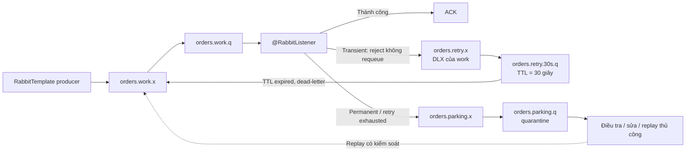
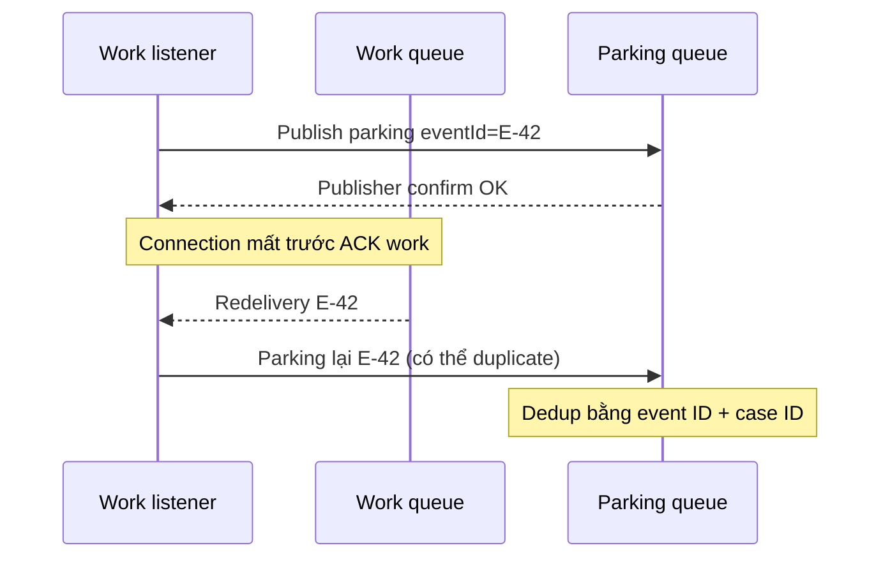
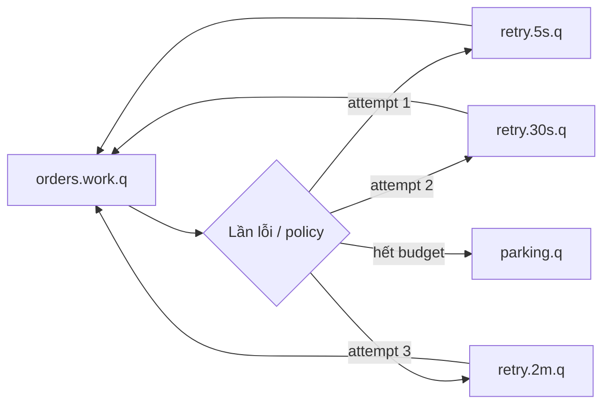
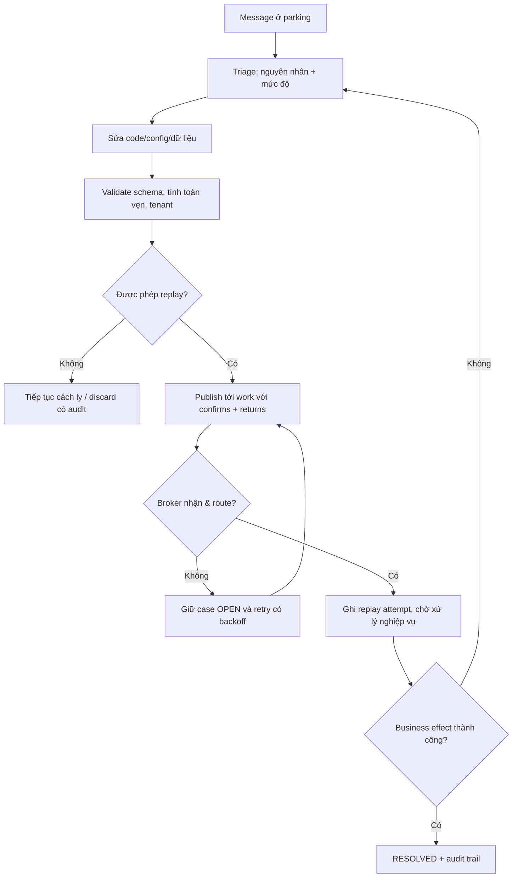

# Retry queue, DLQ và khu vực xử lý thông điệp lỗi

Trong hệ thống Spring AMQP, message có thể thất bại vì **mạng tạm thời gián đoạn, cơ sở dữ liệu quá tải, API đối tác trả 503, payload sai schema hoặc một ràng buộc nghiệp vụ không bao giờ thỏa**. Nếu mọi exception đều được `basicNack(requeue=true)` ngay lập tức, consumer có thể xử lý mãi một message lỗi và làm nghẽn những message hợp lệ. Nếu mọi lỗi đều bị loại bỏ, hệ thống có thể mất sự kiện nghiệp vụ quan trọng.

Một thiết kế vận hành tốt thường tách thành ba vùng:

- **Retry queue**: vùng chờ cho lỗi *có thể hồi phục*, có **thời gian trì hoãn**, **giới hạn số lần thử** và khả năng quan sát.
- **Dead-letter queue (DLQ)**: hàng đợi nhận message bị dead-letter bởi **broker** khi reject không requeue, hết TTL, vượt giới hạn độ dài hoặc vượt delivery limit trên quorum queue.
- **Parking lot / quarantine**: khu vực **cách ly cuối cùng** để người vận hành phân loại, sửa nguyên nhân, lưu bằng chứng và quyết định có replay message hay không.

Ba vùng không bắt buộc là ba queue riêng trong mọi kiến trúc. Một DLQ có thể đồng thời đóng vai trò parking lot, nhưng **retry queue, DLQ và parking lot có mục đích, thời hạn lưu, quyền truy cập và quy trình xử lý khác nhau**. Phải xác định điều gì tự động thử lại và điều gì cần con người can thiệp.

Bài học thuộc chương **Mẫu tích hợp** của module **SPRING_AMQP**. Ta dùng `RabbitTemplate`, `@RabbitListener`, exchange, queue, binding, ACK/NACK, Spring Retry, dead-letter, giao dịch và quan sát hệ thống để xây một luồng xử lý bất đồng bộ đáng tin cậy.

> **Nguyên tắc:** *Retry không phải là chiến lược bảo đảm dữ liệu.* Chỉ retry khi lỗi có khả năng biến mất; không ACK trước khi nghiệp vụ hoặc việc chuyển message sang vùng an toàn đã được xác nhận; mọi đường redelivery phải chịu được duplicate.

## 1. Mục tiêu học tập

Sau bài này, bạn có thể:

1. Phân loại lỗi thành **transient**, **permanent**, **unknown** và **infrastructure** thay vì retry mọi exception.
2. Phân biệt **retry tại listener** (Spring Retry) với **retry qua broker** (TTL + dead-letter exchange).
3. Thiết kế topology `work queue → retry queue → work queue` và luồng riêng sang **parking lot**.
4. Giải thích chính xác khi nào broker dead-letter và ý nghĩa `x-death`, `reason`, `count`, `x-delivery-count`, `retry_count`.
5. Xây Java config cho exchange/queue/binding, listener phân loại exception và publisher đưa message sang parking lot với publisher confirms.
6. Ngăn retry loop vô hạn, giới hạn thời gian chờ/backoff, xử lý lỗi khi parking publisher cũng thất bại.
7. So sánh TTL retry với delayed retry native của **RabbitMQ 4.3+** trên quorum queue và các giới hạn an toàn DLX.
8. Tạo quy trình điều tra, sửa lỗi, replay có kiểm soát, lưu dấu audit và idempotency.
9. Thiết kế metric, alert và integration tests bao phủ happy path, transient failure, poison message, DLQ và replay.

## 2. Retry không đồng nghĩa requeue, và DLQ không tự sửa lỗi

Một delivery trong RabbitMQ AMQP 0-9-1 có các kết cục quan trọng:

| Kết cục | Phản ứng của broker | Mục đích |
| --- | --- | --- |
| `basicAck` | Loại delivery đã xử lý ra khỏi work queue. | Hoàn tất nghiệp vụ hoặc đã bàn giao an toàn tới đích mới. |
| `basicNack(requeue=true)` | Đưa message trở lại queue để giao lại; thường **không có delay** mặc định. | Phục hồi lỗi rất ngắn, nhưng có nguy cơ vòng lặp nóng. |
| `basicNack(requeue=false)` hoặc `basicReject(requeue=false)` | Reject; nếu queue có DLX thì broker dead-letter, nếu không message có thể bị loại bỏ. | Đưa message sang tuyến lỗi đã cấu hình. |
| Message TTL hết hạn | Broker dead-letter theo DLX của **queue chứa message** nếu đã cấu hình. | Kết thúc khoảng chờ retry trong delay queue. |
| Quorum queue vượt `delivery-limit` | Broker drop hoặc dead-letter tùy DLX. | Chặn poison message bị redeliver quá nhiều. |

**Tránh hiểu nhầm:** `basicNack(requeue=true)` không tự đưa message vào DLQ; nó yêu cầu giao lại trên cùng queue. **DLQ không phải một chức năng "retry after 30 seconds" tự có**. Muốn trì hoãn, cần thiết kế TTL queue, delayed exchange, native delayed retry hoặc một scheduler khác.

Với `@RabbitListener` dùng `AcknowledgeMode.AUTO`, bạn thường không tự gọi `basicAck`:

- Method **return bình thường** → container ACK delivery theo cấu hình.
- Method **ném exception** → container/error handler quyết định requeue hoặc reject.
- Ném `AmqpRejectAndDontRequeueException` → reject không requeue, bất kể `defaultRequeueRejected`.
- Ném `ImmediateRequeueAmqpException` → yêu cầu requeue ngay, bất kể `defaultRequeueRejected`; rất dễ hot-loop nếu dùng sai.

### Phân loại exception trước khi quyết định

| Nhóm lỗi | Ví dụ | Retry ngay? | Retry trễ? | Parking/quarantine? |
| --- | --- | --- | --- | --- |
| **Transient** | HTTP 429/503, kết nối DB chập chờn, lock timeout | Chỉ rất ít lần khi phù hợp | **Có**, bounded backoff | Sau khi hết retry budget |
| **Permanent – dữ liệu** | JSON sai, schema không hỗ trợ, thiếu trường bắt buộc | Không | Không | **Có**, lưu bằng chứng |
| **Permanent – nghiệp vụ** | Event vi phạm invariant, ID không hợp lệ, currency không hỗ trợ | Không | Thường không | Có, hoặc xử lý theo quy tắc domain |
| **Infrastructure/config** | Broker thiếu exchange, sai credentials, DLX không có binding | Không giải quyết bằng retry nóng | Có thể tạm trì hoãn sau alert | Cần can thiệp cấu hình |
| **Unknown** | Exception chưa phân loại, lỗi code mới | Không vô hạn | Một budget nhỏ nếu cần | **Có**, đồng thời alert |
| **Duplicate event** | Event đã COMMIT nhưng ACK mất | Không cần chạy nghiệp vụ lại | Không cần | Không; xử lý idempotent rồi ACK |

**Không retry vì thấy exception:** phải hỏi liệu một lần thử sau có cơ sở để thành công không, tổng chi phí các lần thử là bao nhiêu và đâu là thời điểm dừng.

## 3. Bức tranh kiến trúc

Một lựa chọn thực hành có tính minh họa là **TTL retry một mức delay**, luồng parking do ứng dụng chủ động publish:



**Đọc sơ đồ theo trách nhiệm:**

1. Producer chỉ publish **sự kiện nghiệp vụ** vào `orders.work.x` bằng routing key đúng.
2. Listener xử lý thành công thì ACK.
3. Khi gặp lỗi transient còn retry budget, listener **reject không requeue**, broker dead-letter từ work queue vào retry exchange và retry queue.
4. Retry queue **không có business consumer**. Khi TTL hết hạn, broker dead-letter message về work exchange.
5. Listener nhận lại event, kiểm tra lịch sử retry và quyết định xử lý, chờ thêm hoặc chuyển **parking**.
6. Khi lỗi permanent hoặc vượt số lần thử, ứng dụng publish message **tới parking exchange**, chờ xác nhận publish an toàn rồi **return bình thường để ACK bản delivery gốc**.
7. Không có tuyến tự động từ parking queue trở lại work queue. Replay chỉ diễn ra qua quy trình có kiểm soát.

**Cần phân biệt:** đường work → retry và retry → work là **broker dead-lettering**; đường work → parking trong mẫu này là **application republish**. Vì một queue chỉ có một cấu hình DLX chính, không thể chỉ dựa vào một `x-dead-letter-exchange` trên work queue để tự động chọn hai tuyến khác nhau theo loại exception; phải thêm application logic hoặc thiết kế topology khác.

### 3.1 Retry queue, DLQ, parking lot: mục đích khác nhau

| Loại vùng | Ai chuyển message vào? | Có tự quay về work không? | Thời hạn lưu và người xử lý |
| --- | --- | --- | --- |
| **Retry/delay queue** | Broker DLX hoặc producer/recoverer | **Có**, khi hết delay hoặc lịch trình đến hạn | Ngắn; máy xử lý, có giới hạn |
| **DLQ** | Broker khi dead-letter | **Không mặc định** | Theo policy; ứng dụng/operator điều tra |
| **Parking lot** | Ứng dụng sau khi phân loại hoặc operator | **Không** | Dài hơn; có trạng thái case/audit và replay được duyệt |
| **Error database/table** | Recovery service hoặc error handler | Không | Truy vết, báo cáo, thao tác thủ công |
| **Error stream** | Producer/consumer ứng dụng hoặc broker | Tùy | Retention/replay riêng, thường không dùng semantics ACK queue |

Một DLQ có thể được gọi là parking lot nếu thực sự có quy trình quản trị, retention, quyền truy cập và khả năng replay; **đổi tên queue không tự tạo quy trình xử lý lỗi**.

## 4. Dead-letter thực sự xảy ra khi nào?

RabbitMQ dead-letter một message khi:

1. Consumer `basic.reject`/`basic.nack` với `requeue=false`.
2. Message hết **message TTL** trong queue.
3. Queue vượt giới hạn độ dài và message bị drop theo overflow policy.
4. Quorum queue vượt giới hạn delivery theo cấu hình.

**Queue expiration (hết TTL của chính queue)** không tương đương message TTL: khi một queue hết hạn và bị xóa, message của nó **không được dead-letter** như khi từng message hết TTL.

DLX là **một exchange bình thường**. Queue phải cấu hình DLX, và exchange/binding target phải tồn tại. Nếu DLX hoặc target queue không có, dead-letter có thể bị mất tùy loại queue/strategy. Đừng coi một queue tên `*.dlq` là an toàn nếu chưa test đường routing.

### 4.1 Policy so với x-arguments

Có hai cách gắn DLX/TTL lên queue:

- **Queue arguments**: `x-dead-letter-exchange`, `x-dead-letter-routing-key`, `x-message-ttl` hoặc qua Spring `QueueBuilder`.
- **RabbitMQ policies**: broker áp dụng DLX/TTL cho nhóm queue theo regex và policy priority.

RabbitMQ khuyến nghị dùng **policies** cho DLX khi vận hành vì thay đổi mà không phải xóa/redeclare queue. Arguments hard-coded trong ứng dụng có thể không thay đổi được khi queue đã tồn tại, và có thể ưu tiên hơn policy. Bài này dùng `QueueBuilder` để dễ hình dung; production cân nhắc provisioning bằng policies/IaC.

### 4.2 Khi message TTL hết hạn

Dùng **queue-level message TTL**, ví dụ `x-message-ttl=30000` (30 giây), tránh trộn với `x-expires` (TTL của **queue**).

- Message được giữ trong retry queue tối thiểu theo cơ chế TTL trước khi được xem xét dead-letter.
- Expired message thường chỉ được loại/dead-letter khi tới **đầu queue** hoặc qua các sự kiện quản lý TTL; đừng kỳ vọng timer chính xác từng mili giây.
- Per-message TTL khác nhau trên cùng queue dễ có **head-of-line blocking**: message đã hết hạn phía sau message chưa hết hạn có thể chờ lâu.
- Khi dead-letter vì hết TTL, RabbitMQ ghi reason `expired` vào lịch sử death.

**Khuyến nghị cho TTL retry:** dùng delay queue riêng cho từng mức thời gian, với queue-level TTL cố định, hoặc một cơ chế delayed delivery được broker hỗ trợ.

## 5. Khai báo topology với Spring AMQP

Ví dụ dựa trên **Spring Boot 3.5 / Spring AMQP 3.2**, RabbitMQ 4.2; JDK 17+. Dùng `spring-boot-starter-amqp` để có `RabbitTemplate`, `@RabbitListener`, `RabbitAdmin` và kết nối được Boot quản lý.

### 5.1 Các exchange và queue

```java
import org.springframework.amqp.core.Binding;
import org.springframework.amqp.core.BindingBuilder;
import org.springframework.amqp.core.DirectExchange;
import org.springframework.amqp.core.Queue;
import org.springframework.amqp.core.QueueBuilder;
import org.springframework.beans.factory.annotation.Qualifier;
import org.springframework.context.annotation.Bean;
import org.springframework.context.annotation.Configuration;

@Configuration
public class RetryTopology {

    public static final String WORK_X = "orders.work.x";
    public static final String WORK_KEY = "orders.created";
    public static final String WORK_Q = "orders.work.q";

    public static final String RETRY_X = "orders.retry.x";
    public static final String RETRY_KEY = "wait.30s";
    public static final String RETRY_Q = "orders.retry.30s.q";

    public static final String PARK_X = "orders.parking.x";
    public static final String PARK_KEY = "orders.failed";
    public static final String PARK_Q = "orders.parking.q";

    @Bean
    DirectExchange workExchange() {
        return new DirectExchange(WORK_X);
    }

    @Bean
    DirectExchange retryExchange() {
        return new DirectExchange(RETRY_X);
    }

    @Bean
    DirectExchange parkingExchange() {
        return new DirectExchange(PARK_X);
    }

    @Bean
    Queue workQueue() {
        return QueueBuilder.durable(WORK_Q)
            .deadLetterExchange(RETRY_X)
            .deadLetterRoutingKey(RETRY_KEY)
            .build();
    }

    @Bean
    Queue retryQueue() {
        return QueueBuilder.durable(RETRY_Q)
            .ttl(30_000)
            .deadLetterExchange(WORK_X)
            .deadLetterRoutingKey(WORK_KEY)
            .build();
    }

    @Bean
    Queue parkingQueue() {
        return QueueBuilder.durable(PARK_Q).build();
    }

    @Bean
    Binding workBinding(
            @Qualifier("workQueue") Queue queue,
            @Qualifier("workExchange") DirectExchange exchange) {
        return BindingBuilder.bind(queue)
            .to(exchange).with(WORK_KEY);
    }

    @Bean
    Binding retryBinding(
            @Qualifier("retryQueue") Queue queue,
            @Qualifier("retryExchange") DirectExchange exchange) {
        return BindingBuilder.bind(queue)
            .to(exchange).with(RETRY_KEY);
    }

    @Bean
    Binding parkingBinding(
            @Qualifier("parkingQueue") Queue queue,
            @Qualifier("parkingExchange") DirectExchange exchange) {
        return BindingBuilder.bind(queue)
            .to(exchange).with(PARK_KEY);
    }
}
```

Các queue/exchange/binding trên là `@Bean` để `RabbitAdmin` của Spring Boot có thể khai báo với broker khi có connection AMQP 0-9-1. **Không** tạo listener cho `RETRY_Q`: đây là queue chỉ dùng để chờ TTL và dead-letter quay về work. Nếu một consumer vô tình ACK message ở retry queue, nó sẽ không bao giờ tự quay về work.

### 5.2 Bảng routing cần kiểm tra trên broker

| Nguồn | Exchange | Routing key | Đích |
| --- | --- | --- | --- |
| Publisher | `orders.work.x` | `orders.created` | `orders.work.q` |
| Work queue bị reject | `orders.retry.x` | `wait.30s` | `orders.retry.30s.q` |
| Retry queue message expired | `orders.work.x` | `orders.created` | `orders.work.q` |
| Ứng dụng chủ động parking | `orders.parking.x` | `orders.failed` | `orders.parking.q` |
| Operator replay đã duyệt | `orders.work.x` | `orders.created` | `orders.work.q` |

Nếu sai một binding, message có thể biến mất khỏi tuyến mong đợi. Đặc biệt, **publisher confirm ACK không tự chứng minh message đã route tới một queue**; bật `mandatory/returns` khi application tự republish.

### 5.3 Cấu hình Boot để tránh retry nóng và xác minh publish

```yaml
spring:
  rabbitmq:
    publisher-confirm-type: correlated
    publisher-returns: true
    template:
      mandatory: true
    listener:
      type: simple
      simple:
        acknowledge-mode: auto
        concurrency: 2
        prefetch: 10
        default-requeue-rejected: false
        retry:
          enabled: false
```

Trong **mẫu TTL broker retry**, Spring Retry tại listener được tắt có chủ đích: **mỗi lần listener thất bại chỉ tạo một lần delayed retry**, giúp đếm budget rõ ràng. Nếu bật đồng thời Spring Retry ở listener, một vòng TTL có thể chứa nhiều lần thử nội bộ và tổng attempts tăng đáng kể.

- `default-requeue-rejected: false`: exception thoát khỏi listener thường bị reject không requeue, vì vậy message đi vào DLX của work queue.
- `AmqpRejectAndDontRequeueException` cũng buộc reject không requeue, ngay cả khi một factory khác đặt default true.
- `AcknowledgeMode.AUTO`: ACK sau khi method return bình thường; không phải AMQP auto-ack mode `NONE`.
- `publisher-confirm-type: correlated`, `publisher-returns` và `mandatory` giúp kiểm tra **application republish sang parking**.
- `prefetch=10` không phải số lần retry. Với nhiều consumer, số message chưa ACK có thể lên tới `concurrency × prefetch` (xấp xỉ, còn phụ thuộc container/replicas).

**Lưu ý:** nếu dùng một `SimpleRabbitListenerContainerFactory` tự tạo và khai báo `containerFactory` riêng, cần áp dụng chính sách này trên **factory thực tế**; không cho rằng Boot property luôn sửa mọi custom factory.

## 6. x-death: cơ sở đếm broker-side retry

RabbitMQ ghi **lịch sử dead-letter** trong header `x-death`. Đây là một mảng các map, mỗi map đại diện cho cặp **(queue, reason)**. Các entry được broker gộp/compress theo cặp, gồm những trường như:

| Trường | Ý nghĩa |
| --- | --- |
| `queue` | Queue nơi message bị dead-letter. |
| `reason` | `rejected`, `expired`, `maxlen` hoặc `delivery_limit`. |
| `count` | Số lần death cho **queue + reason** tương ứng. |
| `first-time` / `last-time` | Lần đầu/lần gần nhất broker dead-letter theo cặp. |
| `exchange`, `routing-keys` | Nơi message được publish trước death. |

Trong topology của bài:

- Mỗi lần **work** reject để retry: `queue=orders.work.q, reason=rejected` tăng 1.
- Mỗi lần hết TTL ở **retry**: `queue=orders.retry.30s.q, reason=expired` tăng 1.

Hai con số thường cùng tăng theo vòng retry, nhưng **không bao giờ lấy tổng mọi `x-death.count` làm số retry nghiệp vụ**. Message có thể đi qua nhiều DLX/reasons và các trường có ý nghĩa khác nhau.

### 6.1 Helper Java đọc đúng entry

```java
import java.util.List;
import java.util.Map;
import org.springframework.amqp.core.Message;

public final class RetryHistory {
    private RetryHistory() {}

    public static long workRejections(Message message) {
        Object value = message.getMessageProperties()
            .getHeaders().get("x-death");

        if (!(value instanceof List<?> entries)) {
            return 0L; // Delivery đầu tiên thường chưa có x-death.
        }

        for (Object entry : entries) {
            if (!(entry instanceof Map<?, ?> death)) {
                continue;
            }
            if (!RetryTopology.WORK_Q.equals(
                        String.valueOf(death.get("queue")))) {
                continue;
            }
            if (!"rejected".equals(
                        String.valueOf(death.get("reason")))) {
                continue;
            }

            Object count = death.get("count");
            return count instanceof Number number
                    ? number.longValue() : 0L;
        }

        return 0L;
    }
}
```

Đoạn code cố ý **không giả định entry đầu tiên** là work queue: thứ tự mảng thường ưu tiên death gần nhất, nên entry đầu tiên có thể thuộc retry queue với reason `expired`. Từng thư viện/phiên bản có cách biểu diễn header khác nhau, nên integration test cần xác nhận `x-death` thực tế trên broker đang chạy.

### 6.2 Cảnh giác RabbitMQ 4.x và x-death do client tự gửi

RabbitMQ **4.0 trở đi** không còn xem `x-death` do application client gửi khi **republish** là lịch sử death do broker tạo. Không tự sao chép `x-death` từ message nhận được vào một message mới rồi mong broker cộng tiếp count như trước.

Spring AMQP **3.2+** có hỗ trợ `MessageProperties.getRetryCount()` và `incrementRetryCount()` cho trường hợp **application tự republish**; khi thiếu `retry_count` và có broker DLX, framework có logic mapping từ `x-death.count`. Với kiến trúc tự republish, cần **tự tăng `retry_count`** hoặc dùng application header của riêng bạn, ví dụ `app_retry_attempt`, và kiểm thử đúng phiên bản.

**Mẫu chính trong bài dùng broker dead-letter work ↔ retry**, không phải client republish để retry. Vì vậy, `x-death` do **broker** cập nhật qua mỗi vòng death là lựa chọn phù hợp; publisher parking **không** cố gửi lại header `x-death`.

### 6.3 Ví dụ số lần xử lý

Đặt `MAX_DELAYED_RETRIES = 3`, TTL = 30 giây:

| Lần listener chạy | Work rejections đã ghi trước lần này | Nếu vẫn lỗi transient |
| --- | --- | --- |
| **1** (t≈0) | 0 | Reject → retry #1. |
| **2** (t≈30s) | 1 | Reject → retry #2. |
| **3** (t≈60s) | 2 | Reject → retry #3. |
| **4** (t≈90s) | 3 | **Đã hết budget** → publish parking, chờ confirm, rồi ACK. |

Tổng tối đa có chủ đích là **4 lần business attempt** (lần đầu + 3 lần retry trễ), không phải ba lần chạy listener. Thời gian trên chỉ là minh họa; TTL/dead-letter, scheduling, backlog và broker readiness không đảm bảo đúng mốc tuyệt đối.

## 7. Producer: giữ event ID ổn định

Một lần publish đơn giản bằng `RabbitTemplate`:

```java
import java.util.UUID;
import com.fasterxml.jackson.databind.ObjectMapper;
import org.springframework.amqp.core.MessageDeliveryMode;
import org.springframework.amqp.rabbit.core.RabbitTemplate;
import org.springframework.stereotype.Service;

record OrderCreated(UUID eventId, String orderId, long amountMinor) {}

@Service
public class OrderPublisher {
    private final RabbitTemplate rabbit;
    private final ObjectMapper mapper;

    public OrderPublisher(RabbitTemplate rabbit, ObjectMapper mapper) {
        this.rabbit = rabbit;
        this.mapper = mapper;
    }

    public void publish(OrderCreated event) throws Exception {
        if (event.eventId() == null) {
            throw new IllegalArgumentException("Missing eventId");
        }
        String json = mapper.writeValueAsString(event);

        rabbit.convertAndSend(
            RetryTopology.WORK_X,
            RetryTopology.WORK_KEY,
            json,
            message -> {
                message.getMessageProperties()
                    .setMessageId(event.eventId().toString());
                message.getMessageProperties()
                    .setDeliveryMode(MessageDeliveryMode.PERSISTENT);
                return message;
            });
    }
}
```

Với Spring `SimpleMessageConverter` mặc định, gửi **String JSON** sẽ có AMQP text body (thường `text/plain`) và `@RabbitListener(Message)` có thể tự parse bytes bằng Jackson. Nếu muốn một JSON converter thống nhất, hãy cấu hình producer/consumer cùng hợp đồng; đừng tự đổi content type thành JSON rồi vẫn giả định String tự được converter giống nhau ở mọi version.

**Ví dụ trên chưa đợi publisher confirms.** Khi cần bảo đảm event không mất giữa DB commit và publish, producer nên dùng **transactional outbox** cộng correlated confirms và returns. Mất confirm có thể khiến producer retry cùng event; **không cấp eventId mới cho cùng logical event**.

## 8. Parking lot: publish xác nhận trước khi ACK delivery cũ

Khi listener đã quyết định không tiếp tục xử lý tự động, nó phải **bàn giao an toàn** bản message lỗi sang parking lot. Không nên:

```text
ACK bản work message
    -> publish parking
    -> publish thất bại
    -> mất cả bản work và parking
```

Thứ tự an toàn hơn:

```text
Publish parking message
    -> chờ publisher confirm dương
    -> kiểm tra message đã route được (mandatory return)
    -> listener return bình thường
    -> container ACK delivery gốc
```

Vẫn có cửa sổ duplicate: parking publish thành công nhưng ACK work bị mất, work message có thể quay lại và được publish parking lần nữa. Vì vậy **parking case phải dedup theo event ID + failure episode**, hoặc reconciliation/replay phải chịu được bản sao.

### 8.1 ParkingPublisher có confirms và returns

```java
import java.util.UUID;
import java.util.concurrent.TimeUnit;
import org.springframework.amqp.core.Message;
import org.springframework.amqp.core.MessageDeliveryMode;
import org.springframework.amqp.core.MessageProperties;
import org.springframework.amqp.rabbit.connection.CorrelationData;
import org.springframework.amqp.rabbit.core.RabbitTemplate;
import org.springframework.stereotype.Component;

@Component
public class ParkingPublisher {
    private final RabbitTemplate rabbit;

    public ParkingPublisher(RabbitTemplate rabbit) {
        this.rabbit = rabbit;
    }

    public void parkAfterConfirm(
            Message original,
            String category,
            long previousRejects,
            Exception cause) throws Exception {

        MessageProperties meta = new MessageProperties();
        meta.setDeliveryMode(MessageDeliveryMode.PERSISTENT);
        meta.setContentType(
            original.getMessageProperties().getContentType());

        // Message ID gốc phải ổn định để điều tra/dedup.
        String originalId = original.getMessageProperties()
            .getMessageId();
        if (originalId != null) {
            meta.setMessageId(originalId);
        }

        // Không sao chép x-death của broker vào message mới.
        meta.setHeader("app_error_category", category);
        meta.setHeader("app_original_queue", RetryTopology.WORK_Q);
        meta.setHeader("app_previous_rejections", previousRejects);
        meta.setHeader("app_exception_type",
                       cause.getClass().getSimpleName());

        Message parkingMessage =
            new Message(original.getBody(), meta);

        CorrelationData correlation =
            new CorrelationData(UUID.randomUUID().toString());

        rabbit.send(
            RetryTopology.PARK_X,
            RetryTopology.PARK_KEY,
            parkingMessage,
            correlation);

        var confirm = correlation.getFuture()
            .get(10, TimeUnit.SECONDS);

        if (!confirm.isAck()) {
            throw new IllegalStateException(
                "Parking publish NACK: " + confirm.getReason());
        }
        if (correlation.getReturned() != null) {
            throw new IllegalStateException(
                "Parking message was unroutable");
        }
    }
}
```

Code sử dụng `spring.rabbitmq.publisher-confirm-type=correlated`, `publisher-returns=true` và `template.mandatory=true` ở mục 5. Cần các cấu hình này để `CorrelationData.getFuture()` và `getReturned()` mang ý nghĩa như ví dụ.

**Giới hạn cần hiểu:**

- `get(10, TimeUnit.SECONDS)` chờ đồng bộ trong listener; đây là lựa chọn dễ học, có thể làm giảm throughput. Production có thể chuyển sang **outbox parking** hoặc bộ chuyển tiếp riêng để tránh giữ consumer thread lâu.
- Nếu parking exchange/queue bị lỗi, method ném exception và **không ACK work**. Với topology hiện tại và `defaultRequeueRejected=false`, bản work sẽ bị dead-letter **vào retry queue**, sau đó thử parking lại. Đây là đường fallback có delay nhưng vẫn cần **alert nghiêm trọng** vì broker DLX có thể không bảo đảm truyền an toàn mặc định.
- Confirm **không bảo đảm exactly-once** giữa hai queue; cùng event có thể xuất hiện hai lần ở parking.
- Không nhúng toàn bộ stack trace hoặc thông tin nhạy cảm vào headers. Dùng error code/exception class hữu hạn; lưu stack trace đã redacted ở hệ thống điều tra riêng.
- Dùng `app_*` headers cho metadata do ứng dụng kiểm soát, không giả làm `x-death` của broker.

### 8.2 Điều gì xảy ra nếu park được nhưng work ACK thất bại?



**Không dùng số message hiện diện trong parking queue làm số case duy nhất.** Một message có thể được chuyển nhiều lần sau sự cố ACK/confirm. Hệ thống quản trị nên có bảng `parking_cases` hoặc unique key để phân biệt case, lần gửi và lần xử lý.

## 9. Listener: xử lý, retry trễ hoặc parking

Ví dụ nhận **raw Spring AMQP Message** để đọc `x-death`. Ta phân loại lỗi parse JSON/invariant là permanent, lỗi downstream đã biết là transient, lỗi chưa phân loại được đưa vào parking để điều tra. Các exception `TransientOrderException` và `InvalidOrderException` là **class do ứng dụng tự định nghĩa**, không phải Spring AMQP built-in.

```java
import com.fasterxml.jackson.core.JsonProcessingException;
import com.fasterxml.jackson.databind.ObjectMapper;
import org.springframework.amqp.AmqpRejectAndDontRequeueException;
import org.springframework.amqp.core.Message;
import org.springframework.amqp.rabbit.annotation.RabbitListener;
import org.springframework.stereotype.Component;

@Component
public class OrderWorkListener {
    private static final long MAX_DELAYED_RETRIES = 3L;

    private final ObjectMapper mapper;
    private final OrderProcessor processor;
    private final ParkingPublisher parking;

    public OrderWorkListener(
            ObjectMapper mapper,
            OrderProcessor processor,
            ParkingPublisher parking) {
        this.mapper = mapper;
        this.processor = processor;
        this.parking = parking;
    }

    @RabbitListener(queues = RetryTopology.WORK_Q)
    public void consume(Message incoming) throws Exception {
        long priorRejects = RetryHistory.workRejections(incoming);

        try {
            OrderCreated event = mapper.readValue(
                incoming.getBody(), OrderCreated.class);

            if (event.eventId() == null
                    || event.orderId() == null
                    || event.orderId().isBlank()
                    || event.amountMinor() <= 0) {
                throw new InvalidOrderException(
                    "Order event has invalid fields");
            }

            // Phương thức của bean riêng, transaction commit
            // trước khi return từ listener.
            processor.processOnce(event);
        }
        catch (JsonProcessingException | InvalidOrderException ex) {
            // Permanent: không retry dữ liệu sai schema/invariant.
            parking.parkAfterConfirm(
                incoming, "PERMANENT", priorRejects, ex);
        }
        catch (TransientOrderException ex) {
            if (priorRejects < MAX_DELAYED_RETRIES) {
                // Work DLX -> retry queue TTL -> work.
                throw new AmqpRejectAndDontRequeueException(
                    "Delayed retry after transient failure", ex);
            }
            parking.parkAfterConfirm(
                incoming, "RETRY_EXHAUSTED", priorRejects, ex);
        }
        catch (Exception ex) {
            // Unknown: cách ly và alert, tránh retry vô hạn.
            parking.parkAfterConfirm(
                incoming, "UNCLASSIFIED", priorRejects, ex);
        }

        // AUTO ACK khi return bình thường, kể cả sau khi
        // parkAfterConfirm() đã xác nhận parking an toàn.
    }
}
```

Đặt hai custom exception tương ứng trong ứng dụng:

```java
public class InvalidOrderException extends RuntimeException {
    public InvalidOrderException(String message) {
        super(message);
    }
}

// Đặt ở file Java riêng nếu khai báo public.
public class TransientOrderException extends RuntimeException {
    public TransientOrderException(String message, Throwable cause) {
        super(message, cause);
    }
}
```

Một class public phải được đặt trong file Java trùng tên; đoạn trên là **hai class mẫu** chứ không phải hai public class để đặt chung vào một file. `OrderProcessor` được triển khai ở mục 10.

### Điểm đặc biệt khi parking publisher thất bại

Exception ném ra từ bên trong một nhánh `catch` khi gọi `parking.parkAfterConfirm(...)` **không bị các `catch` còn lại của cùng câu lệnh `try` bắt lại**. Nó thoát khỏi listener, nên với `defaultRequeueRejected=false` container reject work message vào retry queue. Điều đó làm đường lỗi parking có cơ hội thử lại sau TTL, thay vì ACK trước khi parking thành công.

Đây vẫn chỉ là **bảo vệ best-effort** nếu DLX của broker mặc định at-most-once. Nếu nghiệp vụ đòi hỏi tránh thất thoát khi parking infrastructure không sẵn sàng, cần **outbox/durable case record**, cấu hình DLX an toàn hoặc một giao thức bàn giao có theo dõi.

### Tại sao không gọi `rabbitTemplate.send(RETRY_X, ...)` rồi return ngay?

Nếu application tự republish và sau đó ACK gốc, sẽ có **khoảng trống không atomic**. Nếu gửi chưa được broker xác nhận nhưng listener return và ACK, message có thể mất. Nếu gửi thành công nhưng ACK gốc mất, có thể tạo duplicate. Dùng publisher confirms/returns và idempotency, hoặc chọn broker DLX như ví dụ hiện tại, để làm rõ ai chịu trách nhiệm chuyển message.

## 10. Idempotency và giao dịch: bắt buộc khi có retry

Retry, broker restart và publish lại có thể dẫn đến **at-least-once delivery**: cùng event được xử lý nhiều lần. Cần tách **số lần nhận message** khỏi **số lần tạo business effect**.

Một thiết kế PostgreSQL đơn giản:

```sql
CREATE TABLE processed_events (
    consumer_name TEXT NOT NULL,
    event_id UUID NOT NULL,
    processed_at TIMESTAMPTZ NOT NULL DEFAULT now(),
    PRIMARY KEY (consumer_name, event_id)
);

CREATE TABLE order_projection (
    order_id TEXT PRIMARY KEY,
    amount_minor BIGINT NOT NULL,
    updated_at TIMESTAMPTZ NOT NULL DEFAULT now()
);
```

Service riêng có transaction:

```java
import org.springframework.jdbc.core.JdbcTemplate;
import org.springframework.stereotype.Service;
import org.springframework.transaction.annotation.Transactional;

@Service
public class OrderProcessor {
    private static final String CONSUMER = "orders-projection";
    private final JdbcTemplate jdbc;

    public OrderProcessor(JdbcTemplate jdbc) {
        this.jdbc = jdbc;
    }

    @Transactional
    public void processOnce(OrderCreated event) {
        int claimed = jdbc.update(
            """
            INSERT INTO processed_events(consumer_name, event_id)
            VALUES (?, ?)
            ON CONFLICT (consumer_name, event_id) DO NOTHING
            """,
            CONSUMER, event.eventId());

        if (claimed == 0) {
            return; // Duplicate delivery: không áp dụng lần hai.
        }

        jdbc.update(
            """
            INSERT INTO order_projection(order_id, amount_minor)
            VALUES (?, ?)
            ON CONFLICT (order_id)
            DO UPDATE SET amount_minor = EXCLUDED.amount_minor,
                          updated_at = now()
            """,
            event.orderId(), event.amountMinor());
    }
}
```

Với giả định event có ID ổn định:

1. Lần đầu thành công → marker + projection **COMMIT cùng transaction**.
2. Connection chết trước ACK → broker giao lại.
3. Lần sau, unique constraint đã có marker → service return, **không ghi hiệu ứng hai lần**.
4. Listener return bình thường → ACK lại delivery hiện tại.

Nếu `processOnce` gặp deadlock/timeout DB, transaction **rollback marker và projection**; lỗi có thể được ánh xạ tới `TransientOrderException` tại boundary thích hợp để retry trễ. Ví dụ service ở trên dùng Spring JDBC và chưa tự phân loại `DataAccessException`: trong ứng dụng thật cần phân biệt lỗi transient với lỗi schema/migration và mapping vào các exception đã định nghĩa.

**Lưu ý:** unique `eventId` ngăn duplicate event, không tự phát hiện **cùng ID nhưng payload khác**. Với event quan trọng, lưu thêm fingerprint/schema version và cảnh báo khi một ID có nội dung mâu thuẫn.

## 11. Retry budget và deadline tổng thể

Có hai loại giới hạn cần đồng thời đặt:

- **Attempt budget**: số lần listener được phép thử cho một event (ví dụ lần đầu + 3 delayed retries).
- **Time budget / deadline**: tổng thời gian từ lúc event được tạo tới khi phải thành công hoặc bàn giao cho parking (ví dụ 15 phút), tránh kéo dài vô hạn vì broker outage hoặc backlog.

Ví dụ:

```text
t = 00:00    attempt #1 thất bại -> retry 30s
t = 00:30    attempt #2 thất bại -> retry 30s
t = 01:00    attempt #3 thất bại -> retry 30s
t = 01:30    attempt #4 thất bại -> parking

Nếu broker ngừng 10 phút trước attempt #4:
  thực tế event có thể chờ > 11 phút dù chỉ ba lần delay.
```

Không xem TTL = 30 giây là cam kết **latency chính xác**. Queue/backlog/broker availability làm thời gian chờ biến động.

### Retry amplification khi xếp nhiều tầng

Giả sử đồng thời có:

- HTTP SDK retry 3 lần trong một business attempt.
- Spring Retry chạy 4 attempts trong một listener invocation.
- Broker delayed retry 3 vòng thêm sau lần đầu (tổng 4 invocations).

Kịch bản xấu có thể gọi downstream **3 × 4 × 4 = 48 lần** cho một event. Cần ghi rõ attempt budget của mỗi tầng và tổng tải có thể tạo, nhất là khi hệ thống đang gặp sự cố diện rộng.

### Retry có jitter

Delay cố định khiến rất nhiều message thất bại cùng lúc có thể quay lại đồng loạt. Để tránh **retry storm**:

- Dùng **delay buckets** (ví dụ 5s, 30s, 2m) và phân bổ có kiểm soát.
- Với scheduler/application republish, có thể tính exponential backoff + jitter theo event ID hoặc random có giới hạn.
- Giới hạn concurrency, prefetch và rate GET/HTTP/DB của downstream.
- Dùng circuit breaker hoặc tạm dừng consumer khi downstream chắc chắn đang down.
- Alert khi retry queue tăng, thay vì chỉ tăng số attempts.

## 12. Retry ở listener bằng Spring Retry: khi nào chọn?

Không phải lỗi nào cũng cần tạo một vòng broker DLX.

**Spring Retry trong container** thực hiện lại logic xử lý quanh **cùng delivery** trước khi settle. Phù hợp với lỗi rất ngắn, ví dụ timeout DB thoáng qua trong vài trăm mili giây; mỗi lần retry giữ consumer thread và message ở trạng thái unacked.

| Tiêu chí | Spring Retry in-memory | Broker TTL retry |
| --- | --- | --- |
| Địa điểm chờ | Trong listener/container và retry advice. | Message nằm trong retry queue ở broker. |
| Có chiếm consumer thread khi backoff? | Thường **có**. | Thường **không**, consumer thread được giải phóng. |
| Chi phí | Không chuyển queue mỗi lần, nhanh với retry ngắn. | Thêm dead-letter/routing/disk, bền hơn với delay dài. |
| State | Retry state/attempt trong JVM hoặc interceptor. | Metadata broker `x-death`, queue. |
| Khi JVM restart | Retry in-memory bị gián đoạn; unacked có thể redeliver. | Message đang nằm trong queue chờ tiếp tục khi broker còn dữ liệu. |
| Hợp lỗi | Spike ngắn, transient rất nhẹ. | Downstream down vài chục giây/phút. |
| Điểm dừng | Retry policy/recoverer. | Application kiểm tra death count, TTL/deadline, terminal route. |

### 12.1 Phương án khác: work queue dead-letter trực tiếp vào DLQ

Khi không cần retry queue trì hoãn, có thể cấu hình **một DLX cuối cùng**:

```text
work queue -- RejectAndDontRequeueRecoverer --> DLX --> failed.q
```

Dùng Spring Retry advice, ví dụ một container factory riêng:

```java
import org.springframework.amqp.rabbit.config.SimpleRabbitListenerContainerFactory;
import org.springframework.amqp.rabbit.connection.ConnectionFactory;
import org.springframework.amqp.rabbit.config.RetryInterceptorBuilder;
import org.springframework.amqp.rabbit.retry.RejectAndDontRequeueRecoverer;
import org.springframework.context.annotation.Bean;

@Bean
SimpleRabbitListenerContainerFactory boundedRetryFactory(
        ConnectionFactory connectionFactory) {

    var factory = new SimpleRabbitListenerContainerFactory();
    factory.setConnectionFactory(connectionFactory);
    factory.setDefaultRequeueRejected(false);

    var advice = RetryInterceptorBuilder.stateless()
        .maxRetries(2)
        .backOffOptions(300, 2.0, 1_000)
        .recoverer(new RejectAndDontRequeueRecoverer())
        .build();

    factory.setAdviceChain(advice);
    return factory;
}
```

**Không dùng factory này trong topology work → retry của mục 5 mà chưa tính lại số attempts.** Ví dụ trên dành cho **phương án riêng** có DLX của work queue route tới **terminal DLQ**, không phải vòng TTL retry. Số lần Spring Retry thực tế phụ thuộc cách builder diễn giải `maxRetries` và version; khi test phải đo rõ **initial attempt + retries**.

Với lỗi dữ liệu permanent, `@RabbitListener` có thể ném `AmqpRejectAndDontRequeueException` ngay để không lãng phí retry. Nếu recoverer **nuốt exception rồi return**, container có thể ACK message thay vì broker dead-letter; không được xem mọi recoverer đều tương đương reject.

### 12.2 RepublishMessageRecoverer không phải broker DLX

Spring AMQP cung cấp:

- `RejectAndDontRequeueRecoverer`: sau khi retry exhausted, ném exception buộc reject, đưa vào DLX nếu broker cấu hình.
- `RepublishMessageRecoverer`: **ứng dụng publish một message mới** tới error exchange/routing key, thường thêm error headers.
- `RepublishMessageRecovererWithConfirms`: hỗ trợ chờ publisher confirms và phát hiện tình huống publish lỗi/returned theo cấu hình.

**Đánh đổi quan trọng:** recoverer republish thành công rồi return có thể làm container ACK **message gốc**. Khi republish lỗi hoặc confirm không chắc, phải quyết định rollback/requeue/park sao cho không mất dữ liệu và chịu được duplicate. Đừng chỉ thêm `RepublishMessageRecoverer` rồi mặc định có exactly-once handoff.

### 12.3 Stateless vs stateful retry

- **Stateless:** retry trong một lần listener invocation, thường dễ hiểu cho xử lý đồng bộ, một transaction được quản lý phù hợp.
- **Stateful:** giữ retry state theo message key qua delivery boundaries, cần message identity ổn định và hiểu tương tác với transaction rollback/requeue.

Stateful retry có thể hữu ích khi transaction manager yêu cầu rollback giữa attempts, nhưng setup sai (message ID thiếu, retry key không ổn định) dẫn tới các hành vi fatal khó đoán. Chọn theo transaction boundary, không chỉ theo mục tiêu giảm log lỗi.

**Batch listener** có thêm giới hạn vì một batch nhiều message khó xác định chính xác phần tử nào fail; không sao chép retry policy của listener một message vào batch mà không kiểm chứng recoverer semantics.

## 13. Tăng dần thời gian chờ bằng nhiều retry queues

Nếu 30 giây vẫn quá dày hoặc quá thưa, có thể tạo nhiều delay queues:



**Lưu ý kiến trúc:** một work queue chỉ có một DLX mặc định, nên **không thể chỉ tạo ba delay queues rồi trông chờ broker tự chọn thời gian theo attempt**. Cần thêm:

1. **Application republish** theo attempt, có publisher confirms/returns rồi ACK gốc; hoặc
2. **Router/intermediary consumer** chọn bucket theo header rồi publish an toàn; hoặc
3. Delayed exchange/scheduler hoặc **native quorum delayed retry** khi phiên bản cho phép.

Với application republish, dùng `retry_count` (Spring AMQP 3.2+) hoặc `app_retry_attempt` ổn định và **tự tăng** sau mỗi lần gửi. Đừng tin `x-death` do client gửi trên RabbitMQ 4.x.

### 13.1 Head-of-line blocking và per-message TTL

Một cách phổ biến là đưa nhiều message vào **một queue** nhưng mỗi message có TTL khác nhau. Khi message đầu queue còn TTL dài, một message phía sau đã hết TTL có thể **không được dead-letter ngay**, gây sai lệch lịch retry.

Nếu muốn delay buckets cố định, chọn **mỗi queue một `x-message-ttl`**. Nếu muốn lịch chính xác cho từng event, cân nhắc broker native delayed retry (nếu có), scheduler service hoặc hệ thống delay phù hợp và kiểm thử concurrency/order.

### 13.2 Ordering khi message được retry

Nếu event A lỗi rồi chuyển sang retry queue, work consumer có thể xử lý **B, C** trước khi A quay lại. Đây là điều bình thường của delayed retry, nhưng **có thể phá thứ tự nghiệp vụ** với cùng order ID.

Ví dụ:

```text
Order-42: A = created      -> lỗi, chuyển retry 30s
Order-42: B = paid         -> xử lý thành công
Order-42: C = shipped      -> xử lý thành công
Sau 30s: A quay lại       -> xử lý sai thứ tự
```

Các lựa chọn:

- Thiết kế handler **idempotent, state-aware**: B chỉ apply khi prerequisite tồn tại, nếu không retry theo trạng thái.
- Dùng sequence/version per aggregate và **conditional update** trong DB.
- Partition theo aggregate key và kiểm soát ordering ở consumer/workflow, chấp nhận head-of-line blocking cục bộ.
- Tránh dùng retry queue làm bảo đảm thứ tự. Một queue FIFO không thể tự giữ thứ tự khi một message bị tách ra đường delay riêng.

## 14. RabbitMQ quorum queue: delivery-limit và delayed retry native

RabbitMQ quorum queue có cơ chế **poison-message handling** với `x-delivery-count` và `delivery-limit`. Khi vượt limit, message có thể bị drop hoặc dead-letter. Từ **RabbitMQ 4.0**, mặc định delivery limit cho quorum queue thường là **20** (có thể được thay qua policy hoặc queue argument).

**Đừng coi delivery-limit là toàn bộ business retry policy.** Nó đo các lần delivery không thành công theo ngữ nghĩa broker và phiên bản, không thay thế phân loại transient/permanent, deadline nghiệp vụ hoặc thao tác parking.

### 14.1 Native delayed retry chỉ có từ RabbitMQ 4.3

**RabbitMQ 4.3+** bổ sung **delayed retry trực tiếp cho quorum queue**. Khi bật chính sách phù hợp, message được giữ trong trạng thái delayed trên chính quorum queue thay vì dead-letter qua một TTL queue riêng.

Delay theo **linear backoff** mặc định của cơ chế này:

```text
delay = min(minDelay × deliveryCount, maxDelay)
```

Có thể cấu hình bằng policy với các khóa:

- `delayed-retry-type`: `disabled`, `all`, `failed` hoặc `returned`.
- `delayed-retry-min`: delay tối thiểu (ms).
- `delayed-retry-max`: giới hạn delay (ms).

Ví dụ **chỉ áp dụng với RabbitMQ 4.3+ và queue đã là quorum**, không áp dụng cho RabbitMQ 4.2:

```bash
rabbitmqctl set_policy qq-delayed-retry \
  '^orders[.]work[.]q$' \
  '{"delayed-retry-type":"all","delayed-retry-min":1000,"delayed-retry-max":30000}' \
  --priority 10 --apply-to quorum_queues
```

Khi dùng cơ chế này, đường trả message về queue và semantics `basic.nack`/requeue cần theo đúng tài liệu của phiên bản. **Đừng áp dụng nguyên mô hình work → TTL retry → work** trên cùng một queue rồi đồng thời bật native delayed retry mà không tính lại điều kiện death/return và delivery count.

**Mốc phiên bản rất quan trọng:** tài liệu quorum queue mới mô tả native delayed retry từ **4.3**; tài liệu RabbitMQ **4.2** vẫn dựa vào TTL+DLX, plugin hoặc application scheduler cho nhiều kiểu delayed delivery.

### 14.2 Dead-lettering có thể mất message nếu target không sẵn sàng

Dead-lettering mặc định qua một exchange khác là một thao tác republish nội bộ; **không phải giao dịch exactly-once liên queue**. Với quorum queue, RabbitMQ hỗ trợ **at-least-once dead-lettering** khi cấu hình phù hợp:

- Queue nguồn là **quorum queue**.
- Cấu hình `dead-letter-strategy=at-least-once`.
- Dùng `overflow=reject-publish`, không phải `drop-head`.
- Định nghĩa DLX/routing/binding target đúng.
- Đáp ứng điều kiện feature flags/phiên bản broker theo tài liệu.

Khi bật, broker có thể giữ message trong source quorum queue cho đến khi internal dead-letter consumer nhận confirms từ target. Điều này **giảm nguy cơ mất**, nhưng vẫn có thể tạo **duplicate** ở target và tăng resource pressure nếu target bị chặn.

Trong topology code mục 5, `QueueBuilder.durable(...)` mặc định không tạo quorum queue. **Không tự coi topology đó đã có at-least-once dead-lettering**. Muốn sử dụng, thiết kế queue type, policy, overflow và migration trên broker một cách có chủ đích.

### 14.3 Quorum 4.2 và 4.3 còn khác nhau về delivery count

RabbitMQ 4.2 đếm poison message và áp dụng delivery-limit theo quy tắc của phiên bản đó. RabbitMQ **4.3** tinh chỉnh cách tính dựa vào delivery failures so với explicit returns, đồng thời có thêm `x-acquired-count`. Vì vậy, nếu thuật toán của bạn dựa trực tiếp vào `x-delivery-count`, phải test chính xác hành vi `reject`/`nack` của broker đang chạy; không dùng một phép so sánh từ blog phiên bản cũ rồi cho là đúng mãi.

**Trong mô hình TTL/DLX của bài**, số lần **work queue rejected** từ broker `x-death` là một chỉ báo cụ thể hơn cho các vòng delay đã thiết kế, nhưng vẫn không thay thế unique event ID và policy nghiệp vụ.

## 15. Parking lot cần quy trình vận hành, không chỉ là một queue

Một vùng parking tốt phải giúp người trực ca trả lời:

- Message nào lỗi, từ producer/workflow nào, lần đầu lỗi lúc nào?
- Nội dung có chứa dữ liệu nhạy cảm không; ai được quyền xem?
- Đã thử mấy lần; lỗi gần nhất và nguyên nhân gốc là gì?
- Lỗi thuộc **dữ liệu, code, cấu hình, hạ tầng, trạng thái nghiệp vụ**?
- Có thể sửa message hay phải sửa dữ liệu/phiên bản consumer?
- Khi replay, làm sao tránh business effect bị thực thi hai lần?
- Ai duyệt replay, có audit trail và phương án rollback không?

### 15.1 Một bảng case quản trị gợi ý

```sql
CREATE TABLE parking_cases (
    case_id UUID PRIMARY KEY,
    event_id UUID NOT NULL,
    source_queue TEXT NOT NULL,
    failure_category TEXT NOT NULL,
    failure_summary TEXT,
    payload_reference TEXT,
    first_seen_at TIMESTAMPTZ NOT NULL DEFAULT now(),
    last_seen_at TIMESTAMPTZ NOT NULL DEFAULT now(),
    last_rejected_count BIGINT NOT NULL DEFAULT 0,
    status TEXT NOT NULL
        CHECK (status IN ('OPEN','INVESTIGATING',
                         'READY_TO_REPLAY','REPLAYING',
                         'RESOLVED','DISCARDED')),
    assigned_to TEXT,
    resolution_note TEXT,
    version BIGINT NOT NULL DEFAULT 0
);

CREATE INDEX parking_cases_status_idx
    ON parking_cases(status, first_seen_at);
```

Đây là **schema minh họa**; cần thêm audit table riêng lưu người duyệt, thời gian, thao tác, previous/new status, correlation ID, tracking của lần replay và lý do truy cập dữ liệu nhạy cảm. Nếu cùng event bị parking hai lần, tạo **unique key/logic dedup** theo `(consumer, eventId, failureEpisode)` và cập nhật evidence thay vì tạo vô hạn case trùng.

### 15.2 Quy trình replay đúng



**Không xóa bản parking ngay khi gọi `RabbitTemplate.send(...)`.** Đợi confirms và returns; tốt nhất giữ case cho tới khi **consumer hoàn tất nghiệp vụ** hoặc trạng thái xử lý rõ ràng, vì publisher confirm không chứng minh business commit.

Nếu chọn **copy** message để replay (không consume khỏi parking trước), dễ giữ bản gốc cho audit. Nếu chọn **consume-and-republish**, cần tránh ACK parking trước khi confirm work và chịu được duplicate khi ACK parking bị mất.

### 15.3 Lựa chọn replay

| Phương án | Ưu điểm | Cần kiểm soát |
| --- | --- | --- |
| Replay **nguyên bản** với cùng event ID | Tái lập hành vi, giữ chứng cứ. | Idempotency; nếu payload vẫn sai sẽ parking lại. |
| Replay sau khi **fix consumer/config** | Không thay event gốc, tránh sửa dữ liệu lịch sử. | Version rollout và compatibility. |
| Phát **corrective event mới** | Thể hiện correction rõ trong domain. | Không giả làm bản gốc; liên hệ source event và audit. |
| Sửa payload rồi phát **event mới** | Khắc phục poison data. | Version/schema validation, approvals và quyền chỉnh dữ liệu. |
| Discard có phê duyệt | Loại trường hợp không nên áp dụng. | Nêu lý do, retention/legal hold, metric về loss được chấp nhận. |

**Không thay đổi event ID của cùng logical event chỉ để vượt idempotency marker.** Nếu đó thật sự là một corrective event với ý nghĩa nghiệp vụ mới, nó cần ID mới và liên hệ `correctionOfEventId` rõ ràng.

## 16. Quan sát, cảnh báo và giới hạn độ lớn của vùng lỗi

Một hệ thống retry tốt không chỉ nhìn DLQ depth. Nên ghép broker metrics với application và business metrics:

| Metric/quan sát | Ý nghĩa |
| --- | --- |
| `orders.work.q: messages_ready` | Backlog công việc chưa giao. |
| `orders.work.q: messages_unacknowledged` | In-flight, có thể do xử lý chậm hoặc backend down. |
| `orders.retry.30s.q: messages_ready` | Số message đang đợi retry, phát hiện retry storm. |
| `orders.parking.q: messages_ready` | Số message đang cách ly, cần triage. |
| Redelivery rate / reject / dead-letter rates | Lỗi transient, poison message hoặc retry loop. |
| `x-death.reason` histogram và `count` | Chẩn đoán vì sao message qua DLX. |
| Case age p95 / oldest open case | Phát hiện parking tích tụ không được xử lý. |
| `retry_success_after_n_attempts` | Hiệu quả retry policy và có nên đổi backoff. |
| `event_duplicate_skipped_total` | Idempotency bảo vệ khi ACK mất. |
| Publisher confirm NACK/timeout và returned message | Đường chuyển parking/replay có an toàn không. |
| DLX target unavailability và quorum dead-letter backlog | Phát hiện mất khả năng dead-letter sang đích. |

**Metric `retry_success_after_n_attempts` và `event_duplicate_skipped_total` là custom metrics**, không phải tự có từ Spring AMQP. Không dùng event ID, user ID, order ID hay exception message làm **Prometheus low-cardinality labels**: sẽ tạo cardinality cao. Những ID cụ thể nên đặt vào structured logs/tracing có quyền truy cập phù hợp.

### 16.1 Alert cần phân biệt mức độ

- **P0/P1:** parking publish xác nhận thất bại liên tục, DLX target bị mất, broker storage/queue overflow, hoặc không thể lấy message lỗi ra khỏi nguồn.
- **P2:** parking backlog tăng vượt budget, oldest case vượt SLA, retry rate tăng mạnh, downstream lỗi kéo dài.
- **P3:** dữ liệu poison có tần suất thấp, case mới cần điều tra thường kỳ.

Cần có **runbook**: kiểm tra routing/DLX, xác nhận quorum/permissions, pause publisher hoặc giảm concurrency khi bão retry, kiểm tra DB, chụp evidence rồi mới replay.

### 16.2 Bảo vệ parking khỏi trở thành kho vô hạn

Parking queue cũng có giới hạn lưu trữ, giới hạn message size, TTL/length policies và các yêu cầu tuân thủ dữ liệu. Nhưng **đặt message TTL ngắn cho parking mà không có archive** có thể xóa toàn bộ bằng chứng trước khi người vận hành kịp xử lý. Khi cần retention dài, có thể lưu pointer + evidence trong DB/object storage, để queue làm tín hiệu công việc thay vì kho duy nhất.

Đối với message cực lớn, cân nhắc **Claim Check**: parking lưu tham chiếu tới object immutable, checksum và metadata; object phải tồn tại trong suốt thời hạn replay/quarantine.

## 17. Integration tests cần bao phủ

Dùng **RabbitMQ thật** qua Testcontainers để kiểm tra TTL, routing và headers; mock `RabbitTemplate` không chứng minh broker DLX hoạt động đúng. Nếu dùng Spring Boot 3.5/Testcontainers 1.x, có thể bắt đầu bằng:

```java
import org.junit.jupiter.api.Test;
import org.springframework.boot.test.context.SpringBootTest;
import org.springframework.boot.testcontainers.service.connection.ServiceConnection;
import org.testcontainers.containers.RabbitMQContainer;
import org.testcontainers.junit.jupiter.Container;
import org.testcontainers.junit.jupiter.Testcontainers;
import org.testcontainers.utility.DockerImageName;

@SpringBootTest
@Testcontainers
class RetryParkingIntegrationTest {
    @Container
    @ServiceConnection
    static final RabbitMQContainer rabbit =
        new RabbitMQContainer(
            DockerImageName.parse("rabbitmq:4.2-management"));

    @Test
    void contextStartsWithRabbitMq() {
        // Thêm gửi message, Awaitility và kiểm tra từng tuyến.
    }
}
```

Ví dụ chỉ cho thấy **test fixture**; các assertion trong integration test phải thực sự publish và đọc state, không coi container startup là bằng chứng retry đã chạy.

### Ma trận test tối thiểu

| Test | Cách kích hoạt | Điều kiện PASS |
| --- | --- | --- |
| **Happy path** | Publish event hợp lệ. | Listener commit nghiệp vụ; queue work không còn delivery lỗi. |
| **Transient once** | Service fail một lần rồi thành công. | Message đi work → retry → work; sau đó ACK; không vào parking. |
| **Retry exhausted** | Service luôn ném transient. | Tổng đúng **4 attempts** theo budget ví dụ; parking được confirmed. |
| **Permanent poison** | JSON sai hoặc vi phạm schema. | Parking ngay; không chờ 3 lần TTL. |
| **x-death history** | Làm một vòng TTL. | Có entry `work/rejected` và `retry/expired`, count đúng. |
| **Parking publish failure** | Xóa/tắt target parking trong môi trường test. | Work không được ACK như thành công; alert/fallback rõ. |
| **Duplicate after ACK loss** | Commit DB rồi ngắt connection trước ACK. | Unique marker ngăn business effect lặp. |
| **Unroutable parking** | Sai binding của parking exchange. | Mandatory return được phát hiện, không đánh dấu bàn giao thành công. |
| **Quorum delivery-limit** | Dùng quorum queue và vượt limit có kiểm soát. | Drop hoặc DLX theo policy đã chọn; không mất ngoài dự kiến. |
| **Recovery/replay** | Sửa lỗi, replay case đã duyệt. | Event ID giữ đúng; business completion và audit cập nhật. |

Với TTL = 30 giây và ba vòng retry, test exhaustion cần trên ~90 giây cộng overhead. Để test nhanh, provision **retry queue khác, TTL vài trăm mili giây** và dùng tên queue riêng cho test class; **không** sửa x-message-ttl của queue production đã tồn tại rồi mong redeclare cùng tên thành công.

Dùng **Awaitility** hoặc polling có timeout đủ rộng, tránh `Thread.sleep(1000)` rồi assert ngay. Khi đọc message từ parking queue bằng `RabbitTemplate.receive(...)` trong test, nhớ rằng thao tác đó **tiêu thụ/ACK** message; chỉ thực hiện ở queue riêng không có consumer/operator cùng đọc.

### 17.1 Test thất bại của chính đường DLX

Một số bài test chỉ kiểm tra trạng thái happy path, còn DLX được triển khai sai nhưng không bị phát hiện. Hãy thử có chủ đích:

1. Đổi routing key work → retry thành tên không có binding.
2. Publish poison transient, quan sát message có thể không tới retry target.
3. Đối chiếu logs/metrics broker, listener và recovery policy.
4. Nếu dùng quorum at-least-once DLX, kiểm tra broker giữ message cho tới khi target xác nhận, nhưng cũng cần theo dõi nguồn bị tích tụ và duplicates.
5. Khôi phục binding, bảo đảm tuyến được giám sát thay vì yên lặng mất message.

Chỉ thử trên môi trường cách ly; đừng xóa DLX của một queue production đang mang dữ liệu thật.

## 18. Những bẫy thường gặp

| Bẫy | Vì sao sai | Cách xử lý |
| --- | --- | --- |
| Ném exception và mặc định mọi thứ sẽ vào DLQ | `defaultRequeueRejected` có thể **true**, khiến requeue vô hạn; queue cũng có thể không có DLX. | Quy định reject policy, DLX và test. |
| Dùng `basicNack(requeue=true)` cho mọi lỗi tạm | Có thể tạo vòng retry nóng không delay. | Retry có backoff hoặc delayed queue. |
| Để work DLX → retry nhưng không giới hạn vòng lặp | Poison message quay lại mãi. | Đọc đúng `x-death`/counter, deadline và parking. |
| Cộng mọi `x-death.count` thành số retries | Có nhiều cặp `queue,reason`. | Chỉ đếm `work/rejected` hoặc quy tắc riêng. |
| Đọc `x-death[0]` mặc định là work queue | Entry gần nhất có thể là `retry/expired`. | Tìm theo queue + reason. |
| Copy `x-death` khi app republish trên RabbitMQ 4.x | Broker không tin lịch sử x-death từ client. | Dùng `retry_count` hoặc `app_retry_attempt`. |
| Đặt queue TTL (x-expires) thay vì message TTL | Xóa cả queue; message không dead-letter như mong đợi. | Dùng `x-message-ttl` hoặc `QueueBuilder.ttl`. |
| Dùng per-message TTL khác nhau trên một queue | Expired messages có thể chờ sau non-expired head. | Delay buckets hoặc native delayed retry. |
| Cho business consumer đọc retry queue | Message bị ACK trước khi TTL chuyển về work. | Retry queue không có consumer thông thường. |
| Publish parking rồi return trước confirms | Mất message nếu publish thất bại nhưng work ACK. | Chờ confirms và mandatory returns hoặc outbox. |
| Parking confirm thành công rồi cho rằng không thể có duplicate | Work ACK có thể bị mất sau khi park. | Dedup parking cases theo event ID. |
| Chỉ dùng `delivery-limit` làm business retry budget | Thay đổi theo loại queue/phiên bản, không phân loại lỗi. | Kết hợp policy nghiệp vụ + deadline + alerts. |
| Coi dead-letter mặc định là at-least-once | DLX target unavailable có thể gây loss. | Quorum at-least-once DLX khi phù hợp và test. |
| Bật Spring Retry và broker retry mà không tính tổng | Retry amplification và quá tải downstream. | Giới hạn attempts tổng và từng tầng. |
| Parking queue không có quy trình triage | Lỗi tích tụ vô hạn, không bao giờ sửa. | Case state machine, owner, SLA, runbook. |
| Replay với event ID mới để vượt unique constraint | Có thể gây duplicate business effect. | Giữ ID logical event, hoặc corrective event riêng có audit. |
| Xóa case ngay sau publish replay | Publisher confirm chưa phải consumer business success. | Theo dõi completion/ack nghiệp vụ. |
| Lấy trace ID làm idempotency key | Trace ID có thể thay đổi khi retry, một trace chứa nhiều event. | Dùng stable event ID từ domain. |
| Không giám sát target DLQ/quorum source backlog | Message có thể bị giữ hoặc mất khi target không sẵn. | Metrics, alert, retention/quota và diễn tập lỗi. |

## 19. Bài tập thực hành

### Bài A — từ requeue nóng sang retry có delay

1. Viết listener ném `ImmediateRequeueAmqpException` khi HTTP giả lập trả 503; quan sát số lần nhận tăng rất nhanh (chỉ làm ở broker test).
2. Thay bằng `AmqpRejectAndDontRequeueException`, cấu hình work → retry queue TTL 5 giây → work.
3. Quan sát số lần nhận và `x-death` trong message.
4. Giải thích vì sao retry trễ giảm áp lực downstream nhưng có thêm chi phí routing/disk.

### Bài B — giới hạn attempts và đẩy vào parking

1. Đặt `MAX_DELAYED_RETRIES=2` để giảm thời gian test.
2. Cho business handler luôn thất bại transient.
3. Xác minh tổng đúng **3 lần xử lý** (lần đầu + hai delayed retries).
4. Kiểm tra parking publish đã nhận confirm và không bị returned.
5. Xác minh work queue không tiếp tục nhận lại event sau khi parking thành công.

### Bài C — phân loại lỗi

Cho lần lượt ba đầu vào:

- JSON sai cú pháp: parking ngay.
- Valid event nhưng downstream tạm trả 503: retry trễ rồi thành công.
- Valid event với business ID không tồn tại: quy tắc domain quyết định reject/parking hay chờ dữ liệu; ghi rõ lựa chọn.

Đo số attempts, queue depth, age và error category.

### Bài D — replay có kiểm soát

1. Tạo bảng `parking_cases` và một API operator yêu cầu quyền duyệt.
2. Chỉ replay case đã được sửa/nghiệm thu.
3. Dùng cùng event ID và lưu replay attempt/correlation ID riêng.
4. Giả lập publisher confirm timeout: không đánh dấu case resolved trước khi consumer business commit.
5. Chạy replay lần hai, xác nhận idempotency không tạo effect gấp đôi.

### Bài E — quorum queue và lỗi DLX target

1. Dùng RabbitMQ 4.2 quorum queue, cấu hình DLX và thử target unavailable.
2. So sánh mặc định at-most-once với at-least-once dead-lettering **theo policy phù hợp**.
3. Quan sát backlog source, retained dead letters, khả năng có duplicate và quota/overflow.
4. Nếu có RabbitMQ 4.3+, thử native delayed retry trên quorum queue và so sánh với TTL queue.
5. Ghi rõ khác biệt version trước khi chọn chiến lược production.

### Bài F — kiểm tra retry storm

Tạo 1.000 messages cùng bị 503, đo:

- Số requests downstream/giây khi requeue ngay.
- Số requests/giây khi TTL retry 30 giây.
- Queue ready/unacked, CPU, thread pool, p95/p99 latency.
- Ảnh hưởng khi tăng concurrency/prefetch.
- Số case cuối cùng được đưa vào parking và thời gian triage.

Kết luận dựa trên **successful business events/sec và tải toàn hệ thống**, không chỉ message delivery rate.

## 20. Checklist triển khai production

1. **Luồng:** work, retry, terminal DLQ/parking và đường replay có sơ đồ, routing key và owner.
2. **Phân loại:** exception transient/permanent/unknown có policy và test riêng.
3. **Retry budget:** max attempts, time deadline, backoff, jitter và tổng attempts mọi tầng.
4. **Broker:** queue durable, message persistent, publisher confirms/returns; DLX/TTL/policy được kiểm tra thực tế.
5. **Phiên bản:** RabbitMQ 4.2 TTL+DLX vs 4.3 native quorum delayed retry; Spring AMQP 3.2 `retry_count` khi client republish.
6. **Header:** phân tích `x-death` theo queue+reason; không giả tạo `x-*` headers.
7. **Parking handoff:** publish confirmed trước khi ACK work, hoặc dùng outbox; chấp nhận và dedup duplicates.
8. **Idempotency:** event ID ổn định, unique marker và business transaction.
9. **Quorum:** hiểu `delivery-limit`, `at-least-once dead-lettering`, `overflow=reject-publish` và giới hạn vận hành.
10. **Ordering:** delayed retry có thể đảo thứ tự event; thiết kế version/state preconditions khi cần.
11. **Quarantine:** có trạng thái case, SLA, phân quyền, audit, retention và công cụ replay.
12. **Observability:** queue depths, redelivery, x-death, retry success, parking age, confirm failures và các alert.
13. **Tests:** có RabbitMQ thật, failure injection, ACK-loss/duplicate, DLX target unavailable và replay.
14. **Runbook:** xử lý khi parking target mất, retry storm, tăng backlog, DLQ đầy và version migration.
15. **Data protection:** hạn chế payload nhạy cảm trong logs/headers, phân quyền parking và đáp ứng chính sách lưu/xóa.

## 21. Ghi nhớ cốt lõi

- **Retry queue** là nơi chờ retry *có trì hoãn*; **DLQ** là đích broker dead-letter; **parking lot** là khu vực dừng tự động và điều tra/quản trị message lỗi.
- **Không requeue ngay vô hạn.** Cần phân loại lỗi, attempt budget, deadline, backoff và đường terminal rõ ràng.
- **Work → retry TTL → work** là mẫu broker-side retry phổ biến; phải đếm `x-death` đúng **queue + reason** và có điểm dừng.
- **RabbitMQ 4.x không tin `x-death` do client republish.** Khi ứng dụng tự republish, dùng `retry_count` (Spring AMQP 3.2+) hoặc application attempt header.
- **RabbitMQ 4.3+ có native delayed retry trên quorum queue**; lựa chọn theo broker version và yêu cầu, không áp dụng cú pháp mới cho RabbitMQ 4.2.
- **Đừng ACK gốc trước khi parking handoff an toàn.** Chờ confirms/returns, dùng outbox khi cần và xử lý duplicate sau cửa sổ ACK loss.
- **Quorum at-least-once dead-lettering** cần cấu hình riêng; mặc định dead-letter có thể mất message khi đích không sẵn sàng.
- **Replay phải được kiểm soát và idempotent.** Publisher confirm chỉ nói broker nhận publish; nghiệp vụ có hoàn tất hay không là một trạng thái khác.

## Tài liệu tham khảo

- [Spring AMQP — Resilience: Recovering from Errors and Broker Failures](https://docs.spring.io/spring-amqp/reference/amqp/resilience-recovering-from-errors-and-broker-failures.html): `AmqpRejectAndDontRequeueException`, `ImmediateRequeueAmqpException`, retry interceptors, recoverers, broker retry và `retry_count`.
- [Spring AMQP — Message Listener Container Configuration](https://docs.spring.io/spring-amqp/reference/amqp/containerAttributes.html): `defaultRequeueRejected`, `AcknowledgeMode.AUTO`, prefetch và concurrency.
- [Spring AMQP — Publisher Confirms and Returns](https://docs.spring.io/spring-amqp/reference/amqp/template.html): `CorrelationData`, correlated confirms, returns và `mandatory`.
- [RabbitMQ — Dead Letter Exchanges](https://www.rabbitmq.com/docs/dlx): các lý do dead-letter, cấu hình policy, `x-death`, dead-letter cycles và tính an toàn.
- [RabbitMQ — Time-To-Live and Expiration](https://www.rabbitmq.com/docs/ttl): queue-level TTL, per-message TTL, queue expiration và head-of-line blocking.
- [RabbitMQ — Quorum Queues](https://www.rabbitmq.com/docs/quorum-queues): delivery-limit, native delayed retry từ 4.3 và at-least-once dead-lettering.
- [RabbitMQ 4.2 — Quorum Queues](https://www.rabbitmq.com/docs/4.2/quorum-queues): semantics/giới hạn quorum của phiên bản 4.2.
- [RabbitMQ — Consumer Acknowledgements and Publisher Confirms](https://www.rabbitmq.com/docs/confirms): ACK, NACK, redelivery và publisher confirms.
- [RabbitMQ — Consumer Prefetch](https://www.rabbitmq.com/docs/consumer-prefetch): in-flight deliveries, prefetch và backpressure.
- [Spring AMQP — Testing Support](https://docs.spring.io/spring-amqp/reference/testing.html): kiểm thử `@RabbitListener`, `TestRabbitTemplate` và tích hợp broker.
- [Enterprise Integration Patterns — Dead Letter Channel](https://www.enterpriseintegrationpatterns.com/patterns/messaging/DeadLetterChannel.html): cơ sở của dead-letter/quarantine trong kiến trúc tích hợp.
