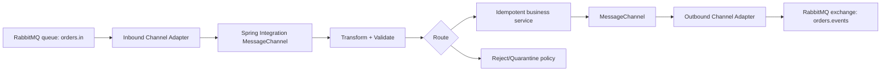
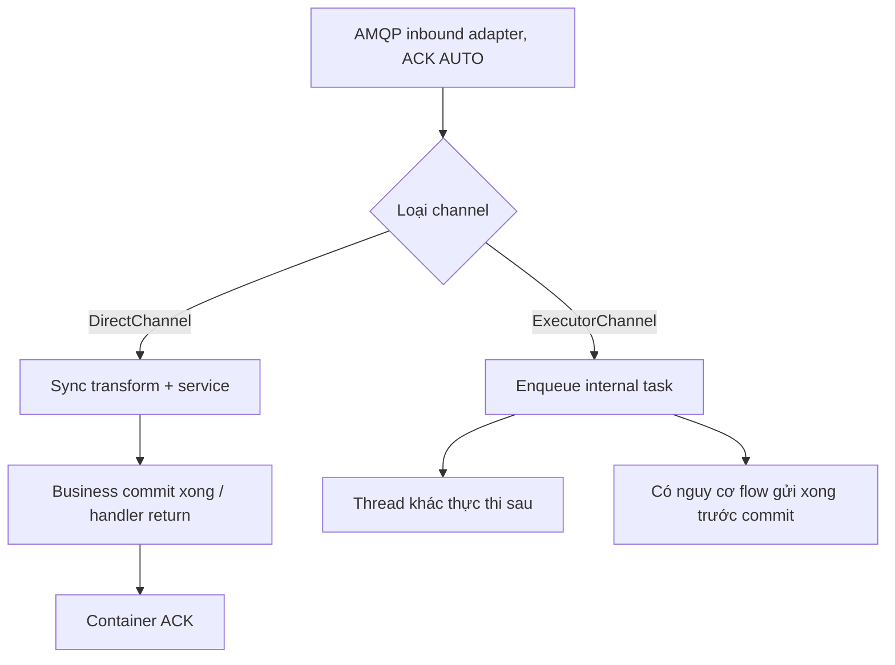
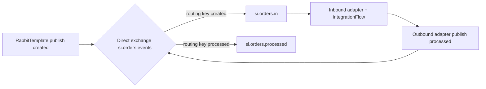
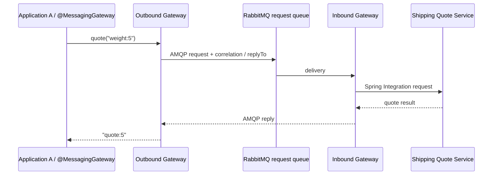
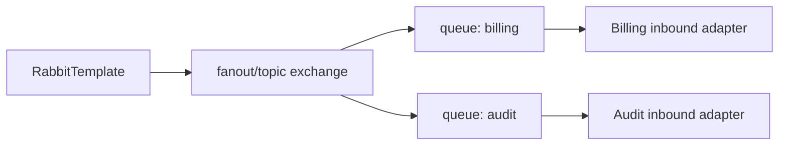

# Spring Integration AMQP adapter và gateway khi cần luồng tích hợp

> **Chương:** Mẫu tích hợp  
> **Công nghệ:** Spring AMQP, RabbitMQ, Spring Integration, Java DSL, `RabbitTemplate`, `@RabbitListener`, exchange, queue và binding  
> **Trọng tâm:** Dùng **AMQP channel adapter** để nối RabbitMQ với một luồng xử lý một chiều; dùng **AMQP gateway** khi cần request/reply. Hiểu ranh giới acknowledgment, retry, publisher confirms, error channel và các giới hạn độ tin cậy khi kết hợp nhiều bước tích hợp.

## 1. Khi nào `RabbitTemplate` và `@RabbitListener` bắt đầu trở nên bất tiện?

Một ứng dụng nhận sự kiện `order.created` qua RabbitMQ, chuẩn hóa dữ liệu, kiểm tra hợp lệ, chọn tuyến xử lý, ghi kết quả vào cơ sở dữ liệu rồi phát `order.accepted` sang exchange khác. Đôi khi ứng dụng cần hỏi một dịch vụ báo giá theo cơ chế request/reply. Có hai cách triển khai phổ biến:

**Cách trực tiếp bằng Spring AMQP**: `@RabbitListener` gọi một service, service gọi `RabbitTemplate` để publish hoặc request/reply. Cách này thường **ít thành phần hơn, dễ debug và rất phù hợp** nếu chỉ có một vài bước xử lý.

**Cách luồng tích hợp bằng Spring Integration**: dùng `IntegrationFlow`, `MessageChannel`, `Transformer`, `Filter`, `Router`, `Service Activator` và **AMQP adapter/gateway** để nối các bước theo mẫu Enterprise Integration Patterns. Cách này phù hợp khi luồng cần nhiều tuyến, biến đổi, chia/gom message, bridge qua HTTP/file/JMS hay những điểm vào/ra khác nhau.



Điểm cần phân biệt ngay từ đầu:

- **Spring AMQP (stack AMQP 0-9-1 trong ví dụ chính)** cung cấp connection, `RabbitTemplate`, listener container, exchange/queue/binding, confirm, ACK/NACK và conversion; các phiên bản mới còn có stack AMQP 1.0 riêng.
- **Spring Integration** cung cấp bộ khung luồng message và **adapter/gateway dựa trên Spring AMQP**. Nó **không thay RabbitMQ**, không biến mọi bước thành một giao dịch phân tán và không tự mang lại exactly-once.
- **RabbitMQ** tiếp tục quyết định routing, persistence/queue type, prefetch, redelivery, DLX và các điều kiện broker xác nhận.

Sau bài này, bạn có thể chọn đúng endpoint inbound/outbound, xây một luồng Java DSL có topology cụ thể, triển khai request/reply, phân biệt `errorChannel` với retry/DLQ, và đánh giá liệu Spring Integration có thật sự đáng thêm vào ứng dụng hay không.

## 2. Bốn endpoint AMQP và cách đọc hướng dữ liệu

Các từ **inbound** và **outbound** được định nghĩa từ **góc nhìn ứng dụng Spring Integration**, không phải từ góc nhìn RabbitMQ:

| Endpoint | Luồng đi đâu? | Hành vi | Chọn khi |
| --- | --- | --- | --- |
| **Inbound Channel Adapter** | RabbitMQ queue → Spring `MessageChannel` | Nhận và chuyển message **một chiều** | Nhận sự kiện để xử lý qua filter, transformer, router và service activator |
| **Outbound Channel Adapter** | Spring `MessageChannel` → RabbitMQ exchange/queue | Publish message **một chiều** | Phát event hoặc chuyển công việc sang broker, không chờ business reply |
| **Inbound Gateway** | RabbitMQ request → Spring flow → RabbitMQ reply | **Hai chiều**, nhận request và trả reply | Ứng dụng đóng vai trò **RPC server**, xử lý request AMQP |
| **Outbound Gateway** | Spring flow → RabbitMQ request → Spring flow nhận reply | **Hai chiều**, gửi request và đợi reply | Ứng dụng đóng vai trò **RPC client** |

Một **asynchronous outbound gateway** cũng có thể tồn tại trong stack AMQP 0-9-1; nó dùng `AsyncRabbitTemplate`, không bắt thread gửi chờ đến khi remote reply như outbound gateway đồng bộ.

### 2.1. Phân biệt AMQP gateway với `@MessagingGateway`

`@MessagingGateway` là một **proxy Java interface ở ranh giới mã ứng dụng ↔ Spring Integration**. Nó có thể giúp code gọi `quoteClient.quote("5kg")` thay vì tự xây `Message<?>`. Proxy này **không đồng nghĩa** đã có một kết nối RPC đến RabbitMQ.

Một phương thức `@MessagingGateway` có thể kết nối đến `DirectChannel` và cuối flow là **outbound channel adapter**, nghĩa là **không có business reply**. Ngược lại, một flow có `Amqp.outboundGateway(...)` mới thực hiện RPC qua RabbitMQ. Phân biệt cả hai lớp gateway:

```text
Java caller
    |
@MessagingGateway interface     (giao diện gọi trong JVM)
    |
Spring Integration input channel
    |
AMQP outbound gateway           (request/reply qua RabbitMQ)
    |
RabbitMQ request queue ---> AMQP inbound gateway ở service bên kia
                                     |
                                  business
                                     |
                                  reply
```

### 2.2. Quy tắc chọn nhanh

- Nếu chỉ `@RabbitListener` → gọi service → `RabbitTemplate.convertAndSend()`, **ưu tiên Spring AMQP thuần**.
- Nếu cần nhiều bước **transform → validate → route → enrich → aggregate → publish** và nhiều loại transport, cân nhắc Spring Integration.
- Nếu cần RPC trực tiếp chỉ một call, `RabbitTemplate.convertSendAndReceive()` có thể đủ. Nếu request hoặc reply còn đi qua các kênh EIP, dùng outbound/inbound gateway.
- Nếu mục tiêu chỉ tăng throughput consumer, trước tiên cân nhắc prefetch/concurrency, batching và container configuration; **thêm Spring Integration không mặc nhiên tăng throughput**.

## 3. Dependency, phiên bản và phạm vi giao thức

Với RabbitMQ **AMQP 0-9-1**, cần Spring AMQP và module `spring-integration-amqp` của Spring Integration. Ví dụ Gradle, khi dự án đã được quản lý dependency versions bằng Spring Boot BOM tương thích:

```groovy
dependencies {
    // Spring Boot application với AMQP 0-9-1.
    implementation 'org.springframework.boot:spring-boot-starter-integration'
    implementation 'org.springframework.integration:spring-integration-amqp'

    // Thêm RabbitMQ/Spring AMQP starter tương thích phiên bản Boot.
    // Với Boot 4.x: spring-boot-starter-rabbitmq;
    // với Boot 3.x: spring-boot-starter-amqp.
    implementation 'org.springframework.boot:spring-boot-starter-rabbitmq'

    testImplementation 'org.springframework.boot:spring-boot-starter-test'
    testImplementation 'org.springframework.amqp:spring-rabbit-test'
}
```

**Không chép nguyên block cho Boot 3.x**: tên RabbitMQ starter đã thay đổi theo nhánh Boot; đồng thời phiên bản Spring Integration và Spring AMQP cần tương thích. Với Boot 3.x, đổi dòng RabbitMQ starter như chú thích và để BOM đang sử dụng quản lý phiên bản. Nếu đang dùng Java DSL trong một project Spring Framework không dùng Boot, bổ sung `spring-integration-core`, `spring-integration-amqp`, `spring-rabbit` cùng phiên bản tương thích.

Một cấu hình kết nối lab cho **AMQP 0-9-1**:

```yaml
spring:
  rabbitmq:
    host: localhost
    port: 5672
    username: demo
    password: demo-local-only
    virtual-host: /
    publisher-confirm-type: correlated
    publisher-returns: true
    template:
      mandatory: true
```

`demo-local-only` là tài khoản **chỉ dùng cho môi trường thử nghiệm**. Trong production dùng TLS/mTLS hoặc phương án auth phù hợp, secret injection, vhost và quyền resource tối thiểu.

**Lưu ý giao thức:** `Amqp.inboundAdapter(...)` và `Amqp.outboundGateway(...)` trong ví dụ chính thuộc Spring Integration **AMQP 0-9-1**. Spring Integration **7.0+** còn cung cấp stack **RabbitMQ AMQP 1.0** riêng (`AmqpClient`, `RabbitAmqpTemplate`); không được gắn `CachingConnectionFactory` 0-9-1 vào client 1.0 hay chỉ đổi port rồi cho rằng protocol đã đổi. Phạm vi bổ sung được giải thích ở mục 13.

## 4. `Message<?>`, `MessageChannel` và ranh giới đồng bộ

Spring Integration hoạt động với `org.springframework.messaging.Message<?>`: gồm `payload` và `headers`. Adapter chuyển từ `org.springframework.amqp.core.Message` (body + AMQP properties) sang một Spring Messaging message. Outbound adapter làm phép chuyển ngược với converter/header mapper.

Các thành phần cơ bản:

| Thành phần | Vai trò | Điều cần lưu ý với RabbitMQ |
| --- | --- | --- |
| `DirectChannel` | Gọi subscriber **đồng bộ trên thread của sender** | Lỗi handler thường có thể lan ngược lên listener container; phù hợp giữ ranh giới ACK AUTO đồng bộ |
| `ExecutorChannel` | Chuyển việc sang task executor | Ranh giới thread/transaction khác; producer có thể coi send nội bộ xong khi business task còn chạy |
| `QueueChannel` | Buffer message trong ứng dụng để poll | **Mặc định không phải queue bền vững RabbitMQ**; buffer bộ nhớ không bảo đảm qua crash |
| `PublishSubscribeChannel` | Phát trong JVM đến nhiều subscriber | Không tự có broker routing/persistence và không thay fanout exchange |
| `Transformer` | Biến đổi body/headers | Phải giữ contract message, operation ID và correlation ID quan trọng |
| `Filter`, `Router` | Loại/định tuyến message | Nếu filter âm thầm bỏ message, inbound adapter có thể xem như đã xử lý thành công và ACK |
| `Service Activator` | Gọi nghiệp vụ | Exception và transaction commit cần được nối đúng với ACK/retry |

**Cạm bẫy:** người học có thể nghĩ thêm `ExecutorChannel` là một kiểu retry an toàn. Thực tế inbound adapter với `AUTO`, khi flow xử lý bất đồng bộ, ranh giới hoàn tất của việc **gửi vào channel** khác với hoàn tất transaction của nghiệp vụ. Nếu listener ACK sớm mà executor chết, message có thể mất khỏi RabbitMQ. Muốn tách thread, phải kiểm tra chính xác semantics của adapter/acknowledgment, hoặc ghi handoff bền vững trước khi ACK.



## 5. Bài thực hành: topology RabbitMQ cho một IntegrationFlow

Ta chọn một contract nhỏ, **có thể chạy riêng trong lab**:

- Exchange direct: `si.orders.events`.
- Queue đầu vào: `si.orders.in`, binding key `created`.
- Queue kiểm tra đầu ra: `si.orders.processed`, binding key `processed`.
- Một message đơn giản có payload dạng String `op-101|order-42`, trong đó `op-101` là `operationId` dùng cho idempotency.

```java
import org.springframework.amqp.core.Binding;
import org.springframework.amqp.core.BindingBuilder;
import org.springframework.amqp.core.DirectExchange;
import org.springframework.amqp.core.Queue;
import org.springframework.amqp.core.QueueBuilder;
import org.springframework.beans.factory.annotation.Qualifier;
import org.springframework.context.annotation.Bean;
import org.springframework.context.annotation.Configuration;

@Configuration(proxyBeanMethods = false)
public class IntegrationOrdersTopology {
    static final String EXCHANGE = "si.orders.events";
    static final String INPUT = "si.orders.in";
    static final String OUTPUT = "si.orders.processed";

    @Bean
    DirectExchange integrationOrdersExchange() {
        return new DirectExchange(EXCHANGE);
    }

    @Bean
    Queue integrationOrdersInputQueue() {
        return QueueBuilder.durable(INPUT).build();
    }

    @Bean
    Queue integrationOrdersProcessedQueue() {
        return QueueBuilder.durable(OUTPUT).build();
    }

    @Bean
    Binding createdBinding(DirectExchange integrationOrdersExchange,
            @Qualifier("integrationOrdersInputQueue") Queue queue) {
        return BindingBuilder.bind(queue).to(integrationOrdersExchange)
                .with("created");
    }

    @Bean
    Binding processedBinding(DirectExchange integrationOrdersExchange,
            @Qualifier("integrationOrdersProcessedQueue") Queue queue) {
        return BindingBuilder.bind(queue).to(integrationOrdersExchange)
                .with("processed");
    }
}
```

Khi Spring Boot cấu hình `RabbitAdmin`, các bean `DirectExchange`, `Queue`, `Binding` có thể được khai báo lúc kết nối. Nếu runtime dùng quyền `configure` hạn chế, đội platform cần **pre-provision** topology và không để ứng dụng vừa thiếu quyền vừa tự declare. Queue durable không tự tạo publisher confirms hay exactly-once.



## 6. Inbound Channel Adapter: từ queue vào luồng EIP

Thay vì tự viết `@RabbitListener`, để inbound adapter sở hữu **listener container** và đẩy message vào `IntegrationFlow`. Ví dụ Java DSL cho Spring Integration 6.x/7.x, giả định `IdempotentOrderService` là bean của ứng dụng:

```java
import org.springframework.amqp.rabbit.connection.ConnectionFactory;
import org.springframework.context.annotation.Bean;
import org.springframework.context.annotation.Configuration;
import org.springframework.integration.amqp.dsl.Amqp;
import org.springframework.integration.dsl.IntegrationFlow;

@Configuration(proxyBeanMethods = false)
public class IncomingOrderFlow {

    @Bean
    IntegrationFlow incomingOrders(ConnectionFactory connectionFactory,
                                   IdempotentOrderService orderService) {
        return IntegrationFlow
                .from(Amqp.inboundAdapter(
                        connectionFactory, IntegrationOrdersTopology.INPUT))
                .transform(String.class, String::trim)
                .filter(String.class, value -> !value.isBlank(),
                        endpoint -> endpoint.throwExceptionOnRejection(true))
                .handle(String.class, (value, headers) -> {
                    // Ghi dữ liệu và inbox/dedupe trong cùng DB transaction.
                    orderService.processIdempotently(value);
                    return null; // One-way flow: không tạo reply AMQP.
                })
                .get();
    }
}
```

Đây là **inbound adapter một chiều**. Dù handler Java có trả về dữ liệu, adapter không biến nó thành reply RPC như inbound gateway. Nếu ứng dụng cần phát một sự kiện mới sau khi xử lý, hãy tạo một outbound adapter theo mục 7 và đưa kết quả vào channel đầu ra của nó (hoặc kết nối hai endpoint trong cùng IntegrationFlow).

### 6.1. Vì sao filter phải có chính sách từ chối rõ ràng?

`.filter(...)` có thể âm thầm loại message nếu predicate trả false. Từ góc nhìn listener `AUTO`, một message được filter bỏ mà không exception có thể được xem là **đã xử lý**, rồi ACK. Trong ví dụ, `throwExceptionOnRejection(true)` khiến dữ liệu không hợp lệ đi vào error/retry handling thay vì bị xóa không dấu vết.

Tuy nhiên, exception có thể bị requeue liên tục nếu chưa cấu hình retry/backoff, `AmqpRejectAndDontRequeueException` hoặc DLX. Với poison message không thể sửa, hãy **phân loại lỗi** và chuyển vào DLQ/quarantine thay vì để message quay lại mãi.

### 6.2. Nếu muốn tự cung cấp listener container

Spring Integration cũng hỗ trợ `AmqpInboundChannelAdapter` với một `SimpleMessageListenerContainer` được cấu hình tường minh:

```java
import org.springframework.amqp.core.AcknowledgeMode;
import org.springframework.amqp.rabbit.connection.ConnectionFactory;
import org.springframework.amqp.rabbit.listener.SimpleMessageListenerContainer;
import org.springframework.integration.amqp.inbound.AmqpInboundChannelAdapter;
import org.springframework.messaging.MessageChannel;

// Mẫu wiring trong @Configuration; không đăng ký song song với flow ở trên.
SimpleMessageListenerContainer container =
        new SimpleMessageListenerContainer(connectionFactory);
container.setQueueNames("si.orders.in");
container.setAcknowledgeMode(AcknowledgeMode.AUTO);
container.setConcurrentConsumers(2);
container.setPrefetchCount(10);
container.setShutdownTimeout(30_000L);

AmqpInboundChannelAdapter adapter =
        new AmqpInboundChannelAdapter(container);
adapter.setOutputChannel(inputChannel);
// Để Spring quản lý lifecycle của container và adapter.
```

`connectionFactory` và `inputChannel` ở đây là những bean đã được cung cấp trong `@Configuration`; đoạn code minh họa **cách ghép API**, chưa phải class Java hoàn chỉnh. **Không** tự gọi `container.setMessageListener(...)` trước khi truyền container vào adapter: adapter cần gắn listener của chính nó. Nếu đã cung cấp container riêng, bạn chịu trách nhiệm toàn bộ thuộc tính của container thay vì đồng thời cấu hình những thuộc tính đó ở adapter/DSL rồi chờ framework tự hòa giải.

### 6.3. Chọn ACK mode phù hợp

| Chế độ | Ý nghĩa với inbound adapter | Rủi ro |
| --- | --- | --- |
| `AUTO` | Container ACK khi **flow đồng bộ** kết thúc bình thường | Lỗi bị error flow nuốt, hoặc thread handoff làm ACK trước business commit |
| `MANUAL` | Code chịu trách nhiệm `basicAck/basicNack` theo delivery tag và channel nhận | Quên ACK, ACK trước commit, ACK trên channel sau reconnect |
| `NONE` | Broker tự coi delivery đã được nhận, không chờ ACK | Worker chết giữa xử lý có thể làm **mất business work** |

Trong manual mode, AMQP channel và delivery tag có thể được chuyển trong headers `amqp_channel` / `amqp_deliveryTag`. Chỉ dùng chúng trong luồng xử lý đúng channel và version đã được xác minh; không truyền delivery tag sang executor/dịch vụ khác rồi ACK tùy tiện sau reconnect.

## 7. Outbound Channel Adapter: từ `MessageChannel` ra RabbitMQ

Phía outbound sử dụng `Amqp.outboundAdapter(...)`, một endpoint **một chiều**. Ví dụ tạo một `DirectChannel` và bắc cầu từ channel tới exchange đã khai báo:

```java
import org.springframework.amqp.core.AmqpTemplate;
import org.springframework.beans.factory.annotation.Qualifier;
import org.springframework.context.annotation.Bean;
import org.springframework.context.annotation.Configuration;
import org.springframework.integration.amqp.dsl.Amqp;
import org.springframework.integration.channel.DirectChannel;
import org.springframework.integration.dsl.IntegrationFlow;
import org.springframework.messaging.MessageChannel;

@Configuration(proxyBeanMethods = false)
public class OutgoingOrderFlow {
    @Bean("outgoingOrders")
    MessageChannel outgoingOrders() {
        return new DirectChannel();
    }

    @Bean
    IntegrationFlow outboundProcessedOrders(
            AmqpTemplate amqpTemplate,
            @Qualifier("outgoingOrders") MessageChannel outgoingOrders) {
        return IntegrationFlow.from(outgoingOrders)
                .handle(Amqp.outboundAdapter(amqpTemplate)
                        .exchangeName(IntegrationOrdersTopology.EXCHANGE)
                        .routingKey("processed"))
                .get();
    }
}
```

Ứng dụng có thể gửi tới channel đó mà không cần tự gọi `RabbitTemplate`:

```java
import org.springframework.beans.factory.annotation.Qualifier;
import org.springframework.messaging.MessageChannel;
import org.springframework.messaging.support.MessageBuilder;
import org.springframework.stereotype.Service;

@Service
public class ProcessedOrderEmitter {
    private final MessageChannel outgoingOrders;

    public ProcessedOrderEmitter(
            @Qualifier("outgoingOrders") MessageChannel outgoingOrders) {
        this.outgoingOrders = outgoingOrders;
    }

    public void emit(String operationId) {
        boolean sent = outgoingOrders.send(
                MessageBuilder.withPayload("processed:" + operationId).build());
        if (!sent) {
            throw new IllegalStateException("MessageChannel did not accept send");
        }
    }
}
```

Với `DirectChannel`, `send()` gọi subscriber trên **cùng thread**; lỗi đồng bộ của outbound endpoint có thể lan ngược. Nhưng **`send() == true` không đồng nghĩa publisher confirm từ RabbitMQ đã về**, càng không chứng minh consumer đích đã ghi database. Muốn biết broker nhận/chấp nhận publish, cần cấu hình **publisher confirms**; muốn phát hiện không có binding để route, cần **returns** hoặc cơ chế giám sát khác.

### 7.1. Ghép inbound và outbound trong một flow

Khi nghiệp vụ thực sự có đường **queue → biến đổi → publish exchange**, có thể dùng một flow thay cho hai flow rời rạc:

```java
@Bean
IntegrationFlow orderBridge(ConnectionFactory connectionFactory,
                            AmqpTemplate amqpTemplate,
                            IdempotentOrderService service) {
    return IntegrationFlow
            .from(Amqp.inboundAdapter(connectionFactory, "si.orders.in"))
            .handle(String.class, (payload, headers) -> {
                service.processIdempotently(payload);
                return "processed:" + payload;
            })
            .handle(Amqp.outboundAdapter(amqpTemplate)
                    .exchangeName("si.orders.events")
                    .routingKey("processed"))
            .get();
}
```

Đây là **phương án thay thế** cho inbound flow ở mục 6, không phải flow phải đăng ký **thêm** trên cùng `si.orders.in`: nếu cả hai active, chúng sẽ thành **competing consumers**. Bằng cách dùng một direct flow đồng bộ, exception từ outbound publish (nếu xuất hiện đồng bộ) có thể ảnh hưởng việc ACK của inbound, nhưng **vẫn không có transaction nguyên tử giữa DB commit, ACK inbound và broker confirm outbound**. Với yêu cầu không mất sự kiện sau DB commit, nên sử dụng **transactional outbox** và một relay publisher riêng.

### 7.2. Giữ ranh giới giữa logic nghiệp vụ và transport

Trong code thực, tách `IdempotentOrderService` khỏi các lớp định tuyến AMQP. Service nhận một envelope hợp lệ, xử lý transaction và trả kết quả. Flow làm nhiệm vụ mapping/routing, không nhúng SQL transaction dài trong biểu thức SpEL hoặc lambda khó kiểm soát. Các bước `.handle(...)` chỉ là cách nối service vào flow; logic đảm bảo dữ liệu bền vững vẫn nằm ở lớp nghiệp vụ.

## 8. Gateway request/reply: server và client qua RabbitMQ

Khi cần gọi một worker theo kiểu RPC, hai đầu có vai trò khác nhau:



### 8.1. Service B: inbound gateway là đầu **nhận request**

```java
import org.springframework.amqp.rabbit.connection.ConnectionFactory;
import org.springframework.context.annotation.Bean;
import org.springframework.context.annotation.Configuration;
import org.springframework.integration.amqp.dsl.Amqp;
import org.springframework.integration.dsl.IntegrationFlow;

@Configuration(proxyBeanMethods = false)
public class QuoteServerIntegration {
    @Bean
    IntegrationFlow quoteServer(ConnectionFactory connectionFactory) {
        return IntegrationFlow
                .from(Amqp.inboundGateway(
                        connectionFactory, "si.quote.requests"))
                .transform(String.class, request -> {
                    if (!request.startsWith("weight:")) {
                        throw new IllegalArgumentException("Bad request");
                    }
                    return "quote:" + request.substring("weight:".length());
                })
                .get();
    }
}
```

`si.quote.requests` phải được **khai báo trước** bằng bean `Queue`/quản trị RabbitMQ. `Amqp.inboundGateway` lấy request, gửi vào flow và đợi reply payload của flow; nó dựa vào `replyTo`/correlation từ AMQP request (hoặc cấu hình reply routing thay thế). Trong thực tế nên validate schema, deadline và operation ID để tránh thực thi hai lần khi caller retry.

### 8.2. Service A: outbound gateway là đầu **gửi request**

```java
import org.springframework.amqp.core.AmqpTemplate;
import org.springframework.context.annotation.Bean;
import org.springframework.context.annotation.Configuration;
import org.springframework.integration.amqp.dsl.Amqp;
import org.springframework.integration.annotation.IntegrationComponentScan;
import org.springframework.integration.annotation.MessagingGateway;
import org.springframework.integration.dsl.IntegrationFlow;

@Configuration(proxyBeanMethods = false)
@IntegrationComponentScan
public class QuoteClientIntegration {
    @Bean
    IntegrationFlow quoteClient(AmqpTemplate amqpTemplate) {
        return flow -> flow
                .handle(Amqp.outboundGateway(amqpTemplate)
                        .routingKey("si.quote.requests"));
    }
}

@MessagingGateway(defaultRequestChannel = "quoteClient.input")
interface ShippingQuoteClient {
    String quote(String request);
}
```

Vì không chỉ định exchange, `routingKey("si.quote.requests")` gửi tới **default exchange** bằng tên queue. Một service bất kỳ có thể inject `ShippingQuoteClient` và gọi `quote("weight:5")` khi flow/client đã được khởi tạo. Khi không dùng `@IntegrationComponentScan` hoặc cơ chế đăng ký interface tương đương, Spring sẽ không nhất thiết tạo proxy; đừng nghĩ annotation trên interface tự có tác dụng khi component scanning chưa được bật.

**Timeout có hai vị trí khác nhau**:

- `RabbitTemplate.replyTimeout` là thời gian client **đợi AMQP reply**. Ở `RabbitTemplate.convertSendAndReceive()` thuần, timeout thường dẫn đến `null`. Với **Spring Integration outbound gateway**, `requiresReply=true` mặc định có thể chuyển tình huống không có reply thành exception.
- `replyTimeout` cấu hình trên **outbound gateway endpoint** là thời gian gửi reply **vào Spring reply channel** nếu channel có thể block, không phải thời gian RabbitMQ service xử lý request. Tương tự, inbound gateway có timeout riêng khi đợi response trên reply channel ở các luồng chuyển thread.

Do đó test một request chạy quá deadline phải xác định **timeout xảy ra ở tầng nào**, không so sánh hai property trùng tên như thể chúng giống nhau.

### 8.3. Vì sao RPC timeout có thể dẫn đến duplicate?

```text
Caller gửi op-77 --> Worker nhận --> DB commit --> Reply bị mất
Caller timeout (trạng thái UNKNOWN)
Caller retry cùng op-77 --> Worker nhận lại --> dedupe --> không commit lần 2
```

Đừng biến một exception “reply timeout” thành kết luận “server chưa làm gì”. Với RPC có side effect (đặt hàng, thanh toán), luôn dùng `operationId` bền vững, idempotent server, reconciliation và deadline riêng. RPC phù hợp truy vấn/điều phối nhanh; nếu công việc kéo dài nhiều phút hoặc caller phải được tách rời, **event/choreography một chiều** thường đơn giản và bền hơn.

### 8.4. Khi nào dùng async outbound gateway?

`Amqp.asyncOutboundGateway(asyncRabbitTemplate)` hữu ích khi thread poller/flow không nên **chặn đợi reply**. Khi reply tới, kết quả tiếp tục được xử lý trong pipeline trên thread nhận reply. Tuy nhiên:

- Cần cấu hình `AsyncRabbitTemplate` và reply listener/container phù hợp với phiên bản Spring AMQP.
- Reply đến muộn, timeout, error channel, correlation và shutdown vẫn cần được xử lý.
- “Async” ở đây **không** đồng nghĩa exactly-once, không bảo đảm downstream đã commit.
- Nếu không có yêu cầu concurrency/latency rõ ràng, outbound gateway đồng bộ đơn giản hơn.

## 9. `errorChannel`, retry và ACK: đường lỗi có thể thay đổi cách broker xử lý message

Một lỗi trong flow có thể xảy ra ở nhiều điểm: conversion JSON, filter, transformer, DB, outbound publish hay RPC timeout. Cần phân loại:

| Lỗi | Xử lý mong muốn | Cách thường triển khai |
| --- | --- | --- |
| Payload không đúng schema | Không retry vô hạn, đưa vào quarantine/DLQ có lý do | Reject/DLX, recoverer, lưu thông tin sự cố |
| Lỗi DB tạm thời | Retry có backoff, giới hạn số lần | Container retry advice hoặc retry ở flow có kiểm soát |
| Phụ thuộc ngoài bị timeout | Không tạo loop nóng; không giả định nghiệp vụ chưa thực thi | Retry/idempotency/reconciliation |
| Sai routing key outbound | Phát hiện không có binding | `mandatory`/publisher returns và route kiểm tra |
| Publisher confirm không tới | Trạng thái publish không chắc chắn | CorrelationData, outbox, retry idempotent |
| Lỗi trong gateway request/reply | Reply lỗi theo contract hoặc reject request | Error flow + correlation; tránh ACK sai |

### 9.1. Điểm dễ mất message: error flow nuốt exception

Đối với AMQP **inbound channel adapter** sử dụng `AcknowledgeMode.AUTO`, nếu có `errorChannel`, framework có thể phát một `ErrorMessage` vào đó. **Nếu error flow nhận lỗi và trả về bình thường**, container có thể coi message gốc đã được xử lý và **ACK**. Điều này đôi khi đúng (message độc đã được ghi bền vững vào quarantine), nhưng rất nguy hiểm nếu handler chỉ log lỗi rồi bỏ.

```text
AMQP delivery
    |
Inbound adapter -> transform throws
    |
errorChannel -> logger -> returns normally
    |
Container may ACK original delivery
    |
No retry / no DLQ from original queue
```

Với lỗi cần retry, phải **để exception quay trở lại container** hoặc áp dụng cơ chế ACK/NACK/manual recovery có kiểm soát theo semantics đúng version. Nếu error flow lưu message vào DB/quarantine rồi trả về, chỉ ACK sau khi **ghi bền vững** thành công. Không tạo một `errorChannel` chung “log rồi nuốt mọi lỗi” cho tất cả adapter.

### 9.2. Retry ở hai tầng không nên bật vô hạn cùng lúc

- **Spring Integration flow retry**: tập trung xử lý lại một bước tích hợp/handler trong JVM.
- **Spring AMQP container retry**: tập trung thử lại một delivery trước khi từ chối hoặc giao cho recoverer.
- **RabbitMQ DLX/TTL**: đường đi broker-level để trì hoãn hoặc lưu message lỗi.

Nếu một flow retry 5 lần, container lại retry 5 lần và broker requeue không giới hạn, một message độc có thể chạy hàng chục lần, áp lực DB tăng và các consumer khác bị đói. Thiết kế một **retry budget** theo loại lỗi, log số attempt và chuyển sang DLQ/quarantine sau ngưỡng.

### 9.3. Tránh gửi message sang executor rồi ACK trước commit

Nếu inbound adapter nhận message, gửi vào `ExecutorChannel`, listener có thể kết thúc ở thời điểm task **được giao cho executor**, không phải khi task hoàn tất DB. Những bản Spring Integration/Spring AMQP và channel/transaction cấu hình khác nhau có thể quyết định acknowledgement khác nhau; không copy giả định “AUTO luôn chờ đến cuối flow dù có thread khác”. Nếu cần async, cách an toàn phổ biến là:

1. Handler đầu tiên ghi **durable handoff** (transactional outbox hoặc job record) đồng bộ.
2. Adapter/container ACK sau khi handoff thật sự commit.
3. Worker nền xử lý job từ nguồn bền vững và dùng idempotency.

Chỉ dùng in-memory queue/task executor để bàn giao khi ứng dụng **chấp nhận** mất dữ liệu nếu process chết.

## 10. Publisher confirms, returns và ranh giới độ tin cậy outbound

Với Spring AMQP 0-9-1, **publisher confirm** trả lời broker đã chấp nhận publish theo cơ chế confirm; **publisher return** thông báo message `mandatory` không được route tới queue thích hợp. Hai kết quả **khác nhau**: broker có thể confirm **ACK** cho một publish nhưng đồng thời **return** message vì không có binding.

```text
Spring Integration outbound adapter
            |
            v
      RabbitTemplate -> RabbitMQ exchange
                           |
                      route to queue?
                       /          \
                      yes         no (mandatory)
                       |           |
                 confirm ACK     basic.return
                                   |
                             confirm ACK vẫn có thể xảy ra
```

Trong Spring Boot dùng RabbitTemplate, có thể bật:

```yaml
spring:
  rabbitmq:
    publisher-confirm-type: correlated
    publisher-returns: true
    template:
      mandatory: true
```

Với Spring Integration outbound endpoint, có hai cách tích hợp confirm:

1. Cấu hình **`confirmCorrelationExpression`, confirm ACK/NACK channels, return channel** trên adapter/gateway. Điều này phù hợp khi confirm là một nhánh của flow giám sát.
2. Từ Spring Integration 5.4 trở đi, có thể đưa `CorrelationData` vào header `AmqpHeaders.PUBLISH_CONFIRM_CORRELATION`, sau đó đợi hoặc gắn callback vào future, **không đồng thời cấu hình** confirm channels theo cơ chế thứ nhất.

Ví dụ logic gửi từ `outgoingOrders` đã tạo ở mục 7:

```java
import java.util.UUID;
import java.util.concurrent.TimeUnit;
import org.springframework.amqp.rabbit.connection.CorrelationData;
import org.springframework.amqp.support.AmqpHeaders;
import org.springframework.messaging.MessageChannel;
import org.springframework.messaging.support.MessageBuilder;

// Trong service/test đã inject đúng MessageChannel outgoingOrders.
CorrelationData correlation =
        new CorrelationData(UUID.randomUUID().toString());

boolean acceptedLocally = outgoingOrders.send(
        MessageBuilder.withPayload("processed:op-101")
                .setHeader(AmqpHeaders.PUBLISH_CONFIRM_CORRELATION, correlation)
                .build());
if (!acceptedLocally) {
    throw new IllegalStateException("MessageChannel rejected send");
}

CorrelationData.Confirm confirm = correlation.getFuture()
        .get(10, TimeUnit.SECONDS);
if (!confirm.isAck() || correlation.getReturned() != null) {
    throw new IllegalStateException("Publish nack or unroutable message");
}
```

**Điều kiện:** `AmqpTemplate` thực tế trong outbound adapter phải là một `RabbitTemplate` hỗ trợ correlated confirms và returns; bật cấu hình connection factory phù hợp. Nếu có nhiều endpoint cần callbacks/returns riêng, cân nhắc **template chuyên dụng cho từng endpoint** thay vì ghi đè callbacks của một template dùng chung. Đoạn mã là ví dụ gọi trong method có biến `outgoingOrders` được inject, không phải Java class độc lập.

**Timeout của confirm không chắc là publish thất bại:** broker có thể đã nhận message nhưng connection đứt trước khi client nhận ACK. Retry gửi có thể sinh bản sao; producer nên có outbox với `operationId` cố định, consumer phải idempotent. Publisher confirm không thay được consumer acknowledgement hoặc business database commit.

## 11. Header mapping, converter và vấn đề correlation

Inbound adapter/gateway chuyển AMQP message thành Spring Messaging message. Theo mặc định, `DefaultAmqpHeaderMapper.inboundMapper()` chỉ ánh xạ các **AMQP property chuẩn**; header do ứng dụng tự định nghĩa có thể **không được đưa vào** Spring Integration headers nếu chưa cấu hình mapping.

| Thông tin | Nên xử lý thế nào? |
| --- | --- |
| `contentType` và kiểu payload | Dùng converter thống nhất giữa producer và consumer; với JSON cấu hình converter an toàn, không deserialize class tùy ý từ dữ liệu không tin cậy |
| `correlationId` và `replyTo` | Giữ đúng contract của gateway/RPC; không thay tùy tiện bằng tracking ID khác |
| `operationId`/`eventId` | Giữ trong payload hoặc header đã được map có chủ đích; dùng deduplication |
| Custom `tenantId`, `schemaVersion` | Cấu hình header mapper hoặc mapped request/reply headers nếu nghiệp vụ cần; kiểm tra security |
| Delivery tag/channel | Chỉ dùng cho manual ACK trong ngữ cảnh inbound hiện tại; không gửi chúng như payload kinh doanh |
| Trace context | Dùng propagation/observation phù hợp và whitelist header, không log secret |

Không dùng wildcard `*` để copy **mọi** custom header từ nguồn chưa tin cậy vào các service/queue khác. Có thể có token, thông tin người dùng hoặc payload metadata nhạy cảm. Chỉ map những header thật sự thuộc message contract.

### 11.1. Message envelope bền vững

Ví dụ event JSON (schema minh họa):

```json
{
  "eventId": "evt-101",
  "operationId": "op-101",
  "eventType": "order.created",
  "schemaVersion": 1,
  "orderId": "order-42",
  "occurredAt": "2026-11-26T03:00:00Z"
}
```

Event chứa ID phục vụ đối soát và idempotency; schema version giúp consumer nâng cấp an toàn. Trong các flow biến đổi, **không vô tình tạo một ID mới** mỗi khi retry/re-publish nếu nghiệp vụ cần nhận diện cùng tác động. Giữ namespace nội bộ ổn định, đừng ghép raw customer ID vào metric tags/queue names gây cardinality cao.

## 12. Những mẫu EIP có lợi nhất khi phối hợp với AMQP

Spring Integration có giá trị khi có nhiều **bước độc lập** phải nối lại và thay đổi theo quy tắc. Nhưng không phải pattern nào cũng miễn phí:

| Pattern | Ví dụ | Lưu ý độ tin cậy |
| --- | --- | --- |
| **Transformer** | Chuyển AMQP JSON sang DTO hợp đồng nội bộ | Conversion error phải có dead-letter/quarantine rõ |
| **Filter** | Bỏ qua duplicate, từ chối event không hợp lệ | Distinguish deliberate discard với lỗi cần retry |
| **Router** | Định tuyến `order.created` sang validation, `order.cancelled` sang compensation | Không route dựa vào header user không tin cậy; bảo vệ default route |
| **Splitter** | Một batch order thành N tác vụ logic | Đảm bảo operation ID riêng từng item; không hứa ACK từng item nếu chỉ một physical delivery |
| **Aggregator** | Gom N phản hồi từ các hệ thống để tạo một kết quả | Cần correlation/release strategy, group timeout và `MessageStore` bền vững nếu muốn phục hồi sau restart |
| **Recipient List / Publish–Subscribe** | Cùng event đi tới nhiều nhánh nghiệp vụ | In-process pub/sub không tương đương fanout exchange và không tự có bền vững |
| **Content Enricher** | Bổ sung dữ liệu từ kho hoặc dịch vụ khác | Timeout, fallback, giới hạn concurrency và idempotent side effect |
| **Bridge** | RabbitMQ → database/outbox hoặc Kafka/HTTP | Cửa sổ ACK upstream/publish downstream vẫn tồn tại; phải có chiến lược phát lại |

### 12.1. Khi cần broadcast cho nhiều service

Thay vì một inbound adapter nhận từ **một queue** rồi dùng `PublishSubscribeChannel` để mong nhiều service khác nhau nhận đầy đủ sự kiện, thiết kế **exchange và queue độc lập cho mỗi nhóm consumer**:



Trong cùng một queue, nhiều adapter hoặc listener sẽ là **competing consumers** (mỗi message thường được giao cho một consumer trong nhóm), không phải broadcast. Với xử lý đa nhánh **trong một JVM**, `PublishSubscribeChannel` có thể phù hợp, nhưng cần hiểu cách nó báo lỗi, executor và ACK.

### 12.2. Aggregator và tài nguyên bền vững

`Aggregator` có thể giữ message group chờ đủ phần tử. Nếu dùng `SimpleMessageStore`/in-memory store rồi JVM crash, trạng thái gom group có thể mất. Với quy trình có giá trị nghiệp vụ, cân nhắc JDBC/Redis/message store được hỗ trợ, `groupTimeout`, release strategy, idempotency và cleanup. Cần kiểm thử mất một phần tử, duplicate, out-of-order, restart và side effect của handler cuối.

### 12.3. Khi nào không nên dùng Spring Integration?

Nếu ứng dụng chỉ có một listener đơn giản gọi service transactional và một template publish, sơ đồ Java DSL có thể tạo thêm kênh/adapter mà không giải quyết vấn đề mới. Không cần biến mỗi phương thức Java thành một `IntegrationFlow`. Chỉ thêm framework khi nó làm luồng **dễ giải thích, tái dùng, đo, thay đổi và kiểm thử hơn**, không phải vì có nhiều pattern để chọn.

## 13. Các biến thể: polled adapter, RabbitMQ Stream, AMQP 1.0

### 13.1. Message-driven vs polled inbound adapter

`Amqp.inboundAdapter(...)` là **message-driven** qua listener container. Spring Integration cũng có `Amqp.inboundPolledAdapter(...)` / `AmqpMessageSource` để chủ động poll nhận message qua lịch `Poller`. Khi không cần polling theo một lịch cụ thể, message-driven thường đơn giản và hiệu quả hơn.

Với polled adapter, phải hiểu `receive`, độ trễ poll, việc xử lý lỗi, ACK/nack, sức chứa queue và thời gian poller; đừng đổi sang polling chỉ để “giảm message”, vì RabbitMQ đã có prefetch/consumer flow control.

### 13.2. RabbitMQ Stream

RabbitMQ Stream sử dụng **append-only log** và **offset/replay**; nó không có ACK/xóa message giống queue thông thường. Spring Integration có các Stream queue channel adapters riêng, dựa trên `spring-rabbit-stream`/RabbitMQ Stream client. Nếu hệ thống không dùng native Stream protocol, đừng tự thêm Stream vào mọi IntegrationFlow. Trường hợp muốn replay lịch sử hoặc dùng super stream phải kiểm thử offset, retention, partitions và consumer identity.

### 13.3. RabbitMQ AMQP 1.0 — một bộ endpoint khác

Từ **Spring Integration 7.0**, có adapter/gateway **AMQP 1.0** trên `spring-rabbitmq-client`. Những lớp/DSL liên quan là `AmqpClientMessageProducer`, `AmqpClientMessageHandler`, `AmqpClientInboundGateway` và `AmqpClient`, sử dụng `RabbitAmqpTemplate`/`AmqpConnectionFactory`. Ví dụ Java DSL thuộc stack **1.0**:

```java
// Đoạn minh họa riêng cho AMQP 1.0; không dùng với 0-9-1 ConnectionFactory.
@Bean
IntegrationFlow amqp10Receive(AmqpConnectionFactory connectionFactory) {
    return IntegrationFlow
            .from(AmqpClient.inboundChannelAdapter(
                    connectionFactory, "amqp10.orders"))
            .handle(message -> System.out.println(message.getPayload()))
            .get();
}

@Bean
IntegrationFlow amqp10Send(RabbitAmqpTemplate amqpTemplate) {
    return flow -> flow
            .handle(AmqpClient.outboundAdapter(amqpTemplate)
                    .exchange("amqp10.events")
                    .routingKeyExpression("'created'"));
}
```

Imports tương ứng ở phiên bản Spring Integration 7.x là `org.springframework.integration.amqp.dsl.AmqpClient`, `org.springframework.integration.dsl.IntegrationFlow`, `org.springframework.amqp.rabbitmq.client.AmqpConnectionFactory` và `org.springframework.amqp.rabbitmq.client.RabbitAmqpTemplate`; chúng khác `org.springframework.amqp.rabbit.connection.ConnectionFactory` dùng bởi `Amqp.inboundAdapter(...)` truyền thống.

AMQP 1.0 outbound adapter xử lý gửi **bất đồng bộ**; lỗi publish cần được đưa vào `errorChannel` phù hợp và không nên giả định lời gọi handler đồng bộ là broker đã lưu message. Kiểm tra version Spring Integration/Spring AMQP và broker RabbitMQ, đặc biệt **address v2, settlement, SASL/TLS** khi chuyển protocol.

## 14. Thiết kế kiểm thử từ flow đơn giản tới lỗi đầu cuối

### 14.1. Unit/component tests

Đừng buộc tất cả bài test phải có broker. Với business handler, kiểm tra validate, transform, routing decision, error classification và idempotency bằng unit tests. Với luồng EIP có `DirectChannel`, có thể tạo Spring test context, gửi `MessageBuilder.withPayload(...).build()` vào input channel rồi kiểm tra output channel/spy handler.

Những điều **unit test không chứng minh**: exchange tồn tại, binding đúng, broker ACK, DLX, RPC correlation qua mạng hoặc publisher returns.

### 14.2. Integration test dùng RabbitMQ thật

Với Testcontainers hoặc broker test cô lập, triển khai topology như mục 5 rồi kiểm tra:

1. `RabbitTemplate.convertAndSend("si.orders.events", "created", "op-101|order-42")` dẫn tới inbound adapter, sau đó service ghi business state đúng **một lần**.
2. Gửi message qua `outgoingOrders`, xác nhận **queue `si.orders.processed`** thật sự nhận `processed:...`; test không chỉ dừng ở `MessageChannel.send()`.
3. Gửi sai routing key khi `mandatory=true`, kiểm tra **return** (có thể đi cùng publisher ACK); không chờ queue đích vô hạn.
4. Ép lỗi transient ở service, kiểm tra số lần thử, backoff, DLQ và không tạo vòng requeue nóng.
5. Ép lỗi conversion/validation, đảm bảo `errorChannel` không vô tình làm container ACK message cần DLQ.
6. Cho outbound gateway gọi inbound gateway, kiểm tra request/reply đúng correlation; cố ý delay server và xác minh timeout/late reply không gây duplicate side effect.
7. Dừng listener container giữa DB commit và ACK, sau đó consumer nhận lại; kiểm tra business unique key vẫn chỉ commit một lần.

Đợi bằng `CountDownLatch`/Awaitility với deadline, không `Thread.sleep(300)` rồi hy vọng timing đủ. Sử dụng queue/vhost dành riêng cho mỗi suite; không để các listener ở các test cạnh tranh cùng queue không chủ đích.

### 14.3. Mẫu assertion theo trạng thái nghiệp vụ

```java
// Ví dụ phần thân integration test; giả định các bean đã được inject.
rabbitTemplate.convertAndSend(
        "si.orders.events", "created", "op-101|order-42");

await().atMost(java.time.Duration.ofSeconds(10))
        .untilAsserted(() -> {
            assertThat(orderRepository.countEffects("op-101")).isEqualTo(1);
        });

// Gửi lại cùng operationId để mô phỏng duplicate delivery/publish.
rabbitTemplate.convertAndSend(
        "si.orders.events", "created", "op-101|order-42");

await().atMost(java.time.Duration.ofSeconds(10))
        .untilAsserted(() ->
            assertThat(orderRepository.countDeduplicated("op-101"))
                    .isGreaterThanOrEqualTo(1));

assertThat(orderRepository.countEffects("op-101")).isEqualTo(1);
```

`orderRepository` và các hàm repository là **minh họa business test fixture**, không phải API có sẵn trong Spring AMQP. Ở dự án thực, test sử dụng database và unique constraint cùng transaction của `IdempotentOrderService`. Một assert `verify(handler, times(1))` không đủ: RabbitMQ có thể redeliver, nhiệm vụ là **một tác động nghiệp vụ** chứ không nhất thiết chỉ một lần gọi handler.

### 14.4. Ma trận kiểm thử nên có

| Case | Adapter một chiều | Gateway hai chiều | Dữ liệu cần xác nhận |
| --- | --- | --- | --- |
| Happy path | Publish → queue → flow → output | Request → reply đúng | Payload, routing, business commit |
| Route sai | Publisher return, message không tới queue | Request unroutable khác remote timeout | Return code, error classification |
| DB lỗi tạm thời | Retry hữu hạn, ACK/NACK/DLQ đúng | Failure/reply policy | Không mất message, không loop vô hạn |
| Process chết sau DB commit trước ACK | Redelivery | Caller có thể timeout | Operation ID chỉ commit một lần |
| Header mapping thiếu | Custom header biến mất hoặc defaulted | Correlation/reply mapping lỗi | Schema, trace, header whitelist |
| Async channel/worker chết | Có thể mất internal handoff | Late reply | Durable handoff hoặc idempotent compensation |
| Shutdown/rolling deploy | Cancel consumer, chờ inflight, requeue unacked | Reply đang chờ có thể mất | Drain deadline, reconciliation |

## 15. Quan sát và vận hành luồng tích hợp

Một `IntegrationFlow` gồm nhiều endpoint nên có **ID ổn định** và metric/trace/log để biết lỗi xảy ra ở:

- **Broker:** ready/unacked, consumer count, queue age, publish/deliver/ack rate, return/confirm, DLQ.
- **Application:** số message qua input/output channel, thời gian transformer/service activator, error channel rate, retry count, RPC latency/timeout.
- **Nghiệp vụ:** số operation ID được commit thành công, duplicate skipped, outbox pending, poison quarantined.

Không ghi `customerId`, `messageId`, `correlationId` hoặc tên queue sinh động làm **metric labels không giới hạn**. Đặt chúng trong log/traces/audit có phân quyền; metric dùng `service`, `flow_id`, `endpoint_type`, `outcome` và `queue_class` hữu hạn. Kết nối Spring Integration observation với Spring AMQP tracing cần kiểm tra phiên bản/header mapping để không mất trace context qua gateway.

### 15.1. Lifecycle và triển khai

- Inbound adapter sở hữu listener container: khi dừng ứng dụng, phải chờ handler đang chạy hoàn tất hoặc chủ động chấp nhận requeue unacked.
- Dùng `DirectChannel` để giữ ranh giới xử lý đồng bộ khi cần ACK sau business commit.
- Outbound adapter không nên ghi vào một `QueueChannel` in-memory rồi coi đã “chuyển” message an toàn.
- Khi scale-out nhiều pod, mỗi inbound adapter/`@RabbitListener` trên **cùng queue** là competing consumer; nếu cần fanout, tạo queue riêng.
- Khi thay đổi topology, pre-provision/rollout cẩn thận để tránh mismatch exchange/queue arguments và `PRECONDITION_FAILED`.
- Không dùng `RabbitTemplate` shared callbacks mà không kiểm tra xung đột giữa các outbound endpoint.

## 16. Những hiểu lầm thường gặp

| Hiểu lầm | Cách hiểu đúng |
| --- | --- |
| “Có `@RabbitListener` thì bắt buộc phải có Spring Integration.” | Spring AMQP chạy độc lập; chỉ thêm Spring Integration khi cần EIP/flow orchestration. |
| “Inbound/outbound là theo hướng nhìn RabbitMQ.” | Hướng được xác định theo **ứng dụng Spring Integration**. |
| “`@MessagingGateway` nghĩa là đã gọi remote RPC.” | Nó chỉ là interface proxy; **AMQP outbound gateway** mới là endpoint RPC qua RabbitMQ. |
| “Channel adapter luôn có reply.” | Adapter là **one-way**; gateway là **request/reply**. |
| “`MessageChannel.send()` thành công = broker đã ACK.” | Send có thể chỉ là local acceptance; cần publisher confirms/returns. |
| “Publisher confirm ACK = message đã vào đúng queue.” | Unroutable mandatory message có thể được return dù publish đã confirm ACK. |
| “`errorChannel` chỉ log lỗi nên sẽ requeue.” | Error flow nuốt lỗi ở ACK AUTO có thể khiến container ACK. |
| “`ExecutorChannel` giữ nguyên transaction/ACK như `DirectChannel`.” | Thread boundary thay đổi semantics hoàn tất; cần durable handoff hoặc xác minh ack behavior. |
| “`QueueChannel` là queue RabbitMQ durable.” | In-memory channel không tự có durability broker. |
| “Dùng `@Transactional` là ACK inbound + DB commit + outbound publish nguyên tử.” | Chưa có distributed atomicity; cần outbox/inbox/idempotency và retry. |
| “Đổi port 5672 là chuyển từ AMQP 0-9-1 sang AMQP 1.0.” | Phải đổi đúng client/protocol/DSL (`AmqpClient` cho stack 1.0). |

## 17. Checklist quyết định kiến trúc

Trước khi đưa Spring Integration AMQP vào hệ thống thực, trả lời:

1. **Có thực sự cần một luồng nhiều bước?** Hay `@RabbitListener` + service + `RabbitTemplate` đã dễ hiểu hơn?
2. **Endpoint nào một chiều, endpoint nào request/reply?** Có đang nhầm `@MessagingGateway` với AMQP gateway không?
3. **Topology và quyền hạn đã rõ?** Exchange, queue, binding, DLX, vhost, TLS và quyền configure/write/read được kiểm soát chưa?
4. **Ranh giới ACK nằm ở đâu?** Có `ExecutorChannel`/`QueueChannel` in-memory nào làm ACK trước commit không?
5. **Filter/error flow có thể làm mất message không?** Với lỗi cần retry, exception có quay lại container và đi tới retry/DLQ đúng không?
6. **Publish được xác minh thế nào?** Có correlated confirm, mandatory return, outbox và operation ID ổn định không?
7. **RPC timeout được hiểu thế nào?** Có phân biệt timeout AMQP với timeout gửi vào reply channel và trạng thái UNKNOWN không?
8. **Header mapping có làm mất dữ liệu contract không?** Có whitelist custom headers, converter và trace propagation đúng không?
9. **Scale/rollout có an toàn?** Consumer compete đúng ý, có drain, retry budget, DLQ và idempotency?
10. **Kiểm thử tích hợp có đo kết quả nghiệp vụ?** Không chỉ assert send/no exception hoặc subscriber được gọi một lần.

**Kết luận:** Spring Integration AMQP cung cấp bốn điểm nối **inbound/outbound channel adapter** và **inbound/outbound gateway** để dùng RabbitMQ trong một `IntegrationFlow` nhiều bước. Adapter giải quyết **event một chiều**, gateway giải quyết **request/reply**; `@MessagingGateway` chỉ là giao diện thuận tiện cho code gọi vào flow. Khi kết hợp `RabbitTemplate`, `@RabbitListener`, exchange, queue và binding, hãy giữ rõ ACK boundary, header mapping, retry/DLQ, confirms/returns và transaction/outbox. **Dùng Spring Integration khi luồng EIP thật sự đem lại giá trị; nếu không, Spring AMQP thuần là lựa chọn gọn và dễ vận hành hơn.**

### Tài liệu tham khảo

- [Spring Integration — AMQP (RabbitMQ) Support](https://docs.spring.io/spring-integration/reference/amqp.html): bộ adapter/gateway và dependency `spring-integration-amqp`.
- [Spring Integration — Inbound Channel Adapter](https://docs.spring.io/spring-integration/reference/amqp/inbound-channel-adapter.html): Java DSL, listener container, ACK modes và error handling.
- [Spring Integration — Outbound Channel Adapter](https://docs.spring.io/spring-integration/reference/amqp/outbound-channel-adapter.html): `Amqp.outboundAdapter`, routing/exchange, confirms và returns.
- [Spring Integration — Inbound Gateway](https://docs.spring.io/spring-integration/reference/amqp/inbound-gateway.html): receiver request/reply, `replyTo` và reply channel.
- [Spring Integration — Outbound Gateway](https://docs.spring.io/spring-integration/reference/amqp/outbound-gateway.html): `Amqp.outboundGateway`, RPC, `requiresReply` và timeout.
- [Spring Integration — Asynchronous Outbound Gateway](https://docs.spring.io/spring-integration/reference/amqp/async-outbound-gateway.html): `AsyncRabbitTemplate`, reply processing và error channel.
- [Spring Integration — Alternative Publisher Confirms and Returns](https://docs.spring.io/spring-integration/reference/amqp/alternative-confirms-returns.html): `AmqpHeaders.PUBLISH_CONFIRM_CORRELATION`.
- [Spring Integration — Inbound Message Conversion](https://docs.spring.io/spring-integration/reference/amqp/conversion-inbound.html): converter, header mapping và tác động của error channel đến ACK.
- [Spring Integration — AMQP 1.0 Support](https://docs.spring.io/spring-integration/reference/amqp/amqp-1.0.html): `AmqpClient`/`RabbitAmqpTemplate` và các endpoint 1.0.
- [Spring AMQP — Reference](https://docs.spring.io/spring-amqp/reference/): `RabbitTemplate`, listener containers, confirms, retry và dead-letter.
- [RabbitMQ — Consumer Acknowledgements and Publisher Confirms](https://www.rabbitmq.com/docs/confirms): delivery ACK, publisher confirm và reliability boundaries.
