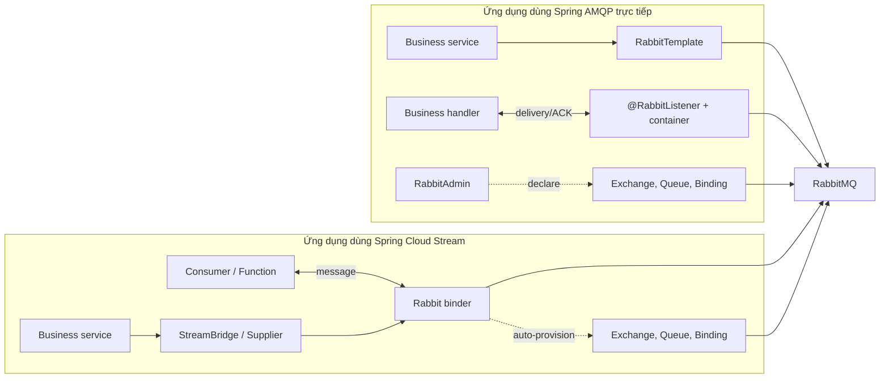
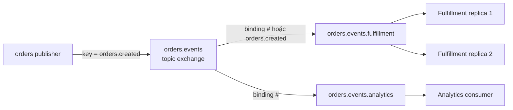
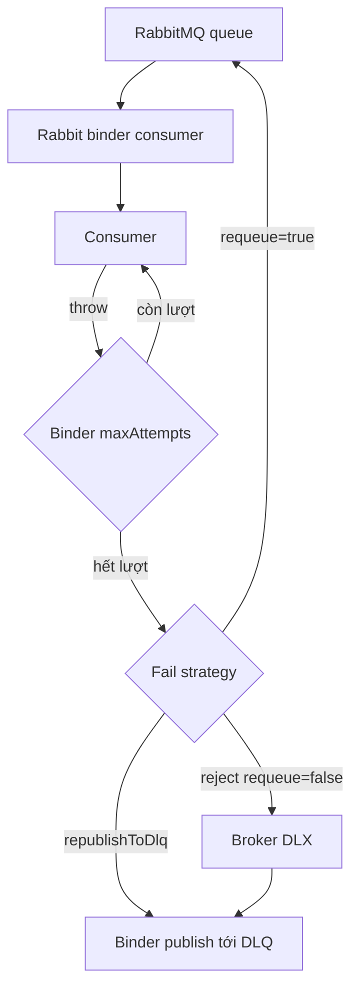

# Spring Cloud Stream Rabbit binder và ranh giới so với Spring AMQP trực tiếp

## 1. Tại sao cần thêm một lớp binder khi đã có Spring AMQP?

Một hệ thống đặt hàng có thể dùng **Spring AMQP trực tiếp**:

1. `RabbitAdmin` khai báo exchange `orders.events.x`, queue `orders.created.q` và binding `orders.created`.
2. `RabbitTemplate` publish message với exchange/routing key cụ thể.
3. `@RabbitListener` nhận message, xử lý database, ACK hoặc để container retry/reject theo cấu hình.

Khi các dịch vụ chỉ trao đổi **sự kiện có schema rõ ràng**, người phát triển có thể muốn tập trung vào việc **nhận một event và thực thi hàm nghiệp vụ**, còn việc kết nối broker, tạo destination, gắn consumer group, chuyển đổi payload, retry phổ biến được cấu hình bên ngoài code. **Spring Cloud Stream Rabbit binder** phục vụ trường hợp này.

Điểm cần hiểu không phải “công nghệ nào thay thế công nghệ nào”, mà là **ranh giới trừu tượng**:

- **Spring Cloud Stream** cung cấp mô hình hàm `Supplier` / `Function` / `Consumer`, *binding* đầu vào/đầu ra, message conversion, consumer group và binder abstraction.
- **Rabbit binder** ánh xạ các binding đó sang **RabbitMQ exchange, queue, binding và AMQP consumer/producer**; phần lớn được xây trên hạ tầng Spring AMQP/Spring Integration.
- **Spring AMQP trực tiếp** đưa ra API sát RabbitMQ hơn: `RabbitTemplate`, `RabbitAdmin`, `@RabbitListener`, listener container, publisher confirms/returns, manual ACK, RPC, transaction và tùy biến channel.

Bài thuộc chương **Mẫu tích hợp** của module `SPRING_AMQP`. Nó giải thích cách chọn ranh giới phù hợp, thực hành một luồng event bằng Rabbit binder, dùng lại topology có sẵn, nhận biết lỗi retry/DLQ, so sánh độ tin cậy và thiết kế di chuyển an toàn giữa hai mô hình.

> **Thông điệp quan trọng:** Rabbit binder **không phải giao thức RabbitMQ mới**, cũng không tạo ra bảo đảm exactly-once. Việc chọn binder thay vì `RabbitTemplate` đổi **mức abstraction và điểm đặt cấu hình**, chứ không làm biến mất semantics exchange, queue, ACK, confirm hoặc retry của broker.

## 2. Hai con đường từ nghiệp vụ tới RabbitMQ



| Tiêu chí | Spring Cloud Stream + Rabbit binder | Spring AMQP trực tiếp |
| --- | --- | --- |
| API nghiệp vụ | `Consumer<T>`, `Function<I,O>`, `Supplier<T>`, `StreamBridge` | `RabbitTemplate`, `@RabbitListener`, `RabbitAdmin` |
| Địa chỉ | `destination`, `group`, `bindingName`; tham số Rabbit-specific bổ sung | Exchange, queue, routing key, binding cụ thể |
| Provisioning mặc định | Binder có thể tự tạo exchange, queue, binding dựa trên binding/group | `RabbitAdmin` khai báo bean `Declarable` do ứng dụng cung cấp |
| Conversion | Theo `content-type` và kiểu hàm/`Message<?>` | Qua `MessageConverter`, listener argument resolution |
| Retry phổ biến | `maxAttempts`, backoff và Rabbit-specific DLQ properties | Spring Retry, listener advice/error handler và AMQP APIs |
| Publisher confirms/returns | Có cơ chế qua binder + error channels/confirm headers, cần cấu hình | Điều khiển bằng `RabbitTemplate`, `CorrelationData`, callbacks |
| Manual ACK và channel | Có các tùy chọn Rabbit-specific, nhưng đi qua binder | Điều khiển trực tiếp listener container/`Channel` |
| RPC request/reply | Không phải lựa chọn mặc định cho RPC AMQP chuyên biệt | `convertSendAndReceive`, reply-to, correlation, timeout |
| Portability | Tốt hơn ở **phần xử lý event dạng hàm**, không tuyệt đối | Gắn rõ RabbitMQ/Spring AMQP |
| Observability | Binding/function metrics + RabbitMQ-specific metrics/trace | Micrometer Observation của template/container + broker metrics |
| Cần gì để chạy? | Spring Cloud release train tương thích với Boot + Rabbit binder | Spring Boot AMQP starter/Spring AMQP thích hợp |

Không nên chọn binder chỉ vì thấy chữ “cloud”: ngay cả khi dùng binder, **RabbitMQ vẫn là broker thực**, có disk alarm, quorum, consumer concurrency, publisher timeout và failure modes như thông thường.

## 3. Rabbit binder ánh xạ destination, group ra topology nào?

### 3.1. Mặc định binder tạo gì?

Với Rabbit binder và một consumer:

```yaml
spring:
  cloud:
    function:
      definition: processOrder
    stream:
      bindings:
        processOrder-in-0:
          destination: orders.events
          group: fulfillment
```

Mặc định **khi chưa cấu hình prefix hoặc override topology**:

| Khái niệm Cloud Stream | Tài nguyên RabbitMQ tương ứng |
| --- | --- |
| `destination: orders.events` | **Topic exchange** tên `orders.events` |
| `group: fulfillment` | Queue có tên `orders.events.fulfillment` |
| Không khai báo `group` | Queue anonymous, auto-delete với tên sinh động |
| Consumer group có nhiều instance | Các instance cùng đọc **một queue**, cạnh tranh nhận delivery |
| Hai group `fulfillment` và `analytics` | Hai queue riêng, mỗi group có một bản copy message đã route |
| Consumer `bindingRoutingKey` mặc định | `#` — match mọi routing key của topic exchange |
| Producer routing key mặc định | Thường là destination (hoặc key có suffix partition khi partitioned) |



**Quan trọng:** `group` là **một cơ chế sở hữu queue/nhóm consumer**, không phải RabbitMQ exchange type. Đối với một group, nhiều replica thường cạnh tranh nhận **mỗi delivery một lần**; không nhân bản message cho từng pod. Muốn hai team nhận mọi event, mỗi team dùng **group khác nhau** hoặc queue riêng phù hợp.

Nếu **không đặt group**, binder dùng anonymous queue có thể bị xóa khi client ngừng; đó thường là mô hình pub/sub tạm thời, **không thích hợp cho một work queue cần giữ backlog qua deployment**.

### 3.2. Phân biệt binding name và destination

Một function Java tên `processOrder` có input binding name **`processOrder-in-0`**. Đây là tên cấu hình **trong application**, còn `orders.events` là **tên exchange đích**.

```text
processOrder                = tên bean/function
processOrder-in-0           = binding name bên ứng dụng
orders.events               = destination/exchange RabbitMQ
orders.events.fulfillment   = queue theo destination + group
orders.created              = routing key đặt riêng trong Rabbit binder
```

Đừng dùng `processOrder-in-0` làm routing key khi thực tế đã cấu hình `orders.created`: hai khái niệm thuộc **hai lớp khác nhau**.

## 4. Viết consumer kiểu hàm và khai báo topology do binder quản lý

Ví dụ dùng Java 17+, Spring Boot và một **Spring Cloud release train tương thích**. Cần kiểm tra [Spring Cloud compatibility](https://spring.io/projects/spring-cloud) trước khi chọn BOM; không ép một phiên bản Cloud Stream mới chạy trên mọi Spring Boot cũ.

### 4.1. Dependency

Với Gradle, phiên bản các dependency cần do BOM Spring Boot và Spring Cloud phù hợp quản lý:

```gradle
dependencies {
    implementation("org.springframework.cloud:spring-cloud-starter-stream-rabbit")

    // Nếu cần metrics/health trong ứng dụng:
    implementation("org.springframework.boot:spring-boot-starter-actuator")
}
```

`spring-cloud-starter-stream-rabbit` mang Rabbit binder; không cần tự dùng `@EnableBinding` hay `@StreamListener` theo phong cách legacy. Functional model với `@Bean Consumer`/`Function`/`Supplier` là cách tiếp cận được Spring Cloud Stream khuyến nghị.

### 4.2. Định nghĩa schema nghiệp vụ

```java
package example.orders;

// eventId do nghiệp vụ sinh ra và giữ nguyên nếu gửi lại
// cùng logical event; dùng schemaVersion để nâng cấp dữ liệu.
public record OrderCreated(
        String eventId,
        String orderId,
        int schemaVersion) {}
```

`eventId` nằm trong **body** để Java, Python hoặc Node.js đều có thể hiểu; không dựa hoàn toàn vào Java type header `__TypeId__` hay UUID do transport sinh. Production có thể dùng JSON Schema, Avro hoặc Protobuf, nhưng cần versioning rõ ràng.

### 4.3. Consumer thuần hàm

```java
package example.orders;

import java.util.function.Consumer;
import org.springframework.context.annotation.Bean;
import org.springframework.context.annotation.Configuration;

@Configuration
public class OrderConsumerConfiguration {

    @Bean
    public Consumer<OrderCreated> processOrder(
            OrderProcessingService service) {
        return event -> {
            if (event.eventId() == null
                    || event.eventId().isBlank()
                    || event.schemaVersion() != 1) {
                throw new IllegalArgumentException(
                        "Unsupported OrderCreated contract");
            }
            // Service phải commit inbox(eventId) và side effect
            // trong một DB transaction trước khi return.
            service.applyOnce(event);
        };
    }
}

interface OrderProcessingService {
    void applyOnce(OrderCreated event);
}
```

Ở đây **không có `@RabbitListener`**. Binder tạo message-driven consumer và đưa payload đã chuyển đổi thành `OrderCreated` vào function. Khi function ném exception, binder áp dụng retry/error handling đã cấu hình; khi function trả thành công, listener container xử lý acknowledgement theo mode tương ứng.

Spring Cloud Stream không tự cài đặt logic `applyOnce`; đây vẫn là trách nhiệm ứng dụng. Với sự kiện phải tránh side effect trùng, cần **DB unique key/inbox** cho `eventId`, không chỉ một cache trong RAM.

### 4.4. Cấu hình Rabbit binder có routing rõ ràng

```yaml
spring:
  application:
    name: fulfillment-service
  rabbitmq:
    addresses: ${RABBITMQ_ADDRESSES:localhost:5672}
    username: ${RABBITMQ_USERNAME:guest}
    password: ${RABBITMQ_PASSWORD:guest}
    virtual-host: ${RABBITMQ_VHOST:/}
  cloud:
    function:
      definition: processOrder
    stream:
      bindings:
        processOrder-in-0:
          destination: orders.events
          group: fulfillment
          content-type: application/json
          consumer:
            max-attempts: 1
            concurrency: 2
      rabbit:
        bindings:
          processOrder-in-0:
            consumer:
              exchange-type: topic
              binding-routing-key: orders.created
              auto-bind-dlq: true
              republish-to-dlq: false
              requeue-rejected: false
```

Giải thích từng điểm:

- `processOrder-in-0` là tên **input binding** từ function `processOrder`.
- `destination=orders.events` bảo binder quản lý **topic exchange** `orders.events`.
- `group=fulfillment` tạo queue durable `orders.events.fulfillment` để nhiều instance cùng đọc và để message chờ khi consumer tạm offline.
- `binding-routing-key=orders.created` thay wildcard `#` bằng một key cụ thể.
- `max-attempts=1` tắt **binder-level retry trong cùng lần nhận** để tập trung minh họa broker DLX.
- `auto-bind-dlq=true` yêu cầu binder provision dead-letter infrastructure.
- `republish-to-dlq=false` khiến binder dùng đường **reject/negative acknowledgement** để broker dead-letter (khi DLX đã được gán), thay vì republish qua ứng dụng.
- `requeue-rejected=false` tránh requeue nóng vô hạn cho message lỗi khi retry đã hết.

Khi dùng `auto-bind-dlq=true`, hãy **kiểm tra tên DLX/DLQ thực tế qua RabbitMQ Management UI/CLI** trước khi dùng cho vận hành; binder có quy tắc naming mặc định và các thuộc tính để override. Không mặc nhiên coi DLQ là `orders.events.fulfillment.dlq` nếu chưa kiểm tra cấu hình và phiên bản cụ thể.

**Cảnh báo bảo mật:** `guest` ở ví dụ chỉ dùng cho môi trường local được broker cho phép; production sử dụng secret, TLS và quyền `configure/write/read` giới hạn theo vhost. Không commit password thật.

## 5. Publish từ REST/command handler bằng StreamBridge

Một `Supplier<OrderCreated>` phù hợp khi framework có nguồn dữ liệu polling/triggers. Với một REST endpoint hoặc outbox relay muốn phát event **theo sự kiện nghiệp vụ**, `StreamBridge` thường tự nhiên hơn.

### 5.1. Khai báo output binding

```yaml
spring:
  cloud:
    stream:
      output-bindings: orderEvents-out-0
      bindings:
        orderEvents-out-0:
          destination: orders.events
          content-type: application/json
      rabbit:
        bindings:
          orderEvents-out-0:
            producer:
              exchange-type: topic
              routing-key: orders.created
```

`output-bindings` tạo output binding ngay khi ứng dụng khởi động, ngay cả khi không có `Supplier` function. Nếu bỏ property này, `StreamBridge` có thể tạo/cached binding động lần đầu gọi; hãy hiểu khác biệt để không vô tình tạo hàng trăm dynamic destinations.

### 5.2. Java producer

```java
package example.orders;

import org.springframework.cloud.stream.function.StreamBridge;
import org.springframework.messaging.Message;
import org.springframework.messaging.support.MessageBuilder;
import org.springframework.stereotype.Service;

@Service
public class OrderEventPublisher {
    private final StreamBridge streamBridge;

    public OrderEventPublisher(StreamBridge streamBridge) {
        this.streamBridge = streamBridge;
    }

    public void publish(OrderCreated event) {
        Message<OrderCreated> message = MessageBuilder
                .withPayload(event)
                .setHeader("x-business-correlation-id", event.orderId())
                .build();

        boolean sentToBinding =
                streamBridge.send("orderEvents-out-0", message);
        if (!sentToBinding) {
            throw new IllegalStateException(
                    "Output binding did not accept message");
        }
    }
}
```

`StreamBridge.send(...)` trả về một **boolean từ cơ chế gửi của binding/channel**. Giá trị `true` **không tương đương publisher confirm ACK** từ RabbitMQ, không chứng minh broker đã lưu bền vững hay queue đã nhận message. Đối với `OrderPaid` hoặc event nghiệp vụ cần bảo đảm, thiết kế riêng chính sách **publisher confirms/returns** hoặc dùng transactional outbox với relay biết kiểm tra publish outcome.

`Message<OrderCreated>` ở trên là **Spring Messaging `Message`**, không phải `org.springframework.amqp.core.Message`. Binder chuyển payload/headers theo `content-type` và cấu hình binder để publish qua RabbitMQ. Nếu chọn `RabbitTemplate`, code phía producer tự quyết định exchange/routing key và converter.

### 5.3. Một ứng dụng có thể vừa consume vừa produce

Trong cùng app, nếu vừa có bean `processOrder` vừa gọi `StreamBridge`, phải bảo đảm:

```yaml
spring:
  cloud:
    function:
      definition: processOrder
    stream:
      output-bindings: orderEvents-out-0
```

Không dùng `Function` có output chỉ vì muốn emit event **có side effect sau DB transaction** mà chưa xác định lúc nào broker publish so với DB commit. Function có thể trả output khi logic handler hoàn tất nhưng **không tự tạo transaction nguyên tử DB + RabbitMQ**.

## 6. Cùng bài toán dùng Spring AMQP trực tiếp

Nếu không dùng binder, ứng dụng tự sở hữu topology:

```java
import org.springframework.amqp.core.BindingBuilder;
import org.springframework.amqp.core.Declarables;
import org.springframework.amqp.core.DirectExchange;
import org.springframework.amqp.core.Queue;
import org.springframework.amqp.core.QueueBuilder;
import org.springframework.context.annotation.Bean;
import org.springframework.context.annotation.Configuration;

@Configuration
public class OrdersAmqpTopology {

    @Bean
    public Declarables ordersDeclarables() {
        DirectExchange exchange =
                new DirectExchange("orders.events.x", true, false);
        Queue queue =
                QueueBuilder.durable("orders.created.q").build();
        return new Declarables(
                exchange,
                queue,
                BindingBuilder.bind(queue).to(exchange)
                        .with("orders.created")
        );
    }
}
```

Publisher dùng exchange/key rõ ràng:

```java
import org.springframework.amqp.rabbit.core.RabbitTemplate;
import org.springframework.stereotype.Service;

@Service
public class DirectAmqpOrderPublisher {
    private final RabbitTemplate template;

    public DirectAmqpOrderPublisher(RabbitTemplate template) {
        this.template = template;
    }

    public void send(String json) {
        template.convertAndSend(
                "orders.events.x", "orders.created", json);
    }
}
```

Consumer:

```java
import org.springframework.amqp.rabbit.annotation.RabbitListener;
import org.springframework.stereotype.Component;

@Component
public class DirectAmqpOrderListener {
    private final OrderJsonHandler handler;

    public DirectAmqpOrderListener(OrderJsonHandler handler) {
        this.handler = handler;
    }

    @RabbitListener(queues = "orders.created.q")
    public void handle(String json) {
        handler.applyOnceFromJson(json);
    }
}

interface OrderJsonHandler {
    void applyOnceFromJson(String json);
}
```

Ở cách trực tiếp:

- Exchange type là `direct`, queue là `orders.created.q` theo **thiết kế rõ ràng**, không theo quy ước `destination.group`.
- `RabbitAdmin` khai báo topology từ beans khi được cấu hình. `RabbitTemplate` và `@RabbitListener` **không tự hiểu** consumer group hay bind key như Cloud Stream.
- Publisher confirmations/returns và AMQP ACK có thể được điều khiển chi tiết hơn; ứng dụng chịu trách nhiệm ghép các thành phần lại.
- Code trên chỉ minh họa tuyến gửi/nhận; chưa có JSON converter chung, confirms/returns, DLQ hay idempotency. Phải bổ sung theo yêu cầu ứng dụng.

**Đừng deploy đồng thời cả hai ví dụ lên cùng queue production mà chưa kiểm soát:** `@RabbitListener` và binder consumer cùng nhận từ một queue sẽ trở thành **competing consumers**, không phải shadow subscribers. Nếu cả hai cùng tự khai báo queue/exchange với **khác arguments hoặc type**, broker có thể báo `PRECONDITION_FAILED`.

## 7. Ranh giới provisioning: binder không biết trước RabbitAdmin của bạn

### 7.1. Hai nguồn định nghĩa topology dễ gây xung đột

Spring Cloud Stream Rabbit binder có thể auto-provision một **topic exchange** cho `orders.events`. Trong khi đó một ứng dụng Spring AMQP cũ đã tạo **direct exchange** tên `orders.events`.

```text
Existing RabbitAdmin:
  exchange orders.events type=direct

Rabbit binder mặc định:
  cố declare exchange orders.events type=topic

=> inequivalent args / PRECONDITION_FAILED
```

Đây không phải lỗi transient. Bật retry hoặc `ignoreDeclarationExceptions` không biến hai exchange type thành tương thích. Cần quyết định **ai có quyền quản lý topology**.

Một ví dụ khác là tên queue: binder có group `fulfillment` sẽ dùng `orders.events.fulfillment`; `RabbitAdmin` cũ tạo `orders.created.q`. Nếu không cấu hình đúng, binder sẽ tạo **queue mới**, còn message đang ở queue cũ vẫn chờ, tạo cảm giác consumer “không nhận message”.

### 7.2. Dùng lại exchange/queue đã có, không để binder tự tạo

Giả sử hạ tầng đã provision:

```text
Exchange: orders.events.x (direct)
Queue:    orders.created.q (durable)
Binding:  orders.events.x --orders.created--> orders.created.q
```

Cấu hình **consumer binder** đọc đúng queue đã tồn tại:

```yaml
spring:
  cloud:
    function:
      definition: processOrder
    stream:
      bindings:
        processOrder-in-0:
          destination: orders.events.x
          group: orders.created.q
          content-type: application/json
      rabbit:
        bindings:
          processOrder-in-0:
            consumer:
              queue-name-group-only: true
              declare-exchange: false
              bind-queue: false
```

Trong cấu hình này:

- `destination` chỉ rõ **exchange đã có**.
- `group` được dùng làm **tên queue thực tế** vì `queue-name-group-only=true`.
- `declare-exchange=false` không để binder cố declare exchange đang được IaC/RabbitAdmin quản lý.
- `bind-queue=false` không để binder cố tạo queue/binding; toàn bộ queue và binding **phải tồn tại trước**.

Nếu broker chưa có queue hoặc binding, binder **không tự chữa** khi ta tắt provisioning; hãy kiểm tra lỗi startup và trạng thái broker. Quyền `read`/`write` không thay quyền `configure` khi một công cụ muốn declare.

Producer binder cũng có thể publish vào exchange cũ:

```yaml
spring:
  cloud:
    stream:
      output-bindings: orderEvents-out-0
      bindings:
        orderEvents-out-0:
          destination: orders.events.x
          content-type: application/json
      rabbit:
        bindings:
          orderEvents-out-0:
            producer:
              declare-exchange: false
              routing-key: orders.created
```

Đây là phương án **cùng wire contract, khác programming model** để chuyển dần từ `RabbitTemplate` sang binder hoặc ngược lại. Đừng bật lại auto-provision khi chưa đối chiếu type, durable, arguments và policy của các tài nguyên đang có.

### 7.3. Khi nào nên dùng RabbitAdmin, khi nào để binder provision?

| Hoàn cảnh | Cách sở hữu topology nên cân nhắc |
| --- | --- |
| Dịch vụ event nhỏ, topology có thể theo quy ước destination/group | Binder auto-provision, test tên tài nguyên thực tế |
| Nhiều ứng dụng cùng chia sẻ exchange và team platform sở hữu resources | IaC/RabbitAdmin do platform quản lý; app binder tắt declaration phù hợp |
| Queue có x-arguments/policy đặc biệt và vòng đời độc lập app | Provision tập trung, kiểm thử equivalence và permissions |
| Chuyển consumer cũ `@RabbitListener` sang binder trên **cùng queue** | Binder `queueNameGroupOnly`, `bindQueue=false`, `declareExchange=false`; canary có kiểm soát |
| Cần quản lý hàng trăm dynamic queues và binding bất thường | Xem xét `AmqpAdmin`/provisioning service riêng hơn là biến mọi thứ thành dynamic destination |
| Muốn thay RabbitMQ bằng Kafka trong tương lai | Binder làm giảm coupling ở tầng function, nhưng phải thiết kế lại ordering/partition/DLQ/delivery semantics |

Không nên để **hai nguồn cấu hình cùng “sở hữu” queue**: policy và bean argument có thể khác nhau, khởi động nhiều instance có thể gây lỗi khai báo xen kẽ.

## 8. Retry và DLQ: cùng đích đến, khác người điều phối

### 8.1. Phân biệt ba vòng xử lý



| Cơ chế | Xảy ra ở đâu? | Tính chất |
| --- | --- | --- |
| `maxAttempts` / backoff trong binder | Trong consumer process, qua retry handler | Có thể gọi handler nhiều lần **trong một delivery**, không nhất thiết quay lại broker |
| `requeueRejected` | Khi xử lý thất bại sau retry | Broker có thể giao lại message; nếu lặp nóng sẽ gây retry storm |
| `autoBindDlq` | Lúc provision topology | Tạo/gắn DLX và DLQ; **không** tự bảo đảm handler sẽ không retry vô hạn |
| `republishToDlq=true` | Binder publish một message mới tới DLQ | Thêm failure headers; cần chú ý publish outcome và frame/header limits |
| `republishToDlq=false` + reject không requeue | Broker dead-letter theo DLX | Giữ gần message gốc hơn; không tự thêm stack trace của binder |
| `x-death` | RabbitMQ khi dead-letter | Hỗ trợ chẩn đoán dead-letter cycles, không phải khóa idempotency |

Ở ví dụ mục 4, ta cố ý đặt `max-attempts=1`, `republish-to-dlq=false`, `requeue-rejected=false` để minh họa **một lần thử, sau lỗi sẽ reject và broker DLX**. Một hệ thống thật thường muốn phân loại lỗi:

- **Lỗi tạm thời** (DB/network timeout): retry có backoff và tổng số lần hữu hạn; có thể dùng retry queue TTL/DLX khi cần delay dài.
- **Lỗi vĩnh viễn** (schema sai, thiếu trường bắt buộc): không requeue mãi; đưa tới DLQ/parking có quy trình điều tra.
- **Poison message**: dùng DLQ/delivery-limit phù hợp queue type để tránh toàn bộ consumer bị giữ bởi một message lỗi.

### 8.2. Khi cần retry trong binder trước khi DLQ

Có thể dùng biến thể:

```yaml
spring:
  cloud:
    stream:
      bindings:
        processOrder-in-0:
          consumer:
            max-attempts: 3
            back-off-initial-interval: 1000
            back-off-max-interval: 5000
      rabbit:
        bindings:
          processOrder-in-0:
            consumer:
              auto-bind-dlq: true
              republish-to-dlq: true
              requeue-rejected: false
```

Các property này **thay cho các giá trị cùng tên ở mục 4**, không phải một application.yml thứ hai cùng hiệu lực. `republish-to-dlq=true` giúp giữ thêm thông tin exception trong headers, nhưng có chi phí **một lần publish mới** tới DLQ, có khả năng lỗi khi broker gặp sự cố. Thêm stack trace còn làm tăng kích thước headers, cần kiểm soát dung lượng AMQP frame.

Khi binder xử lý republish-to-DLQ và connection factory hỗ trợ confirms/returns, binder có thể đợi kết quả hoặc fallback sang broker reject/dead-letter khi publish thất bại. **Không tự suy rằng DLQ đã lưu an toàn chỉ từ việc consumer function ném exception.**

### 8.3. Cùng lỗi ở Spring AMQP trực tiếp

Với `@RabbitListener`, ứng dụng có thể cấu hình `SimpleRabbitListenerContainerFactory` cùng advice chain Spring Retry hoặc `ConditionalRejectingErrorHandler`, dùng `AmqpRejectAndDontRequeueException`, manual `basicNack`, `RabbitAdmin` và DLX. Sự khác biệt là **config/ownership**, không phải Rabbit binder mang đến một loại DLX riêng.

Nếu đổi trực tiếp sang binder, hãy viết **failure tests**, không chỉ happy path:

1. Handler throw do DB tạm mất — có retry bao nhiêu lần, backoff đúng không?
2. Handler throw vì schema invalid — message được reject hay requeue?
3. Broker không route được DLQ — có alert và dữ liệu phục hồi được không?
4. Listener commit DB rồi mất ACK — inbox có tránh side effect trùng không?
5. Producer publish event trùng vì confirm timeout — `eventId` có ổn định không?

## 9. Publisher confirms, transaction và sự thật về `StreamBridge.send`

Rabbit binder sử dụng RabbitMQ bên dưới, nên **publisher confirms/returns** vẫn là vấn đề quan trọng. Một yêu cầu nghiệp vụ:

```text
BEGIN database transaction
  INSERT orders
  INSERT outbox_events(eventId, payload)
COMMIT

Relay:
  publish eventId
  await confirm + check returned/unroutable
  mark outbox PUBLISHED
```

`StreamBridge.send(...) == true` chỉ trả về kết quả của **đường gửi qua binder/MessageChannel**. Nó không phải bằng chứng “message đã được broker lưu bền vững”, càng không phải “consumer đã ACK”. Với Rabbit binder, có các cơ chế như:

- Bật publisher confirms trên underlying `ConnectionFactory`.
- Dùng Rabbit binder producer error channel và `confirmAckChannel` hoặc **confirm header** (`useConfirmHeader`) theo tài liệu phiên bản (hai cơ chế này có ràng buộc loại trừ nhau).
- Theo dõi **returned message/unroutable**, publish NACK và timeout bằng tương quan từng lần gửi.
- Với nghiệp vụ quan trọng, dùng **outbox** để publish lại khi kết quả chưa xác định.

Không tự thêm `CorrelationData` vào payload JSON rồi hy vọng binder tự dùng nó làm confirm correlation; phải cấu hình **đúng header/interface mà Rabbit binder hỗ trợ** hoặc giữ phần publisher cần kiểm soát cao bằng `RabbitTemplate`.

### Vì sao cần xử lý duplicate ở cả hai mô hình?

Nếu broker đã nhận message nhưng publisher mất kết nối trước khi nhận confirm, relay có thể publish lại. Consumer sau khi commit DB cũng có thể chết trước khi ACK; message được giao lại. Cả binder và trực tiếp đều **không tự xóa hai cửa sổ bất định** này.

Thiết kế inbox:

```sql
CREATE TABLE processed_events (
    event_id VARCHAR(128) PRIMARY KEY,
    processed_at TIMESTAMPTZ NOT NULL DEFAULT now()
);
```

Pseudo-code trong **một DB transaction**:

```text
BEGIN
  inserted = INSERT processed_events(eventId)
                ON CONFLICT DO NOTHING
  IF inserted:
      validate aggregateVersion
      apply business side effect
COMMIT
consumer function returns -> binder/container ACK
```

Nếu muốn `@Transactional` gộp cả RabbitMQ và DB, cần hiểu đây không mặc nhiên là distributed atomic transaction; Rabbit transaction và database transaction có thể commit lệch nhau. Với **saga/outbox**, hướng an toàn thường là event bền vững + idempotency, không phải tìm một annotation đảm bảo exactly-once cho mọi broker.

## 10. Consumer group, partition và thứ tự sự kiện

### 10.1. Group giúp scale cạnh tranh, không bảo đảm completion order

Giả sử có hai bản sao `fulfillment-service`, cùng `group=fulfillment`. Chúng nhận delivery từ **một queue**, nhưng một bản sao có thể xử lý `OrderCreated(ORD-42)` chậm hơn bản kia xử lý `OrderUpdated(ORD-42)`.

Ngay cả khi queue lưu thứ tự enqueue, **thứ tự commit nghiệp vụ** có thể khác khi concurrent consumers/prefetch/retry. Giải pháp cần xét:

- `aggregateVersion`/optimistic locking để không ghi trạng thái cũ đè trạng thái mới.
- Route events của cùng `orderId` vào partition ổn định khi thật sự cần ordering per key.
- Quorum queue Single Active Consumer hoặc consumer concurrency phù hợp khi yêu cầu thứ tự nghiêm ngặt.
- Không kỳ vọng tăng `concurrency` vô hạn giúp tăng throughput mà không ảnh hưởng semantics.

### 10.2. Partitioning của Spring Cloud Stream không hoàn toàn “portable”

Spring Cloud Stream có `producer.partitionKeyExpression`, `partitionCount` và consumer `partitioned`, `instanceIndex` để xử lý message theo partition. Nhưng Rabbit binder triển khai phân vùng bằng các **queue/routing key thực**; partition key không tự biến RabbitMQ topic exchange thành Kafka partition.

Khi bật partitioning, cần đồng bộ `instanceIndex/instanceCount`, routing, binding và số consumer phù hợp. Rabbit binder **không tự scale partitioned consumers tùy ý** theo số replica như người dùng Kafka thường kỳ vọng; phải đảm bảo đủ consumer cho các partition đã định nghĩa.

Thử nghiệm trước khi thay đổi:

| Tình huống | Mong đợi |
| --- | --- |
| Hai event cùng `orderId` | Đi cùng partition nếu expression/hash policy ổn định |
| Scale thêm instance nhưng `instanceIndex` trùng | Có thể tranh chấp/phân bổ sai, cần phát hiện |
| Đổi số partition đang chạy | Có thể đổi ánh xạ key, cần migration/order guard |
| Một partition consumer crash | Message chưa ACK được giao lại; không gây duplicate side effect |
| Chuyển sang Kafka binder | Kiểm tra lại semantics partition/offset/ACK/retention từ đầu |

**Lưu ý:** Portable ở mức API function **không đồng nghĩa** tương đương về ordering, retry, queue type, retention hay dead-letter giữa Rabbit và Kafka.

## 11. Khi nào dùng binder, khi nào dùng trực tiếp?

| Yêu cầu | Lựa chọn nên ưu tiên xem xét | Lý do |
| --- | --- | --- |
| Event-driven microservice với JSON contract rõ | **Rabbit binder** | Code nghiệp vụ là function; cấu hình group/routing/retry bằng binding properties |
| Nhiều nhóm xử lý cùng một loại event | **Rabbit binder** | `group` rõ ràng, tự provision queue cho mỗi nhóm |
| Dịch vụ cần thay binder giữa Rabbit/Kafka | **Cloud Stream abstraction**, kèm đánh giá semantics | Giảm coupling code, nhưng transport-specific config vẫn phải thay |
| `RabbitTemplate` request/reply, `replyTo`, correlation, late reply | **Spring AMQP trực tiếp** | Điều khiển RPC, timeout và correlation chuyên biệt |
| Manual ACK/nack/requeue, thao tác channel tinh vi | **Spring AMQP trực tiếp** | Điều khiển sát broker ở listener/channel |
| Routing dựa trên exchange/headers/arguments phức tạp | **Spring AMQP hoặc IaC + binder đọc topology có sẵn** | Tránh binder tự provision sai type/arguments |
| Publisher confirm/return theo từng event và outbox relay | **Trực tiếp** hoặc binder đã cấu hình confirm rõ | Cần chứng minh publish outcome, không chỉ `send` boolean |
| Nhiều broker/vhost, topology ownership nghiêm ngặt | **Tùy kiến trúc**, thường explicit factories/admin | Tránh cấu hình nhiều binders/admin vô tình khai báo chéo |
| Native RabbitMQ Streams protocol / AMQP 1.0 | Xem **module client/protocol phù hợp** | Rabbit binder mặc định không có nghĩa là AMQP 1.0/native streams |
| Consumer xử lý đơn giản, cần retry/DLQ chuẩn | **Rabbit binder** | Cấu hình phổ biến ngắn gọn, nhưng cần kiểm thử lỗi thật |

Không có luật “binder luôn ít code hơn trong mọi dự án”. Nếu đa số flow phải tự tùy biến Rabbit-specific properties và tương tác `Channel` thường xuyên, thêm abstraction có thể khiến cấu hình khó đọc hơn so với viết trực tiếp.

## 12. Kế hoạch chuyển từ Spring AMQP trực tiếp sang Rabbit binder

Một migration an toàn phải giữ nguyên **business contract** chứ không chỉ khởi động thành công consumer mới.

### Pha 0 — Chụp hiện trạng

Ghi lại:

- Exchange type, routing keys, queues, bindings, vhost, ownership (`RabbitAdmin`/IaC).
- Queue durability, quorum/classic, TTL, DLX/DLQ và những policy hiệu lực.
- Converter và wire format thật (`content-type`, JSON schema, Java type headers).
- Producer confirms/returns, consumer retry/requeue/ACK, `@Transactional`/outbox.
- Consumer concurrency/prefetch, ordering per `orderId` và idempotency.
- Backlog, consumer count, DLQ size, p95/p99 và tỷ lệ lỗi baseline.

### Pha 1 — Giữ topology cũ, chỉ đổi programming model

Đặt binder `destination` và `queue-name-group-only` để **trỏ đúng exchange/queue cũ**, tắt automatic declaration như mục 7. Đảm bảo sender cũ và binder consumer mới **đọc cùng wire contract**. Nếu yêu cầu running side-by-side, chạy từng đợt canary trên một queue/partition được chỉ định — không gọi hai competing consumers trên cùng queue là shadow test.

### Pha 2 — Test hợp đồng và lỗi

| Test | Cấu hình phải qua |
| --- | --- |
| `RabbitTemplate` cũ → binder consumer mới | Payload, metadata, side effect và ACK đúng |
| Binder producer mới → `@RabbitListener` cũ | Routing key, JSON/type headers và converter đúng |
| Binder → binder | End-to-end success |
| Direct → direct | Baseline |
| Sai routing key | Returns/unroutable được phát hiện |
| Exception tạm thời | Retry/backoff và DLQ đúng |
| Exception vĩnh viễn | Không tạo requeue storm; có parking/DLQ |
| Crash sau DB commit trước ACK | Redelivery không tạo double effect |
| Publisher mất confirm | Event ID ổn định, relay có thể retry an toàn |
| Dừng từng pod | Consumer cũ/mới drain; backlog không bị mất |

### Pha 3 — Canary producer và consumer tách đợt

Chọn một cohort/queue thử nghiệm đủ nhỏ, dùng feature flag để quyết định producer nào phát **message thật**. Không dual-publish cùng một event vào **cùng work queue** trừ khi dedup đã được chứng minh. Nếu muốn shadow, tạo **queue riêng** và vô hiệu hóa side effect ở shadow handler.

### Pha 4 — Mở rộng, quan sát, rollback

Tăng từng nấc khi tất cả gate pass. Theo dõi `messages_ready`, unacked, redelivery, DLQ, publish confirms, returns và kết quả business. Nếu rollback:

1. Dừng tạo traffic mới qua binder producer/canary.
2. Gracefully stop binder consumers, chờ hoặc cho requeue các unacked deliveries.
3. Bật lại `@RabbitListener`/producer cũ **chỉ khi còn đọc được schema đã publish**.
4. Giữ nguyên topology và queue còn backlog; không xóa queue chỉ để “quay lại code cũ”.
5. Đối soát outbox, inbox, DLQ và side effects; cập nhật runbook trước lần triển khai tiếp.

## 13. Kiểm thử: test binder không thay cho RabbitMQ thật

Spring Cloud Stream có **Spring Integration Test Binder** để thử function/bindings trong JVM:

```gradle
dependencies {
    testImplementation(
        "org.springframework.cloud:spring-cloud-stream-test-binder")
}
```

Nó cung cấp `InputDestination`, `OutputDestination` và `@EnableTestBinder` hoặc `TestChannelBinderConfiguration`. Ví dụ sau kiểm tra **conversion/function** mà không kết nối RabbitMQ:

```java
import static org.junit.jupiter.api.Assertions.assertEquals;

import java.nio.charset.StandardCharsets;
import java.util.function.Function;

import org.junit.jupiter.api.Test;
import org.springframework.boot.autoconfigure.SpringBootApplication;
import org.springframework.boot.test.context.SpringBootTest;
import org.springframework.cloud.stream.binder.test.EnableTestBinder;
import org.springframework.cloud.stream.binder.test.InputDestination;
import org.springframework.cloud.stream.binder.test.OutputDestination;
import org.springframework.context.annotation.Bean;
import org.springframework.beans.factory.annotation.Autowired;
import org.springframework.messaging.support.MessageBuilder;

@SpringBootTest(
    classes = FunctionBindingIT.App.class,
    properties = "spring.cloud.function.definition=normalize")
class FunctionBindingIT {

    @Autowired InputDestination input;
    @Autowired OutputDestination output;

    @Test
    void functionReceivesAndPublishes() {
        input.send(
                MessageBuilder.withPayload(
                    "order-created".getBytes(StandardCharsets.UTF_8))
                    .build(),
                "normalize-in-0");
        var result = output.receive(10_000, "normalize-out-0");
        assertEquals("ORDER-CREATED",
                new String(
                    result.getPayload(), StandardCharsets.UTF_8));
    }

    @SpringBootApplication
    @EnableTestBinder
    static class App {
        @Bean
        Function<String, String> normalize() {
            return value -> value.toUpperCase();
        }
    }
}
```

**Test này không có RabbitMQ broker**, do đó không chứng minh exchange/queue/binding đã được tạo, consumer group durable, publisher returns, DLQ hay quorum behavior. Cần bổ sung **Testcontainers RabbitMQ** hoặc broker test thật để kiểm tra:

- Binding `orders.created` được tạo và route đúng, key sai không route.
- Queue `orders.events.fulfillment` hoặc `orders.created.q` đúng tên theo mode.
- `autoBindDlq` tạo đúng DLX/queue; reject đưa message tới DLQ như kỳ vọng.
- Producer Java/Python gửi JSON cho binder consumer với `content-type` đúng.
- `RabbitTemplate` cũ ↔ binder mới đủ cả hai chiều.
- Crash/reconnect/ACK timeout và idempotency thực tế trên database.

Đối với một test lặp lại được, dùng broker/vhost cô lập, queue test không có listener khác tranh chấp, tạo `eventId` duy nhất, chờ bằng latch/Awaitility với deadline và **xóa chỉ tài nguyên của lab** sau test.

## 14. Quan sát hệ thống: cùng message, nhiều lớp chỉ số

| Layer | Nên quan sát |
| --- | --- |
| Function/application | Event type, schemaVersion, eventId, business outcome, exception class |
| Spring Cloud Stream binding | Input/output binding đang active, retry attempts, binder errors |
| Rabbit binder/client | Connection/channel recovery, producer confirms/returns, listener consumer tag |
| RabbitMQ | Exchange routes, queue `ready`/`unacked`, DLQ depth, consumer count, node alarms |
| Database | Transaction latency, inbox duplicate prevented, outbox pending |
| Tracing | Trace context qua producer/binder/consumer, correlation ID và span latency |

Với Spring AMQP trực tiếp, Micrometer Observation có thể bật trên `RabbitTemplate`/listener container. Với Cloud Stream, kiểm tra instrumentation và propagation của **bản Cloud Stream + Spring Integration + Rabbit binder đang dùng**; không tự giả định `spring.rabbitmq.template.observation-enabled=true` có hiệu lực lên mọi binding và message route.

**Định danh nghiệp vụ nên nằm trong event:** `eventId`, `orderId`, `schemaVersion` giúp đối soát kể cả khi trace sampling bỏ mất một số spans. Không đưa eventId/orderId vào **low-cardinality metric tags** vì tạo cardinality cao.

## 15. Những nhầm lẫn thường gặp

1. **“Dùng Rabbit binder là không còn RabbitMQ topology.”** Binder vẫn làm việc với exchange, queue, binding và vhost thật.
2. **“Destination của Rabbit binder chính là tên queue.”** Với cấu hình mặc định, destination là **exchange**, còn queue lấy từ destination + group.
3. **“Mỗi pod trong một group nhận được cùng một event.”** Các pod là competing consumers trong cùng một queue.
4. **“Không đặt group vẫn giữ backlog khi service shutdown.”** Anonymous queue thường auto-delete, không phù hợp reliable work queue.
5. **“`StreamBridge.send` true nghĩa là publisher confirm ACK.”** Không; phải kiểm soát publish outcome riêng.
6. **“Bật `autoBindDlq=true` nghĩa là mọi exception đều tới DLQ an toàn.”** Retry/requeue/republish và broker routing còn phải được kiểm thử.
7. **“Binder retry ba lần tức broker đã giao message ba lần.”** Local handler retry có thể xảy ra trong cùng một delivery.
8. **“Cho RabbitAdmin và binder cùng declare exchange type khác nhau rồi retry.”** Broker sẽ báo inequivalent declaration.
9. **“`@RabbitListener` và binder consumer cùng queue tạo shadow copy.”** Chúng cạnh tranh message; muốn shadow cần queue riêng.
10. **“Cloud Stream function luôn dễ đổi Rabbit sang Kafka mà không sửa gì.”** Ordering, partitions, confirms, DLQ và retention khác nhau.
11. **“`Consumer<OrderCreated>` tự cung cấp idempotency.”** Idempotency là logic DB/khóa nghiệp vụ độc lập abstraction.
12. **“Có binder không cần `RabbitTemplate` nữa trong mọi trường hợp.”** RPC và các cơ chế AMQP đặc thù vẫn có thể cần API trực tiếp.
13. **“Group và routing key là một.”** Group đặt tên queue, routing key quyết định binding/publish route.
14. **“Test Binder pass chứng minh RabbitMQ có đúng queue.”** Test Binder chỉ kiểm chứng function/binding trong JVM.
15. **“Chuyển qua binder là tự động AMQP 1.0.”** Rabbit binder mặc định sử dụng RabbitMQ qua AMQP client tương ứng của binder (thông thường AMQP 0-9-1); không có thay đổi wire protocol tự động.

## 16. Checklist chọn kiến trúc

| Câu hỏi | Nếu câu trả lời là... | Kết luận thiết kế |
| --- | --- | --- |
| Business logic chỉ cần nhận/phát event? | Có | Binder đáng cân nhắc |
| Nhiều consumer group nhận cùng event? | Có | Binder `destination/group` dễ diễn đạt |
| Exchange/queue đã tồn tại và được team khác sở hữu? | Có | Tắt binder provisioning hoặc dùng trực tiếp |
| Cần publisher confirms/returns theo event ID? | Có | Tích hợp cơ chế confirms của binder **hoặc** dùng RabbitTemplate |
| Cần RPC, manual channel operations? | Có | Spring AMQP trực tiếp thường rõ ràng hơn |
| Có yêu cầu portable Rabbit/Kafka? | Có | Binder giúp phần function nhưng cần kiểm chứng transport semantics |
| Có DLQ/retry và lỗi poison? | Có | Bất kỳ lựa chọn nào cũng phải chạy failure tests |
| Consumer phải chống duplicate? | Có | Inbox/idempotent handler ở business layer |
| Có đổi queue type hoặc exchange type? | Có | Phải lập kế hoạch migration topology, không redeclare cùng tên |
| Cần observability và performance? | Có | Đo cả binding, broker confirms/ACK, DB và outcomes |

## 17. Câu hỏi tự kiểm tra

1. Đâu là khác biệt giữa `spring.cloud.function.definition`, `processOrder-in-0`, `destination`, `group` và `bindingRoutingKey`?
2. Nếu destination là `orders.events` và group là `fulfillment`, binder thường tạo exchange/queue tên gì? Nếu không có group thì sao?
3. Hai service độc lập muốn nhận đủ mọi `OrderCreated` nên dùng cùng group hay hai group khác nhau? Vì sao?
4. Rabbit binder mặc định tạo topic exchange nhưng RabbitAdmin cũ đã tạo direct exchange cùng tên. Vì sao startup thất bại và sửa an toàn ra sao?
5. Để binder consume queue cũ `orders.created.q` mà không tự declare lại exchange và binding, cần những property gì?
6. `StreamBridge.send(...) == true` khác publisher confirm ACK ở điểm nào? Nếu publish timeout sau khi broker đã nhận, cần xử lý gì?
7. So sánh `autoBindDlq`, `republishToDlq`, `requeueRejected` và `maxAttempts`; chúng thuộc cùng một tầng retry hay nhiều tầng?
8. Vì sao `@RabbitListener` và `Consumer<OrderCreated>` của binder cùng đọc một queue **không** thể dùng làm shadow test?
9. Khi handler commit DB rồi mất ACK, binder có tự tránh duplicate side effect không? Thiết kế database cần có gì?
10. Giải thích tại sao dùng binder trừu tượng vẫn không thể coi Kafka partition và RabbitMQ queue là giống nhau.
11. Bài test `InputDestination/OutputDestination` chứng minh được những gì, và cần RabbitMQ Testcontainers để kiểm tra điều gì?
12. Khi nào nên giữ `RabbitTemplate`/`RabbitAdmin` trực tiếp thay vì thêm binding properties phức tạp?
13. Hãy thiết kế luồng canary đổi từ `@RabbitListener` sang binder trên một work queue có backlog nhưng không được xử lý trùng nghiệp vụ.
14. Làm thế nào để kiểm tra producer mới, consumer cũ, producer cũ và consumer mới vẫn hiểu JSON/headers như nhau?

**Ghi nhớ:** Spring Cloud Stream Rabbit binder là **lớp trừu tượng cho event-driven functions**, tự ánh xạ `destination` và `group` thành exchange/queue/binding và cung cấp retry/DLQ theo cấu hình. Spring AMQP trực tiếp cho **quyền điều khiển RabbitMQ chi tiết hơn** qua `RabbitTemplate`, `RabbitAdmin`, `@RabbitListener` và container/channels. Cần chọn **một chủ sở hữu topology**, giữ wire contract ổn định, kiểm tra publisher confirms/returns, ACK, retry/DLQ và idempotency bằng broker thật. Chọn abstraction theo **mức điều khiển nghiệp vụ cần**, không theo giả định rằng framework mới sẽ tự tăng bảo đảm giao nhận.

### Tài liệu tham khảo chính thức

- [Spring Cloud Stream — Binder Abstraction](https://docs.spring.io/spring-cloud-stream/reference/spring-cloud-stream/overview-binder-abstraction.html): mục tiêu binder và portability.
- [Spring Cloud Stream — Functional Programming Model](https://docs.spring.io/spring-cloud-stream/reference/spring-cloud-stream/producing-and-consuming-messages.html): `Supplier`, `Function`, `Consumer`, binding names và `StreamBridge`.
- [Spring Cloud Stream — Binding Properties](https://docs.spring.io/spring-cloud-stream/reference/spring-cloud-stream/binding-properties.html): `destination`, `group`, content type, consumer retries và producer properties.
- [Spring Cloud Stream — Rabbit Binder / Existing Destinations](https://docs.spring.io/spring-cloud-stream/reference/rabbit/rabbit_overview/existing-destinations.html): topology mặc định, `queueNameGroupOnly`, `bindQueue`, `declareExchange`.
- [Spring Cloud Stream — RabbitMQ Consumer Properties](https://docs.spring.io/spring-cloud-stream/reference/rabbit/rabbit_overview/rabbitmq-consumer-properties.html): binding routing, DLQ, retry, container và quorum queue.
- [Spring Cloud Stream — RabbitMQ Producer Properties](https://docs.spring.io/spring-cloud-stream/reference/rabbit/rabbit_overview/prod-props.html): exchange, routing keys, confirms, producer error channel.
- [Spring Cloud Stream — Error Handling](https://docs.spring.io/spring-cloud-stream/reference/spring-cloud-stream/overview-error-handling.html): RetryTemplate, error channels và recovery.
- [Spring Cloud Stream — Testing](https://docs.spring.io/spring-cloud-stream/reference/spring-cloud-stream/spring_integration_test_binder.html): Spring Integration Test Binder.
- [Spring AMQP — Reference](https://docs.spring.io/spring-amqp/reference/): `RabbitTemplate`, `RabbitAdmin`, listener containers, ACK, confirms và transactions.
- [RabbitMQ — Exchanges and Bindings](https://www.rabbitmq.com/tutorials/amqp-concepts): routing và queue/exchange semantics.
