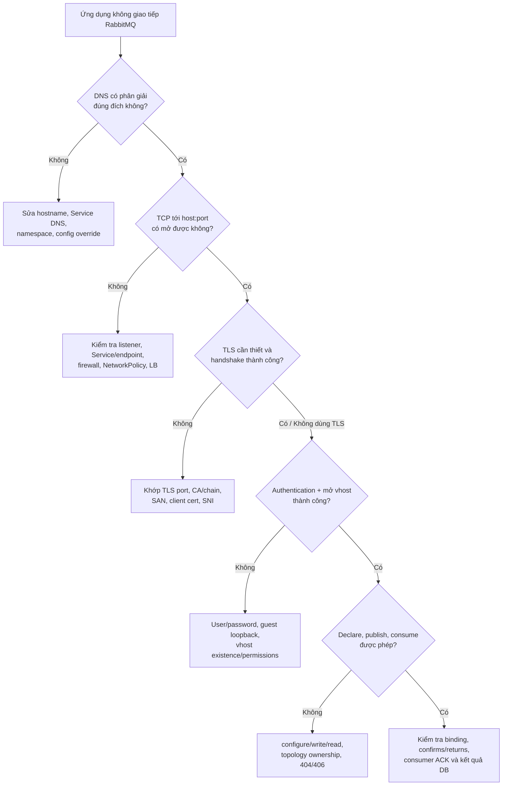
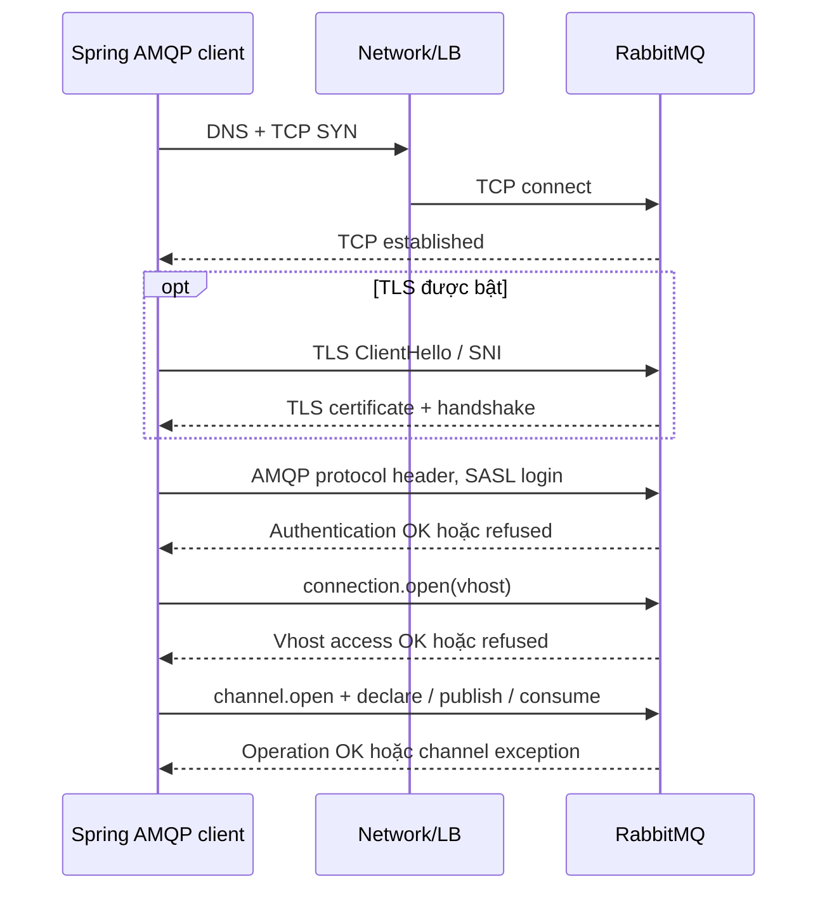

# Không kết nối được do địa chỉ, virtual host, TLS hoặc quyền truy cập

Ứng dụng Spring Boot dùng **Spring AMQP** có thể khởi động bình thường ở máy lập trình, nhưng khi triển khai lên Docker, Kubernetes hoặc staging lại liên tục báo `Connection refused`, `ACCESS_REFUSED`, `SSLHandshakeException` hoặc `Failed to declare queue`. Dù cùng xuất hiện bên cạnh `RabbitTemplate` hay `@RabbitListener`, những lỗi này **không thuộc một nguyên nhân**: có lỗi xảy ra trước khi bắt tay TCP; có lỗi sau khi TLS đã thiết lập; có lỗi tại bước xác thực, chọn virtual host; cũng có lỗi chỉ phát sinh khi ứng dụng khai báo exchange, queue, binding hoặc bắt đầu consume.

Vì vậy, sửa một lỗi “không kết nối được” bằng cách tăng retry, tắt TLS hoặc cấp quyền `.*` cho mọi resource thường không giải quyết nguyên nhân gốc và còn tạo rủi ro bảo mật. Cách hiệu quả hơn là đi theo **các lớp kết nối theo thứ tự**, tìm bằng chứng ở **cả phía client và RabbitMQ broker**, rồi xác nhận luồng nghiệp vụ đã phục hồi.

Bài thuộc chương **Chẩn đoán sự cố** của module **SPRING_AMQP**. Nó sử dụng ngữ cảnh `RabbitTemplate`, `@RabbitListener`, exchange, queue, binding, publisher confirms, consumer acknowledgements, retry, dead-letter và quan sát hệ thống để giúp phân biệt **lỗi địa chỉ**, **virtual host**, **TLS** và **quyền truy cập**.

## 1. Nhận diện triệu chứng trước khi thay đổi cấu hình

| Triệu chứng / dấu hiệu thường gặp | Lớp cần kiểm tra đầu tiên | Không nên kết luận quá sớm |
| --- | --- | --- |
| `UnknownHostException` hoặc `Name or service not known` | DNS/hostname | Mật khẩu RabbitMQ sai |
| `ConnectException: Connection refused` | TCP listener, host, port, service/endpoints | Broker cố tình từ chối do ACL |
| `ConnectTimeoutException` / `SocketTimeoutException` khi bắt đầu kết nối | Routing mạng, firewall, load balancer, network policy | Queue không tồn tại |
| `No route to host` | Định tuyến mạng, firewall/host network | RabbitMQ exchange chưa khai báo |
| `SSLHandshakeException`, `PKIX path building failed` | TLS trust/CA, chain, hostname, giao thức | Tài khoản thiếu quyền consume |
| `certificate_unknown`, `bad_certificate`, `unknown_ca` | Chứng chỉ server/client hoặc cấu hình mTLS | Chỉ cần tăng timeout |
| `Login was refused`, `AuthenticationFailureException` | Tài khoản, mật khẩu, auth mechanism, giới hạn `guest` | Cần tạo lại queue |
| `access to vhost ... refused` | Vhost tồn tại, quyền vào vhost của user | TCP chưa kết nối |
| `ACCESS_REFUSED - access to ... refused` khi declare/publish/consume | Quyền `configure/write/read` của resource | Không có quyền đăng nhập |
| `404 NOT_FOUND - no queue/exchange ...` | Resource trong đúng vhost hoặc tên khai báo sai | Thiếu quyền TLS |
| `406 PRECONDITION_FAILED` khi redeclare | Queue/exchange arguments không tương thích | Không thể kết nối TCP |
| Listener kết nối nhưng `consumers=0` | Subscription, listener startup, queue, quyền `read`, recovery | Producer chắc chắn không gửi message |
| Publisher có confirm ACK nhưng consumer không nhận | Binding/routing, returns, consumer, ACK/DB | Kết nối thất bại |

Đây là **bảng định hướng**, không phải ánh xạ một-một giữa exception và nguyên nhân. Thư viện Spring AMQP có thể bọc lỗi mạng/protocol trong `AmqpIOException`, `AmqpAuthenticationException`, `AmqpConnectException` hoặc `AmqpException` khác; **đọc chuỗi `Caused by` sâu nhất cùng timestamp trong broker log**, không chỉ dòng “Failed to connect” ở đầu stack trace.

### 1.1. Một quy tắc rất quan trọng

**Đừng gộp ba câu hỏi khác nhau thành một:**

1. **Kết nối được chưa?** DNS → TCP → TLS (nếu bật) → AMQP handshake → login → mở vhost.
2. **Thao tác lên broker có được phép không?** `exchange.declare`, `queue.declare`, `queue.bind`, `basic.publish`, `basic.consume` có permission tương ứng không?
3. **Nghiệp vụ có hoàn tất không?** Publish đã route đúng queue, consumer đã nhận, DB đã commit, ACK và retry/DLQ có chính xác không?

Một connection **đã mở** vẫn có thể bị từ chối khi `RabbitAdmin` declare queue; một publisher **gửi được** vẫn có thể publish tới exchange không có binding phù hợp; một listener **đã đăng ký** vẫn có thể xử lý thất bại. Chẩn đoán từng lớp giúp tránh sửa sai chỗ.

## 2. Quy trình loại trừ theo thứ tự



**Luôn chạy phép thử từ cùng vị trí mạng với ứng dụng bị lỗi.** Kiểm tra `rabbitmq.prod.local:5671` từ máy cá nhân thành công không chứng minh pod `orders-worker` ở namespace `apps` truy cập được địa chỉ đó: hai nơi có DNS, route, firewall, proxy, CA và danh tính khác nhau.

### 2.1. Thu thập “bộ bằng chứng” tối thiểu

Trước khi chỉnh sửa bất cứ thứ gì, ghi lại:

- Service/instance/pod, môi trường, thời điểm lỗi, lần deploy hoặc lần xoay secret gần nhất.
- Hostname/port/transport TLS thực tế mà **Spring ConnectionFactory** đang sử dụng; có cấu hình `addresses` ghi đè không?
- Tên vhost, username **không kèm mật khẩu**, loại auth mechanism, chứng chỉ/trust bundle phiên bản nào.
- Exception chain đầy đủ **đã che secret** và log RabbitMQ tại cùng thời điểm.
- Kết quả kiểm tra DNS, TCP, TLS, authentication, quyền vhost, resource permissions.
- Các tác động sau lỗi: số consumer, queue backlog, outbox pending, publisher confirm/return, retry/DLQ.

Không gửi password, token, private key, PKCS#12 hoặc AMQP URI có mật khẩu vào ticket, chat, log chẩn đoán hay dashboard.

## 3. Kiểm tra Spring Boot đang dùng cấu hình nào

Với ứng dụng **Spring Boot + `spring-boot-starter-amqp` + AMQP 0-9-1**, các thuộc tính thông dụng nằm dưới `spring.rabbitmq.*`:

```yaml
# application.yml — chỉ chứa tham số không nhạy cảm và tên secret.
spring:
  rabbitmq:
    host: ${RABBITMQ_HOST}
    port: ${RABBITMQ_PORT:5671}
    virtual-host: ${RABBITMQ_VHOST}
    username: ${RABBITMQ_USERNAME}
    password: ${RABBITMQ_PASSWORD}
    connection-timeout: 10s
    requested-heartbeat: 30s
    ssl:
      enabled: true
      verify-hostname: true
      validate-server-certificate: true
```

Các placeholder `${...}` được Spring resolve khi chạy. Không gắn mật khẩu thật hoặc private key vào file thuộc Git; secret phải đến từ nguồn bên ngoài được phân quyền.

### 3.1. `addresses` có thể ghi đè `host/port`

Nếu có cấu hình:

```yaml
spring:
  rabbitmq:
    host: rabbitmq-staging.internal
    port: 5671
    addresses: "amqp://rabbitmq-dev.internal:5672"
```

thì với Spring Boot AMQP 0-9-1, **`addresses` được sử dụng thay cho `host` và `port`**. Nhìn riêng `host` có thể khiến bạn chẩn đoán nhầm đích. Tên `addresses` (số nhiều) dùng cho nhánh 0-9-1; **RabbitMQ-specific AMQP 1.0** có property khác là `spring.amqp.rabbitmq.address` (số ít).

Nếu chuyển từ dạng host/port sang URI, hãy kiểm tra cả **`amqp://` so với `amqps://`**, vhost trong URI và các credential được đưa vào. Đừng đặt URI có password trực tiếp trong ví dụ cấu hình production.

### 3.2. Chọn đúng nhánh giao thức

| Tích hợp | Property prefix | Client/container điển hình | Ghi chú |
| --- | --- | --- | --- |
| RabbitMQ AMQP **0-9-1** | `spring.rabbitmq.*` | `RabbitTemplate`, `CachingConnectionFactory`, `@RabbitListener` classic container | Phạm vi chính của bài |
| RabbitMQ AMQP **1.0** của Spring AMQP 4.x | `spring.amqp.rabbitmq.*` | `RabbitAmqpTemplate`, `RabbitAmqpListenerContainer` | Không dùng cùng bean ConnectionFactory như 0-9-1 |
| Generic AMQP **1.0** | `spring.amqp.*` | Generic `AmqpClient` và `@AmqpListener` | Dùng client/properties khác |
| Native RabbitMQ **Stream protocol** | `spring.rabbitmq.stream.*` tùy tích hợp | `RabbitStreamTemplate`, `StreamListenerContainer` | Giao thức native stream, thường port 5552 |

**Đúng host và port nhưng sai protocol vẫn không handshake được.** RabbitMQ có thể hỗ trợ AMQP 0-9-1 và AMQP 1.0 trên listener AMQP thông thường; RabbitMQ native Stream protocol **không** dùng cổng 5672 làm cổng stream mặc định.

### 3.3. Vì sao một profile bị bỏ qua?

Xem `spring.profiles.active`, biến môi trường `SPRING_RABBITMQ_*`, secret mount, Config Server/Kubernetes và tham số khởi động. Một override ở runtime có thể đưa ứng dụng quay lại `localhost` hoặc vhost `/` dù file `application-prod.yml` ghi đúng.

Khi kiểm tra effective configuration, chỉ xuất **host logic, port, TLS enabled, tên vhost, username đã được cho phép ghi log**; không in toàn bộ `Environment` hoặc property map vì có thể lộ password. Cần phân biệt **property source có giá trị** và **ConnectionFactory thực tế** khi ứng dụng tự tạo bean mà bỏ qua auto-configuration.

## 4. Địa chỉ: DNS, localhost và port không phải cùng một lỗi

### 4.1. `localhost` trong container là container đó

Đây là lỗi phổ biến khi chuyển ứng dụng từ máy lập trình lên Docker/Kubernetes:

```text
Máy phát triển:
  app trên host -> localhost:5672 -> RabbitMQ chạy trên host

Docker Compose:
  app container -> localhost:5672 -> chính app container, KHÔNG phải broker
  app container -> rabbitmq:5672 -> service rabbitmq trong Compose network

Kubernetes:
  app pod -> localhost:5672 -> chính pod/network namespace của app
  app pod -> rabbitmq.messaging.svc.cluster.local:5672
             -> Service RabbitMQ tại namespace messaging (nếu được cấu hình)
```

Trong Docker Compose, **service name** được resolve qua DNS của network Compose; host-published port thường dành cho kết nối từ host, còn container với container nên dùng **container/service port**. Trong Kubernetes, Service, Endpoints/EndpointSlices và NetworkPolicy phải cùng cho phép luồng từ pod ứng dụng tới broker. Tên DNS trong sơ đồ chỉ là ví dụ, cần thay theo namespace thật.

### 4.2. Port phổ biến và nguy cơ nhầm cổng

| Cổng mặc định | Dịch vụ | Dùng cho |
| --- | --- | --- |
| `5672` | AMQP **không TLS** | `RabbitTemplate`/AMQP client nếu broker mở listener plaintext |
| `5671` | AMQP **có TLS** | Spring AMQP với SSL/TLS bật đúng |
| `15672` | Management HTTP | UI/API quản trị, **không** phải AMQP |
| `15671` | Management HTTPS | UI/API quản trị qua TLS, **không** phải AMQP |
| `5552` | Native RabbitMQ Stream protocol | Stream client; không phải cổng AMQP 0-9-1 thông thường |
| `25672` | Erlang distribution | Broker node/CLI cluster, không phải cổng app publish |

Các port trên là **mặc định**, không phải quy tắc bất biến. RabbitMQ, reverse proxy hoặc load balancer có thể dùng port khác. Quan sát listener thực tế trên broker trước khi kết luận.

### 4.3. Các phép thử mạng không cần mật khẩu

Từ đúng máy/container/pod bị lỗi:

```bash
# 1) DNS: trả IP nào? Lệnh phụ thuộc image và hệ điều hành.
getent hosts rabbitmq.prod.internal
nslookup rabbitmq.prod.internal

# 2) TCP: chỉ kiểm tra đường mạng tới cổng đã chọn.
nc -vz -w 5 rabbitmq.prod.internal 5671

# 3) Broker-side (operator): broker đang nghe cổng nào?
rabbitmq-diagnostics listeners
```

Nếu image tối giản thiếu `getent`, `nslookup` hoặc `nc`, dùng một **debug container được phép**, đặt tại cùng namespace/network context và chịu cùng network policy; không cài tool tùy tiện vào image production chỉ để thử. Trên Windows có thể dùng `Test-NetConnection rabbitmq.prod.internal -Port 5671`.

**Diễn giải đúng:**

- DNS thất bại → sửa hostname, DNS search domain, namespace, resolver hoặc cấu hình app.
- DNS đúng nhưng TCP `refused` → đích có thể không nghe port, Service không có endpoint hợp lệ, proxy gửi RST hoặc route tới sai host.
- TCP `timeout` → nghi vấn firewall, NetworkPolicy, routing, LB hoặc broker quá tải; phân biệt với DNS timeout.
- TCP thành công → **mới xác nhận cổng mở**; chưa chứng minh TLS, tài khoản, vhost hay quyền publish/consume.

## 5. Kubernetes, Docker và load balancer: kiểm tra đường đi thực tế

Một hostname hợp lệ có thể phân giải tới Service **không có endpoint ready** hoặc kết nối tới node không mở listener AMQP. Kiểm tra:

```bash
# Ví dụ minh họa chỉ đọc; namespace và tên Service phải thay theo triển khai.
kubectl get svc -n messaging rabbitmq -o wide
kubectl get endpointslice -n messaging \
  -l kubernetes.io/service-name=rabbitmq
kubectl get pods -n messaging -o wide
kubectl get networkpolicy -n messaging
```

Các lệnh trên **không xác nhận** traffic từ namespace `apps` được phép đi sang `messaging`; cần xem chính sách ingress **và** egress, service mesh, mTLS/proxy sidecar, firewall cloud và DNS theo workload.

Với load balancer AMQP:

- Sử dụng **TCP/TLS passthrough** hoặc TLS termination/re-encryption có chủ đích; không đưa client AMQP vào HTTP proxy chỉ hỗ trợ request–response.
- Health check phải kiểm tra **đúng AMQP listener** hoặc ít nhất TCP endpoint theo thiết kế, không nhầm Management HTTP healthy với AMQP listener healthy.
- TLS server certificate phải hợp **DNS name mà client kết nối**; nếu dùng certificate trên backend nhưng client nói chuyện qua DNS LB, kiểm tra SAN và SNI.
- Heartbeat/idle timeout giữa load balancer và AMQP connection dài hạn có thể gây **reconnect theo chu kỳ**, khác với từ chối kết nối ngay từ đầu.
- Nếu broker cluster có node đang reboot, cần biết client đi qua list `addresses`/DNS/LB nào và có cơ chế recovery đúng không.

Đừng tăng connection retry thành vòng lặp vô hạn không backoff: khi broker đang lỗi, reconnect storm có thể làm cả cluster khó phục hồi hơn.

## 6. Phân biệt TCP connect thất bại với AMQP login bị từ chối

`java.net.ConnectException: Connection refused` thường do TCP không được thiết lập tới đích, còn RabbitMQ `ACCESS_REFUSED` có thể xảy ra **sau khi TCP/TLS đã hoạt động**.



**Vì sao không nên “sửa” bằng timeout?**

- Lỗi `UnknownHostException` không được chữa bằng `connection-timeout=60s`.
- Lỗi `Login was refused` không được chữa bằng tăng heartbeat.
- Lỗi certificate/hostname không được chữa bằng disable verification.
- Lỗi `ACCESS_REFUSED` khi `basic.consume` không được chữa bằng thêm consumer thread.

Chỉ tăng timeout khi có **bằng chứng kết nối đúng đích nhưng độ trễ mạng/handshake cao trong mức chấp nhận**, đồng thời xử lý nguyên nhân chính (routing, broker resource pressure, DNS hoặc LB).

## 7. TLS: đúng cổng chưa đủ, phải xác minh đúng broker

Khi dùng TLS, cả client và RabbitMQ phải thống nhất transport và certificate trust. Các lỗi thường gặp:

| Dấu hiệu | Nguồn gốc thường gặp | Hướng xử lý |
| --- | --- | --- |
| Client bật TLS đi vào cổng plaintext `5672` | Mismatch transport | Dùng TLS listener thực tế hoặc sửa cấu hình client |
| Client plaintext đi vào TLS port `5671` | Broker đợi TLS ClientHello, client gửi AMQP header | Bật SSL/TLS client đúng port |
| `PKIX path building failed` | CA/intermediate thiếu hoặc truststore sai | Cấp trust CA/chain hợp lệ; không dùng trust-all |
| `No subject alternative DNS name matching ...` | Host kết nối không nằm trong SAN | Sửa DNS/SAN hoặc cấp lại certificate |
| `certificate expired` | Cert hết hạn / clock lệch lớn | Rotate cert, kiểm tra thời gian hệ thống |
| `unknown_ca` / `bad_certificate` | Broker không tin client cert hoặc client không tin broker | Kiểm tra đúng chiều trust và mTLS configuration |
| `handshake_failure`, `protocol_version` | TLS version/cipher, proxy, certificate purpose | Xem log cả hai đầu, xác minh TLS policy |
| Chỉ fail qua LB, direct broker thành công | SNI, TLS termination, hostname mismatch, backend routing | Kiểm tra chính sách LB và server certificate |

**Không bao giờ thay kiểm tra certificate bằng `verify-hostname=false` hay `validate-server-certificate=false` trong production.** Việc đó có thể khiến client nói chuyện với một máy chủ giả mạo mà không phát hiện.

### 7.1. Spring Boot SSL Bundle để tin đúng CA

Với Spring Boot hỗ trợ SSL bundles:

```yaml
spring:
  rabbitmq:
    host: rabbitmq.prod.internal
    port: 5671
    virtual-host: orders-prod
    username: ${RABBITMQ_USERNAME}
    password: ${RABBITMQ_PASSWORD}
    ssl:
      enabled: true
      bundle: rabbitmq-trust
      verify-hostname: true

  ssl:
    bundle:
      pem:
        rabbitmq-trust:
          truststore:
            certificate: "file:/run/certs/rabbitmq/ca-chain.pem"
```

Trong ví dụ, `ca-chain.pem` là CA/intermediate trust material mà ứng dụng được phép dùng để xác minh **broker**; private key không cần thiết khi chỉ dùng server-authenticated TLS. Kiểm tra property `spring.rabbitmq.ssl.bundle` có trong **phiên bản Boot thực tế**, và file CA được mount đúng path/permissions.

Nếu tổ chức dùng truststore PKCS#12/JKS thay vì PEM, sử dụng các thuộc tính `spring.rabbitmq.ssl.trust-store`, `trust-store-type` và `trust-store-password` theo Spring Boot. Không cấu hình đồng thời nhiều nguồn TLS mâu thuẫn rồi suy đoán nguồn nào hiệu lực.

### 7.2. Kiểm tra TLS bằng OpenSSL

```bash
# Chỉ kiểm tra TLS handshake/certificate — không phải AMQP login.
openssl s_client \
  -connect rabbitmq.prod.internal:5671 \
  -servername rabbitmq.prod.internal \
  -verify_hostname rabbitmq.prod.internal \
  -CAfile /run/certs/rabbitmq/ca-chain.pem \
  -verify_return_error
```

Đây là phép thử **read-only** về kết nối/trust, không cần mật khẩu RabbitMQ. Kiểm tra `Verify return code`, certificate chain, Subject Alternative Name và thông báo lỗi. `-servername` giúp gửi **SNI** khi cần; `-verify_hostname` chủ động kiểm tra hostname. Nếu broker bắt buộc mTLS, phép thử không có client certificate/key sẽ thất bại đúng theo policy.

Sau khi TLS thành công, OpenSSL không tự gửi AMQP protocol header; broker có thể đóng socket sau một khoảng chờ. **Đây không phải bằng chứng TLS thất bại**, mà là do `s_client` không phải AMQP client hoàn chỉnh.

## 8. mTLS: phân biệt certificate và tài khoản AMQP

Với **mutual TLS**, client phải xuất trình certificate và private key; broker cũng phải tin CA ký certificate của client. Tuy nhiên:

- **TLS xác minh client certificate** là một lớp xác thực kênh.
- **AMQP authentication** có thể vẫn đòi username/password theo SASL PLAIN.
- Chỉ khi RabbitMQ cấu hình certificate authentication (ví dụ plugin `rabbitmq_auth_mechanism_ssl` và SASL `EXTERNAL`) cùng client chọn đúng cơ chế, chứng chỉ có thể thay username/password cho RabbitMQ login.
- **Quyền vhost/resource** vẫn là bước **authorization** tiếp theo, dù xác thực bằng certificate thành công.

Ví dụ cấu hình PEM bundle cho mTLS, **vẫn dùng username/password AMQP**:

```yaml
spring:
  rabbitmq:
    host: rabbitmq.prod.internal
    port: 5671
    username: ${RABBITMQ_USERNAME}
    password: ${RABBITMQ_PASSWORD}
    virtual-host: orders-prod
    ssl:
      enabled: true
      bundle: rabbitmq-mtls
      verify-hostname: true

  ssl:
    bundle:
      pem:
        rabbitmq-mtls:
          truststore:
            certificate: "file:/run/certs/rabbitmq/server-ca.pem"
          keystore:
            certificate: "file:/run/secrets/rabbitmq/client.crt"
            private-key: "file:/run/secrets/rabbitmq/client.key"
```

Private key phải được mount bảo mật theo quyền của workload. Thay file client key hoặc CA trên filesystem **không mặc nhiên reload** TLS context/connection đã mở; có thể cần rolling restart hoặc cơ chế reload được phiên bản framework hỗ trợ và đã test.

### 8.1. Dùng OpenSSL kiểm tra chiều mTLS

```bash
# Chỉ thực hiện trong môi trường có quyền truy cập khóa client.
# Tránh bật verbose shell tracing làm lộ thông tin nhạy cảm.
openssl s_client \
  -connect rabbitmq.staging.internal:5671 \
  -servername rabbitmq.staging.internal \
  -verify_hostname rabbitmq.staging.internal \
  -CAfile /run/certs/rabbitmq/server-ca.pem \
  -cert /run/secrets/rabbitmq/client.crt \
  -key /run/secrets/rabbitmq/client.key \
  -verify_return_error
```

Thử nghiệm này xác nhận nhiều vấn đề của TLS/mTLS, **nhưng không kiểm tra kết nối AMQP đã được cấp quyền vào `orders-prod` hoặc consume `orders.jobs`**. Đừng sao chép private key sang máy cá nhân chỉ để tiện debug; ưu tiên chạy từ môi trường có quyền truy cập key hợp lệ.

## 9. Virtual host là một namespace và hàng rào quyền

RabbitMQ virtual host (*vhost*) phân tách tên exchange, queue, binding và permission. Queue `orders.jobs` trong vhost `orders-prod` **khác** queue cùng tên trong vhost `/`.

Các tình huống thường gặp:

1. Ứng dụng không cấu hình `spring.rabbitmq.virtual-host` nên kết nối vào vhost **mặc định** `/` thay vì vhost môi trường mong muốn.
2. Vhost `orders-prod` **không tồn tại** trên broker/cluster đích.
3. User đã xác thực nhưng **không được phép vào vhost đó**.
4. Đã vào vhost nhưng queue/exchange trong namespace đó chưa được provision.
5. URI có ký tự `/` trong tên vhost nhưng không **percent-encode** chính xác.

### 9.1. Cấu hình tên vhost trong Spring Boot

**Cách dễ hiểu nhất** khi dùng host/port riêng:

```yaml
spring:
  rabbitmq:
    host: rabbitmq.prod.internal
    port: 5671
    virtual-host: orders-prod
    ssl:
      enabled: true
```

Nếu muốn dùng **default vhost tên `/`**, đặt:

```yaml
spring:
  rabbitmq:
    virtual-host: "/"
```

Không nhầm tên vhost `/` với path URL. Trong URI `amqp://` hoặc `amqps://`, **vhost phải là một segment**; ký tự slash bên trong vhost phải được percent-encode:

| Vhost thực | Thành phần URI vhost | Ví dụ URI không chứa userinfo |
| --- | --- | --- |
| `/` | `%2F` | `amqps://broker.internal:5671/%2F` |
| `orders-prod` | `orders-prod` | `amqps://broker.internal:5671/orders-prod` |
| `/team/orders` | `%2Fteam%2Forders` | `amqps://broker.internal:5671/%2Fteam%2Forders` |

Đặc biệt, `amqp://broker.internal:5672/` với dấu slash cuối nhưng **vhost trống** không tương đương `/%2F` là vhost mặc định `/`. Khi dùng property `addresses` và URI, kiểm tra cả scheme, vhost path, username/password và override.

### 9.2. Kiểm tra vhost hiện có và quyền user

Chỉ operator đã được phân quyền nên chạy các lệnh sau:

```bash
# Xem vhost hiện có; không thay đổi dữ liệu.
rabbitmqctl list_vhosts

# Xem các permission trên vhost đích.
rabbitmqctl list_permissions -p orders-prod

# Xem user được cấp quyền trên vhost nào.
rabbitmqctl list_user_permissions orders-worker
```

RabbitMQ thường **không tự cấp permission** khi tạo vhost mới. Vì vậy, một user đăng nhập được ở vhost `/` nhưng bị từ chối ở `orders-prod` là hoàn toàn có thể xảy ra. Việc **tạo vhost** và **cấp quyền** phải theo nguồn sở hữu (IaC/operator), không để runtime tự thêm vhost mỗi khi gặp lỗi.

### 9.3. Dấu hiệu từ broker log

Phân biệt:

- `vhost 'orders-prod' not found` hoặc thông điệp tương đương → đối chiếu tồn tại vhost.
- `access to vhost 'orders-prod' refused for user 'orders-worker'` → user đã đi tới bước mở vhost nhưng chưa có quyền vhost theo backend/policy.
- `user 'orders-worker' authenticated and granted access to vhost 'orders-prod'` → authentication + vhost open thành công, nếu vẫn lỗi hãy đi tiếp tới **resource permissions** và topology.

Thông điệp cụ thể thay đổi theo RabbitMQ/client version. Ghép bằng **thời gian, username, vhost, peer address và connection identifier**, không chỉ tìm một chuỗi cố định.

## 10. Authentication: sai mật khẩu, sai secret hay user `guest`?

Sau TCP (và TLS nếu có), client xác thực với RabbitMQ. Sai username/password hoặc cơ chế authentication có thể làm connection bị đóng **trước khi tạo channel**.

| Nguyên nhân | Cách xác minh an toàn |
| --- | --- |
| Username sai hoặc user đã bị xóa | `rabbitmqctl list_users` hoặc identity backend; so sánh **tên**, không in password |
| Password cũ sau rotation | Kiểm tra secret **version**, pod revision, thời điểm rollover, broker auth logs |
| Ứng dụng dùng profile khác | Kiểm tra effective `spring.rabbitmq.username` và nguồn config, không xuất giá trị password |
| Biến môi trường/secret mount thiếu | Xác minh tên key, mount path và quyền đọc; tránh fallback sang `guest` |
| Backend xác thực LDAP/OAuth/external gặp lỗi | Kiểm tra broker plugin/backend logs và availability |
| SASL mechanism không khớp | Xác minh client đang dùng PLAIN hay EXTERNAL theo thiết kế |
| Dùng `guest` từ máy khác | Mặc định RabbitMQ chỉ cho `guest` đăng nhập từ loopback |

**Không dùng tài khoản `guest/guest` cho ứng dụng production.** Mở rộng `loopback_users` để cho phép guest remote thường là cách làm nguy hiểm, đặc biệt nếu dùng mật khẩu mặc định. Hãy tạo service account riêng cho từng môi trường/vai trò với secret được quản lý tập trung.

### 10.1. Vì sao rotation khiến lỗi lúc có lúc không?

Một app có connection dài hạn đã đăng nhập bằng credential cũ có thể **tiếp tục hoạt động** cho tới khi reconnect, trong khi pod mới dùng secret đã thay không khớp sẽ fail ngay (hoặc ngược lại). Điều này tạo cảm giác lỗi ngẫu nhiên giữa các instance.

Khi rotation:

1. Xác định **mỗi pod đang dùng secret version nào** mà không đọc/in giá trị.
2. Dùng kế hoạch rolling update hoặc refresh connection đã được test.
3. Xác minh connection mới bằng danh tính mới trước khi thu hồi danh tính cũ.
4. Khi cần thu hồi quyền ngay, cân nhắc **đóng các connection đang sống** của user cũ theo quy trình operator.
5. Quan sát publisher confirm unknown, consumer redelivery, outbox và kết quả nghiệp vụ.

Một secret thay trên volume **không bảo đảm** `CachingConnectionFactory` thay credential đang lưu và tự reconnect; cần xác minh vòng đời bean/connection của ứng dụng cụ thể.

## 11. Authorization: login thành công vẫn có thể bị từ chối thao tác

Trong RabbitMQ, resource permissions thường là **ba regex trên từng vhost**:

- **`configure`:** khai báo/tạo/xóa resource.
- **`write`:** ghi/publish tới resource phù hợp.
- **`read`:** nhận/đọc từ resource phù hợp.

Các thao tác AMQP 0-9-1 có thể yêu cầu kết hợp các quyền trên **những resource khác nhau**.

| Thao tác thường gặp | Quyền chính cần xem | Resource |
| --- | --- | --- |
| `exchange.declare` | `configure` | Exchange được khai báo |
| `queue.declare` (chủ động, không phải passive) | `configure` | Queue được khai báo |
| `basic.publish` tới exchange | `write` | Exchange đích |
| `basic.consume` | `read` | Queue được subscribe |
| `basic.get` | `read` | Queue được đọc |
| `queue.bind` | `write` trên queue và `read` trên exchange nguồn | Cả hai resource |
| Declare queue có DLX | Có thêm kiểm tra quyền liên quan DLX theo broker | Queue và exchange DLX |
| `queue.purge` | `read` theo permission model AMQP 0-9-1 | Queue |

**Không dựa riêng vào nhãn “producer” hoặc “consumer” để suy quyền.** Một ứng dụng chỉ consume nhưng dùng `RabbitAdmin` tự khai báo queue/binding tại startup có thể cần **`configure`** và những quyền bind liên quan. Nếu production đã provision topology bằng IaC, runtime có thể chỉ cần `write`/`read` tối thiểu.

### 11.1. Ví dụ phân quyền theo vai trò

Giả sử exchange `orders.events` và queue `orders.jobs` đã được platform tạo trong vhost `orders-prod`:

```bash
# VÍ DỤ THAM KHẢO — các lệnh bên dưới THAY ĐỔI PERMISSIONS.
# Chỉ operator có thẩm quyền thực hiện qua IaC/change request.

# Runtime publisher: không được declare/consume, chỉ publish đúng exchange.
rabbitmqctl set_permissions -p orders-prod orders-api \
  '^$' '^orders\.events$' '^$'

# Runtime listener: không được declare/publish, chỉ consume đúng queue.
rabbitmqctl set_permissions -p orders-prod orders-worker \
  '^$' '^$' '^orders\.jobs$'
```

`^$` thường không khớp tên resource, dùng để hạn chế nhóm quyền đó. Các lệnh trên **không cấp quyền khai báo topology**. Nếu `RabbitAdmin` của app vẫn cố tạo queue/binding, startup có thể xuất hiện `ACCESS_REFUSED`; cách sửa nên là **tách provisioning khỏi runtime** hoặc cấp đúng quyền tối thiểu theo trách nhiệm đã định, **không** thêm `.*` toàn vhost chỉ để hết lỗi.

**Lưu ý theo RabbitMQ version:** permission của **passive declare** có quy tắc khác active declare và đã thay đổi ở một số release. Khi xây health check hoặc `RabbitAdmin.getQueueProperties(...)`, kiểm tra chính xác release đang chạy, thay vì mặc định test “queue tồn tại” không đòi permission nào.

### 11.2. Đừng nhầm error ở channel với connection

Một producer có thể đã authenticate và mở vhost, sau đó `basic.publish` tới exchange không được phép → broker **đóng channel** với `ACCESS_REFUSED`. Connection có thể còn mở. Spring `CachingConnectionFactory` có thể tạo/mượn channel khác, nhưng các thao tác kế tiếp vẫn lỗi cho tới khi **sửa permission hoặc resource**.

Tương tự, `@RabbitListener` có thể không đăng ký consumer vì thiếu quyền `read` trên queue. Quan sát **consumer count theo queue** và sự kiện listener; chỉ kiểm tra `connection isOpen` không đủ.

## 12. Topology lỗi khác với kết nối lỗi

Khi application đã connect/authenticate được, những lỗi sau vẫn có thể ngăn message flow:

| Lỗi | Nguyên nhân thường gặp | Hướng xử lý |
| --- | --- | --- |
| `404 NOT_FOUND - no queue 'orders.jobs'` | Queue chưa tồn tại trong **đúng vhost**, tên sai, queue đã bị xóa | Kiểm tra owner topology, tồn tại queue, lifecycle và binding |
| `404 NOT_FOUND - no exchange 'orders.events'` | Producer gửi tới exchange chưa provision hoặc sai vhost | Khai báo exchange theo change plan; test route |
| `406 PRECONDITION_FAILED - inequivalent arg ...` | `RabbitAdmin` redeclare queue cùng tên nhưng khác durable/type/arguments | Đồng bộ định nghĩa hoặc migration qua queue mới |
| `ACCESS_REFUSED` khi `queue.bind` | Thiếu quyền theo resource của binding | Kiểm tra quyền `write` queue và `read` exchange |
| Publish thành công nhưng queue không nhận | Routing key không match binding, queue khác vhost, exchange type không như dự kiến | Inspect binding, `mandatory`/returns, alternate exchange |
| `@RabbitListener` không bắt đầu/đang recovery | Queue missing, quyền read, listener autoStartup, số consumer/executor | Spring container logs/events, queue existence, broker consumers |

**Không xóa queue đang có message chỉ để sửa `406 PRECONDITION_FAILED`.** Queue type (classic/quorum/stream) không được đổi bằng cách redeclare tại chỗ. Tạo queue/version mới, chuyển route có kế hoạch, drain và đối soát backlog cũ trước khi xóa resource.

### 12.1. Vì sao `RabbitAdmin` có thể gây ra “lỗi kết nối”?

`RabbitAdmin` có thể tự khai báo các bean `Exchange`, `Queue` và `Binding` khi connection được thiết lập. Nếu principal runtime chỉ có quyền consumer `read` nhưng vẫn được yêu cầu declare queue, RabbitMQ từ chối khai báo. Người vận hành thấy app log lỗi khi startup/reconnect rồi nhầm đó là lỗi network.

Điều cần xác minh:

1. Ai là **owner của topology**: service app, platform operator hay IaC?
2. Các bean queue/exchange/binding có cùng định nghĩa với broker hiện tại không?
3. Service account được yêu cầu **declare** hay chỉ **publish/consume**?
4. Nếu topology do IaC quản lý, có cần tắt hoặc giới hạn auto-declaration tại runtime không?
5. Quyền nào bị từ chối trong broker log; đây là **connection open**, **channel operation** hay **listener consumer**?

Không sửa nhầm bằng cách “cho mọi user configure toàn bộ vhost”. Tách rõ quyền control plane và data plane.

## 13. Spring AMQP: kiểm tra từng mức không tạo side effect nguy hiểm

Một phép thử “kết nối” phải nói rõ nó chứng minh điều gì.

### 13.1. Connection/channel smoke test

Khi ứng dụng đã auto-configure `RabbitTemplate`:

```java
import org.springframework.amqp.rabbit.core.RabbitTemplate;
import org.springframework.stereotype.Component;

@Component
public class RabbitConnectivityProbe {
    private final RabbitTemplate rabbitTemplate;

    public RabbitConnectivityProbe(RabbitTemplate rabbitTemplate) {
        this.rabbitTemplate = rabbitTemplate;
    }

    public boolean canOpenChannel() {
        // Ép Spring lấy connection và channel từ ConnectionFactory.
        // Không declare, publish, consume hoặc xóa message.
        Boolean opened = rabbitTemplate.execute(channel -> channel.isOpen());
        return Boolean.TRUE.equals(opened);
    }
}
```

Đây là **kỹ thuật chẩn đoán có chủ đích**, không nhất thiết nên gọi trên mỗi HTTP request. `true` cho thấy ứng dụng tạo/mượn được channel AMQP tại thời điểm thử, **không chứng minh** có quyền read queue, write exchange hoặc backend business đang hoàn tất.

Đừng lạm dụng probe này làm liveness check khiến pod restart vô hạn khi broker tạm không sẵn sàng. Readiness hoặc chỉ số phụ thuộc có thể phù hợp hơn; tiêu chí còn tùy vai trò producer/consumer và chiến lược failover.

### 13.2. Consumer readiness

Với `@RabbitListener`, cần đối chiếu:

- Container đã được đăng ký và `isRunning()` chưa?
- Broker đã thấy **consumer thực** trên đúng queue/vhost chưa?
- Có `ConsumeOkEvent`, `MissingQueueEvent` hoặc `ListenerContainerConsumerFailedEvent` không?
- Listener đã đọc/ACK message test (nếu có môi trường kiểm thử) và business state có thay đổi đúng không?

Ví dụ theo dõi lỗi consumer:

```java
import org.slf4j.Logger;
import org.slf4j.LoggerFactory;
import org.springframework.amqp.rabbit.listener.ConsumeOkEvent;
import org.springframework.amqp.rabbit.listener.ListenerContainerConsumerFailedEvent;
import org.springframework.amqp.rabbit.listener.MissingQueueEvent;
import org.springframework.context.event.EventListener;
import org.springframework.stereotype.Component;

@Component
public class RabbitListenerDiagnostics {
    private static final Logger log =
            LoggerFactory.getLogger(RabbitListenerDiagnostics.class);

    @EventListener
    public void consumerFailed(ListenerContainerConsumerFailedEvent event) {
        log.warn("Rabbit consumer failure fatal={} reason={}",
                 event.isFatal(), event.getReason());
    }

    @EventListener
    public void missing(MissingQueueEvent event) {
        log.error("Rabbit listener queue missing: {}", event.getQueue());
    }

    @EventListener
    public void subscribed(ConsumeOkEvent event) {
        log.info("Rabbit consumer subscribed queue={}", event.getQueue());
    }
}
```

Không gắn `Throwable.toString()` hay nguyên văn message payload vào metric labels. Với log, giữ exception class, vhost/queue đã xác nhận không nhạy cảm và timestamp, đồng thời loại bỏ các credential/PII.

### 13.3. Publisher đã kết nối nhưng không có route

Khi publisher gửi qua `RabbitTemplate`, bật correlated confirms/returns nếu workflow đòi biết broker chấp nhận lần publish và message có được route:

```yaml
spring:
  rabbitmq:
    publisher-confirm-type: correlated
    publisher-returns: true
```

```java
// Với RabbitTemplate đã được cấu hình qua Spring:
rabbitTemplate.setMandatory(true);
// Dùng CorrelationData + confirm/return cho từng publish trong
// workflow nghiệp vụ; không dùng debug publish để sửa topology production.
```

**Confirm ACK chưa đủ chứng minh message đến queue mong muốn**: exchange có thể tiếp nhận message nhưng không có binding match; khi `mandatory=true`, RabbitMQ có thể trả `basic.return` cho message unroutable. Nếu có alternate exchange, message có thể đi đường khác và không nhất thiết nhận return. Khi producer mất kết nối trước confirm, trạng thái là **UNKNOWN**, cần outbox/retry với event ID ổn định và consumer idempotent.

## 14. Một cấu hình production tối thiểu dễ chẩn đoán

Ví dụ cho Spring Boot AMQP **0-9-1** sử dụng TLS và một vhost tách biệt:

```yaml
# application-prod.yml — giữ secret thật ngoài source repository.
spring:
  rabbitmq:
    host: rabbitmq.prod.internal
    port: 5671
    virtual-host: orders-prod
    username: ${RABBITMQ_USERNAME}
    password: ${RABBITMQ_PASSWORD}
    connection-timeout: 10s
    requested-heartbeat: 30s
    ssl:
      enabled: true
      bundle: rabbitmq-prod
      verify-hostname: true
    publisher-confirm-type: correlated
    publisher-returns: true

  ssl:
    bundle:
      pem:
        rabbitmq-prod:
          truststore:
            certificate: "file:/run/certs/rabbitmq/ca.pem"

management:
  endpoints:
    web:
      exposure:
        include: "health,info,metrics,prometheus"
```

Các điều kiện để cấu hình có hiệu lực:

- Đích broker thật sự có TLS AMQP listener trên port 5671, đúng DNS/SAN và CA.
- Vhost `orders-prod` tồn tại; service account được xác thực và có permission theo vai trò.
- Exchange/queue/binding được platform hoặc `RabbitAdmin` khai báo trước và phù hợp.
- Nguồn secret được mount vào runtime, không fallback sang giá trị demo.
- Ứng dụng dùng Spring Boot version hỗ trợ `ssl.bundle`; khi khác version phải chọn cấu hình truststore tương ứng.
- Actuator/Prometheus endpoint **phải có dependency thích hợp và được bảo vệ mạng/quyền**, không mở công khai.

**Không dùng một YAML “đa môi trường” chứa toàn bộ credential dev/staging/prod**. Khác biệt vhost, host, CA và danh tính phải được inject theo deployment profile/secret policy.

## 15. Quan sát hệ thống khi điều tra kết nối và quyền

Nên kết hợp **ít nhất ba nguồn bằng chứng**:

1. **Application log/trace:** `AmqpConnectException`, `AuthenticationFailureException`, `SSLHandshakeException`, listener events, publisher confirms/returns, retry attempts.
2. **RabbitMQ broker logs/Management:** connection accepted/closed, authentication, vhost open refused, channel exceptions, consumer subscriptions, listeners.
3. **Metrics:** connection churn, failed connections, consumer count, queue ready/unacked, channel opens/closes, redelivery, outbox pending, business completion latency.

| Mẫu quan sát | Hướng suy luận | Không nên bỏ qua |
| --- | --- | --- |
| Không có connection trên broker, DNS thất bại | Sai hostname/search domain | Runtime override, container namespace |
| TCP không mở, broker không nghe port | Network/service/listener | Pod endpoints, firewall, LB |
| TCP mở, TLS failure, không có auth success | TLS/cert/protocol | Port scheme, CA/SAN/mTLS, SNI |
| TLS success, auth denied | Credential/auth mechanism | Secret version, guest restriction |
| Auth success, vhost denied | Vhost thiếu hoặc user không được phép | Vhost name, permission theo vhost |
| Vhost success, `ACCESS_REFUSED` khi declare | Runtime thiếu configure hoặc ownership sai | RabbitAdmin, resource name/permissions |
| Connection open, channel liên tục đóng `404/406` | Topology mismatch | Queue name, durable/type, binding |
| Connection open, consumer count về 0 | Listener startup/permissions/subscription | MissingQueueEvent, broker read ACL |
| Consumer count ổn, DB không tiến | Nghiệp vụ, retry, executor, transaction | Đây không còn là lỗi connect đơn thuần |

### 15.1. Thời gian và định danh

Đồng bộ clock giữa app/broker/monitoring giúp ghép sự kiện. Dùng connection name có cấu trúc **service/env/instance** (khi có chủ đích) để thấy connection của pod nào; tránh dùng password/URI có credential hoặc message ID làm metric tag cardinality cao. Nếu cluster restart/rollout, connection churn ngắn hạn có thể hợp lệ; cần đánh giá với change timeline.

### 15.2. Khi nào health check nên fail?

- **Liveness:** có lỗi broker tạm thời không nhất thiết là lý do restart vòng lặp.
- **Readiness của consumer:** cần biết listener đăng ký thật trên queue, quyền read đúng, không chỉ process còn sống.
- **Readiness của publisher:** nếu API chỉ có thể nhận request khi đã có outbox bền vững thì broker mất tạm thời có thể không bắt API fail ngay; nếu không có outbox và publish đồng bộ bắt buộc thì sức khỏe broker liên quan trực tiếp.

Đặt health semantics theo **hợp đồng nghiệp vụ**, không sao chép “RabbitMQ ping = 200” cho mọi service.

## 16. Runbook xử lý sự cố theo thứ tự an toàn

**Bước 1 — Xác định phạm vi sự cố.** Một pod, một namespace, toàn staging hay toàn cluster? Có thay đổi DNS/LB, deployment, secret, certificate, vhost, permission hoặc topology gần đây không?

**Bước 2 — Tìm cấu hình kết nối thực tế.** Xác nhận host, `addresses`, port, scheme, vhost, TLS enabled, username và secret version. Không lộ secret. Xem profile/override và các `ConnectionFactory` do ứng dụng tự tạo.

**Bước 3 — Từ chính môi trường ứng dụng, thử DNS và TCP.** Nếu fail, làm việc với network/platform trước; chưa cần xóa queue, thay publisher hay sửa Java listener.

**Bước 4 — Nếu dùng TLS, xác minh certificate.** `openssl s_client` với SNI, CA và hostname check; nếu mTLS, dùng đúng client cert/key. Kiểm tra broker log và certificate chain.

**Bước 5 — Xác minh auth/vhost.** Kiểm tra user tồn tại, password version, `guest` restriction, vhost tồn tại và user có permission để mở vhost.

**Bước 6 — Kiểm tra resource ACL và topology.** Dựa trên lệnh thực tế: publish cần `write` exchange, consume cần `read` queue, active declaration cần `configure`. Xem `RabbitAdmin` có tự declare không, có `404/406` không.

**Bước 7 — Khôi phục từng đường publish/consume.** Chạy một smoke test trên queue/exchange **test được phép**, đo confirms/returns, listener subscription, database commit và ACK. Không purge queue production hoặc gửi test message vào luồng tài chính thật.

**Bước 8 — Đối soát độ tin cậy.** Khi kết nối thất bại có thể có publisher result **UNKNOWN**, consumer commit-before-ACK rồi redelivery, retry/DLQ và outbox pending. Dùng event ID, idempotency và nguồn trạng thái nghiệp vụ để tránh mất/lặp công việc.

**Bước 9 — Theo dõi sau khôi phục.** Connection churn giảm? Consumer count ổn định? Backlog được drain, confirm timeout và DLQ không tăng bất thường, business SLO phục hồi?

**Bước 10 — Ghi lại root cause.** Lớp hỏng, bằng chứng, thay đổi nào sửa được, vì sao alert chưa phát hiện sớm, và biện pháp ngăn tái diễn.

### 16.1. Khi không được “sửa nhanh”

| Thao tác dễ làm nhưng nguy hiểm | Vì sao không nên |
| --- | --- |
| Tắt `verify-hostname` hoặc trust-all cert | Mất xác thực máy chủ, nguy cơ broker giả |
| Mở `guest` cho kết nối từ xa | Mở rộng bề mặt tấn công với danh tính mặc định |
| Cấp `configure/write/read = .*` cho mọi user | Vi phạm least privilege, che lỗi ownership |
| Purge/delete queue để sửa lỗi declare | Có thể phá hủy message ready/unacked đang chờ |
| Tăng retry kết nối không giới hạn và không backoff | Gây reconnect storm khi broker còn yếu |
| Chỉ dựa vào `RabbitTemplate.convertAndSend` không exception | Không chứng minh route, consumer commit hay business completion |
| Log mọi property/env để tìm mật khẩu sai | Dễ làm lộ credential/tokens/private key |

## 17. Thực hành chẩn đoán bốn nhóm lỗi

Dùng **RabbitMQ development/Testcontainers**, data/credential thử nghiệm và một ứng dụng Spring Boot có `RabbitTemplate`, `@RabbitListener`. Không làm các thao tác phá vỡ quyền/TLS trên production.

### Kịch bản A — Host, port và network

1. Cho app trỏ `localhost` trong app container khác broker.
2. Ghi nhận `Connection refused` hoặc timeout; kiểm tra `localhost` thực sự chỉ đến container app.
3. Đổi sang service DNS của broker, kiểm tra `getent` và `nc` từ cùng network.
4. Đưa port sai (ví dụ Management HTTP thay AMQP) để xem TCP có thể mở nhưng AMQP handshake thất bại.
5. Khôi phục host/port đúng, kiểm tra smoke test connection/channel.

**Kết quả mong đợi:** người học phân biệt DNS/TCP/protocol thay vì coi mọi lỗi là mật khẩu.

### Kịch bản B — TLS và hostname

1. Dùng TLS listener với server certificate và CA dev hợp lệ.
2. Thử client không tin CA → kiểm tra `PKIX`.
3. Thử tên DNS ngoài SAN → kiểm tra hostname verification fail.
4. Thử client plaintext vào TLS port và ngược lại → đối chiếu broker handshake/protocol logs.
5. Sửa trust CA, hostname và transport, **không tắt xác minh certificate**.

**Kết quả mong đợi:** TLS test pass là điều kiện cần trước khi đụng credential, nhưng không phải phép chứng minh quyền publish/consume.

### Kịch bản C — Username, password, vhost và guest

1. Tạo user và vhost test theo đúng quy trình, ban đầu **chưa cấp quyền**.
2. Kết nối bằng sai password → ghi nhận lỗi authentication.
3. Dùng đúng password nhưng user không được phép vào vhost → ghi nhận `access to vhost refused`.
4. Cấp quyền vhost tối thiểu, kết nối lại.
5. Nếu muốn kiểm tra `guest` remote restriction, chỉ làm trong mạng test, **không thay `loopback_users` để mở guest production**.

**Kết quả mong đợi:** phân biệt user/password không hợp lệ với vhost không tồn tại hoặc không được phép.

### Kịch bản D — Đăng nhập được nhưng không thể declare/publish/consume

1. Provision exchange `orders.events` và queue `orders.jobs` bằng principal topology admin.
2. Cấp publisher chỉ quyền `write` exchange, consumer chỉ `read` queue.
3. Producer gửi message và consumer nhận thành công khi topology đã tồn tại.
4. Cho consumer runtime tự `queue.declare` hoặc `queue.bind` để thấy thiếu permission theo operation.
5. Cố tình redeclare queue với argument khác trên môi trường test → ghi nhận `406 PRECONDITION_FAILED`.
6. Sửa bằng **quyền đúng và topology đúng**; không dùng admin credential cho mọi runtime, không delete queue còn pending.

**Kết quả mong đợi:** connection/vhost authentication pass nhưng channel operation fail được xác định đúng là authorization/topology, không phải network.

## 18. Checklist trước khi đóng incident

| Điều cần xác minh | Bằng chứng tối thiểu |
| --- | --- |
| Ứng dụng tới đúng host/port | Effective ConnectionFactory config, DNS/TCP test trong app network |
| Broker thật sự đang nghe listener đó | `rabbitmq-diagnostics listeners` hoặc cấu hình/listener metrics |
| TLS server được tin cậy đúng cách | CA chain và hostname/SAN verification thành công |
| mTLS (nếu cần) đúng hai chiều | Client cert/key/CA, broker config và auth mechanism phù hợp |
| User xác thực được | Broker log authentication success, secret version đúng |
| Vhost tồn tại và user được phép vào | `list_vhosts`, `list_user_permissions`, broker vhost open |
| Publisher có quyền đúng | `write` exchange, publish/confirm/return test hợp lệ |
| Consumer có quyền đúng | `read` queue, consumer count và listener registration |
| Topology tương thích | Exchange/queue/binding đúng vhost, không còn `404/406` |
| Không còn reconnect storm | Connection churn/error/heartbeat ổn định |
| Không có business event bị mất/lặp | Outbox/retry/DLQ đã đối soát, idempotent consumer hoạt động |
| Health/SLO đã phục hồi | Business completion rate, backlog age, p95/p99 và alert ổn định |

**Tóm tắt:** khi Spring AMQP “không kết nối được”, hãy chẩn đoán theo **DNS → TCP → TLS → authentication → vhost → resource authorization → topology → nghiệp vụ**. Việc chẩn đoán đúng lớp giúp sửa **một cấu hình sai** mà không cần mở rộng quyền vô lý, vô hiệu hóa TLS hay xóa queue đang chứa message quan trọng.

## 19. Câu hỏi tự kiểm tra

1. Vì sao `localhost:5672` hoạt động trên máy dev nhưng lỗi khi ứng dụng chạy trong một Docker container khác broker?
2. `UnknownHostException` khác `Connection refused` và `ConnectTimeoutException` ở bước nào?
3. `nc` kết nối tới port `5671` thành công có chứng minh AMQP login, quyền vhost và `basic.consume` thành công không?
4. Vì sao dùng port `15672` cho `RabbitTemplate` là sai dù Management UI có thể truy cập?
5. Nếu `spring.rabbitmq.host` trỏ production nhưng `spring.rabbitmq.addresses` trỏ staging, đâu là đích thực tế theo auto-configuration của Spring Boot?
6. Khi client TLS kết nối plaintext port hoặc client plaintext kết nối TLS port, broker có thể ghi những loại lỗi gì?
7. `PKIX path building failed` và `No subject alternative DNS name matching` khác nhau ra sao? Sửa thế nào mà không tắt hostname verification?
8. mTLS client certificate được broker chấp nhận có bảo đảm `@RabbitListener` được phép đọc queue không?
9. Vì sao user vào được vhost `/` nhưng không vào được `orders-prod`? Vhost trong URI cho tên `/` cần được encode thế nào?
10. `ACCESS_REFUSED` khi `queue.declare` khác gì với `ACCESS_REFUSED` khi `connection.open(vhost)`?
11. Runtime producer chỉ cần `write` trên exchange, nhưng `RabbitAdmin` cố declare queue/binding: chuyện gì có thể xảy ra?
12. Queue `orders.jobs` có thật ở vhost `/` nhưng app kết nối `orders-prod`. Vì sao vẫn có thể nhận `404 NOT_FOUND`?
13. Vì sao `406 PRECONDITION_FAILED` khi redeclare classic/quorum queue không được sửa bằng cách xóa queue cũ đang có backlog?
14. Tại sao publisher confirm ACK chưa chứng minh message đã vào queue và listener đã commit database?
15. Sau khi đổi mật khẩu, một pod cũ còn kết nối được trong khi pod mới fail login: giải thích và quy trình khôi phục nào an toàn?
16. Khi connection đã mở nhưng `consumers=0`, bạn sẽ kiểm tra những thành phần nào trước khi tăng số thread listener?

## Tài liệu tham khảo

- [RabbitMQ — Troubleshooting Network Connectivity](https://www.rabbitmq.com/docs/troubleshooting-networking): kiểm tra DNS, TCP, listener, timeout và connection churn.
- [RabbitMQ — Troubleshooting TLS-enabled Connections](https://www.rabbitmq.com/docs/troubleshooting-ssl): xác minh TLS configuration, CA/chain, OpenSSL, client/server certificate.
- [RabbitMQ — Networking](https://www.rabbitmq.com/docs/networking): listener, cổng AMQP/Management/Stream, TLS và cấu hình network.
- [RabbitMQ — Authentication, Authorisation and Access Control](https://www.rabbitmq.com/docs/access-control): xác thực, guest restriction, vhost access, quyền `configure/write/read`.
- [RabbitMQ — Virtual Hosts](https://www.rabbitmq.com/docs/vhosts): phạm vi namespace, tạo vhost và cấp permission.
- [RabbitMQ — URI Specification](https://www.rabbitmq.com/docs/uri-spec): scheme `amqp/amqps`, vhost path và percent-encoding.
- [RabbitMQ — TLS Support](https://www.rabbitmq.com/docs/ssl): TLS/mTLS, trust, certificate validation và EXTERNAL authentication.
- [RabbitMQ — Queues](https://www.rabbitmq.com/docs/queues): queue declaration, tồn tại theo vhost và equivalence checks.
- [Spring Boot — AMQP](https://docs.spring.io/spring-boot/reference/messaging/amqp.html): `spring.rabbitmq.*`, `addresses`, khác biệt với AMQP 1.0 integration.
- [Spring Boot — Common Application Properties](https://docs.spring.io/spring-boot/appendix/application-properties/): cấu hình TLS, hostname verification, SSL bundle và connection timeout.
- [Spring Boot — SSL Bundles](https://docs.spring.io/spring-boot/reference/features/ssl.html): PEM/keystore trust và certificate cho RabbitMQ.
- [Spring AMQP — Connection and Resource Management](https://docs.spring.io/spring-amqp/reference/amqp/connections.html): `CachingConnectionFactory`, connection recovery và channel management.
- [Spring AMQP — Configuring the Broker](https://docs.spring.io/spring-amqp/reference/amqp/broker-configuration.html): `RabbitAdmin` và declaration topology.
- [Spring AMQP — Consumer Events](https://docs.spring.io/spring-amqp/reference/amqp/receiving-messages/consumer-events.html): sự kiện listener success/failure/queue missing.
- [RabbitMQ — Consumer Acknowledgements and Publisher Confirms](https://www.rabbitmq.com/docs/confirms): giới hạn của confirms/ACK và rủi ro redelivery.
