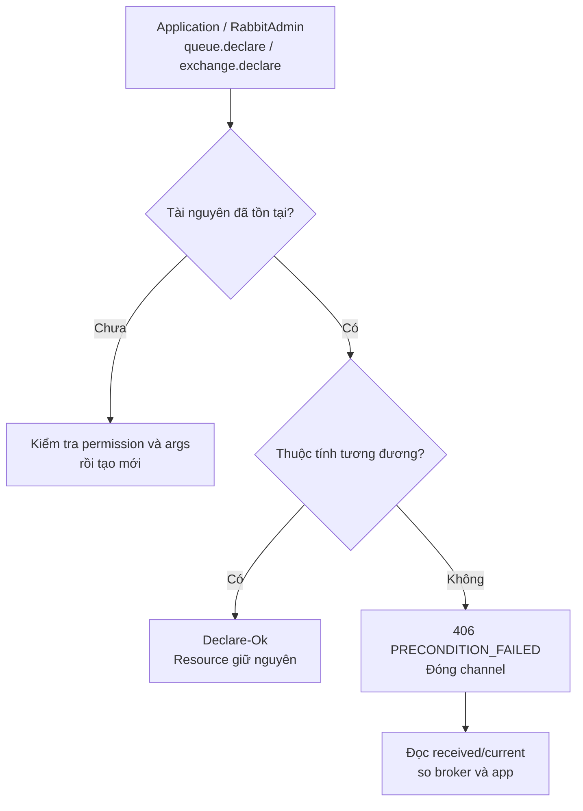
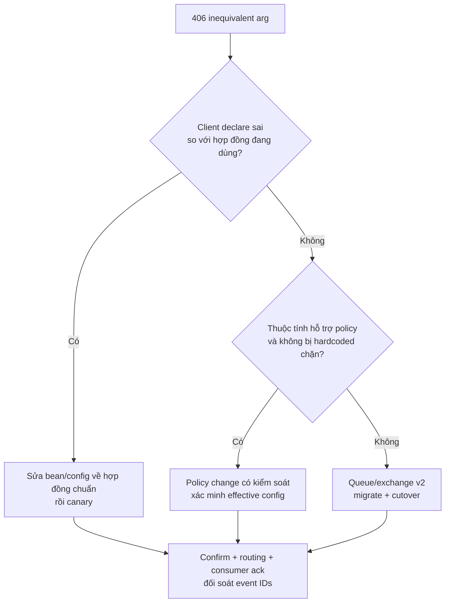

# PRECONDITION_FAILED khi khai báo queue/exchange không khớp trong Spring AMQP

## 1. Tình huống thực tế và mục tiêu chẩn đoán

Trong **SPRING_AMQP**, ứng dụng publish bằng `RabbitTemplate` qua exchange/routing key/binding, consume bằng `@RabbitListener` và có thể khai báo queue/exchange/binding qua `RabbitAdmin`. Các thành phần này phối hợp để tạo pipeline có publisher confirms, consumer acknowledgements, retry, dead-letter và transaction. Nhưng một bản deploy mới đôi khi không khởi động được listener dù RabbitMQ vẫn đang chạy:

```text
Shutdown Signal: channel error
reply-code=406
reply-text=PRECONDITION_FAILED - inequivalent arg
  'durable' for queue 'orders.work' in vhost '/orders':
  received 'false' but current is 'true'
class-id=50, method-id=10
```

Broker đã có queue `orders.work` với `durable=true`; ứng dụng mới lại gửi `queue.declare` yêu cầu `durable=false`. RabbitMQ **không âm thầm sửa queue cũ**. Broker từ chối khai báo, phát lỗi giao thức **`406 PRECONDITION_FAILED`** và đóng **channel** gây lỗi. Dữ liệu của queue hiện hữu vẫn ở đó; xóa queue để ứng dụng start được có thể làm mất message.

### Mục tiêu của bài

- Đọc lỗi `inequivalent arg` để chỉ ra **resource/vhost/thuộc tính/giá trị received và current**.
- Phân biệt 406 do queue/exchange mismatch với 403 thiếu quyền, 404 resource không tồn tại và 405 exclusive queue bị khóa.
- Hiểu những thuộc tính **không thể thay bằng redeclare**, trường nào có thể được điều chỉnh bằng RabbitMQ policy và khi nào cần migration.
- Tìm nguồn khai báo sai trong Spring Boot: `RabbitAdmin`, `Declarables`, `@RabbitListener`, auto-declaration lúc startup/reconnect và nhiều admin.
- Khắc phục không `purge`, không `deleteQueue` đang có dữ liệu; lập kế hoạch queue/exchange v2 nếu cần.
- Tái hiện lỗi với RabbitMQ Testcontainers, kiểm tra channel closure và chống cấu hình drift qua CI.

> **Quy tắc an toàn:** Trong môi trường đang có message, không xử lý `PRECONDITION_FAILED` bằng cách xóa rồi tạo lại queue/exchange. Trước tiên thu thập bằng chứng và đối chiếu hợp đồng topology.

## 2. Vì sao RabbitMQ trả `406 PRECONDITION_FAILED`?

Một thao tác AMQP 0-9-1 `queue.declare` hay `exchange.declare` có hai kết quả hợp lệ:

1. **Chưa tồn tại:** RabbitMQ tạo resource với cấu hình yêu cầu, nếu hợp lệ và user có quyền cần thiết.
2. **Đã tồn tại:** RabbitMQ kiểm tra tính **tương đương thuộc tính**. Nếu khớp, declare lại thành công và không làm gì; nếu không khớp, từ chối bằng **406**.



### 2.1. Channel đóng chứ không nhất thiết connection chết

`406` là **channel-level protocol exception**. Broker đóng channel gây lỗi. Connection TCP có thể vẫn mở, nhưng client **không thể dùng lại channel đó**; phải dùng channel mới. `CachingConnectionFactory` của Spring AMQP có thể mở lại channel khác, nhưng sẽ tiếp tục gặp `406` nếu ứng dụng cứ redeclare cùng cấu hình sai.

Điều này giải thích log lặp:

```text
RabbitAdmin declare orders.work
  -> broker 406, close channel
  -> container không hoàn tất startup
  -> connection/channel recovery
  -> RabbitAdmin declare orders.work lần nữa
  -> lại 406
```

Đổi `recoveryInterval` hoặc tăng restart count có thể chỉ làm lỗi tái diễn chậm hơn, **không làm hai định nghĩa trở nên tương đương**.

### 2.2. Phân biệt với các lỗi gần giống

| AMQP reply code | Nguyên nhân ví dụ | Hướng chẩn đoán |
| --- | --- | --- |
| **406 PRECONDITION_FAILED** | Queue/exchange có cùng tên nhưng flags/arguments khác. | So thuộc tính trong broker với request. |
| **403 ACCESS_REFUSED** | Tài khoản ứng dụng thiếu `configure` khi declare. | Kiểm tra user, vhost và regex permission. |
| **404 NOT_FOUND** | Queue/exchange không tồn tại, passive declare/binding thất bại. | Kiểm tra tên, vhost và provisioning. |
| **405 RESOURCE_LOCKED** | Connection khác sở hữu exclusive queue. | Kiểm tra lifecycle/exclusive queue, không đánh đồng với 406. |
| **Timeout/refused connection** | DNS, TLS, network, broker down hoặc resource alarm. | Kiểm tra kết nối; chưa đủ bằng chứng topology mismatch. |

Hãy bắt đầu từ **lỗi gốc sớm nhất** trong timeline, không chỉ stack trace cuối cùng của listener.

## 3. Queue: những thuộc tính phải tương đương khi declare lại

Queue có tên, các cờ `durable`, `exclusive`, `autoDelete` và map `arguments`. Nhiều x-arguments ảnh hưởng trực tiếp tới độ bền và semantics xử lý.

| Thuộc tính | Ví dụ mismatch | Ý nghĩa và hướng xử lý |
| --- | --- | --- |
| `durable` | Broker `true`, ứng dụng `false`. | Không thể đổi durability của queue hiện hữu bằng redeclare; sửa app hoặc migration. |
| `exclusive` | App dùng queue chia sẻ nhưng khai báo exclusive. | Exclusive queue thuộc về một connection; ngoài mismatch còn có thể gặp 405 vì ownership. |
| `autoDelete` | Broker `false`, app `true`. | Khác lifecycle; không xóa queue để thử. |
| `x-queue-type` | Broker classic, code muốn quorum. | Queue type thường bất biến; cần migration. Chú ý default queue type và chính sách kiểm tra equivalence. |
| `x-message-ttl` | Broker không có, app thêm `5000`. | Có thể trả 406; cân nhắc policy để điều chỉnh động khi được hỗ trợ. |
| `x-dead-letter-exchange` | Broker `orders.dlx.v1`, code `orders.dlx.v2`. | Kiểm tra hardcoded x-arguments so với policy; không thay tùy tiện khi queue còn data. |
| `x-dead-letter-routing-key` | Broker thiếu, code thêm key. | Có thể không tương đương; kiểm tra route DLX. |
| `x-max-priority` | Queue không có priority, app thêm `10`. | Thuộc tính tạo queue, cần kế hoạch queue mới. |
| `x-single-active-consumer` | Queue cũ không SAC, code bật `true`. | Không nên coi là tham số đổi trực tiếp ở queue đang chạy. |
| `x-max-length`, TTL queue, overflow, delivery-limit | Client/broker khác giá trị. | Một số có chính sách quản trị riêng; kiểm tra loại queue và version. |

### 3.1. Thêm một argument mới không phải cập nhật queue cũ

Giả sử Management API cho thấy:

```json
{
  "name": "orders.work",
  "durable": true,
  "auto_delete": false,
  "arguments": {}
}
```

Phiên bản ứng dụng mới:

```java
@Bean
Queue ordersWork() {
    return QueueBuilder.durable("orders.work")
            .ttl(5_000)
            .build();
}
```

RabbitMQ không tự thêm `x-message-ttl=5000` vào queue đang tồn tại. Đây là **khác biệt optional arguments**; tài liệu Spring AMQP cảnh báo chính tình huống thêm TTL vào queue cũ có thể dẫn đến declaration exception. Giải pháp tùy loại thuộc tính: giữ lại hợp đồng cũ, áp policy được hỗ trợ, hoặc migration an toàn.

### 3.2. Kiểu dữ liệu của argument cũng quan trọng

Field table của AMQP chứa **kiểu**, không chỉ chuỗi biểu diễn. Ví dụ số nguyên `5000` có thể được khai báo như Integer, Long hoặc String theo cách xây map. Cần đối chiếu type hiển thị trong `reply-text` như `signedint`/`long`/`longstr`. Không ép mọi giá trị thành String chỉ để so bằng mắt.

**Phân biệt**: argument không có, argument có giá trị null (nếu được API cho phép) và argument có giá trị cụ thể không mặc định tương đương.

### 3.3. Queue type không đổi bằng cách sửa QueueBuilder

Ví dụ sai:

```java
// orders.work trên broker đã tồn tại với type classic.
QueueBuilder.durable("orders.work").quorum().build();
```

Không có thao tác nâng cấp classic sang quorum chỉ bằng `queue.declare`. RabbitMQ có **Default Queue Type (DQT)** và có thể cho phép **relaxed equivalence check** riêng đối với queue type tùy cấu hình; nhưng việc nới kiểm tra **không chuyển dữ liệu queue hiện hữu sang type khác**. Khi cần thay đổi thực chất, tạo queue mới và di chuyển luồng có kiểm soát.

### 3.4. Queue tạm/exclusive: đừng đặt tên tĩnh cho mọi instance

Exclusive queue gắn với connection; nếu hai JVM cùng muốn `reply.shared` với exclusive flag, connection thứ hai có thể gặp `RESOURCE_LOCKED` hoặc race khi queue bị xóa sau disconnect. Với reply queue tạm, dùng server-named queue hoặc `AnonymousQueue` phù hợp của Spring. Đọc mã lỗi trước; không gọi mọi lỗi khai báo queue tạm là 406.

## 4. Exchange: type và lifecycle cũng phải khớp

Exchange có `name`, `type`, `durable`, `autoDelete`, `internal` và `arguments`. Những thay đổi sau thường dẫn tới 406:

| Broker hiện có | Code yêu cầu | Vấn đề |
| --- | --- | --- |
| `direct` | `topic` | Exchange type khác; wildcard routing không tự có hiệu lực. |
| `durable=true` | `durable=false` | Thuộc tính persistence không tương đương. |
| `autoDelete=false` | `autoDelete=true` | Lifecycle thay đổi. |
| `internal=false` | `internal=true` | Đường publish cho client đổi. |
| Alternate exchange hoặc x-arguments cũ | Arguments mới | Có thể không tương đương tùy argument. |

```java
// Trên broker đã tồn tại DirectExchange("orders.events", true, false).
@Bean
TopicExchange ordersEvents() {
    return new TopicExchange("orders.events", true, false);
}
```

App mới không được phép “đổi exchange thành topic” bằng redeclare; broker giữ resource cũ và từ chối yêu cầu. Đừng tự thay binding key thành `orders.*` với kỳ vọng direct exchange sẽ hiểu wildcard: trong direct exchange, routing key cần khớp chính xác.

## 5. Đọc `received/current` trong log một cách hệ thống

Ví dụ (mang tính minh họa):

```text
Shutdown Signal: channel error
#method<channel.close>(
  reply-code=406,
  reply-text=PRECONDITION_FAILED - inequivalent arg
    'x-dead-letter-exchange' for queue 'orders.work' in vhost '/orders':
    received the value 'orders.dlx.v2' of type 'longstr'
    but current is the value 'orders.dlx.v1' of type 'longstr',
  class-id=50, method-id=10)
```

Các điểm đọc:

1. **`406`**: trường hợp không tương đương.
2. **`queue orders.work`**: tên tài nguyên được request.
3. **`vhost /orders`**: chỉ kiểm tra resource ở **đúng vhost và đúng cluster**.
4. **`x-dead-letter-exchange`**: trường không khớp; chưa cần đoán các trường khác.
5. **`received orders.dlx.v2`**: giá trị client đang gửi.
6. **`current orders.dlx.v1`**: giá trị trên broker.
7. **`class-id / method-id`**: trợ giúp xác định phương thức AMQP, ví dụ queue.declare.

Trong Spring AMQP, lỗi được bọc bởi những exception như `AmqpIOException`/shutdown signal, tùy đường gọi và phiên bản. Đừng viết rule chỉ dựa vào một câu log tiếng Anh; tập trung vào reply code và tài nguyên.

## 6. Vì sao `RabbitAdmin` có thể làm sự cố lan rộng?

### 6.1. Nguồn auto-declaration

Spring có thể tự khai báo topology thông qua:

- `Queue`/`Exchange`/`Binding` bean và `Declarables`.
- `RabbitAdmin`/`AmqpAdmin` tại lúc tạo connection.
- Các annotation `@QueueBinding`/`@RabbitListener` khai báo đối tượng.
- Listener container yêu cầu redeclare một số tài nguyên bị thiếu, tùy cấu hình.

Ví dụ Spring:

```java
import org.springframework.amqp.core.Binding;
import org.springframework.amqp.core.BindingBuilder;
import org.springframework.amqp.core.DirectExchange;
import org.springframework.amqp.core.Queue;
import org.springframework.amqp.core.QueueBuilder;
import org.springframework.beans.factory.annotation.Qualifier;
import org.springframework.context.annotation.Bean;
import org.springframework.context.annotation.Configuration;

@Configuration
class OrdersTopology {
    @Bean
    DirectExchange ordersEvents() {
        return new DirectExchange("orders.events", true, false);
    }

    @Bean
    Queue ordersWork() {
        return QueueBuilder.durable("orders.work").build();
    }

    @Bean
    Binding ordersCreated(
            @Qualifier("ordersWork") Queue work,
            @Qualifier("ordersEvents") DirectExchange exchange) {
        return BindingBuilder.bind(work).to(exchange)
                .with("orders.created");
    }
}
```

**Không cần gọi `rabbitAdmin.declareQueue(...)` trực tiếp** để có 406: có bean topology được auto-declare là đủ khi lifecycle chạy.

### 6.2. Lỗi xuất hiện sau reconnect dù deploy đã lâu

Một trình tự:

1. Broker queue được provision trước theo IaC.
2. App deploy phiên bản mới hoặc thay profile/env với `Queue` bean khác cấu hình.
3. Kết nối cũ vẫn tồn tại hoặc khai báo chưa được kích hoạt.
4. Sau một lần reconnect, `RabbitAdmin` chạy lại declarations.
5. Broker phát hiện mismatch, trả 406; listener có thể lỗi theo.

Do đó **network không phải lúc nào là nguyên nhân**. Reconnect có thể chỉ là sự kiện kích hoạt một hợp đồng topology sai từ trước.

### 6.3. Cấu hình `ignoreDeclarationExceptions` có ý nghĩa gì?

```java
import org.springframework.amqp.rabbit.connection.ConnectionFactory;
import org.springframework.amqp.rabbit.core.RabbitAdmin;

RabbitAdmin admin = new RabbitAdmin(connectionFactory);
admin.setIgnoreDeclarationExceptions(false);
```

Mặc định `RabbitAdmin` có thể **dừng chuỗi khai báo** khi gặp lỗi đầu tiên, khiến những queue/binding khác chưa được declare, tạo lỗi dây chuyền. Bật `setIgnoreDeclarationExceptions(true)` có thể cho phép admin **log lỗi rồi tiếp tục các khai báo khác**, **không** làm broker sửa queue/exchange sai.

Chỉ dùng cách này khi có kế hoạch xử lý migration rõ ràng, cảnh báo và kiểm chứng mọi topology quan trọng. Không dùng để “cho app chạy xanh” nhưng routing đang sai. Spring phát `DeclarationExceptionEvent` khi declaration exception xảy ra; hãy instrument/alert theo sự kiện này.

### 6.4. `spring.rabbitmq.dynamic=false` và giới hạn thực sự

```yaml
spring:
  rabbitmq:
    dynamic: false
    host: rabbitmq.internal
    virtual-host: /orders
    username: orders-runtime
    password: ${RABBITMQ_PASSWORD}
```

Property trên khiến Spring Boot **không auto-create `AmqpAdmin` bean**; **không xóa bean admin do ứng dụng tự định nghĩa**. Nó hợp lý với producer/consumer runtime khi topology do IaC/provisioner quản lý, nhưng **phải** có readiness check/alert xác minh queue/exchange/binding tồn tại. Không dùng cách này để che một cấu hình deploy sai mà không biết route thực sự.

### 6.5. Nhiều admin hoặc nhiều broker

Nếu ứng dụng có nhiều `RabbitAdmin`/`ConnectionFactory`, các bean `Declarable` có thể được nhiều admin declare trên những target không giống nhau. Sử dụng `setExplicitDeclarationsOnly(true)` và `setAdminsThatShouldDeclare(...)` để scope đúng.

```java
// Tư duy scoping (đưa vào bean config thực tế).
RabbitAdmin admin = new RabbitAdmin(connectionFactory);
admin.setExplicitDeclarationsOnly(true);

Queue queue = QueueBuilder.durable("orders.work").build();
queue.setAdminsThatShouldDeclare(admin);
```

Đoạn này minh họa API: muốn auto-declare, các object thực tế vẫn phải được đăng ký trong Spring context bằng bean/Declarables phù hợp. `AbstractRoutingConnectionFactory` chỉ chọn kết nối đích, **không đồng bộ topology giữa các broker**.

## 7. Runbook thu thập bằng chứng không thay đổi broker

### Bước 1. Ghi lại lỗi gốc và scope

Ghi timestamp UTC, broker/cluster, vhost, user, queue/exchange name, release/config version, reply-text `received/current` và stack trace declaration đầu tiên. Chụp queue depth/ready/unacked, DLQ, publisher confirms/returns, consumer state **trước khi restart**.

### Bước 2. Kiểm tra resource thật

Trên broker có RabbitMQ CLI:

```bash
rabbitmqctl list_queues -p /orders \
  name type durable auto_delete arguments messages \
  messages_ready messages_unacknowledged consumers

rabbitmqctl list_exchanges -p /orders \
  name type durable auto_delete arguments

rabbitmqctl list_bindings -p /orders
```

Các cột thông tin được hỗ trợ có thể khác theo RabbitMQ version. Nếu CLI báo field không hợp lệ, dùng `rabbitmqctl help list_queues`/`list_exchanges` để xem khả năng version đó, không suy ra broker mất dữ liệu.

Management HTTP API (dùng credential observer có quyền phù hợp):

```text
GET /api/queues/%2Forders/orders.work
GET /api/exchanges/%2Forders/orders.events
GET /api/bindings/%2Forders
```

Vhost `/orders` phải URL-encode dấu slash đầu thành `%2F`. Ví dụ:

```bash
curl -sS -u observer \
  'https://rabbitmq-management.internal/api/queues/%2Forders/orders.work' |
  jq '{
    name, vhost, type, durable, auto_delete, arguments,
    policy, operator_policy, effective_policy_definition,
    messages, messages_ready, messages_unacknowledged
  }'

curl -sS -u observer \
  'https://rabbitmq-management.internal/api/exchanges/%2Forders/orders.events' |
  jq '{name,vhost,type,durable,auto_delete,internal,arguments}'
```

Không truyền mật khẩu dạng text cố định trong lệnh/log. JSON có thể thiếu các trường tùy broker version và loại queue.

### Bước 3. Tìm ai đang gửi khai báo sai

Đối chiếu **deployment thực tế** chứ không chỉ file code ở branch hiện tại:

- `QueueBuilder.durable`/`nonDurable`, `.quorum()`, `.ttl()`, `.deadLetterExchange()`, `new Queue(...)`.
- `DirectExchange`/`TopicExchange`, auto-delete/internal, alternate exchange.
- `@RabbitListener(bindings=...)`, `@QueueBinding`, các bean `Declarables`.
- `RabbitAdmin` tự tạo, `spring.rabbitmq.dynamic`, profiles và startup/recovery lifecycle.
- IaC, RabbitMQ definitions, user policies/operator policies, vhost DQT và queue type.

### Bước 4. So sánh thành bảng

| Thuộc tính | Broker hiện có | Ứng dụng định khai báo | Đánh giá |
| --- | --- | --- | --- |
| Queue/vhost | `orders.work / /orders` | `orders.work / /orders` | Tên khớp. |
| Durable | `true` | `true` | Khớp. |
| Auto-delete | `false` | `false` | Khớp. |
| Type | `quorum` | `classic` | Mismatch quan trọng. |
| `x-message-ttl` | Không có | `5000` | Mismatch argument. |
| `x-dead-letter-exchange` | `orders.dlx` | `orders.dlx` | Khớp. |

**Chỉ một trường sai** cũng khiến declare thất bại. Hãy kiểm tra cả **giá trị và kiểu dữ liệu** của optional arguments.

## 8. Giải pháp nào phù hợp, giải pháp nào nguy hiểm?



### 8.1. Trường hợp code mới mới là phía sai

Broker đã có queue durable, code lại khai báo:

```java
@Bean
Queue wrong() {
    return new Queue("orders.work", false);
}
```

Nếu **hợp đồng topology chuẩn** là durable, chỉ cần sửa:

```java
@Bean
Queue ordersWork() {
    return QueueBuilder.durable("orders.work").build();
}
```

Kiểm tra mọi arguments đi kèm, deploy canary, xác minh không còn 406 và listener hoạt động. **Không xóa queue**: dữ liệu hiện hữu vẫn thuộc ứng dụng.

### 8.2. Chính sách RabbitMQ cho TTL/DLX

Với các thuộc tính **được RabbitMQ hỗ trợ thay đổi qua policy**, ưu tiên policy thay vì gắn x-arguments cố định vào `QueueBuilder`. Ví dụ minh họa lệnh thay đổi có kiểm soát:

```bash
# Chỉ chạy sau phê duyệt trên staging hoặc theo change request!
rabbitmqctl set_policy -p /orders \
  orders-work-policy '^orders\.work$' \
  '{"message-ttl":30000,"dead-letter-exchange":"orders.dlx"}' \
  --apply-to queues
```

**Cảnh báo:** Policy có thể làm TTL/DLX của message thay đổi ngay; cần đánh giá retention, retry, DLQ và payload cũ. Nếu client **đã hardcode cùng key** trong x-arguments, client-provided value thường có **ưu tiên trước user policy**. Operator policies có quy tắc ưu tiên/giới hạn riêng. Đừng đặt policy rồi mặc định giá trị mới đã có hiệu lực: đọc `arguments` và `effective_policy_definition`.

Queue type hoặc max priority **không thể biến thành loại khác chỉ nhờ policy**. Cần phân biệt thay đổi runtime policy với thay đổi cấu trúc bất biến.

### 8.3. `ignoreDeclarationExceptions` không phải giải pháp

| Cách “sửa nhanh” | Rủi ro |
| --- | --- |
| Xóa queue rồi restart | Mất ready messages, ảnh hưởng unacked/retry/DLQ, có thể mất nghiệp vụ. |
| `purgeQueue()` | Chỉ xóa ready messages, **không sửa flags/args**; tổn thất dữ liệu vô ích. |
| Bật ignore exceptions vĩnh viễn | Topology vẫn sai, app có thể chạy với các resource khác chưa được tạo. |
| Tắt admin mà không verify binding | Lỗi declare biến mất nhưng publisher có thể unroutable. |
| Tăng restart/recovery interval | Chỉ kéo dài vòng lỗi, không giải quyết contract. |
| Cho ứng dụng `configure/write/read=.*` | Tăng quyền, không khiến properties tương đương. |
| Thêm publisher retry vô hạn | Có thể nhân đôi event và gây hot loop nếu topology sai. |

**Không** tự đổi `x-queue-type` trên queue cũ rồi hy vọng broker chuyển dữ liệu. Dùng migration có kiểm soát.

## 9. Migration queue v2 khi thuộc tính không thể thay tại chỗ

Khi thực sự phải đổi classic sang quorum, bật priority, đổi durability hoặc thay lifecycle queue một cách không tương thích, hãy tạo **resource mới** và chuyển luồng theo từng giai đoạn.

### 9.1. Ví dụ từ classic sang quorum

Topology ban đầu:

```text
orders.events (direct)
    -- orders.created --> orders.work (classic)
                              |
                         consumer v1
```

Topology mới:

```text
orders.events.v2 (direct)
    -- orders.created --> orders.work.v2 (quorum)
                              |
                         consumer v2
```

Với Spring AMQP, bean mới có thể là:

```java
@Bean
Queue ordersWorkV2() {
    return QueueBuilder.durable("orders.work.v2")
            .quorum()
            .build();
}
```

Đây là **queue khác tên** với queue cũ; broker không tự copy message giữa chúng.

### 9.2. Quy trình cutover an toàn

1. **Inventory:** chụp queue type, durable, arguments, TTL/DLX, ready/unacked, consumers, binding, queue leader, DLQ và số liệu outbox/accepted events.
2. **Provision v2:** tạo queue/exchange/binding mới bằng IaC hoặc tài khoản topology có quyền thích hợp, không động đến v1.
3. **Canary:** publish vài event ID dành cho test theo đúng đường v2, chờ publisher confirms, kiểm tra returns/routing, consumer commit và ack.
4. **Chuẩn bị rollback:** tài liệu hóa cách đưa routing trở lại v1 và cách xử lý event đã đi v2. Không chuẩn bị rollback kiểu “xóa v2”.
5. **Tạm dừng/giảm ingress có kiểm soát:** nếu ứng dụng đã ghi bền vững vào transactional outbox, tạm dừng outbox dispatch có thể tạo điểm cắt rõ ràng. Không tuyên bố thành công cho yêu cầu chỉ lưu trong RAM.
6. **Drain v1:** để consumer v1 xử lý hết ready/unacked hoặc ghi rõ những event chưa terminal và phương án di chuyển.
7. **Chuyển routing/producer:** cấu hình đích mới theo feature flag hoặc phát hành có kiểm soát. Nếu hai đích cùng nhận event, phải có idempotency giữa hai đường.
8. **Đối soát:** khớp `eventId` từ accepted/outbox với DB state; kiểm tra cả v1, v2, retry queue và DLQ.
9. **Mở lưu lượng dần:** 10% → 25% → 50% → 100% chỉ khi p95/p99, ack rate, queue backlog, DLQ và broker quorum ổn định (các tỷ lệ là ví dụ).
10. **Decommission:** xóa v1 chỉ sau khi message và business outcome đã được xử lý/đối soát, có owner phê duyệt và bản kế hoạch lưu bằng chứng.

### 9.3. Đảm bảo thứ tự và chống xử lý trùng

Một giai đoạn **dual-route** có thể đưa cùng `OrderCreated(eventId=E-101)` vào hai queue. Nếu v1 và v2 đều update cùng DB mà thiếu unique `eventId`, side effect có thể xảy ra **hai lần**. Nếu cần strict ordering, chuyển luồng theo aggregate key/partition, dùng điểm cắt có fence hoặc tạm dừng và drain trước cutover. **Không** giả định RabbitMQ duy trì thứ tự toàn cục giữa hai queue.

Một consumer idempotent tối thiểu dùng unique constraint:

```sql
CREATE TABLE processed_events (
    consumer_name VARCHAR(100) NOT NULL,
    event_id VARCHAR(128) NOT NULL,
    processed_at TIMESTAMPTZ NOT NULL DEFAULT now(),
    PRIMARY KEY (consumer_name, event_id)
);
```

Marker phải được ghi **cùng transaction DB với thay đổi nghiệp vụ**, và trong dual-route cùng logical consumer group nên dùng cùng định danh xử lý hoặc khóa idempotency có phạm vi phù hợp. Nếu hai nhóm tiêu thụ có mục đích độc lập, tách group name có chủ đích để không vô tình chặn xử lý đúng.

### 9.4. Trường hợp exchange direct chuyển thành topic

Broker đã có `orders.events` type `direct`; app muốn `topic`. Không đổi tại chỗ:

```text
orders.events       (direct, cũ)
orders.events.v2    (topic, mới)
```

Tạo exchange v2, binding wildcard theo ý định, chạy canary publish với các routing key mẫu (khớp, không khớp, nhiều đích), kiểm tra confirms/returns và chuyển publisher theo kế hoạch. Không xóa exchange cũ khi còn producer gửi tới đó, và không coi `orders.*` là wildcard của direct exchange.

## 10. Mẫu Spring AMQP có ownership rõ ràng

### 10.1. Topology provisioner riêng

Với ứng dụng runtime không được phép tạo tài nguyên mới, đặt topology trong profile chuyên biệt:

```java
import org.springframework.amqp.core.BindingBuilder;
import org.springframework.amqp.core.Declarables;
import org.springframework.amqp.core.DirectExchange;
import org.springframework.amqp.core.Queue;
import org.springframework.amqp.core.QueueBuilder;
import org.springframework.context.annotation.Bean;
import org.springframework.context.annotation.Configuration;
import org.springframework.context.annotation.Profile;

@Configuration
@Profile("topology")
class OrdersV2Topology {
    @Bean
    Declarables ordersV2Declarables() {
        DirectExchange exchange =
                new DirectExchange("orders.events.v2", true, false);
        Queue work = QueueBuilder.durable("orders.work.v2")
                .quorum()
                .build();

        return new Declarables(
                exchange,
                work,
                BindingBuilder.bind(work).to(exchange)
                        .with("orders.created"));
    }
}
```

Chạy deployment provisioner với profile `topology`, credential đủ quyền declare, kiểm tra kết quả và lưu topology version. Runtime `producer` và `consumer` không cần profile này và nên chỉ có permission tối thiểu. Tránh để cả ba loại ứng dụng âm thầm tạo topology khác nhau.

### 10.2. Listener chỉ dùng queue đã có

```java
import org.springframework.amqp.rabbit.annotation.RabbitListener;
import org.springframework.stereotype.Component;

@Component
public class OrdersConsumer {
    private final OrderProjectionService service;

    public OrdersConsumer(OrderProjectionService service) {
        this.service = service;
    }

    @RabbitListener(queues = "orders.work.v2")
    public void handle(OrderCreatedEvent event) {
        // service có transaction và idempotency; khi thành công thì trả về.
        service.applyIdempotently(event);
        // Với AUTO ack, listener container ack sau khi method thành công.
    }
}
```

`OrderProjectionService` và `OrderCreatedEvent` là class nghiệp vụ minh họa; ứng dụng cần message converter/schema phù hợp. Nếu queue không được provision trước, listener có thể fail hoặc retry startup. **Đây là lỗi topology thực sự**, không nên “chữa” bằng cách cho consumer toàn quyền configure.

### 10.3. Không tự tạo lại queue sai qua nhiều admin

Spring AMQP hỗ trợ conditional declaration:

```java
RabbitAdmin admin = new RabbitAdmin(targetConnectionFactory);
admin.setExplicitDeclarationsOnly(true);

Queue queue = QueueBuilder.durable("orders.work.v2")
        .quorum().build();
queue.setAdminsThatShouldDeclare(admin);
```

Đây là đoạn minh họa các API cần dùng trong cấu hình thực tế. Để `RabbitAdmin` auto-declare, những object này vẫn phải được đăng ký bean hoặc `Declarables` trong application context; tạo biến local trong method test không đủ. Trong hệ thống nhiều broker, mỗi `RabbitAdmin` phải được ràng buộc với **đúng vhost/broker**, không dùng cùng topology bean cho những đích có contract khác nhau.

### 10.4. Observation và cảnh báo khi có lỗi declare

Khi khai báo không thành công, `RabbitAdmin` có thể phát `DeclarationExceptionEvent`. Hãy tạo alert cho sự kiện và log gồm **resource + vhost + reply code**, đồng thời kiểm tra:

- 406 có xảy ra ngay lúc startup hoặc sau reconnect không?
- Bean nào đang được admin khai báo khi fail?
- Có bao nhiêu queue/consumer bị ảnh hưởng vì admin dừng chuỗi khai báo?
- Backlog và DLQ đang tăng hay đã ổn định?
- Một deploy/feature flag/IaC thay đổi nào xuất hiện sát thời điểm lỗi?

**Không** ghi secrets trong logs. Không coi endpoint `/actuator/health` trả UP là bằng chứng tất cả binding và queues đã đúng.

## 11. Kiểm thử 406 với RabbitMQ thật bằng Testcontainers

Unit test có thể kiểm tra builder tạo ra arguments đúng, nhưng **không** chứng minh RabbitMQ trả 406 và đóng channel. Testcontainers tạo broker thật để xác minh giao thức. Ví dụ JUnit 5 sử dụng RabbitMQ Java Client đi kèm `spring-boot-starter-amqp`.

### 11.1. Maven dependencies

```xml
<dependency>
    <groupId>org.springframework.boot</groupId>
    <artifactId>spring-boot-starter-amqp</artifactId>
</dependency>
<dependency>
    <groupId>org.springframework.boot</groupId>
    <artifactId>spring-boot-starter-test</artifactId>
    <scope>test</scope>
</dependency>
<dependency>
    <groupId>org.testcontainers</groupId>
    <artifactId>rabbitmq</artifactId>
    <scope>test</scope>
</dependency>
<dependency>
    <groupId>org.testcontainers</groupId>
    <artifactId>junit-jupiter</artifactId>
    <scope>test</scope>
</dependency>
```

Chọn version Spring Boot/Testcontainers theo BOM tương thích. Docker/container runtime cần hoạt động trên máy local và CI.

### 11.2. Ví dụ đầy đủ tái hiện mismatch queue và exchange

Lớp `DeclarationEquivalenceIT` dưới đây dùng image `rabbitmq:4.1-management` chỉ trong môi trường test. Tài khoản `it-user/it-pass` là thông tin ví dụ của container cô lập, **không sử dụng production**.

```java
package example.amqp;

import com.rabbitmq.client.BuiltinExchangeType;
import com.rabbitmq.client.Channel;
import com.rabbitmq.client.Connection;
import com.rabbitmq.client.ConnectionFactory;
import java.io.IOException;
import org.junit.jupiter.api.Test;
import org.testcontainers.containers.RabbitMQContainer;
import org.testcontainers.junit.jupiter.Container;
import org.testcontainers.junit.jupiter.Testcontainers;
import org.testcontainers.utility.DockerImageName;
import static org.assertj.core.api.Assertions.*;

@Testcontainers
class DeclarationEquivalenceIT {

    @Container
    static RabbitMQContainer broker = new RabbitMQContainer(
            DockerImageName.parse("rabbitmq:4.1-management"))
            .withAdminUser("it-user")
            .withAdminPassword("it-pass");

    private Connection openConnection() throws Exception {
        ConnectionFactory cf = new ConnectionFactory();
        cf.setHost(broker.getHost());
        cf.setPort(broker.getAmqpPort());
        cf.setUsername(broker.getAdminUsername());
        cf.setPassword(broker.getAdminPassword());
        return cf.newConnection();
    }

    @Test
    void queueDurabilityMismatchClosesChannelNotConnection()
            throws Exception {
        try (Connection conn = openConnection()) {
            try (Channel first = conn.createChannel()) {
                first.queueDeclare("it.orders.q",
                        true, false, false, null);
            }

            Channel incompatible = conn.createChannel();
            try {
                assertThatThrownBy(() ->
                        incompatible.queueDeclare("it.orders.q",
                                false, false, false, null))
                        .isInstanceOf(IOException.class);

                assertThat(incompatible.isOpen()).isFalse();
            } finally {
                if (incompatible.isOpen()) incompatible.close();
            }

            // Resource gốc vẫn tồn tại; connection vẫn sử dụng được.
            try (Channel correct = conn.createChannel()) {
                correct.queueDeclare("it.orders.q",
                        true, false, false, null);
                assertThat(correct.isOpen()).isTrue();
            }
        }
    }

    @Test
    void exchangeTypeMismatchAlsoFails() throws Exception {
        try (Connection conn = openConnection()) {
            try (Channel first = conn.createChannel()) {
                first.exchangeDeclare("it.events.x",
                        BuiltinExchangeType.DIRECT, true);
            }

            Channel incompatible = conn.createChannel();
            try {
                assertThatThrownBy(() ->
                        incompatible.exchangeDeclare("it.events.x",
                                BuiltinExchangeType.TOPIC, true))
                        .isInstanceOf(IOException.class);

                assertThat(incompatible.isOpen()).isFalse();
            } finally {
                if (incompatible.isOpen()) incompatible.close();
            }

            try (Channel correct = conn.createChannel()) {
                correct.exchangeDeclare("it.events.x",
                        BuiltinExchangeType.DIRECT, true);
                assertThat(correct.isOpen()).isTrue();
            }
        }
    }
}
```

**Mục tiêu test:** assert request không tương đương thất bại, channel bị đóng, nhưng một channel **mới** có thể declare bằng cấu hình đúng, chứng minh resource cũ không bị xóa/sửa. Trong RabbitMQ Java Client một số version bọc shutdown signal trong `IOException`; để kiểm tra chi tiết, test bổ sung nên giải mã reply code `406` từ shutdown reason hoặc logs thay vì phụ thuộc duy nhất vào message string.

### 11.3. Mở rộng bộ integration tests

| Test | Setup | Kỳ vọng |
| --- | --- | --- |
| Idempotent queue | Hai declare cùng `durable/autoDelete/args`. | Cả hai thành công. |
| Durable mismatch | `true` rồi `false` cùng tên. | 406, channel đóng, queue cũ còn. |
| TTL mismatch | Queue không TTL, sau đó thêm `x-message-ttl`. | 406 theo equivalence bình thường. |
| Exchange type mismatch | `direct` rồi `topic` cùng tên. | 406, exchange cũ vẫn direct. |
| Queue type mismatch | Classic khác quorum. | Thử trên version/DQT policy của môi trường; thường 406. |
| Reconnect Spring | `RabbitAdmin` redeclare cấu hình chuẩn. | Listener hoạt động, không có `DeclarationExceptionEvent`. |
| Config drift | Manifest mới lệch broker. | Deployment verification thất bại, **không delete queue**. |
| Multi-broker | Mỗi admin khai báo đúng đích. | Không chạm broker khác với queue type khác. |

Với suite chạy song song, dùng broker mới/vhost test hoặc prefix tài nguyên độc nhất. Không dùng queue có message production để chạy negative test. Lệnh `mvn test`/`gradle test` chỉ được chạy ở pipeline QA được phê duyệt; bài Markdown này **chưa chạy** các kiểm thử.

## 12. Ma trận chẩn đoán nhanh cho người trực

| Dấu hiệu | Giả thuyết ưu tiên | Bước tiếp |
| --- | --- | --- |
| `406 inequivalent arg durable` | Một app dùng `nonDurable` nhưng queue hiện có durable. | Đồng bộ bean với contract đang chạy. |
| `406 x-message-ttl current none` | App mới thêm TTL hardcoded. | Chọn policy hoặc migration, đánh giá TTL với message cũ. |
| `406 x-queue-type` | Classic/quorum hoặc DQT không khớp. | So queue type thật, vhost DQT và version; lập v2. |
| `406 exchange type` | Direct/topic mismatch. | Kiểm tra bean exchange và rollout v2. |
| Lỗi sau reconnect | `RabbitAdmin` khai báo lại cấu hình drift. | Xem lần declare đầu và release/config gần nhất. |
| Lỗi chỉ trên broker B | Multi-admin target sai hoặc topology hai broker khác. | Scope `Declarable` và ConnectionFactory. |
| Listener liên tục restart | Một declaration trước đó fail 406. | Tìm root exception, không chỉ tăng retry. |
| `403 ACCESS_REFUSED` | Thiếu quyền declare. | So user/vhost/permission, không chỉnh TTL để chữa. |
| `404 NOT_FOUND` | Resource không tồn tại hoặc sai vhost. | Kiểm tra provisioner/binding và URI. |
| `405 RESOURCE_LOCKED` | Exclusive queue bị connection khác giữ. | Dùng anonymous/server-named reply queue. |
| App UP nhưng không có business event | 406 bị ignore hoặc binding sai. | Kiểm tra publish confirms/returns, route và consumer ack. |

## 13. Runbook xử lý trong production

### 13.1. Giai đoạn phát hiện

1. Thu thập `reply-code=406` đầu tiên, resource/vhost và `received/current`.
2. Đối chiếu broker topology bằng CLI/API **read-only**, kèm ready/unacked/DLQ.
3. Xác định deployment/config/owner nào phát declare; truy vết `RabbitAdmin` và bean.
4. Tạm dừng thay đổi topology không cần thiết, không purge/delete.
5. Nếu backlog lớn, giảm ingress có kiểm soát và giữ bền vững accepted events/outbox.

### 13.2. Giai đoạn sửa chữa

1. Nếu client sai: đưa cấu hình trở về hợp đồng chuẩn đang chạy.
2. Nếu cần đổi thuộc tính hỗ trợ policy: lập change request, kiểm tra precedence/effective value, đánh giá message hiện tại.
3. Nếu thuộc tính bất biến: tạo queue/exchange v2, canary, drain/cutover và rollback.
4. Không dùng `ignoreDeclarationExceptions` để thay thế sửa chữa.
5. Trên staging cùng RabbitMQ version, kiểm thử declare, publish confirm, mandatory return, route, consumer ack và DLQ.

### 13.3. Điều kiện mở lại lưu lượng

Chỉ khi:

- Không còn 406 khi khai báo theo **config đã phê duyệt**.
- Queue/exchange/binding thuộc đúng vhost, type và arguments.
- Producer canary publish được confirm **và** không bị return khi route cần thiết.
- Consumer nhận, commit nghiệp vụ, ack broker; DLQ/retry không tăng bất thường.
- Queue cũ/v2 và outbox đã được **đối soát event IDs**, không còn message bị bỏ quên.
- Có owner theo dõi backlog, p95/p99 latency, redelivery và rollback sau cutover.

**App process healthy không đồng nghĩa xử lý đã phục hồi.** Một queue có thể đang tồn tại ở broker cũ hoặc vhost khác, hoặc message không route vào queue mong muốn.

## 14. Bài thực hành tình huống

### Tình huống A — Thêm TTL vào queue đang phục vụ

Queue `payments.work` hiện chưa có x-arguments. App mới thêm `QueueBuilder.durable("payments.work").ttl(10000)`. Giải thích vì sao có thể gặp 406; đề xuất cách policy, đánh giá ảnh hưởng tới message còn tồn đọng và DLX, không xóa queue.

### Tình huống B — Hai ứng dụng cùng sở hữu một queue

Service A `QueueBuilder.durable("reports.work")`; service B `QueueBuilder.nonDurable("reports.work")`. Cả hai có `RabbitAdmin` và kết nối cùng vhost. Ứng dụng nào deploy trước có thể declare thành công; ứng dụng sau gặp 406. Hãy thiết kế **một topology contract** với provisioner và tách quyền app runtime.

### Tình huống C — Đổi direct sang topic

Broker có `orders.events` direct, code thay bằng `TopicExchange("orders.events")`. Hãy giải thích vì sao lỗi 406 là đúng và viết kế hoạch `orders.events.v2` với canary để kiểm tra wildcard routing và publisher returns.

### Tình huống D — Policy và hardcoded x-args

Operator đặt policy message TTL `30000` nhưng app hardcode `x-message-ttl=60000`. Hãy kiểm tra `arguments`, `effective_policy_definition` và precedence; đừng suy chỉ nhìn tên policy rằng TTL thực tế đã đổi.

### Tình huống E — Lỗi chỉ bùng phát khi reconnect

App chạy lâu, sau network hiccup lỗi 406 bắt đầu xuất hiện. Phân tích auto-declare của `RabbitAdmin` và tìm drift giữa app release và broker, thay vì cho rằng RabbitMQ tự đổi queue type.

### Tình huống F — Exchange/queue ở sai vhost

Broker `/orders` có `orders.work` quorum, nhưng app kết nối nhầm `/` và tự tạo classic queue cùng tên. Lỗi 406 có thể **không xuất hiện trên vhost sai** vì resource mới được tạo thành công; routing/consume vẫn sai. Vì vậy **không có 406 không đủ chứng minh topology đúng**.

## 15. Câu hỏi tự kiểm tra

1. Khi declare queue đang tồn tại với `durable` khác, broker thay queue hay đóng channel?
2. `received` và `current` trong reply text thuộc phía nào?
3. Vì sao thêm `x-message-ttl` vào bean queue cũ có thể làm fail 406?
4. Queue classic có đổi thành quorum chỉ bằng `QueueBuilder.quorum()` không?
5. Tại sao một lỗi 406 có thể kéo theo hàng loạt lỗi listener startup?
6. `RabbitAdmin.setIgnoreDeclarationExceptions(true)` có làm resource cũ được sửa không?
7. `spring.rabbitmq.dynamic=false` có xóa bean `RabbitAdmin` tự định nghĩa không?
8. Vì sao policy có thể không ghi đè x-argument hardcoded?
9. `406` khác `403`, `404` và `405` thế nào?
10. Khi muốn đổi direct exchange thành topic, nên thay tên hay redeclare cùng tên?
11. Trong migration queue v2, làm thế nào tránh xử lý cùng event hai lần?
12. Vì sao chỉ thấy `messages_ready=0` chưa đủ chứng minh cutover thành công?
13. Testcontainers giúp chứng minh điều gì mà Mockito không thể?
14. Với nhiều broker, cần dùng API Spring nào để giới hạn declarables đúng admin?
15. Khi 406 xuất hiện sau reconnect, điều đầu tiên cần tìm là gì?

**Đáp án gợi ý:** (1) 406 và đóng channel, queue cũ không bị thay; (2) received là request mới, current là broker; (3) equivalence của x-arguments; (4) không, cần migration; (5) admin có thể dừng chuỗi declare và container retry; (6) không; (7) không, chỉ tắt auto-create admin của Boot; (8) client args có precedence so với user policy; (9) lần lượt mismatch/thiếu quyền/thiếu resource/khóa exclusive; (10) tạo exchange v2; (11) event ID, idempotent DB transaction, cutover có kiểm soát; (12) có thể còn unacked/DLQ/unroutable; (13) lỗi giao thức 406 và channel closure thật; (14) `setExplicitDeclarationsOnly` và `setAdminsThatShouldDeclare`; (15) lỗi declare gốc và config drift.

## 16. Kết luận

**`PRECONDITION_FAILED - inequivalent arg`** không phải RabbitMQ tùy tiện làm hỏng deployment. Đây là cơ chế bảo vệ **tính nhất quán của tài nguyên**: queue/exchange đã tồn tại không được âm thầm thay durability, type hoặc optional arguments chỉ vì một app phiên bản mới yêu cầu khác.

Quy trình chẩn đoán hiệu quả:

1. Đọc `406` cùng `resource/vhost/received/current`.
2. Kiểm tra broker queue/exchange thật bằng CLI/API và so với bean Spring, config, IaC, policy.
3. Xác định auto-declaration của `RabbitAdmin` và scope của từng admin.
4. Sửa app nếu app sai, dùng policy khi thuộc tính hỗ trợ thay đổi động, hoặc **migration resource v2** nếu metadata bất biến.
5. Kiểm chứng trên broker thật, canary publish/consume và **đối soát message/event ID** trước khi đóng sự cố.

Mục tiêu không phải đơn thuần loại bỏ lỗi 406 khỏi log, mà là khôi phục đúng pipeline **publish → route → consume → ack** mà không làm mất message, tăng số lần xử lý nghiệp vụ hoặc vô tình phá hủy topology đang được sử dụng.

## Tài liệu tham khảo

- [RabbitMQ — Queues](https://www.rabbitmq.com/docs/queues): property equivalence, mã 406, optional arguments, default queue type và thuộc tính bất biến.
- [RabbitMQ — Exchanges](https://www.rabbitmq.com/docs/exchanges): exchange type, durability, auto-delete, internal và arguments.
- [RabbitMQ — Channels](https://www.rabbitmq.com/docs/channels): protocol errors 406/403/404/405 và channel closure.
- [RabbitMQ — Policies](https://www.rabbitmq.com/docs/policies): user/operator policy, precedence và runtime configuration.
- [Spring AMQP — Configuring the Broker](https://docs.spring.io/spring-amqp/reference/amqp/broker-configuration.html): `RabbitAdmin`, automatic declaration, `ignoreDeclarationExceptions`, `DeclarationExceptionEvent` và conditional declaration.
- [Spring AMQP — Listener Container Configuration](https://docs.spring.io/spring-amqp/reference/amqp/containerAttributes.html): `autoDeclare`, admin scoping và listener recovery.
- [Spring Boot — Common Application Properties](https://docs.spring.io/spring-boot/appendix/application-properties/): `spring.rabbitmq.dynamic` và connection properties.
- [Testcontainers — RabbitMQ Module](https://java.testcontainers.org/modules/rabbitmq/): RabbitMQContainer và mapped ports trong integration tests.
- [RabbitMQ — Reliability](https://www.rabbitmq.com/docs/reliability): publisher confirms, consumer acknowledgements, redelivery và recovery.
