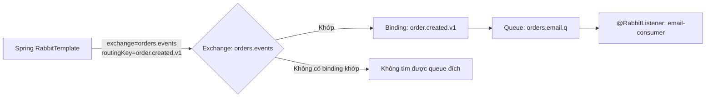
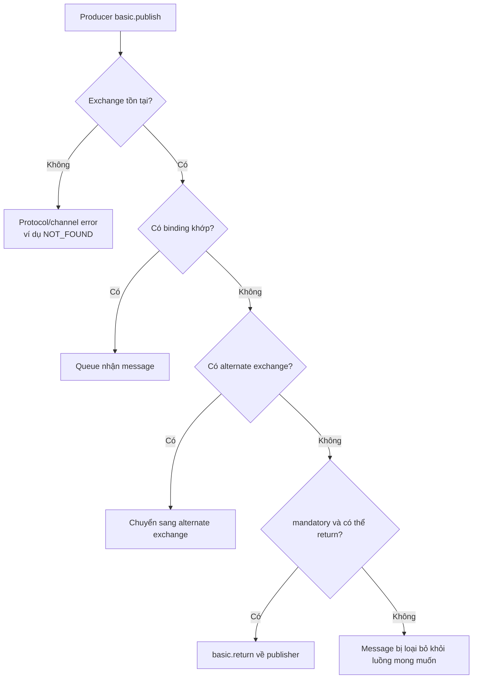
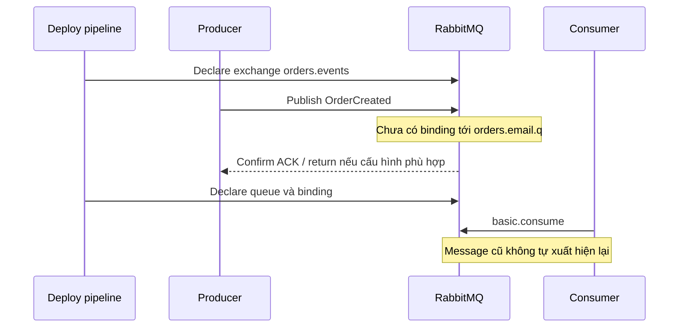

# Thông điệp mất do không có binding hoặc gửi sai exchange/routing key trong Spring AMQP

Một lỗi khó phát hiện trong hệ thống RabbitMQ là **producer gọi `RabbitTemplate.convertAndSend(...)` không thấy exception nhưng consumer `@RabbitListener` vẫn không nhận được message**. Nhiều người kết luận “RabbitMQ làm mất thông điệp”, dù nguyên nhân thực tế có thể là exchange không có binding phù hợp, publisher chọn sai routing key hoặc ứng dụng đang kết nối nhầm virtual host.

Trong chương **Chẩn đoán sự cố** của **SPRING_AMQP**, bài học này hướng dẫn **định vị chính xác nơi message dừng lại**: producer → exchange → binding → queue → consumer. Trọng tâm là phân biệt trường hợp **exchange không tồn tại**, trường hợp **exchange nhận publish nhưng không định tuyến được**, và trường hợp **message đã tới queue nhưng bị consume/ack/reject**. Bài có ví dụ Spring Boot, `RabbitTemplate`, `RabbitAdmin`, `@RabbitListener`, publisher confirms, returns, kiểm thử bằng broker thật và quy trình khôi phục an toàn.

> **Nguyên tắc cốt lõi:** “Không thấy trong queue” chưa đủ để chứng minh message bị mất tại bước routing. Cần tìm bằng chứng ở từng chặng, đặc biệt là **publisher confirm**, **mandatory return**, **binding thực tế** và **trạng thái queue/consumer**.

## 1. Đường đi của một message qua RabbitMQ

Trong AMQP 0-9-1, producer không publish trực tiếp vào một queue tùy ý bằng tên queue như một primitive độc lập. Nó **publish vào exchange**, kèm routing key; exchange áp dụng các binding để chọn queue đích.



Trong ví dụ:

```text
Exchange:    orders.events        (type = direct)
Queue:       orders.email.q
Binding key: order.created.v1

Producer:
  RabbitTemplate.convertAndSend(
      "orders.events", "order.created.v1", "evt-1001")

Kết quả mong muốn:
  orders.events --binding order.created.v1--> orders.email.q
```

Để việc định tuyến xảy ra đúng như hình, các điều kiện sau phải đồng thời đúng:

1. Producer kết nối **đúng broker và virtual host** chứa topology.
2. Exchange `orders.events` thực sự tồn tại và có **loại exchange đúng**.
3. Queue `orders.email.q` tồn tại và được bind vào **exchange đúng**.
4. Binding khớp với routing key của message theo **quy tắc exchange type**.
5. Queue còn hợp lệ tại thời điểm publish; không bị xóa/expire/auto-delete ngoài ý muốn.
6. Sau khi message tới queue, một consumer xử lý và ack/reject theo chính sách phù hợp.

Nếu một điều kiện sai, triệu chứng có thể rất khác nhau. Không nên sửa bằng cách tăng retry hoặc thêm consumer trước khi biết lỗi ở giai đoạn nào.

## 2. Ba trường hợp “không nhận được message” cần tách biệt

| Trường hợp | Broker đã làm gì? | Tín hiệu thường gặp | Hướng kiểm tra |
|---|---|---|---|
| **Exchange không tồn tại** | Publish tới exchange không có trong vhost | Channel exception như `NOT_FOUND`; publish có thể báo lỗi | Tên exchange, vhost, khai báo topology |
| **Exchange có, nhưng không route tới queue nào** | Exchange nhận publish nhưng không tìm đích | Có thể có publisher confirm **ACK**; nếu `mandatory=true` thì có thể nhận `basic.return` | Exchange type, binding, routing key, alternate exchange |
| **Message đã vào queue nhưng không còn ở `ready`** | Message có thể đang `unacked`, đã ack, reject, dead-letter, expire hoặc bị xóa theo policy | Queue ready thấp/0; consumer/ack/redelivery/DLQ có biến động | Consumer count, ack/reject, TTL/DLX, queue metrics |

**Trường hợp 1 không giống trường hợp 2.** Khi publish tới exchange không tồn tại, RabbitMQ thường phản hồi lỗi giao thức và đóng channel liên quan. Khi exchange tồn tại nhưng không có binding khớp, publish có thể hoàn tất ở phía broker mà không vào queue mong muốn. Một confirm ACK trong trường hợp 2 **không xác nhận một consumer đã nhận**.

## 3. Exchange, binding và routing key liên quan thế nào?

Binding là một **quan hệ cấu hình** nối exchange với queue (hoặc tới exchange khác ở topology exchange-to-exchange phù hợp), mang các tham số cần để exchange quyết định hướng định tuyến.

### 3.1. Direct exchange: so khớp routing key chính xác

```text
DirectExchange "orders.events"
    |
    +-- binding "order.created.v1" --> orders.email.q
    +-- binding "order.paid.v1"    --> orders.billing.q
```

| Publish routing key | Kết quả với topology trên |
|---|---|
| `order.created.v1` | Tới `orders.email.q` |
| `order.paid.v1` | Tới `orders.billing.q` |
| `order.created` | Không khớp binding minh họa |
| `orders.created.v1` | Không khớp binding minh họa |
| `ORDER.CREATED.V1` | Không khớp; tên/routing key phân biệt chữ hoa–thường |

Một ký tự khác biệt cũng đủ khiến direct exchange không tìm được binding.

### 3.2. Topic exchange: dùng pattern theo các từ phân tách bằng dấu chấm

Với topic exchange:

- `*` khớp **đúng một từ**.
- `#` khớp **không hoặc nhiều từ**.
- Các từ được ngăn cách bằng dấu chấm `.`.

```text
Binding: sales.order.*.v1

sales.order.created.v1   -> khớp
sales.order.paid.v1      -> khớp
sales.order.created      -> không khớp
sales.order.created.eu.v1 -> không khớp

Binding: sales.order.#

sales.order.created.v1   -> khớp
sales.order.created.eu.v1 -> khớp
```

Đừng nhầm `*` của topic exchange với regex `.*`. Nếu team đổi khóa từ `sales.order.created.v1` thành `sales.orders.created.v1` mà không đổi binding, message có thể trở thành unroutable.

### 3.3. Fanout exchange: bỏ qua routing key

`FanoutExchange` định tuyến tới tất cả queue được bind với nó, **không dựa vào routing key**. Nếu dùng fanout mà subscriber không nhận được, nên kiểm tra binding, vhost và trạng thái queue thay vì chỉ tập trung vào routing key.

### 3.4. Default exchange: tên exchange là chuỗi rỗng

RabbitMQ có một **default direct exchange** với tên `""`. Queue thường được broker tự bind tới default exchange bằng **chính tên queue**. Ví dụ:

```java
// Gửi qua default exchange tới queue có tên "orders.email.q".
rabbitTemplate.convertAndSend("", "orders.email.q", payload);
```

Đừng nhầm lẫn:

```java
rabbitTemplate.convertAndSend(
        "orders.events", "order.created.v1", payload);
```

Hai lệnh có đường định tuyến khác nhau. Nếu chuyển sang default exchange nhưng vẫn dùng routing key `order.created.v1`, message **không tự vào `orders.email.q`** trừ khi có queue có tên phù hợp hoặc topology đặc biệt tương ứng.

### 3.5. Bảng nhận diện nhanh

| Exchange type | Điều cần khớp | Lỗi thiết kế thường gặp |
|---|---|---|
| `direct` | Routing key bằng binding key | Sai chính tả, sai version, khác chữ hoa/thường |
| `topic` | Key khớp pattern `*`/`#` | Nhầm wildcard hoặc thêm/bớt token |
| `fanout` | Queue được bind vào exchange | Tưởng routing key điều khiển fanout |
| `headers` | Message headers khớp binding arguments | Quên header, kiểu dữ liệu/header value sai |
| Default exchange `""` | Routing key bằng tên queue | Gửi business routing key thay vì queue name |

## 4. Vì sao `RabbitTemplate.convertAndSend()` có thể thành công nhưng message vẫn không tới queue?

Method `convertAndSend(...)` gọi API publish. Việc method trở về bình thường **không phải bảo đảm** rằng:

- Broker đã lưu message bền vững.
- Exchange tìm được một queue đích.
- Mọi nhóm subscriber mong muốn đều nhận bản phân phối.
- Listener đã chạy hoặc đã ack.

Trong trường hợp exchange tồn tại nhưng không có binding phù hợp, RabbitMQ có thể **loại bỏ message unroutable**, hoặc gửi qua **alternate exchange** nếu topology có cấu hình. Nếu producer không yêu cầu và xử lý returned messages, ứng dụng có thể không nhận thấy lỗi định tuyến.



Sơ đồ đơn giản hóa đường unroutable. Hành vi cụ thể của `mandatory` khi có alternate exchange cần kiểm tra theo topology và phiên bản broker; **một message được route tới queue fallback cũng không phải đã tới queue nghiệp vụ mong muốn**.

### Message persistent và queue durable không giải quyết lỗi thiếu binding

`deliveryMode=PERSISTENT` chỉ có ý nghĩa trên đường đã được định tuyến và lưu theo cơ chế queue/broker tương ứng. Nếu **không có queue nào nhận message**, không có vị trí lưu để “đợi tới lúc binding xuất hiện”. Khai báo binding sau đó **không khôi phục những publish đã bị loại bỏ trước đây**.

## 5. Hiểu đúng publisher confirms và publisher returns

Đây là phần quan trọng nhất khi điều tra sự cố “publish thành công nhưng message biến mất”.

| Cơ chế | Cho biết điều gì? | Không cho biết điều gì? |
|---|---|---|
| `convertAndSend()` không ném lỗi | Lời gọi gửi phía client đã kết thúc theo API | Broker đã route/consumer đã xử lý |
| **Publisher confirm ACK** | Broker xác nhận việc xử lý publish theo cơ chế confirms | Message đã tới đúng queue nghiệp vụ hoặc listener đã ack |
| **Publisher confirm NACK** | Broker không xác nhận publish thành công | Có thể kết luận chắc chắn không có bản sao nào tồn tại hay không |
| **`mandatory=true` + returned message** | Publish không thể route tới queue nào theo cơ chế return áp dụng | Một queue cụ thể trong nhiều queue bắt buộc đã nhận hay chưa |
| **Consumer ack** | Delivery tới consumer được xác nhận theo chính sách queue | Các subscriber/queue khác cũng đã xử lý |

### Ví dụ dễ hiểu

```text
orders.events là direct exchange.
Binding duy nhất: order.created.v1 -> orders.email.q

Producer gửi key: order.create.v1  (thiếu chữ d)

Khi bật publisher confirms:
  broker có thể gửi publisher confirm ACK

Khi mandatory=true và publisher returns được bật:
  broker trả message unroutable (NO_ROUTE)

Không có binding phù hợp:
  orders.email.q không nhận message này
```

**ACK và RETURN có thể cùng xảy ra cho một publish.** Chúng trả lời hai câu hỏi khác nhau: broker xử lý publish hay không, và exchange có route được tới queue nào không.

### Một giới hạn quan trọng của mandatory returns

Giả sử event cần tới **Notification** và **Analytics**. Nếu chỉ queue Notification được bind, message vẫn route tới ít nhất một queue. `mandatory` có thể **không tạo return**, dù Analytics bị thiếu binding. Publisher confirm ACK cũng không báo “subscriber Analytics chưa nhận”.

Muốn kiểm chứng từng subscription bắt buộc, phải kiểm tra **topology/binding** và **đường xử lý của từng queue**; không dùng `mandatory` như một phép kiểm tra “fanout đã tới đủ mọi nhóm”.

## 6. Bật publisher confirms và returns trong Spring Boot

Với Spring Boot 3.x và Spring AMQP, cấu hình mẫu:

```groovy
dependencies {
    implementation 'org.springframework.boot:spring-boot-starter-amqp'
    implementation 'org.springframework.boot:spring-boot-starter-actuator'
}
```

```yaml
spring:
  rabbitmq:
    host: localhost
    port: 5672
    virtual-host: /orders
    username: orders_publisher
    password: ${AMQP_ORDERS_PUBLISHER_PASSWORD}
    publisher-confirm-type: correlated
    publisher-returns: true
    template:
      mandatory: true
```

Đây là cấu hình minh họa cho broker đã có vhost `/orders`, account và quyền publish thích hợp. **Không dùng username/password cứng trong mã production.** Môi trường thật cần TLS, secrets management và quyền `write` giới hạn vào exchange cần thiết.

Ba thiết lập phục vụ mục đích khác nhau:

1. `publisher-confirm-type: correlated` để liên hệ confirm với từng publish.
2. `publisher-returns: true` để client nhận được bản tin bị trả lại.
3. `template.mandatory: true` để yêu cầu return khi message không được route theo ngữ nghĩa của broker.

**Chỉ đặt `mandatory=true` không đủ** nếu ứng dụng không có callback/future hoặc cơ chế theo dõi returned message để xử lý. **Chỉ bật publisher confirms cũng không đủ** để biết message có vào queue mong muốn hay không.

## 7. Ví dụ Java: capture confirm và returned message

Giả sử hệ thống có exchange `orders.events` và queue `orders.email.q`. Producer gửi `OrderCreated` qua `RabbitTemplate`. Dưới đây là cấu hình callback để **không bỏ qua tín hiệu lỗi**.

### 7.1. Cấu hình `RabbitTemplate`

```java
import org.slf4j.Logger;
import org.slf4j.LoggerFactory;
import org.springframework.amqp.rabbit.connection.ConnectionFactory;
import org.springframework.amqp.rabbit.core.RabbitTemplate;
import org.springframework.context.annotation.Bean;
import org.springframework.context.annotation.Configuration;

@Configuration
public class DiagnosticPublisherConfiguration {

    private static final Logger log =
            LoggerFactory.getLogger(DiagnosticPublisherConfiguration.class);

    @Bean("diagnosticRabbitTemplate")
    public RabbitTemplate diagnosticRabbitTemplate(
            ConnectionFactory connectionFactory) {

        RabbitTemplate template = new RabbitTemplate(connectionFactory);
        template.setMandatory(true);

        template.setConfirmCallback((correlation, ack, cause) -> {
            String eventId = correlation != null
                    ? correlation.getId() : "unknown";
            if (ack) {
                log.debug("Publisher confirm ACK eventId={}", eventId);
            } else {
                log.error("Publisher confirm NACK eventId={} cause={}",
                        eventId, cause);
                // Production: đối soát/outbox và retry có giới hạn.
            }
        });

        template.setReturnsCallback(returned -> {
            log.error(
                "Unroutable publish exchange={} routingKey={} "
                        + "replyCode={} replyText={}",
                returned.getExchange(),
                returned.getRoutingKey(),
                returned.getReplyCode(),
                returned.getReplyText());
            // Tránh log message body vì có thể chứa dữ liệu nhạy cảm.
        });

        return template;
    }
}
```

`publisher-confirm-type=correlated` và `publisher-returns=true` phải được áp dụng lên **ConnectionFactory thực sự được bean này dùng**. Để bảo đảm callback hoạt động, cần tạo publish thật tới broker trong integration test; một mock `RabbitTemplate` không tạo confirm/return từ RabbitMQ.

Nếu có nhiều `RabbitTemplate` hoặc connection factory, hãy dùng `@Qualifier` ở nơi inject và xác minh template nào đang thực sự được ứng dụng dùng. Cấu hình một template khác nhưng producer vẫn gửi bằng template mặc định là lỗi thường gặp.

### 7.2. Gửi event với `CorrelationData`

```java
import org.springframework.amqp.core.MessageDeliveryMode;
import org.springframework.amqp.rabbit.connection.CorrelationData;
import org.springframework.amqp.rabbit.core.RabbitTemplate;
import org.springframework.beans.factory.annotation.Qualifier;
import org.springframework.stereotype.Service;

@Service
public class OrderCreatedPublisher {
    private static final String EXCHANGE = "orders.events";
    private static final String ROUTING_KEY = "order.created.v1";

    private final RabbitTemplate template;

    public OrderCreatedPublisher(
            @Qualifier("diagnosticRabbitTemplate") RabbitTemplate template) {
        this.template = template;
    }

    public CorrelationData publish(String eventId) {
        if (eventId == null || eventId.isBlank()) {
            throw new IllegalArgumentException("eventId trống");
        }

        CorrelationData correlation = new CorrelationData(eventId);
        template.convertAndSend(
                EXCHANGE,
                ROUTING_KEY,
                eventId,
                message -> {
                    message.getMessageProperties().setMessageId(eventId);
                    message.getMessageProperties().setDeliveryMode(
                            MessageDeliveryMode.PERSISTENT);
                    return message;
                },
                correlation);
        return correlation;
    }
}
```

Producer trả về `CorrelationData` để caller hoặc lớp đối soát có thể theo dõi confirm và return theo một `eventId` ổn định. **Không dùng một UUID mới để retry cùng một sự kiện nghiệp vụ** nếu thiết kế idempotency dựa vào event ID.

### 7.3. Đọc confirm và return trong một phép thử chẩn đoán

Trong integration test hoặc công cụ chẩn đoán đồng bộ có timeout:

```java
import java.util.concurrent.TimeUnit;
import org.springframework.amqp.core.ReturnedMessage;
import org.springframework.amqp.rabbit.connection.CorrelationData;

CorrelationData data = publisher.publish("evt-test-1001");

CorrelationData.Confirm confirm =
        data.getFuture().get(5, TimeUnit.SECONDS);

if (!confirm.isAck()) {
    throw new IllegalStateException(
            "Publisher NACK: " + confirm.getReason());
}

ReturnedMessage returned = data.getReturned();
if (returned != null) {
    throw new IllegalStateException(
            "Message unroutable; exchange=" + returned.getExchange()
            + ", routingKey=" + returned.getRoutingKey());
}
```

Đoạn trên dành cho **phép thử có giới hạn thời gian**, không phải lời khuyên block thread HTTP cho mọi publish trong hệ thống tải cao. Theo cơ chế correlated confirms của Spring AMQP hỗ trợ returns, thông tin returned message được gắn với `CorrelationData` để có thể đối chiếu; phải kiểm tra hành vi theo phiên bản đang dùng.

Nếu chờ confirm bị **timeout**, trạng thái publish có thể **không xác định**: broker có thể đã nhận message nhưng tín hiệu xác nhận không tới kịp producer. Khi retry, cần outbox và idempotent consumer; không tự kết luận timeout đồng nghĩa chưa được giao.

## 8. Tạo topology đúng với `RabbitAdmin`

Một ví dụ hoàn chỉnh cần có exchange, queue và **binding**. Tạo riêng hai resource đầu nhưng quên resource thứ ba là nguyên nhân rất điển hình của mất route.

```java
import org.springframework.amqp.core.Binding;
import org.springframework.amqp.core.BindingBuilder;
import org.springframework.amqp.core.DirectExchange;
import org.springframework.amqp.core.Queue;
import org.springframework.amqp.core.QueueBuilder;
import org.springframework.context.annotation.Bean;
import org.springframework.context.annotation.Configuration;

@Configuration
public class OrdersRoutingTopology {
    public static final String EXCHANGE = "orders.events";
    public static final String QUEUE = "orders.email.q";
    public static final String KEY = "order.created.v1";

    @Bean
    public DirectExchange ordersExchange() {
        return new DirectExchange(EXCHANGE, true, false);
    }

    @Bean
    public Queue ordersEmailQueue() {
        return QueueBuilder.durable(QUEUE).build();
    }

    @Bean
    public Binding ordersEmailBinding() {
        return BindingBuilder.bind(ordersEmailQueue())
                .to(ordersExchange())
                .with(KEY);
    }
}
```

Với `RabbitAdmin` được Spring Boot auto-configure và account có quyền, các bean có thể được khai báo trên broker thông qua lifecycle phù hợp của Spring AMQP. **Bean Java đã tồn tại trong `ApplicationContext` không chứng minh binding đã được tạo trên broker.**

Nếu topology được provision trước bởi IaC, runtime có thể không cần `configure`; lúc này ứng dụng không nên tự ý khai báo chéo các resource. Dùng quy trình provisioning rõ ràng và xác minh kết quả trên broker.

### Một ví dụ sai rất khó thấy khi review

```java
// Sai: method tạo exchange và queue nhưng không tạo Binding.
@Bean
public DirectExchange ordersExchange() {
    return new DirectExchange("orders.events");
}

@Bean
public Queue ordersEmailQueue() {
    return QueueBuilder.durable("orders.email.q").build();
}
```

Nếu producer publish tới `orders.events` bằng `order.created.v1`, queue `orders.email.q` không tự được bind. **Tên queue giống hoặc có cùng tiền tố với exchange không tạo thành binding.**

### Listener với queue đã định nghĩa

```java
import org.springframework.amqp.rabbit.annotation.RabbitListener;
import org.springframework.stereotype.Component;

@Component
public class OrdersEmailListener {

    @RabbitListener(queues = OrdersRoutingTopology.QUEUE)
    public void onOrderCreated(String eventId) {
        // Trong production: xử lý idempotent trước khi ack.
        System.out.println("OrderCreated event: " + eventId);
    }
}
```

`@RabbitListener(queues = "...")` chỉ rõ queue cần consume. Nó **không tự tạo direct/topic exchange và binding** theo routing key của producer. Khi muốn khai báo topology qua annotation, có thể dùng `@QueueBinding`/`@Exchange` với quyền phù hợp, nhưng phải kiểm soát admin và tránh xung đột với IaC.

## 9. Runbook 10 phút đầu khi “publish thành công nhưng không nhận được”

Đừng vội restart mọi service hoặc xóa queue. Thực hiện từ phía producer tới broker rồi consumer:

### Bước 1 — Ghi nhận một event có ID cố định

Chọn event vừa phát (hoặc event test không gây side effect) và xác định:

```text
eventId:    evt-1001
timestamp:  2026-11-26T08:00:00Z
broker:     rabbitmq.internal:5672
vhost:      /orders
exchange:   orders.events
routingKey: order.created.v1
queue:      orders.email.q
```

Các giá trị này là **ví dụ chẩn đoán**, không phải thông tin broker thực. Trong log production nên ghi metadata đủ để correlation nhưng **không log password, token hoặc body có PII**.

### Bước 2 — Kiểm tra producer thực sự đang dùng template/connection nào

- `RabbitTemplate` được inject bằng bean nào?
- `ConnectionFactory` tương ứng kết nối host/port/vhost nào?
- Giá trị exchange và routing key có bị đổi qua profile, biến môi trường hoặc feature flag không?
- Message converter có ném exception trước khi publish không?
- Producer đã nhận publisher confirm, return hay exception nào?

**Không dựa vào giá trị trong source code nếu runtime đang override bằng environment/profiles**.

### Bước 3 — Kiểm tra topology trên đúng vhost

Từ môi trường quản trị RabbitMQ có quyền phù hợp:

```bash
# Liệt kê exchange, type và độ bền trên vhost /orders.
rabbitmqctl list_exchanges -p /orders name type durable

# Liệt kê queue và số lượng message.
rabbitmqctl list_queues -p /orders \
  name messages_ready messages_unacknowledged consumers

# Liệt kê quan hệ exchange -> queue và routing key.
rabbitmqctl list_bindings -p /orders \
  source_name source_kind destination_name destination_kind routing_key
```

Tên trường được CLI hỗ trợ có thể khác giữa các phiên bản RabbitMQ; nếu lệnh báo không nhận field, hãy xem hướng dẫn `rabbitmqctl` của phiên bản đang dùng. Có thể dùng **RabbitMQ Management UI/API** để xem trực quan exchange, bindings và queue trên đúng vhost.

Cần chứng minh thực sự tồn tại dòng tương đương:

```text
source_name    = orders.events
source_kind    = exchange
destination    = orders.email.q
destination_kind = queue
routing_key    = order.created.v1
```

Chỉ xác nhận “queue có tên đúng” mà không thấy binding đúng là **chưa đủ**.

### Bước 4 — So khớp exchange type và routing key

Nếu exchange `direct`, so sánh **ký tự chính xác** giữa `routingKey` của publish và binding key. Nếu là `topic`, kiểm tra pattern `*`/`#`. Nếu là `fanout`, tập trung vào bindings hơn routing key.

Đừng đoán theo tên `orders.events` là topic hay direct; phải xem **type thực tế trên broker**.

### Bước 5 — Kiểm tra sự kiện publish

| Tín hiệu từ producer | Cách diễn giải ban đầu |
|---|---|
| Exception `NOT_FOUND`/channel closed khi publish | Exchange hoặc resource trong vhost không tồn tại |
| Publisher confirm **ACK** + **RETURN** | Broker xử lý publish nhưng message không route được theo cơ chế return |
| Confirm **ACK**, không có RETURN | Có thể đã route tới một queue; **chưa bảo đảm đúng queue mong muốn** |
| Confirm **NACK** | Broker không xác nhận thành công; cần điều tra và retry có kiểm soát |
| Confirm timeout | Kết quả có thể chưa rõ; cần đối soát/outbox/idempotency |
| Không có confirm/return instrumentation | Chưa đủ dữ liệu để kết luận |

### Bước 6 — Nếu queue thực sự nhận message, điều tra delivery

Nếu metrics cho thấy ingress queue tăng, vấn đề có thể đã chuyển sang consumer:

- `messages_ready` cao, `consumers=0`: không có consumer, sai queue, listener chưa start hoặc lỗi connection.
- `messages_unacknowledged` cao: listener đang xử lý chậm, quên manual ack, prefetch/concurrency chưa phù hợp.
- Ready và unacked đều thấp nhưng ack rate tăng: message có thể đã được consume và ack rất nhanh.
- DLQ tăng: message có thể bị reject hoặc expire, không phải “mất ở exchange”.

Một message không còn nằm trong queue **không chứng minh** rằng nó chưa từng đến queue.

## 10. Vhost và quyền: topology có tồn tại nhưng ở “nơi khác”

RabbitMQ cho phép có các exchange/queue **trùng tên trên các vhost khác nhau**:

```text
vhost /orders
  exchange orders.events
  queue    orders.email.q
  binding  order.created.v1

vhost /sandbox
  exchange orders.events
  queue    orders.email.q
  (chưa có binding order.created.v1)
```

Nếu producer vô tình kết nối `/sandbox` nhưng người vận hành nhìn Management UI ở `/orders`, rất dễ nghĩ “binding rõ ràng có mà RabbitMQ vẫn làm mất message”.

Kiểm tra:

1. `spring.rabbitmq.virtual-host` trong runtime thực.
2. Username và quyền trên vhost; `configure` để declare, `write` để publish, `read` để consume.
3. Broker endpoint/cluster của từng pod, profile và secret.
4. Management UI có đang lọc đúng vhost không.

Ví dụ cấu hình runtime:

```yaml
spring:
  rabbitmq:
    host: rabbitmq.internal
    port: 5672
    virtual-host: /orders
    username: orders_publisher
    password: ${AMQP_ORDERS_PUBLISHER_PASSWORD}
```

Nếu user thiếu quyền `write` trên exchange, đây thường là **lỗi authorization** chứ không phải một publish unroutable âm thầm. Nếu user khai báo binding bằng `RabbitAdmin` nhưng thiếu quyền cần thiết, binding có thể không tạo thành công; phải đọc startup log và đối chiếu ACL thật.

### Không cấp toàn quyền chỉ để sửa lỗi

Một cách “chữa cháy” nguy hiểm là cấp `.*` cho mọi permission của user runtime. Việc đó có thể làm giảm lỗi tạm thời nhưng mở rộng quyền xóa/đổi topology không cần thiết. Hãy xác định **resource và thao tác** bị từ chối rồi cấp quyền tối thiểu; dùng identity provisioning riêng để khai báo topology khi có thể.

## 11. Race condition khi triển khai: producer gửi trước binding

Một tình huống rất thực tế:



Thực tế, một exchange có thể tồn tại trước nhiều phút so với queue/binding của nhóm mới. Nếu producer phát trong cửa sổ đó, việc sửa binding sau này **không khôi phục message đã bỏ lỡ**.

### Cách phòng tránh

- **Provision exchange, queue và binding trước** khi cho producer phát event mà subscriber cần nhận.
- Dùng migration có version, khai báo topology tương thích trước rolling deployment.
- Không dùng `@DependsOn("rabbitAdmin")` như bằng chứng tuyệt đối rằng broker đã nhận mọi declaration; khai báo có thể theo lifecycle connection.
- Dùng verification trên RabbitMQ hoặc integration test kiểm tra binding thật.
- Khi thêm nhóm subscribe mới, xác định rõ cần hay không cần **backfill lịch sử** từ event store/outbox/DB; queue mới không tự replay.

Nếu topology do IaC quản lý, tách rõ trách nhiệm của runtime `RabbitTemplate`/`@RabbitListener` và job provisioning. Nếu ứng dụng tự declare bằng `RabbitAdmin`, cần kiểm tra quyền, admin ownership, connection factory và log declare errors.

## 12. Phân biệt thiếu binding với alternate exchange

RabbitMQ hỗ trợ **alternate exchange (AE)**: một exchange có thể chuyển các message không định tuyến được sang exchange dự phòng nếu được cấu hình phù hợp.

```text
orders.events (direct)
   |-- khớp key order.created.v1 --> orders.email.q
   |
   +-- không khớp --> orders.unroutable (alternate exchange)
                         |
                         +--> orders.unroutable.q
```

Điều này giúp tăng khả năng quan sát và lưu lại một số message không có route. Nhưng:

- **AE phải được tạo và cấu hình từ trước**; không cứu được các publish đã mất trước khi bật AE.
- Bản tin tới fallback queue **không có nghĩa đã tới queue nghiệp vụ**.
- Cần monitor, phân loại, đặt retention và xử lý replay cho fallback queue.
- Đừng tạo vòng lặp alternate-exchange hoặc fallback routing không rõ trách nhiệm.
- `mandatory` và AE có những tương tác riêng: cần test tình huống AE có/không có route, không suy chỉ từ việc không thấy return.

Nếu một hệ thống không được phép mất event khi thiếu binding, cân nhắc kết hợp **preflight topology**, mandatory returns, AE/quarantine, outbox và reconciliation thay vì chỉ dựa vào một lớp bảo vệ.

## 13. Không nhầm “message tới một queue” với “mọi nhóm đã nhận”

Trong pub/sub, một publish có thể cần đến nhiều queue:

```text
Topic exchange sales.events
   |
   +--> orders.email.q
   +--> orders.analytics.q
   +--> orders.search.q
```

Nếu chỉ `orders.email.q` có binding phù hợp, publish vẫn được route. **Mandatory return không được thiết kế để báo rằng hai queue bắt buộc khác bị thiếu**.

Khi có yêu cầu tất cả nhóm phải nhận:

1. Kiểm tra binding của **từng nhóm** ở bước deployment.
2. Theo dõi **queue ingress/ack/DLQ theo nhóm**.
3. Sử dụng event ID để đối soát kết quả nghiệp vụ từng nhóm.
4. Thiết kế backfill/replay khi bổ sung subscriber muộn.

Không dùng một publish confirm ACK như một “distributed transaction” đại diện cho mọi consumer. RabbitMQ không tự chờ từng service xử lý xong rồi mới ACK publisher.

## 14. Khôi phục message đã bị unroutable: điều gì có thể và không thể làm?

Khi routing sai, **sửa binding chỉ khắc phục các publish mới**. Khả năng khôi phục các publish cũ phụ thuộc hệ thống có giữ được chúng ở đâu hay không.

| Nguồn khôi phục | Có thể làm gì? | Giới hạn |
|---|---|---|
| **Transactional outbox** | Relay publish lại sự kiện chưa được xác nhận/đối soát | Phải xử lý duplicate và trạng thái confirm không xác định |
| **Alternate exchange + fallback queue** | Điều tra, sửa key rồi republish có kiểm soát | Chỉ có từ khi AE/fallback đã hoạt động |
| **Event store hoặc CDC log** | Backfill theo event ID hoặc khoảng thời gian | Cần chính sách schema và side effect replay |
| **Business database** | Tái tạo một số sự kiện từ dữ liệu nghiệp vụ | Có thể không còn đủ thông tin gốc hoặc thứ tự sự kiện |
| **Chỉ có log producer thông thường** | Có thể xác định danh sách ID bị ảnh hưởng | Không chắc reconstruct được payload hợp lệ |
| **Không giữ event ở đâu** | Không có cách khôi phục tự động bảo đảm | Phải báo tác động và xử lý nghiệp vụ thủ công |

### Quy trình replay an toàn

1. **Đóng băng phạm vi sự cố:** xác định thời gian, exchange/routing key/vhost và subscriber bị ảnh hưởng.
2. **Sửa topology**, kiểm chứng publish thử đúng đích trước.
3. **Xác định event cần phát lại** từ outbox/fallback/event store, dùng `eventId` bất biến.
4. **Đối soát subscriber đã xử lý** để tránh nhân đôi email, thanh toán hoặc các tác động ngoài hệ thống.
5. **Replay có giới hạn tốc độ**, giám sát queue ready/unacked, retry và DLQ.
6. **So sánh số lượng đầu–cuối và business outcomes**, không chỉ nhìn số lệnh `convertAndSend()` thành công.

Mất confirm hoặc lỗi mạng có thể khiến producer không biết message đã được route trước đó hay chưa. **Replay phải thiết kế theo nguyên tắc at-least-once + idempotent processing**, không giả định mọi event cần replay đều chắc chắn chưa từng được giao.

## 15. Định danh sự kiện và inbox để tránh tác động lặp sau replay

Ví dụ một consumer gửi email theo `OrderCreated`:

```text
eventId = evt-1001

Lần 1: email đã gửi, nhưng ACK chưa đến RabbitMQ.
Lần 2: message bị redeliver hoặc được replay sau sửa binding.
```

Nếu không có bảo vệ, consumer có thể gửi email hai lần. Một giải pháp cho side effect nội bộ là sử dụng **inbox/dedup record**, thường theo khóa `(consumerGroup, eventId)` trong cùng transaction với thay đổi dữ liệu của consumer.

```sql
CREATE TABLE consumer_inbox (
    consumer_group VARCHAR(80) NOT NULL,
    event_id VARCHAR(120) NOT NULL,
    processed_at TIMESTAMPTZ NOT NULL DEFAULT now(),
    PRIMARY KEY (consumer_group, event_id)
);
```

Nhưng việc gửi email/HTTP payment là side effect bên ngoài DB; chỉ ghi inbox không bảo đảm exactly-once nếu crash giữa lúc gọi provider và commit. Dùng **outbox cho side effect**, idempotency key ở provider hoặc reconciliation theo nghiệp vụ.

### Vì sao không tạo event ID mới khi republish?

Nếu producer dùng event ID mới cho cùng sự kiện logic, consumer có thể nghĩ đó là event hoàn toàn mới và thực hiện lại tác động. Khi replay, hãy giữ `eventId`/business identity ổn định và lưu metadata về `replayAttempt`/`reason` ở hệ thống quản trị hoặc header được định nghĩa rõ ràng, không đổi danh tính sự kiện gốc.

## 16. Quan sát và cảnh báo để phát hiện lỗi sớm

Nếu chỉ theo dõi “số lệnh publish mỗi phút”, hệ thống có thể báo xanh dù toàn bộ event không được route tới queue.

| Chỉ số/tín hiệu | Phạm vi | Ý nghĩa khi chẩn đoán |
|---|---|---|
| Publish attempts | Producer, exchange | Có bao nhiêu lần ứng dụng cố gửi |
| Publisher confirms ACK/NACK/timeout | Producer | Broker có xác nhận publish hay không |
| **Publisher returns** | Producer, exchange/key ở mức cardinality kiểm soát | Phát hiện unroutable theo `mandatory` |
| Queue ingress/deliver/ack | Mỗi queue | Xác minh event đã tới/chạy qua queue |
| `messages_ready` | Mỗi queue | Backlog chờ consumer |
| `messages_unacknowledged` | Mỗi queue | Delivery đang xử lý/chờ ack |
| Consumer count | Mỗi queue | Có consumer thực sự đăng ký |
| Retry/redelivery và DLQ | Mỗi nhóm xử lý | Phân biệt lỗi processing với lỗi routing |
| Topology drift/permission errors | Broker/vhost | Cảnh báo binding bị xóa/sai ACL |
| Business event outcomes | Ứng dụng | Sự kiện có tạo tác động mong muốn không |

**Không tạo metric tag theo `eventId`, `orderId` hoặc toàn bộ routing key có giá trị động** vì cardinality có thể tăng rất lớn. Ghi event ID trong log/tracing có kiểm soát; metric chỉ gắn các thuộc tính hữu hạn như tên exchange, nhóm event, kết quả và môi trường.

### Hai cảnh báo nên có

1. **Tỷ lệ returned publish tăng:** trong các trường hợp message bắt buộc phải route, chỉ vài return cũng cần điều tra, nhất là sau rollout topology.
2. **Producer phát event nhưng queue ingress của nhóm bắt buộc bất thường:** so sánh theo cửa sổ thời gian đủ dài, tính đến retry, routing fanout và độ trễ thu thập metrics.

Không so sánh máy móc “publish count = số message ack” khi một event được fanout tới nhiều queue, có retry hoặc có sự kiện không thuộc subscription của queue đó.

## 17. Kiểm thử tích hợp phải có cả ca định tuyến đúng và sai

Unit test Mockito có thể xác minh producer gọi `convertAndSend("orders.events", "order.created.v1", ...)`, nhưng nó **không chứng minh exchange và binding tồn tại trên broker**. `TestRabbitTemplate` cũng không mô phỏng đầy đủ exchange/routing thật: nó có thể gọi listener trực tiếp theo tên queue.

Muốn kiểm chứng lỗi thiếu binding, phải dùng **RabbitMQ thật** trong môi trường test cô lập, chẳng hạn Testcontainers.

### 17.1. Ma trận tình huống

| Test | Kỳ vọng |
|---|---|
| Direct exchange có binding đúng, publish key đúng | Confirm ACK, không return; message vào queue dự kiến |
| Direct exchange tồn tại nhưng publish key sai | Confirm có thể ACK; với `mandatory=true` nhận returned message |
| Exchange không tồn tại | Quan sát channel/protocol exception, không đánh đồng với unroutable |
| Topic exchange với key khớp `*` | Message được route đúng queue |
| Topic exchange với token thừa | Không route nếu không khớp `#` hoặc binding khác |
| Không có binding tới queue bắt buộc | Test phát hiện queue không nhận dù publish API không lỗi |
| Hai queue cần nhận nhưng chỉ một queue được bind | Mandatory không phát hiện nhóm thiếu; assertion từng queue mới bắt được |
| Default exchange và routing key bằng tên queue | Message vào queue được chỉ định |
| Producer chọn sai vhost | Kiểm tra không thể route vào topology vhost khác |
| Tạo binding sau lần publish unroutable | Message cũ không tự xuất hiện lại |
| Listener đọc/ack rất nhanh | Queue ready có thể về 0, nhưng business recorder xác nhận đã xử lý |
| Consumer ném exception/reject | Message đi theo retry/requeue/DLX đúng cấu hình |
| Mất connection sau publish trước confirm | Trạng thái có thể không chắc; retry không tạo side effect trùng |

### 17.2. Ví dụ thử nghiệm với broker thật và `CorrelationData`

Đoạn minh họa sau dành cho một dự án **Spring Boot test context đã tạo được `RabbitTemplate` với correlated confirms/returns và `RabbitAdmin` phù hợp**. Test nên dùng một queue riêng, không có `@RabbitListener` khác cạnh tranh consume cùng queue.

```java
import java.util.UUID;
import java.util.concurrent.TimeUnit;
import org.junit.jupiter.api.BeforeEach;
import org.junit.jupiter.api.Test;
import org.springframework.amqp.core.BindingBuilder;
import org.springframework.amqp.core.DirectExchange;
import org.springframework.amqp.core.Queue;
import org.springframework.amqp.rabbit.connection.CorrelationData;
import org.springframework.amqp.rabbit.core.RabbitAdmin;
import org.springframework.amqp.rabbit.core.RabbitTemplate;
import org.springframework.beans.factory.annotation.Autowired;
import org.springframework.boot.test.context.SpringBootTest;

import static org.assertj.core.api.Assertions.assertThat;

@SpringBootTest
class RoutingWithRealBrokerTest {
    private static final String EXCHANGE = "it.orders.events";
    private static final String QUEUE = "it.orders.created";
    private static final String KEY = "order.created.v1";

    @Autowired
    RabbitTemplate rabbitTemplate;

    @Autowired
    RabbitAdmin rabbitAdmin;

    @BeforeEach
    void declareTestTopology() {
        DirectExchange exchange = new DirectExchange(EXCHANGE);
        Queue queue = new Queue(QUEUE, true);
        rabbitAdmin.declareExchange(exchange);
        rabbitAdmin.declareQueue(queue);
        rabbitAdmin.declareBinding(
                BindingBuilder.bind(queue).to(exchange).with(KEY));
        // Dùng queue/vhost riêng và dọn dữ liệu giữa các test khi cần.
    }

    @Test
    void correctKeyRoutesIntoExpectedQueue() throws Exception {
        String eventId = "evt-" + UUID.randomUUID();
        CorrelationData data = new CorrelationData(eventId);
        rabbitTemplate.convertAndSend(EXCHANGE, KEY, eventId, data);

        var confirm = data.getFuture().get(5, TimeUnit.SECONDS);
        assertThat(confirm.isAck()).isTrue();
        assertThat(data.getReturned()).isNull();

        Object payload = rabbitTemplate.receiveAndConvert(QUEUE, 5000);
        assertThat(payload).isEqualTo(eventId);
    }

    @Test
    void wrongKeyCanBeAckedButReturned() throws Exception {
        String eventId = "evt-" + UUID.randomUUID();
        CorrelationData data = new CorrelationData(eventId);
        rabbitTemplate.convertAndSend(
                EXCHANGE, "order.creatd.v1", eventId, data);

        var confirm = data.getFuture().get(5, TimeUnit.SECONDS);
        assertThat(confirm.isAck()).isTrue();
        assertThat(data.getReturned()).isNotNull();
        assertThat(data.getReturned().getRoutingKey())
                .isEqualTo("order.creatd.v1");
    }
}
```

**Điều kiện để test có ý nghĩa:**

- Có RabbitMQ thật, đúng vhost và account có quyền khai báo topology test.
- Connection factory bật `publisher-confirm-type=correlated` và `publisher-returns=true`.
- `RabbitTemplate` đang dùng `mandatory=true`; nếu không, case `wrongKeyCanBeAckedButReturned` không có căn cứ kỳ vọng returned message.
- Test dùng một exchange **không có alternate exchange** và không có binding khác có thể khớp khóa sai.
- Không có listener khác consume `it.orders.created`; dùng queue test cô lập hoặc dọn backlog để tránh test lẫn dữ liệu.
- `RabbitAdmin` được tạo hoặc inject thật; annotation `@SpringBootTest` không tự bảo đảm bean đó tồn tại nếu `spring.rabbitmq.dynamic=false`.

Đây là ví dụ **phần assertion của integration test**, không tự khởi động broker. Có thể dùng Testcontainers tạo `RabbitMQContainer`, sau đó cấp `spring.rabbitmq.host/port/username/password` từ container bằng `@DynamicPropertySource`. Để test không bị flaky, pin image RabbitMQ tương thích và chờ kết quả có timeout rõ ràng.

**Không chạy kiểm thử sản xuất bằng cách cố tình publish message lỗi vào queue nghiệp vụ thật**: nếu cần thí nghiệm negative path, dùng exchange/queue/vhost test riêng, không gây tác động bên ngoài.

## 18. Tình huống thực hành: chẩn đoán theo bằng chứng

### Tình huống A — Publisher ACK nhưng queue luôn rỗng

**Dữ liệu:** exchange `orders.events` tồn tại; producer dùng key `order.created.v2`; queue `orders.email.q` chỉ có binding `order.created.v1`; mandatory chưa bật.

**Kết luận:** Lỗi có khả năng cao là routing key không khớp binding. Confirm ACK không loại trừ việc message bị unroutable. **Sửa:** đồng bộ event contract/routing key, thêm binding version mới nếu có kế hoạch migration, bật returns, kiểm thử với broker và đánh giá replay sự kiện bị ảnh hưởng.

### Tình huống B — Publish ném `NOT_FOUND`

**Dữ liệu:** producer gửi tới `orders.event` (thiếu chữ `s`), trong khi broker chỉ có `orders.events`.

**Kết luận:** Publish tới exchange không tồn tại khác với việc exchange có nhưng không route được. **Sửa:** kiểm tra tên exchange/vhost, provision resource, xác minh channel errors; nếu dùng outbox, retry sau khi sửa và chống trùng.

### Tình huống C — Management UI có binding đúng nhưng app vẫn không nhận

**Dữ liệu:** UI đang xem vhost `/orders`, producer chạy với `spring.rabbitmq.virtual-host: /sandbox`.

**Kết luận:** Hai vhost có namespace độc lập. **Sửa:** kiểm tra runtime config, account/ACL, broker endpoint và UI filter; không sửa binding của vhost đúng rồi mong producer ở vhost khác tự nhận.

### Tình huống D — Message vào queue nhưng consumer không xử lý

**Dữ liệu:** publish/queue ingress tăng; `messages_ready` tăng, `consumers=0`.

**Kết luận:** Không phải lỗi thiếu binding; queue đã nhận message. **Sửa:** kiểm tra listener container startup, `@RabbitListener(queues=...)`, quyền `read`, connection/recovery, health và deployment.

### Tình huống E — Queue ready bằng 0 và có consumer

**Dữ liệu:** ack rate tăng, DLQ không tăng, ứng dụng vẫn báo “không thấy message”.

**Kết luận:** Message có thể đã được consumer xử lý và ack nhanh; cần truy `eventId` trong log/inbox/business database. Nếu không có dấu vết, kiểm tra converter, listener error handling và tác động nghiệp vụ. **Không khôi phục bằng cách gửi lại hàng loạt** khi chưa đối soát.

### Tình huống F — Fanout tới hai nhóm nhưng thiếu một nhóm

**Dữ liệu:** Topic exchange `sales.events` có binding Notification nhưng thiếu Analytics. Confirm ACK, không có mandatory return.

**Kết luận:** Message đã được route tới **ít nhất một** queue; mandatory không kiểm chứng đủ tất cả nhóm. **Sửa:** kiểm tra topology subscription từng nhóm, khai báo binding Analytics và backfill có kiểm soát nếu cần.

## 19. Checklist xử lý production và phòng ngừa tái diễn

Trước khi thay đổi cấu hình:

- [ ] Xác định broker, vhost, exchange, routing key, queue và `eventId` của một trường hợp cụ thể.
- [ ] Phân biệt exchange không tồn tại, unroutable và message đã được consume/ack.
- [ ] Kiểm tra exchange type cùng **binding thực tế** ở đúng vhost.
- [ ] Ghi nhận publisher confirm ACK/NACK/timeout và mandatory returns.
- [ ] Kiểm tra các queue bắt buộc riêng lẻ; không chỉ nhìn có/không có return.
- [ ] Đối chiếu producer config chạy thực với source code và environment.
- [ ] Kiểm tra `RabbitAdmin`, startup errors, permission `configure/write/read` và thứ tự deploy topology.
- [ ] Xem `messages_ready`, `unacked`, consumer count, retry/redelivery và DLQ.
- [ ] Xác minh dữ liệu nguồn có thể replay: outbox, fallback queue, event store hoặc database.
- [ ] Chỉ replay sau khi có idempotency/đối soát và giới hạn tốc độ.
- [ ] Có integration tests positive/negative với RabbitMQ thật và kiểm tra sau rollout.
- [ ] Không log payload nhạy cảm hoặc cấp toàn quyền broker chỉ để sửa nhanh.

### Câu hỏi tự kiểm tra

1. Vì sao `RabbitTemplate.convertAndSend()` không ném lỗi vẫn chưa chứng minh message tới queue?
2. Publish tới **exchange không tồn tại** khác gì publish tới **exchange tồn tại nhưng không có binding phù hợp**?
3. Khi direct exchange có binding `order.created.v1`, routing key `order.created` có được route không?
4. Với topic exchange, `*` và `#` khác nhau thế nào?
5. Vì sao publisher confirm ACK có thể đi kèm returned message?
6. `mandatory=true` có giúp phát hiện Analytics thiếu binding nếu Notification vẫn nhận event không?
7. Nếu binding được thêm sau một publish unroutable, message cũ có tự xuất hiện lại không?
8. Khi queue ready bằng 0, cần kiểm tra thêm điều gì trước khi kết luận message bị mất ở exchange?
9. Vì sao gửi lại event sau confirm timeout có thể gây tác động nghiệp vụ lặp?
10. Test nào cần broker thật để chứng minh đúng exchange/routing key/binding thay vì chỉ mock `RabbitTemplate`?

**Ghi nhớ:** Khi sự kiện “biến mất”, hãy điều tra theo **đường đi producer → exchange → binding → queue → listener**. **Exchange không tồn tại** thường tạo lỗi channel; **exchange tồn tại nhưng không có route** có thể được publisher **ACK** mà message không tới queue, trừ khi return/alternate exchange cung cấp tín hiệu hoặc đường lưu phù hợp. Trong Spring AMQP, kết hợp `RabbitTemplate` với correlated confirms, `mandatory`/returns, topology được provision và kiểm chứng trước publish, integration tests bằng RabbitMQ thật, cùng outbox/idempotency để hệ thống vừa phát hiện lỗi định tuyến vừa khôi phục an toàn.
