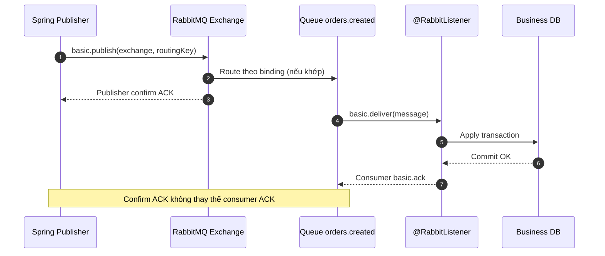
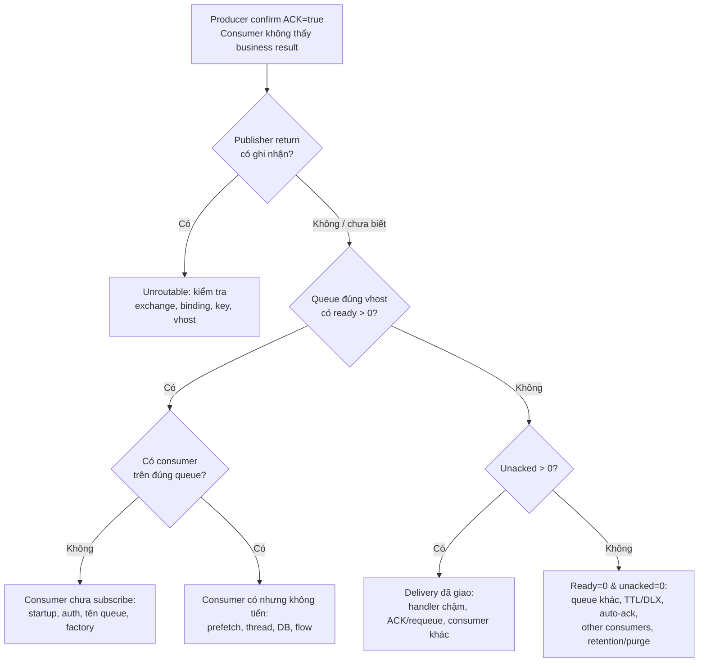
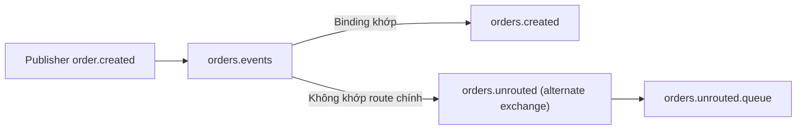
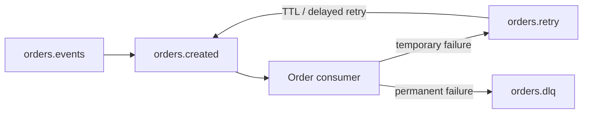

# Confirm ack nhưng không có consumer nhận thông điệp

## 1. Hiện tượng: producer báo thành công, nghiệp vụ vẫn đứng yên

Một producer Spring Boot gửi sự kiện bằng `RabbitTemplate`:

```java
rabbitTemplate.convertAndSend(
        "orders.events",
        "order.created",
        orderCreatedEvent);
```

Log phía gửi ghi:

```text
publisher confirm: ack=true
eventId=evt-1024
exchange=orders.events
routingKey=order.created
```

Tuy nhiên, phía dịch vụ xử lý đơn hàng không thấy log của `@RabbitListener`; cơ sở dữ liệu không có bản ghi mới. Có người kết luận: **“RabbitMQ đã ACK mà làm mất message.”** Kết luận này quá sớm vì đã nhầm **publisher confirm ACK** với **consumer ACK** và với **business completion**.

Trong RabbitMQ AMQP 0-9-1, ít nhất bốn câu hỏi độc lập phải được trả lời:

1. **Broker có nhận trách nhiệm về lệnh publish không?** — Kiểm tra *publisher confirm*.
2. **Publish có định tuyến tới ít nhất một queue đích không?** — Kiểm tra exchange, binding, routing key, *mandatory return* và alternate exchange.
3. **Message có được broker giao cho consumer hay đã bị giữ, hết hạn, loại hoặc consumer khác nhận?** — Kiểm tra queue `ready`, `unacked`, consumer, TTL, DLX và topology.
4. **Consumer đã xử lý nghiệp vụ và ACK thành công chưa?** — Kiểm tra listener lifecycle, conversion, exception, transaction, retry, idempotency và consumer acknowledgment.

**Publisher confirm ACK không chứng minh có consumer nhận, cũng không chứng minh có message đang nằm trong queue.** Một publish không định tuyến được tới queue nào vẫn có thể được broker confirm ACK; nếu `mandatory=false` và không có alternate exchange thích hợp, message có thể bị loại mà ứng dụng không nhận tín hiệu return.

Bài học thuộc chương **Chẩn đoán sự cố** của module **SPRING_AMQP**, kết nối `RabbitTemplate`, `@RabbitListener`, exchange/queue/binding với xác nhận giao nhận, retry, dead-letter, transaction và quan sát để khắc phục sự cố xử lý bất đồng bộ một cách có bằng chứng.

### Mục tiêu học tập

Sau bài, bạn sẽ có thể:

- Phân biệt **publish call**, **publisher confirm ACK/NACK**, **publisher return**, **queue delivery**, **consumer ACK** và **DB commit**.
- Sử dụng một **cây quyết định chẩn đoán** thay vì đoán từ thông báo `ack=true`.
- Kiểm tra exchange type, routing key, binding, default exchange, vhost, alternate exchange và tên queue.
- Đọc `messages_ready`, `messages_unacknowledged`, `consumers`, delivery/ACK/reject rates và lý giải từng trạng thái.
- Cấu hình Spring AMQP **correlated confirms + publisher returns + mandatory** để phân biệt “broker nhận publish” với “unroutable”.
- Kiểm tra `@RabbitListener` chưa khởi động, kết nối nhầm broker, listener nhận nhưng lỗi convert, ACK/requeue, competing consumers và DLQ.
- Thiết kế theo dõi end-to-end bằng event ID, idempotency và trạng thái kết quả publish không xác định.
- Viết runbook và integration test tái hiện những trường hợp confirm ACK nhưng không có business completion.

## 2. Sáu cột mốc không được đánh đồng



Sơ đồ cho thấy **đường lý tưởng khi publish được route thành công**. Khi không có binding khớp, bước exchange → queue và toàn bộ phần consumer **không xảy ra**, nhưng publisher confirm vẫn có thể ACK.

| Tín hiệu | Phát sinh ở đâu? | Khẳng định điều gì? | **Không** khẳng định điều gì? |
|---|---|---|---|
| `convertAndSend(...)` trả về bình thường | Java client/application | Lời gọi gửi đã hoàn tất theo contract đồng bộ | Broker đã confirm, route hay xử lý nghiệp vụ |
| Publisher confirm **ACK** | Broker → publisher channel | Broker đã xử lý publish theo cơ chế confirms áp dụng | Có queue đích, có consumer, DB đã commit |
| Publisher confirm **NACK** | Broker → publisher channel | Broker không xác nhận thành công publish đó | Consumer lỗi; đây là tín hiệu phía publish |
| **`basic.return` / publisher return** | Broker → producer nếu publish unroutable và mandatory phù hợp | Broker không định tuyến được publish tới queue trên đường định tuyến đã xét | Consumer đang chạy hay không; broker đã lưu một bản ở đâu khác |
| `basic.deliver` | Queue → consumer channel | Broker đã đưa delivery cho một consumer | Listener method đã hoàn thành hoặc DB commit |
| Consumer `basic.ack` | Consumer → broker | Consumer chấp nhận delivery theo contract ACK | Một business event chỉ xử lý đúng một lần nếu ứng dụng không idempotent |
| Business DB commit | Database | Transaction nghiệp vụ đã commit | Consumer ACK đã đến broker hoặc message không bị redeliver |

**Khác biệt giữa confirms và consumer ACK:** hai tín hiệu có thể xuất hiện trên **hai channel khác nhau**, từ hai dịch vụ khác nhau, và liên quan tới các giai đoạn hoàn toàn khác nhau của vòng đời message.

### 2.1. Hai kịch bản cùng có `confirm.isAck() == true`

**Kịch bản A — Định tuyến thành công, nhưng không có consumer:**

```text
Producer -> orders.events -> orders.created (ready=1)
                                        consumer count=0
Publisher confirm ACK=true
```

Message có thể đang đợi. Không phải mất message; vấn đề là consumer chưa kết nối hoặc chưa subscribe.

**Kịch bản B — Không có binding khớp:**

```text
Producer -> orders.events
             routingKey=order.cretaed  [gõ sai]
Exchange không tìm được queue phù hợp
Publisher confirm ACK=true
Không có queue đích, không có consumer delivery
```

Với `mandatory=false` và không có alternate exchange hữu hiệu, broker có thể bỏ message. **Chỉ nhìn confirm ACK không thể phân biệt A và B**.

### 2.2. Ý nghĩa “broker nhận trách nhiệm” còn phụ thuộc durability

Ở những queue được định tuyến thành công, guarantees của publisher confirms phụ thuộc loại queue và persistence/replication của RabbitMQ. Ví dụ message persistent vào durable queue có ngữ nghĩa xác nhận khác so với message transient hoặc cấu hình không durable. Tuy nhiên **không có guarantee nào của publisher confirms chuyển thành bảo đảm consumer đã commit**.

Ngoài ra, nếu message được publisher gửi khi network đứt và chưa nhận confirm, kết quả publish có thể **không xác định**: broker có thể đã nhận nhưng ACK chưa đến client. Không được đơn giản coi timeout là “chưa gửi”, rồi retry với business ID khác.

## 3. Bản đồ điều tra theo từng ranh giới



Cây này là **đường điều tra nhanh**, không phải bằng chứng tuyệt đối. Ví dụ `ready=0` tại một thời điểm không có nghĩa message chưa từng nằm trong queue; nó có thể đã được consumer khác nhận, hết TTL hoặc đi sang DLQ. Do đó phải đi từ **event ID cụ thể**, đúng exchange/queue/vhost, cùng cửa sổ thời gian và giữ dấu vết.

### 3.1. Quy tắc điều tra ưu tiên

1. **Xác định đúng một publish attempt**: `eventId`, correlation ID, exchange, routing key, vhost, timestamp, payload schema.
2. **Xác định kiểu ACK** trong log: publisher confirm, consumer ACK hay chỉ HTTP response của producer?
3. **Kiểm tra publisher returns** nếu đã bật mandatory; nếu chưa bật, không thể suy ngược từ việc “không thấy return”.
4. **Xác định queue đích thực tế** qua binding và vhost, không chỉ suy từ routing key.
5. **Ghi snapshot queue state và số consumer**, rồi quan sát rates trong một khoảng ngắn.
6. **Kiểm tra Spring listener/container logs và DLQ** trước khi sửa config.
7. **Chỉ thử resend/requeue** sau khi cân nhắc duplicate và idempotency; không dùng publish lại hàng loạt như bước chẩn đoán đầu tiên.

## 4. Thu thập bằng chứng ở publisher

Một bộ log hữu ích nên có:

```text
time=2026-11-26T09:00:00Z
eventId=evt-1024
publishAttemptId=evt-1024:attempt-1
exchange=orders.events
routingKey=order.created
vhost=/orders
bodyBytes=248
publisherConfirm=ACK
returned=false
confirmLatencyMs=12
```

Các giá trị **chỉ minh họa**. Đừng đưa credential, raw payment body hoặc PII vào log; sử dụng ID đã xác thực/giới hạn độ dài và log correlation ở mức cần thiết.

### 4.1. Tại sao phải có `eventId` và `publishAttemptId` riêng?

`eventId` là danh tính **sự kiện nghiệp vụ**, giữ nguyên nếu cần retry. `publishAttemptId` phân biệt mỗi lần gửi có thể nhận confirm khác nhau.

```text
eventId=evt-1024
    publishAttemptId=evt-1024:1
    publishAttemptId=evt-1024:2
```

Nếu attempt đầu timeout rồi retry, cả hai attempt có thể tới broker. Consumer cần idempotency theo **eventId**, trong khi producer cần correlation theo **attempt ID** để đối chiếu confirms.

### 4.2. Dấu hiệu log cần ghi tách biệt

| Log/state | Diễn giải đúng |
|---|---|
| `send_called=true` | Java producer đã bắt đầu gọi template |
| `send_returned=true` | Lời gọi đồng bộ không ném exception |
| `confirm=ACK` | Broker xác nhận publish |
| `confirm=NACK` | Broker từ chối xác nhận publish |
| `return=true` | Message bị trả do unroutable theo cấu hình mandatory/route |
| `confirm=TIMEOUT` | Outcome chưa xác định; có thể broker đã nhận |
| `consumer_delivery_seen=true` | Có dấu vết nhận ở consumer, chưa chắc commit |
| `business_committed=true` | Side effect đã commit theo contract |
| `consumer_ack_observed=true` | Consumer ACK được quan sát ở ranh giới thích hợp |

Đừng ghi `sentSuccessfully=true` chỉ vì `RabbitTemplate.convertAndSend` trả về.

## 5. Cấu hình publisher confirms và returns trong Spring Boot

Ví dụ cho **Spring Boot 3.x/Spring AMQP 3.x** dùng AMQP 0-9-1 `RabbitTemplate` và `SimpleRabbitListenerContainerFactory`. Các API có thể được giữ trên phiên bản khác, nhưng cần kiểm tra BOM và tính tương thích khi triển khai.

```yaml
spring:
  rabbitmq:
    addresses: rabbitmq.internal:5672
    virtual-host: /orders
    username: ${RABBITMQ_USER}
    password: ${RABBITMQ_PASSWORD}
    publisher-confirm-type: correlated
    publisher-returns: true
    template:
      mandatory: true
    listener:
      simple:
        acknowledge-mode: auto
        auto-startup: true
        prefetch: 10
```

Các cờ quan trọng:

- `publisher-confirm-type: correlated`: bật correlated publisher confirms để phân biệt kết quả từng publish qua `CorrelationData`.
- `publisher-returns: true`: bật cơ chế publisher returns/nhận thông tin message bị trả.
- `template.mandatory: true`: yêu cầu broker **return message unroutable** thay vì âm thầm drop trong trường hợp áp dụng, trừ khi có alternate exchange route phù hợp.
- `virtual-host: /orders`: đảm bảo producer thực sự publish vào vhost đúng. Exchange/queue/binding là **tài nguyên trong từng vhost riêng**.
- `acknowledge-mode: auto`: áp dụng cho **consumer listener**, không làm thay đổi publisher confirm. Trong Spring AUTO, container ACK sau khi listener thành công; không phải RabbitMQ auto-ack.

Đừng nhầm `spring.rabbitmq.publisher-returns=true` với `mandatory=true`. **Chỉ bật returns mà không gửi message mandatory thường chưa đủ để phát hiện unroutable.** Và `mandatory=true` không có một callback/future để ứng dụng quan sát thì vẫn khó điều tra đầy đủ.

### 5.1. Publish có CorrelationData và đọc cả ACK lẫn returned

Ví dụ dưới đây cố ý gửi **raw Spring Message** để kiểm soát payload bytes và metadata. `PublishObservation` chỉ là bản ghi phân loại dành cho tutorial; production cần mapping vào trạng thái outbox và cảnh báo.

```java
import java.nio.charset.StandardCharsets;
import java.util.UUID;
import java.util.concurrent.ExecutionException;
import java.util.concurrent.TimeUnit;
import java.util.concurrent.TimeoutException;

import org.springframework.amqp.AmqpException;
import org.springframework.amqp.core.Message;
import org.springframework.amqp.core.MessageDeliveryMode;
import org.springframework.amqp.core.MessageProperties;
import org.springframework.amqp.core.ReturnedMessage;
import org.springframework.amqp.rabbit.connection.CorrelationData;
import org.springframework.amqp.rabbit.core.RabbitTemplate;
import org.springframework.stereotype.Service;

record PublishObservation(
        String status, String reason, String attemptId) {}

@Service
public class TracedOrderPublisher {
    private final RabbitTemplate template;

    public TracedOrderPublisher(RabbitTemplate template) {
        this.template = template;
    }

    public PublishObservation send(
            String eventId, String json) throws InterruptedException {

        String attemptId = eventId + ":" + UUID.randomUUID();

        MessageProperties properties = new MessageProperties();
        properties.setContentType(MessageProperties.CONTENT_TYPE_JSON);
        properties.setContentEncoding(StandardCharsets.UTF_8.name());
        properties.setDeliveryMode(MessageDeliveryMode.PERSISTENT);
        properties.setMessageId(eventId);
        properties.setHeader("x-event-id", eventId);

        Message message = new Message(
                json.getBytes(StandardCharsets.UTF_8), properties);
        CorrelationData correlation = new CorrelationData(attemptId);

        try {
            // Chữ ký gửi có CorrelationData, không phải chỉ gọi convertAndSend.
            template.send("orders.events", "order.created",
                    message, correlation);

            CorrelationData.Confirm confirm =
                    correlation.getFuture().get(5, TimeUnit.SECONDS);

            if (!confirm.isAck()) {
                return new PublishObservation(
                        "BROKER_NACK", confirm.getReason(), attemptId);
            }

            ReturnedMessage returned = correlation.getReturned();
            if (returned != null) {
                return new PublishObservation(
                        "UNROUTABLE_RETURNED",
                        returned.getReplyCode() + " "
                                + returned.getReplyText(),
                        attemptId);
            }

            return new PublishObservation(
                    "CONFIRMED_NOT_RETURNED",
                    "Broker confirmed; consumer status unknown",
                    attemptId);
        }
        catch (TimeoutException ex) {
            return new PublishObservation(
                    "UNKNOWN_TIMEOUT",
                    "No confirm within the observation window",
                    attemptId);
        }
        catch (ExecutionException | AmqpException ex) {
            return new PublishObservation(
                    "PUBLISH_ERROR_OR_UNKNOWN",
                    ex.getClass().getSimpleName(),
                    attemptId);
        }
    }
}
```

**Những ranh giới quan trọng của ví dụ:**

- `CONFIRMED_NOT_RETURNED` **không được đặt tên là DELIVERED**. Nó chỉ cho biết confirm ACK và không quan sát thấy return tương ứng.
- Với Spring AMQP correlated confirms + returns được cấu hình đúng, thông tin returned message được liên kết với `CorrelationData`; trong cơ chế này return được cung cấp trước khi confirm future hoàn tất theo contract của framework. Nếu triển khai phiên bản khác hoặc custom callback, kiểm chứng lại thứ tự.
- Không có return **không có nghĩa đã vào queue mong đợi**: alternate exchange có thể nhận, binding route sang queue khác, consumer khác đã nhận, message có thể hết TTL...
- `BROKER_NACK` và exception là tín hiệu publisher không có publish outcome thành công được xác nhận; việc xử lý tiếp theo phải dựa vào outbox/retry policy.
- Timeout là **UNKNOWN**, không phải chắc chắn “message bị mất”; retry có thể tạo duplicate.
- Mã trên chờ future trong thread gọi để minh họa. Với throughput production, tránh blocking hàng nghìn request threads, quản lý pending futures, timeout/circuit breaker và publish via outbox relay.

### 5.2. Trường hợp phản trực giác: ACK=true và RETURNED

Nếu publish vào exchange tồn tại nhưng không có binding khớp, broker có thể gửi `basic.return` (vì `mandatory=true`), rồi gửi publisher confirm ACK. Khi đó:

```text
confirm.isAck() = true
correlation.getReturned() != null
returned.replyCode = 312 (NO_ROUTE trong trường hợp điển hình)
```

**Không phải hai tín hiệu mâu thuẫn.** Broker xác nhận đã xử lý lệnh publish, đồng thời thông báo không tìm thấy queue đích để route. Consumer không nhận vì không hề có delivery đến queue mong muốn.

### 5.3. Không dùng ConfirmCallback chung như state riêng từng message

`RabbitTemplate` có thể có `ConfirmCallback` và `ReturnsCallback` ở cấp template, nhưng nhiều publish đồng thời sẽ đi qua cùng callback. Nếu dùng callback:

- Correlate đúng với `CorrelationData`/attempt ID, không lưu “lần ACK cuối” thành một biến global.
- Không đặt callback từ mỗi request (có thể ghi đè callback dùng chung hoặc va chạm component khác).
- Khi template được chia sẻ, thiết kế một bean quản lý callbacks và trạng thái pending.
- Ưu tiên per-message future/returned correlation khi API phù hợp.
- Nếu có nhiều RabbitTemplate/ConnectionFactory, bảo đảm callback đang gắn đúng template được service sử dụng.

## 6. Kiểm tra exchange, queue và binding thực tế

Giả sử ứng dụng mong:

```text
exchange: orders.events (type=direct)
routing key: order.created
queue: orders.created
vhost: /orders
```

Topology tương ứng trong Spring AMQP:

```java
import org.springframework.amqp.core.Binding;
import org.springframework.amqp.core.BindingBuilder;
import org.springframework.amqp.core.DirectExchange;
import org.springframework.amqp.core.Queue;
import org.springframework.amqp.core.QueueBuilder;
import org.springframework.context.annotation.Bean;
import org.springframework.context.annotation.Configuration;

@Configuration
public class OrderTopology {

    @Bean
    DirectExchange orderEventsExchange() {
        return new DirectExchange("orders.events", true, false);
    }

    @Bean
    Queue orderCreatedQueue() {
        return QueueBuilder.durable("orders.created").build();
    }

    @Bean
    Binding orderCreatedBinding(
            DirectExchange orderEventsExchange,
            Queue orderCreatedQueue) {
        return BindingBuilder.bind(orderCreatedQueue)
                .to(orderEventsExchange)
                .with("order.created");
    }
}
```

Spring Boot có thể cấu hình `RabbitAdmin` để declare các `Declarable` từ bean khi kết nối AMQP mở. Tuy nhiên **không nên mặc định** rằng “có bean Queue/Binding trong code” đồng nghĩa broker chắc chắn đã khai báo đúng:

- `RabbitAdmin` có thể bị vô hiệu hoặc không được cấu hình trên connection thực sự dùng.
- App có thể kết nối vhost khác so với môi trường mà bạn đang xem Management UI.
- Declare có thể thất bại do quyền hoặc **precondition mismatch** (queue cùng tên nhưng durable/arguments khác), khiến channel bị đóng.
- Exchange/queue có thể bị xóa sau lúc startup hoặc có topology race giữa nhiều deployments.
- Nếu dùng nhiều `ConnectionFactory`, admin và publisher có thể kết nối hai broker/vhost khác nhau.

### 6.1. Đọc exchange type

| Exchange type | Routing dùng gì? | Lỗi hay gặp |
|---|---|---|
| **direct** | Routing key phải bằng binding key | Gõ sai `order.cretaed` thay `order.created` |
| **topic** | Binding pattern với `*` một token, `#` không hoặc nhiều token, phân tách bằng dấu chấm | Hiểu sai `order.*` sẽ match `order.vn.created` |
| **fanout** | Bỏ qua routing key, gửi tới các queue đã bind | Không có queue bind, tưởng routing key đúng là đủ |
| **headers** | Header matching theo binding arguments | Nhầm body/header, sai kiểu dữ liệu, thiếu `x-match` |
| **default exchange** | Exchange tên rỗng `""` route theo **tên queue** | Gửi `order.created` trong khi queue tên `orders.created` |

Ví dụ topic:

```text
Exchange: orders.topic
Published key: order.vn.created

Binding "order.*"          -> KHÔNG match (chỉ hai từ)
Binding "order.*.created"  -> MATCH
Binding "order.#"          -> MATCH
Binding "order.vn.*"       -> MATCH
```

**Đừng chẩn đoán bằng cách nhìn routing key thôi.** Phải nhìn exchange **type** và binding cụ thể **trên đúng vhost**.

### 6.2. Default exchange là một trường hợp riêng

RabbitMQ có **default exchange** (tên rỗng), mọi queue đều tự động được bind theo **tên queue**. Ví dụ:

```java
rabbitTemplate.convertAndSend(
        "", "orders.created", jsonPayload);
```

Nếu queue `orders.created` tồn tại trên đúng vhost, message có thể được route trực tiếp. Nhưng:

```java
rabbitTemplate.convertAndSend(
        "", "order.created", jsonPayload);
```

không route được tới queue `orders.created` chỉ vì hai tên “na ná” nhau. Với `mandatory=false`, vẫn có thể thấy publisher confirm ACK.

### 6.3. Exchange không tồn tại khác binding không khớp

- **Exchange tồn tại, không có route:** broker có thể xử lý publish, phát return nếu mandatory và xác nhận publish.
- **Exchange không tồn tại:** trong AMQP 0-9-1, publish tới exchange không tồn tại là lỗi giao thức khiến channel bị đóng. Đây **không** phải cùng loại unroutable message thông thường; có thể thấy exception, channel shutdown và publish outcome chưa rõ tùy timing/handler.

Vì vậy không chỉ tra `return`; hãy kiểm tra channel exceptions như `NOT_FOUND - no exchange '...'` và kết nối producer.

### 6.4. Alternate exchange làm “không có return” vẫn khó kết luận

RabbitMQ hỗ trợ **alternate exchange**: khi exchange chính không route được, broker có thể chuyển message sang exchange dự phòng.



Nếu alternate exchange xử lý được message, `mandatory=true` có thể **không tạo return** vì message đã tìm được queue thông qua đường khác. Producer có thể thấy confirm ACK và no return, nhưng consumer mong đợi ở `orders.created` không nhận.

**Cần xem exchange arguments và binding của alternate exchange**, không chỉ binding của exchange chính.

## 7. Đúng vhost, đúng broker, đúng ConnectionFactory

### 7.1. Mỗi vhost là một miền topology riêng

RabbitMQ có thể có:

```text
vhost=/
    exchange=orders.events
    queue=orders.created

vhost=/orders
    exchange=orders.events
    queue=orders.created
```

Hai exchange cùng tên **không phải cùng resource**. Producer vào `/orders`, consumer vào `/` thì:

- Publisher có thể confirm ACK khi publish tới queue trong `/orders`.
- Consumer nhìn queue cùng tên ở `/` và không bao giờ nhận event ấy.
- Management UI dễ đánh lừa nếu filter vhost khác.

Trong Spring Boot:

```yaml
spring:
  rabbitmq:
    addresses: rabbitmq.internal:5672
    virtual-host: /orders
```

Nếu deploy nhiều profile, hãy kiểm tra **effective runtime configuration**, không chỉ file YAML trong repository. Biến môi trường, Secret, profile và config server có thể override.

### 7.2. Nhiều broker/cluster độc lập

Nếu producer và consumer dùng các endpoint RabbitMQ khác nhau:

```text
Publisher -> broker-A.internal:5672 /orders
Consumer  -> broker-B.internal:5672 /orders
```

Publisher confirm ACK ở broker A **không làm consumer kết nối broker B nhận được**. Điều này khác RabbitMQ **cluster** có nhiều node cùng chia sẻ logical topology. Khi có federation/shovel/bridge giữa broker độc lập, đó là đường truyền bổ sung cần quan sát riêng, không phải hệ quả tự nhiên của publisher confirm.

Kiểm tra:

- Host/port, list addresses và TLS SNI nếu có.
- Virtual host.
- Connection name/client properties trong RabbitMQ Management.
- Spring `ConnectionFactory` được inject vào `RabbitTemplate` và listener factory.
- Cluster/environment label (dev/staging/prod) trong logs/metrics.

### 7.3. Khi sử dụng nhiều RabbitTemplate và listener factory

`@Qualifier` là bằng chứng ở Spring wiring, nhưng vẫn cần đối chiếu connection runtime. Nếu một ứng dụng có `RabbitTemplate` “orders” và “audit”, rất dễ gửi bằng template nối cluster A trong khi consumer dùng factory cluster B.

Viết integration test cho cấu hình bean/wiring, và gắn label broker/vhost (không có password) vào startup log. Đừng in toàn bộ AMQP URI nếu chứa credentials.

## 8. Kiểm tra trạng thái queue trên broker

### 8.1. RabbitMQ Management UI

Trong môi trường được phép, mở RabbitMQ Management UI rồi:

1. Chọn **đúng vhost**.
2. Vào **Exchanges**, kiểm tra `orders.events`, type, alternate exchange, bindings tới queue.
3. Vào **Queues and Streams**, mở `orders.created`.
4. Ghi `Ready`, `Unacked`, `Total`, số consumer, publish/deliver/ACK/redeliver rates.
5. Xem các mục **Consumers**, binding, DLX, TTL, queue arguments/policies.
6. Đối chiếu thời gian publish attempt với rate của đúng queue.

Đừng nhấp **Get messages** trên queue production chỉ để “xem thử”; thao tác get có thể tiêu thụ message hoặc thay đổi trạng thái tùy ACK/requeue options. Sử dụng metrics/read-only quan sát trước.

### 8.2. rabbitmqctl trong môi trường được quyền quản trị

Trên node RabbitMQ hoặc môi trường có RabbitMQ CLI và quyền phù hợp:

```bash
# Đúng vhost. Tránh nhầm "/" và "/orders".
rabbitmqctl list_exchanges -p /orders
rabbitmqctl list_bindings -p /orders

# Phân biệt ready, unacked và số consumer.
rabbitmqctl list_queues -p /orders \
  name messages_ready messages_unacknowledged consumers

# Xem consumer đăng ký trong vhost.
rabbitmqctl list_consumers -p /orders
```

Các lệnh trên là **read-only diagnostic**, nhưng trên hệ thống lớn có thể tốn tài nguyên khi liệt kê nhiều đối tượng. Ưu tiên lọc qua Management UI/API, dashboard hoặc công cụ quan sát đã được triển khai; quyền CLI có thể bị giới hạn. Không chạy `purge_queue`, `delete_queue` hoặc `get messages` để điều tra một publish chưa rõ kết quả.

### 8.3. Bảng diễn giải nhanh

| Ready | Unacked | Consumers | Giả thuyết ưu tiên |
|---:|---:|---:|---|
| `>0` | 0 | 0 | Listener không đăng ký, sai queue/vhost/connection hoặc đã dừng |
| `>0` | 0 | `>0` | Consumer chưa được giao đủ; kiểm tra flow, activity, prefetch, subscription/priority, rates |
| 0 | `>0` | `>0` | Delivery đã chuyển; handler chậm, prefetch, ACK treo, consumer khác giữ |
| 0 | 0 | `>0` | Consumer có nhưng message chưa vào queue, đã xử lý, hết hạn, đi queue khác hoặc bị loại |
| 0 | 0 | 0 | Có thể không route, đã xử lý trước đó hoặc listener không còn; phải xem history và returns |
| `>0` | `>0` | `>0` | Consumer đang xử lý nhưng đến chậm hơn khả năng xử lý; có thể backlog tăng |

Đây là **snapshot**, không phải lịch sử. Queue có 0 message ở thời điểm truy vấn không cho biết chính xác message `evt-1024` đã đi đâu. Hãy dùng rate, consumer logs, DLQ và event ID.

### 8.4. Không suy “queue có message” từ exchange publish rate

Một exchange có thể route tới **nhiều queue**, không queue nào, hoặc alternate exchange. `publish rate` ở exchange không luôn bằng số message tới queue `orders.created`. Khi chẩn đoán nên quan sát:

```text
published on exchange
  -> routed into orders.created
  -> delivered to particular consumer
  -> acknowledged/rejected
  -> committed in business DB
```

Nếu có nhiều queue subscriptions, một event publish có thể trở thành nhiều bản copy; đừng cộng các queue counts rồi coi là số unique business events.

## 9. Queue có Ready nhưng consumer không subscribe

Khi `messages_ready > 0` và `consumers=0`, producer routing có thể **đã đúng**. Đầu tiên xem listener thực sự có chạy không.

### 9.1. @RabbitListener có được Spring đăng ký?

```java
import java.nio.charset.StandardCharsets;

import org.springframework.amqp.core.Message;
import org.springframework.amqp.rabbit.annotation.RabbitListener;
import org.springframework.stereotype.Component;

@Component
public class OrderCreatedListener {
    private final OrderService service;

    public OrderCreatedListener(OrderService service) {
        this.service = service;
    }

    @RabbitListener(
            id = "ordersCreatedListener",
            queues = "orders.created")
    public void onOrderCreated(Message message) {
        String eventId = message.getMessageProperties().getMessageId();

        String body = new String(
                message.getBody(), StandardCharsets.UTF_8);

        service.applyOnceAndCommit(eventId, body);
    }
}
```

`OrderService` là service nghiệp vụ do ứng dụng triển khai. Với event JSON thật, hãy parse bằng converter/mapper phù hợp, validate schema và giữ idempotency. Ví dụ dùng raw `Message` để việc chẩn đoán không bị che bởi lỗi DTO conversion trước khi method được gọi.

Những lý do `@RabbitListener` không được đăng ký:

- Class nằm ngoài **component scan**.
- Không có cấu hình kích hoạt annotation listener thích hợp (`@EnableRabbit` hoặc Spring Boot auto-configuration tương ứng).
- Bean không được khởi tạo vì profile/conditional configuration.
- `id`/`queues`/`containerFactory` trỏ sai hoặc có conflict.
- Listener factory bị cấu hình `autoStartup=false`.
- Application context khởi động lỗi, container chưa chạy hoặc bị dừng có chủ ý.
- Listener đang đăng ký vào vhost/broker khác.

### 9.2. Kiểm tra container qua RabbitListenerEndpointRegistry

```java
import org.springframework.amqp.rabbit.listener.MessageListenerContainer;
import org.springframework.amqp.rabbit.listener.RabbitListenerEndpointRegistry;
import org.springframework.stereotype.Component;

@Component
public class ListenerDiagnostics {
    private final RabbitListenerEndpointRegistry registry;

    public ListenerDiagnostics(RabbitListenerEndpointRegistry registry) {
        this.registry = registry;
    }

    public String status() {
        MessageListenerContainer container =
                registry.getListenerContainer("ordersCreatedListener");

        if (container == null) {
            return "NOT_REGISTERED";
        }
        return container.isRunning()
                ? "RUNNING_IN_APP"
                : "REGISTERED_BUT_STOPPED";
    }
}
```

Nếu `container == null`: xác minh annotation, component scan và context. Nếu `isRunning()==false`: xác minh lifecycle, `autoStartup`, exception/recovery.

**Ngay cả `isRunning()==true` cũng chưa chứng minh broker có một consumer active trên queue**, hoặc business handler đang xử lý; phải đối chiếu RabbitMQ Management với channel/consumer tag và queue chính xác. Network issue hoặc lặp recovery có thể khiến “running” nhưng không nhận delivery.

Trong một số dự án, consumer được khai báo bằng `SimpleMessageListenerContainer` hoặc `DirectMessageListenerContainer` như Spring bean trực tiếp, không có `@RabbitListener` endpoint ID. Khi đó **registry không nhất thiết liệt kê toàn bộ container**, nên đừng kết luận “không có listener nào” chỉ từ registry.

### 9.3. Kiểm tra tên queue và container factory

```java
@RabbitListener(
        id = "ordersCreatedListener",
        queues = "orders.created",
        containerFactory = "ordersListenerFactory")
public void consume(Message message) {
    // business handler
}
```

Khi có nhiều factory, tên `ordersListenerFactory` phải trỏ đúng `ConnectionFactory` và đúng consumer settings. Nếu không chỉ định `containerFactory`, Spring thường dùng factory mặc định `rabbitListenerContainerFactory`, có thể là factory kết nối cluster khác.

Các lỗi thường gặp: typo `orders.create` vs `orders.created`, hard-code queue name ở producer nhưng dùng env var khác ở consumer, vhost mismatch, thiếu permission read trên queue, app chỉ start publisher profile.

### 9.4. Lỗi authentication/authorization làm listener không subscribe được

Consumer cần quyền kết nối vhost và **read** queue đúng. `RabbitTemplate` phía producer có thể có quyền publish (write exchange), nhưng credential consumer không có quyền đọc queue.

Dấu hiệu:

```text
ACCESS_REFUSED ... operation queue.declare/consume ...
NOT_FOUND - no queue 'orders.created' in vhost '/orders'
PRECONDITION_FAILED ... inequivalent arg ...
Connection refused / TLS handshake / authentication failed
```

Đừng giải quyết bằng cách cấp `.*` permissions cho mọi app. Hãy xác minh đúng vhost, resource patterns và quyền tối thiểu.

## 10. Có consumer, nhưng listener không thấy log

Khi số consumer trên queue `>0`, cần xác minh **đúng consumer nào** đã đăng ký. RabbitMQ có thể gửi message cho một consumer khác mà bạn không theo dõi log.

### 10.1. Competing consumers trên một queue

```text
queue orders.created
  ├── Consumer A: service orders-projection-v1
  ├── Consumer B: service orders-projection-v2
  └── Consumer C: một instance debug/cron cũ
```

RabbitMQ giao **mỗi delivery queue** cho một consumer theo cơ chế dispatch. Nó **không broadcast mọi message tới tất cả competing consumers** trên cùng queue. Nếu bạn chỉ theo dõi logs của A, message có thể được B hoặc C nhận.

Để tất cả dịch vụ có bản copy riêng, dùng **queue riêng** cho mỗi subscriber và binding phù hợp tới exchange, không dùng một queue chung rồi kỳ vọng broadcast.

**Các bước kiểm tra:**

- Xem consumer tag, channel, connection name và client properties.
- Kiểm tra số pod/replicas cũ còn sống; đừng bỏ qua debug consumer và job định kỳ.
- Search `eventId` trên **tất cả instance** được phép subscribe queue.
- Kiểm tra auto-ack/consumer lifecycle nếu một app “ăn” message nhưng không xử lý.
- Không xóa ngẫu nhiên consumer hoặc cancel subscription production khi chưa có kế hoạch idempotency/recovery.

### 10.2. Single Active Consumer

Queue có cấu hình `x-single-active-consumer=true` sẽ chỉ có **một active consumer** tại một thời điểm theo tính năng tương ứng. Các consumer còn lại có thể đăng ký nhưng standby.

Nếu bạn đang đọc log của standby consumer, sẽ không thấy delivery dù Management UI cho biết tổng consumer `>1`. Kiểm tra active consumer, queue arguments và tính sẵn sàng/khả năng xử lý của consumer active.

**Tăng số pod không tự làm tăng throughput** của một queue đang giới hạn single active consumer; cần xử lý bottleneck hoặc kiến trúc shard phù hợp.

### 10.3. Consumer priority và phân phối không đều

RabbitMQ có cơ chế **consumer priority**; consumer ưu tiên cao có thể nhận phần lớn delivery khi sẵn sàng. Nếu một consumer khác priority cao hơn, instance đang theo dõi có thể không nhận dù mọi thứ vẫn hoạt động đúng theo policy.

Quan sát deliveries theo consumer tag, priority arguments và trạng thái readiness thay vì suy “không thấy log = RabbitMQ không gửi”.

## 11. Unacked cao: có delivery nhưng chưa có business completion

Kịch bản:

```text
orders.created:
  ready=0
  unacked=400
  consumers=4
  prefetch=100 mỗi consumer
  business commit rate gần 0
```

Broker có thể đã chuyển rất nhiều delivery vào consumer channels, nhưng listener bị block ở DB/API, executor thiếu thread hoặc logic xử lý lỗi. Với `prefetch=100`, mỗi consumer giữ nhiều message chưa ACK; việc thêm pod có thể **không lấy lại các message đã giao** cho pod cũ.

### 11.1. Ưu tiên kiểm tra gì?

1. Thread dump/stack trace: handler đang bị block ở đâu?
2. DB pool wait/transaction locks, API latency/timeouts.
3. `prefetch` và số consumer thực.
4. Message size và converter/parsing cost.
5. Số callback nhận, thành công, lỗi, retry và ACK.
6. Consumer channel có bị hủy liên tục/`basic.cancel` không?
7. Với manual ACK, có branch **quên gọi `basicAck`/`basicNack`** không?

### 11.2. AUTO không phải auto-ack của RabbitMQ

Trong Spring AMQP:

- **`AcknowledgeMode.AUTO`:** Spring container thực hiện consumer ACK khi listener xử lý thành công; nếu lỗi thì tùy retry/requeue/recoverer.
- **`AcknowledgeMode.MANUAL`:** Ứng dụng tự quản lý ACK/NACK với channel/delivery tag đúng.
- **`AcknowledgeMode.NONE`:** RabbitMQ auto-ack; broker coi delivery được chấp nhận theo cơ chế auto-ack, rủi ro mất dữ liệu nếu consumer chết trước commit.

Một listener `void` chuyển việc cho thread khác rồi return bình thường khi `AUTO` có thể khiến container ACK **trước khi background task hoàn tất**, tạo trạng thái ready=0/unacked=0 nhưng DB chưa cập nhật.

**Không tăng throughput bằng cách bật NONE khi nghiệp vụ yêu cầu xử lý đáng tin cậy**.

### 11.3. Manual ACK bị bỏ quên

Ví dụ phản ví dụ:

```java
@RabbitListener(
        queues = "orders.created",
        ackMode = "MANUAL")
public void unsafe(
        Message message,
        com.rabbitmq.client.Channel channel) throws Exception {

    if (isAlreadyProcessed(message)) {
        return; // LỖI: quên ACK nhánh duplicate.
    }
    handle(message);
    channel.basicAck(
            message.getMessageProperties().getDeliveryTag(),
            false);
}
```

Nếu nhánh duplicate return mà không ACK, `unacked` có thể tăng và prefetch bị giữ. Cần thiết kế tất cả các nhánh hoàn tất đều settle đúng, kể cả duplicate và invalid payload, đồng thời không ACK trước DB commit.

Ví dụ an toàn hơn cho nhánh duplicate:

```java
if (isAlreadyProcessed(message)) {
    channel.basicAck(
            message.getMessageProperties().getDeliveryTag(),
            false);
    return;
}
```

Nhưng `isAlreadyProcessed` phải dựa trên dữ liệu nghiệp vụ bền vững và idempotency; đừng dùng một bộ nhớ RAM chưa đồng bộ để kết luận sự kiện đã xử lý.

## 12. Listener method chưa chạy vì lỗi xảy ra trước callback

Một consumer có thể đã nhận delivery nhưng không đi vào method `@RabbitListener` do Spring infrastructure xử lý thất bại **trước lúc bind arguments**.

### 12.1. MessageConverter và payload contract

Ví dụ listener nhận DTO:

```java
@RabbitListener(queues = "orders.created")
public void handle(OrderCreatedEvent event) {
    // Code có thể không bao giờ vào đây nếu converter lỗi.
}
```

Các lỗi có thể xảy ra trước khi method chạy:

- `contentType` không được hỗ trợ bởi converter hiện tại.
- JSON sai, malformed UTF-8 hoặc schema DTO không tương thích.
- Type headers như `__TypeId__` trỏ tới class không có hoặc bị chặn bởi trusted-type settings.
- Method yêu cầu header bắt buộc nhưng message thiếu.
- Argument resolver, Bean Validation hoặc adapter invocation ném exception.
- Exception bị error handler/retry advice xử lý và message đi requeue/DLQ.

Kiểm tra stack trace chứa các nhóm lỗi như `MessageConversionException`, `ListenerExecutionFailedException`, `MethodArgumentNotValidException` hoặc exception do Jackson ném. Tên chính xác phụ thuộc Spring AMQP/Spring Messaging version.

### 12.2. Test raw Message để khoanh vùng

Trong môi trường test, có thể tạm dùng listener nhận `org.springframework.amqp.core.Message` và log **chỉ metadata an toàn**:

```java
@RabbitListener(
        id = "diagnosticOrdersListener",
        queues = "orders.created")
public void inspect(Message message) {
    var props = message.getMessageProperties();

    log.info("delivery eventId={} size={}B redelivered={} contentType={}",
            props.getMessageId(),
            message.getBody().length,
            props.isRedelivered(),
            props.getContentType());
}
```

Đây là **đoạn minh họa**; `log` là một SLF4J logger phải được khai báo khi đưa vào class. Không nên thêm một diagnostic consumer cạnh tranh trên **queue production** chỉ để thử: nó có thể nhận/ACK message thật và gây mất dấu nghiệp vụ. Thay listener tại một bản triển khai thử nghiệm hoặc chạy trên queue/broker riêng.

Đo body/header size **không tự ngăn DoS**: client đã nhận bytes trước method; nếu nghi input độc hại, dùng broker message limit, converter constraints và pipeline quarantine.

### 12.3. Exception và cơ chế requeue mặc định

Trong nhiều cấu hình Spring listener, lỗi từ callback có thể dẫn tới reject/requeue và redelivery theo container/error policy. Nếu message lỗi cố định, requeue liên tục gây vòng lặp, rate cao nhưng business commits bằng 0.

Khi dùng `AmqpRejectAndDontRequeueException`, container có thể reject mà không requeue, và broker dead-letter nếu DLX phù hợp. `defaultRequeueRejected=false` hay retry interceptor có thể thay đổi luồng này; cần kiểm tra **factory đang chạy thật**, không chỉ config sample.

**Một lỗi JSON vĩnh viễn không nên được retry vô hạn**. Dùng bounded retry, DLQ/error store và logging có mã lỗi; message trong DLQ vẫn phải được xem là input không tin cậy.

## 13. Ready=0, unacked=0, không có return: tìm các đường message biến mất khỏi queue

Đây là trường hợp dễ đánh lừa nhất vì trạng thái rỗng hiện tại có nhiều nguyên nhân.

### 13.1. Message đã được consumer khác nhận và ACK

Có thể consumer khác process thành công, hoặc **ACK sớm khi chưa commit**. Xem consumer tags/connections, application logs và event ID trong DB. Không có cách khẳng định chỉ từ snapshot queue hiện tại.

### 13.2. TTL hết hạn trước khi được consumer nhận

RabbitMQ hỗ trợ queue-level TTL (`x-message-ttl`/policy) và per-message TTL (`expiration`). Khi hết hạn, message có thể bị loại hoặc chuyển DLX nếu cấu hình phù hợp.

```text
Publish -> route tới orders.created -> confirm ACK
TTL=1s; consumer không online
Sau 2s: message expired -> dead-letter hoặc drop
Consumer start: không thấy message
```

Publisher confirm ACK ở lúc publish **không bảo đảm message còn trong queue mãi**. Kiểm tra queue arguments, policies và per-message expiration; đặc biệt khi producer gắn TTL ngắn nhưng listener start chậm.

### 13.3. Queue max-length / overflow policy

Queue có `max-length` hoặc `max-length-bytes` có thể giới hạn backlog. Tùy loại queue và overflow behavior:

- Broker có thể loại **message cũ hơn** ở đầu queue để dành chỗ cho message mới.
- Hoặc reject publish khi đạt giới hạn (trong các kiểu hỗ trợ).
- Message bị loại có thể đi DLX nếu queue có cấu hình dead-letter hợp lệ.

Do đó một publish confirm ACK **không tự chứng minh** message ấy còn tồn tại sau khi queue đạt overflow. Phải xem queue policy, overflow và dead-letter metrics; tránh giả định rằng confirm ACK đồng nghĩa không có nguy cơ message bị loại vì retention/overflow.

### 13.4. Retry queue, delay queue hoặc DLQ

Message có thể đi khỏi queue `orders.created` vì consumer đã reject/nack, retry interceptor đưa sang retry queue, TTL ở retry queue dẫn message quay lại, hoặc dead-letter tới `orders.dlq`.



Sơ đồ mô tả một **kiến trúc retry được ứng dụng/broker cấu hình riêng**; RabbitMQ không tự động tạo queue retry và vòng backoff nếu ứng dụng chưa thiết kế.

Kiểm tra:

- `x-dead-letter-exchange`, `x-dead-letter-routing-key`, queue policies.
- `x-death`/dead-letter metadata theo broker.
- Retry queue và DLQ depth.
- `AmqpRejectAndDontRequeueException`, `RepublishMessageRecoverer`, retry interceptor và các consumer recoverer.
- Metrics của **từng queue trong chuỗi**, không chỉ queue nguồn.

### 13.5. Purge/delete/auto-delete/exclusive

Một queue có thể bị **purge** bởi job vận hành, bị xóa, hoặc cấu hình `auto-delete` / `exclusive` khiến lifecycle khác dự đoán. Nếu queue được tạo lại với cùng tên, các message cũ không tự trở lại.

Không chạy thao tác phá hủy để chẩn đoán. Kiểm tra RabbitMQ audit/management changes và deployment/configuration history.

### 13.6. Delayed delivery hoặc priority

Một exchange/plugin delayed-message hoặc workflow scheduled retry có thể giữ message **chưa chuyển vào queue mục tiêu** cho đến thời điểm đã hẹn. Queue có message ưu tiên cao/thấp có thể khiến một message bị trì hoãn lâu khi lượng ưu tiên cao liên tục tới.

Publisher confirm ACK vẫn không khẳng định delivery đến listener ngay. Cần kiểm tra topology delayed/retry và plugin/policy đang áp dụng.

## 14. Bảng đối chiếu các kết quả publisher + broker

| Confirm | Returned | Queue ready/unacked | Consumer | Kết luận thận trọng |
|---|---|---|---|---|
| ACK | Có | Không cần còn message | Bất kỳ | Publish **unroutable** theo đường route trả về; điều tra exchange/key/bindings |
| ACK | Không | Ready > 0 | 0 | Có backlog chờ; consumer chưa subscribe hoặc sai nơi quan sát |
| ACK | Không | Ready > 0 | >0 | Consumer chậm, flow, dispatch hoặc vấn đề subscription |
| ACK | Không | Unacked > 0 | >0 | Delivery đã được giao; kiểm tra handler, ACK và consumer khác |
| ACK | Không | Ready=0, Unacked=0 | >0 | Có thể đã xử lý, chuyển queue, TTL, DLQ hoặc route nơi khác; cần trace |
| ACK | Không | Không thấy queue mong đợi | Bất kỳ | Kiểm tra vhost, alternate exchange, route tới queue khác, lifecycle queue |
| NACK | Có/không | Bất kỳ | Bất kỳ | Publish chưa được broker xác nhận thành công; không suy consumer outcome |
| Timeout | Không rõ | Bất kỳ | Bất kỳ | Publish outcome **unknown**; phải reconcile trước retry |
| ACK | Không biết vì mandatory/returns chưa bật | Bất kỳ | Bất kỳ | **Không thể kết luận routed** chỉ từ thiếu return |

**Đọc bảng theo thời gian:** snapshot queue được chụp 10 phút sau publish không xác định được một message đã từng tồn tại ở queue không. Ghi rõ timestamp/cửa sổ metrics của từng nguồn.

## 15. Bộ thí nghiệm tái hiện ngay trên môi trường test

Thí nghiệm dùng `orders.events` type `direct`, queue `orders.created` và binding `order.created`. Không chạy trên queue production.

### 15.1. Khai báo topology thử nghiệm

```java
@Configuration
class DiagnosticTopology {

    @Bean
    DirectExchange diagnosticExchange() {
        return new DirectExchange(
                "diag.orders.events", true, false);
    }

    @Bean
    Queue diagnosticQueue() {
        return QueueBuilder.durable(
                "diag.orders.created").build();
    }

    @Bean
    Binding diagnosticBinding(
            DirectExchange diagnosticExchange,
            Queue diagnosticQueue) {
        return BindingBuilder.bind(diagnosticQueue)
                .to(diagnosticExchange)
                .with("order.created");
    }
}
```

Đoạn code là **mảnh ví dụ**: cần import từ `org.springframework.amqp.core.*` và `org.springframework.context.annotation.*`, và Spring AMQP/RabbitAdmin phải cấu hình đúng môi trường. Dùng prefix `diag.` để tách test topology.

### 15.2. Test 1 — Có binding và không có consumer

1. Dừng diagnostic listener.
2. Gửi message `eventId=diag-1` tới exchange `diag.orders.events`, key `order.created`.
3. Kiểm tra publisher confirm ACK và returned=null.
4. Kiểm tra queue `diag.orders.created` có ready tăng.
5. Khởi động listener; quan sát delivery, commit, ACK và ready giảm.

**Kỳ vọng:** confirm ACK xuất hiện **trước** khi có consumer; nó không đòi hỏi listener chạy sẵn.

### 15.3. Test 2 — Sai routing key

1. Giữ exchange/queue/binding như test 1.
2. Gửi `order.cretaed` (cố ý typo), bật `mandatory=true`.
3. Quan sát publisher confirm ACK **và** returned message với lý do kiểu `NO_ROUTE`.
4. Xác minh `diag.orders.created` không nhận message.

**Kỳ vọng:** phân biệt unroutable với thiếu consumer. Nếu tắt mandatory trong thử nghiệm, có thể thấy ACK nhưng không có return.

### 15.4. Test 3 — Consumer nhận nhưng callback không thành công

1. Dùng listener nhận DTO có converter/contract cố định.
2. Gửi payload malformed JSON tới queue đúng.
3. Quan sát exception trước method, retry/requeue/DLQ tùy cấu hình.
4. Đổi sang raw Message trên **test queue** để thấy broker thực sự đã deliver.

**Kỳ vọng:** “không thấy log đầu method” không nhất thiết là RabbitMQ không giao delivery.

### 15.5. Test 4 — Hai consumer tranh nhau một queue

1. Khởi động hai instance diagnostic listener cùng queue.
2. Gửi 20 message với event ID khác nhau.
3. Kiểm tra logs cả hai instance.
4. So sánh số delivery tổng với số message đã gửi.

**Kỳ vọng:** mỗi delivery đi tới một competing consumer, không broadcast cho cả hai.

### 15.6. Test 5 — TTL trước khi listener khởi động

1. Dùng **queue test riêng** có TTL rất ngắn và DLX nếu muốn quan sát message hết hạn.
2. Dừng listener rồi publish.
3. Chờ TTL theo cách có kiểm soát, quan sát source queue và DLQ.
4. Khởi động consumer.

**Kỳ vọng:** publisher ACK không giữ message vô thời hạn; message đã expired không tới listener nguồn.

## 16. Test publisher routing thật thay vì chỉ mock RabbitTemplate

Unit test Mockito:

```java
verify(rabbitTemplate).convertAndSend(
        eq("orders.events"),
        eq("order.created"),
        any(OrderCreatedEvent.class));
```

chỉ chứng minh **code đã gọi đúng overload với tham số mong muốn**. Nó không biết exchange, binding hoặc queue nào có trong broker.

Để kiểm thử sự cố “confirm ACK nhưng không nhận”, cần **integration test với RabbitMQ thật**:

- Provision exchange/queue/binding trên broker test.
- Dùng `RabbitTemplate` **thật**, bật correlated confirms, returns và mandatory.
- Gửi một message có event ID.
- Khẳng định confirm ACK, returned=null và message nằm trong **queue mong muốn** khi không có consumer.
- Gửi sai key; khẳng định confirm ACK có thể đi cùng returned.
- Khởi động listener; xác minh business completion bằng DB/projection, không chỉ log callback.
- Test TTL/DLX và lỗi converter nếu đó là đường lỗi chính.
- Dùng timeout hữu hạn/Awaitility thay `Thread.sleep` cố định để tránh test flaky.

### 16.1. Với TestRabbitTemplate phải hiểu giới hạn

`TestRabbitTemplate` trong `spring-rabbit-test` gọi listener trực tiếp theo **queue name** trong Spring context. Nó **không mô phỏng đầy đủ exchange/binding RabbitMQ thực**, không tạo publisher confirm/return giống broker.

Do đó `TestRabbitTemplate` hữu ích để kiểm thử listener logic **không cần broker**, nhưng **không** chứng minh nguyên nhân routing mismatch đã được khắc phục.

### 16.2. Một test contract nên đo đủ ba thứ

```text
A. Producer:
  confirmed?  returned?
B. RabbitMQ:
  đúng queue? ready/unacked? có delivery?
C. Business consumer:
  event ID đã commit? ACK/DLQ? duplicate?
```

Nếu chỉ có A mà không có B/C, ta vẫn chưa có end-to-end guarantee.

## 17. Quan sát trong Spring Boot và RabbitMQ

### 17.1. Những metric nên thu

| Lớp | Chỉ số |
|---|---|
| Publisher | attempts, synchronous errors, confirm ACK/NACK, returned, timeout, confirm latency |
| Routing | Unroutable/return rate theo exchange, alternate-exchange usage khi có instrumentation |
| Queue | ready, unacked, total, publish rate, deliver/get, ACK, reject, redelivery |
| Consumer | Registered/active count, listener starts/stops, handler invocations, errors, processing time |
| Business | Unique event commits, duplicates skipped, DB latency, failed transactions |
| Error path | Retry queue size, delayed messages, DLQ size, oldest poison message age |
| Hạ tầng | Connection/channel closes, auth errors, broker memory/disk alarms, quorum availability |

**Không đưa `eventId` hoặc `orderId` vào Micrometer/Prometheus label**: cardinality có thể tăng rất cao. Dùng event ID trong structured logs/traces, metric labels chỉ nên là nhóm đã chuẩn hóa như queue, outcome, service và bounded error class.

### 17.2. Spring AMQP Observation

Với các phiên bản Spring AMQP/Spring Boot hỗ trợ Micrometer Observation, có thể bật quan sát cho producer/consumer qua template/container và sử dụng trace ID để nối các bước.

Ví dụ cấu hình Spring Boot thường gặp:

```yaml
spring:
  rabbitmq:
    template:
      observation-enabled: true
    listener:
      simple:
        observation-enabled: true
```

Muốn xuất metrics cần Actuator/Micrometer registry phù hợp; trace propagation còn cần instrumentation/context propagation. Không bật tất cả options rồi khẳng định trace sẽ luôn có đủ queue hops: publisher confirm, broker routing và DB transaction là các ranh giới cần instrument và đối chiếu riêng.

### 17.3. Mẫu log end-to-end

```text
producer  eventId=evt-1024 attemptId=... action=PUBLISH_ATTEMPT
producer  eventId=evt-1024 attemptId=... action=CONFIRM_ACK
producer  eventId=evt-1024 attemptId=... action=NO_RETURN_OBSERVED
consumer  eventId=evt-1024 action=DELIVERED queue=orders.created
consumer  eventId=evt-1024 action=BUSINESS_COMMITTED
consumer  eventId=evt-1024 action=LISTENER_RETURNED
```

**Ghi chú:** `LISTENER_RETURNED` không đồng nghĩa ACK đã được broker ghi nhận khi container dùng AUTO; nếu phải chứng minh ACK cần thu broker-side ACK metrics/trace hoặc kiểm thử protocol-level theo mức độ cần thiết.

### 17.4. Những gì không nên làm khi sự cố đang diễn ra

- Không publish lại toàn bộ backlog khi chưa biết attempt cũ thành công hay chưa.
- Không purge queue để “xóa lỗi”.
- Không bật auto-ack để số `unacked` về 0.
- Không tắt DLQ hoặc tăng retry vô hạn để message “có cơ hội chạy lại”.
- Không sửa binding/routing trên production mà không ghi nhận thay đổi và xác minh ảnh hưởng với các subscriber khác.
- Không bật log toàn bộ payload nhạy cảm chỉ vì thiếu event ID.
- Không scale consumer vô hạn khi bottleneck là DB, Single Active Consumer hoặc poison message.

## 18. Runbook xử lý sự cố trong 15 phút đầu

Thời lượng **15 phút** ở đây là mục tiêu tổ chức xử lý ban đầu, không phải cam kết sự cố sẽ được khắc phục trong đúng thời gian này.

### Bước 1 — Xác định triệu chứng cụ thể

Ghi:

```text
Incident ID:
Event ID:
Publish attempt ID:
Exchange:
Routing key:
Expected queue:
Expected consumer service:
RabbitMQ host/cluster:
Virtual host:
Publish timestamp:
Expected business effect:
```

Nếu thiếu event ID, tạo test event có ID mới trong môi trường thử nghiệm phù hợp. Đừng dùng production financial event thật để thử bừa.

### Bước 2 — Xác minh confirm và return

- `Confirm ACK?` Nếu không, điều tra publish connection/queue/publisher outcomes.
- `Return?` Nếu có, bắt đầu từ exchange/binding/routing.
- `Returns enabled + mandatory true?` Nếu không, thiếu return **không đủ chứng cứ** đã route.
- `Confirm timeout?` Đánh dấu UNKNOWN, kiểm tra outbox trước resend.

### Bước 3 — Đối chiếu topology

- Producer và consumer dùng **cùng vhost/cluster** không?
- Exchange có thật, type gì, alternate exchange nào?
- Binding tới queue đích có đúng key/pattern/headers không?
- Queue có tồn tại, durable/arguments phù hợp không?
- RabbitAdmin/declaration có lỗi `PRECONDITION_FAILED` hoặc `NOT_FOUND` không?

### Bước 4 — Chụp queue/consumer state

```text
ready:
unacked:
consumers:
publish rate:
deliver/get rate:
ack/reject rate:
redelivery rate:
DLQ/retry depths:
```

### Bước 5 — Khoanh đúng consumer

- Nếu `consumers=0`: kiểm tra Spring bean scan, `@EnableRabbit`/Boot config, factory, auth, listener startup.
- Nếu `ready>0` và consumer tồn tại: xem dispatch/prefetch/thread/DB bottleneck.
- Nếu `unacked>0`: tìm handler đang chạy, ACK quên, transaction stuck, consumer khác giữ.
- Nếu queue rỗng: điều tra consumer khác, TTL/DLX/alternate exchange/purge/overflow.

### Bước 6 — Giữ an toàn dữ liệu khi khắc phục

- Trước retry, kiểm tra event ID đã được DB xử lý chưa.
- Lưu thông tin outcome của publisher/consumer và giá trị hàng đợi trước thay đổi.
- Duy trì idempotency theo `eventId` và transaction.
- Với message bị DLQ, xác định lỗi và replay có kiểm soát.
- Kiểm tra ảnh hưởng tới các subscriber khác nếu sửa exchange/binding.

### Bước 7 — Xác nhận bằng test end-to-end

Sau khi sửa, một **event ID mới** đi qua đúng queue và consumer, tạo business commit; observer phải thấy confirm/return, queue/consumer metrics và DB outcome nhất quán. Sau đó mới xử lý tồn đọng và kết luận incident đã hồi phục.

## 19. Những tình huống thực tế và kết luận

### Tình huống 1 — Typo trên routing key

**Quan sát:** `confirm=ACK`, `return=NO_ROUTE`, queue source `ready=0`.

**Nguyên nhân:** Producer gửi `order.cretaed` thay vì `order.created` trên direct exchange.

**Khắc phục:** Sửa routing key, thêm contract test cho route, bật mandatory/returns trong producer, xử lý lại event theo outbox nếu hợp lệ.

### Tình huống 2 — Sai vhost

**Quan sát:** Producer ACK và Management UI thấy message ở vhost `/orders`; consumer logs ở vhost `/` không có delivery.

**Nguyên nhân:** `spring.rabbitmq.virtual-host` bị override khác giữa hai service.

**Khắc phục:** Đồng bộ vhost/credential đúng môi trường, thêm startup diagnostics an toàn và integration test nhiều profiles.

### Tình huống 3 — Hai dịch vụ cạnh tranh queue

**Quan sát:** Queue `ready=0`, `unacked=0`; service A không log; service B có log sự kiện.

**Nguyên nhân:** A và B cùng `@RabbitListener(queues="orders.created")`. Message được phân phối cho **một** consumer trong một queue.

**Khắc phục:** Nếu cần broadcast mỗi dịch vụ một bản, tạo **queue riêng** và binding tương ứng. Không chỉ tăng log ở A.

### Tình huống 4 — Consumer DTO không nhận do conversion failure

**Quan sát:** Queue có `redeliver` tăng; logs có `MessageConversionException` trước khi method `handle(OrderCreatedEvent)` được gọi.

**Nguyên nhân:** Publisher gửi content type/payload/schema không khớp converter.

**Khắc phục:** Chuẩn hóa event schema, content type, trusted-type mapping, test converter; bỏ poison message sang DLQ sau retry có giới hạn, không lặp vô hạn.

### Tình huống 5 — Message hết TTL

**Quan sát:** Confirm ACK trước khi consumer start; queue ban đầu có ready nhưng sau đó rỗng; DLQ có event hoặc drop theo cấu hình.

**Nguyên nhân:** `x-message-ttl` hoặc per-message expiration ngắn hơn thời gian backlog chờ.

**Khắc phục:** Điều chỉnh TTL phù hợp SLA, tăng consumer capacity và giám sát oldest pending age; không coi confirms là cam kết lưu vĩnh viễn.

### Tình huống 6 — Unacked tăng nhưng không commit

**Quan sát:** `ready=0`, `unacked=500`, `consumers=5`; DB pool wait cao.

**Nguyên nhân:** Prefetch nhiều, listener bị block khi DB quá tải; messages đã deliver nhưng chưa hoàn tất.

**Khắc phục:** Giảm prefetch/consumer concurrency theo năng lực DB, sửa query/connection pool, timeout có giới hạn; không scale vô hạn để che lỗi.

### Tình huống 7 — Alternate exchange nhận message

**Quan sát:** Confirm ACK, no return; `orders.created` không có message nhưng `orders.unrouted.queue` lại tăng.

**Nguyên nhân:** Exchange chính không có binding khớp, alternate exchange route message vào queue dự phòng.

**Khắc phục:** Sửa binding/routing, có dashboard và alert cho alternate queue, replay có idempotency.

### Tình huống 8 — ACK sớm trước DB commit

**Quan sát:** Consumer log “received”, queue rỗng, producer confirm ACK, nhưng transaction DB lỗi sau khi listener đã return.

**Nguyên nhân:** Listener `void` tạo background task rồi return khi container AUTO ACK, hoặc đang chạy RabbitMQ auto-ack.

**Khắc phục:** Chuyển sang callback đồng bộ với transaction, dùng API async listener có hợp đồng ACK hoàn tất rõ hoặc manual acknowledgment an toàn; kiểm thử crash và idempotency.

## 20. Bài thực hành

### Bài 1 — Phân biệt publisher confirm và consumer ACK

Thiết lập direct exchange, durable queue và binding; dừng toàn bộ consumers rồi gửi một message persistent. Bật publisher confirm. Kiểm tra confirm ACK, `ready=1` và `consumers=0`.

**Kết quả cần giải thích:** broker có thể confirm trước khi consumer xuất hiện.

### Bài 2 — Bật mandatory returns và cố ý sai binding

Publish với routing key sai, quan sát `CorrelationData.getFuture()` và `getReturned()`. Thử bật/tắt `mandatory` trong lab.

**Kết quả:** ACK=true có thể cùng tồn tại với returned=NO_ROUTE; khi không bật mandatory thiếu return không chứng minh routing thành công.

### Bài 3 — Default exchange và queue name

Dùng exchange `""`, gửi lần lượt key `orders.created` và `order.created` khi chỉ có queue `orders.created`. Ghi queue states và return.

**Kết quả:** default exchange route theo tên queue, không theo một “semantic” routing key.

### Bài 4 — Topic pattern

Tạo topic exchange, publish key `order.vn.created` và thử bindings `order.*`, `order.*.created`, `order.#`.

**Kết quả:** giải thích `*` và `#`, và trường hợp publisher confirm ACK nhưng không có route.

### Bài 5 — Vhost mismatch

Provision hai vhost và queue cùng tên. Cho producer vào `/orders` và consumer vào `/`. Đối chiếu Management UI rồi sửa cấu hình.

**Kết quả:** cùng resource name nhưng khác vhost không phải cùng queue.

### Bài 6 — Competing consumers

Chạy hai instance listener subscribe cùng queue, gửi 50 event ID. Tập hợp log từ **cả hai instance**.

**Kết quả:** một queue phân phối mỗi delivery cho một consumer, không broadcast tới từng instance.

### Bài 7 — Thử lỗi converter

Gửi raw payload cố tình sai JSON, nhưng listener nhận DTO. Quan sát lỗi trước method và policy retry/DLQ. Đổi sang raw Message ở queue **thử nghiệm** để nhận diện envelope.

**Kết quả:** “không thấy method log” có thể là lỗi conversion chứ không phải broker không giao.

### Bài 8 — Manual ACK thiếu nhánh duplicate

Tạo manual listener có branch duplicate return trước ACK. Gửi hai lần cùng event ID, quan sát `unacked` và prefetch saturation. Sửa branch để ACK an toàn.

**Kết quả:** phân biệt delivery đã nhận và delivery đã settled.

### Bài 9 — TTL và dead-letter

Dùng test queue có TTL ngắn và DLX. Dừng consumer rồi publish; theo dõi queue và DLQ khi TTL hết.

**Kết quả:** confirm ACK không bảo đảm message còn trong queue lúc consumer khởi động.

### Bài 10 — Alternate exchange

Khai báo alternate exchange + fallback queue cho direct exchange. Publish một routing key không khớp binding chính.

**Kết quả:** không có return nhưng message vẫn có thể vào alternate queue, không phải queue mong đợi.

### Bài 11 — Theo dõi trạng thái listener

Dùng `RabbitListenerEndpointRegistry.getListenerContainer(id)`, lần lượt tắt autoStartup, start/stop container, kiểm tra broker consumer count và `isRunning()`.

**Kết quả:** container “running” phải đối chiếu với consumer đăng ký thực tế.

### Bài 12 — Sự cố publish timeout

Giả lập network delay hoặc broker fault trong lab sao cho confirm future timeout. Trước khi retry, kiểm tra trạng thái event ID; retry với **cùng business ID** và idempotent consumer.

**Kết quả:** timeout được ghi là **UNKNOWN**, không khẳng định message chưa đến broker.

### Bài 13 — Consumer DB timeout

Đặt downstream DB chậm, prefetch cao. Quan sát `ready`, `unacked`, consumer count, business processing rate và thread stacks.

**Kết quả:** tăng thêm consumer không nhất thiết cải thiện khi DB là bottleneck.

### Bài 14 — Viết runbook sự cố đầy đủ

Lấy một ca bất kỳ ở các bài trên và lập bảng:

```text
Evidence:
  publish attempt ID
  confirm / return
  exchange, type, key, vhost
  target queue and bindings
  ready / unacked / consumers
  listener status and logs
  error queues / DLQ
  business DB outcome

Root cause:
Fix:
Verification:
Data reconciliation:
Prevention:
```

**Kết quả:** không kết luận chỉ từ `confirm=ACK` và có kế hoạch kiểm chứng bằng integration test sau sửa.

## 21. Câu hỏi tự kiểm tra

1. Vì sao publisher confirm ACK không chứng minh consumer đã nhận message?
2. Publisher return khác publisher confirm NACK ở chỗ nào?
3. Một publish có `confirm ACK=true` và `returned=NO_ROUTE` có mâu thuẫn không?
4. Nếu `mandatory=false`, có thể xảy ra điều gì với message unroutable?
5. Khi nào `mandatory=true` vẫn không có return dù queue mong đợi không có message?
6. Direct exchange khác topic exchange về điều kiện binding nào?
7. Với topic binding `order.*`, key `order.vn.created` có match không?
8. Default exchange tên rỗng dùng routing key như thế nào?
9. Vì sao hai vhost có exchange/queue trùng tên không chia sẻ message?
10. `ready=100`, `unacked=0`, `consumers=0` gợi ý nguyên nhân nào?
11. `ready=0`, `unacked=100`, `consumers=2` có đủ để kết luận message đã xử lý chưa?
12. Khi hai service cùng consume một queue, có phải cả hai đều nhận mọi event không?
13. Vì sao một listener có thể không ghi log ở đầu method dù broker đã deliver?
14. `AcknowledgeMode.AUTO` của Spring khác `AcknowledgeMode.NONE` như thế nào?
15. Nếu manual listener return ở nhánh duplicate mà không ACK, hậu quả gì có thể xảy ra?
16. TTL, max-length, DLX và alternate exchange làm việc điều tra queue rỗng khó hơn thế nào?
17. Một producer timeout chờ confirm nên được coi là “publish thất bại chắc chắn” hay “outcome chưa rõ”?
18. `RabbitListenerEndpointRegistry.getListenerContainer(id).isRunning()` có đủ chứng minh broker đang deliver không?
19. Nếu RabbitTemplate mock test pass, có thể kết luận exchange/binding đã khai báo đúng không?
20. Vì sao listener phải idempotent khi producer có retry và consumer có thể redeliver?
21. Khi queue dùng Single Active Consumer, tại sao chỉ một instance nhận message?
22. Bạn cần những bằng chứng nào để khẳng định sự cố đã khắc phục end-to-end?

## Ghi nhớ

- **Publisher confirm ACK xác nhận một ranh giới publish, không phải routing thành công tới queue mong muốn, không phải consumer ACK và càng không phải business DB commit.**
- Để phân biệt publish unroutable, bật **correlated confirms + returns + mandatory**; xử lý **ACK + returned** là tình huống có thể xảy ra và cần phân loại riêng.
- **Kiểm tra topology trên broker thật:** exchange type, routing key/pattern, binding, alternate exchange, queue name, vhost, connection factory và broker/cluster đang dùng.
- **Đọc đúng queue state:** `ready` là message chờ, `unacked` là message đã deliver nhưng chưa ACK, `consumers` cho biết subscriptions; một snapshot không phản ánh lịch sử một event.
- **Không thấy log listener chưa chắc chưa có delivery:** message có thể tới consumer khác, bị conversion error trước method, nằm trong retry/DLQ, hết TTL hoặc bị ACK quá sớm.
- **Publisher timeout là outcome không xác định**; retry cần event ID ổn định, outbox/reconciliation và idempotent consumer để tránh side effect trùng.
- Điều tra theo **event ID + attempt ID + confirm/return + broker state + consumer logs + DB outcome**; khắc phục xong phải chứng minh bằng một integration test với RabbitMQ thật.

## Tài liệu tham khảo

- [RabbitMQ — Publisher Confirms](https://www.rabbitmq.com/docs/confirms)
- [RabbitMQ — Exchanges](https://www.rabbitmq.com/docs/exchanges)
- [RabbitMQ — AMQP 0-9-1 Concepts](https://www.rabbitmq.com/tutorials/amqp-concepts)
- [RabbitMQ — Consumer Acknowledgements and Publisher Confirms](https://www.rabbitmq.com/docs/confirms)
- [RabbitMQ — Dead Letter Exchanges](https://www.rabbitmq.com/docs/dlx)
- [RabbitMQ — Time-to-Live](https://www.rabbitmq.com/docs/ttl)
- [RabbitMQ — Queue Length Limits](https://www.rabbitmq.com/docs/maxlength)
- [RabbitMQ — Consumers](https://www.rabbitmq.com/docs/consumers)
- [RabbitMQ — Monitoring](https://www.rabbitmq.com/docs/monitoring)
- [Spring AMQP — RabbitTemplate and Publisher Confirms/Returns](https://docs.spring.io/spring-amqp/reference/amqp/template.html)
- [Spring AMQP — Consumer Listener Containers](https://docs.spring.io/spring-amqp/reference/amqp/receiving-messages/async-consumer.html)
- [Spring AMQP — Exception Handling and Retry](https://docs.spring.io/spring-amqp/reference/amqp/resilience-recovering-from-errors-and-broker-failures.html)
- [Spring AMQP — Testing Support](https://docs.spring.io/spring-amqp/reference/testing.html)
