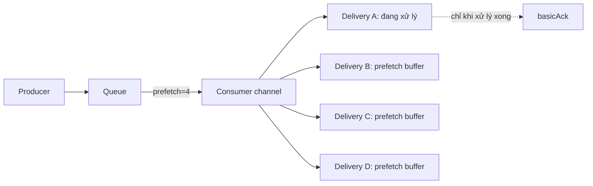
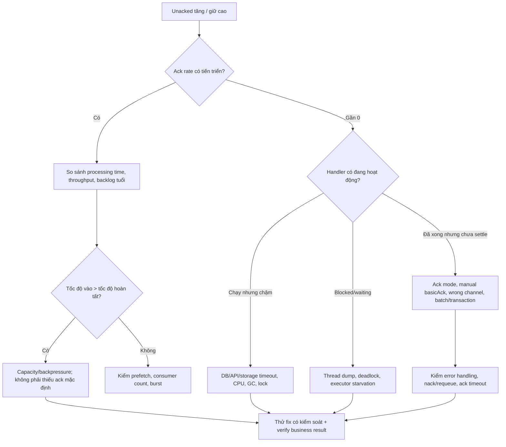
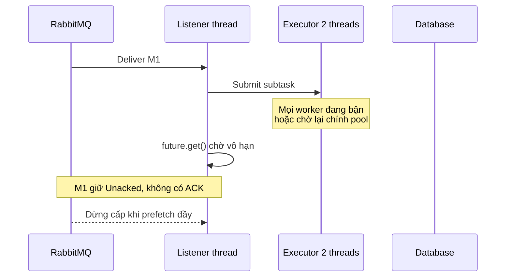

# Unacked tăng liên tục do xử lý chậm, kẹt luồng hoặc thiếu ack

## 1. Hiểu sự cố trước khi chỉnh cấu hình

Trong chương **Chẩn đoán sự cố** của **SPRING_AMQP**, ta đã có producer gửi qua `RabbitTemplate`, consumer nhận bằng `@RabbitListener`, các exchange–queue–binding định tuyến message, còn ack/retry/dead-letter bảo vệ việc xử lý. Một sự cố phổ biến khi vận hành RabbitMQ là thấy cột **Unacked** tăng và nghĩ rằng queue “đã bị hỏng”.

Ví dụ queue `orders.payments.q` có ba consumer, application đang nhận message, nhưng sau 10 phút:

```text
12:00   Ready=   20   Unacked=  30   Consumers=3
12:03   Ready=  300   Unacked= 150   Consumers=3
12:06   Ready= 1200   Unacked= 300   Consumers=3
12:09   Ready= 2800   Unacked= 300   Consumers=3
```

Ở đây, **Unacked đạt mức gần như cố định** trong khi **Ready tiếp tục tăng**. Nếu mỗi consumer có `prefetch=100`, giới hạn xấp xỉ `3 × 100 = 300` delivery chưa được ack giải thích vì sao broker ngừng cấp thêm message. Nguyên nhân gốc có thể là tác vụ quá chậm, các consumer bị kẹt hoặc code không ack.

Đừng lập tức purge queue, restart mọi pod hoặc tăng prefetch lên hàng nghìn. Những thao tác này có thể xóa dữ liệu, làm message bị giao lại và tạo side effect trùng, hoặc chỉ chuyển backlog từ broker sang bộ nhớ JVM.

**Mục tiêu:** đọc đúng chỉ số, khoanh vùng tác nhân đang giữ delivery, chứng minh vì sao ack không tiến triển, sửa an toàn và xác nhận cả luồng nghiệp vụ phục hồi.

Sau bài học, bạn sẽ có thể:

1. Phân biệt `Ready`, `Unacked`, `Total`, delivery rate và ack rate.
2. Sử dụng RabbitMQ Management UI, `rabbitmqctl`, HTTP API và Spring/Micrometer metrics để tìm queue, channel, consumer có vấn đề.
3. Tách ba nhóm nguyên nhân: **xử lý chậm**, **kẹt luồng/deadlock**, **thiếu hoặc sai acknowledgement**.
4. Hiểu `AcknowledgeMode.AUTO`, `MANUAL`, `NONE` và tương tác với prefetch, batch, transaction và async listener.
5. Phân biệt xử lý tạm thời, retry có giới hạn, dead-letter và khôi phục connection/channel.
6. Viết test tái hiện sự cố và runbook khắc phục không làm mất message.

## 2. RabbitMQ tính Unacked như thế nào?

RabbitMQ AMQP 0.9.1 theo dõi các message đã **deliver đến consumer** ở chế độ cần acknowledgement nhưng **chưa nhận ack/nack/reject giải phóng delivery** trên channel. Các message đó vẫn chưa quay lại trạng thái sẵn sàng giao cho consumer khác.

| Chỉ số queue | Ý nghĩa | Diễn giải |
|---|---|---|
| `messages_ready` | Message đang đợi được deliver | Có thể tăng khi không có consumer hoặc consumer hết credit |
| `messages_unacknowledged` | Message đã deliver nhưng chưa được consumer xác nhận | Có thể đang xử lý, nằm trong prefetch buffer, đang kẹt hoặc code quên ack |
| `messages` | `Ready + Unacked` tại snapshot queue | Tổng lượng message đang chờ/đang giao, không phải tổng số sự kiện lịch sử |
| `consumers` | Số consumer đang subscribe vào queue | Không chứng minh handler đang tiến triển |
| `deliver/get rate` | Delivery mới tới client trong một khoảng thời gian | Cần đối chiếu với `ack rate` |
| `ack rate` | Tốc độ broker nhận acknowledgements | Gần 0 trong khi Unacked cao là tín hiệu cần điều tra |
| `redeliver rate` | Message được giao lại | Có thể do mất connection, nack/requeue, ack timeout |

Một cách diễn giải sơ bộ trong khoảng đo:

```text
Unacked(t + Δt) ≈ Unacked(t)
               + deliveries_cần_ack
               - deliveries_đã_settle
               ± các thay đổi do channel/connection đóng, requeue
```

Đây **không phải** công thức dùng thay broker metrics; các giá trị được lấy mẫu tại thời điểm khác nhau, có batch ack, requeue và reconnect. Dù vậy, nó giúp hiểu tại sao delivery rate cao mà ack rate thấp sẽ làm lượng in-flight tăng.

### 2.1. Unacked cao không mặc định là lỗi

Với 10 consumer, mỗi consumer xử lý 100 message/giây và prefetch 200, có thể thường xuyên thấy hàng trăm message unacked dù ack rate vẫn cao và độ trễ nghiệp vụ đạt SLO. Ngược lại, **Unacked=1 kéo dài 40 phút** trên queue chứa một job quan trọng cũng là sự cố, dù con số nhỏ.

Hãy đánh giá theo **thời gian ở trạng thái unacked**, tốc độ ack, độ tuổi công việc, tác dụng phụ nghiệp vụ và tải thực tế, không chỉ một số đếm ở dashboard.

### 2.2. Unacked khác “message đang chạy trong method”

Với prefetch lớn, một consumer nhận trước nhiều delivery nhưng chỉ thực sự chạy handler cho một hoặc vài delivery. Phần còn lại có thể đang nằm trong bộ đệm client/container, **đã tính là Unacked**. Vì vậy `Unacked=250` không có nghĩa ứng dụng đang chạy 250 tác vụ Java đồng thời.



## 3. Prefetch tạo ngưỡng như thế nào?

`prefetchCount` giới hạn số delivery chưa ack mà RabbitMQ cho phép outstanding theo phạm vi QoS của consumer/channel. Với cấu hình thông dụng, có thể ước lượng mức trần trên một queue là:

```text
unacked_capacity ≈ active_consumers × prefetch_per_consumer
```

Ví dụ `concurrency=4`, `prefetch=50`: mức Unacked khoảng `4 × 50 = 200` khi tất cả consumer nhận đầy. Đây là **ước lượng vận hành**, không phải bất biến tuyệt đối: shared channel, global QoS, quorum queue, thay đổi prefetch khi đang có delivery, nhiều queue/container và recovery có thể làm quan sát khác đi.

| Hiện tượng | Diễn giải có khả năng |
|---|---|
| Unacked tăng rồi ổn định gần `consumers × prefetch` | Consumer đã sử dụng hết credit; xử lý/ack chậm hoặc bị chặn |
| Unacked thấp, Ready rất cao, Consumers=0 | Không có consumer hoặc listener chưa subscribe |
| Unacked cao, Ready=0, ack rate cao | Có thể chỉ đang tận dụng pipeline/prefetch bình thường |
| Unacked cao, ack rate gần 0, handler duration tăng | Tác vụ kẹt, quá chậm hoặc quên ack |
| Unacked giảm đột ngột, Ready/redeliver tăng | Channel/connection đóng, broker requeue delivery chưa ack |
| Unacked tăng không thấy plateau | Kiểm số consumer tăng, prefetch lớn/không giới hạn, QoS, đo sai phạm vi queue |

**Lưu ý:** `prefetch=0` trong AMQP 0.9.1 có ý nghĩa **không giới hạn theo QoS**, không phải “không prefetch”. Tùy queue type, broker vẫn có thể áp thêm giới hạn riêng. Khi nghi ngờ, xem **prefetch thực được broker báo trên consumer**, không chỉ thuộc tính được khai báo trong YAML.

### 3.1. Đừng chữa bằng cách tăng prefetch ngay

Nếu mỗi job mất 30 giây và chỉ một handler xử lý tuần tự, tăng prefetch từ 20 lên 500 **không giúp job hoàn tất nhanh hơn**. Nó chỉ chuyển nhiều message từ `Ready` sang `Unacked`, có thể làm JVM giữ nhiều payload trong memory và làm phân phối lệch về consumer chậm.

Giảm prefetch xuống 1–10 có thể phù hợp với **job nặng, kích thước lớn hoặc thời gian chạy không đều**; nhưng với message rất nhỏ và handler nhanh, prefetch quá thấp có thể giảm throughput. Hãy đo trước và sau thay đổi.

## 4. Chẩn đoán theo một thứ tự có bằng chứng

Khi Unacked tăng, dùng **tín hiệu cùng khoảng thời gian** để phân biệt broker, Spring AMQP và dependency:



**Không suy nguyên nhân từ một snapshot**. Thu thập ít nhất vài mẫu liên tiếp (ví dụ mỗi 30 giây trong 3–5 phút) và đặt chúng cạnh CPU, heap/GC, thread pool, DB pool và log listener. Các khoảng thời gian chỉ mang tính minh họa; với job rất ngắn hoặc incident cấp bách phải lấy mẫu nhanh hơn.

## 5. Quan sát bằng RabbitMQ Management UI, CLI và HTTP API

### 5.1. Trong Management UI

Vào queue cụ thể, kiểm:

1. `Ready / Unacked / Total` và xu hướng trong cùng cửa sổ thời gian.
2. Publish, deliver/get, ack và redeliver rate.
3. Consumer count, consumer tag, trạng thái connection/channel và prefetch.
4. Queue type (classic/quorum), redelivery, DLQ, disk/memory alarms nếu có.
5. Messages unacked ở **channel nào**, trên node/connection nào.

Nếu queue có hàng nghìn unacked, **đừng dùng “Get messages” trên queue production để thử**: thao tác này là một consumer thao tác thật, có thể lấy/chuyển trạng thái message, nhất là khi chọn requeue sai. Đừng purge/delete queue để “reset số”.

### 5.2. Lệnh rabbitmqctl dùng để điều tra

Các lệnh sau chạy **ở node RabbitMQ** hoặc môi trường có CLI và quyền phù hợp; chúng là **read-only**, không thay đổi message:

```bash
# Tổng quan các queue trong vhost "/":
rabbitmqctl list_queues -p / \
  name messages_ready messages_unacknowledged consumers

# Xem số unacked theo channel/connection:
rabbitmqctl list_channels \
  connection number user consumer_count messages_unacknowledged prefetch_count

# Xem consumer tag và prefetch của từng subscription:
rabbitmqctl list_consumers -p /
```

Với vhost không phải `/`, thay đúng tên vhost sau `-p` và kiểm quyền. Các trường được CLI hỗ trợ có thể thay đổi theo phiên bản RabbitMQ; xác nhận bằng `rabbitmqctl help list_queues`, `help list_channels` hoặc tài liệu tương ứng.

Ví dụ giả lập kết quả để suy luận:

```text
Queue                Ready   Unacked  Consumers
orders.payments.q     1600       300          3

Channel              Unacked  Prefetch
worker-a/channel-1       100       100
worker-b/channel-1       100       100
worker-c/channel-1       100       100
```

Điều này cho thấy mỗi channel đang giữ hết credit. Nó **không cho biết** đang kẹt ở SQL, chờ API ngoài hay thiếu `basicAck`; cần tiếp tục sang logs/threads phía ứng dụng.

### 5.3. HTTP API và Prometheus

Management HTTP API cung cấp `GET /api/queues/{vhost}/{qname}`, trong đó vhost `/` thường phải URL-encode thành `%2F`. Trường thường dùng: `messages_ready`, `messages_unacknowledged`, `consumers`, `message_stats.deliver_get_details.rate` và `message_stats.ack_details.rate` (nếu API trả được dữ liệu rate ở phiên bản/cấu hình hiện tại).

RabbitMQ Prometheus plugin cung cấp metric queue như `rabbitmq_detailed_queue_messages_unacked` ở nhóm detailed queue metrics khi kích hoạt endpoint/nhóm phù hợp. Một số môi trường mặc định chỉ lấy aggregate metrics; nếu thiếu metric chi tiết, cần bật đúng nhóm/endpoint và cân nhắc chi phí cardinality/scrape.

Khi dashboard cho thấy Unacked cao, hãy **gắn cùng biểu đồ**:

- Ready, Unacked, ack rate, delivery rate, redelivery rate;
- active consumers, prefetch, channel closes và connection resets;
- thời gian xử lý của `@RabbitListener` p50/p95/p99;
- mức sử dụng thread pool, DB connection pool, CPU, heap và GC pause;
- tuổi message, retry/DLQ rate và **tỷ lệ hoàn tất nghiệp vụ**.

## 6. Nguyên nhân A: xử lý nghiệp vụ quá chậm

Một listener đồng bộ đang làm tác vụ nặng:

```java
import org.springframework.amqp.rabbit.annotation.RabbitListener;
import org.springframework.stereotype.Component;

@Component
public class PaymentConsumer {
    private final PaymentService service;

    public PaymentConsumer(PaymentService service) {
        this.service = service;
    }

    @RabbitListener(id = "paymentConsumer", queues = "orders.payments.q")
    public void onMessage(String message) {
        // AUTO ack: chỉ ack khi method kết thúc bình thường.
        service.applyOnce(message);
    }
}

interface PaymentService {
    void applyOnce(String message);
}
```

Nếu `service.applyOnce` mất 15 giây vì gọi HTTP không có timeout, Unacked sẽ chiếm credit trong suốt thời gian đó. Ngay cả khi business logic đúng, tốc độ arrival lớn hơn tốc độ completion sẽ tạo backlog.

### 6.1. Phân tích từ số liệu

Giả sử mỗi worker xử lý tuần tự một job trung bình 10 giây:

```text
1 worker ≈ 0,1 job/giây
5 workers ≈ 0,5 job/giây (lý tưởng, nếu không tranh tài nguyên)
Producer gửi 3 job/giây → backlog tăng ≈ 2,5 job/giây
```

Nếu tăng 5 lên 20 workers nhưng DB pool chỉ có 8 connection, hiệu năng có thể không tăng tuyến tính. Nhiều worker đứng chờ pool làm Unacked nhiều hơn; một số job mất quá lâu và có thể trúng consumer acknowledgement timeout.

### 6.2. Cần đo chính xác từng bước của handler

Thay vì chỉ đo tổng method:

| Giai đoạn | Điều cần đo | Dấu hiệu |
|---|---|---|
| Deserialize/validate | Payload size, thời gian parse, lỗi schema | CPU cao hoặc poison message |
| Chờ connection pool | Hikari active/idle/pending/timeouts | DB pool cạn, transaction giữ connection |
| SQL transaction | Slow query, lock wait, commit time | Lock contention, deadlock, index thiếu |
| HTTP/gRPC bên ngoài | Latency, timeout, retry, status | Dependency chậm, không đặt deadline |
| Object storage | Throughput, upload latency, throttling | Payload quá lớn hoặc bandwidth thấp |
| Ack/settlement | Ack rate và channel errors | Method xong nhưng ack không đi được |

Khắc phục theo bottleneck: tối ưu query/index, giới hạn HTTP timeouts, giảm synchronous fanout, tách job dài, sử dụng bulkhead/circuit breaker, cân bằng concurrency với DB pool. **Không** chỉ tăng `prefetch` để che việc service không đủ công suất.

## 7. Nguyên nhân B: thread bị BLOCKED, WAITING hoặc deadlock

Một consumer có thể nhận message, giữ unacked nhưng handler không tiến triển vì:

- Đợi `synchronized` lock, `ReentrantLock` hoặc transaction/row lock;
- Đợi `CompletableFuture.join()`, `Future.get()` không có timeout;
- Thread pool starvation: handler submit task vào chính executor đã hết worker rồi chờ task hoàn tất;
- Chờ kết quả request–reply hoặc external HTTP không có deadline;
- GC pause dài, CPU throttling, memory pressure hoặc native I/O blocking;
- Handler bị deadlock khi hai transaction lấy lock theo thứ tự ngược nhau.



**Cảnh báo về sơ đồ:** Chuỗi ở trên minh họa thread bị đợi; điều kiện starvation thực tế phụ thuộc vào executor, queue và số worker.

### 7.1. Tìm bằng thread dump và metrics

Trong môi trường staging hoặc pod có quyền thao tác JVM:

```bash
# Liệt kê Java process để xác định đúng PID trong container:
jcmd -l

# Chụp thread dump process Java cụ thể (thay <JAVA_PID>):
jcmd <JAVA_PID> Thread.print -l
```

Thực tế container có thể không có `jcmd`/JDK tools. Khi đó dùng cơ chế thread dump/JFR/Actuator dành cho vận hành đã phân quyền hoặc debug image tương thích. Không tự cài debug tool vào pod production khi chưa có phê duyệt.

Trong dump, tìm listener thread theo tên executor và stack trace:

| Thread state/stack | Gợi ý | Bước tiếp theo |
|---|---|---|
| `BLOCKED` tại lock ứng dụng | Contention hoặc deadlock | Xem lock owner, thứ tự lock, độ dài critical section |
| `WAITING` ở `CompletableFuture.get()/join()` | Wait không timeout hoặc executor starvation | Kiểm thread pool, completion callback, timeout |
| `WAITING/TIMED_WAITING` ở pool/HTTP | I/O/connection pool dependency | So khớp pool saturation, request latency và deadline |
| `RUNNABLE` liên tục với CPU cao | Loop, serialization, thuật toán nặng | CPU profile/JFR, payload size |
| Worker không xuất hiện hoặc container stopped | Listener lifecycle/connection | Kiểm consumer tag, `RabbitListenerEndpointRegistry`, recovery |

Một thread ở `WAITING` **không luôn là lỗi**: thread nhàn rỗi hợp lệ cũng waiting. Phải đối chiếu với stack, số message unacked do consumer đó giữ và **không có completion theo thời gian**. Lấy nhiều thread dump cách nhau để xem stack có tiến triển, thay vì kết luận từ một snapshot.

### 7.2. Ví dụ anti-pattern gây starvation

```java
// KHÔNG NÊN: đợi tác vụ con trên executor có thể đang bị chiếm hết.
public void process(String message) {
    CompletableFuture<Void> future =
            CompletableFuture.runAsync(() -> saveToDatabase(message),
                    boundedExecutor);
    future.join(); // Có thể treo nếu boundedExecutor bão hòa.
}
```

Nếu handler vẫn phải chờ, cần executor đủ năng lực, timeout/budget và chính sách từ chối/backpressure. Nếu thiết kế bất đồng bộ thực sự, dùng API listener async được framework hỗ trợ và đảm bảo acknowledgement xảy ra theo **thời điểm future hoàn thành**, không phải khi vừa submit việc.

## 8. Nguyên nhân C: thiếu ACK hoặc ACK sai cách

Spring AMQP có ba `AcknowledgeMode` thường gặp. Đừng nhầm tên Spring `AUTO` với automatic acknowledgement của RabbitMQ.

| Chế độ Spring | Broker chờ ack? | Ai ack? | Hậu quả nếu sai |
|---|---|---|---|
| `AUTO` (**mặc định**) | Có | Container sau listener trả thành công; lỗi đi qua chính sách exception/requeue | Handler chậm/kẹt giữ Unacked; không cần gọi `basicAck` thủ công |
| `MANUAL` | Có | Ứng dụng phải `basicAck`, `basicNack` hoặc `basicReject` đúng delivery trên channel nhận | Quên settle khiến Unacked giữ đến khi channel đóng hoặc timeout |
| `NONE` | Không, broker coi đã giao là xong | Không có ack từ listener | Unacked thường không là chỉ số của delivery này; lỗi xử lý có nguy cơ mất message |

**Không “sửa Unacked” bằng cách chuyển sang `NONE`** cho công việc quan trọng. Việc broker không còn giữ message unacked lúc đó chỉ chuyển rủi ro thành **mất công việc khi consumer chết**.

### 8.1. Cấu hình Spring Boot và các thuộc tính liên quan

Ví dụ `application.yml` cho `SimpleRabbitListenerContainerFactory` mặc định của Spring Boot có `spring-rabbit`:

```yaml
spring:
  rabbitmq:
    listener:
      simple:
        acknowledge-mode: auto
        concurrency: 3
        max-concurrency: 3
        prefetch: 10
        default-requeue-rejected: false
```

Với cấu hình này, ba consumer có tổng mức in-flight khoảng 30 delivery trong điều kiện thường. `default-requeue-rejected=false` không phải cách xóa lỗi: cần DLX/DLQ hoặc recoverer đúng để tránh mất message khi handler thất bại. Một listener dùng `containerFactory` riêng sẽ **không chắc kế thừa** tất cả property ở `spring.rabbitmq.listener.simple.*`; kiểm cấu hình factory thực và consumer prefetch trên broker.

### 8.2. Mẫu an toàn nhất khi xử lý đồng bộ: để container AUTO ack

```java
import org.springframework.amqp.AmqpRejectAndDontRequeueException;
import org.springframework.amqp.rabbit.annotation.RabbitListener;
import org.springframework.stereotype.Component;

@Component
public class InvoiceWorker {
    private final InvoiceApplicationService service;

    public InvoiceWorker(InvoiceApplicationService service) {
        this.service = service;
    }

    @RabbitListener(queues = "invoices.jobs.q")
    public void onMessage(String raw) {
        try {
            service.processOnce(raw); // Transaction/idempotency ở service.
            // Trả về bình thường: container AUTO ack.
        } catch (BadInvoicePayloadException invalid) {
            // Với DLX, reject(no requeue) có thể chuyển sang DLQ.
            throw new AmqpRejectAndDontRequeueException("BAD_INVOICE_PAYLOAD");
        }
        // Không bắt mọi Throwable rồi return: sẽ ACK nhầm message lỗi.
    }
}

interface InvoiceApplicationService {
    void processOnce(String raw);
}

class BadInvoicePayloadException extends RuntimeException {}
```

Nếu `service.processOnce` ném lỗi tạm thời, container xử lý theo retry/recoverer/error handler đã cấu hình; không mặc định mọi lỗi sẽ vào DLQ hay được retry đúng budget. Đối với DB transaction, phải bảo đảm commit hoàn tất **trước khi listener trả về thành công**, vì ack của broker không commit chung nguyên tử với database.

### 8.3. Mẫu MANUAL acknowledgement đúng delivery tag

Trong những trường hợp cần manual ack, `Channel` và `deliveryTag` được cung cấp trong listener:

```java
import com.rabbitmq.client.Channel;
import java.io.IOException;
import org.springframework.amqp.rabbit.annotation.RabbitListener;
import org.springframework.messaging.handler.annotation.Header;
import org.springframework.amqp.support.AmqpHeaders;
import org.springframework.stereotype.Component;

@Component
public class ManualInvoiceWorker {
    private final InvoiceApplicationService service;

    public ManualInvoiceWorker(InvoiceApplicationService service) {
        this.service = service;
    }

    @RabbitListener(
            id = "manualInvoiceWorker",
            queues = "invoices.manual.q",
            ackMode = "MANUAL")
    public void onMessage(String raw, Channel channel,
            @Header(AmqpHeaders.DELIVERY_TAG) long tag) throws IOException {
        try {
            service.processOnce(raw); // Chỉ return sau commit.
            channel.basicAck(tag, false); // Chỉ ACK delivery hiện tại.
        } catch (BadInvoicePayloadException permanent) {
            channel.basicReject(tag, false); // DLQ nếu đã có DLX.
        } catch (TemporaryInvoiceException transientFailure) {
            // Mẫu tối giản: reject sang DLQ/quarantine, KHÔNG hot requeue.
            // Retry trì hoãn phải nằm trong pipeline riêng có giới hạn.
            channel.basicNack(tag, false, false);
        }
    }
}

class TemporaryInvoiceException extends RuntimeException {}
```

Đây là **phương án thay thế** cho listener `AUTO` và dùng queue riêng trong ví dụ; đừng tạo cả hai listener cạnh tranh trên cùng queue khi học. Trong thực tế cần xác nhận queue có DLX, thiết kế retry giới hạn, tracing/metrics và không đưa nguyên exception chứa payload/PII vào log.

Điều kiện sống còn của `MANUAL`:

- Mỗi delivery phải được settle **một lần**: ack, nack hoặc reject phù hợp.
- Gửi ack bằng **chính Channel đã nhận delivery tag**. Delivery tag chỉ có ý nghĩa trong channel đó.
- `basicAck(tag, false)` là ack một delivery; `multiple=true` có thể ack **tất cả delivery tag trước đó còn outstanding** trên cùng channel — nguy hiểm nếu có xử lý song song.
- Đừng gọi ack hai lần hoặc ack tag không tồn tại: RabbitMQ có thể đóng channel với `PRECONDITION_FAILED - unknown delivery tag`.
- Khi `basicAck` bị `IOException`, không được mặc định chắc broker chưa nhận ack. Dùng idempotency vì message có thể redeliver.
- Nếu method ném exception **trước khi vào try/catch**, hoặc code chỉ log rồi return mà không ack, delivery có thể tiếp tục ở trạng thái unacked. Phải kiểm cả converter/error handler và mọi nhánh điều khiển.

### 8.4. Mẫu dễ gây leak: return sớm

```java
@RabbitListener(queues = "invoices.manual.q", ackMode = "MANUAL")
public void bad(String raw, Channel channel,
        @Header(AmqpHeaders.DELIVERY_TAG) long tag) throws IOException {

    if (raw.isBlank()) {
        return; // BUG: Không ACK/NACK/REJECT.
    }

    service.processOnce(raw);
    channel.basicAck(tag, false);
}
```

Khi có nhiều message lỗi `raw.isBlank()`, Unacked sẽ tăng đến ngưỡng prefetch; Ready có thể tăng tiếp. Đây là trường hợp **thiếu ack thật**, khác với handler đang chạy chậm.

## 9. Một số bẫy Spring AMQP: async, batch và transaction

### 9.1. Listener tạo task async rồi return quá sớm

```java
@RabbitListener(queues = "invoices.jobs.q")
public void brokenAsync(String raw) {
    executor.submit(() -> service.processOnce(raw));
    // AUTO ack khi method này return, KHÔNG đợi task con.
}
```

Đây **không gây Unacked cao** mà là lỗi ngược lại: message **được ack quá sớm**, khi nghiệp vụ chưa hoàn tất. Đừng “chữa” Unacked bằng kiểu offload này vì có thể mất dữ liệu nếu executor/process chết sau ack.

Spring AMQP có hỗ trợ `@RabbitListener` trả `CompletableFuture<?>`/`Mono<?>` với semantics async acknowledgement. Với phiên bản hỗ trợ, container phải dùng `AcknowledgeMode.MANUAL` (Spring AMQP có thể tự điều chỉnh khi phát hiện async return type), và settlement phải gắn với **completion**, kể cả exceptional completion. Đọc tài liệu của phiên bản đang dùng; không giả định một method trả future bất kỳ luôn có cùng behavior.

### 9.2. Batch và ACK trễ theo thiết kế

Spring AMQP `SimpleMessageListenerContainer` có `batchSize`, `consumerBatchEnabled`; `DirectMessageListenerContainer` có `messagesPerAck` và `ackTimeout`. Trong một số cấu hình, container **trì hoãn gửi ack** để xử lý theo batch hoặc giảm overhead mạng.

Vì vậy, quan sát ack rate thành những **đợt** không nhất thiết có nghĩa thiếu ack. Kiểm:

1. Loại listener container: SMLC hay DMLC.
2. `batchSize` / `messagesPerAck` / `ackTimeout` / `receiveTimeout` thực tế.
3. Transaction `channelTransacted` và thời điểm `tx.commit`.
4. Prefetch có thể được nâng tự động nếu batch size hoặc messages-per-ack lớn hơn prefetch.

Không sửa code manual ack nếu vấn đề thực sự là cấu hình batch đã chọn. Đánh giá latency budget và tác động khi crash giữa hai đợt ack.

### 9.3. Database commit và broker ack không có giao dịch nguyên tử mặc định

Một handler có thể commit DB rồi timeout trước ack; RabbitMQ redeliver, message được xử lý lại. Dù số Unacked giảm sau reconnect, đó **không phải bằng chứng business đúng**. Cần một `eventId`/`operationId` bền, unique constraint và logic idempotent.

## 10. Delivery acknowledgement timeout theo phiên bản RabbitMQ

RabbitMQ có cơ chế **consumer delivery acknowledgement timeout** nhằm tránh một delivery bị giữ quá lâu. Không nên tự khẳng định behavior giống nhau ở mọi phiên bản:

| Broker | Cần lưu ý |
|---|---|
| RabbitMQ **3.13 / 4.0 / 4.1** | Delivery ack timeout theo cấu hình có thể đóng channel với `PRECONDITION_FAILED` khi delivery quá hạn; các delivery chưa ack trên channel đó có thể bị requeue |
| RabbitMQ **4.3+** | Tài liệu hiện hành nêu delivery acknowledgement timeouts **chỉ hỗ trợ quorum queues**; với AMQP 0.9.1 broker có thể cancel consumer nếu client hỗ trợ consumer-cancel notification, nếu không sẽ đóng channel |
| Mọi phiên bản | Kiểm loại queue, chính sách `consumer_timeout`, log broker và phiên bản trước khi suy ra nguyên nhân |

Giá trị mặc định thường được tài liệu mô tả là **30 phút**, nhưng kiểm cấu hình thực của cluster. Với RabbitMQ 4.3+ khi dùng quorum queue, queue hoặc consumer có thể có timeout riêng theo tính năng được broker hỗ trợ. Đừng tăng vô hạn chỉ để che handler treo: thời gian giữ unacked quá lâu ảnh hưởng đến recovery và lưu trữ.

Ví dụ dấu hiệu trong broker log:

```text
PRECONDITION_FAILED - delivery acknowledgement on channel ... timed out
```

Khi thấy `PRECONDITION_FAILED`, cần phân biệt **delivery acknowledgement timeout** với **unknown delivery tag** do double ack hoặc ack trên sai channel; cùng thuộc channel exception nhưng nguyên nhân và cách sửa khác nhau.

### 10.1. Khi nào nên tăng timeout?

Chỉ cân nhắc khi job **hợp lệ** có thời gian chạy tối đa đã đo vượt timeout, đã có heartbeat/progress monitoring, memory budget, concurrency và chính sách retry. Với công việc kéo dài nhiều giờ, hãy cân nhắc **chia tác vụ thành bước nhỏ và checkpoint bền**, thay vì giữ một delivery chưa ack rất lâu.

## 11. Khôi phục an toàn: xử lý theo từng nhóm nguyên nhân

| Nhóm nguyên nhân | Biện pháp ưu tiên | Điều tuyệt đối tránh |
|---|---|---|
| Handler quá chậm | Timeouts cho DB/HTTP; tối ưu query; giảm payload; tune pool và concurrency có đo lường | Tăng prefetch vô hạn |
| Thread deadlock/starvation | Thread dump, xác định lock/executor, sửa chu kỳ chờ hoặc thiếu worker | Restart vô thức mà không giữ bằng chứng |
| MANUAL thiếu ack ở một nhánh | Đảm bảo settle mọi đường đi; kiểm tag/channel; integration test | Chuyển sang `NONE` để Unacked biến mất |
| Ack sai channel/double ack | Gắn ack với Channel của delivery, chỉ ack một lần | Gửi lại basicAck trên channel mới với tag cũ |
| Batch/transaction trì hoãn ack | Kiểm batchSize/messagesPerAck/tx.commit; điều chỉnh theo latency SLO | Phá batch mà không biết tác động throughput |
| Dependency tạm unavailable | Retry hữu hạn, backoff + jitter, DLQ/outbox | `basicNack(requeue=true)` liên tục gây hot loop |
| Consumer sắp shutdown | Graceful drain, deadline, idempotency, redelivery | Kill hàng loạt ngay giữa DB commit và ack |
| Broker consumer timeout | Kiểm phiên bản/queue type, phát hiện handler treo; timeout đủ cho job hợp lệ | Tăng timeout như cách sửa deadlock |

### 11.1. Có nên restart consumer/pod để “giải phóng Unacked”?

Khi channel/connection đóng, RabbitMQ thường **tự requeue những delivery chưa ack** (AMQP 0.9.1 manual acknowledgement), và message có thể chuyển từ Unacked về Ready rồi redeliver sang worker khác. Điều này không có nghĩa sự cố đã được sửa; nếu worker mới vẫn kẹt ở DB, Unacked sẽ tăng lại.

Nếu cần restart vì process bị deadlock thật:

1. Thu thập snapshot metrics, consumer tag, thread dump/log an toàn.
2. Ngăn nhận thêm công việc mới và tiến hành graceful stop trong thời gian đã đo.
3. Xác minh DB/outbox/idempotency chịu được redelivery và message đang xử lý dở.
4. Restart **có kiểm soát**, tránh restart toàn bộ replica cùng lúc.
5. Theo dõi ack rate, business completion, redeliver/DLQ và backlog sau restart.

Không đóng connection production chỉ để làm đẹp biểu đồ Unacked. Một delivery đã commit DB nhưng chưa ack có thể được giao lại và gây side effect trùng nếu thiếu idempotency.

### 11.2. Có nên purge hoặc delete queue?

**Không.** Purge tác động tới những message **Ready**, không giải quyết nguyên nhân của delivery **Unacked** trên consumer đang hoạt động. Delete queue có thể phá hủy dữ liệu và hợp đồng topology; cũng không chữa deadlock trong ứng dụng.

Chỉ dùng purge/delete trong bài test cô lập với sự chấp thuận và dữ liệu test thuộc sở hữu, không dùng như một lệnh khôi phục Unacked trên queue nghiệp vụ.

## 12. Ví dụ instrument listener để biết nó kẹt ở đâu

Log không nên dump payload, token hay thông tin cá nhân. Dùng `eventId` ngẫu nhiên đã validate, mã giai đoạn, error code và thời gian:

```java
import java.util.concurrent.TimeUnit;
import org.slf4j.Logger;
import org.slf4j.LoggerFactory;
import org.springframework.amqp.rabbit.annotation.RabbitListener;
import org.springframework.stereotype.Component;

@Component
public class TimedPaymentListener {
    private static final Logger log =
            LoggerFactory.getLogger(TimedPaymentListener.class);
    private final TimedPaymentService service;

    public TimedPaymentListener(TimedPaymentService service) {
        this.service = service;
    }

    @RabbitListener(id = "timedPayments", queues = "payments.timed.q")
    public void onMessage(String encoded) {
        long start = System.nanoTime();
        String ref = "internal-correlation"; // Tạo/mapping ID an toàn.
        log.info("event=amqp_handle_start ref={}", ref);
        try {
            service.processOnce(encoded);
            log.info("event=amqp_handle_complete ref={} duration_ms={}",
                    ref, TimeUnit.NANOSECONDS.toMillis(
                            System.nanoTime() - start));
        } catch (RuntimeException ex) {
            log.warn("event=amqp_handle_failed ref={} error_code={} duration_ms={}",
                    ref, "PROCESSING_FAILED",
                    TimeUnit.NANOSECONDS.toMillis(
                            System.nanoTime() - start));
            throw ex; // Để container xử lý lỗi theo retry/DLQ.
        }
    }
}

interface TimedPaymentService {
    void processOnce(String encoded);
}
```

Code này minh họa một listener đo latency, không cung cấp sẵn correlation ID thật. Trong ứng dụng thực, **không tự log message.getMessageId() từ người gửi không tin cậy** mà không validate; ID có thể chứa PII/token. Instrument thời gian DB, HTTP, external storage ở các service phụ trợ, và dùng histogram thay vì đưa ID vào metric tags gây cardinality lớn.

### 12.1. Kết hợp log và RabbitMQ

| Bằng chứng | Nếu là xử lý chậm | Nếu là kẹt thread | Nếu là thiếu MANUAL ack |
|---|---|---|---|
| Start/complete logs | Complete xuất hiện nhưng cách xa start | Start có, complete không tới | Complete có thể xuất hiện đầy đủ |
| Thread dump | Đang làm CPU/DB/HTTP có tiến triển | Stack chờ lock/future giống nhau nhiều lần | Listener có thể đã trở về idle |
| Ack rate | Thấp nhưng còn nhích theo completion | Gần 0, không tiến triển | Gần 0 dù nghiệp vụ xong |
| DB state | Commit chậm | Không commit hoặc đang lock | Có thể đã commit |
| Unacked trend | Tiệm cận prefetch rồi Ready tăng | Tiệm cận prefetch rồi không giảm | Tiệm cận prefetch dù handler nhanh |

Nếu handler complete liên tục nhưng Unacked không giảm, kiểm `MANUAL`, ack exception, sai channel/tag, transaction/ack batching trước khi tăng worker.

## 13. Tái hiện bằng integration test thay vì phỏng đoán

Tạo RabbitMQ riêng với Testcontainers trong môi trường test; **không** cố ý làm kẹt worker production. Cần test chứng minh ba tình huống khác nhau:

### 13.1. Slow listener + prefetch=1

1. Khởi tạo queue test riêng, một listener `AUTO`, `concurrency=1`, `prefetch=1`.
2. Handler nhận message đầu rồi chờ trên `CountDownLatch` (có timeout thử nghiệm).
3. Publish hai message với hai `eventId` khác nhau.
4. Trong lúc handler đầu bị giữ, broker thường báo `Unacked≈1, Ready≈1`.
5. Thả latch, handler kết thúc; chờ cả hai event được xử lý và `Unacked` trở về 0.

```java
import java.util.concurrent.CountDownLatch;
import java.util.concurrent.TimeUnit;
import org.springframework.amqp.rabbit.annotation.RabbitListener;
import org.springframework.stereotype.Component;

@Component
public class SlowListenerFixture {
    final CountDownLatch started = new CountDownLatch(1);
    final CountDownLatch release = new CountDownLatch(1);

    @RabbitListener(
            id = "slowListenerFixture",
            queues = "it.unacked.fixture.q",
            concurrency = "1")
    public void onMessage(String body) throws InterruptedException {
        started.countDown();
        boolean wasReleased = release.await(10, TimeUnit.SECONDS);
        if (!wasReleased) {
            throw new IllegalStateException("TEST_WAIT_TIMEOUT");
        }
        // Return bình thường -> AUTO ack.
    }
}
```

Trong test context, cấu hình `prefetch=1` ở factory dành riêng và bảo đảm tạo queue trước listener startup. Test code phải dùng `try/finally` để release latch dù assertion thất bại, dừng listener và xóa tài nguyên test. `AmqpAdmin.getQueueProperties()` thường chỉ cho số message **ready**, không nhất thiết cho Unacked; đọc Unacked qua RabbitMQ Management/HTTP API hoặc `rabbitmqctl` khi cần kiểm chính xác.

### 13.2. MANUAL listener quên ack

Trên queue test riêng, triển khai listener MANUAL có nhánh `return` không `basicAck`/`basicNack`, phát số message lớn hơn prefetch. Kiểm:

- `Unacked` tiến tới giới hạn in-flight;
- `Ready` tiếp tục tồn đọng;
- ack rate gần 0;
- Sau khi sửa listener để settle **mọi nhánh** và khởi động lại trong test, message được xử lý lại an toàn.

### 13.3. Thread starvation

Trong test/staging, dùng executor nhỏ có tác vụ con phụ thuộc lại chính executor; chụp thread dump và đo không có business completion. Sau khi đổi thiết kế executor/deadline, cùng số message phải hoàn tất trong thời gian giới hạn. Không tạo deadlock vô hạn trong bộ test CI chạy chung — mọi latch/future cần timeout và cleanup.

### 13.4. Các assertion đáng tin cậy

| Sai | Đúng |
|---|---|
| `Thread.sleep(1000)` rồi assert | Dùng Awaitility với deadline cho state/metric mong đợi |
| Chỉ kiểm `listener invoked` | Kiểm DB commit, ack rate/Unacked sau hoàn tất |
| Test bằng queue dùng chung | Queue/exchange/vhost riêng, eventId duy nhất |
| Chỉ kiểm Unacked giảm sau restart | Kiểm business side effect không trùng, retry/DLQ đúng |
| Cố tình purge queue để dọn test | Stop listener, chỉ delete tài nguyên do test tạo |

## 14. Runbook xử lý sự cố đang diễn ra

| Bước | Hành động an toàn | Kết quả cần ghi lại |
|---|---|---|
| **1. Xác nhận queue** | Chọn vhost/queue và khoảng thời gian; so `Ready/Unacked/Total` | Unacked tăng hay chỉ dao động? Ready có tăng? |
| **2. Đo tốc độ** | So deliver, ack, redeliver, oldest age | Ack vẫn tiến triển hay gần 0? |
| **3. Kiểm consumer** | `list_consumers`, count, prefetch, channel unacked | Consumer nào giữ delivery, mức credit |
| **4. Kiểm app** | Handler duration, start/complete, thread dump, DB/HTTP pool | Slow, blocked hay method đã xong? |
| **5. Kiểm ack** | AUTO/MANUAL/NONE, ack trên đúng channel, batch/tx | Thiếu ack, double ack hay ack bị delay? |
| **6. Kiểm broker log** | `PRECONDITION_FAILED`, ack timeout, connection/channel closes | Có vòng reconnect/redelivery hay không? |
| **7. Chọn thay đổi nhỏ** | Fix timeout/lock, retry budget, ack path hoặc prefetch phù hợp | Không gây dữ liệu bị xóa, ghi nhận rollback plan |
| **8. Xác minh** | Canary/idempotency, ack rate, Unacked trend, backlog drain, DLQ | Business completion phục hồi trong SLO |

### 14.1. Một timeline chẩn đoán mẫu

```text
09:00  Publish 100 msg/s, Ack 95 msg/s, Unacked tăng nhẹ
09:05  DB pool pending tăng, Ack giảm còn 20 msg/s
09:07  Unacked chạm ~300 (3 consumer x prefetch 100)
09:08  Ready bắt đầu tăng nhanh, redelivery thấp
09:10  Thread dump: listener đang đợi JDBC connection
09:12  Tìm thấy transaction giữ connection quá lâu
09:20  Tối ưu transaction / giới hạn concurrency
09:25  Ack 130 msg/s > Publish 100 msg/s, Ready bắt đầu giảm
09:30  Business latency và outbox/DLQ được đối soát
```

Đây là **dữ liệu minh họa**, không phải đo đạc thực tế. Kết luận ở đây nghiêng về **xử lý chậm vì cạn DB pool**, không phải quên `basicAck`.

### 14.2. Thế nào là “đã phục hồi”?

Không chỉ là `Unacked=0` — đôi khi nó về 0 vì consumer chết, chẳng còn ai xử lý. Phục hồi nên dựa trên:

1. Active consumer đúng như topology mong đợi.
2. Ack rate và xử lý nghiệp vụ đạt thông lượng/SLO; Ready/backlog age giảm.
3. Unacked ổn định theo prefetch và latency công việc, không giữ job treo quá ngưỡng.
4. Không có `unknown delivery tag`, ack timeout hay channel close lặp lại.
5. Message được redeliver không tạo side effect trùng; DLQ và outbox pending được đối soát.
6. Trạng thái business (DB/artifact/event downstream) phản ánh đúng các `eventId` thử nghiệm.

## 15. Những sai lầm thường gặp

| Sai lầm | Hệ quả | Cách đúng |
|---|---|---|
| Coi Unacked > 0 luôn là lỗi | Báo động giả với pipeline bận nhưng khỏe | Đo ack rate và tuổi xử lý |
| Chỉ nhìn Ready mà bỏ Unacked | Bỏ sót consumer giữ nhiều delivery | Quan sát cả ready/unacked/consumer/prefetch |
| Thấy Unacked cao rồi tăng prefetch | Thêm message vào client buffer, nguy cơ OOM | Tìm bottleneck và đo throughput |
| Đổi `AUTO` thành `NONE` để hết Unacked | Broker coi delivery đã xong sớm, mất job khi crash | Giữ ack sau xử lý bền |
| Dùng `MANUAL` nhưng có nhánh return không ack | Unacked chạm prefetch và queue đứng | Settle đúng một lần trên mọi nhánh |
| Gọi `basicAck(tag,true)` khi có xử lý song song | Ack luôn message khác chưa xong | `multiple=false` và channel ownership |
| Ack bằng channel khác | `PRECONDITION_FAILED - unknown delivery tag` | Ack đúng channel đã nhận |
| Chỉ nhìn `isRunning()` của container | Consumer vẫn có thể kẹt | Xem active consumers, logs, business metrics |
| Kẹt thread thì restart cả cluster ngay | Redelivery/duplicate; mất chứng cứ | Thread dump và restart có kiểm soát |
| Purge queue để xóa Unacked | Mất Ready, không sửa listener | Không purge production để “chữa” Unacked |
| Nack requeue ngay mọi exception | Poison message hot loop | Retry hữu hạn/backoff, DLQ |
| Bỏ qua retry/transaction batch | Ack thành từng đợt bị hiểu là lỗi | Kiểm batchSize/messagesPerAck/tx |
| Tăng consumer timeout vô hạn | Che lock/deadlock, giữ message lâu | Tối ưu job, checkpoint, timeout theo dữ liệu |
| Kết luận “Recovered” khi connection xanh | Business vẫn chậm/DLQ tăng | Đối soát đầu cuối |

## 16. Checklist vận hành

Trước khi đóng incident hoặc đưa bản sửa lên production:

1. Đã xác định đúng `vhost`, queue type, số consumer, prefetch thực tế?
2. Đã chụp trend của `Ready`, `Unacked`, deliver/ack/redeliver rate và message age?
3. Đã so số Unacked với ngưỡng prefetch/consumer và xem nó plateau hay tiếp tục tăng?
4. Có latency histogram từ lúc listener bắt đầu đến khi nghiệp vụ commit?
5. Đã kiểm DB pool, slow SQL/locks, HTTP deadlines, executor queue và heap/GC?
6. Đã chụp thread dump khi consumer kẹt và đối chiếu với queue/channel?
7. Đã xác nhận `AUTO/MANUAL/NONE` đúng cho từng container factory?
8. Nếu MANUAL, mọi nhánh có ack/nack/reject **đúng tag/chính channel/một lần**?
9. Có async listener/future hoặc batch/transaction làm ack bị trì hoãn?
10. Đã kiểm broker logs về consumer ack timeout/unknown delivery tag theo **phiên bản**?
11. Có retry budget, DLX/DLQ, idempotency để chịu redelivery sau reconnect?
12. Đã tránh purge/delete queue production, tránh đổi `NONE` để “làm đẹp metric”?
13. Có staging test tái hiện, fix và regression test cho nguyên nhân đã tìm ra?
14. Có tiêu chí business recovery: completion SLO, backlog age, outbox/DLQ và dữ liệu đúng?

## 17. Câu hỏi và bài tập

1. Queue có `Ready=1200`, `Unacked=300`, ba consumer `prefetch=100`. Điều gì hợp lý nhất để kiểm tra tiếp? Vì sao chưa thể kết luận thiếu ack?
2. Một queue có `Ready=0`, `Unacked=100`, ack rate ổn định 100/s. Đây có chắc là sự cố không?
3. Phân biệt `AcknowledgeMode.AUTO` và `NONE` của Spring AMQP. Chế độ nào tương ứng broker không đòi client ack?
4. Vì sao `prefetch=0` là lựa chọn nguy hiểm nếu handler chậm?
5. Viết một listener `MANUAL` có đủ ba nhánh: thành công, payload lỗi vĩnh viễn, lỗi tạm thời; nêu đường đi DLQ.
6. Vì sao `Channel.basicAck(tag,true)` có thể ack nhầm các delivery khác nếu listener xử lý song song?
7. Listener đã log `completed` và DB đã commit, nhưng Unacked không giảm. Bạn sẽ kiểm gì trước khi thêm consumer?
8. Handler gọi `CompletableFuture.runAsync(...)` rồi return ngay trong AUTO. Vì sao Unacked có thể giảm nhưng vẫn mất dữ liệu?
9. Thread dump có nhiều listener ở `CompletableFuture.join()`, ack rate bằng 0. Hãy thiết kế kế hoạch tìm deadlock/executor starvation.
10. RabbitMQ ghi `PRECONDITION_FAILED` sau 30 phút. Làm sao phân biệt delivery acknowledgement timeout với unknown delivery tag? Những khác biệt về RabbitMQ 4.3+ có ý nghĩa gì?
11. Sau khi kill consumer, Unacked từ 300 xuống 0 và Ready tăng 300. Đây có phải khôi phục thành công? Cần kiểm thêm gì?
12. Thiết kế integration test với `prefetch=1`, một message giữ trong latch và một message pending; trình bày expected Ready/Unacked trước và sau release.
13. Khi retry và DLQ chạy đúng, tại sao vẫn cần idempotency phía database?
14. Thiết kế dashboard đủ để phân biệt ba nhóm lỗi: handler chậm, thread kẹt và thiếu manual ack.

## 18. Tài liệu tham khảo

- [RabbitMQ — Consumer Acknowledgements and Publisher Confirms](https://www.rabbitmq.com/docs/confirms): `basicAck/basicNack/basicReject`, delivery tags, prefetch, automatic requeue khi channel đóng.
- [RabbitMQ — Consumers](https://www.rabbitmq.com/docs/consumers): acknowledgement modes, consumer capacity và delivery acknowledgement timeout theo phiên bản.
- [RabbitMQ — Monitoring](https://www.rabbitmq.com/docs/monitoring): `messages_ready`, `messages_unacknowledged`, deliver/ack stats và HTTP API.
- [RabbitMQ — rabbitmqctl Manual](https://www.rabbitmq.com/docs/man/rabbitmqctl.8): `list_queues`, `list_channels` và `list_consumers`.
- [RabbitMQ — Prometheus Plugin](https://www.rabbitmq.com/docs/prometheus): queue-level metrics về ready/unacked/acked/redelivered.
- [Spring AMQP — Message Listener Container Configuration](https://docs.spring.io/spring-amqp/reference/amqp/containerAttributes.html): `AcknowledgeMode`, `prefetchCount`, batching, transaction và shutdown.
- [Spring AMQP — Asynchronous Consumer](https://docs.spring.io/spring-amqp/reference/amqp/receiving-messages/async-consumer.html): prefetch và hoạt động `@RabbitListener`.
- [Spring AMQP — Asynchronous @RabbitListener Return Types](https://docs.spring.io/spring-amqp/reference/amqp/receiving-messages/async-returns.html): `CompletableFuture`/`Mono` và manual acknowledgement khi hoàn thành async.
- [Spring AMQP — Handling Exceptions](https://docs.spring.io/spring-amqp/reference/amqp/receiving-messages/async-annotation-driven/error-handling.html): đường lỗi listener, conversion, nack/requeue.

**Ghi nhớ:** `Unacked` là **delivery đã được giao nhưng broker chưa nhận xác nhận**, không phải số job “đang thực thi song song”. Khi nó tăng, hãy xác định **ack rate, prefetch/consumer, thời gian handler và thread state**, rồi mới quyết định sửa bottleneck hay logic ACK. Trong Spring AMQP, `AUTO` ack khi listener thành công; `MANUAL` đòi settle đúng delivery trên đúng channel; `NONE` không thay thế độ tin cậy. Khôi phục an toàn cần retry có kiểm soát, idempotency và bằng chứng **business completion**, không phải chỉ làm chỉ số Unacked trở về 0.
