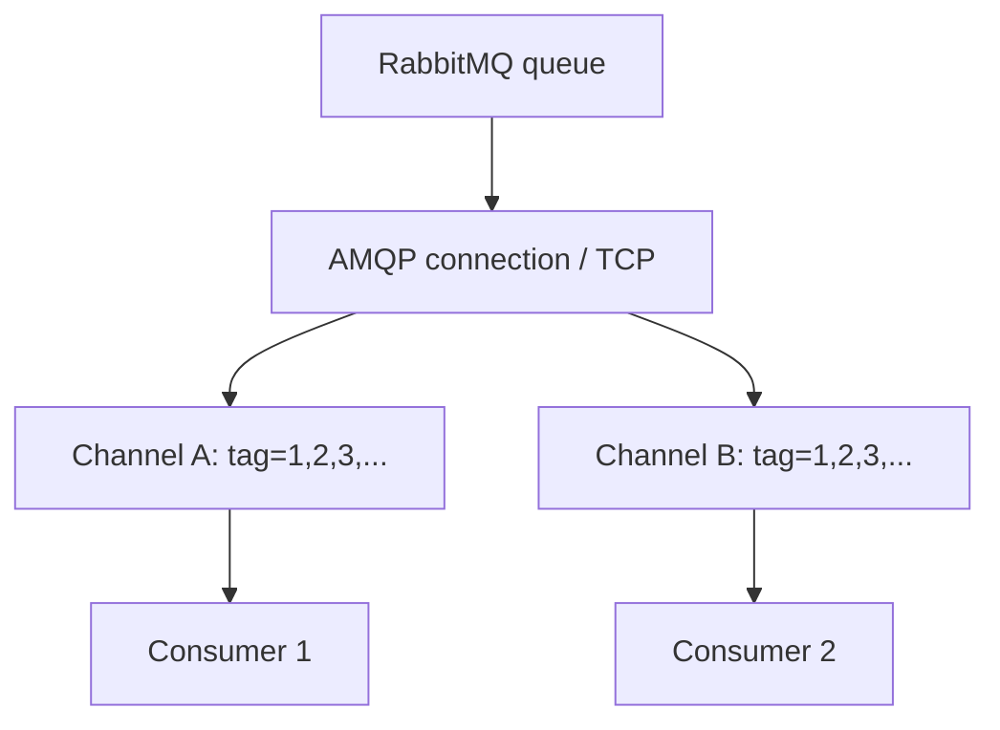
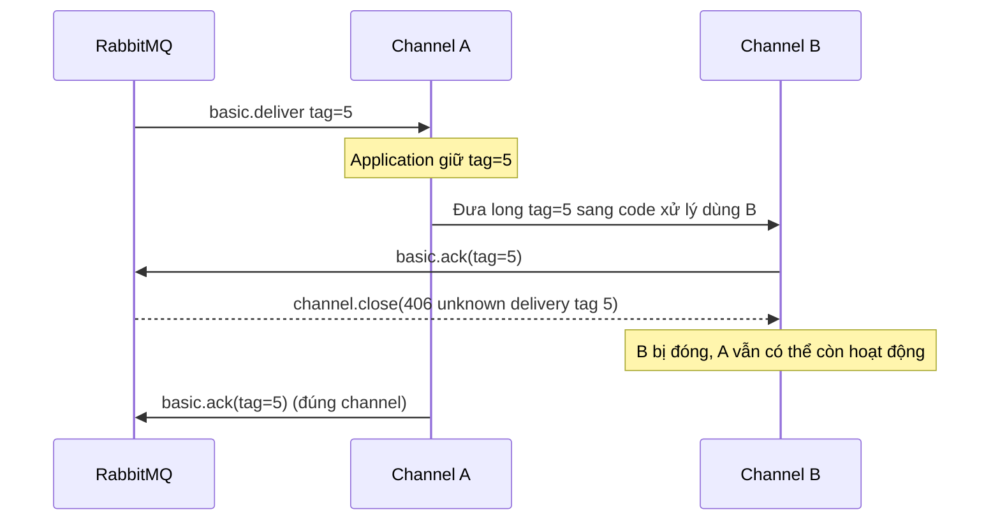
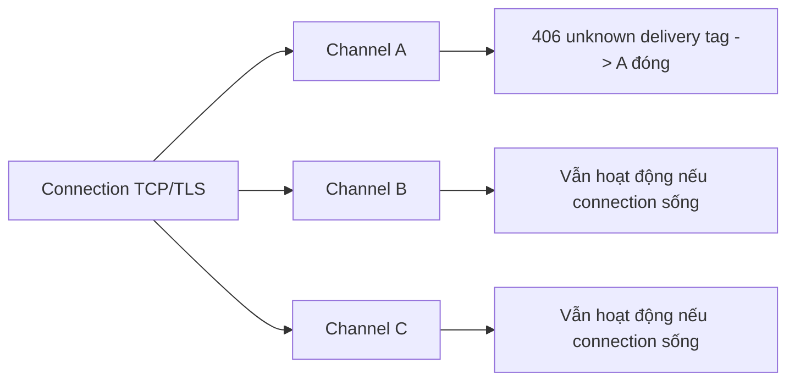
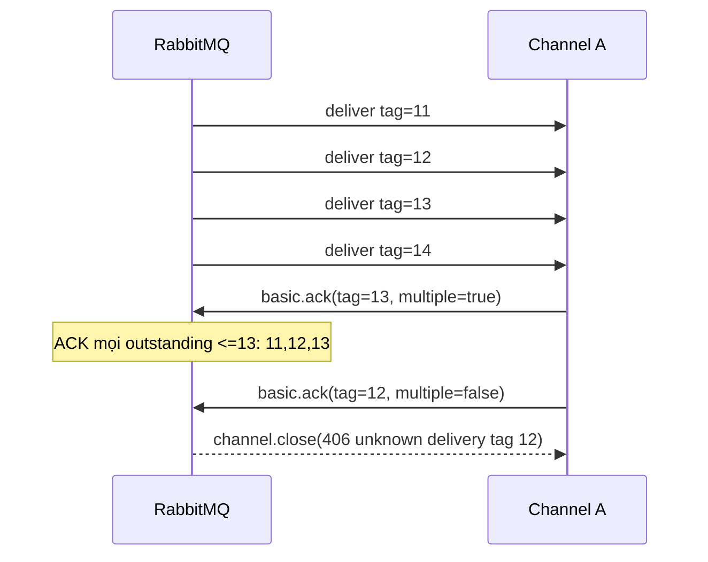
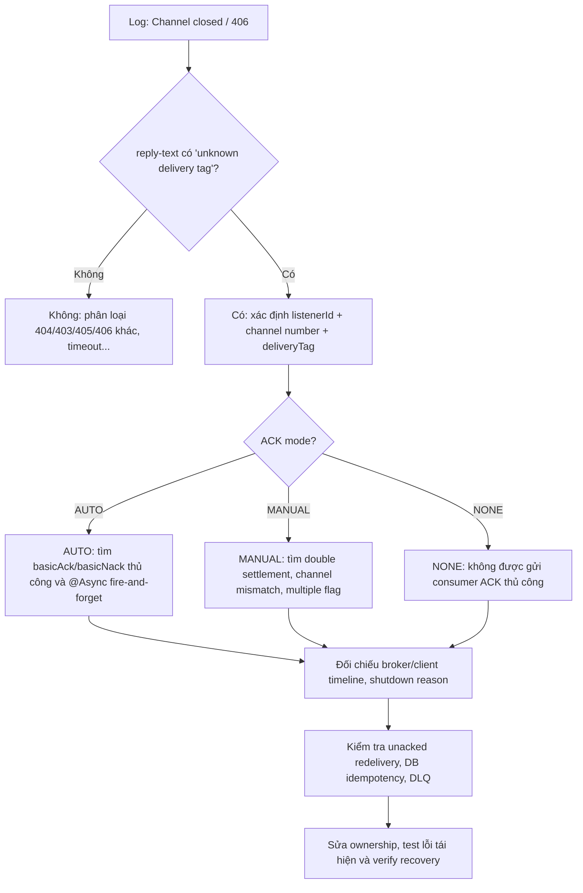

# Lỗi unknown delivery tag và channel bị đóng

> **Chương:** Chẩn đoán sự cố  
> **Module:** SPRING_AMQP — học tích hợp RabbitMQ bằng `RabbitTemplate`, `@RabbitListener`, exchange, queue và binding; thực hành xác nhận giao nhận, retry, dead-letter, giao dịch và quan sát hệ thống để xây dựng luồng xử lý bất đồng bộ đáng tin cậy.
>
> **Trọng tâm:** Lỗi AMQP 0-9-1 `PRECONDITION_FAILED - unknown delivery tag`, nguyên nhân channel bị broker đóng, cách chẩn đoán trong Spring AMQP, và kiểm thử/khắc phục mà không tạo xử lý trùng hoặc làm thất lạc message. Ví dụ dùng **Spring Boot 3.x, Spring AMQP 3.x, RabbitMQ AMQP 0-9-1 và Java 17+**. Với thư viện mới hơn, cần đối chiếu tài liệu/API tương ứng.

## 1. Mục tiêu học tập

Sau bài này, bạn có thể:

1. Giải thích chính xác `deliveryTag`, phạm vi **theo channel**, ACK/NACK/REJECT và cơ chế channel-close của RabbitMQ.
2. Phân biệt `406 PRECONDITION_FAILED - unknown delivery tag` với những lỗi channel khác như `404 NOT_FOUND`, `403 ACCESS_REFUSED`, `405 RESOURCE_LOCKED` và `406 inequivalent arg`.
3. Tìm các nguyên nhân điển hình: **ACK hai lần**, ACK trên channel khác, ACK trễ sau reconnect, `multiple=true` sai, trộn `AUTO` và `MANUAL`, hoặc gọi ACK trong `NONE` mode.
4. Sửa listener Spring AMQP: để container ACK bằng `AUTO` hoặc tự settle **đúng một lần** bằng `MANUAL` và đúng channel.
5. Xử lý listener bất đồng bộ (`CompletableFuture`, reactive, Kotlin `suspend`), transaction, concurrency và batching mà không tranh quyền ACK.
6. Chẩn đoán shutdown reason, log/metric ở producer, broker và listener container; hiểu redelivery của unacked deliveries khi channel đóng.
7. Tái hiện 406 trong RabbitMQ thử nghiệm, viết các integration tests để phát hiện lỗi trước production.
8. Lập runbook phản ứng với channel-close storm, phân tích hậu quả nghiệp vụ và ngăn lỗi lặp lại.

### Một tình huống thực tế

Ứng dụng dùng `@RabbitListener` nhận `PaymentConfirmed`, ghi PostgreSQL rồi gọi `channel.basicAck(tag, false)`. Log thỉnh thoảng xuất hiện:

```text
ShutdownSignalException: channel error;
protocol method: #method<channel.close>(
    reply-code=406,
    reply-text=PRECONDITION_FAILED - unknown delivery tag 17,
    class-id=60,
    method-id=80
)
```

Channel đó bị broker đóng; Spring listener container mở channel khác hoặc khởi động lại consumer. Sau đó cùng event có thể được giao lại và database bị cập nhật hai lần nếu consumer không idempotent.

Chỉ tăng số lần retry hoặc khởi động lại pod không xử lý được lỗi gốc. Trước tiên cần xác định **ai đã ACK/NACK deliveryTag=17, trên channel nào, bao nhiêu lần và trong ACK mode nào**.

## 2. Cơ chế AMQP: delivery tag thuộc channel, không thuộc message

Khi broker giao message tới consumer có manual acknowledgments, mỗi delivery mang một **delivery tag** — số nguyên dương tăng dần **trong phạm vi AMQP channel** mà message được giao.



Hai channel **có thể đồng thời sử dụng cùng giá trị số** như `deliveryTag=1` mà vẫn là **hai delivery hoàn toàn khác nhau**. Delivery tag không phải:

- `MessageProperties.messageId` hay business `eventId`;
- ID duy nhất toàn RabbitMQ cluster;
- định danh cố định qua reconnect hoặc redelivery;
- publisher-confirm sequence number có thể thay cho consumer delivery tag;
- consumer tag (tên subscription);
- offset của native RabbitMQ Streams.

### 2.1. Bốn quy tắc bắt buộc

1. **ACK/NACK/REJECT trên đúng channel đã nhận delivery.** Không mượn channel mới từ `RabbitTemplate` hoặc `CachingConnectionFactory` để ACK tag cũ.
2. **Mỗi delivery chỉ được settle một lần.** Sau khi ACK, NACK hoặc REJECT thành công, tag không còn outstanding; gửi tiếp settlement cho cùng tag có thể gây `unknown delivery tag`.
3. **DeliveryTag chỉ sống trong vòng đời channel.** Sau channel.close/reconnect, một channel mới có dãy tag mới, dù cùng queue, messageId hoặc listenerId.
4. **`multiple=true` thay đổi phạm vi settlement.** Nó có thể ACK/NACK nhiều delivery còn outstanding trên **cùng channel**, không phải chỉ một tag.



**Không dùng tag như một khóa database** để deduplicate. Nếu broker redeliver message do channel lỗi, giá trị tag trên channel mới có thể là `1` dù message trước đó có tag `137`; hãy dùng `eventId` ổn định và transaction nghiệp vụ.

### 2.2. ACK, NACK, REJECT và số tham số

| AMQP method trong Java client | Tham số | Hiệu ứng |
|---|---|---|
| `Channel.basicAck(tag, false)` | `multiple=false` | ACK **một** delivery tag trên chính channel |
| `Channel.basicAck(tag, true)` | `multiple=true` | ACK những delivery còn outstanding có tag **nhỏ hơn hoặc bằng** tag đã cho trên channel |
| `Channel.basicNack(tag, false, true)` | `multiple=false, requeue=true` | NACK một delivery và yêu cầu requeue |
| `Channel.basicNack(tag, false, false)` | `requeue=false` | NACK một delivery; broker dead-letter nếu có DLX phù hợp, nếu không có thể discard |
| `Channel.basicReject(tag, false)` | `requeue=false` | REJECT một delivery; không có tham số `multiple` |

**Publisher confirms sử dụng tên method `basic.ack/basic.nack` tương tự nhưng đi theo chiều ngược** (broker → producer). Publisher-confirm sequence number có scope riêng ở publisher channel; không đem nó làm consumer ACK tag.

### 2.3. Lỗi chính xác là gì?

RabbitMQ thực thi một yêu cầu settlement nhưng không thấy delivery tag hợp lệ trong danh sách còn outstanding theo channel đó. Broker trả **`channel.close` với reply code `406 PRECONDITION_FAILED`**, thường kèm:

```text
PRECONDITION_FAILED - unknown delivery tag 17
```

Đây là **AMQP protocol exception trên channel**, không nhất thiết là lỗi TCP socket, chứng chỉ TLS hay RabbitMQ node crash. Connection cha thường vẫn còn, còn channel đã lỗi không sử dụng tiếp được.

RabbitMQ gửi `channel.close` **bất đồng bộ**. Vì vậy dòng code gửi ACK lỗi đôi khi **không ném exception ngay**; exception có thể xuất hiện vài mili-giây sau khi broker trả shutdown frame, hoặc ở thao tác channel kế tiếp. Phải tìm **thao tác ACK/NACK xảy ra trước** log channel close, không mặc nhiên cho rằng dòng log sau cùng là nguyên nhân.

## 3. Phân biệt channel.close với connection.close



| Phạm vi | Hiện tượng | Message outstanding | Hướng điều tra |
|---|---|---|---|
| **Channel.close** do tag không hợp lệ | Một channel lỗi, các channel khác trên connection có thể hoạt động | Unacked deliveries trên channel bị đóng có thể được requeue | ACK ownership, channel ID, ackMode, `multiple` |
| **Connection.close** hoặc TCP loss | Tất cả channel trên connection đó mất | Unacked deliveries trên các channel thuộc connection bị ảnh hưởng có thể requeue | Network, TLS, heartbeat, broker restart, connection blocked |
| **Consumer cancel** | Subscription ngừng, không đồng nghĩa connection đóng | Tùy lifecycle/channel; phải xem consumer có unacked không | Queue deletion, exclusive access, cancellation logic |
| **Application restart** | JVM/container đóng, connection/channels không còn | Những delivery broker chưa nhận ACK có thể redeliver | Graceful shutdown, DB commit, restart events |

Trong Spring AMQP, `CachingConnectionFactory` có thể cache/reuse channel; listener container quản lý channel cho consumer, còn `RabbitTemplate` quản lý publish channel. **Đừng tự tạo một channel để ACK message mà container đã nhận trên channel khác.**

### 3.1. Bảng mã lỗi thường bị gộp chung là “channel closed”

| Reply code / thông báo | Nguyên nhân điển hình | Có phải unknown delivery tag? |
|---|---|---|
| `406 PRECONDITION_FAILED - unknown delivery tag N` | Double ACK/NACK, ACK trên channel khác, tag cũ | **Có** |
| `406 PRECONDITION_FAILED - inequivalent arg ...` | Khai báo lại queue/exchange với thuộc tính/arguments không tương thích | **Không** |
| `406 PRECONDITION_FAILED - delivery acknowledgement ... timed out` | Consumer không ACK kịp timeout của broker | **Không**; nguyên nhân ban đầu là ACK quá lâu |
| `404 NOT_FOUND - no queue/exchange ...` | Sai vhost/tên resource, chưa declare | **Không** |
| `403 ACCESS_REFUSED` | User thiếu quyền `read/write/configure` hoặc operation bị cấm | **Không** |
| `405 RESOURCE_LOCKED` | Truy cập exclusive resource từ connection không sở hữu | **Không** |
| `AlreadyClosedException` | Client tiếp tục gọi thao tác trên channel/connection đã bị đóng | **Triệu chứng thứ cấp**, cần xem nguyên nhân close trước |
| `AmqpIOException` / `ShutdownSignalException` | Spring/Java client bao bọc hoặc phát tín hiệu shutdown | **Chỉ biết loại sau khi xem reply code, shutdown reason** |

Lưu ý: Không phải mọi `406` đều do double ACK. Trong postmortem, luôn ghi lại **reply-text và channel ID** để phân loại chính xác.

## 4. Nguyên nhân phổ biến số 1: ACK hai lần

Một handler có thể ACK hai lần khi cùng delivery đi qua hai nhánh:

```java
// PHẢN VÍ DỤ: chỉ đặt trong test, KHÔNG triển khai.
@RabbitListener(queues = "payments.confirmed.q", ackMode = "MANUAL")
public void broken(Message message, Channel channel) throws IOException {
    long tag = message.getMessageProperties().getDeliveryTag();
    updateDatabase(message);
    channel.basicAck(tag, false); // ACK thứ nhất.
    audit(message);
    channel.basicAck(tag, false); // ACK thứ hai -> 406.
}
```

### 4.1. Double ACK không nhất thiết viết hai dòng sát nhau

| Mẫu lỗi | Dòng chảy | Vì sao hỏng |
|---|---|---|
| ACK ở service và ở listener | `service.processAndAck()` gọi ACK; listener ACK khi return | Hai nơi cùng sở hữu delivery settlement |
| ACK trong `try` rồi ACK trong `finally` | Nhánh thành công ACK trước, finally chạy tiếp | ACK trùng tag |
| ACK thành công rồi `catch` NACK khi audit/log lỗi | Business logic sau ACK ném lỗi, catch xử lý như chưa ACK | NACK một delivery đã được ACK |
| ACK ở callback và ở retry recoverer | Hai đường kết thúc cùng delivery | Không có quy tắc settlement duy nhất |
| Container `AUTO` và code gọi `basicAck` | App ACK trước, container ACK khi listener return | Tranh quyền ACK giữa container và app |
| Batch ACK nhóm rồi ACK riêng một tag cũ | `basicAck(50,true)`, sau đó `basicAck(48,false)` | Tag 48 đã được settle bằng ACK nhóm |

Một dấu hiệu mạnh là broker log có `unknown delivery tag N` ngay sau khi handler đã trả về **thành công**, đặc biệt khi `@RabbitListener` đang ở `AUTO` mode.

### 4.2. Cách sửa: một owner cho mỗi delivery

Chọn **một trong hai mô hình**:

- **`AUTO`:** Ứng dụng xử lý logic và trả về/throw. **Container** quyết định ACK hoặc reject/nack theo error policy. Không gọi `Channel.basicAck/basicNack/basicReject` trong listener.
- **`MANUAL`:** Ứng dụng được giao channel và tag của delivery và tự settle **đúng một lần**; container không ACK hộ theo luồng thành công thông thường. Cần đảm bảo mọi nhánh lỗi đều có quyết định rõ ràng.

Không dùng `NONE` như một biến thể của MANUAL; ở `NONE` broker xem delivery như đã được auto-ack ngay khi giao, nên ACK thủ công sẽ không có outstanding tag tương ứng.

## 5. Nguyên nhân phổ biến số 2: sai channel và tag cũ sau reconnect

### 5.1. Không ACK bằng RabbitTemplate.execute()

```java
// PHẢN VÍ DỤ: message đi vào listener channel A,
// nhưng RabbitTemplate có thể cấp channel B riêng.
@RabbitListener(queues = "payments.confirmed.q", ackMode = "MANUAL")
public void brokenCrossChannel(
    Message message,
    Channel inboundChannel
) {
    long tag = message.getMessageProperties().getDeliveryTag();
    rabbitTemplate.execute(channelB -> {
        channelB.basicAck(tag, false); // SAI: tag thuộc inboundChannel.
        return null;
    });
}
```

Đoạn trên minh họa anti-pattern: `rabbitTemplate` giả định đã được inject. Việc channel B cũng có tag cùng giá trị **không làm phép ACK trở nên hợp lệ**. Nếu B có một outstanding delivery trùng tag, nguy cơ còn nghiêm trọng hơn: ACK nhầm một delivery khác. Vì vậy không dùng mỗi số tag để chứng minh thao tác thuộc đúng message.

### 5.2. Không giữ tag rồi ACK sau khi container đã chuyển channel

```text
T0: Consumer dùng channel A, nhận E100/tag=81
T1: App lưu tag=81 vào một job/CompletableFuture chạy lâu
T2: Connection lost; A bị đóng, E100 chưa được ACK
T3: Container reconnect -> channel A' (một instance mới)
T4: Old callback dùng tag=81 lên A' hoặc một channel khác
T5: Broker trả 406 unknown delivery tag (hoặc tag vô tình trùng)
T6: E100 có thể được redeliver với tag mới
```

**Tag cũ không có giá trị trên channel mới.** Đừng xây Redis job `{deliveryTag: 81}` và gọi lại ACK sau restart. Hệ thống phải lưu **business event ID** và dữ liệu ứng dụng; delivery settlement chỉ thực hiện trong lifecycle hợp lệ của chính delivery đó.

### 5.3. Trường hợp chuyển công việc sang @Async/Executor

```java
// PHẢN VÍ DỤ: listener return trước khi task hoàn thành,
// trong khi container có thể AUTO-ACK ngay khi method return.
@RabbitListener(queues = "payments.confirmed.q")
public void brokenFireAndForget(Message msg, Channel channel) {
    executor.execute(() -> {
        process(msg);
        channel.basicAck(
            msg.getMessageProperties().getDeliveryTag(),
            false
        );
    });
}
```

Trong `AUTO` mode, container có thể ACK khi listener return; task nền lại gửi ACK cho cùng delivery hoặc dùng channel đã đóng. Tệ hơn, broker đã nhận ACK trước khi `process(msg)` hoàn tất nên nếu task lỗi thì không có cơ chế redelivery bảo đảm.

Muốn xử lý bất đồng bộ thật, cần **lifecycle async return type được Spring AMQP hỗ trợ**, hoặc thiết kế MANUAL ack có quản lý channel thread/exception/lifecycle cẩn thận. Không chỉ gắn `@Async` hoặc `executor.execute` rồi giữ `Channel` như một session bất biến.

## 6. Nguyên nhân phổ biến số 3: sai `multiple=true`

`multiple` trong `Channel.basicAck(tag, multiple)` là tùy chọn **ACK nhóm**, không phải “ACK an toàn hơn”.

Giả sử cùng channel có các tag chưa ACK: `11, 12, 13, 14`.



| Tình huống | Đánh giá |
|---|---|
| Tag 11, 12, 13 đều xử lý xong và một **owner** ACK `13,true` | Có thể đúng nếu đảm bảo thứ tự/ownership |
| Tag 13 xử lý xong nhưng 11, 12 còn chạy | **Nguy hiểm:** ACK cả delivery chưa xử lý |
| Thread A ACK `13,true`, thread B ACK `12,false` sau đó | **Có thể 406** vì tag 12 đã được settle |
| Listener xử lý độc lập từng message, `prefetch>1` | Dùng `multiple=false` đơn giản và an toàn hơn |
| Batch có toàn bộ delivered tags đã hoàn tất, một nơi chịu trách nhiệm ACK | Có thể dùng multiple theo quy tắc tính highest contiguous completed tag |

Trong phần lớn `@RabbitListener` xử lý từng message, **dùng `basicAck(tag, false)`**. Nếu muốn tối ưu ACK batches, hãy dùng khả năng batching/ack của **container** hoặc một thiết kế quản lý pending tags tập trung; không tùy tiện bật `multiple=true`.

### 6.1. Tại sao concurrency làm lỗi này khó tìm?

Với nhiều consumer/channel, tags chỉ tăng **trong mỗi channel**, nhưng log có thể xen kẽ:

```text
consumer-1 / channel-A / tag=21 / E100
consumer-2 / channel-B / tag=21 / E101
consumer-1 / channel-A / tag=22 / E102
```

Chỉ log `tag=21` mà không log channel identity và listener/container ID thì không phân biệt được hai delivery khác nhau. Đừng cho các threads dùng chung một `Channel` để gọi ACK tùy thời điểm; RabbitMQ Java client channels không được coi là đối tượng thread-safe cho concurrent protocol operations. Dùng channel đúng lifecycle và gom settlement có chủ sở hữu.

## 7. Ba ACK mode của Spring AMQP

| Spring `AcknowledgeMode` | Ai ACK delivery? | Nếu handler ném exception | Thói quen đúng |
|---|---|---|---|
| `AUTO` (**mặc định**) | Spring listener container ACK khi xử lý thành công | Container reject/nack theo error handler, retry và `defaultRequeueRejected` | **Không tự gọi** `Channel.basicAck/basicNack` |
| `MANUAL` | Ứng dụng chịu trách nhiệm ACK/NACK/REJECT, hoặc framework async completion khi dùng async return types | Nếu ứng dụng không settle, delivery có thể nằm unacked cho tới khi channel đóng/được xử lý bằng cơ chế khác | Xác định owner và xử lý tất cả nhánh |
| `NONE` | RabbitMQ auto-ack khi giao; không dùng manual acknowledgement | Broker không thể redeliver theo cơ chế unacked cho delivery đó | **Không gửi ACK/NACK thủ công**, không dùng với `channelTransacted=true` |

**Chú ý thuật ngữ:** Spring `AUTO` là **container-managed acknowledgement**, khác với RabbitMQ `autoAck=true` (Spring `NONE`). Một người đọc log thấy “auto” rồi tự gọi `basicAck` để “chắc chắn” thường tạo ra 406.

### 7.1. Cấu hình Spring Boot 3.x cho AUTO

```yaml
spring:
  rabbitmq:
    listener:
      type: simple
      simple:
        acknowledge-mode: auto
        concurrency: 2
        max-concurrency: 4
        prefetch: 10
        default-requeue-rejected: false
```

Listener tương ứng:

```java
import org.springframework.amqp.core.Message;
import org.springframework.amqp.rabbit.annotation.RabbitListener;
import org.springframework.stereotype.Component;

@Component
public class AutoAckPaymentListener {
    private final PaymentProjectionService projection;

    public AutoAckPaymentListener(PaymentProjectionService projection) {
        this.projection = projection;
    }

    @RabbitListener(
        id = "payment.auto.listener",
        queues = "payments.confirmed.q"
    )
    public void handle(Message raw) {
        // DB service riêng có @Transactional và idempotency.
        // Khi method thành công, container quyết định ACK.
        projection.applyIdempotently(raw);
        // TUYỆT ĐỐI không channel.basicAck ở đây.
    }
}
```

`PaymentProjectionService` là service nghiệp vụ của dự án. Khi transaction database commit thành công rồi listener return, container có thể ACK. Nếu process crash sau DB commit nhưng trước ACK, RabbitMQ có thể redeliver, vì vậy service vẫn phải dùng `eventId` để chống side effect trùng.

### 7.2. Cấu hình MANUAL cho một listener riêng

```java
import org.springframework.amqp.core.AcknowledgeMode;
import org.springframework.amqp.rabbit.config.SimpleRabbitListenerContainerFactory;
import org.springframework.amqp.rabbit.connection.ConnectionFactory;
import org.springframework.context.annotation.Bean;
import org.springframework.context.annotation.Configuration;

@Configuration(proxyBeanMethods = false)
class ManualAckConfiguration {
    @Bean("manualAckListenerFactory")
    SimpleRabbitListenerContainerFactory manualAckListenerFactory(
        ConnectionFactory connectionFactory
    ) {
        var factory = new SimpleRabbitListenerContainerFactory();
        factory.setConnectionFactory(connectionFactory);
        factory.setAcknowledgeMode(AcknowledgeMode.MANUAL);
        factory.setConcurrentConsumers(1);
        factory.setPrefetchCount(1);
        factory.setDefaultRequeueRejected(false);
        return factory;
    }
}
```

Một consumer/prefetch=1 giúp bài thực hành dễ kiểm soát; production cần benchmark riêng. `defaultRequeueRejected=false` **không** là lệnh auto-ACK trong MANUAL mode và **không thay thế** việc code tự chọn settlement cho từng delivery.

### 7.3. MANUAL đúng: quyết định settlement đúng một lần

```java
import com.rabbitmq.client.Channel;
import java.io.IOException;
import org.springframework.amqp.core.Message;
import org.springframework.amqp.rabbit.annotation.RabbitListener;
import org.springframework.stereotype.Component;

@Component
public class ManualAckPaymentListener {
    private final PaymentProjectionService service;

    public ManualAckPaymentListener(PaymentProjectionService service) {
        this.service = service;
    }

    @RabbitListener(
        id = "payment.manual.listener",
        queues = "payments.manual.q",
        containerFactory = "manualAckListenerFactory"
    )
    public void handle(Message raw, Channel channel) throws IOException {
        long tag = raw.getMessageProperties().getDeliveryTag();
        Decision decision;

        try {
            service.applyIdempotently(raw);
            decision = Decision.ACK;
        } catch (UnprocessablePaymentException permanent) {
            decision = Decision.REJECT;
        } catch (RuntimeException transientFailure) {
            // Với hệ thống thật, giới hạn retry + backoff/parking;
            // không requeue nóng vô hạn.
            decision = Decision.REQUEUE;
        }

        // Chỉ MỘT đường settlement, trên channel nhận delivery.
        switch (decision) {
            case ACK -> channel.basicAck(tag, false);
            case REJECT -> channel.basicNack(tag, false, false);
            case REQUEUE -> channel.basicNack(tag, false, true);
        }
    }

    private enum Decision { ACK, REJECT, REQUEUE }
}
```

`UnprocessablePaymentException` là exception nghiệp vụ dự án tự khai báo, dùng để phân loại lỗi vĩnh viễn. Trong ví dụ, tất cả lần settlement đều dùng `multiple=false` và **không dùng thêm `basicAck` trong `finally`**.

**Hạn chế cần hiểu:**

- `IOException` khi gửi ACK/NACK **không khẳng định broker chưa nhận frame**. Không bắt exception này rồi tự động gửi `basicNack(tag, ...)` trên channel khác.
- Code `REQUEUE` ở đây minh họa API. Với lỗi DB kéo dài, `requeue=true` có thể tạo vòng giao lại nóng; hãy dùng bounded retry, DLQ/retry queue/quarantine và backoff theo thiết kế production.
- `PaymentProjectionService.applyIdempotently` phải commit DB transaction trước khi được coi là xử lý xong. Inbox marker cùng transaction với side effect.
- Nếu một event cần gọi API ngoài database, cần idempotency/outbox ở hệ thống đích chứ không chỉ ACK đúng.
- Listener AUTO và MANUAL minh họa **hai lựa chọn thay thế**; đừng để cả hai cùng subscribe một work queue trong cùng fixture rồi cho rằng chỉ một nhận tất cả.

### 7.4. Override mode bằng annotation

Spring AMQP hỗ trợ thuộc tính `ackMode` trên `@RabbitListener`, ví dụ:

```java
@RabbitListener(
    id = "payments.manual.override",
    queues = "payments.manual.q",
    ackMode = "MANUAL"
)
public void manualOne(
    String body,
    Channel channel,
    @Header(AmqpHeaders.DELIVERY_TAG) long tag
) throws IOException {
    service.process(body);
    channel.basicAck(tag, false);
}
```

Đây là **fragment**, cần import `com.rabbitmq.client.Channel`, `org.springframework.messaging.handler.annotation.Header` và `org.springframework.amqp.support.AmqpHeaders` cùng dependency/service thật. Thuộc tính listener có thể **override ACK mode của factory**. Khi debug, kiểm tra cả factory và annotation — đừng chỉ nhìn `application.yml` rồi kết luận đang ở `AUTO`.

## 8. Async listener, CompletableFuture, Mono và Kotlin suspend

Với `@RabbitListener` trả về `CompletableFuture<?>`, `Mono<?>` hoặc Kotlin `suspend` (Spring AMQP 3.0.5+), listener có thể hoàn tất **sau khi method đã return**. Spring AMQP có cơ chế ACK/NACK khi async result hoàn tất, nhưng cần dùng đúng mode và phiên bản.

Theo tài liệu, container cần `AcknowledgeMode.MANUAL` để **không ACK sớm**; từ các phiên bản Spring AMQP 2.2.21/2.3.13/2.4.1 trở lên, mode có thể được tự điều chỉnh sang MANUAL khi phát hiện async return type. Dù vậy, nên **cấu hình rõ ràng và kiểm thử** thay vì phụ thuộc vào suy đoán về listener adapter.

### 8.1. Mẫu async return mà Spring quản lý ACK

```java
import java.util.concurrent.CompletableFuture;
import org.springframework.amqp.rabbit.annotation.RabbitListener;
import org.springframework.stereotype.Component;

@Component
class AsyncPaymentListener {
    private final AsyncPaymentProcessor processor;

    AsyncPaymentListener(AsyncPaymentProcessor processor) {
        this.processor = processor;
    }

    @RabbitListener(
        queues = "payments.async.q",
        ackMode = "MANUAL"
    )
    public CompletableFuture<Void> handle(String eventJson) {
        // Future chỉ complete SUCCESS sau khi nghiệp vụ đã thành công.
        return processor.processAsyncAndCommit(eventJson);
    }
}
```

Trong mẫu này, `AsyncPaymentProcessor` là service do dự án triển khai. Khi sử dụng **async return contract**, Spring adapter/container quản lý ACK/NACK theo completion; **không** gọi `basicAck` thủ công lần nữa trong continuation.

**Phản ví dụ:** Trả `CompletableFuture.completedFuture(null)` ngay sau khi enqueue một background task mới chạy; container thấy future thành công và ACK quá sớm dù side effect chưa hoàn tất. Future phải đại diện cho **kết quả thực** của transaction/xử lý.

### 8.2. Lỗi phát sinh trước khi tạo Future

Nếu listener ném exception trước khi có async result object, cần tuân thủ xử lý lỗi của Spring AMQP đối với async return type, và ở các phiên bản liên quan phải trả một future hoàn tất lỗi thay vì để listener thoát theo cách không được framework quản lý đúng. Cấu hình error handler/requeue policy phù hợp, kiểm thử failure trước và sau thời điểm tạo Future. Khi hoàn tất lỗi, kết quả requeue hoặc reject phụ thuộc loại exception và `defaultRequeueRejected`.

### 8.3. Vì sao không dùng raw Channel ở callback chạy lâu?

Nếu giữ `Channel` và `deliveryTag` trong một callback chạy sau timeout/reconnect, channel có thể đã đóng; callback cũ không còn quyền settlement cho delivery mới. Channel Java client cũng không nên bị nhiều thread cùng thao tác giao thức khi không có kiểm soát concurrency. Khi cần async, để **listener adapter** hoàn tất ACK theo completion mà nó quản lý; nếu chủ động tự quản lý, thiết kế ownership/lifecycle rất chặt chẽ và thử network failure.

### 8.4. Spring Retry có thể làm câu chuyện phức tạp hơn

Với retry **stateless** tại listener container, cùng một broker delivery có thể chạy handler nhiều lần. Chỉ **một lần settlement cuối** mới nên gửi ACK/NACK/REJECT. Không viết recovery handler và listener cùng ACK; không đưa ACK vào mỗi lần thử của retry interceptor nếu interceptor còn quyền gọi lại listener.

## 9. Transactions, batching, prefetch và timeout

### 9.1. `channelTransacted` không sửa unknown tag

Khi Spring AMQP dùng transactional channel (`channelTransacted=true`), broker còn cần `tx.commit` bên cạnh acknowledgment để xác nhận giao dịch AMQP. Tuy nhiên, **delivery tag phải hợp lệ ngay tại thời điểm gửi ACK/NACK**; RabbitMQ có thể đóng channel vì unknown tag trước khi transaction commit.

Đừng bật `channelTransacted=true` để “cho ACK chắc chắn hơn” mà không hiểu DB transaction synchronization, commit order và performance. Đây là cơ chế khác publisher confirms. Nếu dùng Spring `RabbitTransactionManager` hoặc best-efforts one phase commit, nó **không tạo XA atomic transaction** giữa RabbitMQ và PostgreSQL.

### 9.2. Batching làm tăng phạm vi lỗi nếu dùng nhầm

- `SimpleMessageListenerContainer.batchSize` có thể ảnh hưởng số message xử lý/ACK trong một batch hoặc transaction ở chế độ phù hợp.
- `DirectMessageListenerContainer.messagesPerAck` gom ACK theo số message/thời gian ở chế độ hỗ trợ.
- Manual `basicAck(tag, true)` do app gọi **không giống** việc để container batching quản lý.
- Batch ACK có thể giảm số protocol frames nhưng mở rộng cửa sổ **redelivery khi channel đóng**, và dễ tạo ACK sớm nếu app không đảm bảo mọi delivery trong nhóm đã hoàn tất.

Khi đang điều tra unknown tag, nên tạm chọn một queue thử nghiệm với `prefetch=1`, không batching và `multiple=false` để cô lập nguyên nhân. Đây là cấu hình để debug, không nhất thiết là cấu hình throughput tốt nhất cho production.

### 9.3. Consumer ack timeout là lỗi 406 khác

RabbitMQ có **consumer delivery acknowledgement timeout**: nếu consumer giữ delivery unacked quá lâu, broker có thể đóng channel với `PRECONDITION_FAILED` mô tả thời gian chờ ACK. Lỗi này có thể requeue các outstanding deliveries, nhưng **reply-text không phải `unknown delivery tag`**.

Nếu timeout xuất hiện:

1. Đo handler p95/p99, DB lock, HTTP downstream latency và thread starvation.
2. Xem `prefetch`, batch duration, transaction timeouts, consumer scheduling.
3. Giảm thời gian giữ delivery hoặc thiết kế tác vụ dài theo checkpoint/outbox.
4. Chỉ điều chỉnh broker acknowledgment timeout theo SLA sau khi đo thực tế.

Tăng timeout không sửa **double ACK**; ngược lại, chỉnh ACK mode không tự sửa consumer bị treo lâu không ACK.

## 10. Hậu quả dữ liệu khi channel đóng

Khi channel có outstanding unacked deliveries bị đóng, RabbitMQ **có thể tự động requeue** những delivery ấy để giao lại. Đây là cơ chế khôi phục, không phải bằng chứng message đã chuyển DLQ. Còn delivery **đã ACK được broker xử lý** sẽ không vì cùng channel đóng mà tự được đưa lại theo cơ chế unacked.

```mermaid
sequenceDiagram
    participant MQ as RabbitMQ
    participant C as Consumer / Channel A
    participant DB as PostgreSQL
    MQ->>C: Deliver E200 tag=9
    C->>DB: COMMIT E200
    DB-->>C: Success
    Note over C,MQ: ACK chưa tới broker
    C--xMQ: Channel A bị đóng (406 / network)
    MQ-->>MQ: Requeue outstanding E200
    MQ->>C: Redeliver E200 trên Channel B tag=1
    C->>DB: Kiểm tra inbox(eventId=E200)
    DB-->>C: Already processed; skip side effect
    C->>MQ: ACK tag=1 trên Channel B
```

Trong trường hợp **double ACK**, có thể ACK đầu đã được broker ghi nhận trước khi ACK thứ hai gây 406. Delivery đó không cần redeliver; những **delivery khác** còn unacked trên cùng channel mới có thể requeue. Vì vậy:

- Không nói “unknown delivery tag chắc chắn làm message vừa xử lý bị giao lại”.
- Không nói “channel đóng chắc chắn mất message”.
- Phải kiểm tra thứ tự ACK/close và số outstanding/unacked thực tế.

### 10.1. Idempotent consumer là điều kiện bắt buộc

Ví dụ xử lý database:

```sql
CREATE TABLE consumer_inbox (
    consumer_name VARCHAR(100) NOT NULL,
    event_id UUID NOT NULL,
    processed_at TIMESTAMPTZ NOT NULL DEFAULT now(),
    PRIMARY KEY (consumer_name, event_id)
);

CREATE TABLE payment_projection (
    payment_id UUID PRIMARY KEY,
    applied_count INTEGER NOT NULL DEFAULT 0
);
```

```java
import java.util.UUID;
import org.springframework.jdbc.core.JdbcTemplate;
import org.springframework.stereotype.Service;
import org.springframework.transaction.annotation.Transactional;

@Service
public class PaymentProjectionService {
    private final JdbcTemplate jdbc;

    public PaymentProjectionService(JdbcTemplate jdbc) {
        this.jdbc = jdbc;
    }

    @Transactional
    public void applyOnce(UUID eventId, UUID paymentId) {
        int inserted = jdbc.update(
            """
            INSERT INTO consumer_inbox(consumer_name, event_id)
            VALUES (?, ?)
            ON CONFLICT DO NOTHING
            """,
            "payment-projection", eventId
        );
        if (inserted == 0) {
            return; // Một delivery/retry khác đã commit cùng event.
        }

        jdbc.update(
            """
            INSERT INTO payment_projection(payment_id, applied_count)
            VALUES (?, 1)
            ON CONFLICT (payment_id)
            DO UPDATE SET applied_count =
                payment_projection.applied_count + 1
            """,
            paymentId
        );
    }
}
```

Marker inbox và side effect **cùng DB transaction**. Nếu commit DB thành công nhưng channel đóng trước ACK, redelivery dùng **eventId** để bỏ qua effect; sau đó consumer ACK delivery mới. Không dùng deliveryTag làm khóa dedupe vì thay đổi theo channel.

Nếu còn gửi email/HTTP/payment call ngoài DB, unique inbox marker **chưa đủ**: cần transactional outbox/idempotency key ở downstream hoặc reconciliation. ACK đúng chỉ giải quyết settlement với broker, không biến distributed side effects thành exactly-once.

## 11. Cách đọc log và xác định thủ phạm

### 11.1. Mẫu log cần đối chiếu

```text
RabbitMQ server log:
  operation basic.ack caused a channel exception
  precondition_failed: unknown delivery tag 17

Spring/Java client:
  ShutdownSignalException ... reply-code=406
  reply-text=PRECONDITION_FAILED - unknown delivery tag 17

Spring listener:
  Consumer failed / channel shutdown / retrying declaration
  Listener container consumer restarted
```

**Ghi nhớ:** Server-side log cho biết **protocol operation** gây lỗi và reply text; Spring stack trace đôi khi chỉ là chỗ code phát hiện shutdown. Hãy nối chúng bằng mốc thời gian, connection name, channel number, queue, listener ID và tag trong một khoảng ngắn trước sự cố.

### 11.2. Nên log những trường nào?

| Trường | Tại sao cần? | Lưu ý |
|---|---|---|
| `listenerId` / container type | Xác định SMLC/DMLC nào sở hữu channel | Đặt ID cố định cho `@RabbitListener` |
| `queue` / `consumerTag` | Xác định subscription và nguồn delivery | Consumer tag **khác** delivery tag |
| `connectionName` / host/vhost | Ghép broker logs với app instance | Spring `ConnectionNameStrategy` giúp phân biệt pod |
| `channelNumber` / channel identity | Phân biệt channel A tag=17 với B tag=17 | Dãy tag **không** duy nhất toàn application |
| `deliveryTag` / `redelivered` | Theo dõi lifecycle của một delivery | Không dùng làm idempotency key |
| `eventId` / `messageId` | Nối các deliveries của cùng event | Không dùng trực tiếp làm Prometheus label |
| `ackMode` / `multiple` / `settlementType` | Phát hiện double ACK hoặc ACK nhóm sai | Log trước khi gọi ACK/NACK |
| `shutdown.replyCode` / `replyText` | Phân biệt 406 unknown tag, inequivalent arg, timeout, 404/403 | Redact dữ liệu nhạy cảm |

Không log raw body chứa PII, mật khẩu, token, dữ liệu thanh toán. Nên ghi `eventId` trong structured logs/traces và giữ cardinality metric nhỏ.

### 11.3. Ví dụ log trước settlement

```java
// Fragment bên trong MANUAL listener; ch là CHÍNH channel nhận message.
long tag = raw.getMessageProperties().getDeliveryTag();
log.debug(
    "rabbit.delivery.settle action=ACK eventId={} channel={} tag={} " +
    "multiple=false redelivered={}",
    eventId,
    ch.getChannelNumber(),
    tag,
    raw.getMessageProperties().isRedelivered()
);
ch.basicAck(tag, false);
```

Đây là fragment phụ thuộc biến `raw`, `ch`, `eventId`, `log` đã được khai báo. **Không chuyển việc ACK sang logging filter/interceptor khác** sau khi thêm log; chỉ bổ sung quan sát tại một chỗ có quyền settlement duy nhất.

### 11.4. Spring container consumer failure events

Spring AMQP phát `ListenerContainerConsumerFailedEvent` khi consumer gặp lỗi. Có thể ghi nhận:

```java
import org.slf4j.Logger;
import org.slf4j.LoggerFactory;
import org.springframework.amqp.rabbit.listener.ListenerContainerConsumerFailedEvent;
import org.springframework.context.event.EventListener;
import org.springframework.stereotype.Component;

@Component
class ConsumerFailureObserver {
    private static final Logger log =
        LoggerFactory.getLogger(ConsumerFailureObserver.class);

    @EventListener
    public void onFailure(ListenerContainerConsumerFailedEvent event) {
        log.warn(
            "rabbit.consumer.failure reason={} fatal={}",
            event.getReason(), event.isFatal(), event.getThrowable()
        );
    }
}
```

Một event có thể được phát cho **nhiều consumers** khi có sự cố connection dùng chung; không mặc định mỗi event là một **message** lỗi. Muốn alert chính xác, kết hợp reply code/channel shutdown reason và broker metrics, tránh tạo alert storm khi node restart.

## 12. Lệnh kiểm tra RabbitMQ từ phía broker

Thực hiện trên môi trường có quyền quản trị phù hợp, ưu tiên broker/test vhost riêng:

```bash
# Kiểm tra connection, user, vhost và số channel đang có.
rabbitmqctl list_connections name user vhost channels

# Kiểm tra những channel còn hoạt động (channel lỗi thường đã biến mất).
rabbitmqctl list_channels

# Kiểm tra số message ready/unacked theo queue trong một vhost.
rabbitmqctl list_queues -p /orders \
  name messages_ready messages_unacknowledged consumers

# Kiểm tra consumers/consumer tags.
rabbitmqctl list_consumers -p /orders
```

RabbitMQ Management UI/HTTP API và Prometheus plugin có thể hiển thị connection/channel count, unacked, redeliveries và consumer registrations. Cú pháp/trường `rabbitmqctl` phụ thuộc phiên bản broker; chạy `rabbitmqctl help list_channels` hoặc tham khảo tài liệu đúng version để biết các cột có thể truy vấn.

**Hạn chế dữ liệu snapshot:** Một channel đã bị 406 thường biến mất trước khi bạn kịp gọi `list_channels`. Việc channel không còn trong danh sách **không chứng minh nó chưa từng tồn tại**. Muốn truy lịch sử phải có broker logs, client shutdown listener, tracing và thời gian xảy ra lỗi.

### 12.1. Không nhầm counts với nguyên nhân

- `messages_unacknowledged` giảm sau channel close có thể vì message bị **requeue** trở thành `ready`.
- `messages_ready` tăng không chứng minh mọi message là duplicate; có thể chỉ là backlog.
- `redelivered` tăng là bằng chứng broker có giao lại delivery, **không** là bằng chứng DB đã từng commit.
- Consumer count bình thường sau vài giây không chứng minh không có channel-close storm: container có thể mở channel mới liên tục.
- DLQ tăng có thể do reject/requeue policy hoặc quorum delivery limit; channel close không mặc nhiên dead-letter.

## 13. Runbook chẩn đoán theo từng bước



### Bước 1 — Cô lập blast radius

Xác nhận đây là **một channel** hay cả connection/broker node. Kiểm tra consumer count, redelivery rate, queue ready/unacked, DB transaction errors. Nếu channel-close storm ảnh hưởng hệ thống, có thể giảm traffic, dừng phiên bản mới bằng rollout có kiểm soát hoặc rollback sau khi đảm bảo event compatibility; **không xóa queue** chỉ để xóa lỗi.

### Bước 2 — Lấy nguyên văn shutdown reason

Tìm dòng server/client `reply-code=406` và `reply-text`. Ghi chính xác channel number, connection name, timestamp; phân biệt unknown tag với delivery ack timeout và inequivalent queue argument. Không phân loại dựa vào một dòng `AlreadyClosedException` trơ trọi.

### Bước 3 — Xác định owner ACK

Đọc cấu hình `spring.rabbitmq.listener.simple.acknowledge-mode` / `direct.acknowledge-mode`, bean `SimpleRabbitListenerContainerFactory` / `DirectRabbitListenerContainerFactory`, và `@RabbitListener(ackMode=...)`. Tìm mọi chỗ gọi `basicAck`, `basicNack`, `basicReject`; đặc biệt các callback, `finally`, retry advice, async completion.

### Bước 4 — Tìm double settlement hoặc sai channel

So sánh log trước ACK/NACK theo `channelNumber + tag + eventId`. Kiểm tra `multiple=true` có settle tag cũ mà task khác vẫn chờ ACK không. Xem ứng dụng có giữ `Channel` qua reconnect hoặc dùng channel từ `RabbitTemplate.execute()` để ACK không.

### Bước 5 — Kiểm tra hậu quả dữ liệu

Xác định message nào đã commit DB nhưng chưa được broker ACK, có bị redeliver không, có duplicate side effects hay không. Kiểm tra DLQ nếu policy có khả năng dead-letter. Chỉ replay khi nguồn sự thật và idempotency được xác định.

### Bước 6 — Sửa, thử nghiệm và triển khai có kiểm soát

Đặt một owner settlement: Spring AUTO hoặc app MANUAL. Thêm unit/integration tests cho double ACK/cross-channel/multiple, kết nối bị mất và DB commit trước ACK; theo dõi channel close rate, redelivery và business effect sau deploy.

## 14. Tái hiện lỗi trên broker thử nghiệm

**Không thực hiện các kịch bản phá ACK này trên queue production.** Dùng RabbitMQ Testcontainers hoặc vhost/queue disposable, payload giả và chỉ một consumer chủ động.

### 14.1. Dependencies JUnit/Testcontainers

```xml
<!-- Spring Boot 3.x BOM quản lý versions tương thích. -->
<dependencies>
    <dependency>
        <groupId>org.springframework.boot</groupId>
        <artifactId>spring-boot-starter-amqp</artifactId>
    </dependency>
    <dependency>
        <groupId>org.springframework.boot</groupId>
        <artifactId>spring-boot-starter-test</artifactId>
        <scope>test</scope>
    </dependency>
    <dependency>
        <groupId>org.testcontainers</groupId>
        <artifactId>junit-jupiter</artifactId>
        <scope>test</scope>
    </dependency>
    <dependency>
        <groupId>org.testcontainers</groupId>
        <artifactId>rabbitmq</artifactId>
        <scope>test</scope>
    </dependency>
    <dependency>
        <groupId>org.awaitility</groupId>
        <artifactId>awaitility</artifactId>
        <scope>test</scope>
    </dependency>
</dependencies>
```

Với Testcontainers 2.x, artifact group/module có thể đổi; các dependency trên biểu diễn cách cấu hình phổ biến với Boot 3.x/Testcontainers 1.x. Dùng BOM và API của version thật, không trộn major versions tùy ý.

### 14.2. JUnit 5: double ACK thật dẫn tới 406

Test sau dùng **RabbitMQ Java client trực tiếp** để mô phỏng chính xác protocol. Không cần khởi động một Spring listener để gây lỗi; mục đích là xác nhận broker behavior.

```java
import static org.assertj.core.api.Assertions.assertThat;
import static org.awaitility.Awaitility.await;

import com.rabbitmq.client.AMQP;
import com.rabbitmq.client.Channel;
import com.rabbitmq.client.Connection;
import com.rabbitmq.client.ConnectionFactory;
import com.rabbitmq.client.GetResponse;
import com.rabbitmq.client.ShutdownSignalException;
import java.nio.charset.StandardCharsets;
import java.time.Duration;
import java.util.UUID;
import org.junit.jupiter.api.Test;
import org.testcontainers.containers.RabbitMQContainer;
import org.testcontainers.junit.jupiter.Container;
import org.testcontainers.junit.jupiter.Testcontainers;

@Testcontainers
class UnknownTagProtocolTest {

    @Container
    static final RabbitMQContainer BROKER =
        new RabbitMQContainer("rabbitmq:4.1-management");

    @Test
    void doubleAckClosesOnlyItsChannel() throws Exception {
        ConnectionFactory client = new ConnectionFactory();
        client.setHost(BROKER.getHost());
        client.setPort(BROKER.getAmqpPort());
        // Container test mặc định chỉ dành cho môi trường cô lập.

        try (Connection connection = client.newConnection()) {
            String queue = "ack-test-" + UUID.randomUUID();

            Channel channel = connection.createChannel();
            channel.queueDeclare(queue, false, false, false, null);
            channel.basicPublish("", queue, null,
                "event-1".getBytes(StandardCharsets.UTF_8));

            GetResponse delivery = channel.basicGet(queue, false);
            assertThat(delivery).isNotNull();
            long tag = delivery.getEnvelope().getDeliveryTag();

            channel.basicAck(tag, false); // Hợp lệ.
            channel.basicAck(tag, false); // Cùng tag đã ACK -> 406.

            // channel.close là frame bất đồng bộ từ broker.
            await().atMost(Duration.ofSeconds(10))
                .until(() -> !channel.isOpen());

            ShutdownSignalException shutdown = channel.getCloseReason();
            assertThat(shutdown).isNotNull();
            assertThat(shutdown.getReason())
                .isInstanceOf(AMQP.Channel.Close.class);
            AMQP.Channel.Close reason =
                (AMQP.Channel.Close) shutdown.getReason();
            assertThat(reason.getReplyCode()).isEqualTo(406);
            assertThat(reason.getReplyText())
                .contains("unknown delivery tag");

            // Connection cha vẫn có thể hoạt động; dùng channel mới.
            assertThat(connection.isOpen()).isTrue();
            try (Channel cleanup = connection.createChannel()) {
                cleanup.queueDelete(queue);
            }
        }
    }
}
```

**Những gì test chứng minh:** Hai lần `basicAck` cùng tag trên cùng channel có thể khiến broker gửi `406 channel.close`; connection có thể vẫn sống. Nó **không** chứng minh tất cả unacked messages của channel luôn redeliver, vì message đã ACK lần đầu có thể đã được broker settle.

Tùy network/scheduling, lời gọi ACK thứ hai có thể bị client từ chối sớm vì channel đã đóng; khi đó vẫn phải kiểm tra shutdown reason thay vì dựa vào exception phát ngay. Nếu muốn assert mạnh về thứ tự frames, thiết kế thêm synchronization/trace ở test fixture; tránh phụ thuộc vào khoảng `Thread.sleep`.

### 14.3. Reproduce sai channel

Trong **test riêng**, giữ một outstanding delivery ở channel A, dùng một channel B mới chưa từng nhận delivery và gửi ACK cùng số tag:

```java
// Fragment trong test có Connection, queue đã được tạo.
Channel inbound = connection.createChannel();
Channel wrong = connection.createChannel();
GetResponse msg = inbound.basicGet(queue, false);
long tagFromA = msg.getEnvelope().getDeliveryTag();

wrong.basicAck(tagFromA, false); // SAI: tag thuộc inbound.
await().atMost(Duration.ofSeconds(10))
    .until(() -> !wrong.isOpen());

AMQP.Channel.Close reason =
    (AMQP.Channel.Close) wrong.getCloseReason().getReason();
assertThat(reason.getReplyCode()).isEqualTo(406);

// Chỉ kênh inbound, nếu vẫn mở, mới có thể settle tagFromA.
inbound.basicAck(tagFromA, false);
```

Đây là fragment, không phải test class đầy đủ; setup/cleanup tạo queue và connection từ `UnknownTagProtocolTest`. Đừng dùng channel B đã nhận deliveries trước đó để test: nếu tag vô tình tồn tại ở B, ACK có thể settle một message khác và làm phép thử nguy hiểm/khó giải thích.

### 14.4. Reproduce trộn AUTO và MANUAL

Tạo listener thử nghiệm với `ackMode="AUTO"` nhưng gọi `channel.basicAck` trước khi return:

```java
// PHẢN VÍ DỤ cho integration test vhost/queue riêng.
@RabbitListener(
    id = "bad-auto-listener",
    queues = "ack.auto.test.q",
    ackMode = "AUTO"
)
public void mixedAckMode(
    Message message, Channel channel
) throws IOException {
    long tag = message.getMessageProperties().getDeliveryTag();
    channel.basicAck(tag, false); // Application ACK.
    // Return normally -> container AUTO có thể ACK lần nữa.
}
```

Integration test nên assert broker/client log `unknown delivery tag` và khả năng container phục hồi, không dựa trên việc `mixedAckMode()` ném exception ngay. Sau khi tái hiện, **thay bằng AUTO listener không gọi basicAck** hoặc đổi sang MANUAL factory và chỉ một settlement owner; không giữ anti-pattern ở production.

### 14.5. Reproduce `multiple=true` sai thứ tự

Với channel thử nghiệm có ít nhất hai outstanding tags:

```java
// Chỉ dành cho test; a và b đều được nhận trên cùng channel.
long tagA = first.getEnvelope().getDeliveryTag();
long tagB = second.getEnvelope().getDeliveryTag();
channel.basicAck(tagB, true);   // Đã ACK cả A và B.
channel.basicAck(tagA, false); // SAI: tagA đã được ACK.
```

Kỳ vọng channel đóng với `406 unknown delivery tag tagA`. Khi chạy test, kiểm tra replyText thay vì chỉ tìm class `ShutdownSignalException`, vì `406` có nhiều nguyên nhân khác nhau.

## 15. Bộ test bảo vệ code đã sửa

### 15.1. Những test tối thiểu

| Test | Cách tạo điều kiện | Assertion quan trọng |
|---|---|---|
| **T1 — AUTO success** | Listener AUTO xử lý một event | Container ACK, channel không 406 |
| **T2 — AUTO exception** | Handler throw, đã cấu hình DLX/DLQ | Container reject/retry đúng policy, không self-ACK |
| **T3 — MANUAL success** | Handler MANUAL gọi `basicAck(tag,false)` một lần | Message được settle, channel còn mở |
| **T4 — MANUAL reject** | Validation lỗi, `basicNack(tag,false,false)` | Message tới DLQ nếu route hợp lệ, không hot requeue |
| **T5 — Double ACK** | ACK cùng tag hai lần trên channel test | Broker `406 unknown delivery tag` |
| **T6 — Wrong channel** | ACK tag của channel A trên B | Chỉ B bị `406`; A xử lý tag đúng nếu còn mở |
| **T7 — Multiple ACK overlap** | ACK nhóm rồi ACK lại một tag đã settle | `406`; sửa phải bỏ double settlement |
| **T8 — NONE mode** | Consumer autoAck và cố gửi manual ACK trong test | Không có outstanding tag; xảy ra protocol error |
| **T9 — Async success** | CompletableFuture thành công sau DB commit | Container async ACK một lần; không manual ACK |
| **T10 — Async failure** | Future completeExceptionally | NACK/requeue/reject đúng policy và version |
| **T11 — Connection loss** | Cắt channel/connection khi unacked | Redelivery có thể xảy ra trên tag mới, không dùng tag cũ |
| **T12 — Post-commit/pre-ACK** | DB commit rồi cắt connection | Inbox chặn side effect trùng, consumer phục hồi |
| **T13 — Prefetch/concurrency** | Nhiều deliveries trên nhiều channels | Không cross-ack, không phụ thuộc tag global |
| **T14 — Consumer ack timeout** | Handler giữ unacked quá ngưỡng broker test | Có `406` nhưng **không phải unknown delivery tag** |
| **T15 — Queue mismatch** | Redeclare queue khác args | `406 inequivalent arg`, không nhầm với ACK |
| **T16 — Broker restart** | Restart broker test giữ endpoint/queue durable | Client reconnect, eventId idempotent, no ack stale tag |

**Không chạy fault tests trên production**; chúng có thể đóng channel, requeue hàng loạt message và gây side effect nếu không có idempotency. Dùng Testcontainers với queue/vhost disposable hoặc staging đã được chuẩn bị.

### 15.2. Chờ kết quả bất đồng bộ bằng Awaitility

```java
import static org.assertj.core.api.Assertions.assertThat;
import static org.awaitility.Awaitility.await;
import java.time.Duration;

// Ví dụ trong JUnit Test: không assert ngay sau gửi frame ACK lỗi.
await().atMost(Duration.ofSeconds(10))
    .untilAsserted(() ->
        assertThat(channel.isOpen()).isFalse()
    );
assertThat(channel.getCloseReason()).isNotNull();
```

Tránh `Thread.sleep(100)` và giả định channel.close được phát đồng bộ. Để tránh test pass sai, cần assert **reply code + reply text**, không chỉ `isOpen=false` vì channel có thể đóng do lỗi khác.

### 15.3. Test idempotency sau redelivery

Để có phép thử end-to-end:

1. Producer gửi event `E500` có `eventId` cố định.
2. Consumer MANUAL (hoặc AUTO có fault hook) cập nhật DB với inbox marker; commit.
3. Cắt channel **trước khi broker nhận ACK** bằng fault hook trong môi trường test.
4. Spring container phục hồi và RabbitMQ có thể redeliver E500 với **deliveryTag mới**.
5. Consumer kiểm tra `consumer_inbox(E500)`, không áp side effect lần thứ hai, ACK delivery mới.
6. Assert database effect đúng một lần, consumer còn xử lý được `E501`.

Phải đặt fault hook **sau khi DB transaction return/commit**, trước container ACK. Nếu chỉ throw exception từ listener khi `defaultRequeueRejected=false`, message có thể bị reject vào DLQ thay vì redeliver do mất ACK: đó là **kịch bản khác**.

## 16. Sửa lỗi một cách có hệ thống

### 16.1. Checklist review code

- [ ] Xác định mode thật: `AUTO`, `MANUAL`, `NONE`, override annotation, factory và container type.
- [ ] Với AUTO: listener **không** gọi `basicAck/basicNack/basicReject` thủ công.
- [ ] Với MANUAL: mỗi delivery có một owner, một settlement decision, không ACK lại trong `finally`.
- [ ] `Channel` dùng để ACK chính là channel được cung cấp cho **delivery đó**.
- [ ] `deliveryTag` không được lưu để dùng sau reconnect hoặc chuyển sang channel khác.
- [ ] Dùng `multiple=false` nếu xử lý từng message độc lập.
- [ ] Batching/async completion không đồng thời ACK cùng delivery từ hai lớp.
- [ ] Không để callback ngoài luồng giữ channel sau container shutdown.
- [ ] DB transaction commit trước ACK, xử lý duplicate bằng eventId/inbox.
- [ ] Lỗi schema/DB/network được phân loại, retry hữu hạn và DLQ route đã test.
- [ ] Log có channel ID + tag + listener ID + eventId, không ghi bí mật vào metrics.
- [ ] Có integration test mô phỏng double ACK, wrong channel, reconnect và redelivery.

### 16.2. Không sửa bằng các thủ thuật sai

| “Cách sửa nhanh” | Vì sao không nên |
|---|---|
| Tăng `prefetch` hoặc `concurrency` vô hạn | Không chữa settlement ownership; có thể tăng unacked/requeue |
| Tắt broker error logging | Che triệu chứng, vẫn đóng channel |
| Bắt `AlreadyClosedException` rồi bỏ qua mọi lỗi | Có thể che business outcome chưa chắc chắn |
| Thêm một `basicAck` dự phòng trong `finally` | Tạo double ACK |
| Khi ACK lỗi, mượn channel mới và ACK tag cũ | Tag chỉ hợp lệ trên channel gốc |
| Luôn dùng `multiple=true` để giảm số ACK frames | Có thể ACK nhầm delivery khác hoặc settle trước khi hoàn tất |
| Dùng `NONE` để tránh phải xử lý ACK | Broker coi message đã giao xong trước khi business xử lý; giảm an toàn |
| Xóa queue có unacked/ready để “reset” | Có nguy cơ mất dữ liệu nghiệp vụ |
| Gọi `basicNack(requeue=true)` liên tục | Hot requeue, CPU/network cao, phá thứ tự, không sửa 406 |
| Khẳng định “RabbitMQ bug” chỉ vì thấy `406` | Protocol exception thường chỉ ra thao tác client chưa đúng |

## 17. Case study: AUTO listener có manual ACK ẩn trong helper

### 17.1. Triệu chứng

Một release thêm `AcknowledgementHelper.ack(message, channel)` vào service để “chắc chắn message không bị mất”. Listener vẫn chạy với mặc định `AUTO`:

```java
@RabbitListener(id = "payments-v2", queues = "payments.confirmed.q")
public void consume(Message msg, Channel channel) throws IOException {
    projection.applyIdempotently(msg);
    acknowledgementHelper.ack(msg, channel);
    // Return -> Spring AUTO tiếp tục ACK cùng delivery.
}
```

Trong test nhanh, handler log “processed” rồi consumer thỉnh thoảng restart. Broker ghi:

```text
channel.close reply-code=406
PRECONDITION_FAILED - unknown delivery tag 72
```

### 17.2. Phân tích

1. `@RabbitListener` không có `ackMode` override; factory dùng `AUTO`.
2. Helper gọi `basicAck(72,false)` nên broker loại delivery khỏi outstanding list.
3. Handler return bình thường; container `AUTO` gửi ACK cho tag 72 lần nữa.
4. RabbitMQ trả `406 unknown delivery tag 72` và đóng **channel**.
5. Các delivery khác còn unacked trên channel (nếu có) có thể được requeue; sau recovery, cùng business event có thể được xử lý lại.

**Cách sửa ít thay đổi nhất:** Bỏ helper ACK; để container AUTO quản lý settlement. Giữ transaction của projection và inbox idempotency. Nếu có yêu cầu MANUAL thực sự (chủ động ack sau pipeline dài, reject theo nhóm), chuyển listener/factory sang MANUAL và đảm bảo không còn container/async layer khác ACK cùng delivery.

### 17.3. Bằng chứng cần thu trước khi đóng incident

- Broker/client log không còn `406 unknown delivery tag` sau release.
- Channel create/close rate giảm về baseline; listener registry ổn định.
- Queue ready/unacked và redelivery rate không còn tăng bất thường.
- Consumer DB không có side effect trùng nhờ inbox/eventId.
- Publisher confirms/returns tiếp tục bình thường (khác với consumer ACK).
- Integration tests xác nhận AUTO, MANUAL và lost-ACK window.

### 17.4. Câu hỏi tự kiểm tra

1. Vì sao delivery tag 72 không còn hợp lệ sau khi helper đã ACK?
2. Broker đóng channel hay toàn connection trong lỗi này?
3. Vì sao handler có thể return bình thường nhưng log channel-close xuất hiện sau?
4. Những message nào có thể redeliver khi channel đóng: message đã ACK hay unacked?
5. `multiple=true` ở ACK helper có làm an toàn hơn không?
6. Thay `ackMode="NONE"` để tránh lỗi có đánh đổi gì?
7. Nếu DB commit nhưng ACK chưa tới broker, cần cơ chế gì để bảo vệ side effect?
8. Nếu hai consumers có tag=72 ở hai channel, có được dùng tag làm eventId không?

## 18. Tổng kết và tài liệu tham khảo

`PRECONDITION_FAILED - unknown delivery tag` là **lỗi settlement protocol**: RabbitMQ không tìm thấy tag outstanding hợp lệ trên **channel nhận thao tác ACK/NACK/REJECT**, nên đóng channel đó. Nguyên nhân thường là double ACK, ACK bằng channel khác, dùng tag sau reconnect, `multiple=true` sai hoặc trộn Spring `AUTO` và `MANUAL`. Nó **khác** những lỗi `406` do timeout hoặc khai báo queue không tương thích.

Quy tắc phòng ngừa đơn giản nhưng quan trọng: **một delivery → một ACK owner → một settlement decision → đúng channel → đúng lifecycle**. Với `AUTO`, để container làm; với `MANUAL`, tự settle đúng một lần và dùng `multiple=false` khi xử lý từng message. Vì channel-close có thể requeue những delivery chưa ACK, hãy thiết kế consumer idempotent, giữ eventId ổn định, theo dõi redelivery và kiểm thử cửa sổ **DB commit trước ACK**. Chẩn đoán phải dựa trên **reply code/reply text + channel identity + timeline ACK**, không dựa vào một exception tên chung.

**Nguồn tài liệu chính thức:**

- RabbitMQ — Consumer Acknowledgements, Double Acking, Unknown Tags: https://www.rabbitmq.com/docs/confirms
- RabbitMQ — Channels, Protocol Exceptions and Error Handling: https://www.rabbitmq.com/docs/channels
- RabbitMQ — AMQP 0-9-1 Compatibility and Conformance: https://www.rabbitmq.com/docs/specification
- RabbitMQ — Consumers, Delivery Acknowledgement Timeout: https://www.rabbitmq.com/docs/consumers
- Spring AMQP — Message Listener Container Configuration (`AcknowledgeMode`, batching, prefetch): https://docs.spring.io/spring-amqp/reference/amqp/containerAttributes.html
- Spring AMQP — Annotation-driven Listener Endpoints and `ackMode`: https://docs.spring.io/spring-amqp/reference/amqp/receiving-messages/async-annotation-driven/enable.html
- Spring AMQP — Asynchronous `@RabbitListener` Return Types: https://docs.spring.io/spring-amqp/reference/amqp/receiving-messages/async-returns.html
- Spring AMQP — Consumer Events: https://docs.spring.io/spring-amqp/reference/amqp/receiving-messages/consumer-events.html
- Spring AMQP — Choosing a Listener Container: https://docs.spring.io/spring-amqp/reference/amqp/receiving-messages/choose-container.html
- Spring AMQP — Resilience, Error Handling and Retry: https://docs.spring.io/spring-amqp/reference/amqp/resilience-recovering-from-errors-and-broker-failures.html
- Spring AMQP — Transactions and AMQP Channel Transactions: https://docs.spring.io/spring-amqp/reference/amqp/transactions.html
- Testcontainers — RabbitMQ Module: https://java.testcontainers.org/modules/rabbitmq/
