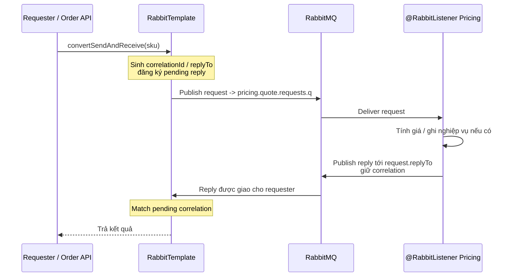
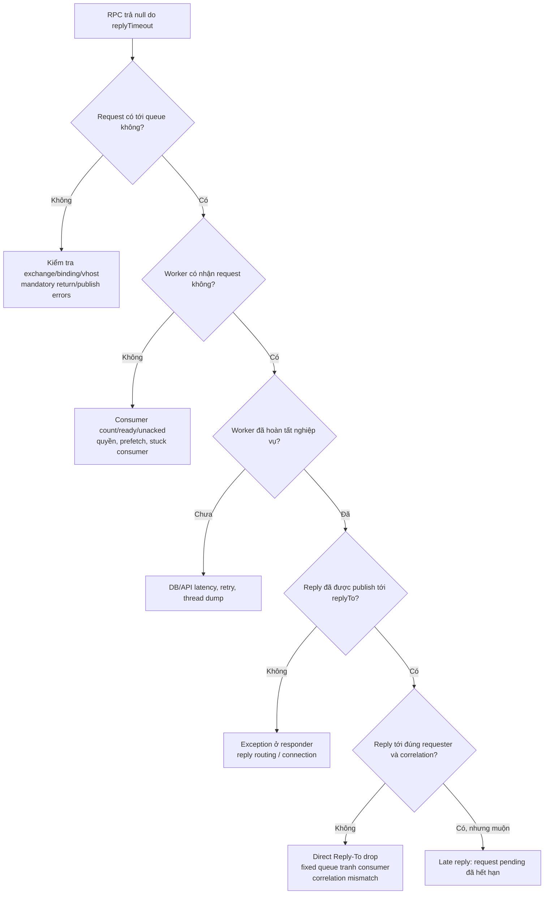
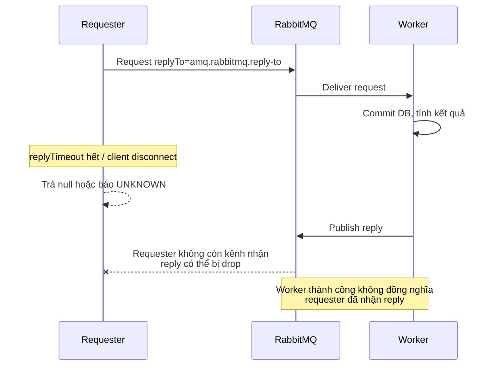

# RPC timeout, correlation sai và phản hồi đến muộn

## 1. Vấn đề: không nhận được reply có đồng nghĩa RPC thất bại?

Trong chương **Chẩn đoán sự cố** của module **SPRING_AMQP**, chúng ta đã sử dụng `RabbitTemplate`, `@RabbitListener`, exchange, queue, binding, acknowledgment, retry, dead-letter và các công cụ quan sát RabbitMQ. Một lỗi khó điều tra trong hệ thống bất đồng bộ là **RPC qua message (request/reply)**: requester gửi message đến worker, chờ kết quả, nhưng **hết thời gian chờ** hoặc nhận một reply không khớp correlation.

Ví dụ Order API hỏi Pricing Service giá của một SKU:

1. Order API gọi `RabbitTemplate.convertSendAndReceive(...)`.
2. `RabbitTemplate` gắn `replyTo` và thông tin **correlation** để tìm đúng lời đáp.
3. RabbitMQ định tuyến request đến `pricing.quote.requests.q`.
4. Pricing worker tính giá và trả reply về địa chỉ `replyTo`.
5. RabbitTemplate ghép reply với request đang chờ và trả kết quả cho Order API.

Hệ thống có thể gặp một trong những tình huống:

- **Request chưa từng tới worker**: sai exchange, routing key, queue, vhost, quyền hoặc connection.
- **Request tới worker nhưng worker xử lý chậm**: DB/API bên dưới kẹt, retry, quá tải hoặc job dài hơn timeout.
- **Worker đã xử lý xong nhưng reply không tới requester**: sai `replyTo`, network disconnect, requester chết, Direct Reply-To làm rơi reply.
- **Reply tới nơi nhưng không ghép được**: thiếu hoặc sai `correlationId`, dùng nhầm correlation key, duplicate correlation, queue trả lời bị consumer khác lấy.
- **Reply đến sau khi requester bỏ chờ**: gọi là **late reply**, không chứng minh thao tác nghiệp vụ đã thất bại.

> **Nguyên tắc điều tra:** Timeout là **không biết kết quả trong ngân sách thời gian**, không đồng nghĩa “worker chưa chạy” hay “có thể retry bằng một business ID mới”. Phải truy nguyên request, broker delivery, worker commit, reply routing, correlation và thời điểm phản hồi.

Bài này trình bày cơ chế request/reply của **Spring AMQP qua AMQP 0.9.1**, so sánh Direct Reply-To với fixed reply queue, giải thích chi tiết `replyTimeout`, `replyTo` và `correlationId`, đồng thời hướng dẫn thu thập bằng chứng, test lỗi và phục hồi an toàn.

## 2. Đường đi của một RPC và bốn loại ID

### 2.1. Luồng bình thường



**Có ít nhất bốn định danh khác nhau:**

| Thuộc tính | Mục đích | Có được dùng thay thế không? |
| --- | --- | --- |
| `correlationId` | Ghép một **reply** với một request **đang chờ** của client/template | Không thay thế business ID hoặc xác nhận xử lý |
| `replyTo` | Chỉ **địa chỉ đích** để worker gửi lời đáp | Không phải khóa correlation và không chứng minh requester còn sống |
| `messageId` | Định danh một message/event ở ứng dụng hoặc log | Không mặc nhiên bằng `correlationId` |
| `operationId`/idempotency key | Định danh **tác động nghiệp vụ logic** khi retry | **Giữ ổn định** sau timeout hoặc mất kết nối |

`CorrelationData` còn là lớp Spring dùng cho **publisher confirms**: nó liên kết một **lần publish** với confirm/return của broker, **khác** mục đích của `messageProperties.correlationId` dùng cho request/reply. Đừng nhầm hai khái niệm chỉ vì đều chứa từ “correlation”.

### 2.2. Một request AMQP điển hình

```text
exchange       = pricing.rpc.x
routingKey     = pricing.quote
queue          = pricing.quote.requests.q
replyTo        = amq.rabbitmq.reply-to     (giá trị gửi từ client)
correlationId  = 92c5...                  (template quản lý)
messageId      = 74f1...                  (request/event logic)
contentType    = text/plain
body           = SKU-2026-001
```

Khi Direct Reply-To được dùng, RabbitMQ chuyển tiếp `reply-to` thành địa chỉ **requester-specific** dạng `amq.rabbitmq.reply-to.<opaque>` để worker trả lời. Đây không phải một queue bền vững thông thường; không tự khai báo, purge hoặc đặt DLX cho địa chỉ đó.

Với fixed reply queue, `replyTo` có thể là tên queue thật, ví dụ `orders.rpc.reply.pod-a`. Trong cả hai phương án, **worker phải trả đúng replyTo được gửi đến**, và phải để Spring hoặc code của responder giữ correlation phù hợp.

## 3. Cơ chế thời gian chờ của RabbitTemplate

Spring AMQP cung cấp hai nhóm method:

- `sendAndReceive(...)`: gửi và nhận `org.springframework.amqp.core.Message`.
- `convertSendAndReceive(...)`: chuyển đổi object sang message, rồi chuyển reply về object bằng `MessageConverter`.

Mặc định, các method gửi–chờ trả lời **timeout sau 5 giây và trả `null`**. Có thể điều chỉnh bằng `RabbitTemplate.setReplyTimeout(milliseconds)`. Thời gian là **mili giây**, không phải seconds.

```java
import org.springframework.amqp.rabbit.connection.ConnectionFactory;
import org.springframework.amqp.rabbit.core.RabbitTemplate;
import org.springframework.context.annotation.Bean;

@Bean
RabbitTemplate pricingRpcTemplate(ConnectionFactory connectionFactory) {
    RabbitTemplate template = new RabbitTemplate(connectionFactory);
    template.setReplyTimeout(3_000L); // 3 giây, ví dụ
    return template;
}
```

Trong các phiên bản Spring Boot hỗ trợ cấu hình `RabbitTemplate` mặc định, cũng có property tương ứng `spring.rabbitmq.template.reply-timeout`, nhưng **đừng giả định** một property sẽ áp dụng cho mọi template custom do ứng dụng tự tạo. Với ví dụ bean thủ công, `setReplyTimeout` là nguồn cấu hình trực tiếp.

### 3.1. Timeout có bao nhiêu ý nghĩa?



Một `null` có thể đến từ **rất nhiều nhánh**. Nên ưu tiên thu thập bằng chứng theo thứ tự: publish → queue → worker → reply → correlation → business result. Đừng tăng timeout lên 60 giây như một cách “sửa” mặc định khi root cause là sai binding hoặc reply queue bị hai Pod cùng consume.

### 3.2. Phân biệt timeout, return và exception

| Quan sát ở requester | Ý nghĩa thường gặp | Bước tiếp theo |
| --- | --- | --- |
| `convertSendAndReceive(...) == null` | Không có reply được ghép trong `replyTimeout` | Tra chuỗi delivery và trạng thái worker |
| `AmqpMessageReturnedException` | Request mandatory không route được tới queue (khi returns bật đúng) | Kiểm tra exchange/routing key/binding/vhost |
| Exception connection/auth/channel | Không mở hoặc dùng được AMQP connection/channel | TLS, credentials, vhost, RabbitMQ status |
| Reply lỗi conversion | Có thể reply đã tới nhưng converter/schema không phù hợp | Kiểm tra `contentType`, reply payload, DTO và converter |
| Client timeout bên ngoài (HTTP/Resilience4j) | Ngân sách HTTP/circuit-breaker hết trước hoặc khác `replyTimeout` | Đối chiếu **tất cả tầng timeout** |
| Async template future hoàn tất lỗi timeout | Hành vi riêng của `AsyncRabbitTemplate` | Không nhầm với `null` của đồng bộ `RabbitTemplate` |

**Lưu ý:** Nếu gửi request với `mandatory=true`, Spring AMQP có thể ném `AmqpMessageReturnedException` thay vì chờ hết 5 giây nếu message không route được. Điều này yêu cầu publisher returns được bật ở connection factory và **không đăng ký `ReturnsCallback` riêng trên cùng RabbitTemplate** vốn cần quản lý returns cho request/reply. Khi dùng publisher confirms với `CorrelationData`, confirm chỉ khẳng định trạng thái publish tại broker, không khẳng định worker đã trả lời.

## 4. Một cấu hình baseline an toàn để tái hiện lỗi

Ví dụ sử dụng **Spring Boot 3.x, Spring AMQP 3.x, Java 17+**, AMQP 0.9.1. Spring AMQP 4.x vẫn có nhánh RabbitMQ AMQP 0.9.1 thông qua các API tương ứng, nhưng cần kiểm tra version/dependency management trước khi sao chép.

### 4.1. Queue/exchange/binding

```java
import org.springframework.amqp.core.Binding;
import org.springframework.amqp.core.BindingBuilder;
import org.springframework.amqp.core.DirectExchange;
import org.springframework.amqp.core.Queue;
import org.springframework.amqp.core.QueueBuilder;
import org.springframework.context.annotation.Bean;
import org.springframework.context.annotation.Configuration;

@Configuration
class PricingRpcTopology {

    @Bean
    DirectExchange pricingRpcExchange() {
        return new DirectExchange("pricing.rpc.x", true, false);
    }

    @Bean
    Queue pricingRequestQueue() {
        return QueueBuilder.durable("pricing.quote.requests.q").build();
    }

    @Bean
    Binding pricingRequestRoute(Queue pricingRequestQueue,
                                DirectExchange pricingRpcExchange) {
        return BindingBuilder.bind(pricingRequestQueue)
                .to(pricingRpcExchange)
                .with("pricing.quote");
    }
}
```

Với Direct Reply-To **không có `@Bean Queue` cho `amq.rabbitmq.reply-to`** và không có reply listener container custom. Spring `RabbitTemplate` sẽ dùng cơ chế phù hợp nếu broker hỗ trợ.

### 4.2. RabbitTemplate cấu hình rõ ngưỡng và trả lỗi unroutable

```java
import org.slf4j.Logger;
import org.slf4j.LoggerFactory;
import org.springframework.amqp.rabbit.connection.ConnectionFactory;
import org.springframework.amqp.rabbit.core.RabbitTemplate;
import org.springframework.amqp.rabbit.support.ListenerExecutionFailedException;
import org.springframework.context.annotation.Bean;
import org.springframework.context.annotation.Configuration;

@Configuration
class PricingRpcClientConfig {
    private static final Logger log =
            LoggerFactory.getLogger(PricingRpcClientConfig.class);

    @Bean("pricingRpcTemplate")
    RabbitTemplate pricingRpcTemplate(ConnectionFactory connectionFactory) {
        RabbitTemplate template = new RabbitTemplate(connectionFactory);

        template.setReplyTimeout(3_000L);
        template.setMandatory(true);

        // Mặc định: không cấp fixed reply queue/replyAddress.
        // RabbitMQ hỗ trợ -> Spring dùng Direct Reply-To.
        template.setReplyErrorHandler(error -> {
            if (error instanceof ListenerExecutionFailedException failure) {
                // Không in raw body/credential; có thể gắn metric riêng.
                log.warn("RPC reply delivery failed: type={}",
                        failure.getClass().getSimpleName());
            }
            else {
                log.warn("RPC reply callback failed: type={}",
                        error.getClass().getSimpleName());
            }
        });
        return template;
    }
}
```

`setReplyErrorHandler(...)` áp dụng cho **reply delivery failures của DirectReplyToMessageListenerContainer** ở các phiên bản hỗ trợ, ví dụ reply tới quá muộn hoặc thiếu correlation. Không coi đây là callback được đảm bảo gọi trong **mọi** trường hợp reply bị broker làm rơi: Direct Reply-To không có buffer và nếu requester disconnect trước, có thể không có delivery tới listener để handler nhận.

Cấu hình Spring Boot cho publisher returns và log:

```yaml
spring:
  rabbitmq:
    host: localhost
    port: 5672
    username: guest
    password: guest
    publisher-returns: true
    publisher-confirm-type: correlated

logging:
  level:
    org.springframework.amqp.rabbit.core.RabbitTemplate: DEBUG
```

Các credentials `guest/guest` là ví dụ **chỉ dành cho RabbitMQ local**; không dùng ở production. Không bật DEBUG lâu dài dưới tải cao, vì có thể làm log lộ metadata hoặc tạo chi phí. Nếu bật returns ở đây, tránh khai báo thêm `template.setReturnsCallback(...)` trên cùng instance dành riêng cho `sendAndReceive` mà không kiểm tra contract của Spring AMQP.

### 4.3. Requester

```java
import org.springframework.amqp.rabbit.core.RabbitTemplate;
import org.springframework.beans.factory.annotation.Qualifier;
import org.springframework.stereotype.Service;

@Service
class PricingRpcClient {
    private final RabbitTemplate rpc;

    PricingRpcClient(@Qualifier("pricingRpcTemplate") RabbitTemplate rpc) {
        this.rpc = rpc;
    }

    public String quote(String sku) {
        Object reply = rpc.convertSendAndReceive(
                "pricing.rpc.x", "pricing.quote", sku);

        if (reply == null) {
            // Unknown outcome: worker có thể đã xử lý xong.
            throw new PricingResultUnavailableException(
                    "Pricing RPC timed out; query result by operationId");
        }
        return (String) reply;
    }
}
```

`PricingResultUnavailableException` là exception ứng dụng tự định nghĩa; không phải class có sẵn của Spring AMQP. Ở môi trường thực, nên đính kèm `operationId` (định danh yêu cầu bền vững) để client có thể truy vấn lại kết quả, tránh gửi một tác vụ gây side effect với ID mới sau timeout.

Đoạn mã trên dùng `String` request/reply để tập trung vào timeout/correlation; trong ứng dụng thật nên dùng DTO JSON cố định, kiểm tra schema version và giới hạn kích thước.

### 4.4. Responder dùng @RabbitListener tự động trả lời

```java
import org.springframework.amqp.rabbit.annotation.RabbitListener;
import org.springframework.stereotype.Component;

@Component
class PricingRpcResponder {

    @RabbitListener(
            id = "pricingQuoteRpc",
            queues = "pricing.quote.requests.q")
    public String quote(String sku) {
        // Dùng service nghiệp vụ, timeout và giới hạn concurrency.
        return "QUOTE:" + sku + ":100000";
    }
}
```

**Khi method trả về giá trị**, Spring AMQP tự đóng gói và gửi reply đến `replyTo` của inbound message, giữ thông tin correlation theo hạ tầng listener; trong trường hợp request có `replyTo`, **không cần `@SendTo`**. `@SendTo` chỉ là địa chỉ fallback khi request không cung cấp reply-to; nếu đặt sai và hiểu nó sẽ ghi đè reply-to của mọi request, có thể dẫn đến sai đường trả lời.

Ví dụ Spring AMQP này là đường RPC qua **AMQP 0.9.1**, không phải `spring-rabbitmq-client`/`RabbitAmqpTemplate` của AMQP 1.0. Nếu dùng AMQP 1.0, kiểm tra tài liệu và lifecycle API riêng của module đó.

## 5. Correlation sai: phân loại nguyên nhân

### 5.1. Hệ thống phải ghép reply như thế nào?

Với request/reply kiểu truyền thống, requester đăng ký một **pending reply** có correlation key; khi reply tới, template tìm pending request tương ứng. Nếu không tìm thấy, reply không được trả “ngẫu nhiên” cho một request khác.

Spring AMQP hiện hành dùng **AMQP `correlationId` property** làm cơ chế correlation mặc định cho reply queue. `RabbitTemplate` thường **tự sinh correlation ID** và không nhất thiết dùng giá trị do ứng dụng gắn trước; để dùng ID tự cung cấp phải đặt `userCorrelationId=true`.

Địa chỉ `replyTo` và ID phải cùng đúng:

```text
Request:
  correlationId = rpc-unique-A
  replyTo = orders.rpc.reply.instance-A

Expected reply:
  correlationId = rpc-unique-A
  destination = orders.rpc.reply.instance-A

Broken reply:
  correlationId = rpc-unique-B
  destination = orders.rpc.reply.instance-A

=> Reply tới đúng queue nhưng không khớp pending request A.
```

**Không dùng lại correlation ID cho hai request còn pending đồng thời.** Spring document cảnh báo rằng nếu application tự điều khiển correlation ID, nó phải **unique**; trùng ID có thể gây cross-talk/ghi đè pending mapping.

### 5.2. Các nguyên nhân điển hình

| Triệu chứng | Nguyên nhân có thể | Điều cần xác minh |
| --- | --- | --- |
| Reply có body nhưng `correlationId` trống | Responder tự publish reply mà không copy property | Kiểm tra code manual reply, inbound/outbound props |
| Reply correlation khác request | Copy nhầm `messageId`/business ID hoặc sửa header | So sánh cả hai message properties |
| Sau nâng cấp mới bị timeout | Một phía dùng `spring_reply_correlation` legacy, phía kia dùng `correlationId` | Đối chiếu `correlationKey` của template |
| Bật `userCorrelationId=true` rồi lỗi ngẫu nhiên | Client dùng correlation trùng hoặc để null | Sinh ID unique per in-flight RPC và test song song |
| Reply tới queue nhưng requester không nhận | Nhiều requester dùng cùng fixed reply queue, tranh nhau consume | Kiểm tra unique reply queue per requester instance |
| Direct Reply-To không có correlation header | Responder không copy đúng property; hoặc client bật cơ chế correlation theo channel | Kiểm tra `useChannelForCorrelation` và client config |
| `@RabbitListener` trả `void` | Không có auto-reply | Return result hoặc publish reply đúng replyTo |
| Header có ID nhưng vẫn không match | Reply tới sau timeout và pending entry đã xóa | So sánh timestamps với `replyTimeout` |

### 5.3. Đừng nhầm correlation key với business key

Trong một ứng dụng thanh toán, `paymentId` có thể lặp qua nhiều lần hỏi trạng thái. `correlationId` cho RPC có thể thay đổi ở mỗi lần hỏi để ánh xạ reply, còn `paymentId`/`operationId` phải giữ nguyên để truy vấn hoặc idempotent retry.

Mô hình phù hợp:

```text
paymentOperationId = PAY-123             (bền vững, khóa nghiệp vụ)
attempt 1 correlationId = rpc-001       (in-flight RPC A)
attempt 2 correlationId = rpc-002       (in-flight RPC B)
both operations refer to PAY-123        (không charge hai lần)
```

Một reply muộn của attempt 1 **không được làm hoàn tất attempt 2** chỉ vì hai attempt cùng `paymentId`. Tách pending request correlation khỏi business state. Nếu service có API/query theo operationId, ưu tiên đối soát trạng thái thật hơn gửi side-effect operation mới.

## 6. Responder tự gửi reply: lỗi copy metadata dễ xảy ra

Với `@RabbitListener` method trả về một object, hạ tầng Spring xử lý reply routing/correlation. Tuy nhiên, một số hệ thống cần tự publish reply (ví dụ viết framework liên ngôn ngữ, forward qua service khác hoặc xử lý bất đồng bộ). Khi đó **responder chịu trách nhiệm** đọc `replyTo` và copy `correlationId` theo giao thức request.

### 6.1. Ví dụ một responder thủ công đúng về routing/correlation

```java
import java.nio.charset.StandardCharsets;
import org.springframework.amqp.AmqpRejectAndDontRequeueException;
import org.springframework.amqp.core.Message;
import org.springframework.amqp.core.MessageProperties;
import org.springframework.amqp.rabbit.annotation.RabbitListener;
import org.springframework.amqp.rabbit.core.RabbitTemplate;
import org.springframework.stereotype.Component;

@Component
class ManualQuoteResponder {

    private final RabbitTemplate replyPublisher;

    ManualQuoteResponder(RabbitTemplate replyPublisher) {
        this.replyPublisher = replyPublisher;
    }

    @RabbitListener(
            id = "manualPricingQuote",
            queues = "pricing.quote.requests.manual.q")
    public void reply(Message request) {
        var requestProps = request.getMessageProperties();
        String replyTo = requestProps.getReplyTo();
        String correlation = requestProps.getCorrelationId();

        if (replyTo == null || replyTo.isBlank()
                || correlation == null || correlation.isBlank()) {
            throw new AmqpRejectAndDontRequeueException(
                    "RPC request lacks replyTo/correlationId");
        }

        String sku = new String(
                request.getBody(), StandardCharsets.UTF_8);
        String result = "QUOTE:" + sku + ":100000";

        var replyProps = new MessageProperties();
        replyProps.setCorrelationId(correlation);
        replyProps.setContentType(MessageProperties.CONTENT_TYPE_TEXT_PLAIN);
        var reply = new Message(
                result.getBytes(StandardCharsets.UTF_8), replyProps);

        // Dùng default exchange và key là địa chỉ replyTo
        // khi request replyTo là tên queue / Direct Reply-To AMQP 0.9.1.
        replyPublisher.send("", replyTo, reply);
    }
}
```

**Đây là ví dụ thay thế responder ở mục 4.4**, dùng **queue riêng `pricing.quote.requests.manual.q`** và cần khai báo/bind queue này nếu muốn chạy. Không đăng ký đồng thời hai handler vào cùng queue rồi kỳ vọng cả hai xử lý một request. Ví dụ chỉ thể hiện giao thức manual reply; production còn cần **validation input, quyền publish reply, timeout, retry và idempotency**.

Nếu request `replyTo` là kiểu `exchange/routingKey` được Spring hỗ trợ cho địa chỉ tùy chỉnh, phải **phân tích địa chỉ đúng** hoặc dùng `Address` của Spring AMQP. Đừng giả định chuỗi đó luôn chỉ là queue name để truyền làm routing key. Với Direct Reply-To 0.9.1, broker đã viết lại `replyTo` theo client, responder dùng **địa chỉ được nhận** chứ không hard-code `amq.rabbitmq.reply-to`.

### 6.2. Những cách làm sai

```java
// SAI: gắn business ID vào correlationId mà requester không chờ ID đó.
replyProps.setCorrelationId(orderId);

// SAI: hard-code tên pseudo-queue, không dùng địa chỉ replyTo thực.
replyPublisher.send("", "amq.rabbitmq.reply-to", reply);

// SAI: dùng chung fixed reply queue cho nhiều requester Pod.
replyPublisher.send("", "orders.rpc.reply.shared", reply);
```

**Các đoạn này là anti-pattern, không chạy trong production.**

Ngoại lệ: Khi requester đặt `useChannelForCorrelation=true` và dùng Direct Reply-To (Spring AMQP 2.3.7+), broker/template có thể dùng **channel đã gửi request** để ghép reply mà không cần responder copy correlation header theo cách thông thường. Đó là một chế độ riêng, phải được kiểm chứng end-to-end và **không dùng làm cách sửa các hệ thống fixed reply queue** thiếu correlation.

### 6.3. Header correlation so với custom correlation key

Spring AMQP 1.1 từng dùng `spring_reply_correlation`; các phiên bản mới dùng `correlationId` theo mặc định. Nếu hai service ở phiên bản rất cũ và rất mới trao đổi request/reply thủ công, có thể cần điều chỉnh `correlationKey` tương thích hoặc nâng cấp cả hai.

Không sửa bằng cách “thêm cả hai header và đoán” mà không có kiểm thử: cần xác nhận nơi Spring tạo pending key, nơi worker đọc request, nơi reply được tạo và nơi reply được match. **Một contract rõ ràng được kiểm thử** tốt hơn một tập fallback mơ hồ.

## 7. Direct Reply-To: vì sao reply có thể biến mất?

### 7.1. Đặc điểm thực của amq.rabbitmq.reply-to

RabbitMQ hỗ trợ **Direct Reply-To**, giúp requester nhận reply mà không khai báo/xóa queue riêng cho mỗi RPC. Trong AMQP 0.9.1, pseudo-queue `amq.rabbitmq.reply-to` được tiêu thụ ở chế độ no-ack trên channel tương ứng. Broker thực hiện routing trực tiếp đến requester theo địa chỉ tạm.

**Không phải queue bền vững:**

- Không xuất hiện như queue thường trong `rabbitmqctl list_queues` hoặc Management UI.
- Không có message buffering hoặc persistence.
- Delivery semantics của reply là **at-most-once**; reply có thể bị drop nếu requester disconnect.
- Không thể gắn DLX/TTL của queue thường vào chính pseudo-queue để cứu reply sau khi requester đã ngắt.
- Chỉ có thể nhận reply khi connection/channel tương ứng còn khả dụng và đúng ngữ cảnh.

Tài liệu RabbitMQ gọi đây là dạng **volatile queue**: không lưu buffer và có khả năng drop. <https://www.rabbitmq.com/docs/direct-reply-to>

### 7.2. Spring dùng Direct Reply-To khi nào?

Nếu không có fixed reply queue và broker hỗ trợ, `RabbitTemplate` tự chọn Direct Reply-To (Spring AMQP từ 1.4.1; trong 2.0+ mặc định dùng `DirectReplyToMessageListenerContainer` để tái sử dụng consumers). Không cần:

- Tạo `Queue("amq.rabbitmq.reply-to")`.
- Cấu hình `@RabbitListener` để consume pseudo-queue.
- Tạo custom reply listener container riêng.

`RabbitTemplate.setUseDirectReplyToContainer(false)` có thể chuyển về hành vi cũ tạo consumer theo request; không nên dùng như cách sửa timeout tùy tiện vì tốn channel/consumer hơn. `useTemporaryReplyQueues=true` có thể yêu cầu queue tạm thay vì Direct Reply-To khi không có `replyAddress`.

### 7.3. Một reply bị mất trên Direct Reply-To



**Quan trọng:** khi responder publish reply với `mandatory=true` tới Direct Reply-To, việc broker xét routing không bảo đảm requester còn hiện diện; không thể coi thiếu `basic.return` là chứng minh reply đã tới caller. Hãy ghi business outcome theo `operationId` để requester tra cứu khi cần.

### 7.4. Khi nào không nên dùng Direct Reply-To?

Nếu business **không chấp nhận mất phản hồi**, hoặc cần replay/inspect reply sau requester restart, hãy cân nhắc **fixed reply queue riêng theo requester** hoặc chuyển sang **async result/event + trạng thái truy vấn theo operationId**. Fixed reply queue có thể buffer reply, nhưng **không tự giữ được pending waiters sau process restart**; để phục hồi thật cần persistence của request status/correlation.

## 8. Fixed reply queue: đường trả lời có tính quan sát cao hơn nhưng dễ cấu hình sai

### 8.1. Sơ đồ

```text
Requester Pod A                            Requester Pod B
  RabbitTemplate A                           RabbitTemplate B
      replyTo=A.reply.q                          replyTo=B.reply.q
         ^                                            ^
         |                                            |
       RabbitMQ <---- @RabbitListener worker ----> RabbitMQ
```

Spring AMQP yêu cầu **mỗi requester instance hoặc mỗi RabbitTemplate dùng một fixed reply queue duy nhất**. Nếu cả Pod A và Pod B lắng nghe `shared.reply.q`, RabbitMQ sẽ **phân phối cạnh tranh**: reply của request A có thể tới listener của B, trong khi B không có pending correlation A. A đợi hết timeout dù worker đã trả lời thành công.

### 8.2. Cấu hình fixed reply queue đúng với một requester

```java
import org.springframework.amqp.core.Queue;
import org.springframework.amqp.core.QueueBuilder;
import org.springframework.amqp.rabbit.connection.ConnectionFactory;
import org.springframework.amqp.rabbit.core.RabbitTemplate;
import org.springframework.amqp.rabbit.listener.SimpleMessageListenerContainer;
import org.springframework.beans.factory.annotation.Qualifier;
import org.springframework.context.annotation.Bean;
import org.springframework.context.annotation.Configuration;

@Configuration
class FixedReplyQueueConfig {

    // Tên này chỉ dành cho một requester instance đang demo.
    @Bean
    Queue replyQueueForInstanceA() {
        return QueueBuilder.nonDurable(
                "orders.rpc.reply.instance-a").build();
    }

    @Bean("fixedReplyRpcTemplate")
    RabbitTemplate fixedReplyRpcTemplate(ConnectionFactory factory) {
        var template = new RabbitTemplate(factory);
        template.setReplyAddress("orders.rpc.reply.instance-a");
        template.setReplyTimeout(5_000L);
        template.setUseDirectReplyToContainer(false);
        return template;
    }

    @Bean
    SimpleMessageListenerContainer fixedReplyListener(
            ConnectionFactory factory,
            @Qualifier("fixedReplyRpcTemplate") RabbitTemplate template) {
        var container = new SimpleMessageListenerContainer(factory);
        container.setQueueNames("orders.rpc.reply.instance-a");
        container.setMessageListener(template);
        return container;
    }
}
```

**Chỉ chạy cấu hình này khi đã quyết định dùng fixed queue**, không trộn với bean Direct Reply-To `pricingRpcTemplate` của mục 4 mà không phân biệt requester sử dụng template nào. Một ứng dụng có nhiều template cần chọn rõ `@Qualifier`.

Các điểm cần xác minh:

- `setReplyAddress(...)` của template phải khớp **queue mà listener thật sự consume**. Nếu reply address là `exchange/routingKey` thì binding phải route đúng vào reply queue.
- Container nhận reply cần có `setMessageListener(template)`, vì **chính RabbitTemplate quản lý pending replies**. Không thay bằng một `@RabbitListener` bất kỳ chỉ log body rồi kết luận đã xử lý correlation.
- Queue phải tồn tại và quyền của requester phải cho phép consume; auto declaration cần RabbitAdmin hoặc provisioning trước.
- Với nhiều instance, `orders.rpc.reply.instance-a` phải được thay bằng **địa chỉ unique cho mỗi Pod/template**. Dùng instance identity ổn định và chính sách cleanup phù hợp; tránh mỗi restart tạo queue orphan vĩnh viễn.
- Nếu đặt queue durable để giữ reply qua restart, **pending map của RabbitTemplate không được khôi phục tự động**. Reply được lưu nhưng app mới có thể coi là late/unknown. Cần một **persistent correlation store** hoặc chọn event-driven workflow thay RPC sync.

### 8.3. Cảnh báo cấu hình replyAddress khác reply queue

Nếu `replyAddress` chứa một route custom, ví dụ:

```text
replyAddress = "my.reply.exchange/worker-a"
listener consumes = "orders.rpc.reply.instance-a"
```

thì bạn cần:

- Exchange `my.reply.exchange` tồn tại.
- Binding `worker-a → orders.rpc.reply.instance-a` tồn tại.
- Reply publisher có quyền publish vào exchange đó.
- RabbitTemplate reply listener nhận đúng queue.
- Không dùng `orders.rpc.reply.instance-b` trên một Pod khác làm subscriber cạnh tranh.

Nếu chỉ có một chuỗi tên queue làm reply address, Spring có thể xác minh listener trùng tên. Với exchange/routing-key, không phải lúc nào container có thể chứng minh binding đúng; cần kiểm tra broker topology trực tiếp.

## 9. Phản hồi đến muộn: nguồn, hậu quả và các lựa chọn xử lý

### 9.1. Late reply là gì?

Giả sử `replyTimeout=3s`:

```text
T+0.000s   Requester gửi command, pending correlation = C1.
T+1.000s   Worker nhận command, gọi API ngoài mất 5 giây.
T+3.000s   Requester hết timeout; pending C1 được gỡ.
T+6.000s   Worker commit và phát reply correlation=C1.
T+6.010s   Reply đến khi C1 không còn được chờ.
```

Nếu requester đang dùng Direct Reply-To, reply có thể đã **bị broker làm rơi** do requester ngắt, hoặc đã tới container nhưng không có pending C1; `replyErrorHandler` có thể quan sát lỗi delivery tương ứng. Với fixed reply queue, reply có thể ở queue thật và được template nhận **sau timeout**; Spring AMQP hiện đại có thể **reject không requeue** late reply khi không ghép được pending request. Nếu reply queue có DLX được cấu hình đúng, một số late replies có thể được chuyển sang DLQ để điều tra.

**Không khẳng định mọi late reply đều vào DLQ**. Direct Reply-To không có queue bền vững để dead-letter, và với fixed queue phải có container nhận, reject semantics, DLX/binding/permissions hoạt động.

### 9.2. Vì sao reply đến muộn dù worker không lỗi?

- Lời gọi DB/API thứ ba có p99 lớn hơn `replyTimeout`.
- Consumer queue backlog lớn hoặc prefetch khiến request chờ lâu.
- Worker cố retry nhiều lần trong method rồi mới trả kết quả.
- JVM stop-the-world GC, thread pool nghẽn, network jitter.
- RabbitMQ connection/channel bị reset và worker tiếp tục bằng cơ chế recovery.
- Controller/HTTP timeout nhỏ hơn `RabbitTemplate.replyTimeout`; client bỏ request trước khi template hoàn tất.
- Outbox/transaction commit rồi worker chờ publish reply, tăng end-to-end latency.

Vì vậy, cần đo **tổng thời gian** từ requester publish đến nhận reply, không chỉ thời gian xử lý trong method `@RabbitListener`.

### 9.3. Reply đến muộn không được biến thành kết quả cho request khác

Spring `RabbitTemplate` giữ pending map theo correlation, nên late reply **không nên** được ghép cho request khác chỉ vì request trước timeout. Nếu ứng dụng tự quản lý pending promises bằng một `Map` thủ công, phải đặt correlation ID unique, dọn entry đúng và kiểm tra “reply belongs to expected operationId” trước khi hoàn tất future.

Nếu muốn nhận và lưu **kết quả muộn** để phục vụ user, cần state store ngoài RabbitTemplate (theo `operationId`). Ví dụ requester timeout trả HTTP `202 Accepted` với link `GET /operations/{operationId}`, còn worker lưu kết quả bền vững và phát event `OperationCompleted`. Không dùng đường RPC sync với pending state trong RAM làm nguồn dữ liệu lâu dài.

## 10. Reply Error Handler và cleanup: đặt đúng kỳ vọng

### 10.1. Theo dõi thất bại ở DirectReplyToMessageListenerContainer

Từ Spring AMQP 2.0.11/2.1.3, `RabbitTemplate` có `setReplyErrorHandler(...)` để xử lý các reply delivery failures khi dùng **DirectReplyToMessageListenerContainer**, ví dụ reply muộn hoặc thiếu correlation header.

```java
template.setReplyErrorHandler(error -> {
    // Handler ở tầng reply delivery, không tự khôi phục
    // một pending request đã timeout.
    metrics.counter("app.rabbit.rpc.reply.delivery.errors").increment();
    log.warn("Direct RPC reply delivery error: {}",
            error.getClass().getSimpleName());
});
```

Đây là snippet minh họa, cần có `metrics`/`log` từ ứng dụng. **Không in raw failed reply body trong log production**: có thể chứa dữ liệu nhạy cảm. Không lấy `correlationId`/`operationId` làm Prometheus label; dùng chúng trong trace/log với chính sách bảo mật phù hợp.

**Handler không được đảm bảo gọi** khi broker làm rơi reply vì requester mất connection. Không thể dùng “zero reply errors” làm bằng chứng không mất reply.

### 10.2. Hook replyTimedOut

Từ Spring AMQP 2.1.2, `RabbitTemplate` có protected method `replyTimedOut(String correlationId)` cho subclass quan sát timeout. Nếu override:

```java
import org.springframework.amqp.rabbit.connection.ConnectionFactory;
import org.springframework.amqp.rabbit.core.RabbitTemplate;

class ObservableRpcTemplate extends RabbitTemplate {

    ObservableRpcTemplate(ConnectionFactory cf) {
        super(cf);
    }

    @Override
    protected void replyTimedOut(String correlationId) {
        try {
            // Metric/log deadline; KHÔNG chứa payload.
            // metrics.counter("app.rabbit.rpc.timeout").increment();
        }
        finally {
            // Gọi super để duy trì cơ chế cleanup mặc định.
            super.replyTimedOut(correlationId);
        }
    }
}
```

Đây chỉ là một **hook quan sát**, không phải cách “kéo dài pending future” sau timeout. Spring tự quản lý cleanup; code override cần tuân theo Javadoc của phiên bản mục tiêu. Nếu không cần hook, đo timeout ở tầng service khi nhận `null` thường đơn giản hơn.

## 11. Late reply với fixed reply queue: DLQ chỉ là kênh điều tra

Với fixed reply queue, bạn có thể đặt DLX để giữ reply bị từ chối:

```java
import org.springframework.amqp.core.Binding;
import org.springframework.amqp.core.BindingBuilder;
import org.springframework.amqp.core.DirectExchange;
import org.springframework.amqp.core.Queue;
import org.springframework.amqp.core.QueueBuilder;
import org.springframework.context.annotation.Bean;

@Bean
Queue rpcRepliesA() {
    return QueueBuilder.nonDurable("orders.rpc.reply.instance-a")
            .deadLetterExchange("orders.rpc.late.dlx")
            .deadLetterRoutingKey("late")
            .build();
}

@Bean
DirectExchange rpcLateDlx() {
    return new DirectExchange("orders.rpc.late.dlx", true, false);
}

@Bean
Queue rpcLateDlq() {
    return QueueBuilder.durable("orders.rpc.late.dlq").build();
}

@Bean
Binding rpcLateBinding(Queue rpcLateDlq,
                       DirectExchange rpcLateDlx) {
    return BindingBuilder.bind(rpcLateDlq)
            .to(rpcLateDlx).with("late");
}
```

**Mã trên là cấu hình thay thế** `replyQueueForInstanceA` của mục 8.2, không đăng ký hai Queue beans cùng tên nhưng arguments khác nhau.

Khi fixed reply template nhận một reply đã timeout và từ chối với `AmqpRejectAndDontRequeueException`, broker có thể dead-letter reply vào `orders.rpc.late.dlq` nếu DLX/binding đã sẵn sàng. Tuy nhiên:

- Một reply **không bao giờ tới** fixed queue vì route sai không thể được cứu bởi DLX của queue đó.
- Một reply nhận được sau requester restart không tự khôi phục correlation đang chờ trong RAM.
- DLQ chứa dữ liệu phản hồi có thể nhạy cảm: kiểm soát retention, access, logging và reprocessing.
- **Không tự động replay mọi late reply** vào request mới: pending correlation đã hết hạn; cần đối soát theo operationId.
- Nếu DLX route sai hoặc target queue lỗi, việc chuyển DLQ có thể thất bại tùy queue type/strategy; test với RabbitMQ thật.

Đối với Direct Reply-To, **không thể dùng mô hình DLX này** vì nó không có reply queue bền vững.

## 12. Troubleshooting theo trình tự: từ requester đến responder

### Bước 1 — xác nhận timeout tầng nào thực sự nổ

Ghi nhận:

```text
HTTP request deadline             = 2500 ms
RabbitTemplate.replyTimeout       = 3000 ms
Worker DB query p99               = 2000 ms
Worker downstream API timeout     = 5000 ms
Network + queue wait              = variable
```

Nếu HTTP đã timeout ở 2,5 giây, người dùng có thể bỏ cuộc trước khi `RabbitTemplate` trả `null` tại 3 giây. Nếu worker API timeout tới 5 giây, RPC 3 giây **không thể ổn định** trừ khi API thường rất nhanh. Định nghĩa end-to-end deadline, phân bổ budget cho queue wait/processing/reply, và đừng cấu hình các tầng mâu thuẫn.

### Bước 2 — kiểm tra exchange, binding, queue và vhost

Ví dụ câu lệnh chỉ đọc, thay vhost/tên phù hợp:

```bash
rabbitmqctl list_queues -p /orders name messages_ready messages_unacknowledged consumers
rabbitmqctl list_exchanges -p /orders name type durable
rabbitmqctl list_bindings -p /orders source_name destination_name routing_key
```

Đọc kết quả:

- `pricing.quote.requests.q` không tồn tại → provisioning/permissions/startup issue.
- Exchange không tồn tại → publisher có thể bị channel exception; không mặc định coi là `NO_ROUTE` return.
- Exchange tồn tại nhưng không có binding `pricing.quote` → mandatory return hoặc message bị drop nếu không mandatory.
- Queue có `messages_ready` tăng, consumer=0 → worker chưa subscribe.
- `messages_unacknowledged` cao, worker p99 tăng → stuck processing, prefetch hoặc ack problem.
- Có nhiều vhost → request được publish vào một vhost khác vhost của worker, dù queue trùng tên.

**Không dùng `rabbitmqctl list_queues` để tìm pseudo-queue Direct Reply-To**: nó không hiện như queue bình thường.

### Bước 3 — xác nhận worker đã thực sự nhận request

Thu thập trong listener:

- `operationId` hoặc business key từ payload đã validate.
- `messageId`, `correlationId`, `replyTo` (chỉ log đã sanitize).
- Thời điểm nhận, thời điểm bắt đầu/kết thúc nghiệp vụ.
- DB transaction/outcome, retry attempt, container ID và node.
- Thời điểm gửi reply và lỗi publish.

Một request có thể được **ACK** rồi nhưng chưa có reply nếu responder trả `void`, ném exception trong reply publishing hoặc đã tự xử lý bằng luồng async mà không quản lý lifecycle đúng. Consumer ACK không chứng minh requester đã nhận reply.

### Bước 4 — đối chiếu thông tin reply

Với fixed queue:

```text
Request sent by instance A:
  replyTo = orders.rpc.reply.instance-a
  correlationId = C-001

Reply observed:
  routedTo = orders.rpc.reply.instance-b  <-- WRONG
  correlationId = C-001

or:
  routedTo = orders.rpc.reply.instance-a
  correlationId = C-999                   <-- WRONG
```

Với Direct Reply-To, xem kết nối/channel requester còn sống, hạ tầng listener trong `RabbitTemplate` và error handler; đừng cố tìm message còn nằm trong pseudo-queue.

### Bước 5 — phân biệt “không có reply” và “reply đã muộn”

Nếu worker xử lý xong sau thời điểm requester timeout, đây là **late reply** hoặc reply thất lạc theo cơ chế delivery. Hành động:

1. Đối soát trạng thái nghiệp vụ bằng `operationId`.
2. Nếu operation đã commit, trả kết quả/cho client query; **không chạy lại side effect**.
3. Nếu operation chưa commit và chính sách cho phép retry, gửi lại **cùng idempotency key**.
4. Nếu outcome mơ hồ, dùng trạng thái `UNKNOWN/RECONCILING` thay vì coi là `FAILED`.
5. Ghi dấu vết late reply để đo SLO và giảm tải, không tự cho rằng tăng timeout luôn giải quyết được.

## 13. Cây chẩn đoán nhanh theo triệu chứng

| Triệu chứng ở log/dashboard | Khả năng cao | Xác nhận | Hướng sửa |
| --- | --- | --- | --- |
| Hầu hết RPC trả `null` sau đúng 5 giây | Đang dùng timeout mặc định và không nhận reply | Kiểm tra `replyTimeout`, reply listener, consumer | Tìm nhánh mất reply; điều chỉnh timeout sau khi có bằng chứng |
| Timeout từ khi deploy thêm replica | Hai instance dùng chung fixed reply queue | Queue consumer count >1 cho reply queue, correlation mismatch | Dùng Direct Reply-To hoặc queue unique per instance |
| Worker log xử lý thành công, requester timeout | Reply sai `replyTo`, muộn hoặc bị drop | So timestamps và correlation, broker reply route | Copy replyTo đúng; reconcile business outcome |
| Chỉ một số request đồng thời nhận kết quả sai | Trùng `correlationId` do `userCorrelationId=true` | Kiểm tra unique IDs trên pending map | Sinh unique ID per in-flight RPC |
| Timeout và `NO_ROUTE` / `AmqpMessageReturnedException` | Sai exchange/routing key/binding | RabbitMQ bindings và returns | Sửa topology, test mandatory returns |
| Không thấy reply trong Management | Đang dùng Direct Reply-To | Kiểm tra template/broker mode | Đây là đặc tính bình thường của pseudo-queue |
| Reply queue ready tăng nhưng requester timeout | Listener không consume queue hoặc queue sai | Reply listener config, replyAddress vs queue | Wire `setMessageListener(rabbitTemplate)` và đúng queue |
| Reply bị đẩy vào DLQ sau khi worker hoàn tất | Fixed reply tới sau timeout, template reject | DLQ, timestamps, `x-death` | Rà lại latency/deadline, không replay mù |
| Reply thiếu correlation sau manual reply | Responder không copy ID | Inbound/outbound props | Dùng auto-reply hoặc copy đúng correlation |
| Reply đúng ID nhưng không có pending requester | Late reply, requester restart hoặc sai instance | Logs, pod life cycle, timeout | Đối soát qua persisted operation status |
| Không có error handler dù có reply mất | Direct Reply-To drop trước client delivery | Connection/consumer lifecycle, broker metrics | Đừng phụ thuộc replyErrorHandler để chứng minh zero loss |
| Worker mắc kẹt trước reply | DB/API latency, thread pool, GC, retry storm | p99, traces, thread dumps, unacked | Giới hạn concurrency, timeout, backoff và giảm queue wait |
| Reply đã tới nhưng conversion ném exception | JSON/schema/contentType mismatch | Converter logs, reply content type | Dùng DTO/version tương thích, xử lý lỗi rõ |
| Timeout sau đổi sang async API | Nhầm `AsyncRabbitTemplate.receiveTimeout` với synchronous reply timeout | Future completion/cancel logs | Dùng contract timeout đúng API, không suy diễn `null` |

## 14. Logging, tracing và metrics: thấy được cả hai đầu

### 14.1. Log có cấu trúc, không chứa dữ liệu bí mật

Requester:

```text
time=... component=rpc_client operationId=OP-124
requestId=REQ-3 listener=pricingQuoteRpc exchange=pricing.rpc.x
routingKey=pricing.quote timeoutMs=3000 outcome=TIMEOUT
elapsedMs=3001
```

Responder:

```text
time=... component=pricing_worker operationId=OP-124
requestId=REQ-3 correlationRef=C-52
queue=pricing.quote.requests.q businessOutcome=COMMITTED
processingMs=4100 replyAttempted=true
```

Sử dụng `operationId`/`requestId` xuyên các service, **nhưng đừng mặc định chúng bằng `correlationId`** do template có thể sinh ID riêng. Nếu log correlation, phải tránh để ID chứa dữ liệu nhạy cảm hay giá trị do publisher không tin cậy có thể tạo log injection.

### 14.2. Mẫu metric nên có

| Metric (tên ứng dụng gợi ý) | Loại | Nhãn an toàn |
| --- | --- | --- |
| `app.rabbit.rpc.calls` | Counter | `service,operation,outcome` |
| `app.rabbit.rpc.duration` | Timer | `service,operation,outcome` |
| `app.rabbit.rpc.timeout` | Counter | `service,operation` |
| `app.rabbit.rpc.reply.delivery.errors` | Counter | `service,reason_class` |
| `app.rabbit.rpc.worker.processing` | Timer | `worker,operation,outcome` |
| `app.rabbit.rpc.worker.reply.publish.failures` | Counter | `worker,reason_class` |
| Broker ready/unacked/consumer count | Gauge | `queue,vhost` |
| DB/API p95/p99, pool pending, 429/503 | Timer/Gauge/Counter | `service,downstream` |

Đây là tên metric **tự thiết kế**, không phải mặc định của Micrometer/Spring AMQP. Không đưa `messageId`/`correlationId`/`operationId` vào **metric labels** vì cardinality cao. Dùng trace/log span attributes có kiểm soát để tìm từng request.

### 14.3. Timeout vs latency percentile

Nếu timeout 3 giây nhưng worker p99 xử lý 4 giây, tỷ lệ timeout không thể được sửa chỉ bằng tăng consumer count. Phải phân tích:

\[
T_{\text{RPC}} =
T_{\text{publish}} +
T_{\text{queue wait}} +
T_{\text{worker}} +
T_{\text{reply route}} +
T_{\text{receive}}
\]

Các thành phần có thể chồng lên nhau tùy triển khai, nên công thức là **mô hình tư duy**, không phải phép đo bắt buộc cộng các histogram không cùng trace. Đo end-to-end timer phía requester và step spans riêng. Phân tích thời gian chờ queue bằng dấu thời gian producer/consumer và **đồng hồ được đồng bộ**, tránh dùng hai clock lệch nhau rồi kết luận RPC chậm.

Nếu SLA yêu cầu dưới 1 giây nhưng 5% request ở worker cần hơn 5 giây, **RPC synchronous là hợp đồng API không phù hợp**; cân nhắc trả HTTP 202 và xử lý async.

## 15. Retry sau timeout phải dựa trên idempotency và trạng thái

### 15.1. Chỉ “request” có thể retry, không phải tác động bất kỳ

Thử với một thao tác có side effect, ví dụ thanh toán:

```text
RPC AuthorizePayment(OP-500) -> timeout
Worker đã authorize nhưng reply muộn/bị drop

Retry AuthorizePayment(OP-NEW) -> có nguy cơ authorize lần hai
Retry AuthorizePayment(OP-500) -> gateway có idempotency theo OP-500
                                  -> trả kết quả cũ hoặc đối soát
```

Một thiết kế an toàn:

1. Client cung cấp **operationId** ổn định; server unique theo operationId.
2. Worker kiểm tra inbox/DB state trước khi gọi side-effect API.
3. Nếu đã có kết quả, trả hoặc phát lại kết quả đã lưu, không chạy lại nghiệp vụ.
4. Nếu outcome **UNKNOWN**, truy vấn provider theo idempotency key/external transaction ID.
5. Bất kỳ kết quả mới nào cũng phải được commit trong DB trước khi phát reply (dùng outbox nếu việc mất reply là nghiêm trọng).
6. Requester timeout trả trạng thái **UNKNOWN/PENDING**, không tự coi là FAILED/ROLLBACK.

### 15.2. Nếu reply bắt buộc không được mất

Direct Reply-To có **at-most-once** semantics cho reply. Nếu ứng dụng cần bảo đảm có thể truy hồi:

- Đưa nghiệp vụ thành **command async** với `operationId` bền vững.
- Worker lưu result và trạng thái `PENDING/COMPLETED/FAILED/UNKNOWN` trong DB.
- Publish `OperationCompleted` qua transactional outbox vào event exchange/queue durable.
- Requester hoặc frontend truy vấn `GET /operations/{id}` / nhận notification.
- Dùng inbox/idempotency để chống duplicate result events.

Đây là thay đổi **protocol ứng dụng**, không chỉ thay tên pseudo-queue. Fixed reply queue có thể cải thiện buffering nhưng không làm một Java thread đã chết sống lại để nhận reply RPC.

### 15.3. Deadline và cancellation

Một requester timeout **không có nghĩa** worker đã bị cancel. Với message gửi qua RabbitMQ, worker có thể đã ACK và đang xử lý, hoặc còn nằm trong queue; RabbitMQ không tự hủy business transaction của worker khi client hết thời gian chờ.

Nếu có yêu cầu hủy, cần **cancellation command có operationId**, workflow trạng thái và điều kiện “chưa thực hiện side effect” rõ ràng. Compensation có thể cần một business operation riêng (void/refund), không dùng `basicNack` để đảo DB commit.

## 16. Kiểm thử timeout, correlation và late reply

Không chỉ viết unit test `verify(rpcTemplate).convertSendAndReceive(...)`. Để kiểm chứng Direct Reply-To drop, exchange routing, fixed reply DLX và listener wiring, cần **RabbitMQ thật** (ví dụ Testcontainers). Test handler, idempotency, timeout ở tầng service có thể dùng unit tests.

### 16.1. Các trường hợp cần bao phủ

| Test ID | Tình huống | Kỳ vọng |
| --- | --- | --- |
| RPC-01 | Responder trả trong timeout | Client nhận đúng reply, không gọi error handler |
| RPC-02 | Worker ngủ lâu hơn `replyTimeout` | Client trả `null`/unknown; worker vẫn có thể hoàn tất |
| RPC-03 | Request exchange/routingKey không có binding | Mandatory return/exception nếu bật returns; không chờ timeout vô nghĩa |
| RPC-04 | Responder trả `void` hoặc quên gửi reply | Worker có thể ACK, client timeout |
| RPC-05 | Responder manual trả sai `correlationId` | Reply không match pending; quan sát reply delivery failure |
| RPC-06 | Responder manual không giữ `replyTo` | Reply sai route; client timeout |
| RPC-07 | `userCorrelationId=true` và hai RPC trùng ID | Kiểm thử chống cross-talk/duplicate; cấu hình phải từ chối/tránh ID trùng |
| RPC-08 | Fixed reply queue bị hai requester dùng chung | Reply có thể tới requester sai; phải thay bằng queue unique |
| RPC-09 | Fixed reply tới sau timeout | Reply bị reject; DLQ nhận nếu có DLX đúng |
| RPC-10 | Direct Reply-To requester disconnect trước reply | Reply có thể bị drop, không có pending recovery |
| RPC-11 | Reply tới đúng ID nhưng payload schema sai | Conversion error, không coi là business success |
| RPC-12 | Worker DB commit xong, reply mất | Client retry theo cùng operationId, effect chỉ một lần |
| RPC-13 | Requester process restart giữa RPC | Không còn in-memory pending; truy vấn persisted outcome |
| RPC-14 | Scale requester 1 → 3 Pods | Direct Reply-To hoạt động độc lập; fixed queue unique từng Pod |
| RPC-15 | Worker có DB/API p99 lớn | Alert timeout + worker latency/queue age phân biệt bottleneck |
| RPC-16 | Hai lần hỏi trạng thái với cùng businessId | Correlation từng RPC khác nhau; không cross-complete |

### 16.2. Test timeout bằng responder trễ

Mẫu integration test có controller phía requester đang gọi template và responder giả cố ý chậm. Ở test profile, đặt `replyTimeout=200ms` và responder delay `800ms`, sau đó **assert requester trả `null`** chứ không chỉ assert exception tuỳ ý. Ví dụ giản lược:

```java
import java.util.concurrent.CountDownLatch;
import java.util.concurrent.TimeUnit;
import org.springframework.amqp.rabbit.annotation.RabbitListener;
import org.springframework.stereotype.Component;

@Component
class DelayedQuoteResponder {
    static final CountDownLatch RECEIVED = new CountDownLatch(1);

    @RabbitListener(queues = "pricing.quote.test.q")
    public String quote(String sku) throws InterruptedException {
        RECEIVED.countDown();
        Thread.sleep(800); // Chỉ dùng trong test fixture.
        return "QUOTE:" + sku;
    }
}
```

```java
// Trong JUnit test với RabbitMQ thật, template nối vào test queue.
rpcTemplate.setReplyTimeout(200L);
Object reply = rpcTemplate.convertSendAndReceive(
        "pricing.rpc.test.x", "pricing.quote.test", "SKU-1");

org.junit.jupiter.api.Assertions.assertNull(reply);
org.junit.jupiter.api.Assertions.assertTrue(
        DelayedQuoteResponder.RECEIVED.await(2, TimeUnit.SECONDS));
```

**Cần chuẩn bị trước** queue `pricing.quote.test.q` và exchange/binding test, tắt hoặc phân vùng các responders khác; nếu không, test có thể không tới đúng worker. Sau timeout, dùng Awaitility/test hook để chờ worker **thực sự hoàn tất** và kiểm tra kết quả. Trong test này `Thread.sleep` chỉ mô phỏng worker chậm, còn assertion bất đồng bộ nên dùng Awaitility/latch để tránh flaky timing.

### 16.3. Test lỗi correlation bằng manual reply

Ở responder manual của mục 6, trong **profile test** đặt:

```java
replyProps.setCorrelationId("wrong-" + correlation);
// Chỉ dành cho fault injection trong test, KHÔNG dùng production.
```

Kỳ vọng: requester đã đăng ký correlation gốc nên không ghép sai reply. Với Direct Reply-To, xử lý lỗi delivery có thể đi vào `replyErrorHandler` khi reply tới requester container. Với fixed queue, reply không hợp lệ có thể bị reject/DLQ theo cấu hình. **Bằng chứng chẩn đoán phải gồm cả request và reply correlation**, không chỉ assert trả null.

### 16.4. Test fixed reply queue bị chia sẻ

Khởi động hai requester instance cùng dùng `orders.rpc.reply.shared`, mỗi instance có template và listener riêng; gửi nhiều concurrent requests với correlation IDs unique. Vì RabbitMQ phân phối cạnh tranh, có thể xảy ra:

- Requester A chờ C1.
- Reply cho C1 được đưa vào consumer của B.
- Template B không có pending C1 → delivery failure/reject.
- Requester A timeout.

Đây là **test negative** để chứng minh cấu hình sai, không phải cấu hình production. Test corrected bằng queue riêng cho mỗi requester và xác nhận không có cross-delivery. **Không dựa vào một lần chạy** làm bằng chứng nếu lỗi tranh chấp mang tính ngẫu nhiên; dùng nhiều lượt và xác minh receiver identity.

### 16.5. Kiểm chứng side effect không nhân đôi

Với RPC chỉ đọc giá, retry thường ít nguy hiểm hơn; với RPC thanh toán/tạo reservation phải kiểm thử:

1. Đầu tiên worker commit DB, reply tới chậm và requester timeout.
2. Requester retry **cùng operationId**.
3. Worker thấy inbox unique hoặc persisted result và **không chạy side effect lần hai**.
4. Assert **một database/gateway operation**, dù worker có thể nhận message hai lần.
5. Nếu gateway timeout sau commit, kiểm tra reconciliation chứ không kết luận failed.

Không đặt `@Transactional` trên toàn method test end-to-end rồi tin rằng worker thread/relay thấy dữ liệu chưa commit. Query lại database từ transaction mới để kiểm tra kết quả đã được commit.

## 17. Runbook xử lý sự cố sản xuất

### 17.1. Thu thập bằng chứng trong 10–15 phút đầu

Không cần chỉnh code khi chưa biết nhánh lỗi. Ghi:

- **Tác động:** tỷ lệ RPC timeout, các operation bị ảnh hưởng, thời gian bắt đầu, triển khai/version gần nhất.
- **Requester:** `replyTimeout` thực tế, exception/null, HTTP/client deadline, pod restart, kết nối/channels.
- **Publisher:** exchange/routing key/vhost, mandatory returns, publisher confirms, network errors.
- **Broker:** request queue ready/unacked/consumers; reply queue nếu là fixed; queue bindings và node health.
- **Worker:** listener receive count, thời gian chờ queue, processing p50/p95/p99, DB/API errors, worker commits.
- **Reply:** replyTo, correlation, thời điểm publish/receive, late/errors/DLQ.
- **Nghiệp vụ:** operationId đã hoàn tất hay chưa; có thể đối soát/tra cứu trạng thái không?

### 17.2. Các biện pháp phù hợp theo nhóm lỗi

| Nhóm lỗi | Cần làm | Không nên làm |
| --- | --- | --- |
| Sai routing | Sửa binding/vhost hoặc target queue; bật mandatory return test | Chỉ tăng `replyTimeout` |
| Worker chậm | Tối ưu DB/API, điều tiết concurrency/prefetch, timeout/downstream budget | Scale vô hạn làm DB quá tải |
| Correlation mismatch | Dùng auto reply hoặc copy đúng, kiểm tra key và uniqueness | Ép mọi request dùng cùng correlationId |
| Fixed reply shared | Mỗi requester một reply queue hoặc chuyển Direct Reply-To | Thêm consumer vào shared queue và hy vọng hết |
| Direct Reply-To drop | Retry idempotently hoặc chuyển thành durable async result | Trông chờ DLQ cho pseudo-queue |
| Late reply | Đối soát status theo operationId, điều chỉnh SLA/protocol | Áp late reply vào một request khác |
| Repeated timeouts sau deploy | Kiểm tra cả hai version client/worker, type converter/schema | Rollback mù không xác định trạng thái side effect |
| Payment/side effect unknown | Tạm dừng duplicate action, query provider, reconcile | Gửi operation mới với idempotency key mới |

### 17.3. Khi nào nên bỏ RPC đồng bộ?

Nếu công việc thường mất vài giây đến vài phút, queue backlog dễ biến động hoặc reply bắt buộc bền vững, hãy ưu tiên:

```text
POST /operations (Idempotency-Key: OP-123)
  -> 202 Accepted + operationId
  -> persist command/outbox
  -> worker executes + persists result
  -> publish OperationCompleted
  -> GET /operations/OP-123 or webhook/SSE
```

Bằng cách này, client timeout hoặc restart **không làm mất dữ liệu kết quả**. Request/reply của RabbitTemplate vẫn phù hợp cho **RPC ngắn, query nhẹ và có thể thực hiện lại an toàn**, đặc biệt khi Direct Reply-To giúp giảm overhead tạo queue.

## 18. Những sai lầm thường gặp

**“`convertSendAndReceive` trả `null` thì worker chưa làm gì.”** Không đúng: worker có thể đã commit nhưng reply mất hoặc đến muộn.

**“Publisher confirm ACK nghĩa là RPC đã thành công.”** Không đúng: confirm chỉ về publish tới broker, reply và business outcome là hai ranh giới riêng.

**“`messageId` và `correlationId` bắt buộc giống nhau.”** Không đúng: một ID theo dõi message, một ID liên kết request với reply pending.

**“Chỉ cần đặt `userCorrelationId=true` để sửa mismatch.”** Không đúng: bật lên đồng nghĩa ứng dụng phải bảo đảm correlation unique; để null/trùng có thể tạo cross-talk.

**“Tăng timeout sẽ sửa mọi lỗi.”** Không đúng nếu worker không subscribe, replyAddress sai hoặc fixed reply queue bị instance khác consume.

**“`@SendTo` luôn ghi đè replyTo.”** Không đúng; khi inbound request có reply-to, cơ chế auto reply dùng địa chỉ đó. `@SendTo` là fallback theo contract Spring listener.

**“Direct Reply-To là queue bình thường nên có thể thêm DLX.”** Không đúng: pseudo-queue volatile, zero-buffer, at-most-once.

**“Có `replyErrorHandler` tức là mọi reply mất đều được log.”** Không đúng: broker có thể drop reply trước khi có client delivery để gọi handler.

**“Fixed reply queue dùng chung cho 5 requester Pod tiết kiệm tài nguyên.”** Có thể gây reply bị consumer sai nhận; Spring AMQP yêu cầu queue unique per requester instance/template trong mô hình này.

**“Timeout nên retry payment với operation ID mới.”** Có thể tạo hai side effects. Retry bằng ID ổn định, hoặc tra cứu/reconcile trước.

**“Reply muộn chỉ cần requeue cho tới khi requester nhận.”** Pending mapping đã timeout; requeue vô hạn tạo poison loop. Với fixed queue có thể cách ly DLQ để điều tra, không replay mù.

**“Đếm số lần handler được gọi bằng số tác động nghiệp vụ.”** Consumer idempotent có thể nhận lại và bỏ qua duplicate; đo business effect đã commit riêng.

## 19. Checklist trước khi đóng incident

- [ ] Đã xác định chính xác timeout ở **Spring RabbitTemplate**, HTTP client hay tầng khác?
- [ ] `replyTimeout` được xác minh theo runtime và đơn vị milliseconds, không chỉ theo file config?
- [ ] Có bằng chứng request tới exchange, được route vào queue và worker đã nhận không?
- [ ] Với mandatory returns, có xử lý `AmqpMessageReturnedException` thay vì chỉ chờ `null` không?
- [ ] Có xác định **Direct Reply-To** hay **fixed reply queue** trong runtime?
- [ ] Với Direct Reply-To, có hiểu pseudo-queue không buffer/không bền vững/không có DLQ không?
- [ ] Với fixed reply queue, mỗi requester/template có queue riêng, listener container được wire vào `RabbitTemplate` chưa?
- [ ] Request `replyTo` và `correlationId` có được copy nhất quán vào reply không?
- [ ] Nếu bật `userCorrelationId=true`, IDs có unique giữa các RPC đang pending không?
- [ ] Có đo worker p99, queue wait, publisher/response latency và downstream bottleneck không?
- [ ] Reply muộn có được ghi nhận và đối soát theo `operationId` thay vì bị xem là failure chắc chắn không?
- [ ] Có tránh dùng message/correlation IDs làm metric labels cardinality cao và log payload nhạy cảm không?
- [ ] Retry RPC side effect có idempotency ở DB hoặc provider đích không?
- [ ] Có integration test RabbitMQ thật cho late reply, correlation mismatch, shared fixed queue và consumer restart không?
- [ ] Đã kiểm tra DLQ của fixed replies **không** bị nhầm là kết quả nghiệp vụ thành công?
- [ ] SLO vẫn phù hợp RPC sync hay cần chuyển sang async command + persisted result?

**Kết luận:** RPC timeout trong Spring AMQP là **tín hiệu không nhận được kết quả đúng hạn**, không phải cam kết worker thất bại. Để xử lý đúng, hãy phân biệt publish/routing, worker execution, reply routing, correlation và late delivery; sử dụng `RabbitTemplate.replyTimeout`, `replyErrorHandler`, Direct Reply-To hoặc fixed reply queue đúng cách; đo end-to-end latency và xử lý retry theo **idempotent business operation**. Khi phản hồi phải bền vững hoặc nghiệp vụ kéo dài, thay RPC sync bằng **command async + outbox + persisted result + reconciliation** sẽ dễ phục hồi và quan sát hơn.

## Tài liệu tham khảo

- [Spring AMQP — Request/Reply Messaging](https://docs.spring.io/spring-amqp/reference/amqp/request-reply.html): `sendAndReceive`/`convertSendAndReceive`, timeout mặc định 5 giây, `replyTimedOut`, `replyErrorHandler`, correlation key, fixed reply queue và late replies.
- [Spring AMQP — Reply Management with @RabbitListener](https://docs.spring.io/spring-amqp/reference/amqp/receiving-messages/async-annotation-driven/reply.html): `@SendTo`, reply-to priority, automatic reply, reply post-processors và correlation.
- [Spring AMQP — RabbitTemplate and Publisher Returns](https://docs.spring.io/spring-amqp/reference/amqp/template.html): `mandatory`, `ReturnsCallback`, `CorrelationData`, publisher confirms và giới hạn.
- [Spring AMQP — RabbitTemplate 3.2 Javadoc](https://docs.spring.io/spring-amqp/docs/3.2.8/api/org/springframework/amqp/rabbit/core/RabbitTemplate.html): `replyTimedOut`, `setReplyTimeout`, `setReplyErrorHandler` và cấu hình tương quan.
- [Spring AMQP — AsyncRabbitTemplate](https://docs.spring.io/spring-amqp/reference/amqp/request-reply.html): `receiveTimeout` của API async, future timeout và hủy pending.
- [RabbitMQ — Direct Reply-To](https://www.rabbitmq.com/docs/direct-reply-to): zero-buffer, at-most-once, behavior khi requester disconnect, pseudo-queue và metric.
- [RabbitMQ — RPC Tutorial](https://www.rabbitmq.com/tutorials/tutorial-six-java): `replyTo`, `correlationId`, idempotency và xử lý duplicate replies.
- [RabbitMQ — Publisher Confirms](https://www.rabbitmq.com/docs/confirms): sự khác biệt giữa publisher confirm, consumer acknowledgment và RPC business outcome.
- [RabbitMQ — Dead Letter Exchanges](https://www.rabbitmq.com/docs/dlx): reject không requeue, DLX/DLQ và giới hạn cơ chế dead-letter.
