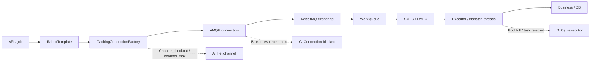
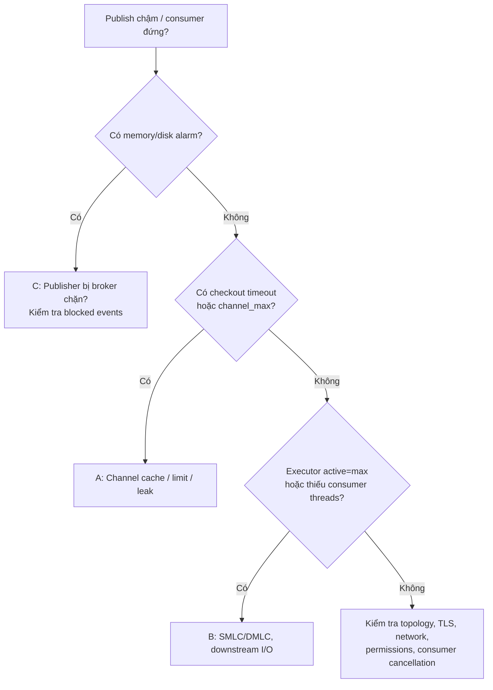
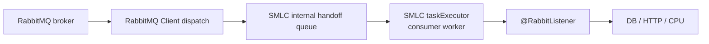
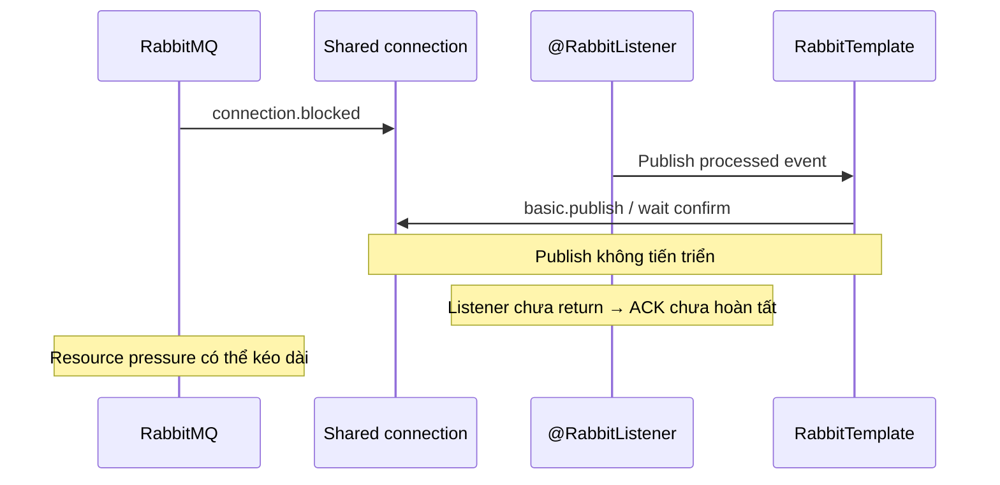

# Hết channel, cạn executor hoặc publisher bị broker chặn

Khi ứng dụng Spring AMQP đột nhiên publish chậm, `@RabbitListener` không nhận message, API timeout hoặc queue backlog tăng, ba nguyên nhân dễ bị trộn lẫn là **hết AMQP channel**, **cạn executor** và **RabbitMQ chặn publishing connection**. Chúng có triệu chứng tương tự nhưng cách xử lý trái ngược: tăng thread cho một broker đang thiếu RAM có thể làm tình hình tệ hơn, còn khởi động lại app chỉ tạm che giấu một channel leak.

Bài học thuộc chương **Chẩn đoán sự cố** của module **SPRING_AMQP**. Ta dùng `RabbitTemplate`, `@RabbitListener`, exchange, queue, binding, ACK/NACK, retry, dead-letter, publisher confirms và các tín hiệu quan sát để tìm nguyên nhân gốc, giảm nguy cơ mất/nhân đôi message và khôi phục dịch vụ.

> **Phạm vi:** RabbitMQ AMQP **0-9-1**, Spring AMQP **3.2.x** / Spring Boot **3.5.x**, Java 17+. AMQP 1.0 generic client và RabbitMQ Streams có giao thức/tài nguyên riêng, không được suy nguyên mọi kết luận về AMQP 0-9-1 channel sang chúng.

## 1. Mục tiêu học tập

Sau bài này, bạn có thể:

1. Phân biệt **connection**, **channel**, **channel cache/pool**, **listener executor**, **RabbitMQ Java Client dispatch executor** và **connection blocked**.
2. Dựa vào log, exception, RabbitMQ Management, CLI và JVM thread dump để tìm nhánh lỗi đúng.
3. Hiểu `channelCacheSize` **không phải** channel limit mặc định, nhưng trở thành giới hạn khi `channelCheckoutTimeout > 0`.
4. Chẩn đoán channel leak, churn, giới hạn `channel_max` và `channel_max_per_node`.
5. Chẩn đoán thiếu worker của SMLC hoặc thiếu client dispatch threads của DMLC.
6. Giải thích RabbitMQ memory/disk alarms, `connection.blocked` và deadlock khi publisher và consumer chia sẻ connection.
7. Cấu hình hợp lý `CachingConnectionFactory`, listener factory, executor và publisher connection tách biệt.
8. Thiết kế phục hồi publish có correlated confirms, returns, outbox và idempotency khi trạng thái broker chưa chắc chắn.
9. Thực hiện runbook, load/failure tests và alert theo từng nguyên nhân.

## 2. Ba vị trí nghẽn trong một luồng message



Một nguyên nhân có thể làm xuất hiện **triệu chứng của hai nguyên nhân còn lại**. Ví dụ broker bị disk alarm → publisher chờ confirm → listener đang publish reply bị giữ thread → executor đầy → ACK chậm → `messages_unacknowledged` tăng. Vì vậy, **đừng chỉ nhìn triệu chứng cuối cùng**.

### 2.1 Bảng quyết định nhanh

| Tín hiệu | Hết channel | Cạn executor | Broker chặn publisher |
| --- | --- | --- | --- |
| Log | `AmqpTimeoutException` khi checkout; `AmqpResourceNotAvailableException`; `channel_max` | `TaskRejectedException`/`RejectedExecutionException`, consumer startup chậm | `ConnectionBlockedEvent`, `connection.blocked`, publish/confirm treo |
| RabbitMQ connections | Có thể running, hoặc đóng do vượt channel_max | Thường running | **blocked** hoặc **blocking** |
| Open channels | Gần cap, tăng liên tục hoặc churn cao | Có thể bình thường | Không nhất thiết tăng |
| JVM | Threads chờ channel | **active=max**, task queue lớn; thread dump chờ DB/HTTP | Threads chờ socket/write/confirm, cascade |
| Broker alarms | Không bắt buộc | Không bắt buộc | **memory/disk resource alarm** |
| Ưu tiên sửa | Leak, limit, concurrency | Đúng executor + downstream | Giảm RAM/disk pressure, tách publisher/consumer |
| Tránh | Tăng channels vô hạn | Tăng concurrency khi DB đang nghẽn | Tắt watermark để publish tiếp |

**Không kết luận chỉ từ một hàng.** Thu bằng chứng cùng thời điểm ở cả app và broker.

## 3. Runbook: 10 phút đầu nên kiểm tra gì?

### 3.1 Thu broker state trước khi restart

Dùng tài khoản có quyền quản trị trong môi trường phù hợp:

```bash
# Danh sách resource alarms của cluster:
rabbitmq-diagnostics -q alarms

# Trạng thái node/broker:
rabbitmq-diagnostics -q status

# Tên connection, state và số channels:
rabbitmqctl list_connections name state channels

# Channel thuộc connection nào, số consumers và unacked:
rabbitmqctl list_channels connection consumer_count messages_unacknowledged

# Queue backlog và consumer count:
rabbitmqctl list_queues name messages_ready messages_unacknowledged consumers
```

Các field cụ thể tùy phiên bản, có thể kiểm tra `rabbitmqctl help list_connections` và `list_channels`. Những lệnh trên chỉ **quan sát**, không purge/delete message.

Nếu RabbitMQ là **cluster**, xem node nào phát alarm; memory/disk alarm của một node có thể ảnh hưởng publish connections trên cả cluster, không chỉ node service đang kết nối.

### 3.2 Thu JVM state và chỉ số business

```bash
# Chụp vài thread dumps liên tiếp để tìm nơi thread bị giữ:
jcmd <java-pid> Thread.print -l
```

Trên container/Kubernetes cần quyền và công cụ JDK phù hợp; không giả định `jcmd` có trong mọi runtime image. Không bật DEBUG toàn ứng dụng kéo dài trong sự cố vì volume log có thể làm disk alarm tệ hơn.

Thu đồng thời:

- P95/p99 thời gian `RabbitTemplate.convertAndSend` và thời gian chờ confirm.
- CCF `getCacheProperties()`, channel cache size/checkout timeout.
- Connection state `running`, `blocked` hay `blocking` và open channel count.
- `ThreadPoolTaskExecutor.activeCount`, pool size, task queue size, rejected tasks.
- RabbitMQ memory, free disk, messages ready/unacked, publish/ACK rate.
- DB pool active/waiters, HTTP client calls in-flight và downstream timeouts.
- Business events hoàn tất, outbox pending, retry/DLQ backlog.

### 3.3 Cây quyết định



Nếu nhiều câu trả lời là “Có”, điều tra **nguyên nhân khởi phát** trước khi tăng tài nguyên.

---

## 4. Nhánh A: hết channel thực sự nghĩa là gì?

Trong AMQP 0-9-1, một connection TCP có thể chứa nhiều **channel** logic. Mỗi consumer thường giữ một channel trong vòng đời nhận message; publisher có thể mượn channel để gửi, thực hiện transaction hoặc request–reply.

RabbitMQ giới hạn các channel để bảo vệ tài nguyên broker:

| Cơ chế | Điều khiển | Ý nghĩa |
| --- | --- | --- |
| Broker per-connection max | `max_channels_per_connection` (alias `channel_max`) | Số channel tối đa trên **một** connection; được thương lượng với client. |
| Broker per-node max | `channel_max_per_node` | Tổng channel trên broker node, qua nhiều connections. |
| Client requested max | `spring.rabbitmq.requested-channel-max` / client `setRequestedChannelMax` | Giới hạn client đề xuất; mức thấp hơn giữa client và broker có hiệu lực. |
| CCF channel cache | `spring.rabbitmq.cache.channel.size` | **Mặc định chỉ giới hạn số channel idle được giữ lại**, không phải số channel đang mở. |
| CCF checkout timeout | `spring.rabbitmq.cache.channel.checkout-timeout` | Khi **> 0**, channel cache size trở thành giới hạn tổng channel cấp phát mỗi connection. |

### 4.1 Cạm bẫy quan trọng nhất: cache size không phải cap mặc định

Với Spring AMQP 3.2, `CachingConnectionFactory` mặc định có `channelCacheSize=25` và `channelCheckoutTimeout=0`.

Giả sử:

```text
channelCacheSize = 10
channelCheckoutTimeout = 0

80 threads đồng thời cần channel:
  -> Có thể mở nhiều hơn 10 channel nếu broker cho phép.
Sau khi trả về:
  -> Tối đa 10 channel rảnh được giữ trong cache.
  -> Những channel còn lại bị đóng vật lý.
```

Bây giờ đổi sang:

```text
channelCacheSize = 10
channelCheckoutTimeout = 2000 ms

10 channel đang bận:
  -> Request thứ 11 chờ có channel trả về.
  -> Nếu 2 giây không có -> AmqpTimeoutException.
```

**Đừng gọi lỗi ở ví dụ thứ hai là “broker hết channel”** nếu broker vẫn còn headroom. Đây là **local CCF checkout cap** do ứng dụng cấu hình.

### 4.2 Broker channel_max khác CCF checkout timeout

Nếu broker giới hạn negotiated `channel_max=32` nhưng app cố mở channel thứ 33, broker có thể từ chối và đóng **connection**, với lỗi dạng:

```text
not_allowed: number of channels opened (...)
has reached the negotiated channel_max (...)
```

Đây là protocol limit, không phải Spring checkout timeout. Nếu broker per-node max cũng bị chạm, nhiều connections có thể ảnh hưởng nhau dù mỗi connection chưa tới negotiated per-connection max.

**Không nâng broker limit vô hạn để ẩn channel leak.** Tài nguyên channel tiêu thụ bộ nhớ và khả năng xử lý phía broker.

### 4.3 Những nguyên nhân tạo quá nhiều channel

1. Mã nghiệp vụ tự gọi `createChannel()` rồi không `close()`.
2. `@RabbitListener` có concurrency quá cao, hoặc quá nhiều containers/replicas.
3. Rất nhiều concurrent `RabbitTemplate.convertSendAndReceive(...)` giữ channel trong thời gian chờ reply.
4. Dùng `ThreadChannelConnectionFactory` nhưng quên `closeThreadChannel()` khi thread kết thúc.
5. Dùng `PooledChannelConnectionFactory` cho consumers, trong khi các consumer giữ channel lâu khiến pool cạn.
6. Cache nhỏ so với concurrency khiến tạo/đóng channel liên tục (**churn**), dù chưa leak.
7. Channel đóng do `404 NOT_FOUND`, `PRECONDITION_FAILED`, exclusive consumer hoặc permission; app cứ tạo lại gây churn.
8. Không tính channel của publisher, admin và RPC khi đặt checkout cap.

### 4.4 Exception nào là bằng chứng gì?

| Dấu hiệu | Phân tích |
| --- | --- |
| `AmqpTimeoutException` khi mượn channel | Có thể local checkout cap đã kín và không có channel trả về trước deadline. |
| `AmqpResourceNotAvailableException` | Không thể tạo channel, ví dụ đã chạm channelMax/resource limit. |
| `ShutdownSignalException ... NOT_ALLOWED` | Broker từ chối protocol/channel limit, có thể đóng connection. |
| `PRECONDITION_FAILED inequivalent arg` | Queue/exchange declare lệch định nghĩa, **không phải** channel capacity mặc dù channel bị đóng. |
| `404 NOT_FOUND - no queue/exchange` | Lỗi topology/vhost, không giải quyết bằng tăng channel cache. |
| `channel is already closed` | Cần tìm nguyên nhân gốc trước lúc channel đóng, có thể recovery, protocol exception. |

Đọc **full stack trace + broker log** theo cùng timestamp, không chỉ tìm từ `channel` trong log.

## 5. Đo, cấu hình và sửa channel exhaustion

### 5.1 Lấy CCF cache properties

Spring AMQP cung cấp `getCacheProperties()` để phân tích cache:

```java
import java.util.Properties;
import org.slf4j.Logger;
import org.slf4j.LoggerFactory;
import org.springframework.amqp.rabbit.connection.CachingConnectionFactory;
import org.springframework.stereotype.Component;

@Component
public class RabbitCacheInspector {
    private static final Logger log =
        LoggerFactory.getLogger(RabbitCacheInspector.class);

    private final CachingConnectionFactory factory;

    public RabbitCacheInspector(CachingConnectionFactory factory) {
        this.factory = factory;
    }

    // Gọi từ endpoint quản trị bảo vệ hoặc chụp khi incident.
    public void snapshot() {
        Properties stats = factory.getCacheProperties();
        log.info("Rabbit channel cache snapshot: {}", stats);
    }
}
```

Một số property quan trọng:

- `channelCacheSize`: cấu hình cache idle.
- `idleChannelsTx` và `idleChannelsNotTx`: channels **idle trong cache** theo transactional/nontransactional.
- `idleChannelsTxHighWater` và `idleChannelsNotTxHighWater`: high water marks của **idle cached channels**.
- `connectionName` và `localPort`: đối chiếu connection với RabbitMQ Management.

**Không suy `idleChannelsNotTx=0` là đã mở hết broker channels.** Nó chỉ cho biết không có channel idle trong cache lúc chụp. Đối chiếu với số channel broker đang giữ, số requests in-flight, limits và checkout wait.

Khi dùng publisher connection sub-factory, kiểm tra thêm `getPublisherConnectionFactoryCacheProperties()` và các connection names tương ứng.

### 5.2 Cấu hình Boot có giới hạn hữu hạn

```yaml
spring:
  rabbitmq:
    requested-channel-max: 128
    cache:
      connection:
        mode: channel
      channel:
        size: 64
        checkout-timeout: 2s
    listener:
      type: simple
      simple:
        concurrency: 4
        max-concurrency: 8
        prefetch: 20
```

Ở ví dụ này:

- `size=64` cộng `checkout-timeout=2s` tạo **CCF channel cap 64 trên mỗi connection** theo hành vi của factory.
- `requested-channel-max=128` là mức client đề nghị; nếu broker thấp hơn, mức thấp hơn chi phối.
- SMLC có thể chạy 4–8 consumers, mỗi consumer giữ channel.
- `prefetch=20` là tối đa deliveries chưa ACK mỗi consumer, **không phải số channel**.

Các số trên là ví dụ sizing. Một factory chỉ có 64 channels sẽ không đủ nếu workload thực tế cần 80 in-flight RPC cùng 16 consumers. Ngược lại, tăng cap lên 1024 có thể gây broker pressure nếu không có headroom.

**Thay đổi cap sau khi connection đã tạo** không nhất thiết cập nhật semaphore của connection hiện tại; tài liệu CCF lưu ý cần tái tạo connection nếu chỉnh giới hạn. Không tự gọi `destroy()` ngay giữa production traffic mà không có kế hoạch redelivery và deployment.

### 5.3 Native channel phải được đóng

```java
import com.rabbitmq.client.Channel;
import org.springframework.amqp.rabbit.connection.Connection;
import org.springframework.amqp.rabbit.connection.ConnectionFactory;

public final class NativeChannelUsage {
    public void declareForTest(ConnectionFactory factory) throws Exception {
        Connection connection = factory.createConnection();
        Channel channel = null;
        try {
            channel = connection.createChannel(false);
            if (channel == null) {
                throw new IllegalStateException("Cannot create channel");
            }
            channel.queueDeclare("ops.audit.q", true, false, false, null);
        }
        finally {
            if (channel != null) {
                channel.close();
            }
            connection.close();
        }
    }
}
```

Với CCF, `channel.close()` thường trả channel về cache nếu còn chỗ; `connection.close()` trên shared proxy không nhất thiết đóng TCP connection thật. Dùng `RabbitAdmin` để declare topology và `RabbitTemplate` cho publish thường thuận tiện và an toàn hơn việc tạo channel thủ công trong từng request.

**Không chia sẻ một native `com.rabbitmq.client.Channel` để nhiều thread cùng publish tùy ý.** Hãy để framework quản lý channel/serialization phù hợp.

### 5.4 Dự toán channel budget

```text
8 SMLC work consumers            ->  8 channels
2 DLQ consumers                  ->  2 channels
20 concurrent publishers (peak) -> 20 channel leases
10 concurrent RPC                -> 10 channel leases
Admin + margin                   ->  4 channels
------------------------------------------------
Ước tính nhu cầu đồng thời       -> 44 channels
```

Nếu local cap=32, có thể timeout dù broker per-connection max=128. Nếu publisher tách connection, tính budget **cho từng connection**, không cộng nhầm. Đây là mô hình minh họa: đo open channels, channel churn và peak concurrency thực tế.

### 5.5 PooledChannelConnectionFactory và ThreadChannelConnectionFactory

- `CachingConnectionFactory` phù hợp phần lớn Spring AMQP workload; framework thường trả channel cho các lời gọi của `RabbitTemplate`/container.
- `PooledChannelConnectionFactory` dựa Apache Commons Pool2, pool bounded (mặc định Pool2 có thể chỉ 8 channels/pool) và có thể **chờ vô hạn** nếu cạn. **Không dùng nó cho consumer dài hạn** vì listener giữ channel trong thời gian hoạt động.
- `ThreadChannelConnectionFactory` gắn channel với thread; nếu dùng nhiều short-lived threads, phải đóng bằng `closeThreadChannel()` để không rò rỉ.

Một publisher đang treo có thể chờ **channel pool** (không phải broker blocked). Luôn xác định connection factory **thực sự được inject**, nhất là dự án dùng nhiều factories hoặc routing connection factory.


---

## 6. Nhánh B: cạn executor — SMLC khác DMLC ở tầng chạy listener

Spring AMQP có nhiều loại thread:

1. Thread của **RabbitMQ Java Client** phục vụ connection, dispatch và callback.
2. Thread của **SimpleMessageListenerContainer (SMLC) taskExecutor** chạy consumer và business listener.
3. Thread của **DirectMessageListenerContainer (DMLC) taskExecutor**, chủ yếu cho công việc monitor/giám sát.
4. Thread của HTTP server, scheduler, custom business executors, Spring Retry và các downstream clients.

Một log “executor saturated” chưa nói rõ **pool nào** đang thiếu tài nguyên.

### 6.1 SMLC: consumer worker được cấp từ container taskExecutor

SMLC có một hàng đợi nội bộ giữa RabbitMQ Java Client và worker thread. Worker do container `taskExecutor` cấp sẽ gọi `@RabbitListener`; nếu method chờ DB/HTTP lâu, thread bị giữ, ACK chậm và broker tích tụ `messages_unacknowledged`.



Mặc định, nếu không tự cấu hình, SMLC dùng `SimpleAsyncTaskExecutor`. Khi bạn thay bằng `ThreadPoolTaskExecutor` có giới hạn, phải đủ worker cho **tổng các listener containers** dùng chung executor.

Dấu hiệu thiếu SMLC worker:

- `ThreadPoolTaskExecutor.activeCount ≈ maxPoolSize`, queue length tăng hoặc task bị reject.
- Listener được cấu hình `concurrency=8` nhưng không thể khởi động đủ 8 consumer tasks.
- Broker không có alarm, channel count bình thường nhưng consumer count/ACK rate thấp.
- Thread dump chỉ ra consumer workers đợi `HikariPool.getConnection()`, lock, socket read hoặc Future.

### 6.2 Cấu hình bounded ThreadPoolTaskExecutor cho SMLC

Ví dụ một ứng dụng dùng Spring AMQP 3.2:

```java
import org.springframework.amqp.rabbit.config.SimpleRabbitListenerContainerFactory;
import org.springframework.amqp.rabbit.connection.ConnectionFactory;
import org.springframework.context.annotation.Bean;
import org.springframework.context.annotation.Configuration;
import org.springframework.scheduling.concurrent.ThreadPoolTaskExecutor;

@Configuration
public class ListenerThreadConfig {

    @Bean("rabbitListenerExecutor")
    ThreadPoolTaskExecutor rabbitListenerExecutor() {
        var executor = new ThreadPoolTaskExecutor();
        executor.setThreadNamePrefix("rabbit-worker-");
        executor.setCorePoolSize(8);
        executor.setMaxPoolSize(12);
        executor.setQueueCapacity(0);
        executor.setKeepAliveSeconds(30);
        executor.setWaitForTasksToCompleteOnShutdown(true);
        executor.setAwaitTerminationSeconds(15);
        return executor; // Spring khởi tạo bean theo lifecycle.
    }

    @Bean("boundedListenerFactory")
    SimpleRabbitListenerContainerFactory boundedListenerFactory(
            ConnectionFactory connectionFactory,
            ThreadPoolTaskExecutor rabbitListenerExecutor) {

        var factory = new SimpleRabbitListenerContainerFactory();
        factory.setConnectionFactory(connectionFactory);
        factory.setTaskExecutor(rabbitListenerExecutor);
        factory.setConcurrentConsumers(4);
        factory.setMaxConcurrentConsumers(8);
        factory.setPrefetchCount(20);
        factory.setDefaultRequeueRejected(false);
        return factory;
    }
}
```

Listener dùng **đúng factory**:

```java
import org.springframework.amqp.rabbit.annotation.RabbitListener;
import org.springframework.stereotype.Component;

@Component
public class OrderWorker {
    private final OrderService orders;

    public OrderWorker(OrderService orders) {
        this.orders = orders;
    }

    @RabbitListener(
        id = "order-worker",
        queues = "orders.work.q",
        containerFactory = "boundedListenerFactory")
    public void consume(String payload) {
        orders.processIdempotently(payload);
    }
}
```

`OrderService` là bean nghiệp vụ giả định. Concurrency 4–8 và executor 8–12 chỉ để minh họa **headroom**; phải tính tất cả containers cùng dùng pool và khả năng thực tế của DB/HTTP downstream.

**Tại sao `queueCapacity=0`?** Ví dụ không giữ một hàng dài task chờ nên task ngoài capacity có thể bị reject rõ ràng. Một queue bounded nhỏ cũng hợp lý khi có lý do. Không tạo queue unbounded cho công việc đòi hỏi xử lý thời gian thực mà không đo latency/queue length.

**Điểm nguy hiểm:** nếu executor chỉ có 2 threads nhưng SMLC cần khởi động 8 consumer tasks, các task còn lại có thể không được schedule. Tăng `prefetch` không tạo worker mới.

### 6.3 DMLC: business listener chạy trên RabbitMQ Client dispatch thread

DMLC có mô hình khác:

- `@RabbitListener` được gọi **trực tiếp trên thread của RabbitMQ Java Client**.
- `taskExecutor` trên DMLC chủ yếu dùng cho tác vụ giám sát consumer.
- `consumersPerQueue` tăng số consumers trên **mỗi queue**, không phải thread pool chung kiểu SMLC.
- Nếu handler gọi HTTP/database đồng bộ và block lâu, nó chiếm **dispatch thread**; các deliveries khác trên executor có thể bị ảnh hưởng.

Vì thế **tăng DMLC taskExecutor không có nghĩa business listener sẽ có thêm dispatch threads**.

| Quan sát | SMLC | DMLC |
| --- | --- | --- |
| Thread chạy business listener | Container `taskExecutor` worker | RabbitMQ Client dispatch |
| Container `taskExecutor` | Trực tiếp quan trọng | Chủ yếu monitor |
| Concurrency | `concurrentConsumers/maxConcurrentConsumers` | `consumersPerQueue` |
| Nếu DB query chậm | Giữ SMLC worker | Giữ client dispatch thread |
| Nơi xem khi thiếu thread | SMLC pool và downstream | RabbitMQ Client connection executor và downstream |
| Tăng pool sai tầng | Listener vẫn ít worker | Monitor tăng nhưng dispatch không đổi |

### 6.4 Executor tại CachingConnectionFactory

Spring cho phép `CachingConnectionFactory.setExecutor(Executor)` để RabbitMQ Java Client dùng khi tạo connection. Tài liệu Spring AMQP mô tả internal client executor mặc định có số thread dựa trên `Runtime.availableProcessors() × 2` tại thời điểm viết; con số có thể đổi theo client version.

Ví dụ **cấu hình Spring thuần** (không tạo trùng factory do Boot đang auto-configure):

```java
import java.util.concurrent.ExecutorService;
import java.util.concurrent.Executors;
import org.springframework.amqp.rabbit.connection.CachingConnectionFactory;
import org.springframework.context.annotation.Bean;
import org.springframework.context.annotation.Configuration;

@Configuration
public class ClientDispatchConfig {

    @Bean(destroyMethod = "shutdown")
    ExecutorService rabbitClientExecutor() {
        // Minh họa: production nên dùng pool có giới hạn,
        // tên thread, metric và chính sách shutdown rõ ràng.
        return Executors.newCachedThreadPool();
    }

    @Bean
    CachingConnectionFactory rabbitConnectionFactory(
            ExecutorService rabbitClientExecutor) {

        var nativeFactory =
            new com.rabbitmq.client.ConnectionFactory();
        nativeFactory.setHost("localhost");

        var springFactory = new CachingConnectionFactory(nativeFactory);
        springFactory.setExecutor(rabbitClientExecutor);
        return springFactory;
    }
}
```

**Không dùng `newCachedThreadPool()` không giới hạn cho hệ thống tải cao mà không capacity planning**. Mục tiêu ví dụ là nhận diện *đúng tầng executor*. Nếu app đã có Boot CCF bean, dùng customization phù hợp thay vì khai báo bean thứ hai không kiểm soát.

**Không trộn callback/dispatch vào cùng một small executor đang thực hiện blocking business jobs.** Khi callback starvation, ACK, consumer recovery và việc nhận publisher confirms có thể bị ảnh hưởng.

### 6.5 Thread dump dẫn tới nguyên nhân gốc khác nhau

| Stack/trạng thái | Hướng điều tra |
| --- | --- |
| `HikariPool.getConnection` | DB pool hết, transaction dài hoặc connection leak. |
| `SocketInputStream.socketRead` / HTTP client wait | Đối tác chậm, timeout chưa đủ, circuit breaker/bulkhead. |
| `CompletableFuture.join` / `Future.get` | Task chờ callback có thể phải chạy trên **cùng** pool đang full. |
| `ReentrantLock.lock` / `Object.wait` | Lock contention/deadlock, dependency cycle. |
| `CachingConnectionFactory.createChannel` | Channel cap/leak; triệu chứng thread WAITING do **nhánh A**. |
| `RabbitTemplate.convertAndSend` / confirm wait | Có thể do broker blocked; cần kiểm tra **nhánh C**. |
| `ThreadPoolExecutor.getTask` | Worker idle, chưa chứng minh pool cạn. |

**Nếu 16 workers cùng đợi DB pool 4 connections, tăng workers lên 64 thường làm tệ hơn.** Hãy sửa downstream concurrency, SQL, timeouts và transaction trước.

---

## 7. Nhánh C: broker chủ động chặn publisher

RabbitMQ có cơ chế **memory high watermark** và **disk free limit** nhằm bảo vệ node khỏi OOM hoặc hết disk. Khi một trong hai alarm kích hoạt, RabbitMQ có thể **tạm dừng đọc từ các AMQP connections đang publish** (TCP backpressure).

Client hỗ trợ protocol extension nhận `connection.blocked`; sau khi **tất cả** resource alarms clear, client nhận `connection.unblocked`. TCP connection có thể vẫn sống, nhưng publisher timeout hoặc chờ confirm rất lâu.

### 7.1 Phân biệt blocked, blocking và running

| Connection state | Ý nghĩa vận hành |
| --- | --- |
| **blocked** | Connection đã publish và bị broker tạm dừng xử lý publishing traffic vì alarm. |
| **blocking** | Connection chưa phát publish trong trạng thái có alarm; có thể vẫn tiến triển với consumer-only hoạt động. |
| **running** | Trạng thái thông thường tại thời điểm quan sát; không bảo đảm ứng dụng business khỏe. |

**Không kết luận `blocking` là mọi consumer đều dừng.** Theo RabbitMQ, connection chỉ consume vẫn có thể nhận/ACK message để giải phóng tài nguyên. Tuy nhiên, publisher và consumer dùng **cùng connection** có thể gây lockup dây chuyền.

Một lưu ý khác: **transient flow control** khi broker nhận chậm hơn tốc độ publisher không nhất thiết có resource alarm hoặc `ConnectionBlockedEvent`; cần phân biệt bằng broker metrics.

### 7.2 Cluster-wide resource alarm

Nếu node 3 báo disk low nhưng app kết nối node 1, publishing trên node 1 vẫn có thể bị chặn do **alarm toàn cluster**. Vì vậy:

1. Chạy `rabbitmq-diagnostics -q alarms`.
2. Xem memory và disk free từng RabbitMQ node.
3. Đối chiếu `list_connections` và state ở node app đang kết nối.
4. Kiểm tra queue replication, quorum queues, disk I/O và backlog.
5. Không kết luận “node tôi nối RAM còn dư” nên chắc chắn không có broker alarm.

**Không tắt watermark chỉ để tiếp tục publish.** Đây là cơ chế bảo vệ broker; việc tắt có thể dẫn tới full disk, OOM và nguy cơ mất dữ liệu.

### 7.3 Spring AMQP phát ConnectionBlockedEvent / ConnectionUnblockedEvent

Từ Spring AMQP 2.0, `AbstractConnectionFactory` phát các event:

- `org.springframework.amqp.rabbit.connection.ConnectionBlockedEvent`.
- `org.springframework.amqp.rabbit.connection.ConnectionUnblockedEvent`.

Ví dụ logger đơn giản:

```java
import java.util.concurrent.atomic.AtomicBoolean;
import org.slf4j.Logger;
import org.slf4j.LoggerFactory;
import org.springframework.amqp.rabbit.connection.ConnectionBlockedEvent;
import org.springframework.amqp.rabbit.connection.ConnectionUnblockedEvent;
import org.springframework.context.event.EventListener;
import org.springframework.stereotype.Component;

@Component
public class RabbitBlockMonitor {
    private static final Logger log =
        LoggerFactory.getLogger(RabbitBlockMonitor.class);

    private final AtomicBoolean publisherBlocked = new AtomicBoolean();

    @EventListener
    public void blocked(ConnectionBlockedEvent event) {
        publisherBlocked.set(true);
        log.error("RabbitMQ connection BLOCKED: {}",
                  event.getConnection());
    }

    @EventListener
    public void unblocked(ConnectionUnblockedEvent event) {
        publisherBlocked.set(false);
        log.info("RabbitMQ connection UNBLOCKED: {}",
                 event.getConnection());
    }

    public boolean isPublisherBlocked() {
        return publisherBlocked.get();
    }
}
```

Đây là **một ví dụ tối giản cho một connection**. Nếu có nhiều connections, một `AtomicBoolean` có thể báo sai trạng thái tổng: cần theo dõi trạng thái theo connection identity, theo node và bổ sung broker alarm metrics.

**Không publish thêm message hoặc gọi I/O blocking từ trong blocked event callback.** Callback nên ghi log/metric/circuit-breaker state nhanh, không làm chậm cơ chế dispatch thông báo.

### 7.4 Deadlock khi listener đồng thời phải publish

Giả sử `@RabbitListener`:

```text
Receive order
  -> DB commit hoặc business check
  -> RabbitTemplate.convertAndSend("processed-event")
  -> return
  -> AUTO ACK original message
```

Khi **cùng CachingConnectionFactory/connection** phục vụ consumer và publisher, RabbitMQ có thể chặn publish vì resource alarm:



Spring AMQP cảnh báo nguy cơ deadlock này với một CCF dùng chung. **Tách connection riêng cho publisher** là biện pháp phù hợp nếu publisher không bắt buộc chia sẻ consumer channel trong AMQP transaction.

### 7.5 Tách publisher connection bằng RabbitTemplate

Có thể đặt `RabbitTemplate.setUsePublisherConnection(true)`, API có từ Spring AMQP 2.0.2:

```java
import org.springframework.amqp.rabbit.connection.CachingConnectionFactory;
import org.springframework.amqp.rabbit.core.RabbitTemplate;
import org.springframework.context.annotation.Bean;
import org.springframework.context.annotation.Configuration;

@Configuration
public class PublisherConnectionConfig {

    @Bean
    RabbitTemplate rabbitTemplate(
            CachingConnectionFactory connectionFactory) {
        var template = new RabbitTemplate(connectionFactory);
        template.setUsePublisherConnection(true);
        return template;
    }
}
```

Khi dùng Boot, khai báo bean như vậy có thể thay bean template tự tạo của Boot; cần đảm bảo **message converters, confirms/returns, mandatory, observation và post-processors** vẫn được cấu hình. Có thể tùy biến RabbitTemplate đang dùng thay vì tạo bean mới, miễn thực hiện trước traffic.

**Ngoại lệ:** khi publisher đang dùng **consumer transactional channel**, không thể tự động tách publisher connection và vẫn coi đó là một AMQP transaction duy nhất. Nếu nghiệp vụ muốn “DB commit, publish và ACK” gần atomic, cân nhắc **transactional outbox + idempotency**, thay vì giả định publish sang connection mới cùng transaction.

**Tách connection không chữa disk/memory alarm**; nó chỉ cho consumer cơ hội tiếp tục giải phóng pressure, tránh bị publisher kẹt kéo theo.

### 7.6 Khắc phục resource alarm

| Alarm/áp lực | Xác minh | Hướng sửa |
| --- | --- | --- |
| **Memory high watermark** | Memory breakdown, queue backlog, message sizes, connections/channels. | Giảm ingress, xử lý backlog, giới hạn publishers và tăng capacity có kế hoạch. |
| **Disk free limit** | RabbitMQ data directory, PVC quota, log, replication/queue storage. | Tăng dung lượng, giảm ingress, cleanup theo retention **được duyệt**, không purge tùy tiện. |
| **Transient flow control** | Publish rate và disk I/O, quorum replication latency, broker saturation. | Backpressure, rate limit và cân bằng tải/kiến trúc. |
| **Connection/file descriptor limit** | OS fd limits, connection churn, connect failures. | Giảm churn, tune giới hạn phù hợp; không nhầm với `connection.blocked`. |

Trong cluster, memory/disk pressure có thể lan ảnh hưởng; phải xem **cả cluster**, không phải chỉ một node.

### 7.7 Publisher confirm timeout là trạng thái *không chắc chắn*

Trong lúc blocked hoặc network failure:

- Message có thể đã vào broker nhưng publisher **chưa nhận confirm**.
- Message cũng có thể chưa được broker đọc.
- API `RabbitTemplate.convertAndSend(...)` return không chứng minh durable broker acknowledgement, tùy workflow.
- Confirm timeout không chứng minh chắc chắn message **chưa được gửi**.

Nếu client retry với **event ID mới** mỗi lần timeout, có thể làm nghiệp vụ xử lý trùng. Phương án đáng tin cậy là publisher confirms + mandatory returns, **outbox lưu sự kiện chưa xác nhận**, retry cùng stable event ID, consumer idempotency/inbox.

---

## 8. Spring Boot properties: điều chỉnh đúng tầng

Ví dụ tham khảo trên Spring Boot 3.5:

```yaml
spring:
  application:
    name: order-worker
  rabbitmq:
    requested-channel-max: 128
    cache:
      connection:
        mode: channel
      channel:
        size: 64
        checkout-timeout: 2s
    publisher-confirm-type: correlated
    publisher-returns: true
    template:
      mandatory: true
    listener:
      type: simple
      simple:
        concurrency: 4
        max-concurrency: 8
        prefetch: 20
        default-requeue-rejected: false

management:
  endpoints:
    web:
      exposure:
        include: health,info,metrics,prometheus
```

**Không copy giá trị vào production khi chưa đo:** 64 channels, 8 consumers và prefetch 20 có thể thừa hoặc thiếu tùy throughput, message sizes, service replicas và downstream.

| Property/API | Điều tác động | Không làm gì |
| --- | --- | --- |
| `cache.channel.size` | Idle cache; thành cap khi checkout timeout > 0. | Không thay broker channel_max. |
| `cache.channel.checkout-timeout` | Deadline chờ channel khi cap áp dụng. | Không giới hạn wait publisher confirms. |
| `requested-channel-max` | Giới hạn per-connection client yêu cầu. | Không thay per-node broker limit. |
| `listener.simple.concurrency` | Số SMLC consumer worker tối thiểu. | Không thêm DMLC client dispatch threads. |
| `listener.direct.consumers-per-queue` | Consumer DMLC mỗi queue. | Không tăng SMLC worker pool. |
| `listener.simple.prefetch` | Max unacked deliveries trên consumer. | Không phải channel budget. |
| `template.mandatory` | Cho phép nhận returned unroutable messages cùng returns phù hợp. | Không giải quyết disk/memory alarm. |
| `publisher-confirm-type=correlated` | Theo dõi broker confirms theo correlation. | Không xác nhận business DB COMMIT. |
| `setUsePublisherConnection(true)` | Tách connection publish theo điều kiện cho phép. | Không cung cấp thêm RAM/disk cho broker. |

### 8.1 Timeout nào dùng cho triệu chứng nào?

| Timeout | Nghĩa | Không phải |
| --- | --- | --- |
| `channel.checkout-timeout` | Chờ mượn channel nếu limit áp dụng. | Publisher confirm timeout. |
| `connection-timeout` | Chờ thiết lập TCP connection. | Deadline khi broker blocked trên connection sống. |
| `requested-heartbeat` | Health check/peer liveness AMQP. | Timeout xử lý một business event. |
| `RabbitTemplate.replyTimeout` | Chờ reply cho request–reply. | Timeout của mọi `convertAndSend`. |
| `CorrelationData.getFuture().get(timeout)` | Chờ confirm một publish. | Bằng chứng message chắc chắn chưa được broker nhận. |
| DB/HTTP client timeout | Chờ downstream từ listener. | Cách tăng channel hoặc broker capacity. |

Timeout hữu hạn giúp phát hiện kẹt, nhưng chỉ **outbox/retry/idempotency** mới giải quyết phần dữ liệu cần phát lại khi kết quả không chắc chắn.

## 9. Các tình huống chẩn đoán thực tế

### Case A — `AmqpTimeoutException` nhưng broker không có alarm

```text
App:
  many threads WAITING in CachingConnectionFactory.createChannel
  channel.checkout-timeout = 2s
Broker:
  state=running, alarms=none
  channels gần local cap
```

**Giả thuyết:** cap bị đầy do consumers/RPC hoặc raw channel leak. Kiểm tra `getCacheProperties()`, broker channel count, thread dump, số concurrent requests và nơi không `close()`. Không cần tăng broker disk hoặc reset watermark.

### Case B — Executor full vì DB pool nghẽn

```text
SMLC ThreadPoolTaskExecutor:
  poolSize=8 activeCount=8 queueSize=100

Thread dump:
  rabbit-worker-1 ... HikariPool.getConnection(...)
  rabbit-worker-2 ... HikariPool.getConnection(...)
  ...
Broker:
  alarms=none, messages_unacknowledged tăng
```

**Giả thuyết:** thiếu DB resources/transaction quá dài. Tăng listener concurrency từ 8 lên 64 có thể làm tệ hơn. Tối ưu SQL, giới hạn in-flight, sửa connection leaks, đặt timeout và cân lại pool.

### Case C — Publisher blocked do disk alarm

```text
RabbitMQ:
  rabbitmq-diagnostics -q alarms -> disk alarm
  application.publisher: blocked
  application.consumer: blocking/running

Spring:
  ConnectionBlockedEvent
  Pending publisher confirms tăng
  API threads chờ
```

**Giả thuyết:** broker bảo vệ disk. Giảm ingress, drain backlog an toàn, mở rộng storage/quota, giữ publisher connection riêng. Sau `ConnectionUnblockedEvent`, retry outbox với stable event ID, không gửi lại tất cả với ID mới.

### Case D — Channel churn do lỗi topology

```text
Broker:
  404 NOT_FOUND - no queue 'orders.work.q'
  PRECONDITION_FAILED - inequivalent arg 'x-dead-letter-exchange'

App:
  repeated channel close/open
```

**Giả thuyết:** channel bị đóng do declare/permission mismatch, không phải do thiếu channel resource. Sửa queue/exchange/binding/vhost và deploy/migration topology hợp lý.

## 10. Dashboard, alert và SLI

| Nguồn | Tín hiệu | Tại sao cần |
| --- | --- | --- |
| Broker | Connection state `running/blocked/blocking` | Xác nhận broker flow control. |
| Broker | Channel count/connection, channel churn | Tìm leak và limit. |
| Broker | Memory used, disk free, alarms/node | Tìm pressure gốc. |
| Broker | `messages_ready`, `messages_unacknowledged` | Phân biệt backlog và in-flight không ACK. |
| Broker | Publisher confirm latency, unconfirmed | Phát hiện publish stalled. |
| Spring | CCF cache stats/high water | Tìm idle cache pressure, localPort mapping. |
| JVM | ThreadPool active/max, queue length, rejects | Chứng minh executor cạn. |
| JVM | Thread dumps, CPU, GC pause | Phân biệt CPU-bound với blocking. |
| Downstream | DB pool waiters, HTTP timeouts | Tìm bottleneck ngoài RabbitMQ. |
| Business | Events processed, oldest pending outbox, duplicate skipped | Xác định liệu giao nhận có thực sự hồi phục. |

Cần metric và logs với tags cardinality thấp (service, vhost, listener, queue, lỗi loại nào). **Không thêm event ID, user ID hoặc stack trace dài thành Prometheus label**; dùng structured logs/trace có kiểm soát cho các chi tiết riêng lẻ.

**Ví dụ alert:**

- P1 khi broker resource alarm kéo dài hoặc publisher connection blocked liên tục, outbox oldest age vượt SLO.
- P1 khi broker đóng connections vì negotiated channel_max lặp lại, gây mất publisher/consumers.
- P2 khi executor active=max và task queue/rejections tăng, listener processing latency tăng.
- P2 khi channel count/churn tăng nhanh dù business throughput không tăng.
- P3 khi cache idle high water gần size nhưng không có timeout; cần capacity review, chưa chắc sự cố.

## 11. Runbook khắc phục an toàn

### Bước 1 — Bảo toàn trạng thái

1. Ghi thời gian sự cố, vhost, connection name, node broker và dịch vụ bị ảnh hưởng.
2. Chụp alarms, channels, connections, queue ready/unacked và thread dump trước khi restart.
3. Giữ event IDs có confirm không chắc, bảo toàn outbox và logs/correlation IDs.
4. Không `purgeQueue`, xóa DLQ, tắt ACK hoặc tắt broker safety watermarks chỉ để giảm biểu đồ.

### Bước 2 — Xác định nguyên nhân khởi phát

```text
Nếu broker alarms != none:
    Điều tra memory/disk alarm và publisher blocked.
Nếu không, nhưng channel checkout timeout / channel_max:
    Điều tra CCF, channel leaks, RPC/consumer concurrency.
Nếu không, nhưng executor full / tasks rejected:
    Điều tra SMLC/DMLC dispatch, DB/HTTP/locks.
Nếu cả ba bình thường:
    Kiểm tra network/DNS, TLS, permissions,
    missing queues, consumer cancelled, publish routing.
```

### Bước 3 — Phục hồi theo nhánh

**Channel:**

- Tìm raw channel không đóng và sửa `finally/close`.
- Tính số listeners + publisher/RPC leases trong cap và broker limits.
- Giảm concurrency đang vượt capacity; tăng cap **chỉ nếu broker có headroom**.
- Nếu thay đổi channel cap cần tái tạo connection, rollout có kiểm soát để chấp nhận redelivery.
- Kiểm tra channel churn còn kéo dài do `404/PRECONDITION_FAILED` hay không.

**Executor:**

- Xác định đúng pool chạy business (SMLC vs DMLC).
- Đọc thread dump để biết đang chờ DB/HTTP/lock, không chỉ tăng thread count.
- Giới hạn task in-flight, timeout/circuit breaker và prefetch khi phù hợp.
- Giữ đủ RabbitMQ client dispatch capacity để recovery/ACK tiến triển.
- Khi thay đổi concurrency, tính theo tổng containers, replicas và downstream resource budget.

**Broker blocked:**

- Xác nhận memory/disk alarms trong cluster.
- Rate-limit producer hoặc giữ message trong outbox; cho consumer có đường tiến triển.
- Cấp thêm disk/giảm backlog theo retention policy có duyệt; không xóa dữ liệu nghiệp vụ tùy tiện.
- Dùng publisher connection riêng nếu không bị ràng buộc chung transaction.
- Khi unblocked, retry outbox có backoff/jitter, stable event ID; đo confirms/returns.

### Bước 4 — Xác nhận hồi phục

Sự cố chỉ hoàn tất khi:

- Broker alarms đã clear; publisher connection không còn blocked.
- Channel count ổn định, không churn bất thường, local checkout latency thấp.
- Executor active/queue/rejections về baseline; consumer count/ACK rate phục hồi.
- Queue ready/unacked giảm; DLQ/parking được kiểm tra có thiếu hoặc tăng bất thường không.
- Publisher confirms và mandatory returns hoạt động, outbox pending đang giảm.
- Consumer idempotent không tạo business effect trùng khi có replay/redelivery.
- Business SLI hồi phục, không chỉ dừng log exception.

## 12. Bài thực hành với RabbitMQ test

Chỉ làm trên broker **cách ly** hoặc Testcontainers, không tạo resource alarm giả, làm đầy disk hay ngắt producer trên production.

### Bài A — Channel cache và checkout cap

1. Dùng CCF `channelCacheSize=2`, `channelCheckoutTimeout=0` trong test process.
2. Mượn ba channel đồng thời có kiểm soát, quan sát broker có thể mở >2 channel nếu negotiated max cho phép.
3. Đóng channels; xem cache giữ tối đa hai idle channels.
4. Tạo factory/connection mới với `channelCheckoutTimeout=1_000ms`.
5. Giữ hai channel bận, thử mượn channel thứ ba; ghi nhận timeout.
6. Giải thích vì sao đây là local cap, không nhất thiết broker channel_max.

### Bài B — Channel leak và churn

1. Viết một helper cố tình bỏ quên `close()` trong môi trường test, tạo channel từng lần.
2. Quan sát `rabbitmqctl list_connections name channels`.
3. Sửa helper dùng `finally`/close và chạy lại.
4. So sánh open channel count và channel create/close rate.
5. Thử declare một queue sai argument và phân biệt `PRECONDITION_FAILED` với leak.

### Bài C — SMLC thiếu thread

1. Tạo SMLC với `concurrentConsumers=4` và `ThreadPoolTaskExecutor` chỉ 2 threads, queue capacity 0.
2. Gửi tải nhỏ, quan sát consumer task rejection/consumer count.
3. Tăng executor đủ cho concurrency, rồi tạo downstream giả lập chờ HTTP 5 giây.
4. Đo `activeCount`, `messages_unacknowledged`, thread dump.
5. Giảm blocking timeout và điều chỉnh concurrency; giải thích vì sao tăng worker vô hạn không chữa được downstream.

### Bài D — DMLC và RabbitMQ client dispatch

1. Dùng DMLC với một số consumers mỗi queue và listener giả lập blocking call.
2. Chụp thread names để xác định business callback đang ở RabbitMQ client dispatch thread.
3. Thay riêng DMLC taskExecutor, xem business listener có thật sự chuyển thread không.
4. Cấu hình executor của CCF **trước khi mở connection**, thử lại cùng workload.
5. Đo throughput, latency, số client threads và khả năng ACK/recovery.

### Bài E — Blocked publisher

1. Trong RabbitMQ sandbox, dùng memory/disk thresholds được kiểm soát và **không làm đầy disk host** để gây alarm ngắn.
2. Bật logging `ConnectionBlockedEvent`, `ConnectionUnblockedEvent` và correlated confirms.
3. Publish test events, chạy `rabbitmq-diagnostics -q alarms`.
4. Quan sát blocked state, pending confirms và API latencies.
5. Giải phóng test backlog hoặc điều chỉnh capacity an toàn để alarm clear.
6. Xác minh unblocked event, retry outbox với cùng event ID và consumer idempotency.
7. So sánh cấu hình dùng connection chung với publisher connection tách biệt.

### Bài F — Confirm timeout và duplicate

1. Bật publisher confirms/mandatory returns.
2. Giả lập mất confirm sau khi broker đã có thể nhận publish bằng network fault/test seam.
3. Ghi trạng thái uncertain trong outbox, retry **cùng event ID**.
4. Dùng DB unique constraint để xác minh business effect chỉ áp dụng một lần.
5. Phân biệt returned unroutable message với publisher NACK và timeout.

## 13. Các sai lầm cần tránh

| Sai lầm | Hậu quả | Cách đúng |
| --- | --- | --- |
| Coi `channelCacheSize` mặc định là channel cap. | Điều chỉnh sai; không hiểu vì sao open channels lớn hơn cache size. | Kiểm tra `channelCheckoutTimeout`. |
| Tăng broker `channel_max` khi có `404 NOT_FOUND`. | Không sửa topology lỗi, tăng churn. | Đọc root exception, sửa queue/exchange/vhost. |
| Không đóng raw channel. | Channel leak, cap/limit bị chạm. | Trả channel trong `finally`. |
| Dùng pooled channel factory cho consumer dài hạn. | Pool bị chiếm mãi. | Dùng CCF cho listeners. |
| Tăng SMLC concurrency nhưng executor nhỏ. | Consumer tasks thiếu thread hoặc bị reject. | Sizing theo tổng consumer tasks. |
| Tăng DMLC taskExecutor để tăng business callback threads. | Sửa sai tầng. | Xem Rabbit client dispatch executor. |
| Dùng chung pool nhỏ cho client callbacks và blocking work. | ACK/recovery starvation. | Tách/bảo vệ dispatch capacity. |
| Tăng workers khi DB pool đã cạn. | Thêm threads chờ DB, timeout nhiều hơn. | Tối ưu downstream và backpressure. |
| Coi blocked là broker crash/TCP close. | Restart không giải quyết resource alarm. | Kiểm tra alarms và connection states. |
| Tắt memory/disk watermark để cho publish tiếp. | Có thể dẫn đến disk full hoặc OOM. | Giảm ingress/tăng capacity. |
| Dùng một connection cho consumer phải publish trước ACK. | Nguy cơ deadlock khi broker blocked. | Tách publisher connection khi giao dịch cho phép. |
| Coi confirm timeout nghĩa broker chưa nhận. | Retry có event ID mới gây duplicate effect. | Stable event ID + outbox + consumer idempotency. |
| Purge queue để giảm backlog ngay. | Có thể xóa dữ liệu chưa xử lý. | Giảm ingress, drain theo runbook. |
| Restart trước khi thu bằng chứng. | Mất root-cause evidence, tăng redelivery. | Chụp logs/metrics/thread dump trước. |

## 14. Checklist ca trực

1. [ ] Ghi incident timestamp, vhost, app connection name, broker node.
2. [ ] Chạy `rabbitmq-diagnostics -q alarms`, `list_connections`, `list_channels`.
3. [ ] Kiểm tra CCF cache stats, checkout timeout, broker negotiated channel_max.
4. [ ] Chụp thread dump và phân loại SMLC/DMLC/client dispatch threads.
5. [ ] Kiểm tra executor active/queue/rejections, DB pool/HTTP timeout.
6. [ ] Xác minh connection state blocked/blocking, memory/disk watermark.
7. [ ] Xem producer và consumer đang dùng chung TCP connection hay tách.
8. [ ] Kiểm tra publisher confirms/returns, outbox pending, event IDs chưa chắc chắn.
9. [ ] Không purge hoặc tắt broker alarms nếu chưa đánh giá data safety.
10. [ ] Phục hồi có rate limit/backoff, xác nhận redelivery idempotent.
11. [ ] Theo dõi queue ready/unacked, business throughput và DLQ sau khi hồi phục.
12. [ ] Cập nhật postmortem, điều chỉnh alert và diễn tập lại failure mode.

## 15. Ghi nhớ cốt lõi

- **Channel exhaustion:** phân biệt **CCF checkout cap** với **RabbitMQ negotiated channel_max**; `channelCacheSize` mặc định là idle cache size, không phải total cap.
- **Executor starvation:** SMLC business listener chạy trên container taskExecutor; DMLC chạy trên RabbitMQ Java Client dispatch thread. Tăng pool **đúng tầng** mới có ích.
- **Publisher bị broker chặn:** memory/disk alarms có thể giữ TCP connection nhưng tạm dừng publish, phát `connection.blocked/unblocked`; alarm có thể ảnh hưởng toàn cluster.
- **Rủi ro deadlock:** consumer vừa nhận vừa publish trên cùng blocked connection có thể không ACK để giải phóng pressure; tách publisher connection khi phù hợp.
- **Timeout publish chưa chắc mất message**. Dùng publisher confirms/returns, stable event ID, transactional outbox và consumer idempotency.
- **Chẩn đoán dựa trên nhiều lớp bằng chứng:** broker alarms + open channels + executor thread dump + downstream + business SLI, không nâng các giới hạn một cách mù quáng.

## Tài liệu tham khảo

- [Spring AMQP — Connection and Resource Management](https://docs.spring.io/spring-amqp/reference/amqp/connections.html): CCF channel cache, checkout timeout, runtime stats, blocked event và publisher connection.
- [Spring AMQP 3.2 — Connection and Resource Management](https://docs.spring.io/spring-amqp/reference/3.2/amqp/connections.html): hành vi tương ứng phiên bản 3.2.
- [Spring AMQP — Threading and Asynchronous Consumers](https://docs.spring.io/spring-amqp/reference/amqp/receiving-messages/threading.html): SMLC, DMLC và client dispatch executors.
- [Spring AMQP — Choosing a Container](https://docs.spring.io/spring-amqp/reference/amqp/receiving-messages/choose-container.html): mô hình xử lý listener và concurrency.
- [Spring AMQP — RabbitTemplate API](https://docs.spring.io/spring-amqp/docs/3.2.5/api/org/springframework/amqp/rabbit/core/RabbitTemplate.html): `setUsePublisherConnection`.
- [Spring AMQP — CachingConnectionFactory API](https://docs.spring.io/spring-amqp/docs/3.2.5/api/org/springframework/amqp/rabbit/connection/CachingConnectionFactory.html): `setChannelCacheSize`, `setChannelCheckoutTimeout`, `getCacheProperties`.
- [Spring Boot 3.5 — Application Properties](https://docs.spring.io/spring-boot/3.5/appendix/application-properties/index.html): cấu hình `spring.rabbitmq.*`.
- [RabbitMQ — Channels](https://www.rabbitmq.com/docs/channels): channel max, per-node limit, churn và lệnh điều tra.
- [RabbitMQ — Blocked Connection Notifications](https://www.rabbitmq.com/docs/connection-blocked): `connection.blocked` và `connection.unblocked`.
- [RabbitMQ — Memory and Disk Alarms](https://www.rabbitmq.com/docs/alarms): memory/disk watermarks, blocking state, cluster-wide alarms.
- [RabbitMQ — Monitoring](https://www.rabbitmq.com/docs/monitoring): `rabbitmq-diagnostics alarms` và health checks.
- [RabbitMQ — rabbitmqctl Manual](https://www.rabbitmq.com/docs/man/rabbitmqctl.8): `list_connections`, `list_channels`, `list_queues`.
- [RabbitMQ — Consumer Acknowledgements and Publisher Confirms](https://www.rabbitmq.com/docs/confirms): consumer ACK, publisher confirm, redelivery và trạng thái không chắc chắn.
