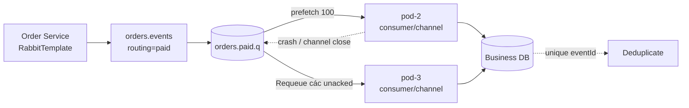
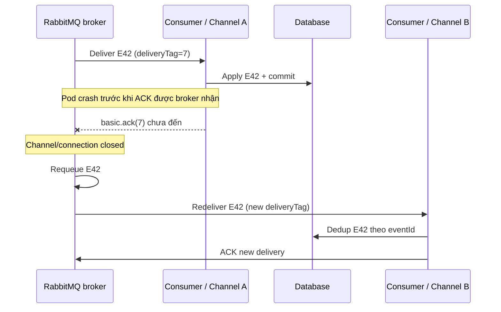
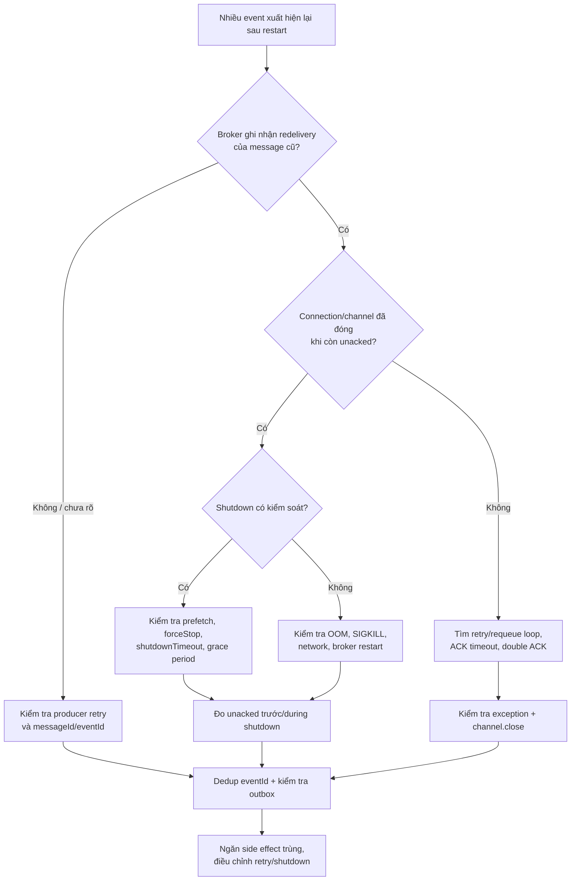
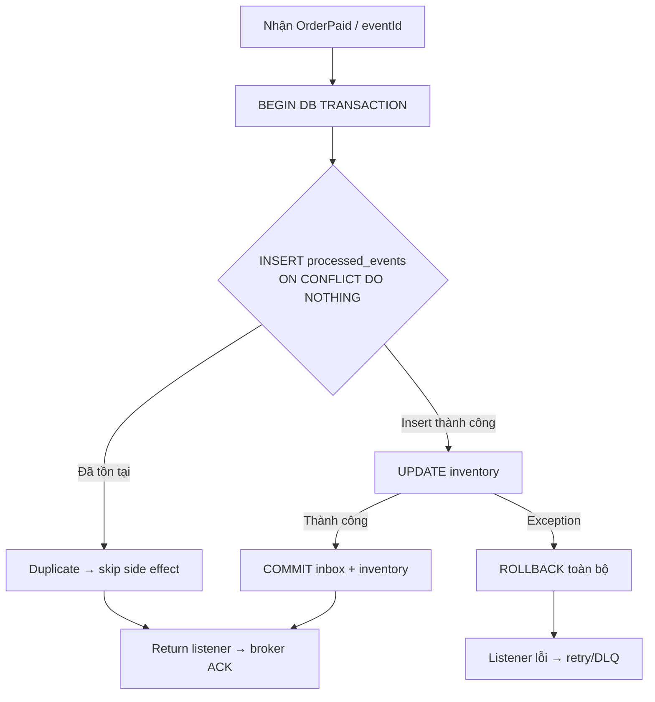
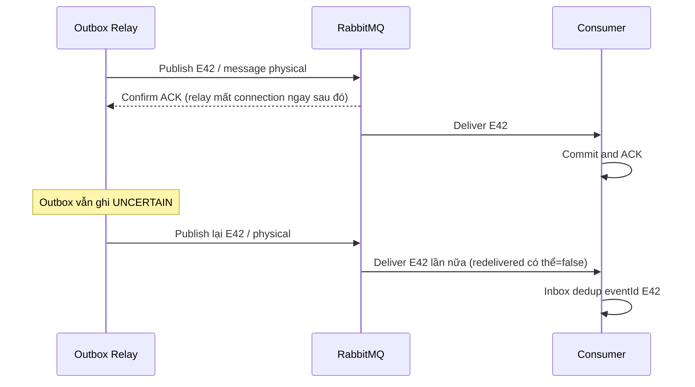

# Phát lại nhiều thông điệp sau khi consumer khởi động lại

> **Chương:** Chẩn đoán sự cố. Trong module **SPRING_AMQP**, producer dùng `RabbitTemplate` publish qua exchange, queue và binding; consumer dùng `@RabbitListener` xử lý, ACK, retry, dead-letter và giao dịch. Bài này chẩn đoán hiện tượng **một lượng lớn message được giao lại (redelivered) ngay sau khi consumer restart**, phân biệt nguyên nhân bình thường của cơ chế at-least-once với lỗi cấu hình/thiết kế, và xây phương án khôi phục **không xử lý trùng side effect**.

## 1. Hiện tượng: “restart một pod, hàng trăm đơn hàng chạy lại”

Hệ thống có queue `orders.paid.q` nhận các sự kiện `OrderPaid` từ exchange `orders.events`, routing key `paid`. Ba replica của dịch vụ kho dùng `@RabbitListener`, mỗi replica có 4 consumers với `prefetch=100`. Khi rolling restart hoặc một replica bị kill, log cho thấy nhiều `eventId` đã xử lý lại, số lần redelivery tăng đột ngột, và có nguy cơ trừ tồn kho hai lần.

Ví dụ quan sát:

```text
14:03:10 inventory-pod-2: received eventId=E101 redelivered=false
14:03:11 inventory-pod-2: DB COMMIT E101
14:03:11 inventory-pod-2: connection closed before broker observed ACK
14:03:12 inventory-pod-3: received eventId=E101 redelivered=true
14:03:12 inventory-pod-3: duplicate eventId=E101 -> skip business mutation
```

**Không tự động kết luận RabbitMQ “gửi trùng do bug”.** Khi broker chưa chắc chắn đã nhận ACK, việc giao lại là **hành vi đúng để tránh mất message** ở cơ chế tiêu thụ có ACK. Điều phải điều tra là **vì sao nhiều message còn unacked**, **vì sao kết nối/channel đóng**, và **consumer có chịu được duplicate không**.



### Những dấu hiệu cần ghi lại ngay

| Dấu hiệu | Ý nghĩa sơ bộ |
| --- | --- |
| `messages_unacknowledged` giảm mạnh khi connection mất | Broker đang giải phóng các delivery chưa ACK trên connection/channel cũ |
| `messages_ready` tăng sau khi pod dừng | Message chưa được ACK trở lại trạng thái sẵn sàng giao |
| `messages_redelivered_total` tăng khi consumer khác khởi chạy | Broker đang giao lại message, có thể hoàn toàn hợp lệ |
| `messages_unacknowledged` gần `consumers × prefetch` | Rất nhiều message đã được cấp cho consumer nhưng chưa ACK |
| Log DB `COMMIT` rồi event được nhận lần nữa | Có thể xảy ra cửa sổ **commit DB thành công nhưng ACK chưa tới broker** |
| Log `PRECONDITION_FAILED` / `consumer_timeout` / `unknown delivery tag` | Channel lỗi hoặc bị đóng, kéo theo requeue nhiều delivery |
| Redelivery lặp vô hạn cả khi không restart | Có thể là poison message, requeue loop, retry policy hoặc downstream lỗi |

Trước khi thao tác với dữ liệu, **không purge queue, không tắt ACK, không tăng delivery limit lên vô hạn** chỉ để làm biểu đồ hết đỏ. Các thao tác đó có thể che nguyên nhân hoặc làm mất message.

## 2. Cơ chế gốc: ACK quyết định message có trở lại queue không

Với AMQP 0-9-1 **manual acknowledgement ở mức protocol**, RabbitMQ giao một delivery với **delivery tag gắn với channel**. Delivery tồn tại ở trạng thái unacked cho đến khi broker nhận `basic.ack`; broker cũng có thể nhận `basic.nack`/`basic.reject`.



**Các quy tắc chính:**

1. Nếu consumer process hoặc connection chết, RabbitMQ **tự động requeue mọi delivery chưa ACK** thuộc connection/channel đóng; không cần gọi `basic.nack`.
2. Khi một consumer khác nhận lại message, delivery tag **mới**, hợp lệ trên **channel mới**. Không lưu delivery tag cũ vào DB để ACK sau khi restart.
3. Cờ `redelivered` thường bằng `true` khi broker biết message đã được giao trước đó, nhưng **không phải ID duy nhất hay bằng chứng đầy đủ về mọi duplicate**. Producer cũng có thể publish lại cùng event logic thành một message vật lý khác.
4. Consumer nhận lại message **có thể thuộc replica khác**; không được kỳ vọng mỗi message luôn quay lại consumer cũ.
5. Kết quả ACK có thể đến broker hoặc bị mất khi connection đóng sát thời điểm gửi. Caller không có một transaction nguyên tử giữa **database commit** và **AMQP ACK** chỉ nhờ `@Transactional` ở một DB.

**Ranh giới tính đúng đắn:** RabbitMQ chủ đích hỗ trợ kiểu xử lý **at-least-once** khi có ACK và redelivery. Điều đó **cho phép duplicate**, không hứa hẹn exactly-once side effect.

### 2.1. ACK trong Spring AMQP có ba chế độ dễ nhầm

| `AcknowledgeMode` Spring | Nghĩa thực tế ở listener container | Hệ quả khi process crash |
| --- | --- | --- |
| `AUTO` (mặc định phổ biến) | Container gọi **protocol ACK sau khi listener hoàn tất thành công**; không phải RabbitMQ auto-ack | Message chưa ACK có thể bị requeue |
| `MANUAL` | Ứng dụng tự gọi `Channel.basicAck/basicNack/basicReject` | Quên ACK hoặc ACK sai channel tạo unacked và redelivery |
| `NONE` | RabbitMQ **auto-ack** ngay khi giao, không chờ listener hoàn thành | Crash có thể **mất message** đã giao; không phải cách sửa duplicate an toàn |

Đây là khác biệt rất quan trọng: **Spring `AUTO` ≠ AMQP `autoAck=true`**. Chuyển sang `NONE` để “hết redelivery” có thể đổi một lỗi duplicate thành **mất dữ liệu**.

### 2.2. Cửa sổ DB commit trước broker ACK

```text
T0  Listener nhận message M
T1  Mã nghiệp vụ ghi DB và COMMIT
T2  Spring container chuẩn bị basic.ack
T3  TCP/connection bị ngắt
T4  Broker chưa thấy ACK => đưa M trở lại queue
T5  Consumer khác đọc M, xử lý lại
```

Không có thao tác “đảo ngược thời gian” để làm cho DB commit và ACK xảy ra cùng một nguyên tử transaction. Vì vậy **idempotency key** và **cùng transaction lưu dấu đã xử lý + side effect** là tuyến phòng thủ chính.

## 3. Vì sao một lần restart có thể làm “nổ” nhiều redelivery?

Hãy tính theo cửa sổ prefetch. Giả sử:

```text
replicas = 5
consumers_per_replica = 4
prefetch_per_consumer = 100

Lý thuyết delivery chưa ACK toàn deployment:
5 × 4 × 100 = 2.000 messages

Nếu một replica bị kill và 4 consumers của nó gần đầy prefetch:
4 × 100 = 400 deliveries có thể bị requeue do channel đóng.
```

Đây là **giới hạn ước lượng**, không phải lúc nào cũng có đúng 400 redelivery. Nó còn phụ thuộc batch ACK, tốc độ xử lý, số channel, số consumer thực tế và RabbitMQ queue type. Nhưng nó giải thích tại sao **một pod** chết có thể khiến **hàng trăm event** đột ngột quay lại queue dù lúc đó chỉ có một vài business method đang chạy.

### 3.1. Message có thể đang ở ba vị trí

| Vị trí | Broker metrics | Nếu channel/connection bị đóng |
| --- | --- | --- |
| Chưa được deliver, nằm trong queue | `messages_ready` | Vẫn sẵn sàng cho consumer khác, không nhất thiết là “redelivery” |
| Broker đã giao nhưng listener thread chưa xử lý, nằm trong client buffer/prefetch | `messages_unacknowledged` | **Requeue**, có thể được giao tới consumer khác |
| Listener đang xử lý và chưa ACK | `messages_unacknowledged` | **Requeue**; side effect có thể đã xảy ra hoặc đang chạy |

Điều này cũng giải thích vì sao `messages_ready=0` trước restart **không có nghĩa mọi event đã xử lý xong**. Một lượng lớn đã được prefetched vào các consumer và vẫn còn unacked.

### 3.2. Prefetch cao làm burst lớn hơn, không tự tạo duplicate

Prefetch là số delivery chưa ACK được RabbitMQ cho phép trên consumer/channel theo cách cấu hình. Spring AMQP từ 2.0 nâng default prefetch lên **250** cho throughput; với message lớn, xử lý chậm hoặc yêu cầu fairness/ordering, cần cân nhắc giảm.

| Workload | Gợi ý kiểm thử ban đầu | Vì sao |
| --- | --- | --- |
| Message lớn/side effect chậm | `prefetch=1–10` | Giới hạn số unacked và memory phía client |
| Event nhỏ, xử lý nhanh | `prefetch=16–100` | Giảm overhead lấy message, phải benchmark |
| Cần thứ tự nghiêm ngặt | `prefetch=1`, `concurrency=1` cho một luồng | Giảm phân phối/hoán đổi thứ tự; vẫn phải xét requeue và retry |
| Nhiều replica, rolling deploy | Prefetch vừa phải + graceful shutdown | Giảm số message chưa xử lý bị requeue tập thể |

Các con số **là điểm khởi đầu đo đạc**, không phải ngưỡng bắt buộc; throughput tối ưu phụ thuộc payload bytes, consumer processing latency, network RTT và broker queue type. Nếu mỗi replica có 10 consumer, giảm prefetch từ 250 xuống 20 có thể giảm đáng kể số delivery unacked khi pod crash.

### 3.3. Batch ACK có thể làm “cả cụm message” phải chạy lại

Ngoài prefetch, `SimpleMessageListenerContainer` có thể dùng `batchSize` hoặc `messagesPerAck` để gom nhiều ACK khi phù hợp. Nếu nhiều business methods **đã hoàn tất** nhưng ACK được trì hoãn vì batch/time window, một channel close vẫn làm **toàn bộ phần chưa ACK** bị requeue.

Không dùng batch ACK lớn cho workload có side effect đắt và khó idempotent chỉ vì benchmark throughput tăng vài phần trăm. Cần đo số `unacked` trước shutdown và thời gian giữa business commit với ACK; còn nếu chọn batch, phải chấp nhận repeat window và triển khai idempotency.

## 4. Phân biệt restart có kiểm soát với crash đột ngột

Không phải cách dừng consumer nào cũng tạo cùng lượng redelivery.

| Tình huống | Điều thường xảy ra | Điều cần kiểm tra |
| --- | --- | --- |
| `SIGTERM` + shutdown đủ thời gian | Container ngừng nhận mới, xử lý nốt một số prefetched deliveries rồi ACK | Spring shutdown logs, `shutdownTimeout`, grace period của orchestrator |
| `SIGKILL` / OOM kill / JVM crash | Không có cleanup/ACK cuối, connection mất | Unacked trước kill, OOM/system logs, thời gian phát hiện kết nối chết |
| `forceStop=true` | Dừng sau record hiện tại, các prefetched deliveries còn lại bị requeue | Đây có thể là cấu hình cố ý; không coi burst là bất thường |
| Hết `shutdownTimeout` và force-close channel | Channel đóng, mọi unacked còn lại bị requeue | Lỗi shutdown chậm, business tasks bị treo, timeout cấu hình |
| Network partition / heartbeat timeout | Broker phát hiện connection hỏng và requeue pending deliveries | Connection logs, heartbeat, DNS, network |
| Consumer ACK timeout | Broker hủy consumer/đóng channel theo phiên bản/protocol, requeue delivery | Log timeout, xử lý message quá lâu, delivery timeout config |
| `basicAck` sai delivery tag/channel | Broker đóng channel vì protocol error; các delivery khác cũng bị requeue | `PRECONDITION_FAILED - unknown delivery tag` |
| Exception nghiệp vụ + default requeue | Message có thể lặp lại ngay cả khi process không restart | Retry policy, `defaultRequeueRejected`, redelivery loops |

### 4.1. Spring container shutdown

Theo tài liệu Spring AMQP:

- `shutdownTimeout` mặc định khoảng **5 giây** cho listener container liên quan. Khi dừng, nếu consumer không kết thúc trong thời hạn này, `forceCloseChannel=true` (mặc định) có thể đóng channel, khiến unacked deliveries bị requeue.
- `forceStop=false` (mặc định ở các phiên bản hỗ trợ) cho phép container **xử lý hết các prefetched messages** sau khi cancel consumer rồi mới dừng. `forceStop=true` cho phép dừng sau message hiện tại, trả các prefetched messages còn lại cho broker. Tùy chọn này có từ Spring AMQP **2.4.14 / 3.0.6**.
- Trong quá trình shutdown, `basic.cancel` ngừng giao mới, nhưng **không tự ACK hoặc requeue các message đã gửi trước đó**. Các message đó cần được xử lý/ACK hoặc channel phải đóng để requeue.

**Không tăng `shutdownTimeout` vô hạn.** Cần phối hợp với `terminationGracePeriodSeconds` của Kubernetes/systemd/container orchestration và thời gian xử lý **p99** của một message/batch. Nếu platform kill JVM trước khi container kịp drain, timeout Spring lớn đến đâu cũng không giúp.

### 4.2. Consumer acknowledgement timeout theo phiên bản RabbitMQ

Một delivery bị giữ unacked quá lâu có thể kích hoạt cơ chế **consumer delivery acknowledgement timeout**. Trên RabbitMQ **4.2 trở xuống**, broker có thể đóng channel với lỗi `PRECONDITION_FAILED` và requeue các unacked trên channel đó. Từ **RabbitMQ 4.3**, tài liệu hiện hành giới hạn hỗ trợ consumer acknowledgement timeout vào **quorum queues**, với hành vi AMQP 0-9-1 là cancel consumer hoặc đóng channel tùy capability client.

Do đó, khi người học thấy `consumer_timeout` trong log, phải kiểm tra **RabbitMQ version + queue type + protocol**, không áp một runbook chung cho mọi broker release. Tăng timeout chỉ hợp lý khi workload thật sự chạy lâu và có giám sát; tốt hơn là xử lý ở background job phù hợp, giảm thời gian giữ delivery và điều chỉnh worker capacity.

## 5. Phân loại nguyên nhân theo bằng chứng, không theo phỏng đoán

Trước tiên, chọn một **eventId** đại diện cho message bị lặp và tìm toàn bộ thời điểm xử lý của ID đó. Song song, đối chiếu broker connection/channel logs và số liệu queue trong khoảng restart.



### 5.1. Bảng triệu chứng → giả thuyết → kiểm tra

| Triệu chứng | Giả thuyết hàng đầu | Bằng chứng xác minh | Không nên làm |
| --- | --- | --- | --- |
| Một burst redelivery đúng lúc deploy | Prefetched unacked bị requeue | `forceStop`, `shutdownTimeout`, pod termination logs | Tắt consumer ACK |
| Redelivery tăng ở mọi pod cùng lúc | Broker/network/cluster issue | Broker logs, connection churn, alarms | Restart tất cả pods ngay |
| Một message chạy lại liên tục mỗi giây | Poison message + `requeue=true` | Listener exceptions, message ID, redelivery rate | Requeue nóng vô hạn |
| Nhiều message chạy lại dù chỉ 1 method lỗi | Channel close làm toàn bộ unacked requeue | `PRECONDITION_FAILED`, ACK timeout, prefetch | Chỉ tăng retry của method lỗi |
| DB báo đã commit nhưng listener chạy lại | Crash giữa DB commit và protocol ACK | DB audit timestamp, app logs, broker connection close | Xóa message khỏi queue thủ công |
| Message xuất hiện lại nhưng `redelivered=false` | Producer publish lại hoặc đã qua DLX/re-publish | EventId, message ID, publishing logs, headers | Bỏ qua vì cờ redelivered=false |
| Sau restart một số event “biến mất” | Auto-ack, TTL, DLX/drop, quorum delivery limit, queue không durable | Queue type/policy, x-death, DLQ, consumer ack mode | Coi đó là thành công |
| Lặp kéo dài theo chu kỳ ~30 phút | Consumer acknowledgement timeout (tùy phiên bản) | Broker timeout logs, xử lý chậm, queue type | Chỉ tăng prefetch |

**Điểm phân biệt then chốt:** hiện tượng **same broker message bị giao lại** khác với **hai message vật lý có cùng nội dung do producer gửi lại**. Cả hai có thể cùng tạo tác động nghiệp vụ trùng, nhưng đường điều tra khác nhau.

### 5.2. Chẩn đoán theo thứ tự thời gian

```text
Tại T-5 phút:  Có bao nhiêu consumers/channels và unacked?
Tại T0:       SIGTERM, pod OOM, broker channel.close hay network error?
T0..T+30s:    Bao nhiêu deliveries về ready? Broker đã phát redelivered?
T+30s:        Có consumer mới? ACK/s, retry/s, DLQ/s biến động thế nào?
T+1 phút:     Có eventId được DB commit trước T0 rồi nhận lại?
T+5 phút:     Backlog có giảm ổn định hay tiếp tục requeue loop?
```

Nếu một consumer cũ bị kill lúc `unacked=250`, sau khi channel đóng `ready` có thể tăng khoảng 250 và những consumer còn lại nhận ngay các message ấy. RabbitMQ không nhất thiết hiển thị ready tăng lâu: chúng có thể được **redeliver nhanh đến mức biểu đồ ready chỉ lóe lên**, trong khi `redelivery rate` tăng rõ.

## 6. Thu thập bằng chứng từ RabbitMQ Management, HTTP API và logs

### 6.1. Management UI: nhìn đúng ba loại dữ liệu

Vào **Queues and Streams → orders.paid.q**, ghi lại:

- `messages_ready`: chờ được giao.
- `messages_unacknowledged`: đã giao nhưng chưa ACK.
- `consumers`: số consumer thực, không phải số replica khai báo.
- Message rates: deliver, ACK, redelivery; kiểm tra burst trùng với deployment.
- Queue type: classic/quorum; chính sách DLX, delivery-limit, message TTL.

Vào **Connections/Channels**, kiểm tra connection nào đóng, channel nào có nhiều unacked, các trạng thái `running`/`flow`/`blocked`, user/vhost, client properties. Nếu tất cả consumer channel cùng đóng khi pod mất connection, đó là giả thuyết rất mạnh cho mass requeue.

### 6.2. Chỉ đọc HTTP API, không làm thay đổi dữ liệu

```bash
# Vhost "/" được URL encode thành "%2F".
# -u monitoring-user sẽ yêu cầu mật khẩu; không hardcode vào script.
curl -fsS -u monitoring-user \
  'http://localhost:15672/api/queues/%2F/orders.paid.q' \
  | jq '{name, type, messages, messages_ready,
          messages_unacknowledged, consumers,
          message_stats, arguments}'

curl -fsS -u monitoring-user \
  'http://localhost:15672/api/connections' \
  | jq '.[] | {name, state, user, vhost, channels}'
```

Trường `message_stats` hoặc `*_details.rate` có thể không tồn tại khi chưa có traffic hoặc do cấu hình thống kê. Đừng coi field không xuất hiện là một bằng chứng về số lần delivery bằng 0.

**Không dùng `POST /api/queues/.../get` với tùy chọn ACK/requeue không hiểu rõ chỉ để xem payload production**: API “get message” có thể lấy message ra khỏi queue, thay đổi trạng thái delivery và gây nhiễu quá trình điều tra. Ưu tiên log có structured eventId và queue metrics; nếu thật sự phải inspect message, chỉ thực hiện theo quy trình an toàn trên queue cô lập.

### 6.3. Tên log cần tìm

```text
Spring / Java:
  Connection reset / Shutdown Signal
  Channel shutdown / consumer cancelled
  ListenerContainerConsumerFailedEvent
  failed to declare queue / missing queues
  ListenerExecutionFailedException
  AmqpRejectAndDontRequeueException
  PRECONDITION_FAILED - unknown delivery tag
  delivery acknowledgement timed out

RabbitMQ:
  client unexpectedly closed TCP connection
  consumer acknowledgement timeout
  channel exception: precondition_failed
  memory / disk alarm, connection blocked
  queue leader/replica instability (quorum)
```

**Sự kiện channel close** thường là điểm nối giữa “một lỗi protocol nhỏ” và “cả loạt message được giao lại”. Ví dụ ACK một delivery tag **hai lần**, hoặc ACK trên **channel khác** với channel nhận delivery, có thể làm RabbitMQ đóng channel với `PRECONDITION_FAILED - unknown delivery tag`. Các unacked khác trên channel đó cũng bị requeue.

## 7. Đọc metadata redelivery trong `@RabbitListener`

Để xác định message nào được giao lại, hãy log **ID nghiệp vụ ổn định** và các trường transport có sẵn:

```java
import org.slf4j.Logger;
import org.slf4j.LoggerFactory;
import org.springframework.amqp.core.Message;
import org.springframework.amqp.core.MessageProperties;
import org.springframework.amqp.rabbit.annotation.RabbitListener;
import org.springframework.stereotype.Component;

@Component
class PaidMessageDiagnostics {
    private static final Logger log =
        LoggerFactory.getLogger(PaidMessageDiagnostics.class);

    private final PaidEventProcessor processor;

    PaidMessageDiagnostics(PaidEventProcessor processor) {
        this.processor = processor;
    }

    @RabbitListener(
        id = "ordersPaidDiagnostics",
        queues = "orders.paid.q")
    public void onMessage(Message message) throws Exception {
        MessageProperties properties = message.getMessageProperties();
        String messageId = properties.getMessageId();
        Object deliveryCount =
            properties.getHeaders().get("x-delivery-count");
        Object acquiredCount =
            properties.getHeaders().get("x-acquired-count");

        log.info(
            "queue={} messageId={} redelivered={} deliveryTag={} " +
            "deliveryCount={} acquiredCount={} consumerTag={}",
            properties.getConsumerQueue(),
            messageId,
            properties.isRedelivered(),
            properties.getDeliveryTag(),
            deliveryCount,
            acquiredCount,
            properties.getConsumerTag());

        // Parser/processor kiểm tra eventId trong payload;
        // messageId transport có thể vắng hoặc không phải business ID.
        processor.apply(message.getBody());
    }
}
```

`PaidEventProcessor` là service ứng dụng tự hiện thực (mục 10). Ví dụ này phục vụ **điều tra và minh họa metadata**, không dùng như một listener bổ sung nếu ứng dụng đã có listener khác trên cùng queue: hai consumer sẽ **cạnh tranh message**, khiến kết quả kiểm thử bị thay đổi. Khi triển khai, gắn phần log trên vào listener đang có hoặc dùng interceptor/advice được kiểm soát.

**Không log payload đầy đủ** cho sự kiện chứa thông tin khách hàng, thanh toán hoặc token. Dùng `eventId` trong envelope (hoặc `messageId` chỉ khi producer cam kết nó là unique business ID) và correlation/tracing ID trong logs, không dùng ID có cardinality cao làm Prometheus label.

### 7.1. Ba trường dễ gây nhầm

| Trường | Dùng thế nào? | Không được suy ra |
| --- | --- | --- |
| `MessageProperties.isRedelivered()` | Broker đặt cờ cho delivery trước đó đã giao; hữu ích để khoanh vùng | `false` không chứng minh event nghiệp vụ chưa từng được xử lý |
| `x-delivery-count` | Quorum queue báo số lần delivery thất bại theo semantics của broker/version | Không phải tổng số invocation của Java method trong mọi tình huống |
| `x-acquired-count` | RabbitMQ **4.3+** trên quorum queue: theo dõi số lần message được cấp cho consumer | Không chứng minh consumer thực sự chạy business code mọi lần |
| `x-death` | Metadata khi message **dead-letter** | Không phải đồng hồ đếm của mọi lần `basic.nack(requeue=true)` trên cùng queue |
| `deliveryTag` | ACK một delivery trên **channel hiện tại** | Không phải eventId và không bền qua restart |

Một message được republish bởi ứng dụng tới exchange sẽ là **một publish mới**, có thể có `redelivered=false` ngay cả khi payload chứa cùng `eventId` cũ. Vì vậy **dedup luôn dựa vào ID nghiệp vụ**, không dựa vào `redelivered` hoặc `x-delivery-count`.

## 8. Thiết lập listener để giảm burst mà không mất dữ liệu

Một cấu hình khởi điểm hợp lý cho consumer xử lý nghiệp vụ có side effect:

```java
import org.springframework.amqp.core.AcknowledgeMode;
import org.springframework.amqp.rabbit.config.SimpleRabbitListenerContainerFactory;
import org.springframework.amqp.rabbit.connection.ConnectionFactory;
import org.springframework.context.annotation.Bean;
import org.springframework.context.annotation.Configuration;

@Configuration(proxyBeanMethods = false)
class PaidListenerConfiguration {

    @Bean("safePaidListenerFactory")
    SimpleRabbitListenerContainerFactory safePaidListenerFactory(
            ConnectionFactory connectionFactory) {
        SimpleRabbitListenerContainerFactory factory =
            new SimpleRabbitListenerContainerFactory();
        factory.setConnectionFactory(connectionFactory);

        factory.setConcurrentConsumers(2);
        factory.setMaxConcurrentConsumers(4);
        factory.setPrefetchCount(16);
        factory.setAcknowledgeMode(AcknowledgeMode.AUTO);

        // Những lỗi không retry được sẽ rời request queue,
        // chỉ an toàn nếu đã cấu hình DLX/DLQ phù hợp.
        factory.setDefaultRequeueRejected(false);
        return factory;
    }
}
```

Đây là **cấu hình khởi điểm để thực hành**, không phải bộ số mặc định tối ưu cho mọi dự án. `prefetch=16` giới hạn số message chưa ACK ở mỗi consumer; với 4 consumers trong một replica, tối đa khoảng **64 deliveries unacked** nếu các consumer cùng đạt giới hạn. Điều này **giảm biên độ burst** khi replica bị kill nhưng không loại bỏ duplicate.

**Cần phối hợp shutdown:** trên listener container, `shutdownTimeout` nên đủ cho các message/batch đang xử lý; `forceStop=false` phù hợp nếu muốn drain hết prefetched trước khi dừng. Nếu không thể đảm bảo grace period đủ, giảm prefetch và giữ idempotency. Không tắt `forceCloseChannel` mù quáng: nếu shutdown treo, trì hoãn đóng channel có thể khiến rollout bị kẹt lâu.

### 8.1. Cấu hình Spring Boot 3.x tương đương

```yaml
spring:
  rabbitmq:
    listener:
      simple:
        acknowledge-mode: auto
        concurrency: 2
        max-concurrency: 4
        prefetch: 16
        default-requeue-rejected: false
```

Đây là nhóm cấu hình **Spring Boot 3.x, AMQP 0-9-1**. Với Spring Boot 4.x, cần kiểm tra starter RabbitMQ, property namespace và cấu hình container được phiên bản dự án hỗ trợ. Đừng kết hợp một bean factory cấu hình thủ công với những Boot properties khác mà không biết bên nào thực sự được dùng cho `@RabbitListener(containerFactory=...)`.

### 8.2. Vì sao `defaultRequeueRejected=false` chưa phải giải pháp đủ?

Khi method listener **ném exception**, mặc định `defaultRequeueRejected=true` có thể đưa message về queue để giao lại ngay; đặt `false` làm failed delivery bị **reject không requeue**, có thể đi đến DLX nếu queue có cấu hình. Nhưng chính sách này **không hủy automatic requeue do connection/channel đóng**. Một pod chết giữa DB commit và ACK vẫn gây redelivery ngay cả khi `defaultRequeueRejected=false`.

Do đó cần hai biện pháp **song song**:

1. Retry/DLQ hữu hạn cho **lỗi xử lý nghiệp vụ** đã được container bắt.
2. Idempotency cho **delivery lặp do restart, mất ACK, producer retry**, vốn không phụ thuộc listener error policy.

### 8.3. Không bỏ qua trạng thái transactional và async

- Với `AcknowledgeMode.AUTO` và handler xử lý đồng bộ, container gửi ACK sau khi listener hoàn tất. Nếu một service `@Transactional` được inject qua Spring proxy và được gọi đồng bộ, DB commit của method đó kết thúc trước khi listener method return.
- Nếu listener gọi `executor.execute(...)` rồi return `void`, container có thể ACK **trước khi tác vụ phụ xử lý xong**, tạo rủi ro mất việc dù redelivery giảm.
- Nếu `@RabbitListener` trả `CompletableFuture`/`Mono`, container cần cấu hình acknowledgement phù hợp để **ACK/NACK khi async completion**, không phải khi chỉ tạo future. Tài liệu Spring AMQP khuyến nghị `AcknowledgeMode.MANUAL` cho async return.
- Nếu `channelTransacted=true` hoặc kết hợp DB transaction manager, phải hiểu rõ thứ tự commit/RabbitMQ channel transaction, rollback và khả năng duplicate sau recovery. Không tự động coi DB và RabbitMQ nằm trong một XA transaction.

## 9. Idempotent consumer: biện pháp bắt buộc cho side effect

**Mục tiêu:** nhận event `E42` một lần, hai lần hay mười lần đều chỉ áp dụng **một lần nghiệp vụ** cho consumer logic tương ứng. Ví dụ nếu event `OrderPaid` khiến dịch vụ kho trừ số lượng reserved, việc trừ hai lần có thể làm tồn kho âm.

### 9.1. ID phải do producer tạo và giữ nguyên

Một event envelope nên chứa `eventId` bất biến:

```json
{
  "eventId": "b52f6624-c117-4cb3-9ad8-7c2031bbf208",
  "eventType": "OrderPaid",
  "orderId": "ORDER-2026-00142",
  "sku": "SKU-RED-XL",
  "quantity": 2,
  "occurredAt": "2026-11-26T03:00:00Z"
}
```

Producer lưu event cùng `eventId` trong outbox/DB và **giữ nguyên ID khi publish retry**. Không tạo UUID mới trong listener mỗi lần nhận: ID như vậy luôn khác trên redelivery và không thể dedup.

**Phạm vi dedup:** nếu nhiều consumer business độc lập cùng nhận một event, chúng có thể cùng xử lý sự kiện theo logic riêng. Vì vậy khóa nên gồm `(consumer_name, event_id)` thay vì chỉ `event_id` nếu dùng chung một inbox table.

### 9.2. Inbox table với unique key

Ví dụ dùng PostgreSQL:

```sql
CREATE TABLE processed_events (
    consumer_name VARCHAR(120) NOT NULL,
    event_id      VARCHAR(120) NOT NULL,
    processed_at  TIMESTAMPTZ NOT NULL DEFAULT now(),
    PRIMARY KEY (consumer_name, event_id)
);

-- Bảng nghiệp vụ minh họa, phải có dữ liệu SKU trước khi test.
CREATE TABLE inventory (
    sku      VARCHAR(80) PRIMARY KEY,
    reserved INTEGER NOT NULL CHECK (reserved >= 0)
);
```

Trong một DB transaction:

1. `INSERT` dấu đã xử lý bằng **unique key**, không dùng check-then-insert.
2. Nếu insert mới thành công, thực hiện side effect.
3. Nếu event đã có, **không làm lại side effect**, method trả thành công để container ACK delivery lặp.
4. Nếu side effect lỗi, **rollback cả inbox insert**, để delivery có thể được xử lý lại theo retry/DLQ policy.
5. Khi transaction commit xong, listener method return; Spring container mới ACK theo `AUTO` mode.



### 9.3. Java: Spring JDBC + `@Transactional`

Ví dụ Java 17+; phần parser và business service là hai bean khác nhau để Spring transaction proxy hoạt động đúng:

```java
import com.fasterxml.jackson.databind.ObjectMapper;
import java.io.IOException;
import org.springframework.amqp.AmqpRejectAndDontRequeueException;
import org.springframework.amqp.core.Message;
import org.springframework.amqp.rabbit.annotation.RabbitListener;
import org.springframework.stereotype.Component;

record OrderPaidEvent(
    String eventId,
    String orderId,
    String sku,
    int quantity) {
}

@Component
class OrderPaidListener {
    private final ObjectMapper mapper;
    private final PaidEventProcessor processor;

    OrderPaidListener(ObjectMapper mapper, PaidEventProcessor processor) {
        this.mapper = mapper;
        this.processor = processor;
    }

    @RabbitListener(
        id = "paidInboxConsumer",
        queues = "orders.paid.q",
        containerFactory = "safePaidListenerFactory")
    public void handle(Message message) throws IOException {
        OrderPaidEvent event;
        try {
            event = mapper.readValue(
                message.getBody(), OrderPaidEvent.class);
        } catch (IOException malformedPayload) {
            // Poison event: không requeue vô hạn.
            throw new AmqpRejectAndDontRequeueException(
                "Malformed OrderPaid payload", malformedPayload);
        }

        if (event.eventId() == null || event.eventId().isBlank()
                || event.sku() == null || event.sku().isBlank()
                || event.quantity() <= 0) {
            throw new AmqpRejectAndDontRequeueException(
                "OrderPaid missing event identity or invalid quantity");
        }

        processor.apply(event); // Commit DB trước khi method return.
    }
}
```

```java
import org.springframework.jdbc.core.JdbcTemplate;
import org.springframework.stereotype.Service;
import org.springframework.transaction.annotation.Transactional;

@Service
class PaidEventProcessor {
    private static final String CONSUMER = "inventory-order-paid";
    private final JdbcTemplate jdbc;

    PaidEventProcessor(JdbcTemplate jdbc) {
        this.jdbc = jdbc;
    }

    @Transactional
    public void apply(OrderPaidEvent event) {
        int inserted = jdbc.update(
            "INSERT INTO processed_events (consumer_name, event_id) " +
            "VALUES (?, ?) ON CONFLICT DO NOTHING",
            CONSUMER, event.eventId());

        if (inserted == 0) {
            // Event này đã được commit trong transaction trước đó.
            return;
        }

        int updated = jdbc.update(
            "UPDATE inventory SET reserved = reserved - ? " +
            "WHERE sku = ? AND reserved >= ?",
            event.quantity(), event.sku(), event.quantity());

        if (updated != 1) {
            // Exception sẽ rollback CẢ inbox insert và business UPDATE.
            throw new IllegalStateException(
                "Insufficient reserved stock for " + event.sku());
        }
    }
}
```

**Điều kiện để ví dụ đạt đúng ngữ nghĩa:**

- `JdbcTemplate` và `@Transactional` phải sử dụng **cùng DataSource và transaction manager**; schema được provision và inventory SKU có dữ liệu.
- `processor.apply(event)` được gọi qua **bean khác**, không self-invocation phá Spring AOP transaction proxy.
- `IllegalStateException` là unchecked exception nên mặc định làm rollback DB transaction. Nếu code dùng checked exception nghiệp vụ, phải cấu hình `rollbackFor` tương ứng.
- Không có bước HTTP/payment gateway bên ngoài DB transaction trong ví dụ. Nếu side effect ra hệ thống ngoài, cần downstream idempotency key, outbox/saga/reconciliation; transaction DB không tự tạo atomicity với mạng.
- Không dùng `eventId` trùng cho **hai sự kiện nghiệp vụ khác nhau**; nên có schema/version và validate event type để tránh dedup nhầm.

### 9.4. Bốn đường lỗi khi DB + ACK kết hợp

| Điểm crash | DB transaction | Broker ACK | Kết quả sau restart |
| --- | --- | --- | --- |
| Trước inbox insert | Chưa commit | Chưa ACK | Reprocess bình thường |
| Sau insert nhưng trước DB commit | Rollback khi connection DB bị ngắt | Chưa ACK | Reprocess bình thường |
| **Sau DB commit, trước broker ACK** | Đã commit | Chưa tới broker | **Redelivery → inbox duplicate → skip side effect → ACK** |
| Sau broker ACK đến nơi | Đã commit | Broker đã ghi nhận | Message không bị requeue vì crash này |

Giải pháp trên đạt **effectively-once side effect trong phạm vi cùng DB và khóa nghiệp vụ**, chứ **không biến RabbitMQ thành exactly-once delivery**. Log vẫn có thể ghi `received E42` nhiều lần; điều quan trọng là một lần business mutation đã commit.

## 10. Retry hữu hạn và Dead Letter Queue: tách poison message khỏi restart burst

**Hai vấn đề khác nhau:**

- **Restart burst:** một lượng lớn *delivery chưa ACK* quay lại do channel/connection đóng. Cách phòng vệ chính là graceful shutdown, prefetch hợp lý và **idempotency**.
- **Poison message loop:** cùng một payload luôn làm listener ném exception. Cách xử lý là **retry hữu hạn**, phân loại lỗi, backoff và **DLX/DLQ**, không requeue nóng.

### 10.1. Topology DLX/DLQ cho `orders.paid.q`

```java
import org.springframework.amqp.core.Binding;
import org.springframework.amqp.core.BindingBuilder;
import org.springframework.amqp.core.DirectExchange;
import org.springframework.amqp.core.Queue;
import org.springframework.amqp.core.QueueBuilder;
import org.springframework.context.annotation.Bean;
import org.springframework.context.annotation.Configuration;

@Configuration(proxyBeanMethods = false)
class PaidQueueTopology {

    @Bean
    DirectExchange ordersEvents() {
        return new DirectExchange("orders.events");
    }

    @Bean
    DirectExchange ordersDeadLetters() {
        return new DirectExchange("orders.dlx");
    }

    @Bean
    Queue paidQueue() {
        return QueueBuilder.durable("orders.paid.q")
            .deadLetterExchange("orders.dlx")
            .deadLetterRoutingKey("orders.paid.failed")
            .build();
    }

    @Bean
    Queue paidFailedQueue() {
        return QueueBuilder.durable("orders.paid.failed.q").build();
    }

    @Bean
    Binding paidBinding(Queue paidQueue, DirectExchange ordersEvents) {
        return BindingBuilder.bind(paidQueue)
            .to(ordersEvents).with("paid");
    }

    @Bean
    Binding failedBinding(Queue paidFailedQueue,
                          DirectExchange ordersDeadLetters) {
        return BindingBuilder.bind(paidFailedQueue)
            .to(ordersDeadLetters).with("orders.paid.failed");
    }
}
```

**Lưu ý về declaration:** ví dụ dùng **classic durable queue** theo mặc định nếu vhost policy/type không override. Trong môi trường production, ưu tiên cấu hình DLX qua policy được quản trị để có thể đổi mà không redeclare queue arguments; ví dụ dùng `QueueBuilder.deadLetterExchange(...)` để code lab chạy độc lập. **Không redeclare queue có cùng tên nhưng khác `x-arguments`** trong hệ thống đang chạy: broker có thể báo `PRECONDITION_FAILED inequivalent arg`.

### 10.2. Dùng Spring Retry interceptor với số lượt hữu hạn

Để xử lý lỗi transient **ngắn** bên trong một listener invocation:

```java
import org.springframework.amqp.rabbit.config.SimpleRabbitListenerContainerFactory;
import org.springframework.amqp.rabbit.retry.RejectAndDontRequeueRecoverer;
import org.springframework.amqp.rabbit.config.RetryInterceptorBuilder;
import org.springframework.context.annotation.Bean;

@Bean("retryingPaidListenerFactory")
SimpleRabbitListenerContainerFactory retryingPaidListenerFactory(
        org.springframework.amqp.rabbit.connection.ConnectionFactory factory) {
    SimpleRabbitListenerContainerFactory listener =
        new SimpleRabbitListenerContainerFactory();
    listener.setConnectionFactory(factory);
    listener.setPrefetchCount(16);
    listener.setConcurrentConsumers(2);

    listener.setDefaultRequeueRejected(false);
    listener.setAdviceChain(
        RetryInterceptorBuilder.stateless()
            .maxRetries(2)
            .backOffOptions(500L, 2.0, 2_000L)
            .recoverer(new RejectAndDontRequeueRecoverer())
            .build());
    return listener;
}
```

`maxRetries(2)` nghĩa là có thể thử ban đầu cộng tối đa **hai lần retry** theo cấu hình Spring Retry; sau đó recoverer ném `AmqpRejectAndDontRequeueException`, để broker dead-letter nếu DLX đã được khai báo. Cần dependency `spring-retry` tương thích trên classpath và kiểm tra cách Spring AMQP version hiện tại cung cấp builder.

**Không chạy đồng thời hai listener factories** trên cùng queue trong ví dụ lab mà không có chủ đích. `retryingPaidListenerFactory` là **phương án thay thế** cho `safePaidListenerFactory` ở mục 8; đổi `containerFactory` trên `@RabbitListener` khi muốn kiểm thử retry.

**Lưu ý:** stateless retry thường thực hiện nhiều lần **trong cùng một delivery**, nên broker `redelivered` có thể **vẫn false** qua các invocation business ở bên trong interceptor. Không dùng broker redelivery count để đếm số lần retry stateless của Spring. Nếu lỗi cần chờ hàng phút, không block một consumer thread bằng backoff lâu; cân nhắc retry queue/DLX có delay hoặc workflow riêng.

### 10.3. Không dùng recoverer sai ngữ nghĩa

| Recoverer / hành vi | Tác động đến broker | Phù hợp khi |
| --- | --- | --- |
| `RejectAndDontRequeueRecoverer` | Throw exception để broker reject không requeue; DLX nhận nếu configured | Poison message muốn chuyển DLQ theo broker |
| `RepublishMessageRecoverer` | Publish bản sao sang error exchange; nếu recoverer return bình thường thì input có thể được ACK | Cần failure envelope/stack trace, có chính sách publisher confirms |
| `ImmediateRequeueMessageRecoverer` | Yêu cầu đưa lại queue ngay | Chỉ khi có backoff/giới hạn ở tầng khác; dễ tạo hot loop |
| Không có recoverer, chỉ log và trả thành công | Container ACK input | **Nguy hiểm** nếu lỗi nghiệp vụ chưa được lưu/quarantine bền vững |

Với `RepublishMessageRecoverer`, phải hiểu **republish thành công chưa chắc đã durable**, cần phiên bản có hỗ trợ confirms phù hợp nếu input sẽ được ACK sau khi recoverer return. Không mặc định error queue đã có dữ liệu chỉ vì log ghi “republish”.

### 10.4. DLQ không phải cơ chế replay tự động

`orders.paid.failed.q` là nơi giữ event cần điều tra. Để replay:

1. Xác định **lý do lỗi** và khắc phục consumer/schema/dependency trước.
2. Quyết định **eventId gốc**, xác định đã có business side effect chưa.
3. Republish với **cùng eventId**, giữ metadata cần thiết, có giới hạn rate.
4. Theo dõi confirm/return của replay publish; **không xóa DLQ message trước khi publish an toàn**.
5. Nếu replay đến queue chính và listener nhận lại, **inbox dedup** bảo đảm không làm side effect lần hai.

Mọi công cụ “Move all from DLQ to source” không kiểm soát có thể biến lỗi nhỏ thành retry storm. Trong production, replay cần runbook, audit và quota.

## 11. Quorum queue: `x-delivery-count`, delivery limit và thay đổi RabbitMQ 4.3

Quorum queue có cơ chế bảo vệ **poison message** bằng delivery limit. **RabbitMQ 4.0+** đặt mặc định `delivery-limit=20`, nghĩa là các message vượt số lần delivery thất bại có thể bị loại bỏ hoặc dead-letter (khi DLX được cấu hình).

**Đặc biệt quan trọng khi restart hàng loạt:** nếu `prefetch=250` và mọi unacked delivery liên tục bị trả về cùng một nhóm sau nhiều lần crash, **nhiều message** có thể chạm delivery limit dù bản thân payload không hề lỗi. Nếu queue **không có DLX**, những message đó có thể bị **drop**. Vì vậy với quorum queue, cần có đường dead-letter cho các message vượt limit và kế hoạch hồi phục chính thức.

### 11.1. Ba mốc cần phân biệt

| RabbitMQ version | Mặc định / semantics liên quan |
| --- | --- |
| RabbitMQ **3.13** và trước | Quorum queue thường không có delivery limit mặc định tương đương 20 |
| RabbitMQ **4.0–4.2** | Delivery limit mặc định **20**, các lần requeue/nack có thể tính vào bộ đếm theo cơ chế `acquired-count` |
| RabbitMQ **4.3+** | Delivery limit dựa trên **`delivery-count`** cho thất bại thực sự; `basic.nack(requeue=true)` **không** làm tăng delivery-count như trước, còn `basic.reject` và connection/channel failure có thể làm tăng |

RabbitMQ 4.3 có thêm `x-acquired-count` để đo số lần message được cấp cho consumer, còn `x-delivery-count` phản ánh các lần **thất bại delivery** theo semantics mới. Đây là chi tiết có thể làm sai hoàn toàn chiến lược giám sát nếu copy cách tính từ bài viết cho RabbitMQ 4.1 sang cluster 4.3.

### 11.2. Bảng hành vi đáng nhớ trên RabbitMQ 4.3+

| Sự kiện | `x-acquired-count` tăng? | `x-delivery-count` tăng? |
| --- | --- | --- |
| `basic.nack(requeue=true)` | Có | **Không** |
| `basic.reject(requeue=true)` | Có | **Có** |
| Client crash / connection mất với unacked | Có | **Có** |
| Consumer ACK timeout / consumer bị cancel | Có thể | Theo quy tắc của protocol/queue, không suy đơn giản là lỗi nghiệp vụ |
| Network partition trong cluster | Có thể | Không nhất thiết |

**Hệ quả:** nếu ứng dụng dùng `basic.nack(requeue=true)` để retry vô hạn, **delivery limit trên RabbitMQ 4.3 không tự cắt vòng lặp** như một số hệ thống cũ kỳ vọng. Cần retry budget ở ứng dụng, delayed retry có giới hạn hoặc `basic.reject`/DLX phù hợp loại lỗi.

### 11.3. Cách cấu hình delivery limit an toàn

Trong lab, có thể khai báo quorum queue với optional argument qua Spring AMQP:

```java
import org.springframework.amqp.core.Queue;
import org.springframework.amqp.core.QueueBuilder;
import org.springframework.context.annotation.Bean;

@Bean
Queue quorumPaidQueue() {
    return QueueBuilder.durable("orders.paid.quorum.q")
        .quorum()
        .deliveryLimit(10)
        .deadLetterExchange("orders.dlx")
        .deadLetterRoutingKey("orders.paid.failed")
        .build();
}
```

**Lưu ý:** đây là một queue **mới và riêng** cho lab; không áp vào queue classic `orders.paid.q` đã có trong mục 10. Tên queue đã được khai báo kiểu classic không thể đơn giản chuyển sang quorum bằng cách sửa code rồi redeclare. Trong production, nên ưu tiên **policy `delivery-limit`** và DLX, kiểm soát thay đổi bằng quy trình operator.

```bash
# Ví dụ policy trong LAB cho các quorum queues prefix "orders.paid.".
# Đảm bảo match đúng tên và quyền admin trước khi chạy.
rabbitmqctl set_policy paid-quorum-limit '^orders\.paid\.' \
  '{"delivery-limit":10}' \
  --apply-to quorum_queues
```

**Đừng đặt `delivery-limit=-1` để xóa alert một cách máy móc**: nó có thể tạo retry vô tận nếu message độc hại hoặc consumer liên tục crash. Nếu buộc phải vô hiệu hóa vì tương thích, cần có cơ chế retry budget/quarantine khác và được đánh giá vận hành rõ ràng.

### 11.4. Vấn đề hàng loạt message vào DLQ sau crash

Khi một quorum queue có 100 delivery unacked và process crash lặp nhiều lần, không phải chỉ message “gây crash” chạm limit. **Các prefetched delivery chưa từng chạy business code** cũng có thể bị broker coi là thất bại qua những lần connection loss và dần chạm limit. Vì vậy:

- Giảm prefetch nếu payload lớn/processing chậm/restart thường xuyên.
- Tránh rolling restart tất cả consumer replicas cùng một lúc.
- Phân biệt `x-acquired-count` và `x-delivery-count` theo đúng broker version.
- Bật DLX/DLQ để tránh silent drops; giám sát DLQ depth và tình trạng publish dead letter.
- Đảm bảo message được xử lý thực sự trước khi ACK, và consumer idempotent theo eventId.

## 12. Manual acknowledgement: double ACK và `multiple=true` gây requeue dây chuyền

`AcknowledgeMode.MANUAL` phù hợp khi ứng dụng cần tự quyết định ACK/requeue, nhưng cũng mở ra lỗi protocol. Một ví dụ tối thiểu:

```java
import com.rabbitmq.client.Channel;
import java.io.IOException;
import org.springframework.amqp.core.Message;
import org.springframework.amqp.rabbit.annotation.RabbitListener;
import org.springframework.stereotype.Component;

@Component
class ManualPaidConsumer {

    private final PaidEventProcessor processor;
    private final PaidEventParser parser;

    ManualPaidConsumer(PaidEventProcessor processor,
                       PaidEventParser parser) {
        this.processor = processor;
        this.parser = parser;
    }

    @RabbitListener(
        id = "manualPaid",
        queues = "orders.paid.q",
        containerFactory = "manualPaidListenerFactory")
    public void receive(Message message, Channel channel) throws IOException {
        long tag = message.getMessageProperties().getDeliveryTag();
        try {
            OrderPaidEvent event = parser.parse(message.getBody());
            processor.apply(event);

            // ACK duy nhất delivery này, trên chính channel nhận.
            channel.basicAck(tag, false);
        } catch (IllegalArgumentException invalidPayload) {
            // Dữ liệu không sửa được: dead-letter nếu có DLX.
            channel.basicReject(tag, false);
        } catch (Exception transientFailure) {
            // Chỉ dùng requeue ngay khi có chính sách chặn retry storm.
            channel.basicNack(tag, false, true);
        }
    }
}
```

`PaidEventParser` là parser nghiệp vụ ứng dụng tự cung cấp (ví dụ wrap JSON validation thành `IllegalArgumentException`). Khi dùng ví dụ, phải tạo **một factory `manualPaidListenerFactory` có `AcknowledgeMode.MANUAL`** và không đồng thời chạy consumer AUTO trên cùng queue nếu muốn test isolated. Ví dụ dùng `basicNack(requeue=true)` để mô tả semantics, **không khuyến nghị để nguyên trong production** nếu lỗi transient có thể kéo dài; khi đó cần retry queue/backoff hoặc điều khiển attempts riêng.

### 12.1. Một manual ACK an toàn phải thỏa các điều kiện

1. ACK/NACK đúng **delivery tag lấy từ `MessageProperties`**, trên **channel nhận message đó**.
2. Không ACK hai lần, không ACK cả ở listener lẫn container; tránh `AcknowledgeMode.AUTO` cho handler đã tự ACK.
3. Không dùng `basicAck(tag, true)` trừ khi quản lý chính xác **mọi delivery tag nhỏ hơn/cùng channel** đã được xử lý thành công.
4. Nếu xử lý bất đồng bộ trên thread khác, không truyền `Channel` dùng chung tùy tiện giữa threads; dùng hỗ trợ async ack do Spring AMQP/container cung cấp.
5. Nếu DB commit thành công nhưng `basicAck` bị lỗi do channel đóng, **không cố ACK lại trên channel khác với tag cũ**. Để broker requeue và inbox dedup.

### 12.2. Vì sao `multiple=true` nguy hiểm?

`basicAck(tag, true)` có nghĩa ACK **toàn bộ outstanding deliveries có delivery tag ≤ tag** trên channel đó, không chỉ message hiện tại. Nếu xử lý song song/out-of-order và ACK tag lớn trước khi tag nhỏ hoàn tất, có thể ACK message chưa được xử lý và **mất khả năng redelivery** khi crash.

`basicNack(tag, true, true)` cũng có thể đưa **nhiều outstanding deliveries** về queue; một lỗi ở message cuối batch có thể tạo burst trên nhiều message khác. Spring container có các trường hợp batch/cumulative nack để tránh double settlement, do đó cần đối chiếu Spring version và queue type trước khi đổ lỗi cho RabbitMQ.

### 12.3. Không “ACK trong finally”

```java
// ANTI-PATTERN: message bị ACK cả khi business DB lỗi.
try {
    businessService.apply(event);
} finally {
    channel.basicAck(tag, false);
}
```

Nếu `apply` thất bại, `finally` vẫn ACK, làm broker xóa message mà nghiệp vụ chưa commit. Thiết kế đúng là **ACK sau khi success**, hoặc NACK/reject theo chính sách lỗi và giữ một bằng chứng bền vững.

## 13. Producer có thể tạo duplicate riêng, không liên quan restart consumer

Một dòng log trùng eventId sau restart **không luôn là broker redelivery**. Producer có thể gọi lại `RabbitTemplate.convertAndSend(...)` do timeout/connection reset, hoặc outbox relay có thể publish lại khi **publisher confirm đã đến broker nhưng DB chưa ghi nhận trạng thái PUBLISHED**.



**Cách phân biệt:**

| Dấu hiệu | Broker redelivery cùng message | Producer republish cùng event logic |
| --- | --- | --- |
| Broker `redelivered` | Thường true | Có thể false ở cả hai publish vật lý |
| Log producer publish attempts | Có thể chỉ 1 publish | Thường >1 attempt cho cùng eventId |
| `x-death` | Không nhất thiết tồn tại | Có thể khác nếu message qua retry/DLX |
| Broker queue event counts | Requeued delivery không phải publish mới | Có thể thấy publish count tăng |
| Cách chống side effect trùng | Inbox dedup | **Cùng inbox dedup** |

**Publisher confirm là tín hiệu broker nhận trách nhiệm với publish**, không phải bằng chứng consumer đã xử lý xong. Không đổi `eventId` khi republish attempt mới; dùng `CorrelationData.id` khác nhau cho từng confirm attempt nếu cần, nhưng **business eventId cố định**.

Đừng dựa vào `MessageProperties.isRedelivered() == true` để quyết định “chỉ xử lý khi false”: như vậy có thể bỏ qua message chưa từng commit. Cũng đừng dựa vào `false` để tuyên bố không có duplicate.

## 14. Rolling deployment: giảm rủi ro burst từ đầu

Một quy trình shutdown có kiểm soát nên:

1. **Ngừng nhận công việc upstream mới** khi pod chuẩn bị dừng (readiness / pause producer nếu cùng process).
2. **Ngừng đăng ký consumer mới**, yêu cầu listener container stop theo lifecycle Spring.
3. **Drain những delivery đã prefetched** trong budget, cho business DB transaction hoàn tất.
4. **ACK các delivery đã xử lý thành công** trên channel còn sống.
5. Chỉ sau đó mới đóng RabbitMQ connection và để process thoát.
6. Nếu quá deadline deployment, chấp nhận **requeue phần chưa ACK** và đảm bảo consumer thay thế idempotent.

### 14.1. Các timeout phải tương thích

```text
terminationGracePeriodSeconds (Kubernetes/systemd)
    >= thời gian Spring context shutdown
    >= listener shutdownTimeout / drain time cần thiết
    >= p99 business task / batch ACK (kèm headroom)
```

Đây là **mối quan hệ thiết kế**, không phải một công thức chắc chắn cho mọi container lifecycle. Việc dừng đồng thời HTTP server, scheduler, producer relay và consumer có thể chiếm chung grace period. Nếu handler có thể chạy 60 giây nhưng pod chỉ có 10 giây graceful termination, mass redelivery khi rollout là kết quả hoàn toàn có thể dự đoán.

### 14.2. Cách dừng listener thủ công trong test/quản trị

Spring AMQP đăng ký listener containers do `@RabbitListener` tạo thông qua `RabbitListenerEndpointRegistry`:

```java
import org.springframework.amqp.rabbit.listener.MessageListenerContainer;
import org.springframework.amqp.rabbit.listener.RabbitListenerEndpointRegistry;
import org.springframework.stereotype.Component;

@Component
class PaidListenerControl {
    private final RabbitListenerEndpointRegistry registry;

    PaidListenerControl(RabbitListenerEndpointRegistry registry) {
        this.registry = registry;
    }

    void stopPaidConsumerForMaintenance() {
        MessageListenerContainer container =
            registry.getListenerContainer("paidInboxConsumer");

        if (container == null) {
            throw new IllegalStateException(
                "Listener ID not registered: paidInboxConsumer");
        }
        container.stop();
    }
}
```

Code này **chỉ minh họa thao tác dừng trong môi trường có quyền**, không phải endpoint HTTP public để người dùng bất kỳ dừng consumer. Việc `stop()` trả về hay mất bao lâu tùy container và callback lifecycle; cần kiểm tra logs/metrics cho đến khi consumer thực sự không còn nhận message. Không dùng `stop()` như tín hiệu “mọi business transaction đã commit” khi không có bằng chứng.

### 14.3. Có nên bật `forceStop`?

| Mục tiêu | `forceStop=false` | `forceStop=true` |
| --- | --- | --- |
| Tránh redelivery các prefetched delivery khi shutdown bình thường | Thường tốt hơn nếu có đủ drain time | Có thể requeue nhiều prefetched ngay |
| Dừng nhanh để consumer khác tiếp quản | Có thể chờ drain lâu | Phù hợp với consumer độc quyền/single-active cần takeover nhanh |
| Message xử lý chậm và pod grace period ngắn | Vẫn có thể bị force-close channel | Stop sau record hiện tại, nhưng phải chấp nhận burst |
| Bảo đảm không có duplicate | **Không bảo đảm** | **Không bảo đảm** |

Chọn theo SLO và tính idempotent. Với cùng configuration, tăng `shutdownTimeout` và giảm prefetch có thể giảm burst trong rolling deploy nhưng **không loại bỏ** rủi ro crash/OOM hoặc ACK mất do network. Không xây business correctness dựa hoàn toàn vào graceful shutdown.

## 15. Quan sát và cảnh báo: đo cả redelivery lẫn duplicate thực tế

Không dùng **một metric redelivery** để kết luận có bao nhiêu nghiệp vụ đã bị làm lại. Cần nối ba lớp dữ liệu:

1. **RabbitMQ:** delivered/redelivered, ready, unacked, consumer count, channel/connection churn.
2. **Spring AMQP:** listener invocations, exceptions, retries, container restarts, processing duration.
3. **Business DB:** số eventId unique, duplicate bị inbox bỏ qua, transaction commit/rollback, side effect đúng.

### 15.1. Metric cần đặt cạnh nhau

| Metric | Nguồn | Câu hỏi |
| --- | --- | --- |
| `rabbitmq_detailed_queue_messages_ready` | RabbitMQ Prometheus | Bao nhiêu message đang chờ giao? |
| `rabbitmq_detailed_queue_messages_unacked` | RabbitMQ Prometheus | Bao nhiêu delivery chưa được ACK? |
| `rabbitmq_detailed_queue_consumers` | RabbitMQ Prometheus | Consumer mất hoặc đang được thay thế? |
| `rabbitmq_detailed_queue_messages_redelivered_total` | RabbitMQ Prometheus | Broker giao lại bao nhiêu lượt? |
| `rabbitmq_detailed_queue_messages_acked_total` | RabbitMQ Prometheus | Consumer ACK được bao nhiêu lượt? |
| `rabbitmq_detailed_connections_closed_total` | RabbitMQ Prometheus | Có nhiều connection đóng trùng thời điểm deploy? |
| `app.consumer.invocations_total{outcome}` | Ứng dụng tự tạo | Method thực chạy thành công/lỗi bao nhiêu lượt? |
| `app.consumer.inbox_duplicate_total` | Ứng dụng tự tạo | Bao nhiêu lần message trùng được ngăn side effect? |
| `app.consumer.business_commit_total` | Ứng dụng tự tạo | Bao nhiêu transaction nghiệp vụ commit mới? |
| `app.consumer.processing_duration_seconds` | Ứng dụng tự tạo / Observation | p95/p99 xử lý có vượt shutdown/ACK timeout? |

**Các tên `app.*` chỉ là đề xuất**, không mặc định do Spring AMQP cung cấp. Hãy định nghĩa counters và timers bằng Micrometer, với labels có cardinality thấp như `queue`, `consumer_group`, `outcome`; **không dùng `eventId`/`orderId` làm metric label**.

### 15.2. PromQL nhận biết burst

Nếu Prometheus đã scrape `/metrics/detailed` với `family=queue_delivery_metrics`, `queue_coarse_metrics` và `queue_consumer_count`:

```promql
# Số lượt redelivery/giây trên queue quan trọng.
sum by (vhost, queue) (
  rate(rabbitmq_detailed_queue_messages_redelivered_total{
    vhost="/", queue="orders.paid.q"
  }[5m])
)
```

```promql
# ACK/s: so với redelivery và producer publish rate.
sum by (vhost, queue) (
  rate(rabbitmq_detailed_queue_messages_acked_total{
    vhost="/", queue="orders.paid.q"
  }[5m])
)
```

```promql
# Số lượt redelivery trong 15 phút quanh thời điểm rollout.
sum by (vhost, queue) (
  increase(rabbitmq_detailed_queue_messages_redelivered_total{
    vhost="/", queue="orders.paid.q"
  }[15m])
)
```

```promql
# Delivery đang unacked — quan sát trước khi dừng replica.
rabbitmq_detailed_queue_messages_unacked{
  vhost="/", queue="orders.paid.q"
}
```

```promql
# Có consumer nào không?
rabbitmq_detailed_queue_consumers{
  vhost="/", queue="orders.paid.q"
}
```

**Cẩn trọng khi aggregate:** metrics Prometheus của RabbitMQ là node-local; với cluster/quorum và nhiều scrape targets, cần kiểm tra labels `node`/`instance`, queue leader/replica và duplicate scraping trước khi `sum`. Tên `rabbitmq_detailed_*` chỉ có khi chọn đúng metric families; không copy query vào job `/metrics` mặc định mà không kiểm tra endpoint thực.

Một spike redelivery trong 30 giây khi rollout nhưng sau đó ACK rate ổn định và business dedup vẫn đúng có thể là **expected recovery behavior**. Ngược lại, redelivery vẫn cao hàng giờ kèm retry errors và DLQ tăng là dấu hiệu **incident đang tiếp diễn**.

### 15.3. Alert theo tác động

| Alert | Điều kiện gợi ý | Hành động cần có |
| --- | --- | --- |
| Consumer unavailable | `consumers=0`, queue ready > 0, kéo dài | Kiểm tra deployment, credentials và queue name |
| Redelivery storm | Redeliver rate tăng nhiều lần baseline và kéo dài ngoài rollout window | Kiểm tra pod churn, error loops, ACK timeout |
| Excessive unacked | Unacked gần tổng budget `prefetch × consumers` thời gian dài | Xem DB/HTTP latency, thread dump, ack logic |
| Inbox duplicate surge | Unique conflict counter tăng sau deploy | Xác nhận side effects không trùng; đánh giá prefetch/shutdown |
| Quorum DLQ growth | Failed queue có nhiều message mới | Kiểm tra delivery-limit, broker version và poison/crash |
| Repeated channel errors | `PRECONDITION_FAILED` tăng hoặc channel churn liên tục | Sửa double ACK/ACK sai tag/timeout |
| Business side-effect duplication | Unique business operation được commit >1 lần | **Ưu tiên cao:** dừng nguồn side effect và đối soát dữ liệu |

Không page chỉ vì `redelivered > 0` ở một lần restart: người vận hành cần alert theo **SLO, độ dài sự cố, business impact** và cửa sổ rollout được biết trước. Đồng thời, **không bỏ qua** spike redelivery khi duplicate guard của database chưa được chứng minh.

## 16. Kiểm thử fault injection trên RabbitMQ thật

Mục tiêu của bài thực hành không phải “làm RabbitMQ ngừng giao lại message”. Mục tiêu đúng là:

- Chứng minh **unacked sẽ được requeue** khi connection/channel mất.
- Biết số message có thể bị giao lại tùy prefetch.
- Chứng minh **DB side effect không bị lặp** nhờ inbox.
- Kiểm tra khác biệt giữa graceful drain và abrupt crash.
- Kiểm tra retry/DLX/quorum delivery-limit theo đúng broker version.

### 16.1. Lab topology và dữ liệu

Chuẩn bị một RabbitMQ **riêng cho test**, ví dụ container hoặc Testcontainers, với:

```text
Exchange: orders.events             (direct)
Request queue: orders.paid.q        (durable classic, kèm DLX)
DLX: orders.dlx                     (direct)
DLQ: orders.paid.failed.q           (durable)
Routing key: paid

Consumer A: 1 instance / concurrency=1 / prefetch=20
Consumer B: 1 instance / concurrency=1 / prefetch=20
DB: PostgreSQL riêng cho test với bảng processed_events + inventory

Input: 50 events có eventId khác nhau E001..E050
Expected: 50 unique events được business commit đúng một lần
```

Nếu muốn kiểm thử quorum, tạo **queue tên khác** kiểu quorum và bật DLX; không sửa loại queue hiện tại bằng cách redeclare. Với những bài yêu cầu `x-delivery-count`, phải sử dụng RabbitMQ đủ mới và kiểm tra phiên bản để diễn giải.

**Không chạy SIGKILL, OOM stress, giảm disk watermark hoặc purge trên broker dùng chung/production.** Những tình huống này phải giới hạn trong lab có thể xóa bỏ, với dữ liệu giả.

### 16.2. Test A — Baseline không restart

1. Publish 50 events với unique `eventId`, dùng `RabbitTemplate` và publisher confirms khi cần.
2. Consumer xử lý qua `@Transactional PaidEventProcessor.apply` và `AcknowledgeMode.AUTO`.
3. Chờ bằng Awaitility hoặc polling có deadline cho `COUNT(DISTINCT event_id)=50` trong `processed_events`.
4. Xác nhận inventory giảm đúng tổng quantity, queue ready/unacked về mức mong đợi và không có DLQ message.
5. Ghi lại ACK/s, processing p95, consumer count và redelivery count làm baseline.

Kết quả đúng là **side effect thực**, không chỉ là số log `received`. Đừng assert thứ tự E001→E050 với nhiều consumer nếu application không có yêu cầu và thiết kế duy trì thứ tự.

### 16.3. Test B — Kill consumer khi prefetch đang đầy

1. Thêm test fixture làm chậm xử lý (ví dụ lệnh DB chặn có deadline hoặc latch trong listener), **chỉ trên môi trường test**.
2. Dùng `prefetch=20`, concurrency 1, publish 50 events.
3. Đợi tới khi Management UI cho thấy consumer A giữ gần **20 unacked**.
4. Dừng consumer A đột ngột (kill process/container **consumer**, không kill broker hoặc DB).
5. Quan sát khi broker phát hiện connection closed: unacked của A giảm, ready hoặc redelivery tăng; consumer B có thể nhận lại message.
6. Đợi hệ thống hết backlog. Assert **50 unique eventId** và đúng inventory, dù có thể có >50 listener invocation.

**Chẩn đoán mong đợi:** số redelivery xảy ra không nhất thiết chính xác bằng 20, vì một số delivery có thể đã ACK trước khi kill, hoặc đã được giao lại rất nhanh. Bằng chứng quan trọng là **không mất event và không tạo side effect trùng**, không phải số đếm cố định.

### 16.4. Test C — DB commit xong, ACK cố tình chưa gửi

Đây là kiểm thử mạnh nhất để chứng minh idempotency. Dùng một listener **MANUAL** dành riêng cho test, với `CountDownLatch` được đặt **sau** khi `PaidEventProcessor.apply(event)` commit xong, **trước** `basicAck`:

```java
// Pseudocode trong listener test (không đưa vào production):
OrderPaidEvent event = parser.parse(message.getBody());
processor.apply(event);     // DB COMMIT xong
afterCommitLatch.countDown();
allowAckLatch.await();      // Test giữ thread ở đây.
channel.basicAck(deliveryTag, false);
```

Quy trình:

1. Gửi `eventId=E900` cho listener manual.
2. Test đợi `afterCommitLatch` cho biết DB đã commit.
3. **Kill process consumer** trước khi thả `allowAckLatch`.
4. Broker requeue unacked E900; consumer B xử lý lại.
5. Truy vấn DB: đúng **một row (consumer_name, E900)** và side effect đúng một lần.
6. Kiểm tra reply/log nếu có: message redelivered có thể true, delivery tag mới.

Đây là thao tác cố tình làm hỏng đường ACK **chỉ trong lab**. Không chạy fixture chặn ACK trên queue sản xuất; phải dọn consumer và test data sau khi hoàn thành.

### 16.5. Test D — So sánh prefetch lớn và nhỏ

| Lượt | Prefetch | Concurrency | Cách dừng | Điều cần so sánh |
| --- | ---: | ---: | --- | --- |
| D1 | 250 | 2 | Abrupt kill | Unacked trước kill, redelivery burst và client memory |
| D2 | 20 | 2 | Abrupt kill | Burst giảm bao nhiêu, throughput thay đổi thế nào |
| D3 | 20 | 2 | Graceful stop/drain | Số unacked lúc process dừng, thời gian shutdown |
| D4 | 20 | 2 | `forceStop=true` | Prefetched messages được requeue sớm hơn thế nào |

Giữ nguyên payload size, queue type, broker version và processing latency. Không chỉ đo `messages_ready` sau restart; cần measure redelivery count, business duplicate skips và thời gian toàn bộ backlog xử lý xong.

### 16.6. Test E — Poison message và DLQ

1. Gửi một payload malformed `BAD-E901` với event ID ổn định.
2. Listener ném `AmqpRejectAndDontRequeueException` hoặc retry hữu hạn rồi reject không requeue.
3. Kiểm tra message tới `orders.paid.failed.q` theo DLX/binding.
4. Xác nhận không có hot loop trên queue chính; consumer vẫn xử lý được các event tốt sau đó.
5. Republish theo runbook với eventId giữ nguyên sau khi sửa lỗi, không purge dữ liệu.

Nếu muốn test `x-delivery-count` của quorum, dùng queue quorum riêng và tạo **một chuỗi redelivery có chủ đích**, đồng thời kiểm tra tính chất của `basic.nack`/`basic.reject` trên **RabbitMQ 4.3+**. Không coi một message chuyển DLQ là bằng chứng delivery-limit hoạt động nếu chính listener đã reject trực tiếp.

### 16.7. Test F — Producer publish lại sau khi mất confirm

1. Producer gửi `eventId=E777`.
2. Giả lập outbox relay không ghi nhận confirm dù broker đã nhận message.
3. Producer retry **cùng `eventId=E777`**, nhưng có thể tạo publish vật lý thứ hai.
4. Consumer thấy hai event logistics, broker `redelivered` có thể false ở publish thứ hai.
5. Assert DB chỉ có **một business side effect** nhờ unique inbox key.

Thử nghiệm này chứng minh **cùng cơ chế idempotency bảo vệ cả broker redelivery và producer duplicate**.

## 17. Runbook xử lý sự cố trên production

Một runbook tốt phải **ngăn duplicate side effect, giữ dữ liệu và khôi phục throughput**. Nếu redelivery burst chỉ là triệu chứng của crash, phản xạ “restart thêm pods” có thể làm tình hình tệ hơn.

### 17.1. Giai đoạn 1 — Khoanh vùng tác động

Ghi lại trong incident timeline:

- **Queue name, vhost, queue type, broker version** và Spring AMQP version.
- Deployment/restart timestamp, replica count, `@RabbitListener` ID, `prefetch`, `concurrency`.
- `messages_ready`, `messages_unacknowledged`, consumer count, redelivery rate trước/sau restart.
- Số **unique event IDs** thực sự được xử lý so với số listener invocations.
- Có mất dữ liệu nghiệp vụ, double charge, double stock deduction hay chỉ log processing trùng?
- Có DLQ tăng hoặc message bị quorum delivery-limit loại bỏ không?

Nếu đã phát hiện **double charge/side effect nguy hiểm**, ưu tiên ngắt đường mutation theo cơ chế circuit breaker/feature flag có kiểm soát và giữ event/outbox/DLQ để đối soát. Đừng purge message để “hết sự cố”: dữ liệu còn trong queue có thể là cơ sở khôi phục.

### 17.2. Giai đoạn 2 — Xác định nguyên nhân channel đóng

| Nếu thấy... | Kiểm tra tiếp | Hướng khắc phục |
| --- | --- | --- |
| `SIGKILL`/OOM khi deploy | JVM heap/direct memory, container events, pod grace period | Giảm pressure, sizing memory, idempotency, graceful shutdown |
| `shutdownTimeout` hết | Handler p99, blocking DB/HTTP, prefetched count | Điều chỉnh grace/shutdown budgets, prefetch và downstream timeouts |
| `forceStop=true` | Ai đặt policy? Có yêu cầu single-active takeover? | Cân nhắc đổi sang drain nếu latency shutdown cho phép |
| `PRECONDITION_FAILED - unknown delivery tag` | Manual ACK tag/channel, double ACK, `multiple=true` | Sửa protocol misuse trước khi tăng throughput |
| ACK timeout | Handler giữ unacked quá lâu, broker version/queue type | Xử lý job async phù hợp hoặc điều chỉnh timeout theo SLO |
| Network/heartbeat disconnect | DNS, packet loss, LB timeouts, broker restart | Sửa hạ tầng, backoff reconnect có jitter |
| Redelivery không gắn restart | Default requeue, poison payload, retry advice | Retry hữu hạn, DLX, không hot loop |
| Event lặp nhưng `redelivered=false` | Publisher retry/outbox relay, message ID | Correlate publish attempts và stable event ID |

**Thao tác giảm tải tạm thời** như hạ ingress producer hoặc hãm tốc outbox relay có thể giúp consumer drain backlog trong khi điều tra. Không tăng đồng loạt concurrency khi database đang quá tải hoặc bị deadlock.

### 17.3. Giai đoạn 3 — Xác nhận tính đúng đắn của dữ liệu

```sql
-- Ví dụ thống kê unique events đã được commit.
SELECT consumer_name, COUNT(*) AS unique_processed
FROM processed_events
GROUP BY consumer_name;

-- Với event ID cần đối soát:
SELECT consumer_name, event_id, processed_at
FROM processed_events
WHERE event_id = 'E900';
```

Nếu bảng inbox chưa được thiết kế từ đầu, cần đối chiếu business audit/outbox/transaction logs trước khi replay. **Không giả định hai log “processed” nghĩa là hai DB commits.** Ngược lại, cũng không coi một inbox row là bằng chứng hệ thống ngoài (payment gateway, email, API) không bị gọi hai lần nếu chúng không tham gia cùng transaction.

### 17.4. Giai đoạn 4 — Khôi phục có kiểm soát

1. Sửa nguyên nhân crash/ACK timeout/requeue loop.
2. Bảo đảm listener **idempotent**, có metric duplicate và DLQ.
3. Khởi động một số replica nhỏ, theo dõi ready/unacked/redelivery và DB capacity.
4. Tăng consumer concurrency theo throughput đo được, không vượt downstream connection pool.
5. Giữ publisher/admission rate trong giới hạn để backlog giảm dần.
6. Replay DLQ có quota và publisher confirms **sau khi** đã xác minh payload/code.
7. Kết thúc incident khi **unique business state**, queue backlog, DLQ và SLO đều ổn định, không chỉ khi `redelivery/s` về 0.

### 17.5. Giai đoạn 5 — Ngăn tái diễn

- Bổ sung test “DB commit rồi consumer crash trước ACK” vào CI integration suite.
- Dùng `eventId` bất biến và inbox unique key, audit duplicate skips.
- Đặt prefetch theo payload/latency; phối hợp container shutdown timeout với pod grace period.
- Tách retriable và non-retriable exceptions, áp retry budget và DLQ.
- Với quorum queue, bật dead-letter trước khi trông chờ delivery-limit ngăn poison message.
- Đặt alert cho channel close bursts, broker ACK timeout và business side effects trùng.
- Ghi rõ broker/Spring versions trong runbook vì `x-delivery-count` và timeout semantics đã thay đổi giữa các releases.

## 18. Những anti-pattern làm hiện tượng tệ hơn

| Anti-pattern | Vấn đề | Cách thay thế |
| --- | --- | --- |
| Đổi `AcknowledgeMode.AUTO` thành `NONE` để tránh redelivery | Có thể **mất message** sau crash | Giữ ACK + idempotency |
| Dùng `messageId` mới tạo trong listener làm dedup | Mỗi delivery có ID mới, không phát hiện duplicate | Event ID bất biến từ producer |
| Dedup bằng cờ `redelivered` | Không bắt producer republish, và có thể bỏ sót các trường hợp khác | Unique business eventId |
| Dedup bằng `deliveryTag` | Tag chỉ có ý nghĩa trên channel hiện tại | `(consumer_name,eventId)` trong DB |
| Ghi `processed=true` trước rồi side effect ngoài transaction | Crash tạo dấu đã xử lý nhưng business chưa hoàn tất | Inbox insert + side effect trong một DB transaction |
| Dùng Redis `SETNX` rồi side effect DB không có cơ chế đối soát | Không atomic giữa Redis và DB; có thể mất hoặc lặp công việc | Cùng DB transaction hoặc orchestration/reconciliation |
| `basicAck(tag, true)` trên channel xử lý song song out-of-order | ACK nhầm các delivery chưa hoàn thành | ACK từng message hoặc theo contiguous completed tags |
| ACK trong `finally` | Xóa message kể cả khi DB thất bại | Chỉ ACK sau success hoặc reject/retry đúng policy |
| Retry `basicNack(requeue=true)` vô hạn | Poison message hot loop; RabbitMQ 4.3 không tự tính nack vào delivery-limit | Delayed retry hữu hạn / reject + DLX |
| Tăng `prefetch` cực lớn để ready về 0 | Phình unacked và số message bị requeue khi crash | Benchmark throughput và giới hạn per-consumer |
| Dừng tất cả consumer replicas cùng lúc | Đồng loạt requeue số lượng lớn | Rolling update, graceful drain và capacity headroom |
| Quorum `delivery-limit=-1` để tránh DLQ | Poison message có thể lặp vô tận | DLX + retry budget + xử lý nguyên nhân |
| Quorum queue delivery-limit nhưng **không DLX** | Message có thể bị loại bỏ sau nhiều failed deliveries | Cấu hình dead-letter và giám sát |
| Đọc queue bằng Management API rồi ACK để “xem thử” | Có thể thay đổi trạng thái message, làm sai timeline | Dùng read-only metrics/logs hoặc queue cô lập |
| Test chỉ assert `received_count==N` | Redelivery có thể làm count vượt N dù unique business events thiếu | Assert unique IDs và business state |
| Coi message đã ACK là proof của business commit | Nếu code ACK trước async side effect, có thể mất dữ liệu | ACK sau completion, transaction và kiểm thử |

## 19. Checklist trước khi bàn giao production

| Hạng mục | Điều kiện hoàn tất |
| --- | --- |
| Topic | Có mô tả rõ **message redelivery sau consumer restart** là một phần của at-least-once? |
| Message identity | Producer tạo ID bất biến; retry giữ cùng eventId? |
| Business dedup | Có unique key và inbox update cùng transaction với side effect DB? |
| External side effect | Có idempotency key/reconciliation ở payment/HTTP downstream? |
| Listener ACK | `AUTO`/`MANUAL`/`NONE` được chọn có chủ đích? |
| Manual ACK | Không double ack, không ACK sai channel, không dùng `multiple=true` tùy tiện? |
| Prefetch | Được benchmark theo size/latency và phù hợp độ lớn burst được chấp nhận? |
| Shutdown | `shutdownTimeout`, `forceStop`, Kubernetes grace period và p99 processing phù hợp? |
| Retry | Có phân loại transient/permanent, giới hạn attempts, backoff và DLQ? |
| Quorum queue | Hiểu delivery limit mặc định 20 (4.0+), semantics 4.3 và có DLX? |
| DLQ | Có metric/alert/runbook replay và không xóa event trước khi xác nhận an toàn? |
| Broker metrics | Có ready/unacked/redelivery/ACK/consumers/channel churn? |
| App metrics | Có duplicate skipped, business committed, handler duration, listener errors? |
| Fault injection | Đã test kill process, commit-before-ack, poison message, producer duplicate? |
| Recovery | Runbook không chứa thao tác purge/restart toàn bộ một cách tự động? |
| Version | Biết Spring AMQP, RabbitMQ, protocol, queue type và policy đang áp dụng? |

## 20. Câu hỏi tự kiểm tra

1. Vì sao một consumer có `prefetch=250` có thể gây hàng trăm redelivery khi bị kill dù chỉ đang thực thi một business method?
2. `messages_ready=0` trước restart có nghĩa mọi message đã hoàn tất không? Giải thích vai trò `messages_unacknowledged`.
3. Spring `AcknowledgeMode.AUTO` khác RabbitMQ `autoAck=true` như thế nào?
4. Broker xử lý các delivery chưa ACK ra sao khi channel/connection đóng?
5. Một message đã commit DB nhưng bị redeliver có thể xuất hiện ở bước nào trong timeline? Biện pháp bảo vệ là gì?
6. Vì sao `deliveryTag` mới xuất hiện sau restart không thể dùng làm business dedup key?
7. `forceStop=true` và `forceStop=false` khác nhau thế nào với prefetched deliveries khi dừng container?
8. Vì sao `shutdownTimeout=5s` có thể quá ngắn với listener p99 xử lý 30 giây?
9. Khi nào `PRECONDITION_FAILED - unknown delivery tag` gây requeue nhiều message, và sửa code ACK thế nào?
10. Cờ `redelivered=false` có loại trừ khả năng sự kiện nghiệp vụ trùng không? Tại sao?
11. `x-death`, `x-delivery-count` và `x-acquired-count` có cùng ý nghĩa không?
12. RabbitMQ 4.3 thay đổi hành vi tính delivery limit với `basic.nack(requeue=true)` như thế nào?
13. Tại sao không nên disable quorum delivery limit mà không có chiến lược retry khác?
14. Một event bị xử lý duplicate sau khi DB commit trước ACK. Hãy mô tả cách unique constraint trong inbox giúp giữ side effect đúng.
15. Khi handler gọi HTTP API bên ngoài DB, tại sao chỉ dùng `@Transactional` + inbox trong PostgreSQL chưa bảo đảm exactly-once ở downstream?
16. `defaultRequeueRejected=false` có ngăn automatic requeue do process crash không?
17. Tại sao retry advice stateless có thể gọi business method nhiều lần dù broker `redelivered=false`?
18. Một DLQ đang tăng sau ba lần restart quorum queue. Những bằng chứng nào phân biệt poison message và prefetched deliveries chạm delivery limit?
19. Khi thấy ACK/s cao nhưng inventory vẫn bị trừ hai lần, nên điều tra broker ACK hay business dedup trước?
20. Hãy xây một test kill consumer ngay sau DB commit trước ACK và nêu những assert cần có.

## 21. Tài liệu tham khảo chính thức

- [RabbitMQ — Consumer Acknowledgements and Publisher Confirms](https://www.rabbitmq.com/docs/confirms): manual acknowledgement, automatic requeue khi channel/connection đóng, redelivered flag, delivery tag và prefetch.
- [RabbitMQ — Consumers](https://www.rabbitmq.com/docs/consumers): prefetch, consumer cancellation, acknowledgement timeout và khác biệt theo broker version.
- [RabbitMQ — Channels](https://www.rabbitmq.com/docs/channels): lifecycle channel, ACK sai tag/channel, channel close và unacked deliveries.
- [RabbitMQ — Quorum Queues](https://www.rabbitmq.com/docs/quorum-queues): poison message handling, delivery limit, `x-delivery-count`, `x-acquired-count` và thay đổi kể từ **4.3**.
- [RabbitMQ — Quorum Queues 4.2](https://www.rabbitmq.com/docs/4.2/quorum-queues): hành vi cũ của delivery limit để đối chiếu khi nâng cấp lên 4.3.
- [RabbitMQ — Dead Letter Exchanges](https://www.rabbitmq.com/docs/dlx): các điều kiện dead-letter, policy DLX và hành vi khi routing đến queue lỗi.
- [RabbitMQ — Monitoring with Prometheus](https://www.rabbitmq.com/docs/prometheus): `queue_coarse_metrics`, `queue_delivery_metrics`, queue labels và metric cardinality.
- [RabbitMQ — HTTP API](https://www.rabbitmq.com/docs/http-api-reference): `/api/queues/{vhost}/{name}`, connection/channel data.
- [Spring AMQP — Message Listener Container Configuration](https://docs.spring.io/spring-amqp/reference/amqp/containerAttributes.html): `prefetchCount`, `acknowledgeMode`, `shutdownTimeout`, `forceCloseChannel`, `forceStop`, `batchSize`, `messagesPerAck`.
- [Spring AMQP — Asynchronous Consumer](https://docs.spring.io/spring-amqp/reference/amqp/receiving-messages/async-consumer.html): prefetch mặc định và lựa chọn theo payload/ordering.
- [Spring AMQP — Container Management](https://docs.spring.io/spring-amqp/reference/amqp/receiving-messages/async-annotation-driven/container-management.html): `RabbitListenerEndpointRegistry` và graceful stop.
- [Spring AMQP — Recovering from Errors and Broker Failures](https://docs.spring.io/spring-amqp/reference/amqp/resilience-recovering-from-errors-and-broker-failures.html): `defaultRequeueRejected`, `AmqpRejectAndDontRequeueException`, Spring Retry, recoverer và broker delivery limits.
- [Spring AMQP — Asynchronous Listener Return Types](https://docs.spring.io/spring-amqp/reference/amqp/receiving-messages/async-returns.html): chờ async completion trước khi ACK/NACK.
- [Spring Framework — Transaction Management](https://docs.spring.io/spring-framework/reference/data-access/transaction/declarative.html): `@Transactional`, rollback và proxy boundary.

**Ghi nhớ:** Sau khi consumer restart, RabbitMQ **có thể giao lại tất cả delivery chưa ACK**, bao gồm những message đã làm xong DB commit nhưng broker chưa thấy ACK, hoặc những message đã prefetched nhưng Java code chưa xử lý. Prefetch, shutdown timeout, `forceStop` và lỗi channel quyết định **mức độ burst**; retry/DLX và quorum delivery-limit quyết định đường xử lý khi lỗi kéo dài. **Giải pháp tin cậy không phải loại bỏ redelivery** mà là **ACK đúng thời điểm, graceful shutdown phù hợp, retry hữu hạn, dead-letter có kiểm soát, và inbox idempotent gắn với side effect nghiệp vụ**.
