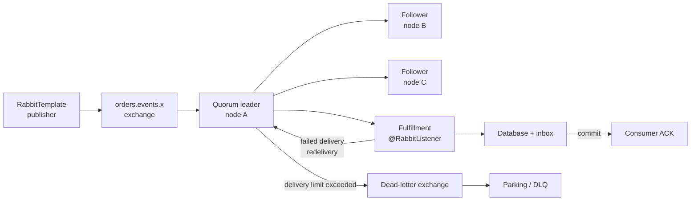
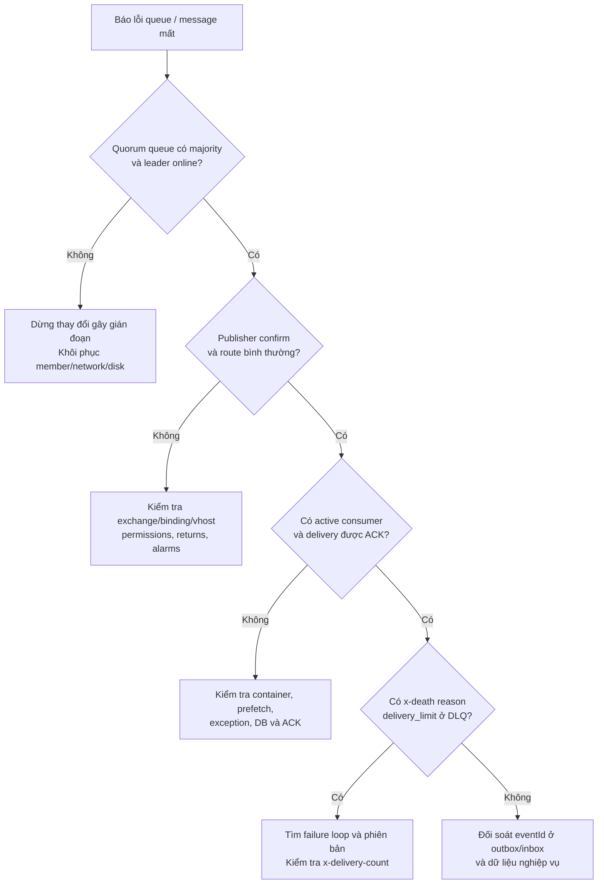
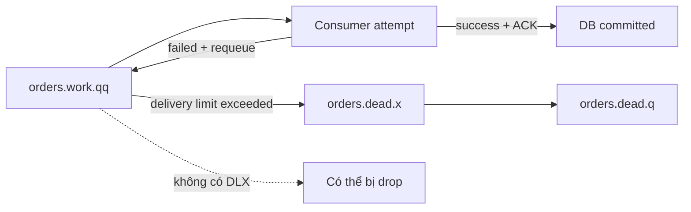
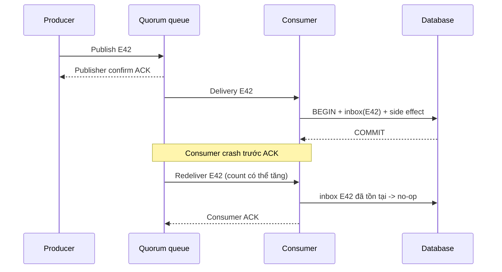

# Quorum queue không khả dụng hoặc chạm delivery limit

## 1. Nhận diện đúng sự cố trước khi can thiệp

Trong hệ thống dùng **Spring AMQP** và **RabbitMQ**, dịch vụ `orders-service` có thể publish sự kiện bằng `RabbitTemplate` tới exchange `orders.events.x`, route vào quorum queue `orders.work.qq`, rồi xử lý qua `@RabbitListener`. Một hôm dashboard báo hai triệu chứng rất khác nhau:

- **Triệu chứng A — Queue không khả dụng:** Publisher không nhận confirm đúng hạn, consumer không nhận message; broker log có lỗi leader election/quorum. Quorum queue đang thiếu **đa số thành viên** hoặc không thể duy trì leader.
- **Triệu chứng B — Message biến mất sau khi xử lý lỗi liên tiếp:** Queue và các node vẫn khỏe, nhưng một event bị giao đi giao lại rồi xuất hiện trong DLQ với lý do `delivery_limit`, hoặc bị loại nếu không có DLX phù hợp.

Hai triệu chứng có thể xảy ra đồng thời: broker mất một node, ứng dụng reconnect, những delivery đang unacked bị giao lại; số lần xử lý thất bại tăng tới giới hạn. Vì vậy không thể chỉ nhìn `messages_ready=0` rồi kết luận message đã được xử lý thành công.

**Mục tiêu bài học** thuộc chương **Chẩn đoán sự cố** của module `SPRING_AMQP`:

1. Phân biệt thiếu quorum/leader với lỗi routing, kết nối, listener hoặc consumer backlog.
2. Hiểu chính xác quorum queue `delivery-limit`, `x-delivery-count` và sự thay đổi quan trọng từ RabbitMQ **4.3**.
3. Đọc bằng chứng ở broker, Spring logs, DLQ và database mà **không phá hủy dữ liệu**.
4. Cấu hình topology, listener, retry, dead-letter và idempotency an toàn.
5. Thực hiện runbook khôi phục theo từng mức độ và viết kiểm thử ngăn sự cố lặp lại.

> **Nguyên tắc khẩn cấp:** Đừng `purge`, xóa/tạo lại queue, `force_reset`, ép node rời cluster, tắt delivery limit hay khởi động lại hàng loạt node chỉ để làm dashboard chuyển màu xanh. Trước hết phải xác định queue còn quorum không, message được broker xác nhận tới đâu, và side effect nào đã commit.

## 2. Hai cơ chế nền tảng: Raft majority và poison-message protection

Quorum queue là queue **durable, replicated**, sử dụng thuật toán **Raft**. Mỗi queue có một nhóm **members** gồm leader và followers. Các thay đổi trạng thái được điều phối qua leader và phải đạt đa số khi cần commit. Broker xác nhận publish vào quorum queue sau khi message được ghi an toàn theo cơ chế quorum. Consumer ACK là chuyện khác: nó xảy ra sau khi ứng dụng xử lý delivery.



### 2.1. Khi nào quorum queue còn hoạt động?

Với **N thành viên thực tế của queue**, không phải số node tùy ý trong cluster:

\[
\text{majority}(N) = \left\lfloor \frac{N}{2} \right\rfloor + 1
\]

| Thành viên của queue | Số thành viên online tối thiểu để có quorum | Số thành viên có thể mất |
| ---: | ---: | ---: |
| 1 | 1 | 0 |
| 2 | 2 | 0 |
| 3 | 2 | 1 |
| 4 | 3 | 1 |
| 5 | 3 | 2 |

Ví dụ một cluster có ba node A, B, C nhưng `orders.work.qq` chỉ có **một** member trên A, thì B và C vẫn khỏe **không** giúp queue chịu được việc mất A. Một queue có ba members đặt trên A/B/C có thể chịu một node mất kết nối; nếu mất hai members, queue không có quorum và sẽ không được phép tiến hành ghi như thể vẫn an toàn.

**Lưu ý:** Mất leader tạm thời khi đa số vẫn còn có thể gây gián đoạn ngắn do bầu leader mới. Mất đa số khác với một kết nối ứng dụng bị ngắt; sửa network của một client không phục hồi được một nhóm Raft đang thiếu quorum.

### 2.2. `delivery-limit` bảo vệ điều gì?

Quorum queue có **poison-message handling** để tránh cùng một message thất bại và được giao lại vô hạn. Nó không kiểm tra giá trị nghiệp vụ, không sửa JSON sai và không thay thế retry/backoff ở ứng dụng.

- RabbitMQ **4.0 trở lên** đặt giới hạn mặc định **20** cho quorum queue, trừ khi được cấu hình khác.
- RabbitMQ **3.13.x** không có delivery limit mặc định theo cách 4.x áp dụng.
- Có thể cấu hình bằng **policy** `delivery-limit` hoặc queue argument `x-delivery-limit`.
- Khi số lần thất bại theo cách broker đếm **vượt giới hạn**, message được **dead-letter** nếu có DLX phù hợp; nếu không, message có thể bị loại khỏi queue và không còn khả năng replay từ đó.
- Giá trị `-1` vô hiệu hóa giới hạn, **không được dùng như phản xạ chữa lỗi** vì có thể gây vòng lặp requeue làm quá tải broker.

**Quan trọng:** `delivery-limit=5` không có nghĩa chính xác “ứng dụng được phép chạy handler năm lần rồi broker luôn đưa tới DLQ”. Cách tính có thay đổi theo phiên bản RabbitMQ, các lần thử local của Spring Retry có thể chưa quay về broker, và một delivery chưa chắc đã tới code handler trước khi consumer bị ngắt.

## 3. Sơ đồ chẩn đoán nhanh



| Tín hiệu | Giả thuyết ưu tiên | Bằng chứng để phân biệt |
| --- | --- | --- |
| `quorum_status` cho thấy thiếu đa số | Queue unavailable thực sự | Member online/leader, cluster partitions, logs |
| `cluster_status` bình thường nhưng một queue không có leader | Một queue hỏng membership/leader riêng | `rabbitmq-queues quorum_status`, node chứa members |
| Queue có quorum, publisher confirm timeout | Disk alarm, flow control, quá tải, network/connection | Node alarms, confirms/NACK, connection logs, disk |
| Publisher confirm ACK nhưng consumer không thấy message | Unroutable, sai vhost, binding/routing key | Mandatory return, exchange/binding, queue name |
| Queue có `messages_ready` tăng, consumer = 0 | Listener chưa chạy hoặc không subscribe đúng queue | `@RabbitListener`, startup logs, auth, container state |
| `messages_unacknowledged` cao | Consumer xử lý chậm/treo hoặc prefetch lớn | DB latency, handler, consumer timeouts |
| Redelivery liên tục, DLQ nhận event | Handler lỗi/ACK sai hoặc delivery limit | `x-delivery-count`, `x-death`, application exceptions |
| Queue/DLQ đều trống nhưng DB chưa có kết quả | Không thể suy ra nguyên nhân từ queue depth | Outbox, publisher confirm/return, message ID, audit |

Đừng chẩn đoán một message chỉ dựa trên `redelivered=true`: flag này cho biết broker từng cố giao lại, **không chứng minh** handler trước đã commit hoặc thực sự đọc được message.

## 4. Thu thập bằng chứng trước khi sửa hệ thống

Các lệnh dưới đây là **lệnh đọc/truy vấn trạng thái**; chạy trên một node quản trị có quyền trong **đúng cluster và virtual host**. Chúng không được dùng để tự thay trạng thái broker:

```bash
# Thông tin node, alarm, phiên bản và trạng thái chung.
rabbitmqctl status
rabbitmq-diagnostics cluster_status

# Danh sách queue và policy trong vhost /.
rabbitmqctl list_queues -p / \
  name type messages_ready messages_unacknowledged consumers arguments
rabbitmqctl list_policies -p /

# Quorum queue cụ thể: leader, followers và tình trạng members.
rabbitmq-queues quorum_status -p / orders.work.qq

# Kiểm tra node này có critical trước một lần dừng node tiếp theo?
rabbitmq-diagnostics check_if_node_is_quorum_critical
```

Trên một số bản RabbitMQ, tùy chọn/field của CLI có thể khác; xem `--help` của đúng phiên bản nếu câu lệnh không chạy. Khi chưa rõ vhost, cần xác minh URL `spring.rabbitmq.virtual-host`, chứ không mặc định mọi queue nằm ở `/`.

**Giới hạn quan trọng:** `check_if_node_is_quorum_critical` trả lời **nếu dừng node này thì có mất quorum không**. Nó **không thay** việc đọc status từng quorum queue để xác định queue hiện có leader/majority. Một cluster có nhiều node ở trạng thái running cũng chưa chắc tất cả quorum queue đều có đầy đủ replica.

### 4.1. Bản ghi incident tối thiểu

| Dữ liệu | Ví dụ/giải thích |
| --- | --- |
| Thời điểm UTC | Khoảng thời gian chính xác xảy ra lỗi |
| Cluster/vhost/queue | `cluster-a`, `/`, `orders.work.qq` |
| RabbitMQ version | Quan trọng vì delivery-count thay đổi ở **4.3** |
| Thành viên/leader | Danh sách thành viên của queue và online/offline |
| Node alarms/partitions | Disk/memory/network partition, leader election |
| Queue type/policy | `x-queue-type=quorum`, `delivery-limit`, DLX |
| Spring AMQP version | Listener lỗi được settle bằng `basic.reject` hay `basic.nack`? |
| `eventId`/`messageId` | Khoá tra cứu một logical event |
| Publisher outcome | Confirm ACK/NACK/timeout và returned/unroutable |
| Consumer outcome | ACK, reject, requeue, exception, crash, DB commit |
| DLQ death reason | `delivery_limit` hay `rejected`/`expired` |

Không log mật khẩu, credentials, payload chứa dữ liệu cá nhân hoặc toàn bộ headers chưa kiểm tra. Dùng ID nghiệp vụ được chuẩn hóa để liên kết producer, broker, consumer và DB.

## 5. Nhánh A: quorum queue không khả dụng

### 5.1. Xác định phạm vi mất quorum

Ví dụ một quorum queue có members A, B, C. Node A đang offline, B đang online, C bị network partition:

```text
Members configured: A, B, C
Online and mutually reachable for queue: B only
Quorum required: 2

Result: Không có đa số để xử lý những thay đổi trạng thái an toàn.
```

Trong tình huống này:

- Publisher có thể timeout, nhận NACK hoặc gặp lỗi kết nối/phát hiện queue không khả dụng; **không mặc định một kết quả cụ thể** khi Raft đang bầu leader.
- `RabbitTemplate.send()` đã return **không có nghĩa** broker đã confirm message.
- Consumer không thể trông đợi xử lý delivery như lúc queue có leader ổn định.
- Dữ liệu đã được publisher xác nhận bền vững trước sự cố có cam kết an toàn trong điều kiện còn đa số dữ liệu/replicas có thể phục hồi; message **chưa được confirm** vẫn có kết quả bất định.

Nếu thiếu quorum, **không** tiếp tục restart nốt node khỏe còn lại, không buộc một follower đơn lẻ làm leader bằng thao tác không được hỗ trợ, và không recreate queue cùng tên để “có queue mới”.

### 5.2. Quy trình an toàn theo mức độ

**P0 — Đóng băng thay đổi:**

1. Dừng rolling upgrade, autoscaling/restarts không cần thiết trên các member còn sống.
2. Đặt maintenance/incident gate cho luồng quan trọng; nếu có transactional outbox, cho event chờ relay thay vì blind publish retry.
3. Thu logs, `cluster_status`, `quorum_status`, node alerts, disk headroom và lịch deploy gần nhất.
4. Đảm bảo không có automation xóa volume khi pod bị recreate; dữ liệu Raft nằm trong storage, không chỉ memory.

**P1 — Khôi phục nguyên nhân thành viên không khả dụng:**

- **Node tắt/hỏng process:** kiểm tra RabbitMQ/Erlang runtime, log startup, systemd/Kubernetes events và đủ disk.
- **Network partition:** kiểm tra DNS, inter-node ports/TLS, firewall, latency/packet loss; không chỉnh membership trước khi hiểu partition.
- **Disk/memory alarms:** xác định áp lực tài nguyên, cấp headroom phù hợp; flow control có thể khiến publisher chậm ngay khi quorum còn sống.
- **Node bị nâng version sai:** kiểm tra upgrade path, Erlang/OTP, feature flags và plugin compatibility; không tự downgrade broker.
- **Replica nằm trên node đã bị decommission:** đánh giá lại membership chỉ theo **quy trình RabbitMQ chính thức** và có người vận hành có thẩm quyền.

**P2 — Đợi cluster tái lập majority và kiểm chứng:**

1. Khôi phục đủ members (hoặc đường phục hồi do operator/DR đã duyệt).
2. Xác minh queue có leader hợp lệ, followers đã bắt kịp, không còn partition/alarms bất thường.
3. Cho một producer canary publish event ID riêng, **đợi publisher confirm** và kiểm tra đúng queue/consumer.
4. Đối soát event IDs đã confirm trước incident và những publish timeout (trạng thái *unknown*).
5. Khôi phục traffic tăng dần, theo dõi p95/p99 confirm, backlog, consumer ACK, DLQ và DB business state.

**P3 — Nếu không thể có majority:** chuyển cấp cho người quản trị/DR, giữ nguyên storage và bằng chứng. Việc xóa member, force boot hoặc phục hồi từ backup có nguy cơ mất những message khác và đòi quy trình chính thức. Không khuyến nghị một lệnh “cứu queue” duy nhất trong bài học chung này.

### 5.3. Cluster khỏe chưa chắc queue khỏe

Một lỗi thường gặp là xem `cluster_status` thấy ba node running rồi kết luận `orders.work.qq` có ba members. Thành viên quorum queue được quản lý **theo queue**. Thêm node mới vào cluster cũng **không tự bảo đảm** queue cũ được thêm replica. Kiểm tra:

```bash
rabbitmq-queues quorum_status -p / orders.work.qq
```

Nếu queue chỉ có một member và không có failure tolerance, phải lập kế hoạch membership change **sau khi queue ổn định**, có đa số và đủ placement; không thực hiện `add_member`/`delete_member` như bước phản xạ trong incident thiếu quorum.

### 5.4. Phân biệt một số lỗi có triệu chứng tương tự

| Lỗi | Tại sao không phải mất quorum? | Chẩn đoán |
| --- | --- | --- |
| `404 NOT_FOUND` khi subscribe | Queue không tồn tại trong vhost/đã bị xóa, không phải Raft minority mặc định | Queue name/vhost, RabbitAdmin declaration, quyền |
| `406 PRECONDITION_FAILED - inequivalent arg x-queue-type` | Ứng dụng redeclare queue cùng tên với loại khác | `QueueBuilder.quorum()` vs queue tồn tại, policy/arguments |
| `403 ACCESS_REFUSED` | Permission `configure`, `read`, `write` thiếu | User/vhost/ACL; không thay queue type |
| Publish unroutable | Exchange tồn tại nhưng binding/routing key không dẫn đến queue | `mandatory=true`, returned message, bindings |
| Queue có quorum nhưng lag cao | Consumer chậm, prefetch/DB bottleneck, disk/network pressure | `ready`/`unacked`, processing latency |
| Consumer không start | Listener factory sai, missing queue, converter hoặc connection | Spring logs, container registry, exception |
| Node bị alarm | Disk/memory limits có thể chặn publisher dù queue vẫn có đa số | Alarms, free disk, queue backlog |

Đặc biệt, **queue type bất biến**: không đổi classic thành quorum bằng cách sửa `QueueBuilder.quorum()` rồi để `RabbitAdmin` redeclare cùng tên. Cần tạo queue mới và migration có đối soát, không xóa dữ liệu cũ.

## 6. Nhánh B: message chạm `delivery-limit`

### 6.1. Một kịch bản thực tế

Handler `OrderCreated` ném exception vì schema mới thiếu field bắt buộc. Spring listener container liên tục trả message về queue. Với quorum queue có giới hạn, broker có thể loại message khỏi work queue sau các lần thất bại được đếm:



Khác với queue mất quorum, ở đây **queue vẫn có leader, vẫn nhận publish mới**. Điều bất thường nằm ở quá trình consume, retry, acknowledgement hoặc việc app bị crash liên tiếp.

Một message không còn trong work queue có thể vì:

1. Handler thành công, ACK và commit DB.
2. Message hết TTL hoặc bị queue length limit tác động.
3. Consumer reject với `requeue=false` nên chuyển DLQ với reason `rejected`.
4. Quorum queue vượt `delivery-limit` nên chuyển DLQ với reason `delivery_limit` hoặc drop.
5. Admin đã purge/delete queue — phải tra audit log, **không** suy ra là tự động do broker.

### 6.2. Khác biệt RabbitMQ trước/sau 4.3 — rất quan trọng

RabbitMQ **4.3** phân biệt rõ số lần **đã giao cho consumer** và số lần **delivery thất bại**:

| Hành động từ AMQP 0-9-1 | RabbitMQ 4.2 trở về trước | RabbitMQ 4.3 trở lên |
| --- | --- | --- |
| Consumer `basic.nack(tag, false, true)` | Có thể tăng delivery count theo cơ chế cũ | **Không** tăng `x-delivery-count` cho failed delivery |
| Consumer `basic.reject(tag, true)` | Được tính là failure/redelivery | **Tăng** `x-delivery-count` |
| Consumer `basic.reject(tag, false)` | Reject terminal, dead-letter nếu có DLX | Reject terminal, dead-letter nếu có DLX |
| Consumer crash/connection loss với unacked messages | Có thể khiến count tăng | **Tăng** failed-delivery count |
| Network partition khiến consumer node bị nghi ngờ down | Hành vi đếm tùy release | `acquired-count` tăng, failed count không tăng theo bảng 4.3 |
| Consumer timeout chưa ACK | Hành vi đếm tùy release | `acquired-count` tăng, failed count không tăng theo bảng 4.3 |

Ở RabbitMQ **4.3+**, header `x-acquired-count` theo dõi số lần message được gán cho consumer; còn `x-delivery-count` theo dõi **failed delivery attempts**. Một message được gán nhưng app crash trước khi xử lý vẫn có thể được tính là failed delivery. Cả hai đều **không phải** số lần logic nghiệp vụ thực sự chạy tới DB.

**Hệ quả thực tế:** Một ứng dụng dựa vào `basic.nack(requeue=true)` để cho broker tự tăng tới limit rồi dead-letter có thể **requeue mãi** sau khi nâng lên 4.3. Nếu muốn đánh dấu một lần xử lý thực sự **thất bại** và tiếp tục dùng delivery limit, kiểm thử cách settle bằng `basic.reject(requeue=true)` hoặc outcome AMQP 1.0 thích hợp. Tuy nhiên cách làm tốt hơn cho lỗi tạm thời thường là **retry có backoff hữu hạn** rồi đưa message vào DLQ có kiểm soát.

Không bỏ qua version của **Spring AMQP**: listener container có thể dùng các biến thể nack/reject khác nhau theo ACK mode, batching và việc handler có truy cập `Channel` hay không. Ví dụ Spring AMQP 4.0.6 đã điều chỉnh cách reject từng delivery thay vì cumulative nack trong một số tình huống; nhưng **đếm trên broker 4.3 vẫn phải kiểm chứng theo semantics của broker 4.3**. Không suy cơ chế đếm từ một property Java duy nhất.

### 6.3. `x-delivery-count`, `x-acquired-count` và `x-death`

| Header/field | Thường thấy ở đâu | Dùng làm gì |
| --- | --- | --- |
| `x-delivery-count` | Message từ **quorum queue** được redeliver | Số failed delivery theo định nghĩa broker/phiên bản |
| `x-acquired-count` | RabbitMQ **4.3+** | Số lần broker đã gán delivery, kể cả không thành công |
| `redelivered` | `MessageProperties` từ delivery | Boolean cho biết message được giao lại |
| `x-death` | Message đã **dead-letter**, quan sát ở queue đích | Lịch sử chết theo queue/reason/count |
| `x-first-death-reason` | Message đã dead-letter | Reason đầu tiên, có thể là `delivery_limit` |
| `x-last-death-reason` | Message đã dead-letter nhiều lần | Reason gần nhất |
| `messageId`/`eventId` | Producer đặt, thường trong message/body | Khóa truy cứu và idempotency nghiệp vụ |

`x-death.reason` có thể là `rejected`, `expired`, `maxlen` hoặc **`delivery_limit`**. Đừng nhầm `rejected` (ứng dụng từ chối/chết ngay) với `delivery_limit` (giới hạn failed redeliveries). Một message đi qua nhiều DLX có thể mang nhiều mục `x-death`; `x-first-death-reason` không nhất thiết là reason mới nhất.

**Lưu ý bảo mật và độ tin cậy:** `x-*` headers liên quan broker do broker quản lý. Không cố tạo client-side `x-death` giả để điều khiển retry; ở các phiên bản mới, RabbitMQ không tin những history fields tự ý do client publish. Dùng business `retryCount`/schema rõ ràng khi ứng dụng thực hiện republish theo kiểu riêng.

## 7. Kiểm tra policy và DLX trước khi động tới delivery limit

### 7.1. Policy và queue argument

Quorum queue có thể khai báo với:

```java
QueueBuilder.durable("orders.work.qq")
        .quorum()
        .deliveryLimit(5)
        .build();
```

Đây là cách đặt `x-delivery-limit` ở lúc khai báo. Với những hệ thống cần điều chỉnh linh hoạt trong vận hành, dùng **RabbitMQ policy** `delivery-limit` có thể thuận tiện hơn; khi cả policy và queue argument cùng tồn tại, phải **kiểm tra cấu hình hiệu lực**, không giả định cái mới sửa sẽ tự ghi đè mọi giá trị đã khai báo.

**Ví dụ chỉ trên môi trường lab**, dùng shell Bash:

```bash
# Chỉ áp dụng quorum queue này trong vhost /.
# Đảm bảo DLX và dead queue đã được khai báo, binding đúng.
rabbitmqctl set_policy -p / lab-qq-poison \
  '^lab[.]orders[.]qq$' \
  '{"delivery-limit":5,"dead-letter-exchange":"lab.orders.dlx","dead-letter-routing-key":"orders.failed"}' \
  --priority 50 --apply-to "quorum_queues"

# Xem policy; đối chiếu effective policy/arguments trong Management UI.
rabbitmqctl list_policies -p /

# Nếu cần gỡ chính policy lab:
rabbitmqctl clear_policy -p / lab-qq-poison
```

Cú pháp dấu nháy là **Bash**; Windows PowerShell/cmd cần escape JSON khác. Không áp dụng regex rộng vào production vì thay delivery limit của nhiều queue có thể khiến **nhiều message chưa xử lý bị loại cùng lúc**. Khi dùng `set_policy`, phải xác định **priority** và những policy khác đang match queue; kiểm tra queue hiện có argument `x-delivery-limit` hay chưa.

Thay policy có thể tác động lên quorum queue đã tồn tại mà không redeclare. Tuy nhiên tăng giới hạn **không phục hồi** message đã bị dead-letter/drop trước đó. Đừng tăng từ 20 lên một triệu chỉ để ngăn alert: bạn có thể biến một poison message thành vòng lặp ăn CPU, disk và network.

### 7.2. DLX phải route tới queue thực

Một cấu hình có `dead-letter-exchange` nhưng **không có** exchange/queue/binding đích phù hợp sẽ không giữ message trong parking queue. Khi quorum queue chạm limit, message có thể rời khỏi work queue mà không có bản sao mà bạn mong đợi ở DLQ.

Với event quan trọng:

- Provision DLX và DLQ **trước** khi bật policy.
- Đảm bảo exchange type/routing key và vhost đúng; kiểm tra publisher/queue permissions.
- DLQ phải đủ dung lượng, durable nếu muốn bảo vệ qua restart; message nên mang delivery mode persistent khi luồng DLX yêu cầu độ bền.
- Có hệ thống giám sát DLQ và một **quy trình xử lý/replay** riêng; DLQ không phải thùng rác vĩnh viễn không ai theo dõi.
- Kiểm tra broker **at-most-once vs at-least-once dead-letter strategy** nếu mức an toàn trong quá trình chuyển từ work queue sang DLQ là bắt buộc.

### 7.3. At-most-once và at-least-once dead-lettering

Quorum queue mặc định dùng **`at-most-once` dead-lettering**. Nếu target DLQ không khả dụng hoặc dead-letter exchange/binding sai, message có rủi ro mất khi chuyển. RabbitMQ hỗ trợ một chế độ **`at-least-once`** an toàn hơn cho chuyển message khỏi quorum queue, nhưng cần:

1. `dead-letter-strategy=at-least-once`.
2. `overflow=reject-publish` (không phải mặc định `drop-head`).
3. Có `dead-letter-exchange` và topology đích hợp lệ.
4. Các điều kiện tương thích/feature flags trong phiên bản RabbitMQ đang dùng.

Trong cơ chế `at-least-once`, source quorum queue **giữ các dead-lettered messages chờ target confirm**; nếu target không nhận, chúng có thể tiếp tục chiếm disk/resource của source và khiến queue đầy. Việc republish trong trường hợp lỗi có thể tạo **duplicate** ở target. Không tự bật chế độ này trên production mà chưa kiểm tra capacity, policy `max-length`, target availability và idempotent DLQ processor.

**Cảnh báo:** Chuyển từ `at-least-once` sang `at-most-once`, hoặc đổi `overflow` làm mất điều kiện bảo đảm, có thể khiến những message đang chờ xác nhận dead-letter bị loại. Đây **không** phải một toggle khôi phục vô hại.

## 8. Ví dụ Spring AMQP: topology có quorum và dead-letter

Ví dụ này minh họa Java 17+, Spring Boot/Spring AMQP có `QueueBuilder.quorum()`; các imports từ Spring AMQP 3.x hoặc 4.x thông dụng. Tên `lab.*` cho biết **chỉ dùng trong test/sandbox**.

### 8.1. Khai báo exchange, queue và DLQ rõ ràng

```java
import org.springframework.amqp.core.BindingBuilder;
import org.springframework.amqp.core.Declarables;
import org.springframework.amqp.core.DirectExchange;
import org.springframework.amqp.core.Queue;
import org.springframework.amqp.core.QueueBuilder;
import org.springframework.context.annotation.Bean;
import org.springframework.context.annotation.Configuration;

@Configuration
public class LabQuorumTopology {

    @Bean
    public Declarables labTopology() {
        DirectExchange events =
                new DirectExchange("lab.orders.x", true, false);
        DirectExchange dead =
                new DirectExchange("lab.orders.dlx", true, false);

        Queue work = QueueBuilder.durable("lab.orders.qq")
                .quorum()
                // Deliberately do NOT set x-delivery-limit:
                // quản lý bằng RabbitMQ policy trong lab.
                .build();

        Queue parking = QueueBuilder.durable("lab.orders.dead.q")
                .build();

        return new Declarables(
                events,
                dead,
                work,
                parking,
                BindingBuilder.bind(work)
                        .to(events).with("orders.created"),
                BindingBuilder.bind(parking)
                        .to(dead).with("orders.failed")
        );
    }
}
```

Ở ví dụ này **DLX/delivery limit nằm trong policy** (mục 7), không hard-code `x-dead-letter-exchange` trong queue bean. Nếu chạy app trên broker sạch trước khi policy được áp dụng, message bị reject có thể **bị loại**. Thứ tự setup cho lab là: tạo exchange/queue/binding, áp dụng policy có DLX, xác nhận effective policy, **sau đó mới publish message thử**.

Khi dùng `RabbitAdmin`, topology có thể được khai báo khi connection AMQP sẵn sàng. Nếu queue **đã tồn tại dưới dạng classic**, việc redeclare cùng tên với `.quorum()` có thể gây `406 PRECONDITION_FAILED`. Không sửa bằng cách xóa queue production; cần migration queue riêng.

### 8.2. Spring Boot configuration cho publisher và listener

```yaml
spring:
  rabbitmq:
    host: localhost
    port: 5672
    username: ${RABBIT_USER:guest}
    password: ${RABBIT_PASSWORD:guest}
    publisher-confirm-type: correlated
    publisher-returns: true
    template:
      mandatory: true
    listener:
      simple:
        concurrency: 1
        max-concurrency: 1
        prefetch: 1
        acknowledge-mode: manual
```

Cấu hình `prefetch: 1` và một consumer giúp **lab** quan sát một message lần lượt, tránh nhiều unacked message bị requeue cùng lúc khi consumer crash. Không coi đây là lựa chọn hiệu năng tối ưu cho tất cả workload. Với production, thiết kế số consumer/prefetch theo throughput, xử lý concurrency và risk của crash.

**Chú ý:** `acknowledge-mode: manual` nghĩa là **application phải ACK/reject từng delivery**. Nếu handler chỉ log rồi return mà không ACK, message sẽ ở trạng thái unacked đến khi channel đóng hoặc timeout; nó không tự động thành công.

## 9. Listener: ACK, reject và version-dependent delivery limit

### 9.1. Ví dụ manual acknowledgement chỉ cho lab

Ví dụ dùng `Channel` của RabbitMQ Java Client để thể hiện chính xác settlement; service `OrderLabHandler` chỉ là contract minh họa:

```java
import java.io.IOException;
import com.rabbitmq.client.Channel;
import org.slf4j.Logger;
import org.slf4j.LoggerFactory;
import org.springframework.amqp.core.Message;
import org.springframework.amqp.rabbit.annotation.RabbitListener;
import org.springframework.stereotype.Component;

@Component
public class QuorumLabListener {
    private static final Logger log =
            LoggerFactory.getLogger(QuorumLabListener.class);

    private final OrderLabHandler handler;

    public QuorumLabListener(OrderLabHandler handler) {
        this.handler = handler;
    }

    @RabbitListener(queues = "lab.orders.qq")
    public void receive(Message message, Channel channel)
            throws IOException {
        long tag = message.getMessageProperties().getDeliveryTag();
        Object failures = message.getMessageProperties()
                .getHeaders().get("x-delivery-count");
        Object acquired = message.getMessageProperties()
                .getHeaders().get("x-acquired-count");

        log.info("Lab delivery: messageId={}, failed={}, acquired={}",
                message.getMessageProperties().getMessageId(),
                failures, acquired);

        try {
            // Demo: applyOnce phải commit DB + inbox trong một transaction.
            handler.applyOnce(message.getBody());
            channel.basicAck(tag, false);
        } catch (InvalidOrderMessageException invalid) {
            // Lỗi vĩnh viễn: dead-letter NGAY (reason rejected).
            channel.basicReject(tag, false);
        } catch (TemporaryOrderFailure temporary) {
            // CHỈ dùng trong lab minh họa delivery-limit.
            // RabbitMQ 4.3+: basic.reject(requeue=true) tính failed delivery.
            channel.basicReject(tag, true);
        } catch (RuntimeException unexpected) {
            log.error("Unexpected lab processing failure", unexpected);
            channel.basicReject(tag, false);
        }
    }
}

interface OrderLabHandler {
    void applyOnce(byte[] payload);
}

class InvalidOrderMessageException extends RuntimeException {}
class TemporaryOrderFailure extends RuntimeException {}
```

**Ràng buộc vận hành:**

- Code manual phải settle **đúng một lần** cho **mỗi delivery tag trên channel**. Không để listener container ACK thêm sau đó; dùng factory `AcknowledgeMode.MANUAL`.
- `channel.basicReject(tag, true)` trong ví dụ **requeue ngay**, có thể tạo tight loop và tiêu thụ CPU, network, DB. **Không triển khai nguyên mẫu này vào production** cho lỗi downstream kéo dài; dùng broker delayed retry (ở phiên bản hỗ trợ) hoặc retry queue TTL/DLX/backoff có giới hạn.
- `channel.basicReject(tag, false)` dead-letter ngay nếu DLX được cấu hình. Nó **không đợi** tới `delivery-limit`. Vì vậy một message trong DLQ với reason `rejected` không phải bằng chứng limit đã chạm.
- Khi `basicAck`/`basicReject` ném `IOException`, kết quả settlement có thể chưa chắc chắn. Để recovery của container quản lý connection, bảo toàn event ID/idempotency; **không ACK lần hai một cách mù quáng**.
- `OrderLabHandler` cần tự triển khai validate schema, DB transaction và inbox. Nếu service xử lý thanh toán, phải dùng idempotency key với external payment API và có chiến lược đối soát riêng.

### 9.2. Vì sao AUTO ACK của Spring có thể tạo loop khác?

Với `@RabbitListener` và `AcknowledgeMode.AUTO`, Spring container sẽ ACK sau khi method thành công; khi method ném exception, `defaultRequeueRejected` mặc định có thể khiến message requeue. Người viết code **không nhìn thấy** một `basicNack`/`basicReject` cụ thể nếu không bật log hoặc kiểm tra cơ chế listener container của đúng Spring AMQP version.

```yaml
spring:
  rabbitmq:
    listener:
      simple:
        acknowledge-mode: auto
        default-requeue-rejected: false
```

Cấu hình trên dùng cho **biến thể handler khác**: listener lỗi sẽ bị reject **không requeue**, phù hợp đưa poison message vào DLQ trực tiếp thay vì quay vòng. Nó **không phải** cách tạo ra năm failed deliveries để thử `delivery-limit=5`. Đừng trộn config AUTO với code manual ACK ở mục 9.1.

Spring AMQP còn có `AmqpRejectAndDontRequeueException` để buộc không requeue; `ImmediateRequeueAmqpException` để buộc requeue. Khi dùng Spring Retry advice chain hoặc `RepublishMessageRecoverer`, retry có thể xảy ra **trong JVM** rồi republish tới error exchange; broker nhìn thấy một delivery khác với khi mỗi attempt quay về cùng queue. Phải kiểm tra cấu hình thực tế trước khi dùng `x-delivery-count` làm bộ đếm business retries.

## 10. Idempotency: tránh sai nghiệp vụ khi khôi phục quorum hoặc retry

Ngay cả khi publisher nhận confirm ACK, consumer có thể commit DB rồi crash trước ACK:



Trong database:

```sql
CREATE TABLE processed_events (
    event_id VARCHAR(128) PRIMARY KEY,
    processed_at TIMESTAMPTZ NOT NULL DEFAULT now()
);
```

Pseudocode **trong cùng database transaction**:

```text
BEGIN
  INSERT INTO processed_events(event_id)
      VALUES (:eventId) ON CONFLICT DO NOTHING
  IF inserted:
      validate business version
      apply business side effect
COMMIT
ACK delivery
```

Nếu producer không tự gán `messageId`, phải có `eventId` bền vững trong JSON/body. Không dùng `deliveryTag`, `x-delivery-count` hoặc `redelivered` làm dedup key: chúng có thể thay đổi qua redelivery và không đại diện cùng một logical event.

**Không bao giờ dùng việc đã vượt delivery limit làm bằng chứng business thất bại hoàn toàn.** Có thể DB đã commit ở một attempt trước nhưng ACK bị mất. Khi replay message từ DLQ, phải kiểm tra inbox/DB và trạng thái hệ thống ngoài như payment provider trước khi quyết định phát lại.

## 11. Runbook 15 phút đầu: phân nhánh, ngăn mất dữ liệu

| Giai đoạn | Nếu queue thiếu quorum | Nếu queue khỏe nhưng message ở DLQ/đã chạm limit |
| --- | --- | --- |
| 0–2 phút | Dừng upgrade/restart, không can thiệp membership | Tạm giảm/stop consumer lỗi để ngăn requeue storm |
| 2–5 phút | Thu cluster/quorum status, alarms, partitions, node logs | Thu policy/arguments, version 4.2 vs 4.3, consumer exceptions |
| 5–8 phút | Xác định member mất do process/network/disk | Kiểm tra `x-death.reason`, x-delivery-count, DLX binding |
| 8–12 phút | Khôi phục **đa số** bằng quy trình operator | Phân loại lỗi schema vs transient; xác định cách ACK/nack/reject |
| 12–15 phút | Canary confirms/consume và đối soát outbox | Fix root cause, test delayed retry/DLQ, chuẩn bị replay có giới hạn |

Các mốc phút chỉ là cấu trúc ưu tiên cho **response runbook**, không phải cam kết queue phải hồi phục trong 15 phút. Nếu không có bằng chứng an toàn để thao tác, dừng và chuyển cấp thay vì thử lệnh phá dữ liệu.

### Tiêu chí mở traffic trở lại

- Quorum queue có leader/majority, followers còn đủ, không có partition mới.
- Disk/memory alarms và network đã ổn định; publish confirm p95/p99 trở về ngưỡng chấp nhận.
- Lỗi consumer đã được khắc phục hoặc có cơ chế backoff/parking được kiểm chứng.
- Queue đích DLX/DLQ route được, đủ capacity; không có dữ liệu chưa biết số phận.
- Canary với event ID mới đi qua publish → queue → DB → ACK thành công.
- Đã đối soát event IDs trước/sau incident ở outbox, inbox và DLQ; trùng lặp không gây side effect lần hai.

## 12. Bài thực hành có kiểm soát

### Thực hành A — Kiểm tra quorum và member placement

1. Tạo cluster thử nghiệm ba node, khai báo `lab.orders.qq` với ba members thực tế.
2. Kiểm tra `rabbitmq-queues quorum_status` để ghi lại leader, followers và online members.
3. Publish N message với `messageId` duy nhất, **đợi publisher confirms** và ghi IDs đã confirm.
4. Dừng **một node** trong môi trường lab: ghi lại leader election và độ trễ confirm; khi còn hai members, queue phải có khả năng tiếp tục hoạt động sau khi ổn định.
5. Trong thí nghiệm riêng đã được cho phép, làm mất đa số: quan sát queue unavailable, client timeout và phục hồi khi trả lại đa số.
6. Khôi phục cluster, đối soát IDs; không biến các publish timeout thành giả định “chắc chắn chưa publish”.

**Không thực hành việc mất quorum trên RabbitMQ production.** Không làm trên laptop một node rồi tuyên bố đã kiểm tra HA ba node.

### Thực hành B — Chạm `delivery-limit` với một poison message

1. Dùng RabbitMQ **4.3+** lab, apply policy `delivery-limit=5` và DLX hợp lệ như mục 7.
2. Đặt `prefetch=1`; dùng listener MANUAL ở mục 9.1 với handler luôn ném `TemporaryOrderFailure` cho event ID `lab-poison-1`.
3. Publish **một** message `lab-poison-1` dạng persistent, đợi publisher confirm.
4. Theo dõi số lần nhận và header `x-delivery-count` / `x-acquired-count`.
5. Vì code dùng `basic.reject(requeue=true)` (đánh dấu failed delivery trên 4.3), broker sẽ dead-letter khi vượt ngưỡng; kiểm tra queue đích DLQ và reason **`delivery_limit`**.
6. Kiểm tra một message hợp lệ khác vẫn được ACK thành công. Không coi một poison message là lý do phải xóa cả queue.

### Thực hành C — Thấy khác biệt giữa nack và reject từ 4.3

1. Tạo queue lab riêng, giữ policy limit hữu hạn và DLQ.
2. Thay **chỉ trên lab** `channel.basicReject(tag, true)` bằng `channel.basicNack(tag, false, true)`.
3. Với RabbitMQ 4.3+, đối chiếu: số acquired có thể tăng nhưng `x-delivery-count` không tăng theo mỗi `basic.nack`; poison event có thể không chạm giới hạn như kỳ vọng.
4. Dừng consumer ngay sau khi đã có đủ số lần quan sát, tránh tạo vòng lặp vô hạn gây nghẽn broker.
5. Viết kết luận về thay đổi behavior khi nâng từ RabbitMQ 4.2 xuống/qua 4.3, không chỉ đổi API một cách mù quáng.

### Thực hành D — Lỗi DLX

1. Trong lab tách biệt, cấu hình policy có tên DLX sai hoặc binding không khớp.
2. Đẩy một message tới terminal reject/limit.
3. Quan sát `orders.work.qq` và DLQ, so sánh **không có message trong DLQ** với event ID đã publish.
4. Khôi phục đúng topology rồi thử lại bằng event ID **mới**; không kỳ vọng message đã bị drop tự xuất hiện lại.
5. Lập runbook phát hiện **missing DLX** trước khi deploy vào production.

### Thực hành E — Consumer crash và prefetch

1. Thử `prefetch=1` rồi tăng lên `prefetch=20` trong lab.
2. Làm consumer crash khi đang có nhiều unacked deliveries; theo dõi việc chúng được giao lại.
3. So sánh sự tăng `x-delivery-count`, số message có nguy cơ chạm giới hạn khi nhiều delivery bị requeue theo nhóm, và trạng thái DB.
4. Cấu hình graceful shutdown, cân đối prefetch/consumer concurrency và thêm inbox idempotency, thử lại.

## 13. Kiểm thử hồi quy sau khi sửa

| Test ID | Đầu vào / điều kiện | Kết quả phải có |
| --- | --- | --- |
| Q-01 | Cluster ba members, dừng một member | Queue phục hồi và tiếp tục confirm sau leader election |
| Q-02 | Mất đa số members trong lab | Không có successful publish giả; client phân loại timeout/unknown |
| Q-03 | Cluster có ba node nhưng queue chỉ có một member | Kiểm tra phát hiện thiếu HA, không báo “chịu lỗi một node” |
| Q-04 | Publish vào exchange không có binding | Mandatory return/unroutable được ghi nhận |
| Q-05 | Queue đúng quorum nhưng Spring consumer sai vhost | Chẩn đoán queue missing/auth, không gán lỗi cho Raft |
| D-01 | Handler luôn reject/requeue trên RabbitMQ 4.3 | Xác minh `x-delivery-count` tăng khi **basic.reject** |
| D-02 | Handler requeue bằng `basic.nack` trên RabbitMQ 4.3 | `x-delivery-count` không tăng vì nack đơn thuần |
| D-03 | Chạm delivery limit + DLX đúng | Message vào DLQ, reason `delivery_limit` |
| D-04 | Handler terminal reject | DLQ reason `rejected`, không chờ delivery limit |
| D-05 | Không có DLX/binding đích | Test phát hiện nguy cơ drop, không đánh dấu xử lý thành công |
| D-06 | Broker 4.2 ↔ 4.3 upgrade rehearsal | So hành vi nack/reject và Spring version thật |
| D-07 | Crash sau DB commit trước ACK | Redelivery nhưng không tạo duplicate side effect |
| D-08 | Prefetch lớn + consumer crash | Đo redeliveries/limit, không mất dữ liệu ngoài chính sách |
| D-09 | Áp dụng policy mới khi queue tồn tại | Effective policy được ghi nhận; test không vô ý áp dụng rộng |
| D-10 | DLQ consumer replay message cũ | Inbox/DB chặn double charge, schema lỗi được xử lý trước replay |
| D-11 | At-least-once DLX target unavailable | Source giữ pending dead-letter; đo disk/headroom và khả năng phục hồi |

Một test chỉ kiểm tra `RabbitTemplate.convertAndSend(...)` không thể chứng minh quorum, DLX hoặc delivery count. Hãy dùng **RabbitMQ cluster thật trong môi trường kiểm thử** để kiểm tra majority/leader, hoặc Testcontainers/broker một node chỉ cho các test phù hợp như conversion và poison handling (không coi đó là HA benchmark).

## 14. Metrics và cảnh báo vận hành

| Layer | Metric/observation nên thu | Dấu hiệu cần phản ứng |
| --- | --- | --- |
| Cluster | Member/node online, partitions, alarms | Mất member hoặc đang dần mất đa số |
| Quorum queue | Leader, members online, replica catch-up | Queue không còn leader/quorum |
| Publish | Confirm ACK/NACK, timeout, mandatory returns | Outbox tăng, publish unknown/unroutable |
| Consumer | Active count, prefetch, `ready`, `unacked` | Consumer không xử lý hoặc giữ delivery quá lâu |
| Redelivery | Redelivered rate, x-delivery-count distribution | Crash loop/poison message, delivery count tăng nhanh |
| DLQ | Dead-letter count, `x-death.reason`, DLQ depth | `delivery_limit` hoặc `rejected` tăng bất thường |
| Resources | Disk free/alarm, memory, CPU, network, WAL | Quorum chậm hoặc bị resource throttling |
| Business | Inbox duplicates prevented, missing event IDs, order status | Có rủi ro mất/nhân đôi side effect |

Đừng đưa `eventId`, `traceId` hoặc `messageId` vào **low-cardinality metrics labels**; những ID đó có quá nhiều giá trị. Đưa vào structured logs/traces có kiểm soát, còn metrics dùng queue/vhost/service/outcome/error class nếu tập nhãn được giới hạn.

### Các alert quan trọng

- **Quorum critical node:** Nếu một node tiếp theo bị dừng sẽ mất majority cho bất kỳ quorum queue quan trọng nào, chặn rolling maintenance.
- **Leader unavailable / member count thấp:** Điều tra ngay cả khi các publisher khác vẫn hoạt động vì chúng có thể dùng queue khác.
- **Publisher confirms timeout hoặc outbox backlog:** Không bỏ qua event có outcome không rõ.
- **`delivery_limit` dead-letter spike:** Tìm schema bug/crash loop, không chỉ tăng limit.
- **DLQ backlog và target unroutable:** Chặn mất message và đảm bảo replay pipeline có owner.
- **Repeated consumer restarts + prefetch lớn:** Có nguy cơ nhiều delivery bị tính thất bại cùng lúc.
- **At-least-once DLX pending tăng:** Target không xác nhận; source queue có thể đầy và reject publish mới.

## 15. Những hiểu lầm thường gặp

1. **“Cluster đủ ba node là mọi quorum queue chịu được mất một node.”** Phải kiểm tra **members của từng queue**, không chỉ số cluster nodes.
2. **“Queue không có message nghĩa là đã xử lý xong.”** Có thể đã bị drop, dead-letter, purge hoặc publish chưa tới queue.
3. **“Publisher `send()` return là message được xác nhận an toàn.”** Phải đợi publisher confirm/return và xác định queue đích.
4. **“Mất quorum thì cứ xóa queue để RabbitAdmin tạo lại.”** Có thể mất dữ liệu; cần khôi phục members/network/backup theo quy trình.
5. **“Bật `x-delivery-limit=-1` là đã sửa poison message.”** Chỉ tắt hàng rào bảo vệ, dễ gây retry storm.
6. **“Limit 20 nghĩa đúng 20 lần method business chạy.”** Broker đếm theo settlement/connection và release, không phải business function invocation.
7. **“`basic.nack(requeue=true)` luôn làm tăng `x-delivery-count`.”** Không đúng với RabbitMQ 4.3+.
8. **“`basic.reject(requeue=false)` sẽ chờ hết limit.”** Nó là terminal reject, có thể dead-letter ngay.
9. **“`x-acquired-count` là số lần DB transaction đã chạy.”** Không: chỉ là số lần broker gán delivery.
10. **“Spring Retry ba lần đồng nghĩa broker tăng delivery count ba lần.”** Retry trong JVM có thể dùng một broker delivery.
11. **“Cấu hình dead-letter-exchange là chắc chắn có DLQ.”** Còn cần exchange/queue/binding, capacity và đúng vhost.
12. **“At-least-once DLX không bao giờ có duplicate.”** Có thể có republish/retry; handler đích vẫn cần idempotency.
13. **“Thay delivery limit sau khi message bị drop sẽ hồi sinh dữ liệu.”** Không; cần source of truth/archive để replay.
14. **“`AmqpRejectAndDontRequeueException` tăng x-delivery-count tới limit.”** Nó thường yêu cầu reject không requeue và đi DLQ ngay.
15. **“Auto ACK của Spring giống RabbitMQ `autoAck=true`.”** `AcknowledgeMode.AUTO` là container ACK sau khi handler thành công; `NONE` mới tương ứng không chờ ACK ứng dụng.
16. **“Tăng prefetch luôn tăng throughput mà không đổi rủi ro.”** Prefetch lớn làm nhiều unacked deliveries bị ảnh hưởng khi app crash.

## 16. Câu hỏi tự kiểm tra

1. Phân biệt quorum queue **không có majority** với queue có majority nhưng không có consumer.
2. Tại sao `cluster_status` có ba node running vẫn chưa chứng minh mọi quorum queue có ba members khỏe mạnh?
3. Với quorum queue ba members, mất một node và mất hai node dẫn tới các trạng thái nào?
4. Tại sao chưa có publisher confirm thì ứng dụng không được đánh dấu outbox row là đã publish?
5. RabbitMQ 4.0 thay đổi delivery limit mặc định ra sao so với RabbitMQ 3.13?
6. Tại sao sau RabbitMQ 4.3 một consumer dùng `basic.nack(tag,false,true)` có thể không bao giờ chạm limit?
7. Khi nào dùng `basic.reject(tag,true)` và khi nào dùng `basic.reject(tag,false)`? Những rủi ro của requeue nóng?
8. `x-delivery-count`, `x-acquired-count` và `x-death` khác nhau về vị trí và ý nghĩa thế nào?
9. Nếu DLQ có `x-first-death-reason=delivery_limit`, điều gì đã xảy ra ở work quorum queue?
10. Khi `defaultRequeueRejected=false` của Spring AMQP có hiệu lực, lỗi listener thường vào DLQ vì `delivery_limit` hay `rejected`?
11. Vì sao không thể coi `rabbitmq-diagnostics check_if_node_is_quorum_critical` là health check đầy đủ cho mọi queue?
12. Tại sao việc nâng delivery limit trong policy không giúp khôi phục những event đã bị drop?
13. Nêu các điều kiện bật `at-least-once` dead-lettering và lý do nó có thể làm source queue đầy khi target unavailable.
14. Vì sao consumer cần inbox/idempotency sau khi DB commit nhưng ACK bị mất?
15. Hãy viết runbook cho tình huống vừa mất node C, vừa có 50 message vào DLQ với reason `delivery_limit`.
16. Thiết kế một phép test chứng minh broker 4.3 đếm khác nhau giữa `basic.reject` và `basic.nack` mà không gây hại production.

**Ghi nhớ:** Khi một quorum queue “không hoạt động”, trước hết kiểm tra **leader và majority của chính queue đó**, rồi mới tới connection, routing, consumer, ACK hoặc resource pressure. Khi message bị giao lại nhiều lần, kiểm tra **RabbitMQ version, `x-delivery-count`, `x-acquired-count`, `x-death` và settlement thực tế**: từ RabbitMQ 4.3, `basic.nack(requeue=true)` không còn tự tăng failed delivery count. Hãy cấu hình **DLX có thể kiểm chứng, retry với backoff, publisher confirms và consumer idempotency**; khôi phục thiếu quorum bằng quy trình vận hành an toàn thay vì xóa queue hoặc vô hiệu hóa hàng rào bảo vệ.

### Tài liệu tham khảo chính thức

- [RabbitMQ — Quorum Queues](https://www.rabbitmq.com/docs/quorum-queues): Raft majority, availability, poison-message handling, delivery limits, at-least-once dead-lettering và các thay đổi từ 4.3.
- [RabbitMQ — Clustering and Network Partitions](https://www.rabbitmq.com/docs/partitions): chẩn đoán partition, leader election, `quorum_status`, `check_if_node_is_quorum_critical`.
- [RabbitMQ — Dead Letter Exchanges](https://www.rabbitmq.com/docs/dlx): `x-death`, `delivery_limit`, các lý do dead-letter và routing.
- [RabbitMQ — Policies](https://www.rabbitmq.com/docs/policies): policy priority, cách áp dụng và tương tác với queue arguments.
- [RabbitMQ — Consumer Acknowledgements and Publisher Confirms](https://www.rabbitmq.com/docs/confirms): `basicAck`, `basicNack`, `basicReject`, confirms và trạng thái publish không chắc chắn.
- [RabbitMQ — Quorum Queue 4.2 Documentation](https://www.rabbitmq.com/docs/4.2/quorum-queues): so sánh behavior trước 4.3.
- [RabbitMQ — RabbitMQ 4.3 Release](https://www.rabbitmq.com/blog/2026/04/23/rabbitmq-4.3-release): `delivery-count` so với `acquired-count` và unlimited returns.
- [Spring AMQP — Resilience and Broker Delivery Limits](https://docs.spring.io/spring-amqp/reference/amqp/resilience-recovering-from-errors-and-broker-failures.html): listener exceptions, default requeue, recoverers và broker delivery limit.
- [Spring AMQP — Listener Container Configuration](https://docs.spring.io/spring-amqp/reference/amqp/containerAttributes.html): prefetch, ACK mode, defaultRequeueRejected và shutdown.
- [Spring AMQP — QueueBuilder API](https://docs.spring.io/spring-amqp/docs/3.2.5/api/org/springframework/amqp/core/QueueBuilder.html): `.quorum()`, `.deliveryLimit()` và queue arguments.
